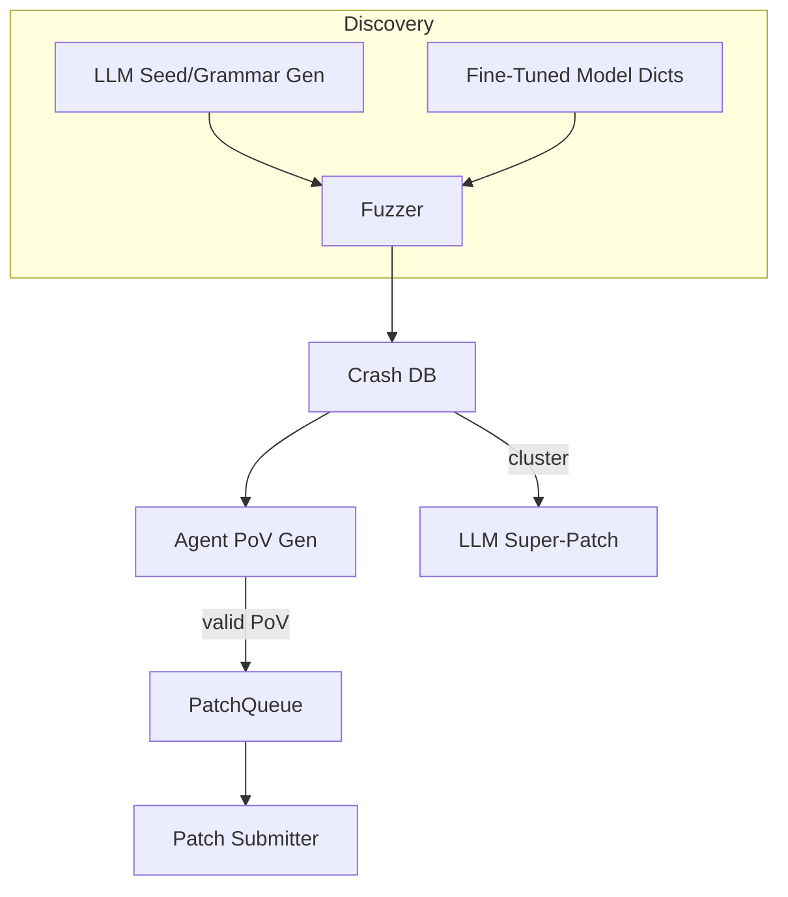

# AI 辅助 Fuzzing 与自动化漏洞发现

{{#include ../banners/hacktricks-training.md}}

## 概述
大型语言模型（LLM）可以通过生成语义丰富的输入、演进语法、分析崩溃数据，甚至提出修复多个漏洞的补丁，大幅增强传统漏洞研究流程。本页汇总了 DARPA AI Cyber Challenge（AIxCC）决赛及其他公开研究中观察到的最有效模式。<sup>[[4]](#references)</sup><sup>[[5]](#references)</sup>

以下内容并非对某个特定竞赛系统的描述，而是对相关技术的抽象总结，便于你在自己的工作流程中复现这些方法。

---

## 1. LLM 生成的种子输入

传统的覆盖率引导型 fuzzer（AFL++、libFuzzer、Honggfuzz……）从少量种子语料库开始，并盲目地变异字节。当目标输入格式复杂（SQL、URL、自定义二进制协议）时，随机变异通常会在到达有意义的分支之前破坏语法。

LLM 可以通过生成*种子生成器*来解决这个引导问题——这些简短脚本能够输出**语法正确且与安全相关的输入**。例如：

```prompt
SYSTEM: You are a helpful security engineer.
USER:
Write a Python3 program that prints 200 unique SQL injection strings targeting common anti-pattern mistakes (missing quotes, numeric context, stacked queries).  Ensure length ≤ 256 bytes / string so they survive common length limits.
```

```python
# gen_sqli_seeds.py (truncated)
PAYLOADS = [
    "1 OR 1=1 -- ",
    "' UNION SELECT NULL,NULL--",
    "0; DROP TABLE users;--",
    ...
]
for p in PAYLOADS:
    print(p)
```

运行一次，并将输出直接馈送到 fuzzer 的初始语料库：

```bash
python3 gen_sqli_seeds.py > seeds.txt
afl-fuzz -i seeds.txt -o findings/ -- ./target @@
```

Benefits:
1. 语义有效性 → 更早实现更深入的覆盖。
2. 可重新生成：调整 prompt，即可聚焦于 XSS、path traversal、binary blobs 等。
3. 成本低（使用 GPT-3.5 不到 1 ¢）。

### Tips
* 指示模型对 payload 长度和编码方式（UTF-8、URL 编码、UTF-16-LE）进行*多样化*处理，以绕过表层过滤器。
* 要求生成*单个自包含脚本*，避免 JSON 格式问题。

---

## 2. 语法演化 Fuzzing

一种更强大的变体是让 LLM **演化语法**，而不是生成具体种子。工作流程（“Grammar Guy”模式）如下：

1. 通过 prompt 生成初始 ANTLR/Peach/LibFuzzer 语法。
2. Fuzz N 分钟，并收集覆盖率指标（命中的边/代码块）。
3. 总结尚未覆盖的程序区域，并将总结反馈给模型：
   ```prompt
   The previous grammar triggered 12 % of the program edges.  Functions not reached: parse_auth, handle_upload.  Add / modify rules to cover these.
   ```
4. 合并新规则，重新 fuzz，重复。

伪代码骨架：

```python
for epoch in range(MAX_EPOCHS):
    grammar = llm.refine(grammar, feedback=coverage_stats)
    save(grammar, f"grammar_{epoch}.txt")
    coverage_stats = run_fuzzer(grammar)
```

要点：
* 保持 *预算* ——每次迭代都会消耗 tokens。
* 使用 `diff` + `patch` 指令，让模型编辑而不是重写。
* 当 Δcoverage < ε 时停止。

---

## 3. 本地 LLM libFuzzer Harness 工程

对于不能离开分析人员工作站的源代码，本地代码模型可以起草一个小型适配器，用于在 fuzzer 字节与 C/C++ API 之间转换。这里的安全边界应明确：**模型编写并修改测试基础设施；coverage-guided mutation 探索输入；sanitizer 报告无效操作；人工审查 harness 并分诊发现的问题**。<sup>[[9]](#references)</sup>

有关不依赖 LLM 的引擎级 corpus、反馈、快照和 stateful-fuzzing 技术，请参阅通用的 [Fuzzing 方法论](../generic-methodologies-and-resources/fuzzing.md)。

从目标头文件中复制的准确声明开始，并限制输出格式。范围明确的提示可以减少模型虚构 API，也便于审查：<sup>[[8]](#references)[[9]](#references)</sup>

```prompt
Write a libFuzzer target for this exact declaration:
int parse_records(const uint8_t *data, size_t size);

Output only C code. Implement LLVMFuzzerTestOneInput, include the
declaration, pass data and size unchanged, and do not use files,
network access, randomness, clocks, threads, or persistent state.
```

对于原始字节解析器，预期结果不应比以下内容更复杂：<sup>[[6]](#references)[[9]](#references)</sup>

```c
#include <stddef.h>
#include <stdint.h>

extern int parse_records(const uint8_t *, size_t);

int LLVMFuzzerTestOneInput(const uint8_t *data, size_t size) {
    (void)parse_records(data, size);
    return 0;
}
```

编译只是第一道验证关卡。在为每个生成的目标耗费 CPU 时间之前，先根据以下不变量逐一检查：<sup>[[6]](#references)[[8]](#references)[[9]](#references)</sup>

- **精确的 API：** 对照真实头文件和现有调用方，检查类型、所有权规则、初始化、清理和调用约定。
- **Harness 安全性：** 对从 `data` 读取的每个位置都进行保护；sanitizer 发现的问题必须源自目标本身，而不是生成的胶合代码。
- **可重复性：** 确保结果仅由 `data` 和 `size` 决定；移除外部 I/O、时间、不可控的随机性、未 join 的线程，以及在调用间留存的状态。
- **吞吐量：** 只有在不会影响行为时，才将开销较大的不可变状态初始化一次；限制输入大小、抑制日志，并释放每次输入所分配的内存。
- **可达性：** 验证预期函数和分支确实会执行。目标虽然能编译，却只触发拒绝路径，就是一种悄无声息的失败。

### 结构感知型目标：保留不变量，同时不掩盖 bug

如果大多数原始输入都会被 magic、长度、版本或校验和检查拦截，就将 fuzz 字节用作**类型化字段素材**，并重建有效对象。固定格式常量，让语义字段和负载字节保持可变，并根据重建后的负载推导完整性元数据。`FuzzedDataProvider` 可用于读取有界的类型化值，而适配器仍须负责限制生成的内存分配和转换。<sup>[[9]](#references)</sup>

<details>
<summary>结构感知型 C++ 目标示例</summary>

```cpp
#include <fuzzer/FuzzedDataProvider.h>
#include <stddef.h>
#include <stdint.h>
#include <vector>

extern "C" int parse_message(const uint8_t *, size_t);

extern "C" int LLVMFuzzerTestOneInput(const uint8_t *data, size_t size) {
    FuzzedDataProvider fdp(data, size);
    uint8_t version = fdp.ConsumeIntegral<uint8_t>();
    auto body = fdp.ConsumeRemainingBytes<uint8_t>();
    if (body.size() > UINT16_MAX) body.resize(UINT16_MAX);
    uint16_t len = static_cast<uint16_t>(body.size());
    std::vector<uint8_t> msg = {0x8b, 'M', 'S', 'G', version,
                                static_cast<uint8_t>(len >> 8),
                                static_cast<uint8_t>(len)};
    msg.insert(msg.end(), body.begin(), body.end());
    (void)parse_message(msg.data(), msg.size());
    return 0;
}
```

</details>

不要对所有问题都使用同一个会修复结构的 target。保留一个会推导长度/校验和、用于探索深层有效状态的 target；另一个 target 则让 fuzzer 控制**声明的**元数据，只限制 harness 自身的读取和分配。第二个 target 保留了长度不匹配和完整性错误的攻击面，否则这些情况会被自动修复抹去。<sup>[[9]](#references)</sup>

### Seeds、字典、sanitizer 和覆盖率反馈

让模型生成写入二进制 seeds 的脚本，而不是让它直接输出二进制内容。为对象生成空、最小、典型和边界有效的 seeds；然后将 magic values、tags、enum 编码和解析器关键字提取到经过审查的字典中。libFuzzer 可通过 `-dict=` 接受该字典，并会将能带来新覆盖率的变异保留在 corpus 中。<sup>[[6]](#references)[[9]](#references)</sup>

```text
magic="\x8bMSG"
version_min="\x00"
version_max="\xff"
config_tag="CONFIG"
```

使用互补的 instrumentation 构建相同的 target。ASan 和 UBSan 可以共用一个 fuzzing 二进制；单独构建 MSan，并对其依赖项进行 instrumentation，以避免未插桩代码导致误报。<sup>[[6]](#references)[[9]](#references)</sup>

```bash
clang++ -g -O1 -fsanitize=fuzzer,address,undefined \
  -fno-sanitize-recover=undefined target.cc harness.cc -o fuzz_target
./fuzz_target corpus -dict=msg.dict -max_len=65535

clang++ -g -O1 -fsanitize=fuzzer,memory \
  target.cc harness.cc -o fuzz_target_msan
```

将 coverage 视为评估每次模型修订的指标。在 libFuzzer 输出中，`cov`/`ft` 早早趋于平坦且 corpus 通常不变，意味着 framing 不佳、过早 return 条件限制过多，或调用了错误的函数；`exec/s` 偏低则说明 setup、I/O、内存分配开销过大，或存在状态泄漏。`NEW` 只能证明某个 coverage 特征发生了变化，并不能证明已到达目标 parser。<sup>[[6]](#references)[[9]](#references)</sup>

若要获取源码级反馈，先构建 coverage 版本并进行 fuzzing，然后只向模型提供未覆盖的函数及其保护条件。检查生成的 harness/seed/dictionary diff，并再次测量：<sup>[[7]](#references)[[8]](#references)[[9]](#references)</sup>

```bash
clang++ -g -O1 -fsanitize=fuzzer \
  -fprofile-instr-generate -fcoverage-mapping target.cc harness.cc -o fuzz_cov
mkdir -p profiles
LLVM_PROFILE_FILE='profiles/%p.profraw' ./fuzz_cov -max_total_time=300 corpus
llvm-profdata merge -sparse profiles/*.profraw -o fuzz.profdata
llvm-cov report ./fuzz_cov -instr-profile=fuzz.profdata
llvm-cov show ./fuzz_cov -instr-profile=fuzz.profdata \
  --show-branches=count --region-coverage-lt=1 target.cc
```

可扩展的循环因此是 **生成 → 编译/链接 → 在 sanitizers 下进行冒烟测试 → 测量目标覆盖率 → 提供最小且相关的覆盖率/源代码上下文 → 修订 → 重新测量**。OSS-Fuzz-Gen 也采用相同原则：评估生成的目标是否可编译、是否发生运行时故障、覆盖率如何，以及相较于现有目标的覆盖率提升，而不是仅凭代码看起来合理就予以接受。<sup>[[7]](#references)[[8]](#references)</sup>

---

## 4. 基于 Agent 的 PoV (Exploit) 生成

找到 crash 后，你仍需要一个**漏洞证明（PoV）**来确定性地触发它。

一种可扩展的方法是启动大量轻量级 worker（进程、线程或容器），每个 worker 使用不同的模型或采样配置。AIxCC 入围团队的调查提供了具体的规模示例：一个团队使用了**数千个并发 agent**，以 AI 优先的方式生成 PoV；另一个团队则协调了 **300–500 个 fuzzing agent**，并将 LLM 留给更高层次的语义推理。<sup>[[4]](#references)</sup>

流程：
1. 静态/动态分析生成*bug 候选项*（包含 crash PC、输入片段、sanitizer 消息的 struct）。
2. Orchestrator 将候选项分发给 agent。
3. Agent 的推理步骤：
   a. 使用 `gdb` 和输入在本地复现 bug。
   b. 提出最小 exploit payload。
   c. 在 sandbox 中验证 exploit。若成功 → 提交。
4. 失败的尝试会作为新的 seed **重新加入队列**，用于 coverage fuzzing（反馈循环）。

优点：
* 并行化可弥补单个 agent 的不可靠性。
* 根据观测到的成功率自动调整 temp / 模型大小。

---

## 5. 使用微调代码模型进行定向 Fuzzing

使用带有漏洞模式标签（整数溢出、缓冲区复制、格式字符串）的 C/C++ 源代码，对开放权重模型（如 Llama-7B）进行微调。然后：

1. 运行静态分析以获取函数列表和 AST。
2. 提示模型：*“给出可能破坏函数 X 中内存安全的 mutation dictionary 条目”*。
3. 将这些 token 插入自定义的 `AFL_CUSTOM_MUTATOR`。

`sprintf` 封装函数的输出示例：
```
{"pattern":"%99999999s"}
{"pattern":"AAAAAAAA....<1024>....%n"}
```

在真实目标上，实测可将崩溃时间缩短 2 倍以上。

---

## 6. AI 引导的补丁策略

### 6.1 超级补丁
要求模型对崩溃特征进行*聚类*，并提出一个**单一补丁**来消除共同根因。一次提交，修复多个 bug → 在每个错误补丁都会扣分的环境中减少准确性惩罚。

提示词大纲：
```
Here are 10 stack traces + file snippets.  Identify the shared mistake and generate a unified diff fixing all occurrences.
```

### 6.2 推测性补丁比例
实现一个队列，让经过 PoV 验证的已确认补丁与*推测性*补丁（无 PoV）按 1:​N 的比例交错排列，并根据评分规则调整比例（例如，2 个推测性补丁 : 1 个已确认补丁）。成本模型会监控扣分与得分，并自动调整 N。

---

## 7. 确定性的逐文件 AI 代码审查

AI 辅助审查中常见的一种失败模式是让一个 agent 检查整个仓库，并寄希望于它选对文件和 grep 关键词。更可靠的做法是**强制覆盖整个仓库**：<sup>[[1]](#references)</sup>

1. 枚举源文件。
2. 每次只发送**一个文件**，并附上最少的上下文（入口点、imports、附近的路由/调用方）。
3. 要求每个文件都提供**结构化报告**：sources、sink、缺失的验证、利用前置条件和置信度。<sup>[[3]](#references)</sup>
4. 按照**source→sink 模式**对报告去重，并手动验证高风险项。

这种方法消耗大量 token，结果也较嘈杂，但在发现广泛的 agentic 审查经常漏掉的**简单且影响重大的 source/sink 漏洞**方面非常有效。

### 值得优先排查的分诊模式

- **动态 PHP include/dispatch**：攻击者可控的路由/控制器/模块名称流入 `require_once()`、`include()` 或 `include_once()`，但没有严格的 allowlist 和路径规范化。
- **管理/账户工作流中的 shell 执行**：用户名、域名、FTP 账户或其他标识符到达 `exec()`、`system()`、`shell_exec()`、`passthru()`、`proc_open()` 或 `popen()`。
- **结构化输入汇聚**：同一参数可从 `$_GET`、`$_POST`、JSON、XML 或框架 body parser 接收，之后又被用于文件系统或 OS 命令 sink。

### 这种方法擅长发现的两类实用漏洞

- **PHP 控制器分发 LFI/RCE**：如果请求可控的控制器名称被拼接到 `require_once()` 中，且没有 allowlist/路径规范化，那么 `../` 等目录遍历序列可能导致 PHP include 非预期的本地 `.php` 文件。如果攻击者能让 include 指向其植入的或其他有用的 PHP 文件，LFI 就会升级为代码执行。参见 [File Inclusion / Path Traversal](../pentesting-web/file-inclusion/README.md)。<sup>[[1]](#references)</sup>
- **托管/管理面板中的认证后命令注入**：如果用户名等账户管理字段被嵌入 shell 命令，低权限的已认证用户可能将普通的创建/删除操作变成 RCE。如果面板以权限更高的服务账户执行命令，影响会更大。参见 [Command Injection](../pentesting-web/command-injection.md)。<sup>[[1]](#references)</sup>

### 实用审查注意事项

- 首先将 LLM 用作**source/sink 审查工具**，而不是 exploit 生成器。
- 要求它明确列出**攻击者可控字段**、**规范化/验证缺口**和**危险 sink**。
- 对大型仓库而言，确定性的逐文件审查通常比单次自主 agent 运行更可靠，即使后者使用了更强的模型。<sup>[[2]](#references)</sup>
- 对**Broken Access Control** 和其他业务逻辑漏洞要降低预期，因为其可利用性取决于跨文件假设、角色语义或产品特定的威胁模型。

---

## 对陌生代码库开展可审计的 Agent 辅助研究

[graph-first fuzz-target workflow](../generic-methodologies-and-resources/fuzzing.md#graph-first-fuzz-target-selection-and-mutation-triage) 已涵盖入口点可达性，[agentic SAST pipelines](../network-services-pentesting/pentesting-web/code-review-tools.md#agentic-sast-pipelines) 则涵盖分阶段审查和证据门槛。将这些确定性结果与模型的假设分开保存，确保每个获准跟进的线索都保留源代码位置、路径证据和动态测量结果。<sup>[[10]](#references)</sup>

### 关联对象生命周期证据，但不臆造数据流

静态分析可能发现，攻击者可控的长度在一个函数中被存储，而同一对象字段很久之后到达了一个 copy sink，却无法证明它们之间跨越回调、重连或对象生命周期的关联。分别保留这两项发现，按对象/字段聚类，并将缺失的边明确列为分诊问题。agent 可以提出这种关联，但必须通过源码审查或运行时插桩加以证明。<sup>[[10]](#references)</sup>

对每个候选项，记录：

- 具体入口点和攻击者可控的字节；
- 相关字段的每个生产者，包括针对每个生产者的专属验证；
- sink、目标容量，以及到达该 sink 所需的构建/运行时条件；
- 从暴露入口点实际获得的调用栈，而不只是直接调用 harness 的结果；
- 能确认或否定该假设的最小动态结果。

一条看似安全的路径，不能证明某个字段在所有情况下都安全。第二个生产者可能在没有第一条路径的边界检查时写入同一字段。应分别测试各条路径，并使用与部署环境等效的构建选项运行 harness，因为 debug assertion 可能会让生产环境中的内存损坏在测试中提前中止。<sup>[[10]](#references)</sup>

### 信息披露与利用的测量门槛

对于疑似未初始化内存信息披露，用可识别的字节填充新分配的内存，并验证该标记是否确实进入发出的数据包。对于利用，要求通过测量满足各项门槛，例如**受控覆写 → 有用的受害对象 → 信息披露 → 指针/基址恢复 → 控制流劫持 → 组合 payload**。只有当 harness 证明当前属性时，agent 才能进入下一步；看似合理的叙述不算通过门槛。[FreeRDP case](../binary-exploitation/libc-heap/heap-overflow.md#cross-path-length-reuse-and-stale-output-disclosure) 展示了验证时必须保留的路径和构建约束。<sup>[[10]](#references)</sup>

---

## 综合应用

端到端的 CRS（网络推理系统）可以按如下方式连接这些组件：



---

## References

- [1] [Project Black - 网络安全本地 AI：发现 phpIPAM LFI 和 myVesta 认证 RCE](https://projectblack.io/blog/local-ai-for-cyber-security)
- [2] [Strix](https://github.com/usestrix/strix)
- [3] [GitHub Copilot 社区 security-review 技能](https://github.com/github/awesome-copilot/blob/main/skills/security-review/SKILL.md)
- [4] [Trail of Bits – AIxCC 决赛：赛况回顾](https://blog.trailofbits.com/2025/08/07/aixcc-finals-tale-of-the-tape/)
- [5] [CTF Radiooo AIxCC 决赛选手访谈](https://www.youtube.com/@ctfradiooo)
- [6] [LLVM — libFuzzer：用于覆盖率引导 fuzz testing 的库](https://llvm.org/docs/LibFuzzer.html)
- [7] [Google — OSS-Fuzz-Gen](https://github.com/google/oss-fuzz-gen)
- [8] [Google Online Security Blog — 提升 Fuzzing：利用 AI 发现更多漏洞](https://security.googleblog.com/2024/11/leveling-up-fuzzing-finding-more.html)
- [9] [8kSec — 使用本地 LLM 辅助生成 Fuzzing Harness](https://8ksec.io/ai-assisted-fuzzing-harness-local-llm)
- [10] [Quarkslab — 从 AI Agents 到 RCE：构建漏洞研究工作流](https://blog.quarkslab.com/from-ai-agents-to-rce-building-a-vulnerability-research-workflow.html)
{{#include ../banners/hacktricks-training.md}}
