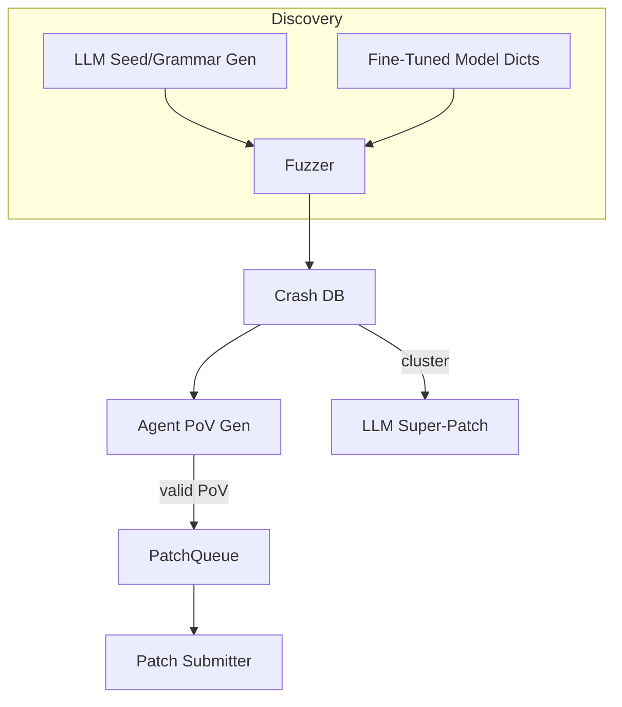

# Fuzzing με υποβοήθηση AI & αυτοματοποιημένη ανακάλυψη ευπαθειών

{{#include ../banners/hacktricks-training.md}}

## Επισκόπηση
Τα μεγάλα γλωσσικά μοντέλα (LLM) μπορούν να ενισχύσουν σημαντικά τις παραδοσιακές ροές εργασίας για την έρευνα ευπαθειών, δημιουργώντας σημασιολογικά πλούσια inputs, εξελίσσοντας γραμματικές, συλλογίζοντας πάνω σε δεδομένα από crashes, ακόμη και προτείνοντας patches για πολλαπλά bugs. Αυτή η σελίδα συγκεντρώνει τα πιο αποτελεσματικά μοτίβα που παρατηρήθηκαν στους τελικούς του AI Cyber Challenge (AIxCC) της DARPA και σε άλλες δημόσιες έρευνες.<sup>[[4]](#references)</sup><sup>[[5]](#references)</sup>

Αυτά που ακολουθούν δεν περιγράφουν ένα συγκεκριμένο σύστημα διαγωνισμού, αλλά αποτελούν μια σύνοψη των τεχνικών, ώστε να μπορείτε να τις αναπαράγετε στις δικές σας ροές εργασίας.

---

## 1. Inputs Seed που δημιουργούνται από LLM

Οι παραδοσιακοί fuzzers με καθοδήγηση από την κάλυψη (AFL++, libFuzzer, Honggfuzz…) ξεκινούν με ένα μικρό corpus από seeds και μεταλλάσσουν bytes στα τυφλά. Όταν η μορφή του input-στόχου είναι σύνθετη (SQL, URLs, προσαρμοσμένα binary protocols), οι τυχαίες μεταλλάξεις συνήθως καταστρέφουν τη σύνταξη προτού επιτευχθούν ενδιαφέροντα branches.

Τα LLM μπορούν να λύσουν αυτό το πρόβλημα αρχικής εκκίνησης, δημιουργώντας *generators για seeds* – σύντομα scripts που παράγουν **inputs με σωστή σύνταξη αλλά σχετικά με την ασφάλεια**. Για παράδειγμα:

```prompt
SYSTEM: You are a helpful security engineer.
USER:
Write a Python3 program that prints 200 unique SQL injection strings targeting common anti-pattern mistakes (missing quotes, numeric context, stacked queries).  Ensure length ≤ 256 bytes / string so they survive common length limits.
```

```python
# gen_sqli_seeds.py (truncated)
PAYLOADS = [
    "1 OR 1=1 -- ",
    "' UNION SELECT NULL,NULL--",
    "0; DROP TABLE users;--",
    ...
]
for p in PAYLOADS:
    print(p)
```

Εκτελέστε το μία φορά και τροφοδοτήστε την έξοδο απευθείας στο αρχικό corpus του fuzzer:

```bash
python3 gen_sqli_seeds.py > seeds.txt
afl-fuzz -i seeds.txt -o findings/ -- ./target @@
```

Οφέλη:
1. Σημασιολογική εγκυρότητα → βαθύτερη κάλυψη από νωρίς.
2. Δυνατότητα επαναδημιουργίας: τροποποιήστε το prompt για να εστιάσετε σε XSS, path traversal, binary blobs κ.λπ.
3. Χαμηλό κόστος (< 1 ¢ με GPT-3.5).

### Συμβουλές
* Ζητήστε από το μοντέλο να *διαφοροποιεί* το μήκος και την κωδικοποίηση των payload (UTF-8, URL-encoded, UTF-16-LE), ώστε να παρακάμπτονται επιφανειακά φίλτρα.
* Ζητήστε ένα *αυτοτελές script* – έτσι αποφεύγονται προβλήματα μορφοποίησης JSON.

---

## 2. Fuzzing Εξέλιξης Γραμματικής

Μια πιο ισχυρή παραλλαγή είναι να αφήσετε το LLM να **εξελίξει μια γραμματική** αντί για συγκεκριμένα seeds. Η ροή εργασίας (μοτίβο «Grammar Guy») είναι:

1. Δημιουργήστε μια αρχική γραμματική ANTLR/Peach/LibFuzzer μέσω prompt.
2. Εκτελέστε fuzzing για N λεπτά και συλλέξτε μετρικές κάλυψης (edges / blocks που καλύφθηκαν).
3. Συνοψίστε τις ακάλυπτες περιοχές του προγράμματος και τροφοδοτήστε ξανά την περίληψη στο μοντέλο:
   ```prompt
   The previous grammar triggered 12 % of the program edges.  Functions not reached: parse_auth, handle_upload.  Add / modify rules to cover these.
   ```
4. Συγχώνευσε τους νέους κανόνες, εκτέλεσε ξανά fuzzing και επανάλαβε.

Σκελετός ψευδοκώδικα:

```python
for epoch in range(MAX_EPOCHS):
    grammar = llm.refine(grammar, feedback=coverage_stats)
    save(grammar, f"grammar_{epoch}.txt")
    coverage_stats = run_fuzzer(grammar)
```

Βασικά σημεία:
* Κρατήστε ένα *budget* – κάθε refinement χρησιμοποιεί tokens.
* Χρησιμοποιήστε οδηγίες `diff` + `patch`, ώστε το μοντέλο να κάνει edits αντί να ξαναγράφει.
* Σταματήστε όταν Δcoverage < ε.

---

## 3. Μηχανική Harness για Local-LLM libFuzzer

Για source που δεν μπορεί να φύγει από τον workstation ενός analyst, ένα local code model μπορεί να συντάξει τον μικρό adapter ανάμεσα στα bytes του fuzzer και ένα C/C++ API. Το χρήσιμο όριο ασφάλειας είναι σαφές: **το μοντέλο γράφει και αναθεωρεί την test infrastructure· το coverage-guided mutation εξερευνά inputs· οι sanitizers αναφέρουν μη έγκυρες λειτουργίες· ένας άνθρωπος ελέγχει το harness και κάνει triage στα ευρήματα**.<sup>[[9]](#references)</sup>

Για τεχνικές corpus, feedback, snapshot και stateful-fuzzing σε επίπεδο engine που δεν εξαρτώνται από LLM, δείτε τη γενική [Μεθοδολογία Fuzzing](../generic-methodologies-and-resources/fuzzing.md).

Ξεκινήστε με την ακριβή δήλωση που αντιγράφηκε από το header του target και περιορίστε τη μορφή εξόδου. Ένα στενό prompt μειώνει τα επινοημένα APIs και κάνει το αποτέλεσμα εύκολο στον έλεγχο:<sup>[[8]](#references)[[9]](#references)</sup>

```prompt
Write a libFuzzer target for this exact declaration:
int parse_records(const uint8_t *data, size_t size);

Output only C code. Implement LLVMFuzzerTestOneInput, include the
declaration, pass data and size unchanged, and do not use files,
network access, randomness, clocks, threads, or persistent state.
```

Για έναν parser ακατέργαστων byte, το αναμενόμενο αποτέλεσμα δεν θα πρέπει να είναι πιο περίπλοκο από:<sup>[[6]](#references)[[9]](#references)</sup>

```c
#include <stddef.h>
#include <stdint.h>

extern int parse_records(const uint8_t *, size_t);

int LLVMFuzzerTestOneInput(const uint8_t *data, size_t size) {
    (void)parse_records(data, size);
    return 0;
}
```

Η μεταγλώττιση είναι μόνο το πρώτο στάδιο επικύρωσης. Ελέγξτε κάθε παραγόμενο target ως προς αυτές τις σταθερές πριν αφιερώσετε χρόνο CPU σε αυτό:<sup>[[6]](#references)[[8]](#references)[[9]](#references)</sup>

- **Ακριβές API:** συγκρίνετε τους τύπους, τους κανόνες διαχείρισης ιδιοκτησίας, την αρχικοποίηση, την αποδέσμευση πόρων και τη σύμβαση κλήσης με την πραγματική κεφαλίδα και τους υπάρχοντες callers.
- **Ασφάλεια harness:** προστατεύστε κάθε ανάγνωση από το `data`· τα ευρήματα του sanitizer πρέπει να προέρχονται από το target και όχι από τον παραγόμενο κώδικα glue.
- **Επαναληψιμότητα:** το αποτέλεσμα πρέπει να εξαρτάται από τα `data` και `size`· αφαιρέστε την εξωτερική I/O, τον χρόνο, την ανεξέλεγκτη τυχαιότητα, τα threads που δεν έχουν γίνει join και την κατάσταση που παραμένει μεταξύ κλήσεων.
- **Throughput:** αρχικοποιείτε την αμετάβλητη κατάσταση που απαιτεί χρόνο μόνο μία φορά, εφόσον αυτό δεν επηρεάζει τη συμπεριφορά, περιορίστε το μέγεθος εισόδου, καταστείλετε την καταγραφή και αποδεσμεύστε τις εκχωρήσεις μνήμης ανά είσοδο.
- **Προσβασιμότητα:** επαληθεύστε ότι εκτελούνται οι προβλεπόμενες συναρτήσεις και διακλαδώσεις. Ένα target που μεταγλωττίζεται αλλά εκτελεί μόνο διαδρομές απόρριψης αποτελεί σιωπηρή αποτυχία.

### Targets με επίγνωση της δομής: διατηρήστε τις σταθερές χωρίς να κρύβετε σφάλματα

Αν οι περισσότερες ακατέργαστες είσοδοι αποτυγχάνουν σε έλεγχο magic, μήκους, έκδοσης ή checksum, χρησιμοποιήστε τα bytes του fuzz ως **υλικό για τυποποιημένα πεδία** και ανακατασκευάστε ένα έγκυρο αντικείμενο. Ορίστε σταθερές μορφοποίησης, αφήστε τα σημασιολογικά πεδία και τα bytes του payload μεταβλητά και υπολογίστε τα μεταδεδομένα ακεραιότητας από το ανακατασκευασμένο payload. Το `FuzzedDataProvider` είναι χρήσιμο για την κατανάλωση οριοθετημένων τυποποιημένων τιμών, ενώ ο adapter παραμένει υπεύθυνος για τον περιορισμό κάθε εκχώρησης μνήμης και μετατροπής που παράγεται.<sup>[[9]](#references)</sup>

<details>
<summary>Παράδειγμα C++ target με επίγνωση της δομής</summary>

```cpp
#include <fuzzer/FuzzedDataProvider.h>
#include <stddef.h>
#include <stdint.h>
#include <vector>

extern "C" int parse_message(const uint8_t *, size_t);

extern "C" int LLVMFuzzerTestOneInput(const uint8_t *data, size_t size) {
    FuzzedDataProvider fdp(data, size);
    uint8_t version = fdp.ConsumeIntegral<uint8_t>();
    auto body = fdp.ConsumeRemainingBytes<uint8_t>();
    if (body.size() > UINT16_MAX) body.resize(UINT16_MAX);
    uint16_t len = static_cast<uint16_t>(body.size());
    std::vector<uint8_t> msg = {0x8b, 'M', 'S', 'G', version,
                                static_cast<uint8_t>(len >> 8),
                                static_cast<uint8_t>(len)};
    msg.insert(msg.end(), body.begin(), body.end());
    (void)parse_message(msg.data(), msg.size());
    return 0;
}
```

</details>

Μη χρησιμοποιείτε έναν στόχο που επιδιορθώνει τις δομές για κάθε ερώτημα. Διατηρήστε έναν στόχο που υπολογίζει τα μήκη/checksum για να εξερευνά έγκυρες καταστάσεις σε βάθος, και έναν άλλον που αφήνει τα **δηλωμένα** metadata υπό τον έλεγχο του fuzzer, περιορίζοντας μόνο τις αναγνώσεις και τις δεσμεύσεις μνήμης του ίδιου του harness. Ο δεύτερος στόχος διατηρεί επιφάνειες επίθεσης με ασύμφωνο μήκος και εσφαλμένη ακεραιότητα, τις οποίες διαφορετικά θα εξαφάνιζε η αυτόματη επιδιόρθωση.<sup>[[9]](#references)</sup>

### Seeds, λεξικά, sanitizers και ανατροφοδότηση κάλυψης

Ζητήστε από το μοντέλο να δημιουργήσει ένα script που γράφει binary seeds, αντί να του ζητήσετε να εκτυπώσει απευθείας binary. Δημιουργήστε seeds από κενά, ελάχιστα, τυπικά και έγκυρα οριακά αντικείμενα· έπειτα εξαγάγετε magic values, tags, enum encodings και parser keywords σε ένα ελεγμένο λεξικό. Το libFuzzer δέχεται αυτό το λεξικό με `-dict=` και διατηρεί στο corpus τις μεταλλάξεις που αποκαλύπτουν νέα κάλυψη.<sup>[[6]](#references)[[9]](#references)</sup>

```text
magic="\x8bMSG"
version_min="\x00"
version_max="\xff"
config_tag="CONFIG"
```

Μεταγλωττίστε τον ίδιο στόχο με συμπληρωματική instrumentation. Τα ASan και UBSan μπορούν να χρησιμοποιούν το ίδιο fuzzing binary· χρησιμοποιήστε ξεχωριστό build με MSan και κάντε instrument τις εξαρτήσεις του, ώστε να αποφύγετε αναφορές που προκαλούνται από μη instrumented κώδικα.<sup>[[6]](#references)[[9]](#references)</sup>

```bash
clang++ -g -O1 -fsanitize=fuzzer,address,undefined \
  -fno-sanitize-recover=undefined target.cc harness.cc -o fuzz_target
./fuzz_target corpus -dict=msg.dict -max_len=65535

clang++ -g -O1 -fsanitize=fuzzer,memory \
  target.cc harness.cc -o fuzz_target_msan
```

Αντιμετωπίστε την κάλυψη ως κριτήριο αξιολόγησης για κάθε αναθεώρηση του μοντέλου. Στην έξοδο του libFuzzer, τα `cov`/`ft` που μένουν χαμηλά από νωρίς και ένα στατικό corpus συνήθως υποδεικνύουν λανθασμένο framing, υπερβολικά περιοριστικό early return ή λάθος κλήση· το χαμηλό `exec/s` υποδεικνύει δαπανηρή προετοιμασία, I/O, εκχώρηση μνήμης ή διαρροή κατάστασης. Το `NEW` αποδεικνύει μόνο ότι άλλαξε ένα χαρακτηριστικό κάλυψης, όχι ότι έγινε προσπέλαση στον επιδιωκόμενο parser.<sup>[[6]](#references)[[9]](#references)</sup>

Για ανατροφοδότηση σε επίπεδο πηγαίου κώδικα, δημιουργήστε ένα build με κάλυψη, εκτελέστε fuzzing και δώστε στο μοντέλο μόνο τις συναρτήσεις που δεν καλύφθηκαν μαζί με τις συνθήκες που ελέγχουν την εκτέλεσή τους. Επαληθεύστε τις αλλαγές στο harness/seed/dictionary και μετρήστε ξανά:<sup>[[7]](#references)[[8]](#references)[[9]](#references)</sup>

```bash
clang++ -g -O1 -fsanitize=fuzzer \
  -fprofile-instr-generate -fcoverage-mapping target.cc harness.cc -o fuzz_cov
mkdir -p profiles
LLVM_PROFILE_FILE='profiles/%p.profraw' ./fuzz_cov -max_total_time=300 corpus
llvm-profdata merge -sparse profiles/*.profraw -o fuzz.profdata
llvm-cov report ./fuzz_cov -instr-profile=fuzz.profdata
llvm-cov show ./fuzz_cov -instr-profile=fuzz.profdata \
  --show-branches=count --region-coverage-lt=1 target.cc
```

Ο κλιμακούμενος βρόχος είναι επομένως **generate → compile/link → smoke-test υπό sanitizers → μέτρηση της κάλυψης του στόχου → παροχή του μικρότερου σχετικού πλαισίου κάλυψης/πηγαίου κώδικα → αναθεώρηση → νέα μέτρηση**. Το OSS-Fuzz-Gen εφαρμόζει την ίδια αρχή, αξιολογώντας τους παραγόμενους στόχους ως προς τη δυνατότητα μεταγλώττισης, τις αποτυχίες κατά την εκτέλεση, την κάλυψη και τη βελτίωση της κάλυψης σε σχέση με τους υπάρχοντες στόχους, αντί να αποδέχεται τον φαινομενικά εύλογο κώδικα χωρίς έλεγχο.<sup>[[7]](#references)[[8]](#references)</sup>

---

<a id="3-agent-based-pov-exploit-generation" hidden>3. Δημιουργία PoV (Exploit) με βάση Agents</a>

## 4. Δημιουργία PoV (Exploit) με βάση Agents

Αφού εντοπιστεί ένα crash, χρειάζεστε ακόμη ένα **proof-of-vulnerability (PoV)** που να το προκαλεί με ντετερμινιστικό τρόπο.

Μια κλιμακούμενη προσέγγιση είναι η εκκίνηση πολλών ελαφρών workers (processes, threads ή containers), καθένας από τους οποίους χρησιμοποιεί διαφορετικό model ή configuration δειγματοληψίας. Η έρευνα των φιναλίστ του AIxCC δίνει συγκεκριμένα παραδείγματα κλίμακας: μία ομάδα χρησιμοποίησε **χιλιάδες ταυτόχρονους agents** για τη δημιουργία PoV με προτεραιότητα την AI, ενώ μια άλλη οργάνωσε **300–500 fuzzing agents** και χρησιμοποιούσε LLMs για συλλογιστική υψηλότερου επιπέδου σχετικά με τη σημασιολογία.<sup>[[4]](#references)</sup>

Pipeline:
1. Η στατική/δυναμική ανάλυση παράγει *υποψήφιες ευπάθειες* (struct με crash PC, input slice, μήνυμα sanitizer).
2. Ο orchestrator κατανέμει τις υποψήφιες ευπάθειες στους agents.
3. Βήματα συλλογιστικής του agent:
   a. Αναπαραγωγή του bug τοπικά με `gdb` + input.
   b. Πρόταση ελάχιστου exploit payload.
   c. Επικύρωση του exploit σε sandbox.  Αν πετύχει → υποβολή.
4. Οι αποτυχημένες προσπάθειες **επανεισάγονται στην ουρά ως νέα seeds** για coverage fuzzing (βρόχος ανατροφοδότησης).

Πλεονεκτήματα:
* Η παραλληλοποίηση μετριάζει την αναξιοπιστία ενός μεμονωμένου agent.
* Αυτόματη προσαρμογή των temp / μεγέθους model με βάση το παρατηρούμενο ποσοστό επιτυχίας.

---

<a id="4-directed-fuzzing-with-fine-tuned-code-models" hidden>4. Κατευθυνόμενο Fuzzing με Fine-Tuned Code Models</a>

## 5. Κατευθυνόμενο Fuzzing με Fine-Tuned Code Models

Κάντε fine-tune ένα open-weight model (π.χ. Llama-7B) με πηγαίο κώδικα C/C++ επισημασμένο με μοτίβα ευπαθειών (integer overflow, αντιγραφή buffer, format string). Έπειτα:

1. Εκτελέστε στατική ανάλυση για να λάβετε τη λίστα συναρτήσεων + AST.
2. Κάντε prompt στο model: *«Δώσε εγγραφές mutation dictionary που είναι πιθανό να παραβιάσουν την ασφάλεια μνήμης στη συνάρτηση X»*.
3. Εισαγάγετε αυτά τα tokens σε ένα προσαρμοσμένο `AFL_CUSTOM_MUTATOR`.

Παράδειγμα εξόδου για έναν wrapper `sprintf`:
```
{"pattern":"%99999999s"}
{"pattern":"AAAAAAAA....<1024>....%n"}
```

Εμπειρικά, αυτό μειώνει τον χρόνο μέχρι το crash κατά >2× σε πραγματικούς στόχους.

---

<a id="5-ai-guided-patching-strategies" hidden>5. Στρατηγικές patching με καθοδήγηση από AI</a>

## 6. Στρατηγικές patching με καθοδήγηση από AI

<a id="51-super-patches" hidden>5.1 Υπερ-patches</a>

### 6.1 Υπερ-patches
Ζητήστε από το μοντέλο να *ομαδοποιήσει* τις υπογραφές των crashes και να προτείνει ένα **ενιαίο patch** που εξαλείφει την κοινή βασική αιτία.  Υποβάλετε μία φορά και διορθώστε πολλά bugs → λιγότερες ποινές ακρίβειας σε περιβάλλοντα όπου κάθε λανθασμένο patch κοστίζει πόντους.

Περίγραμμα prompt:
```
Here are 10 stack traces + file snippets.  Identify the shared mistake and generate a unified diff fixing all occurrences.
```

{{#ref}}
../generic-methodologies-and-resources/fuzzing.md
{{#endref}}

<a id="52-speculative-patch-ratio" hidden>5.2 Αναλογία Υποθετικών Patches</a>

### 6.2 Αναλογία Υποθετικών Patches
Υλοποιήστε μια ουρά στην οποία εναλλάσσονται patches επιβεβαιωμένα μέσω PoV και *υποθετικά* patches (χωρίς PoV) σε αναλογία 1:​N, προσαρμοσμένη στους κανόνες βαθμολόγησης (π.χ. 2 υποθετικά : 1 επιβεβαιωμένο). Ένα μοντέλο κόστους παρακολουθεί τις ποινές σε σχέση με τους βαθμούς και προσαρμόζει αυτόματα το N.

---

<a id="6-deterministic-file-by-file-ai-code-review" hidden>6. Ντετερμινιστικός AI Έλεγχος Κώδικα Αρχείο προς Αρχείο</a>

## 7. Ντετερμινιστικός AI Έλεγχος Κώδικα Αρχείο προς Αρχείο

Μια συχνή αστοχία σε ελέγχους με τη βοήθεια AI είναι να ζητείται από έναν agent να επιθεωρήσει ολόκληρο repository, με την ελπίδα ότι θα επιλέξει τα σωστά αρχεία και τους κατάλληλους όρους grep. Μια πιο αξιόπιστη προσέγγιση είναι να **επιβάλλετε κάλυψη του repository**:<sup>[[1]](#references)</sup>

1. Καταγράψτε τα αρχεία πηγαίου κώδικα.
2. Στείλτε **ένα αρχείο κάθε φορά** μαζί με ελάχιστο σχετικό πλαίσιο (entrypoint, imports, κοντινά routes/callers).
3. Απαιτήστε μια **δομημένη αναφορά** για κάθε αρχείο: πηγές, sink, ελλιπή validation, προϋποθέσεις exploit και βαθμό εμπιστοσύνης.<sup>[[3]](#references)</sup>
4. Αφαιρέστε τις διπλότυπες αναφορές με βάση το **μοτίβο source→sink** και επικυρώστε χειροκίνητα τις αναφορές υψηλού κινδύνου.

Αυτή η μέθοδος απαιτεί πολλά tokens και παράγει θόρυβο, αλλά είναι πολύ αποτελεσματική στον εντοπισμό **απλών bugs source/sink με σημαντικό αντίκτυπο**, τα οποία συχνά διαφεύγουν από ευρείς agentic ελέγχους.

### Μοτίβα διαλογής που αξίζει να ιεραρχήσετε

- **Δυναμικό PHP include/dispatch**: ονόματα route/controller/module ελεγχόμενα από τον επιτιθέμενο καταλήγουν σε `require_once()`, `include()` ή `include_once()` χωρίς αυστηρό allowlist και κανονικοποίηση διαδρομής.
- **Εκτέλεση shell σε ροές εργασίας διαχείρισης/λογαριασμών**: usernames, domains, λογαριασμοί FTP ή άλλα αναγνωριστικά καταλήγουν σε `exec()`, `system()`, `shell_exec()`, `passthru()`, `proc_open()` ή `popen()`.
- **Σύγκλιση δομημένων δεδομένων εισόδου**: η ίδια παράμετρος γίνεται δεκτή από `$_GET`, `$_POST`, JSON, XML ή body parsers του framework και αργότερα χρησιμοποιείται ξανά σε sinks συστήματος αρχείων ή εντολών OS.

### Δύο πρακτικές κατηγορίες bugs που εντοπίζονται αποτελεσματικά με αυτή τη μέθοδο

- **LFI/RCE μέσω PHP controller-dispatch**: αν ένα όνομα controller που ελέγχεται από το request συνενώνεται με `require_once()` χωρίς allowlist/κανονικοποίηση διαδρομής, ακολουθίες traversal όπως `../` μπορούν να κάνουν την PHP να συμπεριλάβει ένα μη προβλεπόμενο τοπικό αρχείο `.php`. Αν ο επιτιθέμενος μπορεί να κατευθύνει το include σε ένα φυτεμένο ή με άλλο τρόπο χρήσιμο αρχείο PHP, το LFI μετατρέπεται σε εκτέλεση κώδικα. Δείτε [File Inclusion / Path Traversal](../pentesting-web/file-inclusion/README.md).<sup>[[1]](#references)</sup>
- **Command injection σε hosting/admin panels με πιστοποίηση**: αν πεδία διαχείρισης λογαριασμών, όπως τα usernames, ενσωματώνονται σε εντολές shell, ένας πιστοποιημένος χρήστης με χαμηλά δικαιώματα μπορεί να μετατρέψει μια κανονική ενέργεια δημιουργίας/διαγραφής σε RCE. Ο αντίκτυπος αυξάνεται όταν το panel εκτελεί την εντολή ως λογαριασμός υπηρεσίας με περισσότερα δικαιώματα. Δείτε [Command Injection](../pentesting-web/command-injection.md).<sup>[[1]](#references)</sup>

### Πρακτικές σημειώσεις ελέγχου

- Χρησιμοποιήστε πρώτα το LLM ως **ελεγκτή source/sink**, όχι ως εργαλείο δημιουργίας exploit.
- Ζητήστε του να καταγράψει ρητά το **πεδίο που ελέγχει ο επιτιθέμενος**, το **κενό στην κανονικοποίηση/επικύρωση** και το **επικίνδυνο sink**.
- Σε μεγάλα repos, ο ντετερμινιστικός έλεγχος ανά αρχείο είναι συχνά πιο αξιόπιστος από μία αυτόνομη εκτέλεση agent, ακόμη κι όταν αυτή χρησιμοποιεί ισχυρότερο μοντέλο.<sup>[[2]](#references)</sup>
- Να αναμένετε ασθενέστερα αποτελέσματα για **Broken Access Control** και άλλα bugs επιχειρησιακής λογικής, όπου η δυνατότητα exploit εξαρτάται από παραδοχές που αφορούν πολλά αρχεία, τη σημασιολογία ρόλων ή μοντέλα απειλών ειδικά για το προϊόν.

---

## 8. Καθοδηγούμενος από μοτίβα έλεγχος kernel με instrumented oracle

Για έναν στόχο μεγέθους kernel, μην ζητάτε από έναν agent να εντοπίσει αυθαίρετα bugs σε ολόκληρο το δέντρο. Μια πιο αποδοτική ως προς τα tokens ροή εργασίας μετατρέπει τη γνώση ιστορικών ευπαθειών σε στατικά queries, ιεραρχεί τα αποτελέσματα με βάση την εκτεθειμένη επιφάνεια επίθεσης και χρησιμοποιεί έναν instrumented kernel ως oracle εκτέλεσης.<sup>[[11]](#references)</sup>

### Βάση δεδομένων μοτίβων → CodeQL/Semgrep → στοχευμένος έλεγχος

Δημιουργήστε μια μικρή βάση γνώσης με επικίνδυνα APIs, μοτίβα ελλιπούς validation, ριψοκίνδυνες ροές source-to-sink και μορφές bugs που έχουν διορθωθεί στο παρελθόν. Ζητήστε από το μοντέλο να μεταφράζει **ένα μοτίβο κάθε φορά** σε ευρετικές ελέγχου και κανόνες CodeQL/Semgrep και, στη συνέχεια, εκτελέστε αυτούς τους ντετερμινιστικούς κανόνες σε ολόκληρο το δέντρο. Ομαδοποιήστε και αφαιρέστε τις διπλότυπες αντιστοιχίες πριν δώσετε ξανά τον κώδικα στο μοντέλο· τα ακατέργαστα αποτελέσματα σαρωτών μπορεί να περιέχουν χιλιάδες υποψήφια ευρήματα μικρής αξίας. Ελέγξτε την τρέχουσα άδεια χρήσης του CodeQL πριν χρησιμοποιήσετε αυτή την προσέγγιση εκτός επιλέξιμων ερευνητικών στόχων ή στόχων ανοιχτού κώδικα.<sup>[[11]](#references)</sup>

Ιεραρχήστε τα υποσυστήματα με βάση τόσο την **πυκνότητα ευρημάτων κανόνων** όσο και την **προσβασιμότητα από τον επιτιθέμενο**, όχι μόνο τον αριθμό των ευρημάτων. Οι διεπαφές kernel που είναι προσβάσιμες από μη προνομιούχες διεργασίες, sandboxes, containers, jails ή guest contexts αξίζουν μεγαλύτερη βαρύτητα από τον κώδικα που είναι προσβάσιμος μόνο εσωτερικά. Διατηρήστε τη μονάδα ελέγχου αρκετά μικρή ώστε ο agent να μπορεί να λαμβάνει υπόψη τους callers, τους validators και τους κανόνες διάρκειας ζωής και ζητήστε μια συγκεκριμένη κλάση ευπάθειας ή ένα μοτίβο ροής ελέγχου, αντί να πείτε «βρες οποιαδήποτε ευπάθεια». Οι παλαιότερες προνομιούχες διεπαφές είναι ιδιαίτερα ενδιαφέρουσες όταν ένα νεότερο όριο περιορισμού τις καθιστά προσβάσιμες σε χρήστη root με namespace ή jail.<sup>[[11]](#references)</sup>

Για κάθε υποψήφιο εύρημα, απαιτήστε ρητή καταγραφή ροής πεδίων πριν επιχειρήσετε exploit.<sup>[[11]](#references)</sup>

```text
entrypoint -> privilege check -> parser -> validation/normalization
           -> later rewrite -> dangerous sink
attacker controls: <fields and lengths>
constraints:       <values rewritten, rejected, or preserved>
observable result: <sanitizer report, assertion, panic, or clean exit>
```

### Χρησιμοποιήστε τα telemetry του KASAN ως oracle για υποθέσεις

Εκτελέστε τον kernel-στόχο σε αναλώσιμο VM με ενεργοποιημένα τα KASAN και χρήσιμα διαγνωστικά assertions. Ο agent πρέπει να επαναλαμβάνει τη διαδικασία **υπόθεση από τον κώδικα πηγής → ελάχιστο trigger από userland → εκτέλεση στο VM → trace από KASAN/assertion → αναθεωρημένη υπόθεση** μέχρι να αναπαραχθεί ή να απορριφθεί η ύποπτη αλλοίωση. Σε κάθε επανάληψη, επιστρέψτε μόνο το σχετικό stack trace και το κοντινό απόσπασμα κώδικα πηγής· έτσι διατηρείται το πλαίσιο για τη συλλογιστική και τα runtime στοιχεία, όχι η εμπιστοσύνη του μοντέλου, αποτελούν το κριτήριο αποδοχής.<sup>[[11]](#references)</sup>

Ένα instrumented build δεν είναι το τελικό περιβάλλον αξιολόγησης της exploitability. Τα assertions ενδέχεται να σταματήσουν την εκτέλεση πριν από την πράξη που προκαλεί την αλλοίωση, ενώ το ίδιο assertion μπορεί να έχει αφαιρεθεί από έναν production kernel. Επαναλάβετε τη δοκιμή με το ίδιο trigger στην ακριβή production configuration, καταγράψτε το kernel build και την configuration, και διαχωρίστε την **προσβασιμότητα**, την **αλλοίωση μνήμης**, το **controlled primitive** και τον **αντίκτυπο στην ασφάλεια** ως ξεχωριστούς ισχυρισμούς.<sup>[[11]](#references)[[12]](#references)</sup>

Το CVE-2026-3038 είναι χρήσιμο παράδειγμα επικύρωσης, όχι πρότυπο exploit. Ένα μη προνομιούχο αίτημα FreeBSD `RTM_GET` μπορούσε να διατηρήσει ένα υπερμεγέθες sockaddr `RTAX_AUTHOR` μέσω επιλεκτικής επικύρωσης και επανεγγραφής της απάντησης, μέχρι που η `rtsock_msg_buffer()` αντέγραψε το ελεγχόμενο από τον χρήστη `sa_len` σε ένα `sockaddr_storage` 128 byte στο stack. Η μέγιστη αντιγραφή των 255 byte προκαλούσε overwrite 127 byte· ένα διαγνωστικό assertion εντόπιζε το εσφαλμένο μήκος στο instrumented build, ενώ ένας GENERIC kernel έφτανε στην αντιγραφή και κατόπιν έκανε panic κατά τον έλεγχο του αλλοιωμένου canary. Αυτό αποδεικνύει denial of service από μη προνομιούχο χρήστη, όχι αυτοτελή κλιμάκωση προνομίων: για αξιόπιστο έλεγχο θα χρειαζόταν πρώτα ένα άλλο primitive, όπως διαρροή canary. Δείτε το [Stack Canaries](../binary-exploitation/common-binary-protections-and-bypasses/stack-canaries/index.html) για το αντίστοιχο όριο του binary exploitation.<sup>[[11]](#references)[[12]](#references)[[13]](#references)</sup>

### Απορρίψτε την καταστρατήγηση προϋποθέσεων exploit

Πριν αποδεχτείτε ένα PoV ή exploit, ζητήστε από έναν ξεχωριστό reviewer/agent να προσπαθήσει να το καταρρίψει βάσει προκαθορισμένων κριτηρίων. Η αξιολόγηση πρέπει να επιβεβαιώνει όλες τις παρακάτω συνθήκες.<sup>[[11]](#references)</sup>

- Δεν τροποποιήθηκαν ο κώδικας πηγής, ο kernel ή το ευάλωτο module του στόχου για να γίνει προσβάσιμη η διαδρομή.
- Δεν προστέθηκαν helper module, synthetic gadget, απενεργοποιημένο mitigation, επιπλέον προνόμια ή μη διαθέσιμο interface.
- Το trigger ξεκινά με την ταυτότητα χρήστη και τους περιορισμούς containment που δηλώθηκαν, πάνω σε καθαρό snapshot.
- Το δηλωμένο αποτέλεσμα εξακολουθεί να εξαρτάται από το bug: η αφαίρεση του malformed field ή η διόρθωση μόνο του bug πρέπει να διακόπτει την αλυσίδα.
- Ένα crash, overread ή overwrite αναφέρεται μόνο ως το αντίστοιχο primitive· η εκτέλεση κώδικα ή η κλιμάκωση προνομίων απαιτεί ανεξάρτητα στοιχεία.

Αυτός ο τελευταίος counterfactual έλεγχος εντοπίζει κυκλικές αποδείξεις: αν οι προϋποθέσεις ήδη παρέχουν τον ισχυριζόμενο αντίκτυπο (για παράδειγμα, εκτέλεση περιεχομένου SUID που έχει δοθεί από τον επιτιθέμενο σε filesystem που είναι mounted χωρίς `nosuid`), τότε το bug ασφάλειας μνήμης δεν προκάλεσε αυτόν τον αντίκτυπο.<sup>[[11]](#references)</sup>

---

## Ελέγξιμη έρευνα με τη βοήθεια agent σε άγνωστες βάσεις κώδικα

Η [graph-first ροή εργασίας επιλογής fuzz-target](../generic-methodologies-and-resources/fuzzing.md#graph-first-fuzz-target-selection-and-mutation-triage) καλύπτει ήδη την προσβασιμότητα entrypoint, ενώ τα [agentic SAST pipelines](../network-services-pentesting/pentesting-web/code-review-tools.md#agentic-sast-pipelines) καλύπτουν τη σταδιακή αξιολόγηση και τα evidence gates. Διατηρήστε αυτά τα ντετερμινιστικά αποτελέσματα ξεχωριστά από τις υποθέσεις του μοντέλου, ώστε κάθε προωθούμενο εύρημα να διατηρεί τις θέσεις στον κώδικα πηγής, τα στοιχεία διαδρομής και μια δυναμική μέτρηση.<sup>[[10]](#references)</sup>

### Συσχετίστε στοιχεία διάρκειας ζωής αντικειμένου χωρίς να επινοείτε data flow

Η στατική ανάλυση μπορεί να εντοπίσει ένα ελεγχόμενο από τον επιτιθέμενο μήκος που αποθηκεύεται σε μία συνάρτηση και το ίδιο πεδίο αντικειμένου να φτάνει σε copy sink πολύ αργότερα, αλλά να μην αποδεικνύει τη σύνδεση μέσω callbacks, reconnects ή της διάρκειας ζωής του αντικειμένου. Διατηρήστε τα δύο ευρήματα ξεχωριστά, ομαδοποιήστε τα ανά αντικείμενο/πεδίο και διατυπώστε ρητά την ακμή που λείπει ως ερώτημα για triage. Ο agent μπορεί να προτείνει τη σχέση, αλλά πρέπει να αποδειχθεί με ανασκόπηση του κώδικα πηγής ή runtime instrumentation.<sup>[[10]](#references)</sup>

Για κάθε υποψήφιο εύρημα, καταγράψτε:

- το συγκεκριμένο entrypoint και τα ελεγχόμενα από τον επιτιθέμενο bytes·
- κάθε producer του σχετικού πεδίου, συμπεριλαμβανομένης της επικύρωσης που αφορά τον καθένα·
- το sink, τη χωρητικότητα του προορισμού και τις συνθήκες build/runtime που απαιτούνται για να επιτευχθεί·
- ένα πραγματικό call stack από το εκτεθειμένο entrypoint, όχι μόνο μια άμεση κλήση harness·
- το μικρότερο δυναμικό αποτέλεσμα που επιβεβαιώνει ή απορρίπτει την υπόθεση.

Μια φαινομενικά ασφαλής διαδρομή δεν καθιστά ένα πεδίο ασφαλές συνολικά. Ένας δεύτερος producer μπορεί να συμπληρώνει το ίδιο πεδίο χωρίς το όριο της πρώτης διαδρομής. Ελέγξτε τις διαδρομές ανεξάρτητα και εκτελέστε το harness με build options ισοδύναμα με εκείνα του deployment, επειδή τα debug assertions μπορούν να μετατρέψουν αλλοίωση μνήμης σε production σε πρόωρο abort που συμβαίνει μόνο σε test.<sup>[[10]](#references)</sup>

### Measurement gates για disclosure και exploitation

Για ύποπτη disclosure μη αρχικοποιημένης μνήμης, γεμίστε νέες allocations με ένα αναγνωρίσιμο byte και επαληθεύστε ότι το ακριβές marker φτάνει στο πακέτο που εκπέμπεται. Για exploitation, απαιτήστε μετρημένα gates όπως **controlled overwrite → χρήσιμο victim object → disclosure → ανάκτηση pointer/base → hijack ροής ελέγχου → συνδυασμένο payload**. Ο agent προχωρά μόνο όταν το harness αποδεικνύει την τρέχουσα ιδιότητα· μια εύλογη αφήγηση δεν σημαίνει ότι ένα gate έχει περάσει. Η [περίπτωση FreeRDP](../binary-exploitation/libc-heap/heap-overflow.md#cross-path-length-reuse-and-stale-output-disclosure) δείχνει τη διαδρομή και τους περιορισμούς build που πρέπει να διατηρηθούν κατά την επικύρωση.<sup>[[10]](#references)</sup>

---

Για μια μελέτη περίπτωσης kernel που εφαρμόζει σταδιακή επικύρωση L0–L4 στην ανάπτυξη exploit με τη βοήθεια LLM, δείτε:

{{#ref}}
../binary-exploitation/freebsd-kernel-exploitation-vnet-jail-escape.md
{{#endref}}

## Συνδυάζοντας όλα τα παραπάνω
Ένα end-to-end CRS (Cyber Reasoning System) μπορεί να συνδέσει τα στοιχεία ως εξής:



---

## References

- [1] [Project Black - Τοπικό AI για την κυβερνοασφάλεια: Εντοπισμός LFI στο phpIPAM και αυθεντικοποιημένου RCE στο myVesta](https://projectblack.io/blog/local-ai-for-cyber-security)
- [2] [Strix](https://github.com/usestrix/strix)
- [3] [Δεξιότητα security-review της κοινότητας του GitHub Copilot](https://github.com/github/awesome-copilot/blob/main/skills/security-review/SKILL.md)
- [4] [Trail of Bits – Τελικοί AIxCC: Ανασκόπηση των αποτελεσμάτων](https://blog.trailofbits.com/2025/08/07/aixcc-finals-tale-of-the-tape/)
- [5] [Συνεντεύξεις των φιναλίστ του AIxCC από το CTF Radiooo](https://www.youtube.com/@ctfradiooo)
- [6] [LLVM — libFuzzer: βιβλιοθήκη για fuzz testing καθοδηγούμενο από κάλυψη](https://llvm.org/docs/LibFuzzer.html)
- [7] [Google — OSS-Fuzz-Gen](https://github.com/google/oss-fuzz-gen)
- [8] [Ιστολόγιο ασφάλειας Google — Αναβάθμιση του fuzzing: Εντοπισμός περισσότερων ευπαθειών με AI](https://security.googleblog.com/2024/11/leveling-up-fuzzing-finding-more.html)
- [9] [8kSec — Δημιουργία harness για fuzzing με τη βοήθεια AI και τοπικού LLM](https://8ksec.io/ai-assisted-fuzzing-harness-local-llm)
- [10] [Quarkslab — Από AI agents σε RCE: Δημιουργία ροής εργασίας για έρευνα ευπαθειών](https://blog.quarkslab.com/from-ai-agents-to-rce-building-a-vulnerability-research-workflow.html)
- [11] [Praetorian — FreeBSoD: Αξιοποίηση γλωσσικών μοντέλων για τον εντοπισμό και την εκμετάλλευση σφαλμάτων του kernel (Μέρος 1 από 2)](https://praetorian.com/blog/ai-vulnerability-research-freebsd-kernel)
- [12] [FreeBSD-SA-26:05.route — Τοπικό DoS και πιθανή κλιμάκωση προνομίων μέσω routing sockets](https://www.freebsd.org/security/advisories/FreeBSD-SA-26:05.route.asc)
- [13] [Πηγαίο patch του FreeBSD-SA-26:05.route](https://security.FreeBSD.org/patches/SA-26:05/route.patch)
{{#include ../banners/hacktricks-training.md}}
