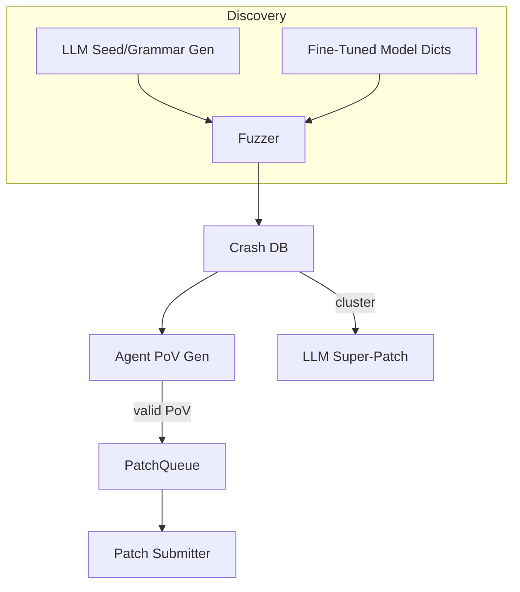

# AI-सहायित Fuzzing और स्वचालित Vulnerability खोज

{{#include ../banners/hacktricks-training.md}}

## अवलोकन
Large-language models (LLMs), semantically rich inputs बनाकर, grammars को विकसित करके, crash data पर तर्क करके और यहाँ तक कि कई bugs को ठीक करने वाले patches सुझाकर, पारंपरिक vulnerability-research pipelines को बहुत अधिक प्रभावी बना सकते हैं। इस पेज में DARPA के AI Cyber Challenge (AIxCC) finals और अन्य सार्वजनिक शोध के दौरान देखे गए सबसे प्रभावी तरीके दिए गए हैं।<sup>[[4]](#references)</sup><sup>[[5]](#references)</sup>

आगे किसी एक विशिष्ट competition system का वर्णन नहीं है, बल्कि तकनीकों का सार दिया गया है, ताकि आप उन्हें अपने workflows में दोहरा सकें।

---

## 1. LLM-जनरेटेड Seed Inputs

पारंपरिक coverage–guided fuzzers (AFL++, libFuzzer, Honggfuzz…) seeds के छोटे corpus से शुरू होकर bytes को अंधाधुंध mutate करते हैं। जब target input format जटिल हो (SQL, URLs, custom binary protocols), तो random mutations आमतौर पर दिलचस्प branches तक पहुँचने से पहले ही syntax तोड़ देते हैं।

LLMs यह bootstrap समस्या हल कर सकते हैं—वे *seed generators* यानी ऐसी छोटी scripts बना सकते हैं, जो **syntax-correct लेकिन security-relevant inputs** आउटपुट करती हैं। उदाहरण के लिए:

```prompt
SYSTEM: You are a helpful security engineer.
USER:
Write a Python3 program that prints 200 unique SQL injection strings targeting common anti-pattern mistakes (missing quotes, numeric context, stacked queries).  Ensure length ≤ 256 bytes / string so they survive common length limits.
```

```python
# gen_sqli_seeds.py (truncated)
PAYLOADS = [
    "1 OR 1=1 -- ",
    "' UNION SELECT NULL,NULL--",
    "0; DROP TABLE users;--",
    ...
]
for p in PAYLOADS:
    print(p)
```

एक बार चलाएँ और आउटपुट को सीधे fuzzer के initial corpus में डालें:

```bash
python3 gen_sqli_seeds.py > seeds.txt
afl-fuzz -i seeds.txt -o findings/ -- ./target @@
```

लाभ:
1. अर्थगत वैधता → शुरुआती चरण में अधिक गहन कवरेज।
2. फिर से जनरेट किया जा सकता है: XSS, path traversal, binary blobs आदि पर ध्यान केंद्रित करने के लिए prompt में बदलाव करें।
3. सस्ता (< GPT-3.5 के साथ 1 ¢)।

### सुझाव
* सतही filters को bypass करने के लिए मॉडल को payload की लंबाई और encoding (UTF-8, URL-encoded, UTF-16-LE) में *विविधता* लाने का निर्देश दें।
* *एक ही self-contained script* माँगें – इससे JSON formatting की समस्याएँ नहीं होंगी।

---

## 2. Grammar-Evolution Fuzzing

इसका अधिक शक्तिशाली रूप यह है कि LLM को ठोस seeds के बजाय **grammar विकसित करने** दें। वर्कफ़्लो (“Grammar Guy” pattern) यह है:

1. prompt के ज़रिए एक शुरुआती ANTLR/Peach/LibFuzzer grammar जनरेट करें।
2. N मिनट तक Fuzzing करें और coverage metrics (hit हुए edges / blocks) इकट्ठा करें।
3. प्रोग्राम के जिन हिस्सों का कवरेज नहीं हुआ, उनका सारांश बनाएँ और उसे मॉडल को वापस दें:
   ```prompt
   The previous grammar triggered 12 % of the program edges.  Functions not reached: parse_auth, handle_upload.  Add / modify rules to cover these.
   ```
4. नए rules मर्ज करें, फिर से fuzz करें और दोहराएँ।

Pseudo-code skeleton:

```python
for epoch in range(MAX_EPOCHS):
    grammar = llm.refine(grammar, feedback=coverage_stats)
    save(grammar, f"grammar_{epoch}.txt")
    coverage_stats = run_fuzzer(grammar)
```

मुख्य बिंदु:
* एक *बजट* रखें — हर refinement में tokens खर्च होते हैं।
* `diff` + `patch` निर्देशों का उपयोग करें, ताकि model दोबारा लिखने के बजाय संपादन करे।
* जब Δcoverage < ε हो जाए, तो रुक जाएँ।

---

## 3. Local-LLM libFuzzer Harness इंजीनियरिंग

ऐसे source code के लिए जिसे analyst के workstation से बाहर नहीं भेजा जा सकता, local code model fuzzer bytes और C/C++ API के बीच छोटा adapter तैयार कर सकता है। उपयोगी security boundary स्पष्ट है: **model test infrastructure लिखता और संशोधित करता है; coverage-guided mutation inputs को explore करता है; sanitizers invalid operations की रिपोर्ट करते हैं; और कोई human harness की समीक्षा करके findings को triage करता है**।<sup>[[9]](#references)</sup>

LLM पर निर्भर न रहने वाली engine-level corpus, feedback, snapshot और stateful-fuzzing तकनीकों के लिए सामान्य [Fuzzing Methodology](../generic-methodologies-and-resources/fuzzing.md) देखें।

लक्ष्य header से सटीक declaration कॉपी करके शुरुआत करें और output format सीमित रखें। संकीर्ण prompt से गढ़े हुए APIs कम होते हैं और परिणाम की समीक्षा करना आसान होता है:<sup>[[8]](#references)[[9]](#references)</sup>

```prompt
Write a libFuzzer target for this exact declaration:
int parse_records(const uint8_t *data, size_t size);

Output only C code. Implement LLVMFuzzerTestOneInput, include the
declaration, pass data and size unchanged, and do not use files,
network access, randomness, clocks, threads, or persistent state.
```

एक raw byte parser के लिए, अपेक्षित परिणाम इससे अधिक जटिल नहीं होना चाहिए:<sup>[[6]](#references)[[9]](#references)</sup>

```c
#include <stddef.h>
#include <stdint.h>

extern int parse_records(const uint8_t *, size_t);

int LLVMFuzzerTestOneInput(const uint8_t *data, size_t size) {
    (void)parse_records(data, size);
    return 0;
}
```

Compilation केवल पहला validation gate है। CPU time खर्च करने से पहले, हर generated target की इन invariants के अनुसार समीक्षा करें:<sup>[[6]](#references)[[8]](#references)[[9]](#references)</sup>

- **Exact API:** types, ownership rules, initialization, teardown और calling convention की तुलना वास्तविक header और मौजूदा callers से करें।
- **Harness safety:** `data` से हर read को guard करें; sanitizer findings target से आने चाहिए, generated glue से नहीं।
- **Repeatability:** परिणाम `data` और `size` का function होना चाहिए; external I/O, time, uncontrolled randomness, join न किए गए threads और ऐसी state हटाएँ जो calls के बीच बनी रहती है।
- **Throughput:** महंगी immutable state को केवल तभी एक बार initialize करें, जब इससे behavior प्रभावित न हो; input size सीमित रखें, logging दबाएँ और हर input के लिए किए गए allocations free करें।
- **Reachability:** पुष्टि करें कि अपेक्षित functions और branches execute होते हैं। ऐसा target जो compile तो होता है, लेकिन केवल rejection paths को exercise करता है, एक मौन विफलता है।

### Structure-aware targets: bugs छिपाए बिना invariants बनाए रखें

अगर ज़्यादातर raw inputs किसी magic, length, version या checksum gate पर विफल हो जाते हैं, तो fuzz bytes को **typed field material** की तरह इस्तेमाल करें और एक valid object फिर से बनाएँ। Format constants को ठीक रखें, semantic fields और payload bytes को mutable रहने दें, और integrity metadata को reconstructed payload से derive करें। Bounded typed values लेने के लिए `FuzzedDataProvider` उपयोगी है, जबकि किसी भी generated allocation और conversion को सीमित करने की ज़िम्मेदारी adapter की रहती है।<sup>[[9]](#references)</sup>

<details>
<summary>उदाहरण: Structure-aware C++ target</summary>

```cpp
#include <fuzzer/FuzzedDataProvider.h>
#include <stddef.h>
#include <stdint.h>
#include <vector>

extern "C" int parse_message(const uint8_t *, size_t);

extern "C" int LLVMFuzzerTestOneInput(const uint8_t *data, size_t size) {
    FuzzedDataProvider fdp(data, size);
    uint8_t version = fdp.ConsumeIntegral<uint8_t>();
    auto body = fdp.ConsumeRemainingBytes<uint8_t>();
    if (body.size() > UINT16_MAX) body.resize(UINT16_MAX);
    uint16_t len = static_cast<uint16_t>(body.size());
    std::vector<uint8_t> msg = {0x8b, 'M', 'S', 'G', version,
                                static_cast<uint8_t>(len >> 8),
                                static_cast<uint8_t>(len)};
    msg.insert(msg.end(), body.begin(), body.end());
    (void)parse_message(msg.data(), msg.size());
    return 0;
}
```

</details>

हर सवाल के लिए एक ही structure-repairing target का इस्तेमाल न करें। एक target ऐसा रखें जो गहरी valid states को explore करने के लिए lengths/checksums derive करे, और दूसरा ऐसा जो **declared** metadata को fuzzer-controlled रखे, जबकि केवल harness की अपनी reads और allocations पर सीमाएँ लगाए। दूसरा target उन mismatched-length और bad-integrity attack surfaces को बनाए रखता है जिन्हें automatic repair अन्यथा मिटा देता।<sup>[[9]](#references)</sup>

### Seeds, dictionaries, sanitizers, और coverage feedback

Model से binary सीधे print करने के बजाय binary seeds लिखने वाली script बनाने को कहें। Empty, minimal, typical, और boundary-valid objects के seeds बनाएँ; फिर magic values, tags, enum encodings, और parser keywords को एक reviewed dictionary में निकालें। libFuzzer उस dictionary को `-dict=` के साथ स्वीकार करता है और नए coverage को उजागर करने वाले mutations को corpus में बनाए रखता है।<sup>[[6]](#references)[[9]](#references)</sup>

```text
magic="\x8bMSG"
version_min="\x00"
version_max="\xff"
config_tag="CONFIG"
```

पूरक instrumentation के साथ उसी target को build करें। ASan और UBSan एक fuzzing binary साझा कर सकते हैं; uninstrumented code के कारण reports से बचने के लिए अलग MSan build बनाएं और उसकी dependencies को instrument करें।<sup>[[6]](#references)[[9]](#references)</sup>

```bash
clang++ -g -O1 -fsanitize=fuzzer,address,undefined \
  -fno-sanitize-recover=undefined target.cc harness.cc -o fuzz_target
./fuzz_target corpus -dict=msg.dict -max_len=65535

clang++ -g -O1 -fsanitize=fuzzer,memory \
  target.cc harness.cc -o fuzz_target_msan
```

हर model revision के लिए coverage को evaluator मानें। libFuzzer के output में शुरुआत से सपाट `cov`/`ft` और स्थिर corpus का आमतौर पर मतलब है गलत framing, बहुत ज़्यादा प्रतिबंधात्मक early return, या गलत call; कम `exec/s` महंगे setup, I/O, allocation, या leaked state की ओर इशारा करता है। `NEW` सिर्फ़ यह साबित करता है कि coverage feature बदला है, यह नहीं कि इच्छित parser तक पहुँचा गया।<sup>[[6]](#references)[[9]](#references)</sup>

source-level feedback के लिए coverage build बनाएं, उसे fuzz करें, और model को केवल uncovered functions तथा उनकी guarding conditions दें। नतीजे में हुए harness/seed/dictionary diff को verify करें और फिर से मापें:<sup>[[7]](#references)[[8]](#references)[[9]](#references)</sup>

```bash
clang++ -g -O1 -fsanitize=fuzzer \
  -fprofile-instr-generate -fcoverage-mapping target.cc harness.cc -o fuzz_cov
mkdir -p profiles
LLVM_PROFILE_FILE='profiles/%p.profraw' ./fuzz_cov -max_total_time=300 corpus
llvm-profdata merge -sparse profiles/*.profraw -o fuzz.profdata
llvm-cov report ./fuzz_cov -instr-profile=fuzz.profdata
llvm-cov show ./fuzz_cov -instr-profile=fuzz.profdata \
  --show-branches=count --region-coverage-lt=1 target.cc
```

इसलिए स्केलेबल लूप है **generate → compile/link → sanitizers के तहत smoke-test → target coverage मापें → सबसे छोटा प्रासंगिक coverage/source context दें → संशोधित करें → फिर से मापें**। OSS-Fuzz-Gen इसी सिद्धांत को लागू करता है: generated targets को compilability, runtime failures, coverage और मौजूदा targets की तुलना में coverage improvement के आधार पर परखता है, बजाय इसके कि plausible code को बिना जाँच स्वीकार कर लिया जाए।<sup>[[7]](#references)[[8]](#references)</sup>

---

<a id="3-agent-based-pov-exploit-generation" hidden>3. Agent-Based PoV (Exploit) Generation</a>

## 4. Agent-Based PoV (Exploit) Generation

Crash मिलने के बाद भी आपको **proof-of-vulnerability (PoV)** चाहिए, जो उसे नियतात्मक रूप से trigger करे।

एक स्केलेबल तरीका है कई lightweight workers (processes, threads या containers) शुरू करना, जिनमें से हर एक अलग model या sampling configuration इस्तेमाल करे। AIxCC finalist survey में ठोस scale के उदाहरण दिए गए हैं: एक टीम ने AI-first PoV generation के लिए **हज़ारों concurrent agents** इस्तेमाल किए, जबकि दूसरी ने **300–500 fuzzing agents** को orchestrate किया और उच्च-स्तरीय semantic reasoning के लिए LLMs का उपयोग किया।<sup>[[4]](#references)</sup>

Pipeline:
1. Static/dynamic analysis से *bug candidates* बनते हैं (crash PC, input slice, sanitizer msg वाला struct)।
2. Orchestrator candidates को agents में बाँटता है।
3. Agent की reasoning के चरण:
   a. `gdb` + input से bug को स्थानीय रूप से reproduce करें।
   b. न्यूनतम exploit payload सुझाएँ।
   c. Sandbox में exploit को validate करें। यदि सफल हो → submit करें।
4. असफल प्रयासों को coverage fuzzing के लिए **नए seeds के रूप में फिर से queue किया जाता है** (feedback loop)।

फ़ायदे:
* Parallelisation से किसी एक agent की अविश्वसनीयता का असर कम होता है।
* देखी गई success-rate के आधार पर temp/model size का auto-tuning।

---

<a id="4-directed-fuzzing-with-fine-tuned-code-models" hidden>4. Directed Fuzzing with Fine-Tuned Code Models</a>

## 5. Directed Fuzzing with Fine-Tuned Code Models

Vulnerability patterns (integer overflow, buffer copy, format string) के अनुसार label किए गए C/C++ source पर किसी open-weight model (जैसे Llama-7B) को fine-tune करें। फिर:

1. Function list + AST पाने के लिए static analysis चलाएँ।
2. Model को prompt दें: *“Function X में memory safety को तोड़ने की संभावना वाले mutation dictionary entries दें”*।
3. उन tokens को एक custom `AFL_CUSTOM_MUTATOR` में डालें।

`sprintf` wrapper के लिए उदाहरण output:
```
{"pattern":"%99999999s"}
{"pattern":"AAAAAAAA....<1024>....%n"}
```

अनुभवजन्य तौर पर, वास्तविक targets पर इससे time-to-crash 2× से भी अधिक कम हो जाता है।

---

<a id="5-ai-guided-patching-strategies" hidden>5. AI-निर्देशित Patching रणनीतियाँ</a>

## 6. AI-निर्देशित Patching रणनीतियाँ

<a id="51-super-patches" hidden>5.1 सुपर Patches</a>

### 6.1 सुपर Patches
मॉडल से crash signatures को *क्लस्टर* करने और सामान्य root cause को दूर करने वाला **एक patch** सुझाने के लिए कहें। एक बार सबमिट करें, कई bugs ठीक करें → ऐसे environments में accuracy penalties कम होंगी, जहाँ हर गलत patch पर points कटते हैं।

Prompt की रूपरेखा:
```
Here are 10 stack traces + file snippets.  Identify the shared mistake and generate a unified diff fixing all occurrences.
```

{{#ref}}
../generic-methodologies-and-resources/fuzzing.md
{{#endref}}

<a id="52-speculative-patch-ratio" hidden>5.2 अनुमानित पैच अनुपात</a>

### 6.2 अनुमानित पैच अनुपात
एक queue लागू करें, जिसमें PoV-सत्यापित patches और *अनुमानित* patches (बिना PoV) को स्कोरिंग नियमों के अनुसार तय 1:​N अनुपात में बारी-बारी से शामिल किया जाए (उदाहरण के लिए, 2 अनुमानित : 1 सत्यापित)। एक cost model, penalties और points पर नज़र रखता है और N को अपने-आप समायोजित करता है।

---

<a id="6-deterministic-file-by-file-ai-code-review" hidden>6. Deterministic File-by-File AI Code Review</a>

## 7. नियतात्मक फ़ाइल-दर-फ़ाइल AI Code Review

AI-सहायता प्राप्त review में अक्सर एक विफलता यह होती है कि एक agent से पूरे repository का निरीक्षण करने को कहा जाता है और उम्मीद की जाती है कि वह सही files और grep terms चुन लेगा। इससे अधिक विश्वसनीय तरीका है **repository का पूरा coverage अनिवार्य करना**:<sup>[[1]](#references)</sup>

1. Source files की सूची बनाएँ।
2. **एक बार में एक file** के साथ न्यूनतम context (entrypoint, imports, पास के routes/callers) भेजें।
3. हर file के लिए **एक संरचित report** माँगें: sources, sink, अनुपलब्ध validation, exploit की preconditions और confidence।<sup>[[3]](#references)</sup>
4. Reports को **source→sink pattern** के आधार पर deduplicate करें और high-risk मामलों को मैन्युअल रूप से validate करें।

इसमें बहुत tokens लगते हैं और परिणाम noisy होते हैं, लेकिन यह **सरल, अधिक प्रभाव वाले source/sink bugs** सामने लाने में बहुत प्रभावी है, जिन्हें व्यापक agentic reviews अक्सर नहीं पकड़ पाते।

### Triage के वे patterns जिन्हें प्राथमिकता देना उचित है

- **Dynamic PHP include/dispatch**: attacker-नियंत्रित route/controller/module नामों का `require_once()`, `include()`, या `include_once()` तक पहुँचना, बिना सख्त allowlisting और path canonicalisation के।
- **Admin/account workflows में shell execution**: usernames, domains, FTP accounts या अन्य identifiers का `exec()`, `system()`, `shell_exec()`, `passthru()`, `proc_open()`, या `popen()` तक पहुँचना।
- **Structured input fan-in**: एक ही parameter का `$_GET`, `$_POST`, JSON, XML या framework body parsers से स्वीकार किया जाना और बाद में filesystem या OS-command sinks में फिर से इस्तेमाल होना।

### इस तरीके से अच्छी तरह मिलने वाली दो व्यावहारिक bug classes

- **PHP controller-dispatch LFI/RCE**: यदि request-नियंत्रित controller नाम को बिना allowlist/path normalisation के `require_once()` के साथ जोड़ा जाता है, तो `../` जैसी traversal sequences के ज़रिए PHP से कोई अनचाही स्थानीय `.php` file include कराई जा सकती है। यदि attacker include को किसी डाली गई या अन्यथा उपयोगी PHP file की ओर निर्देशित कर सकता है, तो LFI से code execution हो सकता है। देखें [File Inclusion / Path Traversal](../pentesting-web/file-inclusion/README.md)।<sup>[[1]](#references)</sup>
- **Hosting/admin panels में authenticated command injection**: यदि usernames जैसे account-management fields को shell commands में जोड़ा जाता है, तो कम privileges वाला authenticated user सामान्य create/delete action को RCE में बदल सकता है। यदि panel command को अधिक privileges वाले service account के रूप में चलाता है, तो प्रभाव बढ़ जाता है। देखें [Command Injection](../pentesting-web/command-injection.md)।<sup>[[1]](#references)</sup>

### व्यावहारिक review नोट्स

- LLM का उपयोग पहले **source/sink reviewer** के रूप में करें, exploit generator के रूप में नहीं।
- उससे स्पष्ट रूप से **attacker-नियंत्रित field**, **normalization/validation gap**, और **खतरनाक sink** की सूची माँगें।
- बड़े repos में, एक मजबूत model का उपयोग करने वाले एकल autonomous agent run की तुलना में नियतात्मक per-file review अक्सर अधिक विश्वसनीय होता है।<sup>[[2]](#references)</sup>
- **Broken Access Control** और अन्य business-logic bugs पर कमज़ोर नतीजों की अपेक्षा करें, जहाँ exploitability कई files से जुड़ी धारणाओं, role semantics या product-विशिष्ट threat models पर निर्भर करती है।

---

## 8. Instrumented Oracle से Pattern-Guided Kernel Auditing

Kernel-आकार के target के लिए agent से पूरे tree में मनमाने bugs खोजने को न कहें। इससे अधिक token-efficient workflow में ऐतिहासिक vulnerability ज्ञान को static queries में बदला जाता है, exposed attack surface के आधार पर नतीजों को rank किया जाता है और instrumented kernel को execution oracle की तरह इस्तेमाल किया जाता है।<sup>[[11]](#references)</sup>

### Pattern database → CodeQL/Semgrep → केंद्रित review

एक छोटा knowledge base बनाएँ, जिसमें खतरनाक APIs, missing-validation patterns, जोखिमपूर्ण source-to-sink flows और पहले ठीक किए गए bug के patterns शामिल हों। Model से कहें कि वह **एक बार में एक pattern** को review heuristics और CodeQL/Semgrep rules में बदले, फिर उन नियतात्मक rules को पूरे tree पर चलाएँ। Code को model को वापस देने से पहले matches को समूहित और deduplicate करें; scanner का कच्चा output हज़ारों कम-मूल्य वाले candidates दे सकता है। Eligible research या open-source targets के बाहर इस तरीके का उपयोग करने से पहले CodeQL का मौजूदा license जाँचें।<sup>[[11]](#references)</sup>

Subsystems को केवल hit count के आधार पर नहीं, बल्कि **rule-hit density** और **attacker reachability** दोनों के आधार पर प्राथमिकता दें। Unprivileged processes, sandboxes, containers, jails या guest contexts से पहुँच योग्य kernel interfaces को केवल आंतरिक code से अधिक महत्व दें। Review की इकाई इतनी छोटी रखें कि agent callers, validators और lifetime rules को याद रख सके; “कोई भी vulnerability ढूँढो” कहने के बजाय किसी नामित vulnerability class या control-flow pattern के लिए prompt दें। पुराने privileged interfaces विशेष रूप से दिलचस्प होते हैं, जब कोई नया containment boundary उन्हें namespaced या jailed root user के लिए पहुँच योग्य बना देता है।<sup>[[11]](#references)</sup>

हर candidate के लिए, exploitation का प्रयास करने से पहले एक स्पष्ट field-flow record माँगें।<sup>[[11]](#references)</sup>

```text
entrypoint -> privilege check -> parser -> validation/normalization
           -> later rewrite -> dangerous sink
attacker controls: <fields and lengths>
constraints:       <values rewritten, rejected, or preserved>
observable result: <sanitizer report, assertion, panic, or clean exit>
```

### Hypothesis oracle के रूप में KASAN telemetry का उपयोग करें

लक्ष्य kernel को KASAN और उपयोगी diagnostic assertions सक्षम करके एक disposable VM में चलाएँ। Agent को **source hypothesis → minimal userland trigger → VM execution → KASAN/assertion trace → revised hypothesis** के चक्र में तब तक काम करना चाहिए, जब तक संदिग्ध corruption पुनरुत्पादित या खारिज न हो जाए। हर iteration पर केवल प्रासंगिक stack trace और उसके आस-पास का source लौटाएँ; इससे तर्क के लिए context बना रहता है और स्वीकृति का आधार model का confidence नहीं, बल्कि runtime evidence होता है।<sup>[[11]](#references)</sup>

Instrumented build, exploitability जाँचने का अंतिम वातावरण नहीं है। Assertions, corruption करने वाली operation से पहले execution रोक सकती हैं, जबकि वही assertion production kernel में compile out हो सकती है। उसी trigger को बिना बदलाव के exact production configuration पर फिर जाँचें, kernel build और configuration दर्ज करें, और **reachability**, **memory corruption**, **controlled primitive** तथा **security impact** को अलग-अलग दावों के रूप में रखें।<sup>[[11]](#references)[[12]](#references)</sup>

CVE-2026-3038, exploit template के बजाय validation का उपयोगी उदाहरण है। एक unprivileged FreeBSD `RTM_GET` request, selective validation और reply rewriting के चलते oversized `RTAX_AUTHOR` sockaddr को तब तक बनाए रख सकती थी, जब तक `rtsock_msg_buffer()` ने user-controlled `sa_len` को 128-byte stack `sockaddr_storage` में copy नहीं कर दिया। अधिकतम 255-byte copy से 127-byte overwrite हुआ; instrumented build में diagnostic assertion ने गलत length पकड़ ली, जबकि GENERIC kernel copy तक पहुँचा और फिर corrupted canary जाँचने पर panic कर गया। यह unprivileged denial of service साबित करता है, standalone privilege escalation नहीं: भरोसेमंद control के लिए पहले canary disclosure जैसे किसी दूसरे primitive की ज़रूरत होगी। संबंधित binary-exploitation सीमा के लिए [Stack Canaries](../binary-exploitation/common-binary-protections-and-bypasses/stack-canaries/index.html) देखें।<sup>[[11]](#references)[[12]](#references)[[13]](#references)</sup>

### Exploit-precondition cheating को खारिज करें

PoV या exploit स्वीकार करने से पहले, किसी अलग reviewer/agent से तय मानदंडों के आधार पर उसे गलत साबित करने की कोशिश करवाएँ। समीक्षा में नीचे दी गई सभी शर्तों की पुष्टि होनी चाहिए।<sup>[[11]](#references)</sup>

- Path को reachable बनाने के लिए target source, kernel या vulnerable module में बदलाव नहीं किया गया था।
- कोई helper module, synthetic gadget, disabled mitigation, अतिरिक्त privilege या अनुपलब्ध interface नहीं जोड़ा गया था।
- Trigger की शुरुआत clean snapshot पर, दावे में बताए गए caller identity और containment restrictions के साथ होती है।
- दावा किया गया परिणाम अब भी bug पर निर्भर करता है: malformed field हटाने या केवल bug patch करने से chain टूटनी चाहिए।
- Crash, overread या overwrite की रिपोर्ट केवल उसी primitive के रूप में की जाती है; code execution या privilege escalation के लिए स्वतंत्र evidence चाहिए।

यह अंतिम counterfactual जाँच circular demonstrations पकड़ती है: यदि prerequisites पहले से ही दावा किया गया impact देती हैं (उदाहरण के लिए, `nosuid` के बिना mount किए गए filesystem से attacker-supplied SUID content चलाना), तो memory-safety bug ने वह impact पैदा नहीं किया।<sup>[[11]](#references)</sup>

---

## अपरिचित Codebase पर Auditable Agent-Assisted Research

[Graph-first fuzz-target workflow](../generic-methodologies-and-resources/fuzzing.md#graph-first-fuzz-target-selection-and-mutation-triage) में entrypoint reachability शामिल है, जबकि [agentic SAST pipelines](../network-services-pentesting/pentesting-web/code-review-tools.md#agentic-sast-pipelines) में staged review और evidence gates शामिल हैं। इन deterministic नतीजों को model की hypotheses से अलग रखें, ताकि हर आगे बढ़ाए गए lead के साथ source locations, path evidence और dynamic measurement मौजूद रहें।<sup>[[10]](#references)</sup>

### Data flow गढ़े बिना object-lifetime evidence को correlate करें

Static analysis को attacker-controlled length एक function में store होती और उसी object field को बहुत बाद में copy sink तक पहुँचते हुए मिल सकता है, लेकिन callbacks, reconnects या object lifetime के पार वह संबंध साबित न हो पाए। दोनों findings को अलग-अलग रखें, object/field के आधार पर cluster करें और छूटी हुई कड़ी को triage के स्पष्ट सवाल के रूप में दर्ज करें। Agent उस संबंध का सुझाव दे सकता है, लेकिन उसे source review या runtime instrumentation से साबित करना होगा।<sup>[[10]](#references)</sup>

हर candidate के लिए दर्ज करें:

- ठोस entrypoint और attacker-controlled bytes;
- संबंधित field के हर producer, जिसमें हर producer के लिए अलग validation भी शामिल हो;
- sink, destination capacity और वहाँ तक पहुँचने के लिए ज़रूरी build/runtime conditions;
- exposed entrypoint से आया वास्तविक call stack, केवल direct harness invocation नहीं;
- hypothesis की पुष्टि या उसे खारिज करने वाला सबसे छोटा dynamic result।

किसी path का सुरक्षित दिखना, field को हर जगह सुरक्षित साबित नहीं करता। दूसरा producer उसी field को पहले path की bound के बिना भर सकता है। Paths को अलग-अलग जाँचें और harness को deployment-equivalent build options के साथ चलाएँ, क्योंकि debug assertions production memory corruption को शुरुआती, केवल test में होने वाले abort में बदल सकती हैं।<sup>[[10]](#references)</sup>

### Disclosure और exploitation के लिए measurement gates

Uninitialized-memory disclosure का संदेह हो, तो fresh allocations में पहचानने योग्य byte भरें और पुष्टि करें कि वही सटीक marker emitted packet तक पहुँचता है। Exploitation के लिए **controlled overwrite → useful victim object → disclosure → pointer/base recovery → control-flow hijack → composed payload** जैसे मापे जा सकने वाले gates अनिवार्य करें। Agent तभी आगे बढ़े, जब harness मौजूदा property साबित करे; विश्वसनीय लगने वाली कहानी gate पार नहीं करती। [FreeRDP case](../binary-exploitation/libc-heap/heap-overflow.md#cross-path-length-reuse-and-stale-output-disclosure) validation के दौरान बनाए रखने योग्य path और build constraints दिखाता है।<sup>[[10]](#references)</sup>

---

LLM-assisted exploit development पर staged L0–L4 validation लागू करने वाले kernel case study के लिए देखें:

{{#ref}}
../binary-exploitation/freebsd-kernel-exploitation-vnet-jail-escape.md
{{#endref}}

## इसे सब एक साथ जोड़ना
एक end-to-end CRS (Cyber Reasoning System) components को इस तरह जोड़ सकता है:



---

## References

- [1] [Project Black - साइबर सुरक्षा के लिए Local AI: phpIPAM LFI और myVesta Authenticated RCE की खोज](https://projectblack.io/blog/local-ai-for-cyber-security)
- [2] [Strix](https://github.com/usestrix/strix)
- [3] [GitHub Copilot community security-review skill](https://github.com/github/awesome-copilot/blob/main/skills/security-review/SKILL.md)
- [4] [Trail of Bits – AIxCC फाइनल: मुकाबले का पूरा ब्यौरा](https://blog.trailofbits.com/2025/08/07/aixcc-finals-tale-of-the-tape/)
- [5] [CTF Radiooo AIxCC फाइनलिस्ट के साक्षात्कार](https://www.youtube.com/@ctfradiooo)
- [6] [LLVM — libFuzzer: coverage-guided fuzz testing के लिए एक library](https://llvm.org/docs/LibFuzzer.html)
- [7] [Google — OSS-Fuzz-Gen](https://github.com/google/oss-fuzz-gen)
- [8] [Google Online Security Blog — Fuzzing को बेहतर बनाना: AI से अधिक vulnerabilities खोजना](https://security.googleblog.com/2024/11/leveling-up-fuzzing-finding-more.html)
- [9] [8kSec — Local LLM के साथ AI-Assisted Fuzzing Harness Generation](https://8ksec.io/ai-assisted-fuzzing-harness-local-llm)
- [10] [Quarkslab — AI Agents से RCE तक: Vulnerability Research Workflow बनाना](https://blog.quarkslab.com/from-ai-agents-to-rce-building-a-vulnerability-research-workflow.html)
- [11] [Praetorian — FreeBSoD: Kernel Bugs खोजने और Exploit करने के लिए Language Models का उपयोग (2 में से भाग 1)](https://praetorian.com/blog/ai-vulnerability-research-freebsd-kernel)
- [12] [FreeBSD-SA-26:05.route — routing sockets के ज़रिए Local DoS और संभावित privilege escalation](https://www.freebsd.org/security/advisories/FreeBSD-SA-26:05.route.asc)
- [13] [FreeBSD-SA-26:05.route source patch](https://security.FreeBSD.org/patches/SA-26:05/route.patch)
{{#include ../banners/hacktricks-training.md}}
