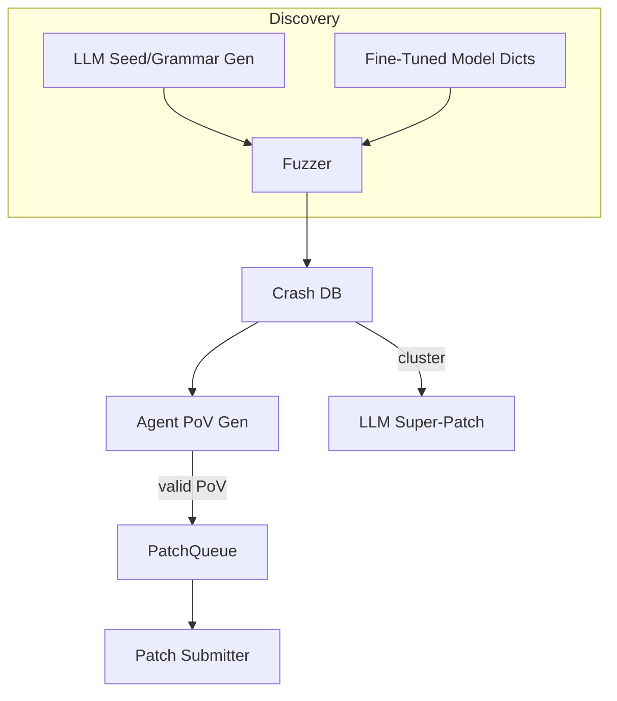

# Fuzzing με υποβοήθηση AI και αυτοματοποιημένη ανακάλυψη ευπαθειών

{{#include ../banners/hacktricks-training.md}}

## Επισκόπηση
Τα μεγάλα γλωσσικά μοντέλα (LLM) μπορούν να ενισχύσουν σημαντικά τις παραδοσιακές ροές εργασίας για την έρευνα ευπαθειών, δημιουργώντας σημασιολογικά πλούσιες εισόδους, εξελίσσοντας γραμματικές, συλλογίζοντας πάνω σε δεδομένα από crashes και ακόμη προτείνοντας patches για πολλαπλά bugs. Αυτή η σελίδα συγκεντρώνει τα πιο αποτελεσματικά μοτίβα που παρατηρήθηκαν στους τελικούς του AI Cyber Challenge (AIxCC) της DARPA και σε άλλες δημόσιες έρευνες.<sup>[[4]](#references)</sup><sup>[[5]](#references)</sup>

Αυτό που ακολουθεί δεν περιγράφει ένα συγκεκριμένο ανταγωνιστικό σύστημα, αλλά αποτελεί μια αφαίρεση των τεχνικών, ώστε να μπορείτε να τις αναπαραγάγετε στις δικές σας ροές εργασίας.

---

## 1. Είσοδοι seed που παράγονται από LLM

Οι παραδοσιακοί fuzzers καθοδηγούμενοι από κάλυψη (AFL++, libFuzzer, Honggfuzz…) ξεκινούν με ένα μικρό corpus από seeds και μεταλλάσσουν bytes στα τυφλά. Όταν η μορφή εισόδου του στόχου είναι σύνθετη (SQL, URL, προσαρμοσμένα δυαδικά πρωτόκολλα), οι τυχαίες μεταλλάξεις συνήθως χαλούν τη σύνταξη προτού εκτελεστούν ενδιαφέροντα branches.

Τα LLM μπορούν να λύσουν αυτό το πρόβλημα αρχικής εκκίνησης, δημιουργώντας *generators seed* — σύντομα scripts που παράγουν **συντακτικά έγκυρες αλλά σχετικές με την ασφάλεια εισόδους**. Για παράδειγμα:

```prompt
SYSTEM: You are a helpful security engineer.
USER:
Write a Python3 program that prints 200 unique SQL injection strings targeting common anti-pattern mistakes (missing quotes, numeric context, stacked queries).  Ensure length ≤ 256 bytes / string so they survive common length limits.
```

```python
# gen_sqli_seeds.py (truncated)
PAYLOADS = [
    "1 OR 1=1 -- ",
    "' UNION SELECT NULL,NULL--",
    "0; DROP TABLE users;--",
    ...
]
for p in PAYLOADS:
    print(p)
```

Εκτελέστε το μία φορά και περάστε την έξοδο απευθείας στο αρχικό corpus του fuzzer:

```bash
python3 gen_sqli_seeds.py > seeds.txt
afl-fuzz -i seeds.txt -o findings/ -- ./target @@
```

Οφέλη:
1. Σημασιολογική εγκυρότητα → βαθύτερη κάλυψη από νωρίς.
2. Επαναδημιουργήσιμο: προσαρμόστε το prompt ώστε να εστιάζει σε XSS, path traversal, binary blobs κ.λπ.
3. Οικονομικό (< 1 ¢ με GPT-3.5).

### Συμβουλές
* Ζητήστε από το μοντέλο να *ποικίλλει* το μήκος και την κωδικοποίηση των payload (UTF-8, URL-encoded, UTF-16-LE), ώστε να παρακάμπτει επιφανειακά φίλτρα.
* Ζητήστε ένα *μεμονωμένο, αυτοτελές script* – έτσι αποφεύγονται προβλήματα μορφοποίησης JSON.

---

## 2. Grammar-Evolution Fuzzing

Μια ισχυρότερη παραλλαγή είναι να αφήσετε το LLM να **εξελίξει μια γραμματική**, αντί για συγκεκριμένα seeds. Η ροή εργασιών (μοτίβο «Grammar Guy») είναι η εξής:

1. Δημιουργήστε μια αρχική γραμματική ANTLR/Peach/LibFuzzer μέσω prompt.
2. Εκτελέστε Fuzzing για N λεπτά και συλλέξτε μετρικές κάλυψης (edges / blocks που επισκέφθηκε).
3. Συνοψίστε τις περιοχές του προγράμματος που δεν καλύφθηκαν και δώστε τη σύνοψη πίσω στο μοντέλο:
   ```prompt
   The previous grammar triggered 12 % of the program edges.  Functions not reached: parse_auth, handle_upload.  Add / modify rules to cover these.
   ```
4. Συγχώνευσε τους νέους κανόνες, εκτέλεσε ξανά fuzzing και επανάλαβε.

Σκελετός ψευδοκώδικα:

```python
for epoch in range(MAX_EPOCHS):
    grammar = llm.refine(grammar, feedback=coverage_stats)
    save(grammar, f"grammar_{epoch}.txt")
    coverage_stats = run_fuzzer(grammar)
```

Βασικά σημεία:
* Κρατήστε ένα *budget* — κάθε βελτίωση χρησιμοποιεί tokens.
* Χρησιμοποιήστε οδηγίες `diff` + `patch`, ώστε το μοντέλο να επεξεργάζεται τον κώδικα αντί να τον ξαναγράφει.
* Σταματήστε όταν Δcoverage < ε.

---

## 3. Σχεδιασμός harness για Local-LLM libFuzzer

Για κώδικα που δεν μπορεί να φύγει από τον σταθμό εργασίας του αναλυτή, ένα τοπικό code model μπορεί να συντάξει τον μικρό adapter ανάμεσα στα bytes του fuzzer και σε ένα C/C++ API. Το χρήσιμο όριο ασφαλείας είναι σαφές: **το μοντέλο γράφει και αναθεωρεί την υποδομή δοκιμών· η mutation καθοδηγούμενη από coverage εξερευνά τα inputs· οι sanitizers αναφέρουν μη έγκυρες λειτουργίες· ένας άνθρωπος ελέγχει το harness και αξιολογεί τα ευρήματα**.<sup>[[9]](#references)</sup>

Για τεχνικές corpus, feedback, snapshot και stateful-fuzzing σε επίπεδο engine, που δεν εξαρτώνται από LLM, δείτε το [Fuzzing Methodology](../generic-methodologies-and-resources/fuzzing.md).

Ξεκινήστε με την ακριβή δήλωση που αντιγράφηκε από το header του στόχου και περιορίστε τη μορφή εξόδου. Ένα στενά διατυπωμένο prompt μειώνει τα επινοημένα APIs και κάνει το αποτέλεσμα εύκολο στον έλεγχο:<sup>[[8]](#references)[[9]](#references)</sup>

```prompt
Write a libFuzzer target for this exact declaration:
int parse_records(const uint8_t *data, size_t size);

Output only C code. Implement LLVMFuzzerTestOneInput, include the
declaration, pass data and size unchanged, and do not use files,
network access, randomness, clocks, threads, or persistent state.
```

Για έναν parser ακατέργαστων byte, το αναμενόμενο αποτέλεσμα δεν θα πρέπει να είναι πιο περίπλοκο από:<sup>[[6]](#references)[[9]](#references)</sup>

```c
#include <stddef.h>
#include <stdint.h>

extern int parse_records(const uint8_t *, size_t);

int LLVMFuzzerTestOneInput(const uint8_t *data, size_t size) {
    (void)parse_records(data, size);
    return 0;
}
```

Η μεταγλώττιση είναι μόνο το πρώτο στάδιο επικύρωσης. Ελέγξτε κάθε παραγόμενο target ως προς αυτές τις αμετάβλητες απαιτήσεις πριν αφιερώσετε χρόνο CPU σε αυτό:<sup>[[6]](#references)[[8]](#references)[[9]](#references)</sup>

- **Ακριβές API:** Συγκρίνετε τους τύπους, τους κανόνες διαχείρισης ιδιοκτησίας, την αρχικοποίηση, τον τερματισμό και τη σύμβαση κλήσης με την πραγματική κεφαλίδα και τους υπάρχοντες callers.
- **Ασφάλεια harness:** Προστατεύστε κάθε ανάγνωση από το `data`· τα ευρήματα των sanitizers πρέπει να προέρχονται από το target, όχι από τον παραγόμενο glue code.
- **Επαναληψιμότητα:** Κάντε το αποτέλεσμα συνάρτηση των `data` και `size`· αφαιρέστε την εξωτερική I/O, τον χρόνο, την ανεξέλεγκτη τυχαιότητα, τα threads που δεν έχουν ολοκληρωθεί με join και την κατάσταση που διατηρείται μεταξύ κλήσεων.
- **Ρυθμαπόδοση:** Αρχικοποιήστε ακριβή, αμετάβλητη κατάσταση μία φορά, μόνο εφόσον αυτό δεν μπορεί να επηρεάσει τη συμπεριφορά, περιορίστε το μέγεθος εισόδου, απενεργοποιήστε την καταγραφή και αποδεσμεύστε τις κατανομές μνήμης ανά είσοδο.
- **Προσπελασιμότητα:** Επιβεβαιώστε ότι εκτελούνται οι προβλεπόμενες συναρτήσεις και διακλαδώσεις. Ένα target που μεταγλωττίζεται αλλά εκτελεί μόνο διαδρομές απόρριψης αποτελεί σιωπηλή αποτυχία.

### Στόχοι με επίγνωση της δομής: διατήρηση αμετάβλητων απαιτήσεων χωρίς απόκρυψη σφαλμάτων

Αν οι περισσότερες ακατέργαστες είσοδοι αποτυγχάνουν σε έναν έλεγχο magic, μήκους, έκδοσης ή checksum, χρησιμοποιήστε τα fuzz bytes ως **υλικό για τυποποιημένα πεδία** και ανακατασκευάστε ένα έγκυρο αντικείμενο. Καθορίστε σταθερές μορφοποίησης, αφήστε τα σημασιολογικά πεδία και τα bytes του payload μεταβλητά και υπολογίστε τα metadata ακεραιότητας από το ανακατασκευασμένο payload. Το `FuzzedDataProvider` είναι χρήσιμο για την κατανάλωση οριοθετημένων, τυποποιημένων τιμών, ενώ ο adapter παραμένει υπεύθυνος για τον περιορισμό κάθε κατανομής μνήμης και μετατροπής που δημιουργείται.<sup>[[9]](#references)</sup>

<details>
<summary>Παράδειγμα C++ target με επίγνωση της δομής</summary>

```cpp
#include <fuzzer/FuzzedDataProvider.h>
#include <stddef.h>
#include <stdint.h>
#include <vector>

extern "C" int parse_message(const uint8_t *, size_t);

extern "C" int LLVMFuzzerTestOneInput(const uint8_t *data, size_t size) {
    FuzzedDataProvider fdp(data, size);
    uint8_t version = fdp.ConsumeIntegral<uint8_t>();
    auto body = fdp.ConsumeRemainingBytes<uint8_t>();
    if (body.size() > UINT16_MAX) body.resize(UINT16_MAX);
    uint16_t len = static_cast<uint16_t>(body.size());
    std::vector<uint8_t> msg = {0x8b, 'M', 'S', 'G', version,
                                static_cast<uint8_t>(len >> 8),
                                static_cast<uint8_t>(len)};
    msg.insert(msg.end(), body.begin(), body.end());
    (void)parse_message(msg.data(), msg.size());
    return 0;
}
```

</details>

Μη χρησιμοποιείτε έναν στόχο που επιδιορθώνει τις δομές για κάθε ερώτημα. Διατηρήστε έναν στόχο που υπολογίζει μήκη/checksum για να εξερευνά βαθιές έγκυρες καταστάσεις, και έναν άλλον που αφήνει τα **δηλωμένα** metadata υπό τον έλεγχο του fuzzer, περιορίζοντας μόνο τις αναγνώσεις και τις δεσμεύσεις μνήμης του ίδιου του harness. Ο δεύτερος στόχος διατηρεί επιφάνειες επίθεσης με ασύμφωνο μήκος και μη έγκυρη ακεραιότητα, τις οποίες διαφορετικά θα εξάλειφε η αυτόματη επιδιόρθωση.<sup>[[9]](#references)</sup>

### Seeds, dictionaries, sanitizers και feedback κάλυψης

Ζητήστε από το μοντέλο να δημιουργήσει ένα script που γράφει δυαδικά seeds, αντί να του ζητήσετε να εκτυπώσει απευθείας δυαδικά δεδομένα. Δημιουργήστε seeds για κενά, ελάχιστα, τυπικά και έγκυρα οριακά αντικείμενα· έπειτα εξαγάγετε magic values, tags, κωδικοποιήσεις enum και λέξεις-κλειδιά του parser σε ένα dictionary που έχει ελεγχθεί. Το libFuzzer δέχεται αυτό το dictionary με `-dict=` και διατηρεί στο corpus τις μεταλλάξεις που αποκαλύπτουν νέα κάλυψη.<sup>[[6]](#references)[[9]](#references)</sup>

```text
magic="\x8bMSG"
version_min="\x00"
version_max="\xff"
config_tag="CONFIG"
```

Δημιούργησε το ίδιο target με συμπληρωματικό instrumentation. Τα ASan και UBSan μπορούν να χρησιμοποιούν το ίδιο fuzzing binary· χρησιμοποίησε ξεχωριστό MSan build και κάνε instrumentation στις εξαρτήσεις του, ώστε να αποφύγεις αναφορές που προκαλούνται από μη instrumented κώδικα.<sup>[[6]](#references)[[9]](#references)</sup>

```bash
clang++ -g -O1 -fsanitize=fuzzer,address,undefined \
  -fno-sanitize-recover=undefined target.cc harness.cc -o fuzz_target
./fuzz_target corpus -dict=msg.dict -max_len=65535

clang++ -g -O1 -fsanitize=fuzzer,memory \
  target.cc harness.cc -o fuzz_target_msan
```

Αντιμετωπίστε την κάλυψη ως αξιολογητή για κάθε αναθεώρηση του model. Στην έξοδο του libFuzzer, τα πρώιμα επίπεδα `cov`/`ft` και ένα στατικό corpus συνήθως υποδηλώνουν κακή διαμόρφωση, υπερβολικά περιοριστικό early return ή λάθος κλήση· το χαμηλό `exec/s` υποδεικνύει ακριβό setup, I/O, εκχωρήσεις μνήμης ή διαρροή κατάστασης. Το `NEW` αποδεικνύει μόνο ότι άλλαξε ένα χαρακτηριστικό κάλυψης, όχι ότι έγινε προσπέλαση του επιδιωκόμενου parser.<sup>[[6]](#references)[[9]](#references)</sup>

Για feedback σε επίπεδο πηγαίου κώδικα, δημιουργήστε ένα build με coverage, κάντε fuzzing και δώστε στο model μόνο τις συναρτήσεις που δεν καλύφθηκαν, μαζί με τις συνθήκες που τις προστατεύουν. Επαληθεύστε τις διαφορές στο harness/seed/dictionary και μετρήστε ξανά:<sup>[[7]](#references)[[8]](#references)[[9]](#references)</sup>

```bash
clang++ -g -O1 -fsanitize=fuzzer \
  -fprofile-instr-generate -fcoverage-mapping target.cc harness.cc -o fuzz_cov
mkdir -p profiles
LLVM_PROFILE_FILE='profiles/%p.profraw' ./fuzz_cov -max_total_time=300 corpus
llvm-profdata merge -sparse profiles/*.profraw -o fuzz.profdata
llvm-cov report ./fuzz_cov -instr-profile=fuzz.profdata
llvm-cov show ./fuzz_cov -instr-profile=fuzz.profdata \
  --show-branches=count --region-coverage-lt=1 target.cc
```

Ο κλιμακώσιμος κύκλος είναι επομένως **generate → compile/link → smoke-test υπό sanitizers → μέτρηση κάλυψης στόχου → παροχή του μικρότερου σχετικού context κάλυψης/πηγαίου κώδικα → αναθεώρηση → νέα μέτρηση**. Το OSS-Fuzz-Gen εφαρμόζει την ίδια αρχή αξιολογώντας τους παραγόμενους στόχους ως προς τη δυνατότητα μεταγλώττισης, τις αστοχίες κατά την εκτέλεση, την κάλυψη και τη βελτίωση της κάλυψης σε σχέση με τους υπάρχοντες στόχους, αντί να αποδέχεται άκριτα κώδικα που φαίνεται εύλογος.<sup>[[7]](#references)[[8]](#references)</sup>

---

<a id="3-agent-based-pov-exploit-generation" hidden>3. Agent-Based PoV (Exploit) Generation</a>

## 4. Δημιουργία PoV (Exploit) με χρήση agents

Αφού εντοπιστεί ένα crash, χρειάζεστε ακόμη ένα **proof-of-vulnerability (PoV)** που να το προκαλεί με ντετερμινιστικό τρόπο.

Μια κλιμακώσιμη προσέγγιση είναι η εκκίνηση πολλών ελαφριών workers (processes, threads ή containers), όπου ο καθένας χρησιμοποιεί διαφορετικό model ή διαφορετικές ρυθμίσεις δειγματοληψίας. Η έρευνα των φιναλίστ του AIxCC δίνει συγκεκριμένα παραδείγματα κλίμακας: μία ομάδα χρησιμοποίησε **χιλιάδες ταυτόχρονους agents** για τη δημιουργία PoV με προτεραιότητα στην AI, ενώ μια άλλη συντόνισε **300–500 fuzzing agents** και χρησιμοποιούσε LLMs για υψηλότερου επιπέδου σημασιολογικό συλλογισμό.<sup>[[4]](#references)</sup>

Pipeline:
1. Η στατική/δυναμική ανάλυση παράγει *υποψήφια bugs* (struct με crash PC, input slice, μήνυμα sanitizer).
2. Ο orchestrator διανέμει τα υποψήφια bugs στους agents.
3. Βήματα συλλογισμού του agent:
   a. Αναπαραγωγή του bug τοπικά με `gdb` + input.
   b. Πρόταση ελάχιστου exploit payload.
   c. Επικύρωση του exploit σε sandbox. Αν πετύχει → υποβολή.
4. Οι αποτυχημένες προσπάθειες **τοποθετούνται ξανά στην ουρά ως νέα seeds** για coverage fuzzing (feedback loop).

Πλεονεκτήματα:
* Η παραλληλοποίηση καλύπτει την αναξιοπιστία ενός μεμονωμένου agent.
* Αυτόματη προσαρμογή του temp / μεγέθους model με βάση το παρατηρούμενο ποσοστό επιτυχίας.

---

<a id="4-directed-fuzzing-with-fine-tuned-code-models" hidden>4. Directed Fuzzing with Fine-Tuned Code Models</a>

## 5. Directed Fuzzing με Fine-Tuned Code Models

Κάντε fine-tune σε ένα open-weight model (π.χ. Llama-7B) με πηγαίο κώδικα C/C++ επισημασμένο με μοτίβα ευπαθειών (integer overflow, buffer copy, format string). Στη συνέχεια:

1. Εκτελέστε στατική ανάλυση για να λάβετε τη λίστα συναρτήσεων + AST.
2. Κάντε prompt στο model: *“Δώσε εγγραφές mutation dictionary που είναι πιθανό να παραβιάσουν την ασφάλεια μνήμης στη συνάρτηση X”*.
3. Εισαγάγετε αυτά τα tokens σε ένα προσαρμοσμένο `AFL_CUSTOM_MUTATOR`.

Παράδειγμα εξόδου για ένα wrapper `sprintf`:
```
{"pattern":"%99999999s"}
{"pattern":"AAAAAAAA....<1024>....%n"}
```

Εμπειρικά, αυτό μειώνει τον χρόνο μέχρι το crash πάνω από 2× σε πραγματικούς στόχους.

---

<a id="5-ai-guided-patching-strategies" hidden>5. Στρατηγικές patching με καθοδήγηση από AI</a>

## 6. Στρατηγικές patching με καθοδήγηση από AI

<a id="51-super-patches" hidden>5.1 Super Patches</a>

### 6.1 Super Patches
Ζητήστε από το μοντέλο να *ομαδοποιήσει* τις υπογραφές crash και να προτείνει **ένα μόνο patch** που εξαλείφει την κοινή βασική αιτία.  Υποβάλετέ το μία φορά, διορθώστε πολλά bugs → λιγότερες ποινές ακρίβειας σε περιβάλλοντα όπου κάθε λανθασμένο patch κοστίζει πόντους.

Περίγραμμα prompt:
```
Here are 10 stack traces + file snippets.  Identify the shared mistake and generate a unified diff fixing all occurrences.
```

{{#ref}}
../generic-methodologies-and-resources/fuzzing.md
{{#endref}}

<a id="52-speculative-patch-ratio" hidden>5.2 Speculative Patch Ratio</a>

### 6.2 Speculative Patch Ratio
Υλοποιήστε μια ουρά όπου εναλλάσσονται patches που έχουν επιβεβαιωθεί μέσω PoV και *speculative* patches (χωρίς PoV), σε αναλογία 1:​N προσαρμοσμένη στους κανόνες βαθμολόγησης (π.χ. 2 speculative : 1 confirmed). Ένα μοντέλο κόστους παρακολουθεί τις ποινές έναντι των πόντων και προσαρμόζει αυτόματα το N.

---

<a id="6-deterministic-file-by-file-ai-code-review" hidden>6. Deterministic File-by-File AI Code Review</a>

## 7. Deterministic File-by-File AI Code Review

Ένα συχνό σφάλμα στον AI-assisted έλεγχο είναι να ζητείται από έναν agent να επιθεωρήσει ολόκληρο το repository, με την ελπίδα ότι θα επιλέξει τα σωστά αρχεία και όρους grep. Μια πιο αξιόπιστη προσέγγιση είναι να **επιβάλλεται η κάλυψη του repository**:<sup>[[1]](#references)</sup>

1. Καταγράψτε τα αρχεία πηγαίου κώδικα.
2. Στείλτε **ένα αρχείο κάθε φορά** μαζί με ελάχιστο πλαίσιο (entrypoint, imports, κοντινά routes/callers).
3. Απαιτήστε μια **δομημένη αναφορά** για κάθε αρχείο: sources, sink, ελλιπής επικύρωση, προϋποθέσεις exploit και βαθμός βεβαιότητας.<sup>[[3]](#references)</sup>
4. Αφαιρέστε τις διπλότυπες αναφορές με βάση το **μοτίβο source→sink** και επικυρώστε χειροκίνητα όσες έχουν υψηλό κίνδυνο.

Αυτή η μέθοδος απαιτεί πολλά tokens και παράγει θόρυβο, αλλά είναι πολύ αποτελεσματική στον εντοπισμό **απλών, υψηλού αντίκτυπου bugs source/sink** που συχνά διαφεύγουν από ευρείς agentic ελέγχους.

### Μοτίβα για triage που αξίζει να δοθεί προτεραιότητα

- **Dynamic PHP include/dispatch**: ονόματα route/controller/module που ελέγχονται από τον attacker καταλήγουν σε `require_once()`, `include()` ή `include_once()` χωρίς αυστηρό allowlist και κανονικοποίηση διαδρομής.
- **Εκτέλεση shell σε ροές εργασιών διαχείρισης/admin λογαριασμών**: usernames, domains, FTP accounts ή άλλα αναγνωριστικά καταλήγουν σε `exec()`, `system()`, `shell_exec()`, `passthru()`, `proc_open()` ή `popen()`.
- **Συγκέντρωση δομημένων εισόδων**: η ίδια παράμετρος γίνεται δεκτή από `$_GET`, `$_POST`, JSON, XML ή parsers body του framework και αργότερα χρησιμοποιείται ξανά σε sinks συστήματος αρχείων ή εντολών OS.

### Δύο πρακτικές κατηγορίες bugs που εντοπίζονται καλά με αυτή τη μέθοδο

- **LFI/RCE μέσω PHP controller-dispatch**: αν ένα όνομα controller που ελέγχεται από το request συνενώνεται με `require_once()` χωρίς allowlist/κανονικοποίηση διαδρομής, ακολουθίες traversal όπως `../` μπορούν να κάνουν την PHP να συμπεριλάβει ένα μη προβλεπόμενο τοπικό αρχείο `.php`. Αν ο attacker μπορεί να κατευθύνει το include σε ένα τοποθετημένο ή με άλλο τρόπο χρήσιμο αρχείο PHP, το LFI μετατρέπεται σε εκτέλεση κώδικα. Δείτε [File Inclusion / Path Traversal](../pentesting-web/file-inclusion/README.md).<sup>[[1]](#references)</sup>
- **Authenticated command injection σε hosting/admin panels**: αν πεδία διαχείρισης λογαριασμών, όπως τα usernames, ενσωματώνονται σε εντολές shell, ένας authenticated χρήστης χαμηλών προνομίων μπορεί να μετατρέψει μια συνηθισμένη ενέργεια δημιουργίας/διαγραφής σε RCE. Ο αντίκτυπος αυξάνεται όταν το panel εκτελεί την εντολή ως service account με περισσότερα προνόμια. Δείτε [Command Injection](../pentesting-web/command-injection.md).<sup>[[1]](#references)</sup>

### Πρακτικές σημειώσεις ελέγχου

- Χρησιμοποιήστε πρώτα το LLM ως **reviewer source/sink**, όχι ως εργαλείο παραγωγής exploit.
- Ζητήστε του να αναφέρει ρητά το **πεδίο που ελέγχεται από τον attacker**, το **κενό κανονικοποίησης/επικύρωσης** και το **επικίνδυνο sink**.
- Σε μεγάλα repos, ο ντετερμινιστικός έλεγχος ανά αρχείο είναι συχνά πιο αξιόπιστος από μία αυτόνομη εκτέλεση agent, ακόμη και όταν η τελευταία χρησιμοποιεί ισχυρότερο μοντέλο.<sup>[[2]](#references)</sup>
- Αναμένετε ασθενέστερα αποτελέσματα σε **Broken Access Control** και άλλα bugs επιχειρησιακής λογικής, όπου η δυνατότητα εκμετάλλευσης εξαρτάται από παραδοχές μεταξύ αρχείων, τη σημασιολογία ρόλων ή μοντέλα απειλών ειδικά για το προϊόν.

---

## Ροές εργασιών σημείων εισόδου για κινητά

Ένα prompt για ολόκληρο το repository συχνά συγχέει τα μοντέλα απειλών και χάνει τη διαδρομή από ένα εξωτερικά προσβάσιμο component σε ένα ευαίσθητο sink. Μια ισχυρότερη ροή εργασίας χωρίζει τον έλεγχο σε stateful taskflows: πρώτα ταξινομεί τις εφαρμογές/components, έπειτα καταγράφει τα σημεία εισόδου που ελέγχονται από τον attacker, εμπλουτίζει κάθε σημείο εισόδου με μεταδεδομένα προσβασιμότητας και, τέλος, εξετάζει το καθένα με βάση κατηγορίες ευπαθειών ειδικές για την πλατφόρμα. Τα mobile taskflows του GitHub Security Lab υλοποιούν αυτό το μοτίβο για repositories Android, iOS και cross-platform.<sup>[[14]](#references)[[15]](#references)</sup>

Για Android, καταγράψτε τουλάχιστον τα εξής:<sup>[[14]](#references)[[15]](#references)</sup>

- exported Activities, Services, Receivers και Providers, συμπεριλαμβανομένων των permissions·
- intent actions, deep-link schemes/hosts/paths, MIME filters και App Links·
- ενέργειες που ελέγχονται από τον attacker, data URIs, `ClipData`, extras και flags χορήγησης URI·
- εισόδους πλοήγησης WebView και γέφυρες `addJavascriptInterface`·
- προνομιούχες λειτουργίες που εκτελούνται downstream, εισαγόμενους πόρους και προορισμούς δικτύου.

Έπειτα, ταξινομήστε κάθε σημείο εισόδου στο κατάλληλο πλαίσιο. Ρωτήστε ρητά για εξουσιοδότηση caller/συμπεριφορά confused-deputy, ανακατεύθυνση intent, πλαστογράφηση ή αποκάλυψη broadcast, μη ασφαλείς εισαγωγές, scripting και έκθεση γεφυρών WebView, καθώς και μεταφορά διαπιστευτηρίων ή cookies μεταξύ origins. Εκτελέστε τόσο έναν **αυστηρό έλεγχο checklist** όσο και έναν **ευρύτερο adversarial έλεγχο**. Συνδέστε τα ευρήματα με τα [Intent Injection](../mobile-pentesting/android-app-pentesting/intent-injection.md) και [WebView Attacks](../mobile-pentesting/android-app-pentesting/webview-attacks.md), αντί να επαναλαμβάνετε τις λεπτομέρειες εκμετάλλευσης.<sup>[[15]](#references)</sup>

Τα τρέχοντα open-source taskflows μπορούν να εκκινηθούν από το Codespace τους με:<sup>[[14]](#references)</sup>

```bash
./scripts/audit/run_audit.sh owner/repository
```

Τα αποτελέσματα γράφονται στον πίνακα `audit_result` της SQLite.<sup>[[14]](#references)</sup> Αντιμετωπίστε τις εγγραφές που επισημαίνονται ως ευάλωτες ως **υποψήφια ευρήματα**, όχι ως επαληθευμένα ευρήματα. Για κάθε υποψήφιο εύρημα, ζητήστε από το μοντέλο να προσδιορίσει την πηγή που ελέγχεται από τον επιτιθέμενο, το ευαίσθητο sink, τις προϋποθέσεις και τον αναμενόμενο αντίκτυπο, και έπειτα ζητήστε του να δημιουργήσει ένα ελάχιστο PoC. Εκτελέστε αυτό το PoC στην αρχική έκδοση, χρησιμοποιώντας debugger ή instrumentation. Έτσι εντοπίζονται συνήθη λάθη της στατικής ανάλυσης, όπως μη προσπελάσιμοι κλάδοι, μη ρεαλιστική κατάσταση εφαρμογής, απώλεια προτεραιότητας των δεδομένων από εξωτερικό αποθηκευτικό χώρο έναντι των ιδιωτικών δεδομένων, καθώς και mitigations που μειώνουν ουσιαστικά τη σοβαρότητα.<sup>[[15]](#references)</sup>

---

## 8. Έλεγχος Kernel με Καθοδήγηση από Μοτίβα και Instrumented Oracle

Για έναν στόχο μεγέθους kernel, μην ζητάτε από έναν agent να εντοπίσει αυθαίρετα σφάλματα σε ολόκληρο το δέντρο. Μια πιο αποδοτική ως προς τα tokens ροή εργασίας μετατρέπει τη γνώση από παλαιότερες ευπάθειες σε στατικά queries, κατατάσσει τα αποτελέσματα με βάση την εκτεθειμένη επιφάνεια επίθεσης και χρησιμοποιεί έναν instrumented kernel ως oracle εκτέλεσης.<sup>[[11]](#references)</sup>

### Βάση δεδομένων μοτίβων → CodeQL/Semgrep → εστιασμένη ανασκόπηση

Δημιουργήστε μια μικρή βάση γνώσεων που περιλαμβάνει επικίνδυνα APIs, μοτίβα ελλιπούς επικύρωσης, επικίνδυνες ροές από source σε sink και σχήματα σφαλμάτων που έχουν διορθωθεί στο παρελθόν. Ζητήστε από το μοντέλο να μεταφράζει **ένα μοτίβο κάθε φορά** σε ευρετικές για την ανασκόπηση και κανόνες CodeQL/Semgrep, και έπειτα εκτελέστε αυτούς τους ντετερμινιστικούς κανόνες σε ολόκληρο το δέντρο. Ομαδοποιήστε και αποδιπλοποιήστε τα αποτελέσματα πριν δώσετε ξανά τον κώδικα στο μοντέλο· η ακατέργαστη έξοδος του scanner μπορεί να περιέχει χιλιάδες υποψήφιες περιπτώσεις χαμηλής αξίας. Ελέγξτε την τρέχουσα άδεια χρήσης του CodeQL πριν εφαρμόσετε αυτήν την προσέγγιση εκτός επιλέξιμων ερευνητικών στόχων ή στόχων ανοικτού κώδικα.<sup>[[11]](#references)</sup>

Δώστε προτεραιότητα στα υποσυστήματα βάσει τόσο της **πυκνότητας των ευρημάτων των κανόνων** όσο και της **προσβασιμότητας από επιτιθέμενους**, όχι μόνο βάσει του αριθμού των ευρημάτων. Οι διεπαφές του kernel που είναι προσβάσιμες από μη προνομιούχες διεργασίες, sandboxes, containers, jails ή περιβάλλοντα guest αξίζουν μεγαλύτερη βαρύτητα από τον κώδικα που είναι προσβάσιμος μόνο εσωτερικά. Κρατήστε τη μονάδα ανασκόπησης αρκετά μικρή ώστε ο agent να διατηρεί στη μνήμη του τους callers, τους validators και τους κανόνες lifetime, και ζητήστε να εξεταστεί μια συγκεκριμένη κατηγορία ευπάθειας ή ένα μοτίβο control-flow αντί να ζητήσετε «να βρεθεί οποιαδήποτε ευπάθεια». Οι παλαιότερες προνομιούχες διεπαφές είναι ιδιαίτερα ενδιαφέρουσες όταν ένα νεότερο όριο απομόνωσης τις καθιστά προσβάσιμες σε χρήστη root με namespace ή jail.<sup>[[11]](#references)</sup>

Για κάθε υποψήφια περίπτωση, απαιτήστε ρητή καταγραφή της ροής των δεδομένων πριν επιχειρήσετε εκμετάλλευση.<sup>[[11]](#references)</sup>

```text
entrypoint -> privilege check -> parser -> validation/normalization
           -> later rewrite -> dangerous sink
attacker controls: <fields and lengths>
constraints:       <values rewritten, rejected, or preserved>
observable result: <sanitizer report, assertion, panic, or clean exit>
```

### Χρησιμοποιήστε τα telemetry του KASAN ως oracle υποθέσεων

Εκτελέστε τον kernel-στόχο σε disposable VM με ενεργοποιημένα τα KASAN και χρήσιμα διαγνωστικά assertions. Ο agent πρέπει να επαναλαμβάνει τη διαδικασία **υπόθεση από τον κώδικα → ελάχιστο userland trigger → εκτέλεση σε VM → trace από KASAN/assertion → αναθεωρημένη υπόθεση** μέχρι να αναπαραχθεί ή να απορριφθεί η ύποπτη αλλοίωση. Σε κάθε επανάληψη, επιστρέψτε μόνο το σχετικό stack trace και το κοντινό σημείο του source code· έτσι διατηρείται το πλαίσιο για τη συλλογιστική, ενώ τα runtime στοιχεία —και όχι η εμπιστοσύνη του μοντέλου— αποτελούν το κριτήριο αποδοχής.<sup>[[11]](#references)</sup>

Ένα instrumented build δεν είναι το τελικό περιβάλλον αξιολόγησης της δυνατότητας εκμετάλλευσης. Τα assertions μπορεί να διακόψουν την εκτέλεση πριν από την ενέργεια που προκαλεί την αλλοίωση, ενώ το ίδιο assertion μπορεί να έχει αφαιρεθεί από τον production kernel. Επαναλάβετε τη δοκιμή με το ίδιο trigger στην ακριβή production configuration, καταγράψτε το kernel build και την configuration και διαχωρίστε την **προσβασιμότητα**, την **αλλοίωση μνήμης**, το **ελεγχόμενο primitive** και τον **αντίκτυπο στην ασφάλεια** ως ξεχωριστούς ισχυρισμούς.<sup>[[11]](#references)[[12]](#references)</sup>

Το CVE-2026-3038 αποτελεί χρήσιμο παράδειγμα επικύρωσης, όχι πρότυπο exploit. Ένα αίτημα `RTM_GET` από μη προνομιούχο χρήστη στο FreeBSD μπορούσε να διατηρήσει ένα υπερμεγέθες sockaddr `RTAX_AUTHOR` μέσω επιλεκτικής επικύρωσης και επανεγγραφής της απάντησης, μέχρι το `rtsock_msg_buffer()` να αντιγράψει το ελεγχόμενο από τον χρήστη `sa_len` σε ένα `sockaddr_storage` 128 byte στη στοίβα. Η μέγιστη αντιγραφή των 255 byte προκαλούσε overwrite 127 byte· ένα diagnostic assertion εντόπιζε το λανθασμένο μήκος στο instrumented build, ενώ ένας GENERIC kernel έφτανε στην αντιγραφή και έπειτα έκανε panic κατά τον έλεγχο του αλλοιωμένου canary. Αυτό αποδεικνύει denial of service από μη προνομιούχο χρήστη, όχι αυτοτελή κλιμάκωση προνομίων: ο αξιόπιστος έλεγχος θα απαιτούσε πρώτα ένα άλλο primitive, όπως διαρροή του canary. Για το αντίστοιχο όριο του binary exploitation, δείτε το [Stack Canaries](../binary-exploitation/common-binary-protections-and-bypasses/stack-canaries/index.html).<sup>[[11]](#references)[[12]](#references)[[13]](#references)</sup>

### Απορρίψτε την παραποίηση των προϋποθέσεων εκμετάλλευσης

Πριν αποδεχτείτε ένα PoV ή exploit, ζητήστε από ξεχωριστό reviewer/agent να προσπαθήσει να το διαψεύσει βάσει προκαθορισμένων κριτηρίων. Η αξιολόγηση πρέπει να επιβεβαιώσει όλες τις ακόλουθες συνθήκες.<sup>[[11]](#references)</sup>

- Δεν τροποποιήθηκαν το source code του στόχου, ο kernel ή το ευάλωτο module για να γίνει προσβάσιμη η διαδρομή.
- Δεν προστέθηκαν helper module, συνθετικό gadget, απενεργοποιημένο mitigation, επιπλέον προνόμια ή μη διαθέσιμο interface.
- Το trigger ξεκινά με την ταυτότητα χρήστη και τους περιορισμούς απομόνωσης που δηλώνονται, σε καθαρό snapshot.
- Το δηλωμένο αποτέλεσμα εξακολουθεί να εξαρτάται από το bug: η αφαίρεση του κακοσχηματισμένου πεδίου ή η διόρθωση μόνο του bug πρέπει να διακόπτει την αλυσίδα.
- Ένα crash, overread ή overwrite αναφέρεται μόνο ως αυτό το primitive· η εκτέλεση κώδικα ή η κλιμάκωση προνομίων χρειάζεται ανεξάρτητα στοιχεία.

Αυτός ο τελευταίος αντιπαραθετικός έλεγχος εντοπίζει κυκλικές αποδείξεις: αν οι προϋποθέσεις ήδη παρέχουν τον δηλωμένο αντίκτυπο (για παράδειγμα, εκτέλεση περιεχομένου SUID που έχει δώσει ο επιτιθέμενος από filesystem που έχει προσαρτηθεί χωρίς `nosuid`), τότε το bug ασφάλειας μνήμης δεν προκάλεσε αυτόν τον αντίκτυπο.<sup>[[11]](#references)</sup>

---

## Ελέγξιμη έρευνα με υποβοήθηση agent σε άγνωστα codebase

Η [graph-first ροή εργασίας επιλογής fuzz target](../generic-methodologies-and-resources/fuzzing.md#graph-first-fuzz-target-selection-and-mutation-triage) καλύπτει ήδη την προσβασιμότητα των entrypoint, ενώ τα [agentic SAST pipelines](../network-services-pentesting/pentesting-web/code-review-tools.md#agentic-sast-pipelines) καλύπτουν τη σταδιακή αξιολόγηση και τα evidence gates. Κρατήστε αυτά τα ντετερμινιστικά αποτελέσματα ξεχωριστά από τις υποθέσεις του μοντέλου, ώστε κάθε lead που προωθείται να διατηρεί τις θέσεις στο source code, τα στοιχεία για τη διαδρομή και μια δυναμική μέτρηση.<sup>[[10]](#references)</sup>

### Συσχετίστε στοιχεία για τον κύκλο ζωής των αντικειμένων χωρίς να επινοείτε ροή δεδομένων

Η στατική ανάλυση μπορεί να εντοπίσει ένα attacker-controlled length που αποθηκεύεται σε μία συνάρτηση και το ίδιο πεδίο αντικειμένου να φτάνει σε copy sink πολύ αργότερα, χωρίς όμως να αποδεικνύει τη σύνδεση μέσω callbacks, reconnects ή του κύκλου ζωής του αντικειμένου. Διατηρήστε τα δύο ευρήματα ξεχωριστά, ομαδοποιήστε τα βάσει αντικειμένου/πεδίου και καταγράψτε την ελλείπουσα ακμή ως ρητό ερώτημα διαλογής. Ο agent μπορεί να προτείνει τη σχέση, αλλά πρέπει να αποδειχθεί με εξέταση του source code ή runtime instrumentation.<sup>[[10]](#references)</sup>

Για κάθε υποψήφιο, καταγράψτε:

- το συγκεκριμένο entrypoint και τα attacker-controlled bytes·
- κάθε producer του σχετικού πεδίου, μαζί με την επικύρωση που αφορά κάθε producer·
- το sink, τη χωρητικότητα του προορισμού και τις συνθήκες build/runtime που απαιτούνται για να είναι προσβάσιμο·
- ένα πραγματικό call stack από το εκτεθειμένο entrypoint, όχι μόνο άμεση κλήση του harness·
- το μικρότερο δυναμικό αποτέλεσμα που επιβεβαιώνει ή απορρίπτει την υπόθεση.

Μια διαδρομή που φαίνεται ασφαλής δεν καθιστά ένα πεδίο ασφαλές συνολικά. Ένας δεύτερος producer μπορεί να συμπληρώσει το ίδιο πεδίο χωρίς το όριο της πρώτης διαδρομής. Δοκιμάστε τις διαδρομές ανεξάρτητα και εκτελέστε το harness με build options ισοδύναμα με αυτά του deployment, επειδή τα debug assertions μπορεί να μετατρέψουν αλλοίωση μνήμης σε production σε πρόωρο abort που εμφανίζεται μόνο στις δοκιμές.<sup>[[10]](#references)</sup>

### Gates μέτρησης για disclosure και exploitation

Για ύποπτη διαρροή μη αρχικοποιημένης μνήμης, γεμίστε νέες allocations με ένα αναγνωρίσιμο byte και επιβεβαιώστε ότι ακριβώς αυτός ο δείκτης φτάνει στο πακέτο που εκπέμπεται. Για exploitation, απαιτήστε μετρημένα gates όπως **ελεγχόμενο overwrite → χρήσιμο victim object → disclosure → ανάκτηση pointer/base → hijack της ροής ελέγχου → συνδυασμένο payload**. Ο agent προχωρά μόνο όταν το harness αποδεικνύει την τρέχουσα ιδιότητα· μια εύλογη αφήγηση δεν σημαίνει ότι πέρασε το gate. Η [περίπτωση FreeRDP](../binary-exploitation/libc-heap/heap-overflow.md#cross-path-length-reuse-and-stale-output-disclosure) δείχνει τη διαδρομή και τους περιορισμούς του build που πρέπει να διατηρηθούν κατά την επικύρωση.<sup>[[10]](#references)</sup>

---

Για μια μελέτη περίπτωσης kernel που εφαρμόζει σταδιακή επικύρωση L0–L4 στην ανάπτυξη exploit με τη βοήθεια LLM, δείτε:

{{#ref}}
../binary-exploitation/freebsd-kernel-exploitation-vnet-jail-escape.md
{{#endref}}

## Διαλογή crash με τη βοήθεια debugger

Οι ροές εργασίας Mona v3 για διαλογή crash, ανάλυση συναρτήσεων και ελεγχόμενη προσβασιμότητα heap chunk βρίσκονται στο [Exploiting Tools](../binary-exploitation/basic-stack-binary-exploitation-methodology/tools/#mona-v3-debugger-context-requests-for-crash-triage).

---

## Συνδυάζοντας τα πάντα
Ένα CRS (Cyber Reasoning System) από άκρο σε άκρο μπορεί να συνδέσει τα στοιχεία ως εξής:



---

## References

- [1] [Project Black - Τοπικό AI για την κυβερνοασφάλεια: Εντοπισμός LFI στο phpIPAM και αυθεντικοποιημένου RCE στο myVesta](https://projectblack.io/blog/local-ai-for-cyber-security)
- [2] [Strix](https://github.com/usestrix/strix)
- [3] [GitHub Copilot community security-review skill](https://github.com/github/awesome-copilot/blob/main/skills/security-review/SKILL.md)
- [4] [Trail of Bits – Τελικοί AIxCC: Ανασκόπηση των αποτελεσμάτων](https://blog.trailofbits.com/2025/08/07/aixcc-finals-tale-of-the-tape/)
- [5] [Συνεντεύξεις με τους φιναλίστ του CTF Radiooo AIxCC](https://www.youtube.com/@ctfradiooo)
- [6] [LLVM — libFuzzer: Μια βιβλιοθήκη για fuzz testing με καθοδήγηση από την κάλυψη κώδικα](https://llvm.org/docs/LibFuzzer.html)
- [7] [Google — OSS-Fuzz-Gen](https://github.com/google/oss-fuzz-gen)
- [8] [Ιστολόγιο Ασφάλειας της Google — Αναβάθμιση του fuzzing: Εντοπισμός περισσότερων ευπαθειών με AI](https://security.googleblog.com/2024/11/leveling-up-fuzzing-finding-more.html)
- [9] [8kSec — Δημιουργία harness για fuzzing με τη βοήθεια AI και τοπικό LLM](https://8ksec.io/ai-assisted-fuzzing-harness-local-llm)
- [10] [Quarkslab — Από AI agents σε RCE: Δημιουργία ροής εργασιών για την έρευνα ευπαθειών](https://blog.quarkslab.com/from-ai-agents-to-rce-building-a-vulnerability-research-workflow.html)
- [11] [Praetorian — FreeBSoD: Αξιοποίηση γλωσσικών μοντέλων για τον εντοπισμό και την εκμετάλλευση σφαλμάτων πυρήνα (Μέρος 1 από 2)](https://praetorian.com/blog/ai-vulnerability-research-freebsd-kernel)
- [12] [FreeBSD-SA-26:05.route — Τοπικό DoS και πιθανή κλιμάκωση προνομίων μέσω sockets δρομολόγησης](https://www.freebsd.org/security/advisories/FreeBSD-SA-26:05.route.asc)
- [13] [Πηγαίο patch του FreeBSD-SA-26:05.route](https://security.FreeBSD.org/patches/SA-26:05/route.patch)
- [14] [GitHub Security Lab - Ροές εργασιών SecLab](https://github.com/GitHubSecurityLab/seclab-taskflows)
- [15] [GitHub Security Lab - Πώς εντοπίσαμε 24 ευπάθειες Android χρησιμοποιώντας έναν AI security agent ανοιχτού κώδικα](https://github.blog/security/how-we-found-24-android-vulnerabilities-using-our-open-source-ai-security-agent)
{{#include ../banners/hacktricks-training.md}}
