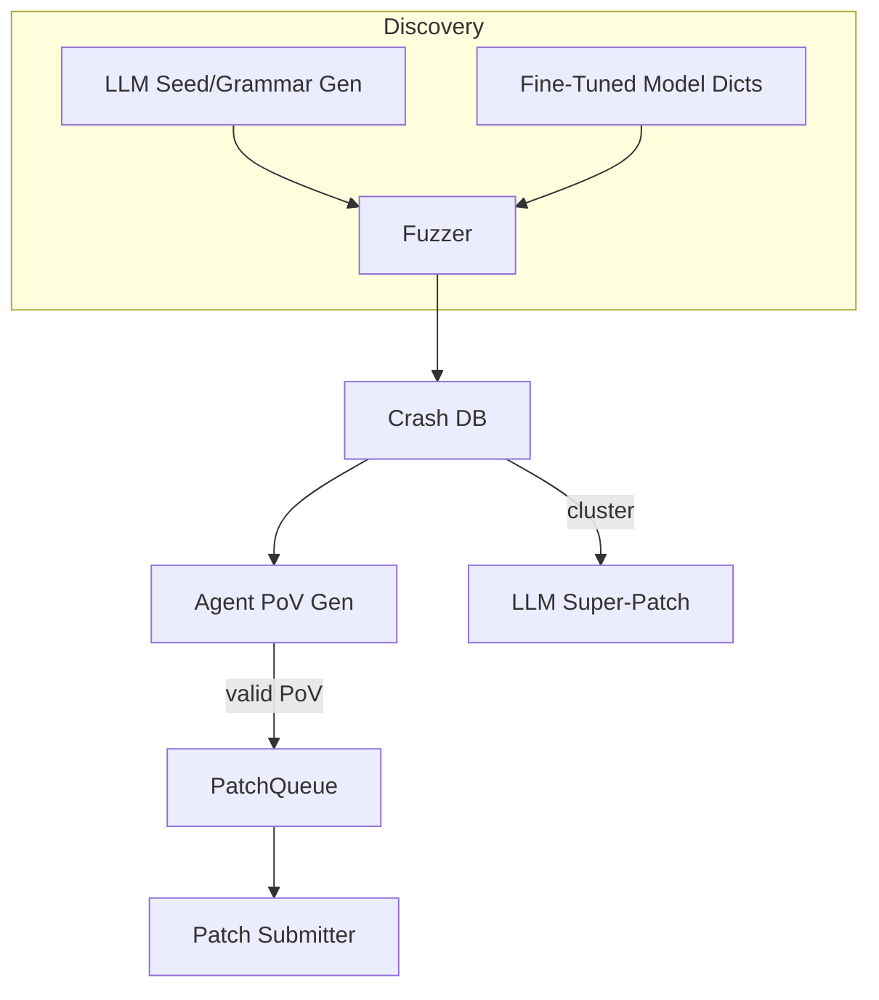

# AI-ondersteunde Fuzzing & Geoutomatiseerde Vulnerability-ontdekking

{{#include ../banners/hacktricks-training.md}}

## Oorsig
Groottaalmodelle (LLM's) kan tradisionele vulnerability-research-pyplyne aansienlik versterk deur semanties ryk invoer te genereer, grammatikas te ontwikkel, crash-data te ontleed en selfs patches vir verskeie bugs voor te stel. Hierdie bladsy versamel die doeltreffendste patrone wat tydens DARPA se AI Cyber Challenge (AIxCC)-eindronde en ander openbare navorsing waargeneem is.<sup>[[4]](#references)</sup><sup>[[5]](#references)</sup>

Wat volg, is nie 'n beskrywing van een spesifieke kompetisiestelsel nie, maar 'n abstraksie van die tegnieke sodat jy dit in jou eie werkvloeie kan toepas.

---

## 1. LLM-gegenereerde Seed-invoer

Tradisionele coverage-guided fuzzers (AFL++, libFuzzer, Honggfuzz…) begin met 'n klein corpus van seeds en muteer grepe blindelings. Wanneer die teikeninvoerformaat kompleks is (SQL, URLs, pasgemaakte binêre protokolle), breek ewekansige mutasies gewoonlik die sintaksis voordat interessante vertakkings bereik word.

LLM's kan hierdie bootstrap-probleem oplos deur *seed generators* uit te voer – kort skripte wat **sintaksis-korrekte, maar sekuriteitsrelevante invoer** uitstuur. Byvoorbeeld:

```prompt
SYSTEM: You are a helpful security engineer.
USER:
Write a Python3 program that prints 200 unique SQL injection strings targeting common anti-pattern mistakes (missing quotes, numeric context, stacked queries).  Ensure length ≤ 256 bytes / string so they survive common length limits.
```

```python
# gen_sqli_seeds.py (truncated)
PAYLOADS = [
    "1 OR 1=1 -- ",
    "' UNION SELECT NULL,NULL--",
    "0; DROP TABLE users;--",
    ...
]
for p in PAYLOADS:
    print(p)
```

Voer dit een keer uit en voer die uitvoer direk in die fuzzer se aanvanklike korpus in:

```bash
python3 gen_sqli_seeds.py > seeds.txt
afl-fuzz -i seeds.txt -o findings/ -- ./target @@
```

Voordele:
1. Semantiese geldigheid → vroeër dieper dekking.
2. Her-genereerbaar: pas die prompt aan om op XSS, path traversal, binary blobs, ens. te fokus.
3. Goedkoop (< 1 ¢ met GPT-3.5).

### Wenke
* Gee die model opdrag om die payload-lengte en encoding (UTF-8, URL-encoded, UTF-16-LE) te *diversifiseer* om oppervlakkige filters te omseil.
* Vra vir ’n *enkele selfstandige script* – voorkom probleme met JSON-formatering.

---

## 2. Grammar-Evolution Fuzzing

’n Kragtiger variant is om die LLM ’n grammar te laat **evolueer** in plaas van konkrete seeds. Die werkvloei (“Grammar Guy”-patroon) is:

1. Genereer ’n aanvanklike ANTLR/Peach/LibFuzzer-grammar via ’n prompt.
2. Fuzz vir N minute en versamel dekkingmaatstawwe (edges / blocks wat getref is).
3. Som ongedekte programareas op en voer die opsomming terug aan die model:
   ```prompt
   The previous grammar triggered 12 % of the program edges.  Functions not reached: parse_auth, handle_upload.  Add / modify rules to cover these.
   ```
4. Voeg die nuwe reëls saam, fuzz weer, herhaal.

Pseudo-code-skelet:

```python
for epoch in range(MAX_EPOCHS):
    grammar = llm.refine(grammar, feedback=coverage_stats)
    save(grammar, f"grammar_{epoch}.txt")
    coverage_stats = run_fuzzer(grammar)
```

Sleutelpunte:
* Hou ’n *begroting* – elke verfyning gebruik tokens.
* Gebruik `diff`- en `patch`-instruksies sodat die model wysigings maak eerder as om alles te herskryf.
* Stop wanneer Δcoverage < ε.

---

## 3. Plaaslike-LLM libFuzzer-harnasingenieurswese

As bronkode nie ’n ontleder se werkstasie mag verlaat nie, kan ’n plaaslike kodemodel die klein adapter tussen fuzzer-grepe en ’n C/C++ API opstel. Die nuttige sekuriteitsgrens is duidelik: **die model skryf en hersien toetsinfrastruktuur; coverage-guided mutation verken invoere; sanitizers rapporteer ongeldige bewerkings; ’n mens hersien die harnas en triageer bevindings**.<sup>[[9]](#references)</sup>

Vir engine-vlak corpus-, terugvoer-, snapshot- en stateful-fuzzing-tegnieke wat nie van ’n LLM afhanklik is nie, sien die algemene [Fuzzing Methodology](../generic-methodologies-and-resources/fuzzing.md).

Begin met die presiese deklarasie wat uit die teikenopskriflêer gekopieer is, en beperk die uitvoerformaat. ’n Eng prompt verminder versinde API’s en maak die resultaat maklik om na te gaan:<sup>[[8]](#references)[[9]](#references)</sup>

```prompt
Write a libFuzzer target for this exact declaration:
int parse_records(const uint8_t *data, size_t size);

Output only C code. Implement LLVMFuzzerTestOneInput, include the
declaration, pass data and size unchanged, and do not use files,
network access, randomness, clocks, threads, or persistent state.
```

Vir 'n rougreepontleder behoort die verwagte resultaat nie ingewikkelder te wees as:<sup>[[6]](#references)[[9]](#references)</sup>

```c
#include <stddef.h>
#include <stdint.h>

extern int parse_records(const uint8_t *, size_t);

int LLVMFuzzerTestOneInput(const uint8_t *data, size_t size) {
    (void)parse_records(data, size);
    return 0;
}
```

Samestelling is slegs die eerste validasiehek. Gaan elke gegenereerde teiken teen hierdie invariants na voordat jy SVE-tyd daaraan bestee:<sup>[[6]](#references)[[8]](#references)[[9]](#references)</sup>

- **Presiese API:** vergelyk tipes, eienaarskapreëls, initialisering, teardown en oproepkonvensie met die werklike header en bestaande callers.
- **Harness-veiligheid:** beveilig elke leesbewerking vanaf `data`; sanitizer-bevindings moet in die teiken ontstaan, nie in die gegenereerde glue nie.
- **Herhaalbaarheid:** maak die resultaat ’n funksie van `data` en `size`; verwyder eksterne I/O, tyd, onbeheerde ewekansigheid, drade wat nie saamgevoeg is nie, en toestand wat tussen oproepe voortduur.
- **Deurset:** initialiseer duur onveranderlike toestand net een keer, en slegs wanneer dit nie gedrag kan beïnvloed nie; beperk die invoergrootte, onderdruk logging en maak per-invoer-allokasies vry.
- **Bereikbaarheid:** verifieer dat die beoogde funksies en vertakkings uitgevoer word. ’n Teiken wat saamgestel word maar slegs verwerpingspaaie toets, is ’n stille mislukking.

### Struktuurbewuste teikens: behou invariants sonder om foute te verberg

As die meeste rou invoere ’n magic-, lengte-, weergawe- of checksum-hek nie slaag nie, gebruik die fuzz-grepe as **getipeerde veldmateriaal** en bou ’n geldige objek opnuut. Stel formaatkonstantes vas, laat semantiese velde en loonvraggrepe veranderlik, en lei integriteitmetadata af van die gerekonstrueerde loonvrag. `FuzzedDataProvider` is nuttig om begrensde getipeerde waardes te verbruik, terwyl die adapter steeds verantwoordelik is om enige gegenereerde allokasie en omskakeling te beperk.<sup>[[9]](#references)</sup>

<details>
<summary>Voorbeeld van ’n struktuurbewuste C++-teiken</summary>

```cpp
#include <fuzzer/FuzzedDataProvider.h>
#include <stddef.h>
#include <stdint.h>
#include <vector>

extern "C" int parse_message(const uint8_t *, size_t);

extern "C" int LLVMFuzzerTestOneInput(const uint8_t *data, size_t size) {
    FuzzedDataProvider fdp(data, size);
    uint8_t version = fdp.ConsumeIntegral<uint8_t>();
    auto body = fdp.ConsumeRemainingBytes<uint8_t>();
    if (body.size() > UINT16_MAX) body.resize(UINT16_MAX);
    uint16_t len = static_cast<uint16_t>(body.size());
    std::vector<uint8_t> msg = {0x8b, 'M', 'S', 'G', version,
                                static_cast<uint8_t>(len >> 8),
                                static_cast<uint8_t>(len)};
    msg.insert(msg.end(), body.begin(), body.end());
    (void)parse_message(msg.data(), msg.size());
    return 0;
}
```

</details>

Moenie vir elke vraag dieselfde teiken gebruik wat strukture herstel nie. Hou een teiken wat lengtes/tjeksomme aflei om diep geldige toestande te verken, en nog een wat die **verklaarde** metadata deur die fuzzer laat beheer, terwyl slegs die harnas se eie leesbewerkings en geheuetoekennings beperk word. Die tweede teiken behou aanvalsvlakke met lengtes wat nie ooreenstem nie en met foutiewe integriteit, wat outomatiese herstel andersins sou uitwis.<sup>[[9]](#references)</sup>

### Seeds, woordeboeke, sanitizers en terugvoer oor coverage

Vra die model om ’n skrip te genereer wat binêre seeds skryf, eerder as om dit te vra om binêre data direk uit te druk. Gebruik leë, minimale, tipiese en grensgeldige objekte as seeds; onttrek dan magic values, tags, enum-koderings en parser-sleutelwoorde in ’n nagegane woordeboek. libFuzzer aanvaar daardie woordeboek met `-dict=`, en hou mutasies wat nuwe coverage in die corpus blootlê.<sup>[[6]](#references)[[9]](#references)</sup>

```text
magic="\x8bMSG"
version_min="\x00"
version_max="\xff"
config_tag="CONFIG"
```

Bou dieselfde teiken met aanvullende instrumentasie. ASan en UBSan kan ’n fuzzing-binêre deel; gebruik ’n aparte MSan-bou en instrumenteer die afhanklikhede daarvan om verslae weens nie-geinstrumenteerde kode te voorkom.<sup>[[6]](#references)[[9]](#references)</sup>

```bash
clang++ -g -O1 -fsanitize=fuzzer,address,undefined \
  -fno-sanitize-recover=undefined target.cc harness.cc -o fuzz_target
./fuzz_target corpus -dict=msg.dict -max_len=65535

clang++ -g -O1 -fsanitize=fuzzer,memory \
  target.cc harness.cc -o fuzz_target_msan
```

Beskou dekking as die beoordelaar vir elke modelhersiening. In libFuzzer-uitvoer dui `cov`/`ft` wat vroeg platval en ’n statiese corpus gewoonlik op swak raamwerk, ’n te beperkende vroeë terugkeer, of die verkeerde aanroep; lae `exec/s` dui op duur opstelling, I/O, geheuetoekenning of toestand wat lek. `NEW` bewys net dat ’n dekkingskenmerk verander het, nie dat die bedoelde parser bereik is nie.<sup>[[6]](#references)[[9]](#references)</sup>

Vir terugvoer op bronvlakke, bou ’n dekking-geïnstrumenteerde weergawe, fuzz dit en gee die model slegs die ongedekte funksies saam met die voorwaardes wat dit beskerm. Verifieer die harness/seed/dictionary-diff en meet weer:<sup>[[7]](#references)[[8]](#references)[[9]](#references)</sup>

```bash
clang++ -g -O1 -fsanitize=fuzzer \
  -fprofile-instr-generate -fcoverage-mapping target.cc harness.cc -o fuzz_cov
mkdir -p profiles
LLVM_PROFILE_FILE='profiles/%p.profraw' ./fuzz_cov -max_total_time=300 corpus
llvm-profdata merge -sparse profiles/*.profraw -o fuzz.profdata
llvm-cov report ./fuzz_cov -instr-profile=fuzz.profdata
llvm-cov show ./fuzz_cov -instr-profile=fuzz.profdata \
  --show-branches=count --region-coverage-lt=1 target.cc
```

Die skaalbare lus is dus **genereer → compileer/skakel → doen rooktoetse onder sanitizers → meet target coverage → verskaf die kleinste relevante coverage-/bron-konteks → hersien → meet weer**. OSS-Fuzz-Gen pas dieselfde beginsel toe deur gegenereerde targets te evalueer vir compileerbaarheid, runtime-foute, coverage en verbeterings in coverage teenoor bestaande targets, eerder as om geloofwaardige kode op sigwaarde te aanvaar.<sup>[[7]](#references)[[8]](#references)</sup>

---

<a id="3-agent-based-pov-exploit-generation" hidden>3. Agentgebaseerde PoV (Exploit)-generering</a>

## 4. Agentgebaseerde PoV (Exploit)-generering

Nadat ’n crash gevind is, het jy steeds ’n **proof-of-vulnerability (PoV)** nodig wat dit deterministies veroorsaak.

’n Skaalbare benadering is om baie liggewig-werkers (prosesse, threads of containers) te begin, elk met ’n ander model of sampling-konfigurasie. Die AIxCC-finaliste-opname gee konkrete voorbeelde op skaal: een span het **duisende gelyktydige agente** vir AI-eerste PoV-generering gebruik, terwyl ’n ander **300–500 fuzzing-agente** georkestreer het en LLM’s vir hoërvlak-semantiese redenasie gereserveer het.<sup>[[4]](#references)</sup>

Pyplyn:
1. Statiese/dinamiese analise lewer *bug-kandidate* op (struct met crash-PC, input-slice, sanitizer-boodskap).
2. Orkestreerder versprei kandidate na agente.
3. Agent se redeneerstappe:
   a. Herhaal bug plaaslik met `gdb` + input.
   b. Stel ’n minimale exploit-payload voor.
   c. Valideer exploit in sandbox. As dit slaag → dien in.
4. Mislukte pogings word **as nuwe seeds vir coverage-fuzzing heringeskryf** (terugvoerlus).

Voordele:
* Parallelisering verberg die onbetroubaarheid van ’n enkele agent.
* Outomatiese afstelling van temp / modelgrootte op grond van die waargenome sukseskoers.

---

<a id="4-directed-fuzzing-with-fine-tuned-code-models" hidden>4. Gerigte Fuzzing met fynafgestelde kodemodelle</a>

## 5. Gerigte Fuzzing met fynafgestelde kodemodelle

Fynafstel ’n model met oop gewigte (bv. Llama-7B) op C/C++-bronkode wat met kwesbaarheidspatrone (integer overflow, buffer copy, format string) gemerk is. Doen dan die volgende:

1. Voer statiese analise uit om ’n funksielys + AST te kry.
2. Vra die model: *“Gee mutation-dictionary-inskrywings wat waarskynlik memory safety in funksie X sal breek”*.
3. Voeg dié tokens in ’n pasgemaakte `AFL_CUSTOM_MUTATOR` in.

Voorbeelduitvoer vir ’n `sprintf`-wrapper:
```
{"pattern":"%99999999s"}
{"pattern":"AAAAAAAA....<1024>....%n"}
```

Empiries verkort dit die tyd-tot-ineenstorting met >2× op werklike teikens.

---

<a id="5-ai-guided-patching-strategies" hidden>5. AI-geleide patchstrategieë</a>

## 6. AI-geleide patchstrategieë

<a id="51-super-patches" hidden>5.1 Super Patches</a>

### 6.1 Super Patches
Vra die model om ineenstortingshandtekeninge te *groepeer* en ’n **enkele patch** voor te stel wat die gemeenskaplike hoofoorsaak uitskakel. Dien dit een keer in, maak verskeie foute reg → minder akkuraatheidsboetes in omgewings waar elke verkeerde patch punte kos.

Raamwerk vir die prompt:
```
Here are 10 stack traces + file snippets.  Identify the shared mistake and generate a unified diff fixing all occurrences.
```

{{#ref}}
../generic-methodologies-and-resources/fuzzing.md
{{#endref}}

<a id="52-speculative-patch-ratio" hidden>5.2 Verhouding van spekulatiewe patches</a>

### 6.2 Verhouding van spekulatiewe patches
Implementeer ’n ry waarin bevestigde, deur PoV gevalideerde patches en *spekulatiewe* patches (geen PoV) teen ’n 1:​N-verhouding afgewissel word, ingestel volgens die puntetoekenningsreëls (bv. 2 spekulatiewe : 1 bevestigde). ’n Kostemodel monitor strafpunte teenoor punte en pas N outomaties aan.

---

<a id="6-deterministic-file-by-file-ai-code-review" hidden>6. Deterministiese lêer-vir-lêer AI-kodehersiening</a>

## 7. Deterministiese lêer-vir-lêer AI-kodehersiening

’n Gereelde mislukkingswyse by AI-ondersteunde hersiening is om een agent te vra om ’n hele repository te ondersoek en te hoop dat dit die regte lêers en grep-terme kies. ’n Betroubaarder patroon is om **repository-dekking af te dwing**:<sup>[[1]](#references)</sup>

1. Lys bronlêers.
2. Stuur **een lêer op ’n slag** saam met minimale konteks (entrypoint, imports, nabygeleë roetes/aanroepers).
3. Vereis ’n **gestruktureerde verslag** vir elke lêer: sources, sink, ontbrekende validering, voorvereistes vir uitbuiting en vertroue.<sup>[[3]](#references)</sup>
4. Verwyder duplikate uit verslae volgens **source→sink-patroon** en valideer die hoërisiko-gevalle met die hand.

Dit gebruik baie tokens en lewer geraas op, maar is baie effektief om **eenvoudige source/sink-foute met groot impak** aan die lig te bring wat breë agentiese hersienings dikwels miskyk.

### Triage-patrone wat prioriteit verdien

- **Dinamiese PHP include/dispatch**: aanvallerbeheerde roete-/beheerder-/modulename wat na `require_once()`, `include()` of `include_once()` vloei sonder streng toelaatlysbeheer en padkanonisering.
- **Dopuitvoering in admin-/rekeningwerkvloei**: gebruikersname, domeine, FTP-rekeninge of ander identifiseerders wat `exec()`, `system()`, `shell_exec()`, `passthru()`, `proc_open()` of `popen()` bereik.
- **Struktureerde invoer-fan-in**: dieselfde parameter word vanaf `$_GET`, `$_POST`, JSON, XML of raamwerk-liggaamontleders aanvaar en later in lêerstelsel- of OS-opdrag-sinks hergebruik.

### Twee praktiese foutklasse wat hierdie metode goed vind

- **PHP-beheerder-dispatch LFI/RCE**: as ’n beheerdernaam wat deur ’n versoek beheer word, sonder ’n toelaatlys/padnormalisering in `require_once()` aaneengeskakel word, kan traversal-reekse soos `../` PHP ’n onbedoelde plaaslike `.php`-lêer laat insluit. As die aanvaller die insluiting na ’n geplante of andersins nuttige PHP-lêer kan rig, word die LFI kode-uitvoering. Sien [File Inclusion / Path Traversal](../pentesting-web/file-inclusion/README.md).<sup>[[1]](#references)</sup>
- **Geoutentiseerde opdrag-inspuiting in hosting-/admin-panele**: as rekeningbestuurvelde soos gebruikersname in dopopdragte ingebed word, kan ’n geoutentiseerde gebruiker met lae voorregte ’n gewone skep-/skrapaksie in RCE omskep. Die impak neem toe wanneer die paneel die opdrag as ’n diensrekening met groter voorregte uitvoer. Sien [Command Injection](../pentesting-web/command-injection.md).<sup>[[1]](#references)</sup>

### Praktiese hersieningsnotas

- Gebruik die LLM eers as ’n **source/sink-hersiener**, nie as ’n uitbuitingsgenerator nie.
- Vra dit om uitdruklik die **aanvallerbeheerde veld**, die **normaliserings-/valideringsgaping** en die **gevaarlike sink** te lys.
- By groot repositories is deterministiese hersiening per lêer dikwels betroubaarder as ’n enkele outonome agentlopie, selfs wanneer laasgenoemde ’n sterker model gebruik.<sup>[[2]](#references)</sup>
- Verwag swakker resultate met **Broken Access Control** en ander besigheidslogikafoute waar uitbuitbaarheid afhang van aannames oor verskeie lêers, rolsemantiek of produkspesifieke bedreigingsmodelle.

---

## Mobiele entry-point-taakvloeie

’n Enkele prompt wat ’n hele repository dek, meng dikwels bedreigingsmodelle en verloor die pad vanaf ’n ekstern bereikbare komponent tot by ’n sensitiewe sink. ’n Sterker werkvloei verdeel die oudit in toestandvolle taakvloeie: klassifiseer eers toepassings/komponente, inventariseer dan aanvallerbeheerde entry points, verryk elke entry point met bereikbaarheidmetadata en hersien uiteindelik elkeen aan die hand van platformspesifieke kwesbaarheidsklasse. GitHub Security Lab se mobiele taakvloeie implementeer hierdie patroon vir Android-, iOS- en kruisplatform-repositories.<sup>[[14]](#references)[[15]](#references)</sup>

Vir Android, teken ten minste die volgende aan:<sup>[[14]](#references)[[15]](#references)</sup>

- uitgevoerde Activities, Services, Receivers en Providers, insluitend toestemmings;
- intent-aksies, diepskakelskema’s/-gashere/-paaie, MIME-filters en App Links;
- aanvallerbeheerde aksies, data-URI’s, `ClipData`, ekstras en URI-toestemmingsvlae;
- WebView-navigasie-invoere en `addJavascriptInterface`-brûe;
- stroomafwaartse bevoorregte bewerkings, ingevoerde hulpbronne en netwerkbestemmings.

Klassifiseer dan elke entry point binne konteks. Vra uitdruklik oor oproepermagtiging/verwarrende-instaanbediener-gedrag, intent-herleiding, broadcast-vervalsing of -openbaarmaking, onveilige imports, WebView-skripte en brugblootstelling, en die verskuiwing van geloofsbriewe of koekies tussen oorspronge. Voer sowel ’n **streng kontrolelystoorsig** as ’n **breër adversariële oorsig** uit. Koppel bevindinge aan [Intent Injection](../mobile-pentesting/android-app-pentesting/intent-injection.md) en [WebView Attacks](../mobile-pentesting/android-app-pentesting/webview-attacks.md) eerder as om die uitbuitingsbesonderhede te dupliseer.<sup>[[15]](#references)</sup>

Die huidige oopbron-taakvloeie kan vanaf hul Codespace met die volgende begin word:<sup>[[14]](#references)</sup>

```bash
./scripts/audit/run_audit.sh owner/repository
```

Resultate word na SQLite in die `audit_result`-tabel geskryf.<sup>[[14]](#references)</sup> Behandel rye wat as kwesbaar gemerk is as **leidrade**, nie as geverifieerde bevindings nie. Vereis vir elke leidraad dat die model die aanvaller-beheerde bron, sensitiewe sink, voorvereistes en verwagte impak noem, en vra dit dan om ’n minimale PoC te skep. Voer daardie PoC teen die oorspronklike build uit met ’n debugger of instrumentering. Dit vang algemene foute in statiese analise op, soos ontoeganklike vertakkings, onrealistiese toepassingstoestande, data van eksterne berging wat voorrang verloor teenoor private data, en versagtings wat die erns beduidend verminder.<sup>[[15]](#references)</sup>

---

## 8. Patroongeleide Kernel-ouditering met ’n geïnstrumenteerde Oracle

Moenie ’n agent vra om arbitrêre foute oor die hele boom te vind wanneer die teiken so groot soos ’n kernel is nie. ’n Meer token-doeltreffende werksvloei omskep historiese kennis van kwesbaarhede in statiese navrae, rangskik die resultate volgens blootgestelde aanvaloppervlak en gebruik ’n geïnstrumenteerde kernel as uitvoeringsoracle.<sup>[[11]](#references)</sup>

### Patroondatabasis → CodeQL/Semgrep → gefokusde hersiening

Bou ’n klein kennisbasis met gevaarlike API’s, patrone van ontbrekende validering, riskante source-to-sink-vloeie en voorheen reggestelde foutpatrone. Vra die model om **een patroon op ’n slag** in hersieningsheuristieke en CodeQL/Semgrep-reëls om te sit, en voer dan daardie deterministiese reëls oor die volledige boom uit. Groepeer en dedupliseer die treffers voordat jy kode aan die model teruggee; rou skandeerderuitsette kan duisende kandidate met min waarde bevat. Gaan CodeQL se huidige lisensie na voordat jy hierdie benadering buite kwalifiserende navorsings- of oopbron-teikens gebruik.<sup>[[11]](#references)</sup>

Prioritiseer substelsels volgens sowel **reël-trefferdigtheid** as **bereikbaarheid vir aanvallers**, eerder as slegs volgens die aantal treffers. Kernel-koppelvlakke wat bereikbaar is vanaf onbevoorregte prosesse, sandboxes, containers, jails of gastekontekste verdien meer gewig as kode wat net intern bereikbaar is. Hou die hersieningseenheid klein genoeg sodat die agent die oproepers, valideerders en leeftydreëls kan behou, en vra vir ’n benoemde kwesbaarheidsklas of beheervloeipatroon in plaas van “vind enige kwesbaarheid”. Verouderde bevoorregte koppelvlakke is veral interessant wanneer ’n nuwer inperkingsgrens hulle bereikbaar maak vir ’n namespaced of jailed root-gebruiker.<sup>[[11]](#references)</sup>

Vereis vir elke kandidaat ’n uitdruklike veldvloeirekord voordat jy uitbuiting probeer.<sup>[[11]](#references)</sup>

```text
entrypoint -> privilege check -> parser -> validation/normalization
           -> later rewrite -> dangerous sink
attacker controls: <fields and lengths>
constraints:       <values rewritten, rejected, or preserved>
observable result: <sanitizer report, assertion, panic, or clean exit>
```

### Gebruik KASAN-telemetrie as ’n hipotese-orakel

Laat die teikenkern loop in ’n weggooibare VM met KASAN en nuttige diagnostiese assertions geaktiveer. Die agent moet herhaal deur **bronhipotese → minimale userland-trigger → VM-uitvoering → KASAN-/assertion-trace → hersiene hipotese** totdat die vermoedelike korrupsie gereproduseer of verwerp is. Gee by elke iterasie net die relevante stack trace en nabygeleë bronkode terug; dit behou die redenasiekonteks terwyl dit verseker dat looptydbewyse, nie modelvertroue nie, die aanvaardingskriterium is.<sup>[[11]](#references)</sup>

’n Geïnstrumenteerde bou is nie die finale exploitability-omgewing nie. Assertions kan uitvoering stop voordat die korrupterende bewerking plaasvind, terwyl dieselfde assertion uit ’n produksiekern gecompileer kan wees. Toets die onveranderde trigger weer teen die presiese produksiekonfigurasie, teken die kernbou en konfigurasie aan, en behandel **bereikbaarheid**, **geheuekorrupsie**, **beheerde primitief** en **sekuriteitsimpak** as afsonderlike bewerings.<sup>[[11]](#references)[[12]](#references)</sup>

CVE-2026-3038 is ’n nuttige valideringsvoorbeeld, nie ’n exploit-sjabloon nie. ’n Onbevoorregte FreeBSD `RTM_GET`-versoek kon ’n oorgroot `RTAX_AUTHOR`-sockaddr deur selektiewe validering en herskrywing van die antwoord behou totdat `rtsock_msg_buffer()` die gebruikerbeheerde `sa_len` na ’n 128-greep stack `sockaddr_storage` gekopieer het. Die maksimum kopie van 255 grepe het ’n oor-skrywing van 127 grepe veroorsaak; ’n diagnostiese assertion het die verkeerde lengte in die geïnstrumenteerde bou opgevang, terwyl ’n GENERIC-kern die kopie bereik het en daarna paniekerig geraak het toe die korrupte canary nagegaan is. Dit bewys ’n onbevoorregte diensweiering, nie selfstandige privilege escalation nie: betroubare beheer sou eers ’n ander primitief, soos ’n canary-lek, vereis. Sien [Stack Canaries](../binary-exploitation/common-binary-protections-and-bypasses/stack-canaries/index.html) vir die ooreenstemmende grens in binary exploitation.<sup>[[11]](#references)[[12]](#references)[[13]](#references)</sup>

### Verwerp die kul van exploit-voorvereistes

Laat ’n afsonderlike beoordelaar/agent, voordat ’n PoV of exploit aanvaar word, dit volgens vaste kriteria probeer weerlê. Die beoordeling moet al die volgende voorwaardes bevestig.<sup>[[11]](#references)</sup>

- Die teikenbronkode, kern en kwesbare module is nie aangepas om die pad bereikbaar te maak nie.
- Geen helper-module, sintetiese gadget, afgeskakelde mitigering, ekstra voorreg of onbeskikbare koppelvlak is bygevoeg nie.
- Die trigger begin met die beweerde oproeperidentiteit en inperkingbeperkings op ’n skoon snapshot.
- Die beweerde resultaat hang steeds van die fout af: die ketting moet breek as die misvormde veld verwyder word of net die fout reggemaak word.
- ’n Crash, overread of overwrite word net as daardie primitief gerapporteer; code execution of privilege escalation vereis onafhanklike bewyse.

Hierdie laaste teenfeitlike kontrole spoor sirkelredenasies in demonstrasies op: as die voorvereistes reeds die beweerde impak moontlik maak (byvoorbeeld, die uitvoer van aanvalleraanlewerde SUID-inhoud vanaf ’n lêerstelsel wat sonder `nosuid` gemount is), het die geheueveiligheidsfout nie daardie impak veroorsaak nie.<sup>[[11]](#references)</sup>

---

## Ouditbare agentondersteunde navorsing oor onbekende kodebasisse

Die [graph-first-werkvloei vir fuzz-teikens](../generic-methodologies-and-resources/fuzzing.md#graph-first-fuzz-target-selection-and-mutation-triage) dek reeds bereikbaarheid vanaf intreepunte, terwyl [agentic SAST-pyplyne](../network-services-pentesting/pentesting-web/code-review-tools.md#agentic-sast-pipelines) gefaseerde hersiening en bewyshekke dek. Hou daardie deterministiese resultate apart van die model se hipoteses sodat elke bevorderde leidraad bronliggings, padbewyse en ’n dinamiese meting behou.<sup>[[10]](#references)</sup>

### Korrelleer bewyse oor objekleeftyd sonder om datavloei te versin

Statiese ontleding kan vind dat ’n aanvallerbeheerde lengte in een funksie gestoor word en dat dieselfde objekveld veel later ’n kopieersink bereik, maar dalk nie die verband oor callbacks, herverbindings of objekleeftyd heen bewys nie. Bewaar albei bevindings afsonderlik, groepeer volgens objek/veld en maak die ontbrekende skakel ’n uitdruklike triagevraag. Die agent mag die verband voorstel, maar bronkodehersiening of looptydinstrumentering moet dit bewys.<sup>[[10]](#references)</sup>

Teken vir elke kandidaat die volgende aan:

- die konkrete intreepunt en aanvallerbeheerde grepe;
- elke vervaardiger van die relevante veld, met inbegrip van validering wat spesifiek vir elke vervaardiger is;
- die sink, bestemmingskapasiteit en bou-/looptydvoorwaardes wat nodig is om dit te bereik;
- ’n werklike oproepstack vanaf die blootgestelde intreepunt, nie net ’n direkte harness-aanroep nie;
- die kleinste dinamiese resultaat wat die hipotese bevestig of verwerp.

’n Pad wat veilig lyk, maak nie ’n veld wêreldwyd veilig nie. ’n Tweede vervaardiger kan dieselfde veld vul sonder die eerste pad se grenskontrole. Toets paaie onafhanklik en laat die harness loop met bouopsies wat met ontplooiing ooreenstem, want debug assertions kan produksiegeheuekorrupsie in ’n vroeë toets-alleen-abort omskep.<sup>[[10]](#references)</sup>

### Meethekke vir bekendmaking en exploitation

Vul vars toekennings met ’n herkenbare greep vir vermoedelike bekendmaking van ongeïnisialiseerde geheue, en verifieer dat presies daardie merker die uitgestuurde pakkie bereik. Vereis vir exploitation meetbare hekke soos **beheerde overwrite → bruikbare slagofferobjek → bekendmaking → wyser-/basisherwinning → beheer-vloei-kaping → saamgestelde payload**. ’n Agent vorder net wanneer die harness die huidige eienskap bewys; ’n geloofwaardige verhaal beteken nie dat ’n hek geslaag is nie. Die [FreeRDP-geval](../binary-exploitation/libc-heap/heap-overflow.md#cross-path-length-reuse-and-stale-output-disclosure) wys die pad- en boubeperkings wat tydens validering behoue moet bly.<sup>[[10]](#references)</sup>

---

Vir ’n kernelgevallestudie wat gefaseerde L0–L4-validering toepas op LLM-ondersteunde exploit-ontwikkeling, sien:

{{#ref}}
../binary-exploitation/freebsd-kernel-exploitation-vnet-jail-escape.md
{{#endref}}

## Alles bymekaarbring
’n End-tot-end CRS (Cyber Reasoning System) kan die komponente soos volg verbind:



---

## References

- [1] [Project Black - Plaaslike AI vir kuberveiligheid: Vind phpIPAM LFI en myVesta Authenticated RCE](https://projectblack.io/blog/local-ai-for-cyber-security)
- [2] [Strix](https://github.com/usestrix/strix)
- [3] [GitHub Copilot-community se security-review-skill](https://github.com/github/awesome-copilot/blob/main/skills/security-review/SKILL.md)
- [4] [Trail of Bits – AIxCC-eindronde: Die verloop van sake](https://blog.trailofbits.com/2025/08/07/aixcc-finals-tale-of-the-tape/)
- [5] [CTF Radiooo AIxCC-finalis-onderhoude](https://www.youtube.com/@ctfradiooo)
- [6] [LLVM — libFuzzer: ’n biblioteek vir coverage-guided fuzz testing](https://llvm.org/docs/LibFuzzer.html)
- [7] [Google — OSS-Fuzz-Gen](https://github.com/google/oss-fuzz-gen)
- [8] [Google Online Security Blog — Verbeter fuzzing: Vind meer kwesbaarhede met AI](https://security.googleblog.com/2024/11/leveling-up-fuzzing-finding-more.html)
- [9] [8kSec — AI-ondersteunde generering van fuzzing-harnasse met ’n plaaslike LLM](https://8ksec.io/ai-assisted-fuzzing-harness-local-llm)
- [10] [Quarkslab — Van AI-agente tot RCE: Bou ’n werkvloei vir kwesbaarheidnavorsing](https://blog.quarkslab.com/from-ai-agents-to-rce-building-a-vulnerability-research-workflow.html)
- [11] [Praetorian — FreeBSoD: Gebruik taalmodelle om kernelfoute te vind en uit te buit (Deel 1 van 2)](https://praetorian.com/blog/ai-vulnerability-research-freebsd-kernel)
- [12] [FreeBSD-SA-26:05.route — Plaaslike DoS en moontlike voorregte-eskalasie via roete-sokke](https://www.freebsd.org/security/advisories/FreeBSD-SA-26:05.route.asc)
- [13] [FreeBSD-SA-26:05.route-bronpleister](https://security.FreeBSD.org/patches/SA-26:05/route.patch)
- [14] [GitHub Security Lab - SecLab-taakvloeie](https://github.com/GitHubSecurityLab/seclab-taskflows)
- [15] [GitHub Security Lab - Hoe ons 24 Android-kwesbaarhede met ’n oopbron-AI-sekuriteitsagent gevind het](https://github.blog/security/how-we-found-24-android-vulnerabilities-using-our-open-source-ai-security-agent)
{{#include ../banners/hacktricks-training.md}}
