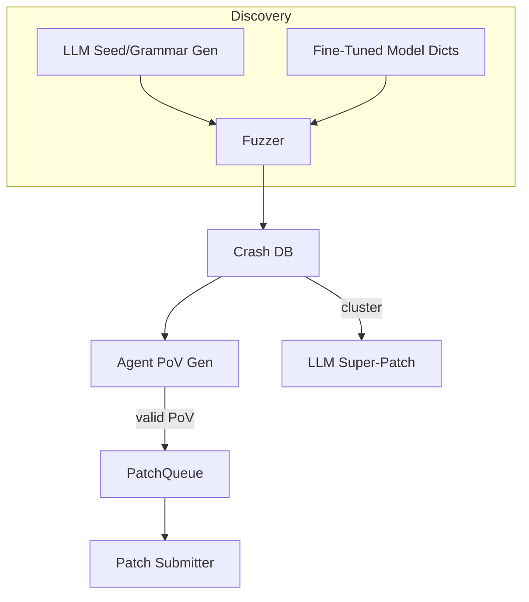

# Fuzzing Inayosaidiwa na AI na Ugunduzi wa Kiotomatiki wa Udhaifu

{{#include ../banners/hacktricks-training.md}}

## Muhtasari
Large-language models (LLMs) zinaweza kuongeza kwa kiasi kikubwa uwezo wa mifumo ya jadi ya utafiti wa udhaifu kwa kuzalisha inputs zenye maana ya kisemantiki, kuboresha grammars, kutoa hoja kuhusu data ya crash, na hata kupendekeza patches zinazoshughulikia bugs nyingi. Ukurasa huu unakusanya mifumo yenye ufanisi zaidi iliyoonekana katika fainali za AI Cyber Challenge (AIxCC) za DARPA na katika tafiti nyingine za umma.<sup>[[4]](#references)</sup><sup>[[5]](#references)</sup>

Yafuatayo si maelezo ya mfumo mmoja maalum wa mashindano, bali ni muhtasari wa mbinu ili uweze kuzitumia tena katika workflows zako mwenyewe.

---

## 1. Seed Inputs Zinazozalishwa na LLM

Coverage–guided fuzzers za jadi (AFL++, libFuzzer, Honggfuzz…) huanza na corpus ndogo ya seeds na kubadilisha bytes bila mwelekeo maalum. Muundo wa input ya target unapokuwa changamano (SQL, URLs, binary protocols maalum), mabadiliko ya nasibu kwa kawaida huharibu syntax kabla matawi ya kuvutia hayajafikiwa.

LLMs zinaweza kutatua tatizo hili la kuanzisha kwa kuzalisha *seed generators* – scripts fupi zinazotoa **inputs zenye syntax sahihi lakini zinazohusiana na usalama**. Kwa mfano:

```prompt
SYSTEM: You are a helpful security engineer.
USER:
Write a Python3 program that prints 200 unique SQL injection strings targeting common anti-pattern mistakes (missing quotes, numeric context, stacked queries).  Ensure length ≤ 256 bytes / string so they survive common length limits.
```

```python
# gen_sqli_seeds.py (truncated)
PAYLOADS = [
    "1 OR 1=1 -- ",
    "' UNION SELECT NULL,NULL--",
    "0; DROP TABLE users;--",
    ...
]
for p in PAYLOADS:
    print(p)
```

Iendeshe mara moja kisha uweke matokeo moja kwa moja kwenye corpus ya mwanzo ya fuzzer:

```bash
python3 gen_sqli_seeds.py > seeds.txt
afl-fuzz -i seeds.txt -o findings/ -- ./target @@
```

Faida:
1. Uhalali wa kisemantiki → coverage ya kina mapema.
2. Inaweza kuzalishwa tena: rekebisha prompt ili kulenga XSS, path traversal, binary blobs, n.k.
3. Nafuu (< 1 ¢ with GPT-3.5).

### Vidokezo
* Iagize model *itofautishe* urefu na encoding ya payload (UTF-8, URL-encoded, UTF-16-LE) ili kukwepa filters za juu juu.
* Omba *script moja inayojitegemea* – huepusha matatizo ya uumbizaji wa JSON.

---

## 2. Grammar-Evolution Fuzzing

Toleo lenye nguvu zaidi ni kuiacha LLM **iboreshe grammar** badala ya seeds halisi. Mtiririko wa kazi (muundo wa “Grammar Guy”) ni:

1. Tengeneza grammar ya awali ya ANTLR/Peach/LibFuzzer kupitia prompt.
2. Fanya fuzzing kwa dakika N na ukusanye vipimo vya coverage (edges / blocks zilizofikiwa).
3. Fupisha maeneo ya program ambayo hayajafunikwa na urudishe muhtasari huo kwa model:
   ```prompt
   The previous grammar triggered 12 % of the program edges.  Functions not reached: parse_auth, handle_upload.  Add / modify rules to cover these.
   ```
4. Unganisha sheria mpya, re-fuzz, rudia.

Muundo wa pseudo-code:

```python
for epoch in range(MAX_EPOCHS):
    grammar = llm.refine(grammar, feedback=coverage_stats)
    save(grammar, f"grammar_{epoch}.txt")
    coverage_stats = run_fuzzer(grammar)
```

Mambo muhimu:
* Weka *budget* – kila uboreshaji hutumia tokens.
* Tumia maagizo ya `diff` + `patch` ili modeli ifanye marekebisho badala ya kuandika upya.
* Simama wakati Δcoverage < ε.

---

## 3. Uhandisi wa Local-LLM libFuzzer Harness

Kwa source ambayo haiwezi kuondoka kwenye workstation ya mchambuzi, modeli ya code ya ndani inaweza kuandaa adapter ndogo kati ya bytes za fuzzer na API ya C/C++. Mpaka wa usalama unaofaa uko wazi: **modeli huandika na kurekebisha miundombinu ya majaribio; mutation inayoongozwa na coverage huchunguza inputs; sanitizers huripoti operesheni batili; binadamu hukagua harness na kuchambua matokeo**.<sup>[[9]](#references)</sup>

Kwa mbinu za corpus, feedback, snapshot na stateful-fuzzing za kiwango cha engine ambazo hazitegemei LLM, angalia [Fuzzing Methodology](../generic-methodologies-and-resources/fuzzing.md).

Anza na tamko halisi lililonakiliwa kutoka kwenye header ya target, kisha weka masharti ya muundo wa matokeo. Prompt finyu hupunguza API zilizobuniwa na kurahisisha ukaguzi wa matokeo:<sup>[[8]](#references)[[9]](#references)</sup>

```prompt
Write a libFuzzer target for this exact declaration:
int parse_records(const uint8_t *data, size_t size);

Output only C code. Implement LLVMFuzzerTestOneInput, include the
declaration, pass data and size unchanged, and do not use files,
network access, randomness, clocks, threads, or persistent state.
```

Kwa parser ya raw byte, matokeo yanayotarajiwa hayapaswi kuwa magumu zaidi ya:<sup>[[6]](#references)[[9]](#references)</sup>

```c
#include <stddef.h>
#include <stdint.h>

extern int parse_records(const uint8_t *, size_t);

int LLVMFuzzerTestOneInput(const uint8_t *data, size_t size) {
    (void)parse_records(data, size);
    return 0;
}
```

Ukusanyaji ni hatua ya kwanza tu ya uthibitishaji. Kagua kila target iliyozalishwa kulingana na masharti haya kabla ya kutumia muda wa CPU juu yake:<sup>[[6]](#references)[[8]](#references)[[9]](#references)</sup>

- **API halisi:** Linganisha aina, kanuni za umiliki, uanzishaji, usafishaji na kanuni ya kuita na header halisi pamoja na watumiaji waliopo.
- **Usalama wa harness:** Linda kila usomaji kutoka `data`; matokeo ya sanitizer lazima yatokane na target, si glue code iliyozalishwa.
- **Uwezo wa kurudiwa:** Fanya matokeo yawe kazi ya `data` na `size`; ondoa I/O ya nje, muda, random isiyodhibitiwa, threads zisizounganishwa na hali inayobaki kati ya miito.
- **Throughput:** Anzisha hali ghali isiyobadilika mara moja tu ikiwa hili haliwezi kuathiri tabia, weka kikomo cha ukubwa wa ingizo, zuia logging na uachie allocations za kila ingizo.
- **Ufikikaji:** Hakikisha kuwa functions na branches zilizokusudiwa zinaendeshwa. Target inayokusanywa lakini inayojaribu tu njia za kukataa ni hitilafu isiyoonekana.

### Targets zinazozingatia muundo: hifadhi masharti bila kuficha bugs

Ikiwa ingizo nyingi ghafi hushindwa kwenye kizuizi cha magic, urefu, toleo au checksum, tumia fuzz bytes kama nyenzo za fields zenye aina maalum na ujenge upya object halali. Weka constants za format zisizobadilika, acha fields za kisemantiki na payload bytes zibadilike, kisha hesabu metadata ya integrity kutokana na payload iliyojengwa upya. `FuzzedDataProvider` ni muhimu kwa kutumia thamani zenye aina maalum na mipaka, huku adapter ikiendelea kuwajibika kwa kuweka kikomo cha allocations na conversions zozote zinazozalishwa.<sup>[[9]](#references)</sup>

<details>
<summary>Mfano wa C++ target inayozingatia muundo</summary>

```cpp
#include <fuzzer/FuzzedDataProvider.h>
#include <stddef.h>
#include <stdint.h>
#include <vector>

extern "C" int parse_message(const uint8_t *, size_t);

extern "C" int LLVMFuzzerTestOneInput(const uint8_t *data, size_t size) {
    FuzzedDataProvider fdp(data, size);
    uint8_t version = fdp.ConsumeIntegral<uint8_t>();
    auto body = fdp.ConsumeRemainingBytes<uint8_t>();
    if (body.size() > UINT16_MAX) body.resize(UINT16_MAX);
    uint16_t len = static_cast<uint16_t>(body.size());
    std::vector<uint8_t> msg = {0x8b, 'M', 'S', 'G', version,
                                static_cast<uint8_t>(len >> 8),
                                static_cast<uint8_t>(len)};
    msg.insert(msg.end(), body.begin(), body.end());
    (void)parse_message(msg.data(), msg.size());
    return 0;
}
```

</details>

Usitumie target moja inayorekebisha muundo kwa kila swali. Dumisha target moja inayokokotoa urefu/checksum ili kuchunguza hali halali za ndani zaidi, na nyingine inayofanya metadata **iliyotangazwa** idhibitiwe na fuzzer huku ikiweka mipaka kwenye usomaji na ugawaji kumbukumbu unaofanywa na harness pekee. Target ya pili huhifadhi sehemu za mashambulizi za urefu usiolingana na uadilifu usio sahihi, ambazo marekebisho ya kiotomatiki yangeondoa.<sup>[[9]](#references)</sup>

### Seeds, dictionaries, sanitizers, na maoni ya coverage

Iombe model itengeneze script inayoandika seeds za binary badala ya kuiomba ichapishe binary moja kwa moja. Tumia objects tupu, za kiwango cha chini kabisa, za kawaida na halali zilizo kwenye mipaka; kisha toa thamani za magic, tags, usimbaji wa enum na maneno muhimu ya parser, uzikusanye kwenye dictionary iliyokaguliwa. libFuzzer hupokea dictionary hiyo kwa `-dict=`, na huhifadhi kwenye corpus mutations zinazofichua coverage mpya.<sup>[[6]](#references)[[9]](#references)</sup>

```text
magic="\x8bMSG"
version_min="\x00"
version_max="\xff"
config_tag="CONFIG"
```

Jenga target hiyo hiyo kwa instrumentation inayokamilishana. ASan na UBSan zinaweza kutumia binary moja ya fuzzing; tumia build tofauti ya MSan na uweke dependencies zake kwenye instrumentation ili kuepuka ripoti zinazosababishwa na code isiyo na instrumentation.<sup>[[6]](#references)[[9]](#references)</sup>

```bash
clang++ -g -O1 -fsanitize=fuzzer,address,undefined \
  -fno-sanitize-recover=undefined target.cc harness.cc -o fuzz_target
./fuzz_target corpus -dict=msg.dict -max_len=65535

clang++ -g -O1 -fsanitize=fuzzer,memory \
  target.cc harness.cc -o fuzz_target_msan
```

Chukulia coverage kama kipimo cha kutathmini kila marekebisho ya model. Katika matokeo ya libFuzzer, `cov`/`ft` zinazofikia kiwango cha juu mapema na corpus tuli kwa kawaida huashiria framing isiyo sahihi, early return yenye masharti makali kupita kiasi, au wito usio sahihi; `exec/s` ya chini huashiria usanidi unaotumia muda mwingi, I/O, ugawaji wa kumbukumbu, au state iliyovuja. `NEW` huthibitisha tu kwamba kipengele cha coverage kimebadilika, si kwamba parser iliyokusudiwa ilifikiwa.<sup>[[6]](#references)[[9]](#references)</sup>

Kwa feedback ya kiwango cha source, tengeneza build ya coverage, fanya fuzzing, kisha mpe model functions ambazo hazijafikiwa pekee pamoja na masharti yanayozilinda. Thibitisha mabadiliko ya harness/seed/dictionary na upime tena:<sup>[[7]](#references)[[8]](#references)[[9]](#references)</sup>

```bash
clang++ -g -O1 -fsanitize=fuzzer \
  -fprofile-instr-generate -fcoverage-mapping target.cc harness.cc -o fuzz_cov
mkdir -p profiles
LLVM_PROFILE_FILE='profiles/%p.profraw' ./fuzz_cov -max_total_time=300 corpus
llvm-profdata merge -sparse profiles/*.profraw -o fuzz.profdata
llvm-cov report ./fuzz_cov -instr-profile=fuzz.profdata
llvm-cov show ./fuzz_cov -instr-profile=fuzz.profdata \
  --show-branches=count --region-coverage-lt=1 target.cc
```

Mtiririko unaoweza kupanuliwa ni **zalisha → compile/link → fanya smoke-test chini ya sanitizers → pima coverage ya target → toa muktadha mdogo zaidi unaohusika wa coverage/source → rekebisha → pima tena**. OSS-Fuzz-Gen hutumia kanuni hiyo hiyo kwa kutathmini targets zilizozalishwa kulingana na uwezo wa ku-compile, hitilafu za runtime, coverage na uboreshaji wa coverage dhidi ya targets zilizopo, badala ya kukubali tu code inayoonekana kuwa sahihi.<sup>[[7]](#references)[[8]](#references)</sup>

---

<a id="3-agent-based-pov-exploit-generation" hidden>3. Agent-Based PoV (Exploit) Generation</a>

## 4. Uzalishaji wa PoV (Exploit) kwa Kutumia Agents

Baada ya crash kupatikana, bado unahitaji **proof-of-vulnerability (PoV)** inayoianzisha kwa uhakika kila mara.

Mbinu inayoweza kupanuliwa ni kuanzisha workers wengi wepesi (processes, threads au containers), kila mmoja akitumia model au usanidi tofauti wa sampling. Utafiti wa finalists wa AIxCC unatoa mifano halisi ya ukubwa: timu moja ilitumia **maelfu ya agents zinazofanya kazi kwa wakati mmoja** kwa ajili ya uzalishaji wa PoV unaotanguliza AI, huku nyingine ikiratibu **agents 300–500 za fuzzing** na kutumia LLMs kwa hoja za kisemantiki za kiwango cha juu.<sup>[[4]](#references)</sup>

Mtiririko:
1. Static/dynamic analysis hutoa *wagombeaji wa hitilafu* (struct yenye crash PC, input slice na ujumbe wa sanitizer).
2. Orchestrator husambaza wagombeaji kwa agents.
3. Hatua za hoja za agent:
   a. Zalisha hitilafu tena ndani ya mazingira ya ndani kwa `gdb` + input.
   b. Pendekeza payload ndogo zaidi ya exploit.
   c. Thibitisha exploit ndani ya sandbox. Ikifaulu → iwasilishe.
4. Majaribio yaliyoshindwa **huwekwa tena kwenye foleni kama seeds mpya** za coverage fuzzing (mzunguko wa mrejesho).

Faida:
* Uendeshaji sambamba huficha kutotegemewa kwa agent mmoja.
* Urekebishaji wa kiotomatiki wa temp / ukubwa wa model kulingana na kiwango cha mafanikio kilichoonekana.

---

<a id="4-directed-fuzzing-with-fine-tuned-code-models" hidden>4. Directed Fuzzing with Fine-Tuned Code Models</a>

## 5. Directed Fuzzing kwa Kutumia Code Models Zilizofanyiwa Fine-Tuning

Fanya fine-tuning ya model yenye open-weight (kwa mfano, Llama-7B) kwa kutumia source ya C/C++ iliyoainishwa kwa mifumo ya vulnerability (integer overflow, buffer copy, format string). Kisha:

1. Endesha static analysis ili kupata orodha ya functions + AST.
2. Ipe model prompt: *“Toa entries za mutation dictionary ambazo zina uwezekano wa kuvunja usalama wa memory katika function X”*.
3. Ingiza tokens hizo kwenye `AFL_CUSTOM_MUTATOR` maalum.

Mfano wa matokeo kwa wrapper ya `sprintf`:
```
{"pattern":"%99999999s"}
{"pattern":"AAAAAAAA....<1024>....%n"}
```

Kimaadili, hii hupunguza muda hadi crash kwa zaidi ya mara 2 kwenye targets halisi.

---

<a id="5-ai-guided-patching-strategies" hidden>5. Mikakati ya Kutengeneza Viraka Inayoongozwa na AI</a>

## 6. Mikakati ya Kutengeneza Viraka Inayoongozwa na AI

<a id="51-super-patches" hidden>5.1 Viraka Bora</a>

### 6.1 Viraka Bora
Iombe model *ikusanye pamoja* saini za crash na ipendekeze **kiraka kimoja** kinachoondoa chanzo kikuu cha pamoja.  Wasilisha mara moja, rekebisha bugs kadhaa → adhabu chache za usahihi katika mazingira ambako kila kiraka kisicho sahihi hugharimu pointi.

Muhtasari wa prompt:
```
Here are 10 stack traces + file snippets.  Identify the shared mistake and generate a unified diff fixing all occurrences.
```

{{#ref}}
../generic-methodologies-and-resources/fuzzing.md
{{#endref}}

<a id="52-speculative-patch-ratio" hidden>Uwiano wa 5.2 wa Patch za Makisio</a>

### 6.2 Uwiano wa Patch za Makisio
Tekeleza queue ambamo patch zilizothibitishwa kwa PoV na patch za *makisio* (zisizo na PoV) zinaingiliana kwa uwiano wa 1:N unaolingana na kanuni za utoaji alama (kwa mfano, patch 2 za makisio : patch 1 iliyothibitishwa). Muundo wa gharama hufuatilia adhabu dhidi ya pointi na kurekebisha N kiotomatiki.

---

<a id="6-deterministic-file-by-file-ai-code-review" hidden>Ukaguzi Deterministic wa AI wa Code, Faili kwa Faili</a>

## 7. Ukaguzi Deterministic wa AI wa Code, Faili kwa Faili

Tatizo linalojirudia katika ukaguzi unaosaidiwa na AI ni kumwomba agent mmoja akague repository nzima na kutegemea achague faili na maneno sahihi ya grep. Mbinu inayotegemewa zaidi ni **kulazimisha kufunika repository yote**:<sup>[[1]](#references)</sup>

1. Orodhesha faili za source.
2. Tuma **faili moja kwa wakati mmoja** pamoja na muktadha wa chini kabisa (entrypoint, imports, routes/callers zilizo karibu).
3. Dai **ripoti yenye muundo** kwa kila faili: sources, sink, validation inayokosekana, masharti ya exploit, na kiwango cha uhakika.<sup>[[3]](#references)</sup>
4. Ondoa ripoti zinazojirudia kwa kutumia **muundo wa source→sink** na uthibitishe mwenyewe zile zenye hatari kubwa.

Hii hutumia token nyingi na hutoa kelele nyingi, lakini inafaa sana kufichua **hitilafu rahisi za source/sink zenye athari kubwa** ambazo ukaguzi mpana wa agentic mara nyingi hukosa.

### Miundo ya triage inayostahili kupewa kipaumbele

- **Dynamic PHP include/dispatch**: majina ya route/controller/module yanayodhibitiwa na mshambuliaji na kufika kwenye `require_once()`, `include()`, au `include_once()` bila allowlist kali na canonicalisation ya path.
- **Utekelezaji wa shell katika workflows za admin/account**: usernames, domains, akaunti za FTP au vitambulisho vingine vinavyofika kwenye `exec()`, `system()`, `shell_exec()`, `passthru()`, `proc_open()` au `popen()`.
- **Uingizaji wa data zenye muundo kutoka vyanzo vingi**: parameter ileile inayokubaliwa kutoka `$_GET`, `$_POST`, JSON, XML au body parsers za framework na baadaye kutumiwa tena kwenye sinks za filesystem au OS-command.

### Aina mbili za vitendo za bug ambazo mbinu hii huzipata vizuri

- **LFI/RCE kupitia PHP controller-dispatch**: ikiwa jina la controller linalodhibitiwa na request limeunganishwa kwenye `require_once()` bila allowlist/path normalisation, mfuatano wa traversal kama `../` unaweza kusababisha PHP kujumuisha faili ya ndani ya `.php` isiyokusudiwa. Ikiwa mshambuliaji anaweza kuelekeza include kwenye faili ya PHP aliyoweka au yenye manufaa kwa njia nyingine, LFI hugeuka kuwa utekelezaji wa code. Tazama [File Inclusion / Path Traversal](../pentesting-web/file-inclusion/README.md).<sup>[[1]](#references)</sup>
- **Command injection iliyothibitishwa kwenye hosting/admin panels**: ikiwa sehemu za usimamizi wa akaunti kama usernames zimeingizwa kwenye shell commands, mtumiaji aliyethibitishwa mwenye ruhusa ndogo anaweza kubadilisha kitendo cha kawaida cha kuunda/kufuta akaunti na kukifanya RCE. Athari huwa kubwa zaidi pale panel inapotekeleza command kama service account yenye ruhusa zaidi. Tazama [Command Injection](../pentesting-web/command-injection.md).<sup>[[1]](#references)</sup>

### Vidokezo vya vitendo vya ukaguzi

- Tumia LLM kama **mkaguzi wa source/sink kwanza**, si kama jenereta ya exploit.
- Iombe itaje wazi **field inayodhibitiwa na mshambuliaji**, **pengo la normalization/validation**, na **sink hatari**.
- Kwa repos kubwa, ukaguzi deterministic wa kila faili mara nyingi hutegemewa zaidi kuliko uendeshaji mmoja wa agent huru, hata kama wa pili unatumia model imara zaidi.<sup>[[2]](#references)</sup>
- Tarajia matokeo dhaifu zaidi kuhusu **Broken Access Control** na bug nyingine za business logic ambapo uwezekano wa exploit hutegemea dhana zinazovuka faili nyingi, maana ya role, au threat models mahususi za bidhaa.

---

## Taskflows za mobile entry-point

Prompt moja ya repository nzima mara nyingi huchanganya threat models na kupoteza njia kutoka kwenye component inayoweza kufikiwa kwa nje hadi kwenye sink nyeti. Workflow imara zaidi hugawa ukaguzi katika taskflows zenye state: kwanza ainisha applications/components, kisha orodhesha entry points zinazodhibitiwa na mshambuliaji, ongeza metadata ya ufikikaji kwa kila entry point, na hatimaye kagua kila moja dhidi ya aina za vulnerability mahususi za platform. Taskflows za mobile za GitHub Security Lab hutumia muundo huu kwa repos za Android, iOS na za cross-platform.<sup>[[14]](#references)[[15]](#references)</sup>

Kwa Android, rekodi angalau:<sup>[[14]](#references)[[15]](#references)</sup>

- Activities, Services, Receivers na Providers zilizo exported, pamoja na permissions;
- intent actions, deep-link schemes/hosts/paths, MIME filters na App Links;
- actions, data URIs, `ClipData`, extras na URI-grant flags zinazodhibitiwa na mshambuliaji;
- inputs za WebView navigation na madaraja ya `addJavascriptInterface`;
- shughuli za privileged zinazofuata, resources zilizoingizwa na maeneo lengwa ya mtandao.

Kisha ainisha kila entry point katika muktadha wake. Uliza wazi kuhusu authorization ya caller/behavior ya confused-deputy, intent redirection, broadcast spoofing au disclosure, imports zisizo salama, WebView scripting na kufichuliwa kwa bridge, pamoja na uhamishaji wa credentials au cookies kati ya origins. Tekeleza **ukaguzi mkali wa checklist** na **ukaguzi mpana wa adversarial**. Unganisha findings na [Intent Injection](../mobile-pentesting/android-app-pentesting/intent-injection.md) na [WebView Attacks](../mobile-pentesting/android-app-pentesting/webview-attacks.md) badala ya kurudia maelezo ya exploitation.<sup>[[15]](#references)</sup>

Taskflows za sasa za open-source zinaweza kuanzishwa kutoka Codespace yake kwa kutumia:<sup>[[14]](#references)</sup>

```bash
./scripts/audit/run_audit.sh owner/repository
```

Matokeo huandikwa kwenye SQLite katika jedwali la `audit_result`.<sup>[[14]](#references)</sup> Chukulia safu mlalo zilizoainishwa kuwa ziko hatarini kama **viashiria vya kufuatilia**, si matokeo yaliyothibitishwa. Kwa kila kiashiria, itake modeli itaje chanzo kinachodhibitiwa na mshambulizi, sinki nyeti, masharti ya awali na athari inayotarajiwa, kisha iombe itengeneze PoC ndogo iwezekanavyo. Tekeleza PoC hiyo dhidi ya build asilia kwa kutumia debugger au instrumentation. Hii hugundua makosa ya kawaida ya static analysis, kama vile matawi ya msimbo yasiyoweza kufikiwa, hali zisizo halisi za programu, data ya hifadhi ya nje kupoteza kipaumbele dhidi ya data ya faragha, na hatua za kupunguza athari zinazopunguza ukali kwa kiasi kikubwa.<sup>[[15]](#references)</sup>

---

## 8. Ukaguzi wa Kernel unaoongozwa na Pattern kwa kutumia Oracle yenye Instrumentation

Kwa target yenye ukubwa wa kernel, usiiombe agent itafute hitilafu za aina yoyote kwenye mti mzima wa msimbo. Workflow yenye ufanisi zaidi wa token hubadilisha maarifa ya kihistoria kuhusu udhaifu kuwa queries za static, huweka matokeo katika mpangilio kulingana na sehemu ya mashambulizi iliyo wazi, na hutumia kernel yenye instrumentation kama oracle ya utekelezaji.<sup>[[11]](#references)</sup>

### Hifadhidata ya Pattern → CodeQL/Semgrep → mapitio yaliyolengwa

Tengeneza hifadhidata ndogo ya maarifa yenye API hatari, pattern za ukosefu wa uthibitishaji, mtiririko hatarishi kutoka source hadi sink, na miundo ya hitilafu iliyowahi kurekebishwa. Iombe modeli itafsiri **pattern moja kwa wakati mmoja** kuwa heuristics za mapitio na rules za CodeQL/Semgrep, kisha endesha rules hizo zenye matokeo thabiti kwenye mti mzima wa msimbo. Panga na ondoa nakala za matokeo yanayofanana kabla ya kuipa modeli msimbo; matokeo ghafi ya scanner yanaweza kuwa na maelfu ya wagombea wasio na thamani kubwa. Kagua leseni ya sasa ya CodeQL kabla ya kutumia mbinu hii nje ya malengo yanayostahiki ya utafiti au open-source.<sup>[[11]](#references)</sup>

Weka kipaumbele kwa subsystems ukizingatia **msongamano wa matokeo ya rule** na **uwezekano wa kufikiwa na mshambulizi**, badala ya idadi ya matokeo pekee. Interfaces za kernel zinazoweza kufikiwa na michakato isiyo na ruhusa za juu, sandboxes, containers, jails au mazingira ya guest zinapaswa kupewa uzito zaidi kuliko msimbo wa ndani pekee. Weka sehemu ya msimbo inayokaguliwa iwe ndogo vya kutosha ili agent ikumbuke callers, validators na rules za lifetime, na iombe itafute aina maalum ya udhaifu au pattern ya control flow badala ya kusema “tafuta udhaifu wowote.” Interfaces za zamani zenye ruhusa za juu huvutia zaidi hasa pale ambapo mpaka mpya wa containment unazifanya zifikike kwa mtumiaji wa root aliye kwenye namespace au jail.<sup>[[11]](#references)</sup>

Kwa kila mgombea, hitaji rekodi wazi ya mtiririko wa data kati ya fields kabla ya kujaribu exploitation.<sup>[[11]](#references)</sup>

```text
entrypoint -> privilege check -> parser -> validation/normalization
           -> later rewrite -> dangerous sink
attacker controls: <fields and lengths>
constraints:       <values rewritten, rejected, or preserved>
observable result: <sanitizer report, assertion, panic, or clean exit>
```

### Tumia telemetry ya KASAN kama oracle ya dhana

Endesha kernel lengwa kwenye VM ya muda mfupi yenye KASAN na assertions muhimu za uchunguzi zimewezeshwa. Agent inapaswa kurudia hatua hizi: **dhana kuhusu source → kichochezi kidogo cha userland → utekelezaji wa VM → trace ya KASAN/assertion → dhana iliyorekebishwa** hadi corruption inayoshukiwa izalishwe tena au ikataliwe. Rudisha tu stack trace husika na source iliyo karibu kwa kila marudio; hii huhifadhi muktadha wa kufikiri huku ushahidi wa wakati wa utekelezaji—si imani ya model—ukiwa kigezo cha kukubali.<sup>[[11]](#references)</sup>

Build iliyo na instrumentation si mazingira ya mwisho ya kutathmini uwezekano wa exploit. Assertions zinaweza kusimamisha utekelezaji kabla ya operesheni inayosababisha corruption, ilhali assertion hiyo hiyo inaweza kuondolewa wakati wa kucompile kernel ya production. Jaribu tena kichochezi kilekile bila mabadiliko kwenye configuration halisi ya production, rekodi build na configuration ya kernel, na chukulia **uwezekano wa kufikiwa**, **memory corruption**, **controlled primitive**, na **athari ya kiusalama** kama madai tofauti.<sup>[[11]](#references)[[12]](#references)</sup>

CVE-2026-3038 ni mfano mzuri wa uthibitishaji, si kiolezo cha exploit. Ombi lisilohitaji ruhusa la FreeBSD `RTM_GET` lingeweza kuhifadhi sockaddr ya `RTAX_AUTHOR` yenye ukubwa uliozidi, kupitia validation teule na uandishi upya wa jibu, hadi `rtsock_msg_buffer()` iliponakili `sa_len` inayodhibitiwa na mtumiaji kwenye `sockaddr_storage` ya stack yenye ukubwa wa baiti 128. Nakala ya juu kabisa ya baiti 255 ilisababisha overwrite ya baiti 127; diagnostic assertion ilinasa urefu usio sahihi kwenye build yenye instrumentation, ilhali kernel ya GENERIC ilifikia nakala hiyo kisha ikapata panic wakati canary iliyoharibiwa ilipokaguliwa. Hii inathibitisha denial of service isiyohitaji ruhusa, si privilege escalation inayojitegemea: udhibiti wa kuaminika ungehitaji kwanza primitive nyingine, kama canary disclosure. Tazama [Stack Canaries](../binary-exploitation/common-binary-protections-and-bypasses/stack-canaries/index.html) kwa mipaka inayohusika na binary exploitation.<sup>[[11]](#references)[[12]](#references)[[13]](#references)</sup>

### Kataa udanganyifu kuhusu masharti ya awali ya exploit

Kabla ya kukubali PoV au exploit, mwambie reviewer/agent tofauti ajaribu kuibatilisha kwa kutumia vigezo vilivyowekwa. Ukaguzi lazima uthibitishe masharti yote yafuatayo.<sup>[[11]](#references)</sup>

- Source ya target, kernel, na module iliyo hatarini havikubadilishwa ili kufanya njia hiyo iweze kufikiwa.
- Hakuna helper module, gadget ya kutengenezwa, mitigation iliyozimwa, ruhusa ya ziada, au interface isiyopatikana iliyoletwa.
- Kichochezi huanza kwa utambulisho wa caller na vizuizi vya containment vinavyodaiwa, kwenye snapshot safi.
- Matokeo yanayodaiwa bado yanategemea bug: kuondoa field iliyoharibika au kuweka patch kwenye bug pekee lazima kuvunje mnyororo.
- Crash, overread, au overwrite inaripotiwa kama primitive hiyo pekee; code execution au privilege escalation inahitaji ushahidi huru.

Ukaguzi huu wa kinyume cha dhana hunasa maonyesho ya mduara: ikiwa masharti ya awali tayari yanatoa athari inayodaiwa (kwa mfano, kutekeleza maudhui ya SUID yaliyotolewa na mshambuliaji kutoka kwenye filesystem iliyowekwa bila `nosuid`), bug ya memory-safety haikusababisha athari hiyo.<sup>[[11]](#references)</sup>

---

## Utafiti Unaoweza Kukaguliwa Unaosaidiwa na Agent kwenye Codebase Zisizofahamika

Workflow ya [graph-first fuzz-target](../generic-methodologies-and-resources/fuzzing.md#graph-first-fuzz-target-selection-and-mutation-triage) tayari inashughulikia ufikikaji wa entrypoint, huku [agentic SAST pipelines](../network-services-pentesting/pentesting-web/code-review-tools.md#agentic-sast-pipelines) zikishughulikia ukaguzi wa hatua kwa hatua na vigezo vya ushahidi. Weka matokeo hayo ya deterministic kando na dhana za model ili kila lead iliyokubaliwa ihifadhi maeneo ya source, ushahidi wa njia, na kipimo cha dynamic.<sup>[[10]](#references)</sup>

### Linganisha ushahidi wa muda wa uhai wa object bila kubuni data flow

Static analysis inaweza kugundua urefu unaodhibitiwa na mshambuliaji ukiwekwa kwenye object ndani ya function moja, na field ileile ya object kufikia sink ya copy baadaye sana, lakini ikashindwa kuthibitisha uhusiano huo kupitia callbacks, reconnects, au muda wa uhai wa object. Hifadhi matokeo hayo mawili kando, yapange kwa object/field, na ufanye edge inayokosekana kuwa swali wazi la triage. Agent inaweza kupendekeza uhusiano huo, lakini lazima uthibitishwe kwa ukaguzi wa source au runtime instrumentation.<sup>[[10]](#references)</sup>

Kwa kila candidate, rekodi:

- entrypoint halisi na baiti zinazodhibitiwa na mshambuliaji;
- kila producer ya field husika, pamoja na validation maalum kwa kila producer;
- sink, uwezo wa destination, na masharti ya build/runtime yanayohitajika ili kuifikia;
- call stack halisi kutoka kwenye entrypoint iliyo wazi, si mwito wa moja kwa moja wa harness pekee;
- matokeo madogo zaidi ya dynamic yanayothibitisha au kukataa dhana.

Njia inayoonekana kuwa salama haithibitishi usalama wa field kila mahali. Producer wa pili anaweza kujaza field hiyohiyo bila bound ya njia ya kwanza. Jaribu njia hizo kivyake na endesha harness kwa build options zinazolingana na deployment, kwa kuwa debug assertions zinaweza kugeuza memory corruption ya production kuwa kusimamishwa mapema kwa majaribio pekee.<sup>[[10]](#references)</sup>

### Vigezo vya kipimo vya disclosure na exploitation

Kwa memory disclosure inayoshukiwa kuwa haijaanzishwa, jaza allocations mpya kwa baiti inayotambulika na uthibitishe kuwa marker hiyo hiyo inafika kwenye packet iliyotolewa. Kwa exploitation, hitaji vigezo vilivyopimwa kama **controlled overwrite → useful victim object → disclosure → pointer/base recovery → control-flow hijack → composed payload**. Agent huendelea tu pale harness inapothibitisha sifa ya sasa; simulizi linaloonekana kuwa la kuaminika halimaanishi kigezo kimepita. [Kisa cha FreeRDP](../binary-exploitation/libc-heap/heap-overflow.md#cross-path-length-reuse-and-stale-output-disclosure) kinaonyesha njia na masharti ya build yanayopaswa kuhifadhiwa wakati wa uthibitishaji.<sup>[[10]](#references)</sup>

---

Kwa kisa cha kernel kinachotumia uthibitishaji wa hatua kwa hatua wa L0–L4 kwa utengenezaji wa exploit unaosaidiwa na LLM, tazama:

{{#ref}}
../binary-exploitation/freebsd-kernel-exploitation-vnet-jail-escape.md
{{#endref}}

## Kuyaunganisha Yote
CRS (Cyber Reasoning System) ya mwanzo hadi mwisho inaweza kuunganisha vipengele kama hivi:



---

## References

- [1] [Project Black - AI ya ndani kwa Usalama wa Mtandao: Kugundua phpIPAM LFI na myVesta Authenticated RCE](https://projectblack.io/blog/local-ai-for-cyber-security)
- [2] [Strix](https://github.com/usestrix/strix)
- [3] [Ujuzi wa security-review wa jumuiya ya GitHub Copilot](https://github.com/github/awesome-copilot/blob/main/skills/security-review/SKILL.md)
- [4] [Trail of Bits – Fainali za AIxCC: Simulizi ya mashindano](https://blog.trailofbits.com/2025/08/07/aixcc-finals-tale-of-the-tape/)
- [5] [Mahojiano ya washiriki waliofika fainali za AIxCC kutoka CTF Radiooo](https://www.youtube.com/@ctfradiooo)
- [6] [LLVM — libFuzzer: maktaba ya majaribio ya fuzz yanayoongozwa na coverage](https://llvm.org/docs/LibFuzzer.html)
- [7] [Google — OSS-Fuzz-Gen](https://github.com/google/oss-fuzz-gen)
- [8] [Blogu ya Usalama wa Google — Kuimarisha Fuzzing: Kugundua Vulnerability zaidi kwa kutumia AI](https://security.googleblog.com/2024/11/leveling-up-fuzzing-finding-more.html)
- [9] [8kSec — Utengenezaji wa Fuzzing Harness kwa Usaidizi wa AI kwa kutumia Local LLM](https://8ksec.io/ai-assisted-fuzzing-harness-local-llm)
- [10] [Quarkslab — Kutoka kwa AI Agents hadi RCE: Kujenga Mtiririko wa Kazi wa Utafiti wa Vulnerability](https://blog.quarkslab.com/from-ai-agents-to-rce-building-a-vulnerability-research-workflow.html)
- [11] [Praetorian — FreeBSoD: Kutumia Language Models Kugundua na Kutumia Kernel Bugs (Sehemu ya 1 kati ya 2)](https://praetorian.com/blog/ai-vulnerability-research-freebsd-kernel)
- [12] [FreeBSD-SA-26:05.route — DoS ya ndani na uwezekano wa kupandisha marupurupu kupitia routing sockets](https://www.freebsd.org/security/advisories/FreeBSD-SA-26:05.route.asc)
- [13] [Kiraka cha chanzo cha FreeBSD-SA-26:05.route](https://security.FreeBSD.org/patches/SA-26:05/route.patch)
- [14] [GitHub Security Lab - Mitiririko ya Kazi ya SecLab](https://github.com/GitHubSecurityLab/seclab-taskflows)
- [15] [GitHub Security Lab - Jinsi tulivyogundua vulnerability 24 za Android kwa kutumia AI security agent ya chanzo huria](https://github.blog/security/how-we-found-24-android-vulnerabilities-using-our-open-source-ai-security-agent)
{{#include ../banners/hacktricks-training.md}}
