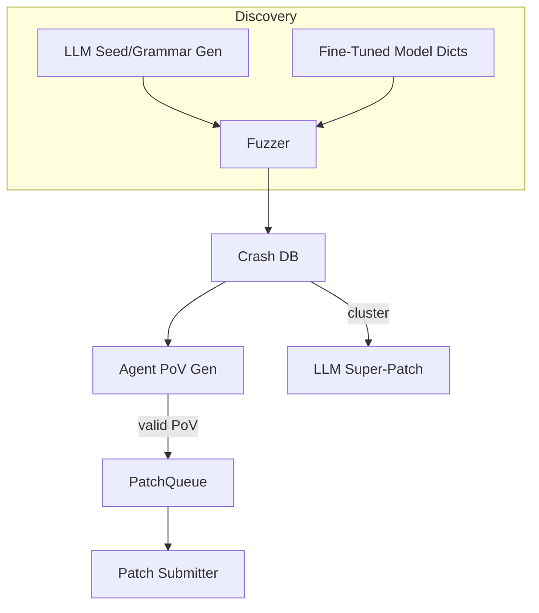

# Fuzzing Inayosaidiwa na AI na Ugunduzi wa Kiotomatiki wa Athari za Usalama

{{#include ../banners/hacktricks-training.md}}

## Muhtasari
Large-language models (LLMs) zinaweza kuongeza kwa kiasi kikubwa uwezo wa mifumo ya jadi ya kutafiti athari za usalama kwa kuzalisha inputs zenye maana ya kisemantiki, kuboresha grammars, kuchanganua data ya crash, na hata kupendekeza patches zinazorekebisha hitilafu nyingi. Ukurasa huu unakusanya mbinu bora zaidi zilizoonekana katika fainali za DARPA’s AI Cyber Challenge (AIxCC) na utafiti mwingine wa umma.<sup>[[4]](#references)</sup><sup>[[5]](#references)</sup>

Yafuatayo si maelezo ya mfumo maalumu wa mashindano, bali ni muhtasari wa mbinu unazoweza kutumia tena katika workflows zako mwenyewe.

---

## 1. Seed Inputs Zinazozalishwa na LLM

Traditional coverage–guided fuzzers (AFL++, libFuzzer, Honggfuzz…) huanza na mkusanyiko mdogo wa seed na kubadilisha bytes bila mpangilio maalumu. Wakati format ya input inayolengwa ni changamano (SQL, URLs, binary protocols maalumu), mabadiliko ya nasibu kwa kawaida huharibu syntax kabla matawi ya kuvutia hayajafikiwa.

LLMs zinaweza kutatua tatizo hili la kuanzisha kwa kutengeneza *seed generators* – scripts fupi zinazotoa **inputs zenye syntax sahihi lakini muhimu kwa usalama**. Kwa mfano:

```prompt
SYSTEM: You are a helpful security engineer.
USER:
Write a Python3 program that prints 200 unique SQL injection strings targeting common anti-pattern mistakes (missing quotes, numeric context, stacked queries).  Ensure length ≤ 256 bytes / string so they survive common length limits.
```

```python
# gen_sqli_seeds.py (truncated)
PAYLOADS = [
    "1 OR 1=1 -- ",
    "' UNION SELECT NULL,NULL--",
    "0; DROP TABLE users;--",
    ...
]
for p in PAYLOADS:
    print(p)
```

Iendeshe mara moja na uweke matokeo moja kwa moja kwenye corpus ya awali ya fuzzer:

```bash
python3 gen_sqli_seeds.py > seeds.txt
afl-fuzz -i seeds.txt -o findings/ -- ./target @@
```

Benefits:
1. Uhalali wa kisemantiki → coverage ya kina zaidi mapema.
2. Inaweza kuzalishwa upya: rekebisha prompt ili izingatie XSS, path traversal, binary blobs, n.k.
3. Gharama nafuu (< 1 ¢ kwa GPT-3.5).

### Tips
* Iagize model *itofautishe* urefu na encoding ya payload (UTF-8, URL-encoded, UTF-16-LE) ili kupita vichujio vya juu juu.
* Omba *script moja inayojitosheleza* – huepusha matatizo ya uumbizaji wa JSON.

---

## 2. Grammar-Evolution Fuzzing

Toleo lenye nguvu zaidi ni kuiruhusu LLM **ibadilishe grammar** badala ya seeds halisi. Mchakato (“Grammar Guy” pattern) ni:

1. Tengeneza grammar ya awali ya ANTLR/Peach/LibFuzzer kupitia prompt.
2. Fanya fuzzing kwa dakika N na ukusanye vipimo vya coverage (edges / blocks zilizoguswa).
3. Fupisha maeneo ya programu ambayo hayajafunikwa na urudishe muhtasari huo kwenye model:
   ```prompt
   The previous grammar triggered 12 % of the program edges.  Functions not reached: parse_auth, handle_upload.  Add / modify rules to cover these.
   ```
4. Unganisha sheria mpya, fanya fuzzing tena, rudia.

Muundo wa pseudocode:

```python
for epoch in range(MAX_EPOCHS):
    grammar = llm.refine(grammar, feedback=coverage_stats)
    save(grammar, f"grammar_{epoch}.txt")
    coverage_stats = run_fuzzer(grammar)
```

Mambo muhimu:
* Weka *budget* – kila uboreshaji hutumia tokens.
* Tumia maagizo ya `diff` + `patch` ili modeli ihariri badala ya kuandika upya.
* Simama wakati Δcoverage < ε.

---

## 3. Uhandisi wa Harness ya Local-LLM libFuzzer

Kwa source code isiyoweza kuondoka kwenye workstation ya mchambuzi, modeli ya code ya ndani inaweza kuandaa adapter ndogo kati ya bytes za fuzzer na API ya C/C++. Mpaka muhimu wa usalama uko wazi: **modeli huandika na kurekebisha miundombinu ya majaribio; coverage-guided mutation huchunguza inputs; sanitizers huripoti operesheni zisizofaa; binadamu hukagua harness na kupanga matokeo yaliyogunduliwa**.<sup>[[9]](#references)</sup>

Kwa mbinu za engine-level za corpus, feedback, snapshot na stateful-fuzzing ambazo hazitegemei LLM, angalia [Fuzzing Methodology](../generic-methodologies-and-resources/fuzzing.md) ya jumla.

Anza na declaration halisi iliyonakiliwa kutoka kwenye header ya target na uweke masharti ya muundo wa output. Prompt finyu hupunguza API zilizobuniwa na kurahisisha ukaguzi wa matokeo:<sup>[[8]](#references)[[9]](#references)</sup>

```prompt
Write a libFuzzer target for this exact declaration:
int parse_records(const uint8_t *data, size_t size);

Output only C code. Implement LLVMFuzzerTestOneInput, include the
declaration, pass data and size unchanged, and do not use files,
network access, randomness, clocks, threads, or persistent state.
```

Kwa parser ya byte ghafi, matokeo yanayotarajiwa hayapaswi kuwa magumu zaidi ya:<sup>[[6]](#references)[[9]](#references)</sup>

```c
#include <stddef.h>
#include <stdint.h>

extern int parse_records(const uint8_t *, size_t);

int LLVMFuzzerTestOneInput(const uint8_t *data, size_t size) {
    (void)parse_records(data, size);
    return 0;
}
```

Compilation ni lango la kwanza tu la uthibitishaji. Kagua kila target iliyozalishwa dhidi ya masharti haya kabla ya kutumia muda wa CPU:<sup>[[6]](#references)[[8]](#references)[[9]](#references)</sup>

- **API halisi:** linganisha aina, kanuni za umiliki, uanzishaji, usafishaji na kanuni za kuita na header halisi pamoja na watumiaji waliopo.
- **Usalama wa harness:** linda kila usomaji kutoka `data`; matokeo ya sanitizer lazima yatokane na target, si glue code iliyozalishwa.
- **Uwezo wa kurudiwa:** hakikisha matokeo yanategemea `data` na `size`; ondoa I/O ya nje, muda, randomness isiyodhibitiwa, threads zisizounganishwa na hali inayodumu kati ya miito.
- **Kasi ya uchakataji:** anzisha hali ghali isiyobadilika mara moja tu ikiwa hilo haliwezi kuathiri tabia, weka kikomo cha ukubwa wa ingizo, zuia logging na uachilie allocations za kila ingizo.
- **Ufikikaji:** thibitisha kuwa functions na branches zilizokusudiwa zinatekelezwa. Target inayokompili lakini hujaribu tu njia za kukataa ni hitilafu isiyoonekana.

### Targets zinazotambua muundo: hifadhi invariants bila kuficha bugs

Ikiwa inputs nyingi ghafi hazipiti kizuizi cha magic, urefu, version au checksum, tumia fuzz bytes kama nyenzo za sehemu zenye aina maalum, kisha unda upya object halali. Weka constants za format zisizobadilika, acha sehemu za semantic na payload bytes ziweze kubadilika, na ukokotoe metadata ya uadilifu kutoka kwenye payload iliyoundwa upya. `FuzzedDataProvider` ni muhimu kwa kutumia thamani zenye aina maalum na mipaka, huku adapter ikiwajibika kuweka kikomo kwa allocations na conversions zozote zinazozalishwa.<sup>[[9]](#references)</sup>

<details>
<summary>Mfano wa target ya C++ inayotambua muundo</summary>

```cpp
#include <fuzzer/FuzzedDataProvider.h>
#include <stddef.h>
#include <stdint.h>
#include <vector>

extern "C" int parse_message(const uint8_t *, size_t);

extern "C" int LLVMFuzzerTestOneInput(const uint8_t *data, size_t size) {
    FuzzedDataProvider fdp(data, size);
    uint8_t version = fdp.ConsumeIntegral<uint8_t>();
    auto body = fdp.ConsumeRemainingBytes<uint8_t>();
    if (body.size() > UINT16_MAX) body.resize(UINT16_MAX);
    uint16_t len = static_cast<uint16_t>(body.size());
    std::vector<uint8_t> msg = {0x8b, 'M', 'S', 'G', version,
                                static_cast<uint8_t>(len >> 8),
                                static_cast<uint8_t>(len)};
    msg.insert(msg.end(), body.begin(), body.end());
    (void)parse_message(msg.data(), msg.size());
    return 0;
}
```

</details>

Usitumie target moja inayorekebisha muundo kwa kila swali. Tumia target moja inayokokotoa urefu/checksum ili kuchunguza hali halali za ndani zaidi, na nyingine inayofanya metadata **iliyotangazwa** idhibitiwe na fuzzer huku ikizuia tu usomaji na ugawaji wa kumbukumbu unaofanywa na harness. Target ya pili huhifadhi attack surfaces za urefu usiolingana na uadilifu usio sahihi ambazo urekebishaji wa kiotomatiki ungeondoa.<sup>[[9]](#references)</sup>

### Seeds, dictionaries, sanitizers, na mrejesho wa coverage

Iombe model itengeneze script inayoandika seeds za binary badala ya kuiomba ichapishe binary moja kwa moja. Tengeneza seeds za objects tupu, za chini kabisa, za kawaida, na za mipaka halali; kisha toa magic values, tags, enum encodings, na parser keywords na uviweke kwenye dictionary iliyokaguliwa. libFuzzer hupokea dictionary hiyo kupitia `-dict=`, na huhifadhi kwenye corpus mutations zinazoonyesha coverage mpya.<sup>[[6]](#references)[[9]](#references)</sup>

```text
magic="\x8bMSG"
version_min="\x00"
version_max="\xff"
config_tag="CONFIG"
```

Jenga target ileile kwa instrumentation inayokamilishana. ASan na UBSan zinaweza kutumia binary moja ya fuzzing; tumia build tofauti ya MSan na uweke instrumentation kwenye dependencies zake ili kuepuka ripoti zinazosababishwa na code isiyo na instrumentation.<sup>[[6]](#references)[[9]](#references)</sup>

```bash
clang++ -g -O1 -fsanitize=fuzzer,address,undefined \
  -fno-sanitize-recover=undefined target.cc harness.cc -o fuzz_target
./fuzz_target corpus -dict=msg.dict -max_len=65535

clang++ -g -O1 -fsanitize=fuzzer,memory \
  target.cc harness.cc -o fuzz_target_msan
```

Chukulia coverage kama kipimo cha kila toleo la model. Katika matokeo ya libFuzzer, `cov`/`ft` zinazobaki tambarare mapema na corpus tuli kwa kawaida humaanisha framing isiyo sahihi, early return yenye vizuizi vingi, au call isiyo sahihi; `exec/s` ya chini huashiria setup ghali, I/O, allocation, au state iliyovuja. `NEW` huthibitisha tu kuwa feature ya coverage imebadilika, si kwamba parser iliyokusudiwa ilifikiwa.<sup>[[6]](#references)[[9]](#references)</sup>

Kwa feedback ya kiwango cha source, tengeneza build yenye coverage, ifanyie fuzzing, kisha mpe model functions ambazo hazijafikiwa pekee pamoja na masharti yanayozilinda. Kagua diff ya harness/seed/dictionary na upime tena:<sup>[[7]](#references)[[8]](#references)[[9]](#references)</sup>

```bash
clang++ -g -O1 -fsanitize=fuzzer \
  -fprofile-instr-generate -fcoverage-mapping target.cc harness.cc -o fuzz_cov
mkdir -p profiles
LLVM_PROFILE_FILE='profiles/%p.profraw' ./fuzz_cov -max_total_time=300 corpus
llvm-profdata merge -sparse profiles/*.profraw -o fuzz.profdata
llvm-cov report ./fuzz_cov -instr-profile=fuzz.profdata
llvm-cov show ./fuzz_cov -instr-profile=fuzz.profdata \
  --show-branches=count --region-coverage-lt=1 target.cc
```

Mzunguko unaoweza kupanuka ni **generate → compile/link → smoke-test under sanitizers → measure target coverage → provide the smallest relevant coverage/source context → revise → re-measure**. OSS-Fuzz-Gen hutumia kanuni hiyo hiyo kwa kutathmini targets zilizozalishwa kulingana na uwezo wa ku-compiliwa, hitilafu za runtime, coverage, na uboreshaji wa coverage dhidi ya targets zilizopo, badala ya kukubali code inayoonekana kuwa sahihi bila kuithibitisha.<sup>[[7]](#references)[[8]](#references)</sup>

---

## 4. Uzalishaji wa PoV (Exploit) kwa Kutumia Agents

Baada ya kupata crash, bado unahitaji **proof-of-vulnerability (PoV)** inayoiwezesha kutokea kwa uhakika.

Mbinu inayoweza kupanuka ni kuanzisha workers wengi wepesi (processes, threads, au containers), kila mmoja akitumia model au usanidi tofauti wa sampling. Utafiti wa finalists wa AIxCC unatoa mifano halisi ya kiwango: timu moja ilitumia **maelfu ya agents zinazofanya kazi kwa wakati mmoja** kwa ajili ya uzalishaji wa PoV unaotumia AI kwanza, huku nyingine ikiendesha **agents 300–500 za fuzzing** na kuhifadhi LLMs kwa ajili ya reasoning ya kisemantiki ya kiwango cha juu.<sup>[[4]](#references)</sup>

Pipeline:
1. Static/dynamic analysis huzalisha *wagombea wa hitilafu* (struct yenye crash PC, input slice, na ujumbe wa sanitizer).
2. Orchestrator husambaza wagombea kwa agents.
3. Hatua za reasoning za agent:
   a. Rudia hitilafu ndani ya kifaa kwa kutumia `gdb` + input.
   b. Pendekeza exploit payload ndogo zaidi.
   c. Thibitisha exploit ndani ya sandbox. Ikifaulu → wasilisha.
4. Majaribio yaliyoshindwa **huongezwa tena kwenye foleni kama seeds mpya** kwa coverage fuzzing (mzunguko wa feedback).

Faida:
* Uendeshaji sambamba huficha kutotegemeka kwa agent mmoja.
* Auto-tuning ya temp / ukubwa wa model kulingana na kiwango cha mafanikio kilichoonekana.

---

## 5. Directed Fuzzing kwa Kutumia Code Models Zilizofanyiwa Fine-Tuning

Fanya fine-tuning ya model yenye open-weight (kwa mfano, Llama-7B) kwa kutumia source code ya C/C++ iliyoainishwa kwa mifumo ya udhaifu (integer overflow, buffer copy, format string). Kisha:

1. Endesha static analysis ili kupata orodha ya functions + AST.
2. Ipe model prompt: *“Toa entries za mutation dictionary zinazoweza kuvunja usalama wa kumbukumbu katika function X”*.
3. Ingiza tokens hizo kwenye `AFL_CUSTOM_MUTATOR` maalum.

Mfano wa matokeo ya wrapper ya `sprintf`:
```
{"pattern":"%99999999s"}
{"pattern":"AAAAAAAA....<1024>....%n"}
```

Kwa majaribio, hii hupunguza muda hadi crash kwa zaidi ya mara 2 kwenye mifumo halisi.

---

## 6. Mikakati ya Uwekaji Viraka Inayoongozwa na AI

### 6.1 Super Patches
Iombe model *iweke katika makundi* saini za crash na ipendekeze **kiraka kimoja** kinachoondoa chanzo cha msingi kinachofanana. Wasilisha mara moja, rekebisha hitilafu kadhaa → adhabu chache za usahihi katika mazingira ambako kila kiraka kisicho sahihi hugharimu pointi.

Muhtasari wa prompt:
```
Here are 10 stack traces + file snippets.  Identify the shared mistake and generate a unified diff fixing all occurrences.
```

{{#ref}}
../generic-methodologies-and-resources/fuzzing.md
{{#endref}}

### 6.2 Uwiano wa Speculative Patch
Tekeleza queue ambamo patches zilizothibitishwa kwa PoV na *speculative* patches (zisizo na PoV) hupangwa kwa uwiano wa 1:N unaorekebishwa kulingana na kanuni za scoring (kwa mfano, 2 speculative : 1 confirmed). Modeli ya gharama hufuatilia penalties dhidi ya points na kujirekebisha N.

---

## 7. Ukaguzi wa AI wa Code kwa Kila Faili kwa Utaratibu Usio na Bahati Nasibu

Tatizo linalotokea mara nyingi kwenye ukaguzi unaosaidiwa na AI ni kumwomba agent mmoja akague repository nzima, ukitumaini atachagua faili na maneno sahihi ya grep. Mbinu inayoaminika zaidi ni **kulazimisha ukaguzi wa repository nzima**:<sup>[[1]](#references)</sup>

1. Orodhesha faili za source.
2. Tuma **faili moja kwa wakati** pamoja na muktadha wa kiwango cha chini (entrypoint, imports, routes/callers zilizo karibu).
3. Dai **ripoti yenye muundo** kwa kila faili: sources, sink, validation inayokosekana, masharti ya exploit, na kiwango cha kujiamini.<sup>[[3]](#references)</sup>
4. Ondoa ripoti zinazojirudia kwa kutumia **muundo wa source→sink** na uthibitishe mwenyewe ripoti zenye hatari kubwa.

Hii hutumia tokens nyingi na hutoa kelele, lakini inafaa sana katika kufichua **hitilafu rahisi zenye athari kubwa za source/sink** ambazo ukaguzi mpana wa agentic mara nyingi hukosa.

### Miundo ya triage inayofaa kupewa kipaumbele

- **Dynamic PHP include/dispatch**: majina ya route/controller/module yanayodhibitiwa na mshambuliaji na kufika kwenye `require_once()`, `include()`, au `include_once()` bila allowlist kali na canonicalisation ya path.
- **Utekelezaji wa shell katika workflows za admin/account**: usernames, domains, akaunti za FTP, au vitambulishi vingine vinavyofika kwenye `exec()`, `system()`, `shell_exec()`, `passthru()`, `proc_open()`, au `popen()`.
- **Kuingia kwa input iliyopangwa kutoka vyanzo vingi**: parameter ileile kupokelewa kupitia `$_GET`, `$_POST`, JSON, XML, au body parsers za framework na baadaye kutumiwa tena kwenye filesystem au OS-command sinks.

### Aina mbili za vitendo za bug ambazo mbinu hii huzipata vizuri

- **PHP controller-dispatch LFI/RCE**: ikiwa jina la controller linalodhibitiwa na request limeunganishwa na `require_once()` bila allowlist/path normalisation, mfuatano wa traversal kama `../` unaweza kufanya PHP ijumuisha faili ya `.php` ya ndani isiyokusudiwa. Ikiwa mshambuliaji anaweza kuelekeza include kwenye faili ya PHP aliyoweka au faili nyingine yenye manufaa, LFI hugeuka kuwa utekelezaji wa code. Angalia [File Inclusion / Path Traversal](../pentesting-web/file-inclusion/README.md).<sup>[[1]](#references)</sup>
- **Command injection iliyothibitishwa kwenye hosting/admin panels**: ikiwa sehemu za usimamizi wa akaunti kama usernames zimepachikwa kwenye shell commands, mtumiaji aliyethibitishwa mwenye haki za chini anaweza kubadili kitendo cha kawaida cha kuunda/kufuta na kukifanya RCE. Athari huongezeka pale paneli inapotekeleza command kama service account yenye haki zaidi. Angalia [Command Injection](../pentesting-web/command-injection.md).<sup>[[1]](#references)</sup>

### Vidokezo vya ukaguzi wa vitendo

- Tumia LLM kwanza kama **mkaguzi wa source/sink**, si kama generator ya exploit.
- Iombe itaje wazi **sehemu inayodhibitiwa na mshambuliaji**, **pengo la normalization/validation**, na **sink hatari**.
- Kwa repos kubwa, ukaguzi wa utaratibu wa kila faili mara nyingi huaminika zaidi kuliko kuendesha agent mmoja anayejitegemea, hata kama huyo wa pili anatumia model yenye nguvu zaidi.<sup>[[2]](#references)</sup>
- Tarajia matokeo dhaifu zaidi kwenye **Broken Access Control** na bug nyingine za business logic ambapo uwezekano wa kutumia udhaifu hutegemea dhana zinazovuka faili nyingi, maana ya roles, au threat models mahususi za bidhaa.

---

## 8. Ukaguzi wa Kernel Unaoongozwa na Miundo kwa Kutumia Oracle Iliyo na Instrumentation

Kwa target yenye ukubwa wa kernel, usimwombe agent atafute bug zozote katika tree nzima. Workflow yenye ufanisi zaidi wa token hubadilisha maarifa ya kihistoria kuhusu udhaifu kuwa static queries, hupanga matokeo kulingana na attack surface iliyo wazi, na kutumia kernel yenye instrumentation kama oracle ya utekelezaji.<sup>[[11]](#references)</sup>

### Hifadhidata ya miundo → CodeQL/Semgrep → ukaguzi unaolenga

Jenga knowledge base ndogo yenye APIs hatari, miundo ya validation inayokosekana, flows hatari za source-to-sink, na maumbo ya bug yaliyorekebishwa awali. Iombe model itafsiri **muundo mmoja kwa wakati** kuwa heuristics za ukaguzi na sheria za CodeQL/Semgrep, kisha endesha sheria hizo zisizobadilika kwenye tree nzima. Panga na ondoa matokeo yanayojirudia kabla ya kuipa model code; matokeo ghafi ya scanner yanaweza kuwa na maelfu ya wagombea wasio na thamani kubwa. Kagua leseni ya sasa ya CodeQL kabla ya kutumia mbinu hii nje ya utafiti unaostahiki au targets za open-source.<sup>[[11]](#references)</sup>

Weka vipaumbele vya subsystems kwa kutumia **msongamano wa rule-hit** na **uwezekano wa mshambuliaji kuzifikia**, badala ya idadi ya hits pekee. Violesura vya kernel vinavyoweza kufikiwa na michakato isiyo na privilege, sandboxes, containers, jails, au guest contexts vinastahili kupewa uzito zaidi kuliko code ya ndani pekee. Weka ukubwa wa kipande cha ukaguzi katika kiwango kinachomwezesha agent kukumbuka callers, validators, na kanuni za lifetime, na uelekeze kwenye vulnerability class au muundo wa control-flow uliotajwa badala ya kusema “tafuta vulnerability yoyote.” Violesura vya zamani vyenye privilege ni muhimu hasa pale containment boundary mpya inapovifanya kufikiwa na root user aliye kwenye namespace au jail.<sup>[[11]](#references)</sup>

Kwa kila mgombea, dai rekodi wazi ya mtiririko wa field kabla ya kujaribu exploitation.<sup>[[11]](#references)</sup>

```text
entrypoint -> privilege check -> parser -> validation/normalization
           -> later rewrite -> dangerous sink
attacker controls: <fields and lengths>
constraints:       <values rewritten, rejected, or preserved>
observable result: <sanitizer report, assertion, panic, or clean exit>
```

### Tumia telemetry ya KASAN kama oracle ya hypothesis

Endesha target kernel kwenye VM ya muda mfupi, huku KASAN na diagnostic assertions zinazofaa zikiwa zimewashwa. Agent inapaswa kurudia mzunguko huu: **source hypothesis → minimal userland trigger → VM execution → KASAN/assertion trace → revised hypothesis** hadi corruption inayoshukiwa izalishwe tena au ikataliwe. Rudisha tu stack trace husika na source iliyo karibu nayo katika kila marudio; hii hudumisha muktadha wa reasoning huku ikifanya ushahidi wa runtime, si imani ya model, kuwa kigezo cha kukubali.<sup>[[11]](#references)</sup>

Build yenye instrumentation si mazingira ya mwisho ya exploitability. Assertions zinaweza kusimamisha execution kabla ya operesheni inayosababisha corruption, ilhali assertion hiyo hiyo inaweza kuondolewa wakati wa kucompile production kernel. Jaribu tena trigger ileile bila kuibadilisha dhidi ya production configuration halisi, rekodi build na configuration ya kernel, na tenga **reachability**, **memory corruption**, **controlled primitive**, na **security impact** kama madai tofauti.<sup>[[11]](#references)[[12]](#references)</sup>

CVE-2026-3038 ni mfano mzuri wa validation, si kiolezo cha exploit. Ombi la `RTM_GET` kutoka kwa mtumiaji asiye na privilege kwenye FreeBSD lingeweza kuhifadhi sockaddr ya `RTAX_AUTHOR` iliyozidi ukubwa kupitia validation ya kuchagua na reply rewriting hadi `rtsock_msg_buffer()` ikanakili `sa_len` inayodhibitiwa na mtumiaji kwenye `sockaddr_storage` ya stack yenye ukubwa wa baiti 128. Nakala ya juu kabisa ya baiti 255 ilisababisha overwrite ya baiti 127; diagnostic assertion iligundua urefu usio sahihi kwenye build yenye instrumentation, ilhali GENERIC kernel ilifika kwenye nakala hiyo kisha ikapata panic wakati canary iliyoharibika ilipokaguliwa. Hii inathibitisha denial of service kutoka kwa mtumiaji asiye na privilege, si privilege escalation inayojitegemea: ili kupata udhibiti unaotegemeka, kwanza kungehitajika primitive nyingine, kama canary disclosure. Tazama [Stack Canaries](../binary-exploitation/common-binary-protections-and-bypasses/stack-canaries/index.html) kwa mipaka husika ya binary exploitation.<sup>[[11]](#references)[[12]](#references)[[13]](#references)</sup>

### Kataa udanganyifu wa masharti ya awali ya exploit

Kabla ya kukubali PoV au exploit, mwombe reviewer/agent tofauti ajaribu kuikanusha kwa kutumia vigezo vilivyowekwa. Review lazima ithibitishe masharti yote yafuatayo.<sup>[[11]](#references)</sup>

- Source ya target, kernel, na vulnerable module havikubadilishwa ili kufanya njia hiyo iweze kufikiwa.
- Hakukuwa na helper module, synthetic gadget, mitigation iliyozimwa, privilege ya ziada, au interface isiyopatikana iliyoongezwa.
- Trigger inaanza na utambulisho wa caller na vizuizi vya containment vilivyodaiwa, kwenye snapshot safi.
- Matokeo yaliyodaiwa bado yanategemea bug: kuondoa field iliyoharibika au kufanya patch ya bug pekee lazima kuvunje chain.
- Crash, overread, au overwrite inaripotiwa kama primitive hiyo pekee; code execution au privilege escalation inahitaji ushahidi huru.

Ukaguzi huu wa mwisho wa counterfactual hugundua majaribio ya mzunguko: ikiwa prerequisites tayari zinatoa impact inayodaiwa (kwa mfano, kutekeleza maudhui ya SUID yaliyotolewa na mshambuliaji kutoka kwenye filesystem iliyowekwa bila `nosuid`), basi memory-safety bug haikusababisha impact hiyo.<sup>[[11]](#references)</sup>

---

## Utafiti Unaokaguliwa kwa Usaidizi wa Agent kwenye Codebase Zisizofahamika

[graph-first fuzz-target workflow](../generic-methodologies-and-resources/fuzzing.md#graph-first-fuzz-target-selection-and-mutation-triage) tayari inashughulikia entrypoint reachability, huku [agentic SAST pipelines](../network-services-pentesting/pentesting-web/code-review-tools.md#agentic-sast-pipelines) zikishughulikia staged review na evidence gates. Weka matokeo hayo ya deterministic tofauti na hypotheses za model ili kila lead iliyokubaliwa ihifadhi source locations, ushahidi wa njia, na kipimo cha dynamic.<sup>[[10]](#references)</sup>

### Linganisha ushahidi wa muda wa uhai wa object bila kubuni data flow

Static analysis inaweza kupata urefu unaodhibitiwa na mshambuliaji ukihifadhiwa kwenye function moja na field hiyohiyo ya object kufika kwenye copy sink baadaye sana, lakini ikashindwa kuthibitisha uhusiano huo kupitia callbacks, reconnects au muda wa uhai wa object. Hifadhi matokeo hayo mawili kivyake, yapange kwa object/field, na uweke edge inayokosekana kama swali wazi la triage. Agent inaweza kupendekeza uhusiano huo, lakini source review au runtime instrumentation lazima ithibitishe.<sup>[[10]](#references)</sup>

Kwa kila candidate, rekodi:

- entrypoint halisi na baiti zinazodhibitiwa na mshambuliaji;
- kila producer ya field husika, pamoja na validation mahususi ya kila producer;
- sink, uwezo wa destination, na masharti ya build/runtime yanayohitajika ili kuifikia;
- call stack halisi kutoka entrypoint iliyo wazi, si mwito wa moja kwa moja wa harness pekee;
- matokeo madogo zaidi ya dynamic yanayothibitisha au kukataa hypothesis.

Njia inayoonekana kuwa salama haiondoi hatari ya field hiyo kila mahali. Producer wa pili anaweza kujaza field hiyohiyo bila kikomo cha njia ya kwanza. Jaribu njia hizo kivyake na endesha harness kwa build options zinazolingana na deployment, kwa sababu debug assertions zinaweza kubadilisha memory corruption ya production kuwa abort ya mapema inayotokea kwenye majaribio pekee.<sup>[[10]](#references)</sup>

### Vigezo vya kipimo vya disclosure na exploitation

Kwa memory disclosure inayoshukiwa kuwa haijaanzishwa, jaza allocations mpya kwa byte inayotambulika na uthibitishe kuwa marker hiyo hiyo inafika kwenye packet inayotumwa. Kwa exploitation, hitaji vigezo vilivyopimwa kama **controlled overwrite → useful victim object → disclosure → pointer/base recovery → control-flow hijack → composed payload**. Agent isonge mbele tu wakati harness imethibitisha sifa ya sasa; simulizi linaloonekana kuwa la kuaminika si kigezo kilichopitishwa. [FreeRDP case](../binary-exploitation/libc-heap/heap-overflow.md#cross-path-length-reuse-and-stale-output-disclosure) inaonyesha njia na masharti ya build yanayopaswa kuhifadhiwa wakati wa validation.<sup>[[10]](#references)</sup>

---

## Kuyaunganisha Yote
CRS (Cyber Reasoning System) ya mwisho hadi mwisho inaweza kuunganisha vipengele hivi hivi:



---

## References

- [1] [Project Black - AI ya ndani kwa Usalama wa Mtandao: Kugundua phpIPAM LFI na myVesta Authenticated RCE](https://projectblack.io/blog/local-ai-for-cyber-security)
- [2] [Strix](https://github.com/usestrix/strix)
- [3] [Ujuzi wa ukaguzi wa usalama wa jumuiya ya GitHub Copilot](https://github.com/github/awesome-copilot/blob/main/skills/security-review/SKILL.md)
- [4] [Trail of Bits – Fainali za AIxCC: Muhtasari wa matukio](https://blog.trailofbits.com/2025/08/07/aixcc-finals-tale-of-the-tape/)
- [5] [Mahojiano na waliofuzu fainali za CTF Radiooo AIxCC](https://www.youtube.com/@ctfradiooo)
- [6] [LLVM — libFuzzer: maktaba ya fuzz testing inayoongozwa na coverage](https://llvm.org/docs/LibFuzzer.html)
- [7] [Google — OSS-Fuzz-Gen](https://github.com/google/oss-fuzz-gen)
- [8] [Google Online Security Blog — Kuboresha Fuzzing: Kugundua Vulnerabilities Zaidi kwa AI](https://security.googleblog.com/2024/11/leveling-up-fuzzing-finding-more.html)
- [9] [8kSec — Uzalishaji wa Fuzzing Harness kwa Usaidizi wa AI kwa Kutumia Local LLM](https://8ksec.io/ai-assisted-fuzzing-harness-local-llm)
- [10] [Quarkslab — Kutoka kwa AI Agents hadi RCE: Kuunda Mchakato wa Utafiti wa Vulnerability](https://blog.quarkslab.com/from-ai-agents-to-rce-building-a-vulnerability-research-workflow.html)
- [11] [Praetorian — FreeBSoD: Kutumia Language Models Kugundua na Kutumia Kernel Bugs (Sehemu ya 1 kati ya 2)](https://praetorian.com/blog/ai-vulnerability-research-freebsd-kernel)
- [12] [FreeBSD-SA-26:05.route — DoS ya ndani na uwezekano wa kupandisha priviliji kupitia routing sockets](https://www.freebsd.org/security/advisories/FreeBSD-SA-26:05.route.asc)
- [13] [FreeBSD-SA-26:05.route patch ya chanzo](https://security.FreeBSD.org/patches/SA-26:05/route.patch)
{{#include ../banners/hacktricks-training.md}}
