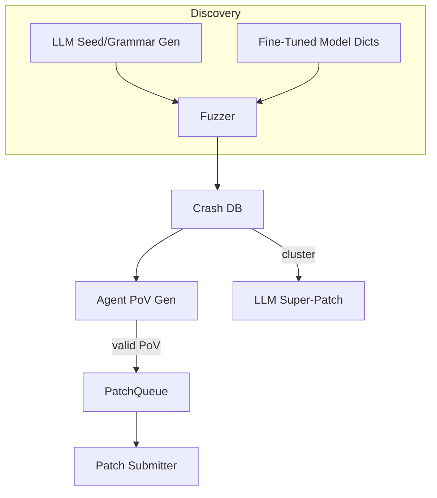

# Fuzzing assistito dall’IA e individuazione automatizzata delle vulnerabilità

{{#include ../banners/hacktricks-training.md}}

## Panoramica
I modelli linguistici di grandi dimensioni (LLM) possono potenziare notevolmente i tradizionali flussi di ricerca delle vulnerabilità, generando input semanticamente ricchi, facendo evolvere grammatiche, ragionando sui dati dei crash e persino proponendo patch per più bug. Questa pagina raccoglie i pattern più efficaci osservati durante le finali dell’AI Cyber Challenge (AIxCC) della DARPA e in altre ricerche pubbliche.<sup>[[4]](#references)</sup><sup>[[5]](#references)</sup>

Quanto segue non descrive un sistema specifico usato in una competizione, ma astrae le tecniche affinché tu possa riprodurle nei tuoi flussi di lavoro.

---

## 1. Input seed generati da LLM

I fuzzers tradizionali guidati dalla coverage (AFL++, libFuzzer, Honggfuzz…) partono da un piccolo corpus di seed e modificano i byte alla cieca. Quando il formato dell’input di destinazione è complesso (SQL, URL, protocolli binari personalizzati), le mutazioni casuali di solito compromettono la sintassi prima che vengano raggiunti branch interessanti.

Gli LLM possono risolvere questo problema iniziale generando *generatori di seed*: brevi script che producono **input sintatticamente corretti ma rilevanti per la sicurezza**. Per esempio:

```prompt
SYSTEM: You are a helpful security engineer.
USER:
Write a Python3 program that prints 200 unique SQL injection strings targeting common anti-pattern mistakes (missing quotes, numeric context, stacked queries).  Ensure length ≤ 256 bytes / string so they survive common length limits.
```

```python
# gen_sqli_seeds.py (truncated)
PAYLOADS = [
    "1 OR 1=1 -- ",
    "' UNION SELECT NULL,NULL--",
    "0; DROP TABLE users;--",
    ...
]
for p in PAYLOADS:
    print(p)
```

Esegui una volta e passa direttamente l’output al corpus iniziale del fuzzer:

```bash
python3 gen_sqli_seeds.py > seeds.txt
afl-fuzz -i seeds.txt -o findings/ -- ./target @@
```

Benefici:
1. Validità semantica → copertura più approfondita fin da subito.
2. Rigenerabile: modifica il prompt per concentrarti su XSS, path traversal, blob binari, ecc.
3. Economico (< 1 ¢ con GPT-3.5).

### Consigli
* Chiedi al modello di *diversificare* la lunghezza e la codifica dei payload (UTF-8, URL-encoded, UTF-16-LE) per aggirare i filtri superficiali.
* Chiedi un *singolo script autonomo*: evita problemi di formattazione JSON.

---

## 2. Grammar-Evolution Fuzzing

Una variante più potente consiste nel lasciare che l’LLM **evolva una grammatica** invece di seed concreti. Il workflow (pattern “Grammar Guy”) è:

1. Genera una grammatica ANTLR/Peach/LibFuzzer iniziale tramite prompt.
2. Esegui il fuzzing per N minuti e raccogli metriche di copertura (edge / blocchi raggiunti).
3. Riassumi le aree del programma non coperte e invia il riepilogo al modello:
   ```prompt
   The previous grammar triggered 12 % of the program edges.  Functions not reached: parse_auth, handle_upload.  Add / modify rules to cover these.
   ```
4. Unisci le nuove regole, esegui di nuovo il fuzzing e ripeti.

Schema di pseudocodice:

```python
for epoch in range(MAX_EPOCHS):
    grammar = llm.refine(grammar, feedback=coverage_stats)
    save(grammar, f"grammar_{epoch}.txt")
    coverage_stats = run_fuzzer(grammar)
```

Punti chiave:
* Tieni un *budget*: ogni revisione consuma token.
* Usa istruzioni `diff` + `patch` affinché il modello modifichi il codice invece di riscriverlo.
* Fermati quando Δcoverage < ε.

---

## 3. Progettazione di harness libFuzzer con LLM locale

Per il codice sorgente che non può lasciare la workstation di un analista, un modello di codice locale può abbozzare il piccolo adapter tra i byte del fuzzer e un'API C/C++. Il confine di sicurezza utile è esplicito: **il modello scrive e revisiona l'infrastruttura di test; la mutazione guidata dalla coverage esplora gli input; i sanitizer segnalano le operazioni non valide; una persona esamina l'harness e analizza i risultati**.<sup>[[9]](#references)</sup>

Per le tecniche di corpus, feedback, snapshot e stateful fuzzing a livello di engine che non dipendono da un LLM, consulta la [metodologia generale di fuzzing](../generic-methodologies-and-resources/fuzzing.md).

Inizia con la dichiarazione esatta copiata dall'header del target e vincola il formato dell'output. Un prompt circoscritto riduce il rischio che vengano inventate API e rende il risultato facile da esaminare:<sup>[[8]](#references)[[9]](#references)</sup>

```prompt
Write a libFuzzer target for this exact declaration:
int parse_records(const uint8_t *data, size_t size);

Output only C code. Implement LLVMFuzzerTestOneInput, include the
declaration, pass data and size unchanged, and do not use files,
network access, randomness, clocks, threads, or persistent state.
```

Per un parser di byte grezzi, il risultato atteso non dovrebbe essere più complicato di:<sup>[[6]](#references)[[9]](#references)</sup>

```c
#include <stddef.h>
#include <stdint.h>

extern int parse_records(const uint8_t *, size_t);

int LLVMFuzzerTestOneInput(const uint8_t *data, size_t size) {
    (void)parse_records(data, size);
    return 0;
}
```

La compilazione è solo il primo passaggio di convalida. Prima di dedicarvi tempo CPU, verificate ogni target generato rispetto a questi invarianti:<sup>[[6]](#references)[[8]](#references)[[9]](#references)</sup>

- **API esatta:** confrontate tipi, regole di ownership, inizializzazione, teardown e convenzione di chiamata con l’header reale e i caller esistenti.
- **Sicurezza dell’harness:** proteggete ogni lettura da `data`; i risultati dei sanitizer devono avere origine nel target, non nel glue generato.
- **Ripetibilità:** fate in modo che il risultato dipenda da `data` e `size`; rimuovete I/O esterni, riferimenti temporali, casualità non controllata, thread non attesi e stato che persiste tra una chiamata e l’altra.
- **Throughput:** inizializzate una sola volta lo stato immutabile costoso solo se ciò non può influire sul comportamento, limitate la dimensione dell’input, disattivate i log e liberate le allocazioni per ogni input.
- **Raggiungibilità:** verificate che vengano eseguite le funzioni e i branch previsti. Un target che compila ma esercita solo percorsi di rifiuto è un fallimento silenzioso.

### Target consapevoli della struttura: preservare gli invarianti senza nascondere bug

Se la maggior parte degli input grezzi non supera un controllo su magic, lunghezza, versione o checksum, usate i byte del fuzz come materiale per campi tipizzati e ricostruite un oggetto valido. Fissate le costanti del formato, lasciate modificabili i campi semantici e i byte del payload e calcolate i metadati di integrità a partire dal payload ricostruito. `FuzzedDataProvider` è utile per consumare valori tipizzati con limiti definiti, mentre l’adapter resta responsabile di limitare qualsiasi allocazione e conversione generata.<sup>[[9]](#references)</sup>

<details>
<summary>Esempio di target C++ consapevole della struttura</summary>

```cpp
#include <fuzzer/FuzzedDataProvider.h>
#include <stddef.h>
#include <stdint.h>
#include <vector>

extern "C" int parse_message(const uint8_t *, size_t);

extern "C" int LLVMFuzzerTestOneInput(const uint8_t *data, size_t size) {
    FuzzedDataProvider fdp(data, size);
    uint8_t version = fdp.ConsumeIntegral<uint8_t>();
    auto body = fdp.ConsumeRemainingBytes<uint8_t>();
    if (body.size() > UINT16_MAX) body.resize(UINT16_MAX);
    uint16_t len = static_cast<uint16_t>(body.size());
    std::vector<uint8_t> msg = {0x8b, 'M', 'S', 'G', version,
                                static_cast<uint8_t>(len >> 8),
                                static_cast<uint8_t>(len)};
    msg.insert(msg.end(), body.begin(), body.end());
    (void)parse_message(msg.data(), msg.size());
    return 0;
}
```

</details>

Non usare un unico target che ripara le strutture per ogni domanda. Mantieni un target che calcola lunghezze/checksum per esplorare stati validi profondi e un altro che lascia i metadati **dichiarati** sotto il controllo del fuzzer, limitando solo le letture e le allocazioni del harness. Il secondo target preserva le superfici di attacco con lunghezze non corrispondenti e integrità non valida, che la riparazione automatica eliminerebbe.<sup>[[9]](#references)</sup>

### Seed, dizionari, sanitizer e feedback di copertura

Chiedi al modello di generare uno script che scriva seed binari invece di chiedergli di stamparli direttamente. Crea seed con oggetti vuoti, minimi, tipici e validi ai limiti; poi estrai valori magic, tag, codifiche enum e parole chiave del parser in un dizionario revisionato. libFuzzer accetta quel dizionario con `-dict=` e conserva nel corpus le mutazioni che rivelano nuova copertura.<sup>[[6]](#references)[[9]](#references)</sup>

```text
magic="\x8bMSG"
version_min="\x00"
version_max="\xff"
config_tag="CONFIG"
```

Compila lo stesso target con strumentazione complementare. ASan e UBSan possono condividere un binario di fuzzing; usa una build separata con MSan e strumenta le sue dipendenze per evitare segnalazioni causate da codice non strumentato.<sup>[[6]](#references)[[9]](#references)</sup>

```bash
clang++ -g -O1 -fsanitize=fuzzer,address,undefined \
  -fno-sanitize-recover=undefined target.cc harness.cc -o fuzz_target
./fuzz_target corpus -dict=msg.dict -max_len=65535

clang++ -g -O1 -fsanitize=fuzzer,memory \
  target.cc harness.cc -o fuzz_target_msan
```

Considera la coverage come criterio di valutazione per ogni revisione del modello. Nell’output di libFuzzer, una `cov`/`ft` piatta fin dalle prime fasi e un corpus statico indicano di solito un framing errato, un early return troppo restrittivo o una chiamata sbagliata; un `exec/s` basso indica setup costoso, I/O, allocazioni o stato non ripulito. `NEW` dimostra solo che una feature di coverage è cambiata, non che sia stato raggiunto il parser previsto.<sup>[[6]](#references)[[9]](#references)</sup>

Per ottenere feedback a livello di sorgente, crea una build con coverage, esegui il fuzzing e fornisci al modello solo le funzioni non coperte e le relative condizioni di guardia. Verifica le modifiche a harness/seed/dictionary e misura di nuovo:<sup>[[7]](#references)[[8]](#references)[[9]](#references)</sup>

```bash
clang++ -g -O1 -fsanitize=fuzzer \
  -fprofile-instr-generate -fcoverage-mapping target.cc harness.cc -o fuzz_cov
mkdir -p profiles
LLVM_PROFILE_FILE='profiles/%p.profraw' ./fuzz_cov -max_total_time=300 corpus
llvm-profdata merge -sparse profiles/*.profraw -o fuzz.profdata
llvm-cov report ./fuzz_cov -instr-profile=fuzz.profdata
llvm-cov show ./fuzz_cov -instr-profile=fuzz.profdata \
  --show-branches=count --region-coverage-lt=1 target.cc
```

Il ciclo scalabile è quindi **generare → compilare/linkare → eseguire smoke test con i sanitizer → misurare la copertura del target → fornire il contesto minimo e pertinente di copertura/codice sorgente → rivedere → misurare di nuovo**. OSS-Fuzz-Gen applica lo stesso principio valutando i target generati in base alla compilabilità, agli errori di runtime, alla copertura e al miglioramento della copertura rispetto ai target esistenti, invece di accettare codice plausibile senza verificarlo.<sup>[[7]](#references)[[8]](#references)</sup>

---

<a id="3-agent-based-pov-exploit-generation" hidden>3. Generazione di PoV (exploit) basata su agenti</a>

## 4. Generazione di PoV (exploit) basata su agenti

Dopo aver trovato un crash, serve comunque una **proof-of-vulnerability (PoV)** che lo inneschi in modo deterministico.

Un approccio scalabile consiste nell'avviare molti worker leggeri (processi, thread o container), ognuno con un modello o una configurazione di campionamento diversi. Il sondaggio sui finalisti dell'AIxCC fornisce esempi concreti di questa scala: un team ha usato **migliaia di agenti concorrenti** per generare PoV con un approccio AI-first, mentre un altro ha orchestrato **300–500 agenti di fuzzing** e ha riservato gli LLM al ragionamento semantico di livello superiore.<sup>[[4]](#references)</sup>

Pipeline:
1. L'analisi statica/dinamica produce *candidati bug* (struct con PC del crash, porzione dell'input e messaggio del sanitizer).
2. L'orchestratore distribuisce i candidati agli agenti.
3. Fasi di ragionamento dell'agente:
   a. Riprodurre localmente il bug con `gdb` + input.
   b. Suggerire un payload exploit minimo.
   c. Convalidare l'exploit in una sandbox. Se ha successo → inviarlo.
4. I tentativi falliti vengono **accodati di nuovo come nuovi seed** per il fuzzing basato sulla copertura (feedback loop).

Vantaggi:
* La parallelizzazione compensa l'inaffidabilità del singolo agente.
* Regolazione automatica della temperatura / dimensione del modello in base al tasso di successo osservato.

---

<a id="4-directed-fuzzing-with-fine-tuned-code-models" hidden>4. Fuzzing mirato con modelli di codice fine-tuned</a>

## 5. Fuzzing mirato con modelli di codice fine-tuned

Esegui il fine-tuning di un modello open-weight (ad es. Llama-7B) su codice sorgente C/C++ etichettato con pattern di vulnerabilità (integer overflow, buffer copy, format string). Poi:

1. Esegui un'analisi statica per ottenere l'elenco delle funzioni + AST.
2. Chiedi al modello: *“Fornisci voci di dizionario di mutazione che probabilmente violano la memory safety nella funzione X”*.
3. Inserisci quei token in un `AFL_CUSTOM_MUTATOR` personalizzato.

Esempio di output per un wrapper `sprintf`:
```
{"pattern":"%99999999s"}
{"pattern":"AAAAAAAA....<1024>....%n"}
```

Empiricamente, questo riduce di oltre 2× il tempo necessario a provocare un crash su target reali.

---

<a id="5-ai-guided-patching-strategies" hidden>5. Strategie di patching guidate dall'IA</a>

## 6. Strategie di patching guidate dall'IA

<a id="51-super-patches" hidden>5.1 Patch multiple</a>

### 6.1 Patch multiple
Chiedi al modello di *raggruppare* le signature dei crash e proporre una **singola patch** che elimini la causa principale comune.  Invia una sola patch, correggi diversi bug → meno penalità di accuratezza negli ambienti in cui ogni patch errata costa punti.

Schema del prompt:
```
Here are 10 stack traces + file snippets.  Identify the shared mistake and generate a unified diff fixing all occurrences.
```

{{#ref}}
../generic-methodologies-and-resources/fuzzing.md
{{#endref}}

<a id="52-speculative-patch-ratio" hidden>5.2 Speculative Patch Ratio</a>

### 6.2 Speculative Patch Ratio
Implementare una coda in cui le patch confermate e validate tramite PoV e quelle *speculative* (senza PoV) si alternano con un rapporto 1:​N, regolato in base alle regole di punteggio (ad es. 2 speculative : 1 confermata). Un modello dei costi monitora penalità e punti e regola N automaticamente.

---

<a id="6-deterministic-file-by-file-ai-code-review" hidden>6. Revisione del codice con l’AI, deterministica e file per file</a>

## 7. Revisione del codice con l’AI, deterministica e file per file

Un errore frequente nella revisione assistita dall’AI consiste nel chiedere a un singolo agente di esaminare un intero repository, sperando che scelga i file e i termini di grep corretti. Un approccio più affidabile consiste nel **forzare la copertura del repository**:<sup>[[1]](#references)</sup>

1. Elencare i file sorgente.
2. Inviare **un file alla volta** con il contesto minimo (entry point, importazioni, route/chiamanti vicini).
3. Richiedere un **report strutturato** per ogni file: source, sink, validazione mancante, precondizioni dell’exploit e livello di confidenza.<sup>[[3]](#references)</sup>
4. Deduplicare i report in base allo **schema source→sink** e convalidare manualmente quelli ad alto rischio.

Questo approccio consuma molti token e produce rumore, ma è molto efficace nell’individuare **bug semplici e ad alto impatto nei source/sink**, spesso trascurati dalle revisioni agentiche ad ampio raggio.

### Schemi di triage da prioritizzare

- **Include/dispatch dinamici in PHP**: nomi di route/controller/moduli controllati dall’attaccante che arrivano a `require_once()`, `include()` o `include_once()` senza una strict allowlist e la canonicalizzazione dei percorsi.
- **Esecuzione di shell nei workflow di amministrazione/account**: nomi utente, domini, account FTP o altri identificatori che arrivano a `exec()`, `system()`, `shell_exec()`, `passthru()`, `proc_open()` o `popen()`.
- **Convergenza di input strutturati**: lo stesso parametro viene accettato da `$_GET`, `$_POST`, JSON, XML o dai parser del body del framework, poi riutilizzato in sink relativi al filesystem o ai comandi del sistema operativo.

### Due classi pratiche di bug che questo metodo individua bene

- **LFI/RCE tramite dispatch dei controller PHP**: se il nome del controller controllato dalla richiesta viene concatenato a `require_once()` senza allowlist o normalizzazione del percorso, sequenze di traversal come `../` possono indurre PHP a includere un file `.php` locale non previsto. Se l’attaccante può indirizzare l’include a un file PHP predisposto o comunque utile, la LFI diventa esecuzione di codice. Vedi [File Inclusion / Path Traversal](../pentesting-web/file-inclusion/README.md).<sup>[[1]](#references)</sup>
- **Command injection autenticata nei pannelli di hosting/amministrazione**: se campi di gestione degli account, come i nomi utente, vengono inseriti in comandi shell, un utente autenticato con privilegi limitati può trasformare una normale operazione di creazione/eliminazione in RCE. L’impatto aumenta se il pannello esegue il comando come un account di servizio più privilegiato. Vedi [Command Injection](../pentesting-web/command-injection.md).<sup>[[1]](#references)</sup>

### Note pratiche per la revisione

- Usare prima l’LLM come **revisore di source/sink**, non come generatore di exploit.
- Chiedergli di elencare esplicitamente il **campo controllato dall’attaccante**, la **lacuna nella normalizzazione/validazione** e il **sink pericoloso**.
- Nei repository di grandi dimensioni, una revisione deterministica file per file è spesso più affidabile di una singola esecuzione di un agente autonomo, anche quando quest’ultimo usa un modello più potente.<sup>[[2]](#references)</sup>
- Aspettarsi risultati più deboli per **Broken Access Control** e altri bug di business logic, la cui sfruttabilità dipende da ipotesi distribuite tra più file, dalla semantica dei ruoli o da threat model specifici del prodotto.

---

## Workflow di taskflow per gli entry point mobile

Un singolo prompt esteso a tutto il repository spesso mescola threat model diversi e perde il percorso da un componente raggiungibile dall’esterno a un sink sensibile. Un workflow più efficace suddivide l’audit in taskflow con stato: prima classifica applicazioni e componenti, poi inventaria gli entry point controllabili dall’attaccante, arricchisce ciascun entry point con metadati di raggiungibilità e infine li esamina rispetto alle classi di vulnerabilità specifiche della piattaforma. I taskflow mobile di GitHub Security Lab applicano questo schema ai repository Android, iOS e multipiattaforma.<sup>[[14]](#references)[[15]](#references)</sup>

Per Android, annotare almeno:<sup>[[14]](#references)[[15]](#references)</sup>

- Activities, Services, Receivers e Providers esportati, incluse le permission;
- azioni intent, schemi/host/path dei deep link, filtri MIME e App Links;
- azioni controllate dall’attaccante, URI di dati, `ClipData`, extra e flag di concessione URI;
- input di navigazione WebView e bridge `addJavascriptInterface`;
- operazioni privilegiate a valle, risorse importate e destinazioni di rete.

Quindi classificare ogni entry point nel suo contesto. Chiedere esplicitamente informazioni su autorizzazione del chiamante/comportamento da confused deputy, redirezione degli intent, spoofing o divulgazione tramite broadcast, importazioni non sicure, scripting WebView ed esposizione dei bridge, nonché trasferimento di credenziali o cookie tra origini. Eseguire sia una **verifica con checklist rigorosa** sia una **verifica avversaria più ampia**. Collegare i risultati a [Intent Injection](../mobile-pentesting/android-app-pentesting/intent-injection.md) e [WebView Attacks](../mobile-pentesting/android-app-pentesting/webview-attacks.md) invece di duplicare i dettagli dello sfruttamento.<sup>[[15]](#references)</sup>

È possibile avviare i taskflow open source attuali dal relativo Codespace con:<sup>[[14]](#references)</sup>

```bash
./scripts/audit/run_audit.sh owner/repository
```

I risultati vengono scritti nella tabella SQLite `audit_result`.<sup>[[14]](#references)</sup> Considerate le righe contrassegnate come vulnerabili come **piste**, non come vulnerabilità verificate. Per ogni pista, chiedete al modello di indicare la source controllata dall’attaccante, il sink sensibile, i prerequisiti e l’impatto previsto, quindi chiedetegli di creare una PoC minima. Eseguite la PoC sulla build originale con un debugger o strumentazione. Questo permette di individuare errori comuni di analisi statica, come rami irraggiungibili, uno stato dell’applicazione irrealistico, dati provenienti da storage esterno che perdono la precedenza rispetto a quelli privati e mitigazioni che riducono sensibilmente la gravità.<sup>[[15]](#references)</sup>

---

## 8. Audit del kernel guidato da pattern con un oracolo strumentato

Per un target delle dimensioni di un kernel, non chiedete a un agent di individuare vulnerabilità arbitrarie nell’intero albero del codice. Un workflow più efficiente in termini di token trasforma le conoscenze sulle vulnerabilità storiche in query statiche, classifica i risultati in base alla superficie d’attacco esposta e usa un kernel strumentato come oracolo di esecuzione.<sup>[[11]](#references)</sup>

### Database di pattern → CodeQL/Semgrep → revisione mirata

Create una piccola base di conoscenze contenente API pericolose, pattern di validazione mancante, flussi rischiosi da source a sink e forme di bug già corrette. Chiedete al modello di tradurre **un pattern alla volta** in euristiche di revisione e regole CodeQL/Semgrep, quindi eseguite queste regole deterministiche sull’intero albero del codice. Raggruppate e deduplicate le corrispondenze prima di fornire il codice al modello: l’output grezzo dello scanner può contenere migliaia di risultati di scarso valore. Verificate la licenza attuale di CodeQL prima di usare questo approccio al di fuori dei target di ricerca idonei o open source.<sup>[[11]](#references)</sup>

Date priorità ai sottosistemi considerando sia la **densità di corrispondenze con le regole** sia la **raggiungibilità da parte dell’attaccante**, anziché basarvi solo sul numero di corrispondenze. Le interfacce del kernel raggiungibili da processi non privilegiati, sandbox, container, jail o contesti guest meritano più peso rispetto al codice accessibile solo internamente. Mantenete l’unità di revisione abbastanza piccola da consentire all’agent di tenere conto di chiamanti, validatori e regole di lifetime; chiedete di individuare una classe di vulnerabilità o un pattern di control flow specifico, anziché “trovare qualsiasi vulnerabilità”. Le interfacce privilegiate legacy sono particolarmente interessanti quando un nuovo confine di contenimento le rende raggiungibili da un utente root con namespace o jail.<sup>[[11]](#references)</sup>

Per ogni risultato candidato, richiedete un record esplicito del flusso dei dati prima di tentare lo sfruttamento.<sup>[[11]](#references)</sup>

```text
entrypoint -> privilege check -> parser -> validation/normalization
           -> later rewrite -> dangerous sink
attacker controls: <fields and lengths>
constraints:       <values rewritten, rejected, or preserved>
observable result: <sanitizer report, assertion, panic, or clean exit>
```

### Usare la telemetria KASAN come oracolo per le ipotesi

Esegui il kernel target in una VM usa e getta con KASAN e asserzioni diagnostiche utili abilitate. L’agent dovrebbe iterare lungo il ciclo **ipotesi sul codice sorgente → trigger minimo in userland → esecuzione nella VM → trace KASAN/asserzione → ipotesi rivista** finché la corruzione sospetta non viene riprodotta o respinta. Restituisci a ogni iterazione solo lo stack trace pertinente e il codice sorgente circostante: così si preserva il contesto per il ragionamento e si fa sì che siano le evidenze runtime, non la confidence del modello, a determinare l’accettazione.<sup>[[11]](#references)</sup>

Una build strumentata non è l’ambiente definitivo per valutare l’exploitability. Le asserzioni possono interrompere l’esecuzione prima dell’operazione che corrompe la memoria, mentre la stessa asserzione potrebbe essere esclusa dalla build di un kernel di produzione. Ripeti il test con il trigger invariato sulla configurazione di produzione esatta, registra la build e la configurazione del kernel e tratta **raggiungibilità**, **corruzione della memoria**, **primitive controllata** e **impatto sulla sicurezza** come affermazioni distinte.<sup>[[11]](#references)[[12]](#references)</sup>

CVE-2026-3038 è un utile esempio di validazione, non un template di exploit. Una richiesta FreeBSD `RTM_GET` non privilegiata poteva preservare un sockaddr `RTAX_AUTHOR` sovradimensionato attraverso la validazione selettiva e la riscrittura della risposta, fino a quando `rtsock_msg_buffer()` copiava il valore `sa_len`, controllato dall’utente, in una `sockaddr_storage` da 128 byte sullo stack. La copia massima di 255 byte produceva un overflow di 127 byte; una asserzione diagnostica rilevava la lunghezza errata nella build strumentata, mentre un kernel GENERIC raggiungeva la copia e poi andava in panic quando veniva verificato il canary corrotto. Questo dimostra un denial of service non privilegiato, non un’escalation di privilegi autonoma: per ottenere un controllo affidabile servirebbe prima un’altra primitive, come la disclosure di un canary. Vedi [Stack Canaries](../binary-exploitation/common-binary-protections-and-bypasses/stack-canaries/index.html) per il relativo confine della binary exploitation.<sup>[[11]](#references)[[12]](#references)[[13]](#references)</sup>

### Rifiutare i trucchi sui prerequisiti dell’exploit

Prima di accettare un PoV o un exploit, chiedi a un reviewer/agent separato di provare a confutarlo applicando criteri fissi. La revisione deve confermare tutte le condizioni seguenti.<sup>[[11]](#references)</sup>

- Il codice sorgente target, il kernel e il modulo vulnerabile non sono stati modificati per rendere raggiungibile il percorso.
- Non sono stati introdotti moduli helper, gadget sintetici, mitigazioni disabilitate, privilegi aggiuntivi o interfacce non disponibili.
- Il trigger parte con l’identità del chiamante dichiarata e le restrizioni di contenimento previste, su uno snapshot pulito.
- Il risultato dichiarato dipende ancora dal bug: rimuovere il campo malformato o applicare una patch che corregga solo il bug deve interrompere la catena.
- Un crash, una lettura oltre i limiti o una scrittura oltre i limiti vengono riportati solo come tali primitive; l’esecuzione di codice o l’escalation di privilegi richiedono prove indipendenti.

Quest’ultimo controllo controfattuale individua le dimostrazioni circolari: se i prerequisiti garantiscono già l’impatto dichiarato (per esempio, eseguendo contenuto SUID fornito dall’attaccante da un filesystem montato senza `nosuid`), il bug di memory safety non ha causato quell’impatto.<sup>[[11]](#references)</sup>

---

## Ricerca verificabile assistita da agent su codebase sconosciute

Il [workflow di fuzz-target graph-first](../generic-methodologies-and-resources/fuzzing.md#graph-first-fuzz-target-selection-and-mutation-triage) tratta già la raggiungibilità degli entrypoint, mentre le [pipeline SAST agentiche](../network-services-pentesting/pentesting-web/code-review-tools.md#agentic-sast-pipelines) coprono le revisioni per fasi e i gate delle evidenze. Mantieni separati questi risultati deterministici dalle ipotesi del modello, così ogni lead promosso conserva le posizioni nel codice sorgente, le evidenze del percorso e una misurazione dinamica.<sup>[[10]](#references)</sup>

### Correlare le evidenze sul ciclo di vita degli oggetti senza inventare flussi di dati

L’analisi statica può individuare una lunghezza controllata dall’attaccante memorizzata in una funzione e lo stesso campo dell’oggetto che raggiunge un sink di copia molto più avanti, senza però riuscire a dimostrare il collegamento attraverso callback, riconnessioni o il ciclo di vita dell’oggetto. Conserva separatamente entrambi i risultati, raggruppali per oggetto/campo e rendi esplicita come domanda di triage l’edge mancante. L’agent può suggerire la relazione, ma questa deve essere dimostrata con una revisione del codice sorgente o con strumentazione runtime.<sup>[[10]](#references)</sup>

Per ogni candidato, registra:

- l’entrypoint concreto e i byte controllati dall’attaccante;
- ogni producer del campo pertinente, inclusa la validazione specifica per ciascun producer;
- il sink, la capacità della destinazione e le condizioni di build/runtime necessarie per raggiungerlo;
- uno stack di chiamate reale dall’entrypoint esposto, non solo un’invocazione diretta dell’harness;
- il risultato dinamico minimo che conferma o respinge l’ipotesi.

Un percorso apparentemente sicuro non rende sicuro il campo in generale. Un secondo producer potrebbe valorizzare lo stesso campo senza il limite imposto dal primo percorso. Verifica i percorsi separatamente ed esegui l’harness con opzioni di build equivalenti a quelle di deployment, perché le asserzioni di debug possono trasformare una corruzione della memoria in produzione in un’interruzione anticipata valida solo per i test.<sup>[[10]](#references)</sup>

### Gate di misurazione per disclosure ed exploitation

Per sospette disclosure di memoria non inizializzata, riempi le nuove allocazioni con un byte riconoscibile e verifica che il marker esatto raggiunga il pacchetto emesso. Per l’exploitation, richiedi gate misurabili come **scrittura oltre i limiti controllata → oggetto vittima utile → disclosure → recupero di puntatori/base → hijack del flusso di controllo → payload composto**. L’agent procede solo quando l’harness dimostra la proprietà corrente; una narrazione plausibile non supera un gate. Il [caso FreeRDP](../binary-exploitation/libc-heap/heap-overflow.md#cross-path-length-reuse-and-stale-output-disclosure) mostra i vincoli sul percorso e sulla build da preservare durante la validazione.<sup>[[10]](#references)</sup>

---

Per un case study sul kernel che applica la validazione per fasi L0–L4 allo sviluppo di exploit assistito da LLM, vedi:

{{#ref}}
../binary-exploitation/freebsd-kernel-exploitation-vnet-jail-escape.md
{{#endref}}

## Mettere insieme il tutto
Un CRS (Cyber Reasoning System) end-to-end può collegare i componenti nel modo seguente:



---

## References

- [1] [Project Black - AI locale per la cybersecurity: trovare LFI in phpIPAM e RCE autenticata in myVesta](https://projectblack.io/blog/local-ai-for-cyber-security)
- [2] [Strix](https://github.com/usestrix/strix)
- [3] [Skill di revisione della sicurezza della community di GitHub Copilot](https://github.com/github/awesome-copilot/blob/main/skills/security-review/SKILL.md)
- [4] [Trail of Bits – Finali AIxCC: il resoconto](https://blog.trailofbits.com/2025/08/07/aixcc-finals-tale-of-the-tape/)
- [5] [CTF Radiooo: interviste ai finalisti AIxCC](https://www.youtube.com/@ctfradiooo)
- [6] [LLVM — libFuzzer: una libreria per test di fuzzing guidati dalla coverage](https://llvm.org/docs/LibFuzzer.html)
- [7] [Google — OSS-Fuzz-Gen](https://github.com/google/oss-fuzz-gen)
- [8] [Google Online Security Blog — Potenziare il fuzzing: trovare più vulnerabilità con l'AI](https://security.googleblog.com/2024/11/leveling-up-fuzzing-finding-more.html)
- [9] [8kSec — Generazione di harness di fuzzing assistita dall'AI con un LLM locale](https://8ksec.io/ai-assisted-fuzzing-harness-local-llm)
- [10] [Quarkslab — Dagli agenti AI alla RCE: creare un workflow di ricerca delle vulnerabilità](https://blog.quarkslab.com/from-ai-agents-to-rce-building-a-vulnerability-research-workflow.html)
- [11] [Praetorian — FreeBSoD: usare i modelli linguistici per trovare e sfruttare bug del kernel (Parte 1 di 2)](https://praetorian.com/blog/ai-vulnerability-research-freebsd-kernel)
- [12] [FreeBSD-SA-26:05.route — DoS locale e possibile escalation dei privilegi tramite socket di routing](https://www.freebsd.org/security/advisories/FreeBSD-SA-26:05.route.asc)
- [13] [Patch sorgente di FreeBSD-SA-26:05.route](https://security.FreeBSD.org/patches/SA-26:05/route.patch)
- [14] [GitHub Security Lab - SecLab Taskflows](https://github.com/GitHubSecurityLab/seclab-taskflows)
- [15] [GitHub Security Lab - Come abbiamo trovato 24 vulnerabilità Android usando un agente di sicurezza AI open source](https://github.blog/security/how-we-found-24-android-vulnerabilities-using-our-open-source-ai-security-agent)
{{#include ../banners/hacktricks-training.md}}
