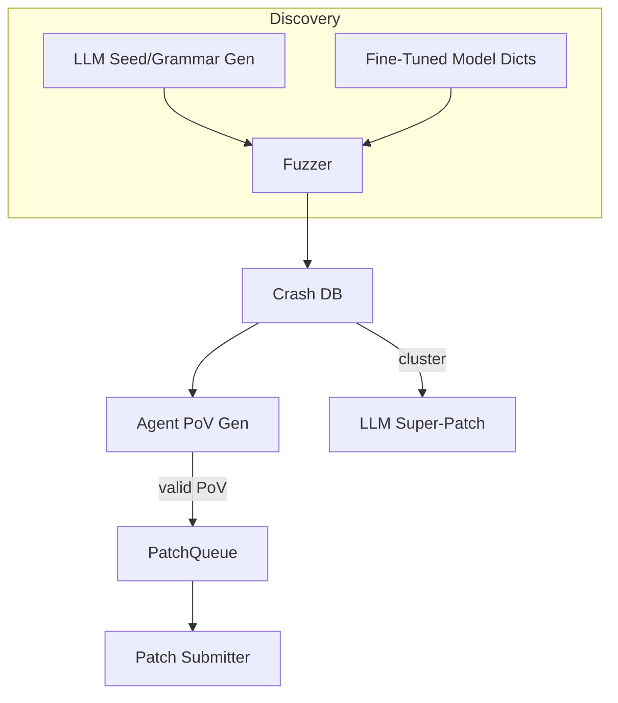

# Fuzzing με υποβοήθηση AI & Αυτοματοποιημένη ανακάλυψη ευπαθειών

{{#include ../banners/hacktricks-training.md}}

## Επισκόπηση
Τα large-language models (LLMs) μπορούν να ενισχύσουν σημαντικά τις παραδοσιακές ροές εργασιών έρευνας ευπαθειών, δημιουργώντας σημασιολογικά πλούσιες εισόδους, εξελίσσοντας γραμματικές, αναλύοντας δεδομένα από crashes και προτείνοντας ακόμη και patches για πολλαπλά bugs.  Αυτή η σελίδα συγκεντρώνει τα πιο αποτελεσματικά μοτίβα που παρατηρήθηκαν στους τελικούς του DARPA AI Cyber Challenge (AIxCC) και σε άλλες δημόσιες έρευνες.<sup>[[4]](#references)</sup><sup>[[5]](#references)</sup>

Αυτό που ακολουθεί δεν περιγράφει ένα συγκεκριμένο σύστημα διαγωνισμού, αλλά αφαιρεί τις τεχνικές από το συγκεκριμένο πλαίσιο, ώστε να μπορείτε να τις αναπαράγετε στις δικές σας ροές εργασιών.

---

## 1. Είσοδοι Seed που Δημιουργούνται από LLM

Οι παραδοσιακοί coverage-guided fuzzers (AFL++, libFuzzer, Honggfuzz…) ξεκινούν με ένα μικρό corpus από seeds και μεταλλάσσουν bytes στα τυφλά.  Όταν η μορφή εισόδου του στόχου είναι σύνθετη (SQL, URLs, προσαρμοσμένα δυαδικά πρωτόκολλα), οι τυχαίες μεταλλάξεις συνήθως καταστρέφουν τη σύνταξη προτού προσεγγιστούν ενδιαφέροντα branches.

Τα LLMs μπορούν να επιλύσουν αυτό το αρχικό πρόβλημα δημιουργώντας *seed generators* – σύντομα scripts που παράγουν **συντακτικά έγκυρες, αλλά σχετικές με την ασφάλεια εισόδους**.  Για παράδειγμα:

```prompt
SYSTEM: You are a helpful security engineer.
USER:
Write a Python3 program that prints 200 unique SQL injection strings targeting common anti-pattern mistakes (missing quotes, numeric context, stacked queries).  Ensure length ≤ 256 bytes / string so they survive common length limits.
```

```python
# gen_sqli_seeds.py (truncated)
PAYLOADS = [
    "1 OR 1=1 -- ",
    "' UNION SELECT NULL,NULL--",
    "0; DROP TABLE users;--",
    ...
]
for p in PAYLOADS:
    print(p)
```

Εκτελέστε το μία φορά και τροφοδοτήστε απευθείας την έξοδο στο αρχικό corpus του fuzzer:

```bash
python3 gen_sqli_seeds.py > seeds.txt
afl-fuzz -i seeds.txt -o findings/ -- ./target @@
```

Οφέλη:
1. Σημασιολογική εγκυρότητα → βαθύτερη κάλυψη από νωρίς.
2. Δυνατότητα επαναδημιουργίας: τροποποιήστε το prompt για να εστιάσει σε XSS, path traversal, binary blobs κ.λπ.
3. Χαμηλό κόστος (< 1 ¢ με GPT-3.5).

### Συμβουλές
* Ζητήστε από το μοντέλο να *διαφοροποιεί* το μήκος και την κωδικοποίηση των payload (UTF-8, URL-encoded, UTF-16-LE), ώστε να παρακάμπτονται επιφανειακά φίλτρα.
* Ζητήστε ένα *αυτοτελές script* – έτσι αποφεύγονται προβλήματα μορφοποίησης JSON.

---

## 2. Fuzzing με Εξέλιξη Γραμματικής

Μια πιο ισχυρή παραλλαγή είναι να αφήσετε το LLM να **εξελίξει μια γραμματική** αντί για συγκεκριμένα seeds. Η ροή εργασίας (μοτίβο «Grammar Guy») είναι:

1. Δημιουργήστε μια αρχική γραμματική ANTLR/Peach/LibFuzzer μέσω prompt.
2. Εκτελέστε fuzzing για N λεπτά και συλλέξτε μετρικές κάλυψης (edges / blocks που προσεγγίστηκαν).
3. Συνοψίστε τις περιοχές του προγράμματος που δεν καλύφθηκαν και δώστε τη σύνοψη πίσω στο μοντέλο:
   ```prompt
   The previous grammar triggered 12 % of the program edges.  Functions not reached: parse_auth, handle_upload.  Add / modify rules to cover these.
   ```
4. Συγχώνευσε τους νέους κανόνες, κάνε ξανά fuzzing και επανάλαβε.

Σκελετός ψευδοκώδικα:

```python
for epoch in range(MAX_EPOCHS):
    grammar = llm.refine(grammar, feedback=coverage_stats)
    save(grammar, f"grammar_{epoch}.txt")
    coverage_stats = run_fuzzer(grammar)
```

Key points:
* Κρατήστε ένα *budget* – κάθε βελτίωση χρησιμοποιεί tokens.
* Χρησιμοποιήστε οδηγίες `diff` + `patch`, ώστε το μοντέλο να κάνει επεξεργασίες αντί να ξαναγράφει.
* Σταματήστε όταν Δcoverage < ε.

---

## 3. Σχεδιασμός Harness για libFuzzer με Local-LLM

Για πηγαίο κώδικα που δεν μπορεί να φύγει από τον σταθμό εργασίας ενός αναλυτή, ένα τοπικό μοντέλο κώδικα μπορεί να συντάξει τον μικρό adapter ανάμεσα στα bytes του fuzzer και ένα C/C++ API. Το όριο ασφαλείας είναι σαφές: **το μοντέλο γράφει και αναθεωρεί υποδομή δοκιμών· η mutation με καθοδήγηση από coverage εξερευνά εισόδους· οι sanitizers αναφέρουν μη έγκυρες λειτουργίες· ένας άνθρωπος ελέγχει το harness και αξιολογεί τα ευρήματα**.<sup>[[9]](#references)</sup>

Για τεχνικές σε επίπεδο engine σχετικά με corpus, feedback, snapshot και stateful-fuzzing, οι οποίες δεν εξαρτώνται από LLM, δείτε τη γενική [Μεθοδολογία Fuzzing](../generic-methodologies-and-resources/fuzzing.md).

Ξεκινήστε με την ακριβή δήλωση που αντιγράψατε από το header του στόχου και περιορίστε τη μορφή εξόδου. Ένα συγκεκριμένο prompt μειώνει τις επινοημένες API και διευκολύνει τον έλεγχο του αποτελέσματος:<sup>[[8]](#references)[[9]](#references)</sup>

```prompt
Write a libFuzzer target for this exact declaration:
int parse_records(const uint8_t *data, size_t size);

Output only C code. Implement LLVMFuzzerTestOneInput, include the
declaration, pass data and size unchanged, and do not use files,
network access, randomness, clocks, threads, or persistent state.
```

Για έναν parser ακατέργαστων byte, το αναμενόμενο αποτέλεσμα δεν θα πρέπει να είναι πιο περίπλοκο από:<sup>[[6]](#references)[[9]](#references)</sup>

```c
#include <stddef.h>
#include <stdint.h>

extern int parse_records(const uint8_t *, size_t);

int LLVMFuzzerTestOneInput(const uint8_t *data, size_t size) {
    (void)parse_records(data, size);
    return 0;
}
```

Η μεταγλώττιση είναι μόνο το πρώτο στάδιο επικύρωσης. Ελέγξτε κάθε target που δημιουργήθηκε ως προς τις ακόλουθες αμετάβλητες προϋποθέσεις, πριν αφιερώσετε σε αυτό χρόνο CPU:<sup>[[6]](#references)[[8]](#references)[[9]](#references)</sup>

- **Ακριβές API:** συγκρίνετε τους τύπους, τους κανόνες ownership, την αρχικοποίηση, τον τερματισμό λειτουργίας και τη σύμβαση κλήσης με την πραγματική κεφαλίδα και τους υπάρχοντες callers.
- **Ασφάλεια harness:** προστατεύστε κάθε ανάγνωση από το `data`· τα ευρήματα των sanitizers πρέπει να προέρχονται από το target και όχι από τον glue code που δημιουργήθηκε.
- **Επαναληψιμότητα:** το αποτέλεσμα να είναι συνάρτηση των `data` και `size`· αφαιρέστε το εξωτερικό I/O, τον χρόνο, την ανεξέλεγκτη τυχαιότητα, τα threads που δεν έχουν γίνει join και την κατάσταση που διατηρείται μεταξύ κλήσεων.
- **Ρυθμός επεξεργασίας:** αρχικοποιήστε την ακριβή αμετάβλητη κατάσταση μία φορά, μόνο αν αυτό δεν μπορεί να επηρεάσει τη συμπεριφορά, περιορίστε το μέγεθος εισόδου, απενεργοποιήστε την καταγραφή και αποδεσμεύστε τις κατανομές μνήμης ανά είσοδο.
- **Προσπελασιμότητα:** επαληθεύστε ότι εκτελούνται οι προβλεπόμενες συναρτήσεις και διακλαδώσεις. Ένα target που μεταγλωττίζεται αλλά ασκεί μόνο διαδρομές απόρριψης αποτελεί σιωπηλή αποτυχία.

### Targets με επίγνωση της δομής: διατηρήστε τις αμετάβλητες προϋποθέσεις χωρίς να κρύβετε σφάλματα

Αν οι περισσότερες ακατέργαστες είσοδοι αποτυγχάνουν σε έλεγχο magic, μήκους, έκδοσης ή checksum, χρησιμοποιήστε τα bytes του fuzzing ως υλικό για τυποποιημένα πεδία και ανακατασκευάστε ένα έγκυρο αντικείμενο. Ορίστε σταθερές μορφής, αφήστε τα σημασιολογικά πεδία και τα bytes του payload μεταβλητά και υπολογίστε τα μεταδεδομένα ακεραιότητας από το ανακατασκευασμένο payload. Το `FuzzedDataProvider` είναι χρήσιμο για την κατανάλωση οριοθετημένων τυποποιημένων τιμών, ενώ ο adapter παραμένει υπεύθυνος για τον περιορισμό κάθε παραγόμενης κατανομής μνήμης και μετατροπής.<sup>[[9]](#references)</sup>

<details>
<summary>Παράδειγμα C++ target με επίγνωση της δομής</summary>

```cpp
#include <fuzzer/FuzzedDataProvider.h>
#include <stddef.h>
#include <stdint.h>
#include <vector>

extern "C" int parse_message(const uint8_t *, size_t);

extern "C" int LLVMFuzzerTestOneInput(const uint8_t *data, size_t size) {
    FuzzedDataProvider fdp(data, size);
    uint8_t version = fdp.ConsumeIntegral<uint8_t>();
    auto body = fdp.ConsumeRemainingBytes<uint8_t>();
    if (body.size() > UINT16_MAX) body.resize(UINT16_MAX);
    uint16_t len = static_cast<uint16_t>(body.size());
    std::vector<uint8_t> msg = {0x8b, 'M', 'S', 'G', version,
                                static_cast<uint8_t>(len >> 8),
                                static_cast<uint8_t>(len)};
    msg.insert(msg.end(), body.begin(), body.end());
    (void)parse_message(msg.data(), msg.size());
    return 0;
}
```

</details>

Μη χρησιμοποιείτε έναν στόχο που επιδιορθώνει τις δομές για κάθε ερώτηση. Διατηρήστε έναν στόχο που υπολογίζει μήκη/checksum για να εξερευνά έγκυρες καταστάσεις σε βάθος, και έναν άλλον που αφήνει τα **δηλωμένα** metadata υπό τον έλεγχο του fuzzer, περιορίζοντας μόνο τις αναγνώσεις και τις δεσμεύσεις μνήμης του ίδιου του harness. Ο δεύτερος στόχος διατηρεί επιφάνειες επίθεσης με αναντιστοιχίες μήκους και λανθασμένη ακεραιότητα, τις οποίες διαφορετικά θα εξάλειφε η αυτόματη επιδιόρθωση.<sup>[[9]](#references)</sup>

### Seeds, dictionaries, sanitizers και feedback κάλυψης

Ζητήστε από το μοντέλο να δημιουργήσει ένα script που γράφει binary seeds, αντί να του ζητήσετε να εκτυπώσει απευθείας binary. Δημιουργήστε seeds για κενά, ελάχιστα, τυπικά και έγκυρα οριακά αντικείμενα· στη συνέχεια, εξαγάγετε magic values, tags, κωδικοποιήσεις enum και λέξεις-κλειδιά του parser σε ένα dictionary που θα ελεγχθεί. Το libFuzzer δέχεται αυτό το dictionary με το `-dict=`, και διατηρεί στο corpus τις μεταλλάξεις που αποκαλύπτουν νέα κάλυψη.<sup>[[6]](#references)[[9]](#references)</sup>

```text
magic="\x8bMSG"
version_min="\x00"
version_max="\xff"
config_tag="CONFIG"
```

Κατασκευάστε τον ίδιο στόχο με συμπληρωματική εργαλειοποίηση. Τα ASan και UBSan μπορούν να χρησιμοποιούν το ίδιο fuzzing binary· χρησιμοποιήστε ξεχωριστό build με MSan και εργαλειοποιήστε τις εξαρτήσεις του, ώστε να αποφύγετε αναφορές που προκαλούνται από μη εργαλειοποιημένο κώδικα.<sup>[[6]](#references)[[9]](#references)</sup>

```bash
clang++ -g -O1 -fsanitize=fuzzer,address,undefined \
  -fno-sanitize-recover=undefined target.cc harness.cc -o fuzz_target
./fuzz_target corpus -dict=msg.dict -max_len=65535

clang++ -g -O1 -fsanitize=fuzzer,memory \
  target.cc harness.cc -o fuzz_target_msan
```

Αντιμετώπισε την κάλυψη ως κριτήριο αξιολόγησης για κάθε αναθεώρηση του μοντέλου. Στην έξοδο του libFuzzer, τα cov/ft που παραμένουν χαμηλά από νωρίς και ένα στατικό corpus συνήθως υποδεικνύουν κακό framing, υπερβολικά περιοριστικό early return ή λανθασμένη κλήση· χαμηλό exec/s υποδεικνύει δαπανηρό setup, I/O, allocation ή διαρροή κατάστασης. Το NEW αποδεικνύει μόνο ότι άλλαξε ένα χαρακτηριστικό κάλυψης, όχι ότι εκτελέστηκε ο επιδιωκόμενος parser.<sup>[[6]](#references)[[9]](#references)</sup>

Για feedback σε επίπεδο πηγαίου κώδικα, δημιούργησε ένα build με coverage, κάνε fuzzing και δώσε στο μοντέλο μόνο τις συναρτήσεις που δεν έχουν καλυφθεί, μαζί με τις συνθήκες που τις προστατεύουν. Επαλήθευσε τις αλλαγές σε harness/seed/dictionary και μέτρησε ξανά:<sup>[[7]](#references)[[8]](#references)[[9]](#references)</sup>

```bash
clang++ -g -O1 -fsanitize=fuzzer \
  -fprofile-instr-generate -fcoverage-mapping target.cc harness.cc -o fuzz_cov
mkdir -p profiles
LLVM_PROFILE_FILE='profiles/%p.profraw' ./fuzz_cov -max_total_time=300 corpus
llvm-profdata merge -sparse profiles/*.profraw -o fuzz.profdata
llvm-cov report ./fuzz_cov -instr-profile=fuzz.profdata
llvm-cov show ./fuzz_cov -instr-profile=fuzz.profdata \
  --show-branches=count --region-coverage-lt=1 target.cc
```

Ο κλιμακώσιμος βρόχος είναι επομένως **generate → compile/link → smoke-test υπό sanitizers → μέτρηση της κάλυψης του target → παροχή του ελάχιστου σχετικού context κάλυψης/πηγαίου κώδικα → αναθεώρηση → νέα μέτρηση**. Το OSS-Fuzz-Gen εφαρμόζει την ίδια αρχή, αξιολογώντας τα generated targets ως προς τη δυνατότητα μεταγλώττισης, τα σφάλματα χρόνου εκτέλεσης, την κάλυψη και τη βελτίωση της κάλυψης σε σχέση με τα υπάρχοντα targets, αντί να αποδέχεται άκριτα κώδικα που απλώς φαίνεται εύλογος.<sup>[[7]](#references)[[8]](#references)</sup>

---

## 4. Παραγωγή PoV (Exploit) με χρήση agents

Αφού εντοπιστεί ένα crash, χρειάζεστε ακόμη ένα **proof-of-vulnerability (PoV)** που το ενεργοποιεί ντετερμινιστικά.

Μια κλιμακώσιμη προσέγγιση είναι η εκκίνηση πολλών ελαφρών workers (processes, threads ή containers), καθενός με διαφορετικό μοντέλο ή ρύθμιση δειγματοληψίας. Η επισκόπηση των φιναλίστ του AIxCC δίνει συγκεκριμένα παραδείγματα κλίμακας: μία ομάδα χρησιμοποίησε **χιλιάδες agents ταυτόχρονα** για παραγωγή PoV με προτεραιότητα στην AI, ενώ μια άλλη συντόνισε **300–500 agents fuzzing** και άφησε τα LLMs για συλλογισμό υψηλότερου επιπέδου σχετικά με τη σημασιολογία.<sup>[[4]](#references)</sup>

Ροή εργασίας:
1. Η στατική/δυναμική ανάλυση παράγει *υποψήφια σφάλματα* (struct με crash PC, τμήμα εισόδου, μήνυμα sanitizer).
2. Ο orchestrator κατανέμει τα υποψήφια σφάλματα στους agents.
3. Βήματα συλλογισμού του agent:
   a. Αναπαραγωγή του σφάλματος τοπικά με `gdb` + είσοδο.
   b. Πρόταση ελάχιστου exploit payload.
   c. Επικύρωση του exploit σε sandbox. Αν πετύχει → υποβολή.
4. Οι αποτυχημένες προσπάθειες **μπαίνουν ξανά στην ουρά ως νέα seeds** για coverage fuzzing (βρόχος feedback).

Πλεονεκτήματα:
* Η παραλληλοποίηση αντισταθμίζει την αναξιοπιστία ενός μεμονωμένου agent.
* Αυτόματη προσαρμογή των temp / του μεγέθους του μοντέλου με βάση το παρατηρούμενο ποσοστό επιτυχίας.

---

## 5. Κατευθυνόμενο fuzzing με code models λεπτομερώς ρυθμισμένα

Κάντε fine-tune σε ένα μοντέλο ανοιχτών βαρών (π.χ. Llama-7B) με πηγαίο κώδικα C/C++ που έχει επισημανθεί με μοτίβα ευπαθειών (integer overflow, αντιγραφή buffer, format string). Στη συνέχεια:

1. Εκτελέστε στατική ανάλυση για να λάβετε τη λίστα συναρτήσεων + AST.
2. Δώστε prompt στο μοντέλο: *“Δώσε καταχωρίσεις λεξικού μεταλλάξεων που είναι πιθανό να παραβιάσουν την ασφάλεια μνήμης στη συνάρτηση X”*.
3. Εισαγάγετε αυτά τα tokens σε ένα προσαρμοσμένο `AFL_CUSTOM_MUTATOR`.

Παράδειγμα εξόδου για ένα wrapper της `sprintf`:
```
{"pattern":"%99999999s"}
{"pattern":"AAAAAAAA....<1024>....%n"}
```

Εμπειρικά, αυτό μειώνει τον χρόνο μέχρι το crash κατά >2× σε πραγματικούς στόχους.

---

## 6. Στρατηγικές patching με καθοδήγηση από AI

### 6.1 Super Patches
Ζητήστε από το μοντέλο να *ομαδοποιήσει* τις υπογραφές των crash και να προτείνει ένα **ενιαίο patch** που εξαλείφει την κοινή βασική αιτία.  Υποβάλετε μία φορά και διορθώστε πολλά bugs → λιγότερες ποινές ακρίβειας σε περιβάλλοντα όπου κάθε λανθασμένο patch κοστίζει πόντους.

Περίγραμμα prompt:
```
Here are 10 stack traces + file snippets.  Identify the shared mistake and generate a unified diff fixing all occurrences.
```

{{#ref}}
../generic-methodologies-and-resources/fuzzing.md
{{#endref}}

### 6.2 Αναλογία Speculative Patch
Υλοποιήστε μια ουρά όπου εναλλάσσονται patches που έχουν επιβεβαιωθεί με PoV και *speculative* patches (χωρίς PoV), σε αναλογία 1:N προσαρμοσμένη στους κανόνες βαθμολόγησης (π.χ. 2 speculative : 1 confirmed). Ένα μοντέλο κόστους παρακολουθεί τις ποινές σε σχέση με τους βαθμούς και προσαρμόζει αυτόματα το N.

---

## 7. Ντετερμινιστικός έλεγχος κώδικα με AI, αρχείο προς αρχείο

Ένας συχνός τρόπος αποτυχίας στους ελέγχους με AI είναι να ζητάτε από έναν agent να ελέγξει ολόκληρο το repository και να ελπίζετε ότι θα επιλέξει τα σωστά αρχεία και όρους για grep. Μια πιο αξιόπιστη προσέγγιση είναι να **επιβάλλετε την κάλυψη ολόκληρου του repository**:<sup>[[1]](#references)</sup>

1. Καταγράψτε τα αρχεία πηγαίου κώδικα.
2. Στείλτε **ένα αρχείο κάθε φορά**, μαζί με ελάχιστο πλαίσιο (entrypoint, imports, κοντινά routes/callers).
3. Απαιτήστε **δομημένη αναφορά** για κάθε αρχείο: sources, sink, έλλειψη validation, προϋποθέσεις exploit και βαθμό βεβαιότητας.<sup>[[3]](#references)</sup>
4. Αποδιπλοποιήστε τις αναφορές με βάση το **μοτίβο source→sink** και επικυρώστε χειροκίνητα όσες έχουν υψηλό ρίσκο.

Αυτή η διαδικασία απαιτεί πολλά tokens και παράγει θόρυβο, αλλά είναι πολύ αποτελεσματική στον εντοπισμό **απλών, υψηλού αντίκτυπου bugs source/sink** που συχνά διαφεύγουν από ευρείς agentic ελέγχους.

### Μοτίβα triage που αξίζει να ιεραρχήσετε

- **Δυναμικό PHP include/dispatch**: ονόματα route/controller/module που ελέγχονται από τον επιτιθέμενο και καταλήγουν στα `require_once()`, `include()` ή `include_once()` χωρίς αυστηρό allowlist και κανονικοποίηση διαδρομής.
- **Εκτέλεση shell σε ροές εργασίας διαχείρισης/admin λογαριασμών**: usernames, domains, FTP accounts ή άλλα αναγνωριστικά που καταλήγουν στα `exec()`, `system()`, `shell_exec()`, `passthru()`, `proc_open()` ή `popen()`.
- **Σύγκλιση δομημένων εισόδων**: η ίδια παράμετρος γίνεται αποδεκτή από `$_GET`, `$_POST`, JSON, XML ή parsers σώματος του framework και επαναχρησιμοποιείται αργότερα σε sinks συστήματος αρχείων ή εντολών OS.

### Δύο πρακτικές κατηγορίες bugs που εντοπίζονται αποτελεσματικά με αυτή τη μέθοδο

- **LFI/RCE μέσω dispatch PHP controller**: αν ένα όνομα controller που ελέγχεται από το request συνενώνεται σε `require_once()` χωρίς allowlist/κανονικοποίηση διαδρομής, ακολουθίες traversal όπως `../` μπορούν να κάνουν την PHP να συμπεριλάβει ένα ανεπιθύμητο τοπικό αρχείο `.php`. Αν ο επιτιθέμενος μπορεί να κατευθύνει το include σε αρχείο PHP που έχει τοποθετήσει ή που είναι χρήσιμο με άλλον τρόπο, η LFI μετατρέπεται σε εκτέλεση κώδικα. Δείτε [File Inclusion / Path Traversal](../pentesting-web/file-inclusion/README.md).<sup>[[1]](#references)</sup>
- **Authenticated command injection σε hosting/admin panels**: αν πεδία διαχείρισης λογαριασμών, όπως τα usernames, ενσωματώνονται σε εντολές shell, ένας πιστοποιημένος χρήστης με χαμηλά προνόμια μπορεί να μετατρέψει μια συνηθισμένη ενέργεια δημιουργίας/διαγραφής σε RCE. Ο αντίκτυπος αυξάνεται όταν το panel εκτελεί την εντολή ως service account με περισσότερα προνόμια. Δείτε [Command Injection](../pentesting-web/command-injection.md).<sup>[[1]](#references)</sup>

### Πρακτικές σημειώσεις ελέγχου

- Χρησιμοποιήστε πρώτα το LLM ως ελεγκτή **source/sink**, όχι ως generator exploit.
- Ζητήστε του να αναφέρει ρητά το **πεδίο που ελέγχεται από τον επιτιθέμενο**, το **κενό στην κανονικοποίηση/επικύρωση** και το **επικίνδυνο sink**.
- Σε μεγάλα repositories, ο ντετερμινιστικός έλεγχος ανά αρχείο είναι συχνά πιο αξιόπιστος από μία αυτόνομη εκτέλεση agent, ακόμη κι αν η δεύτερη χρησιμοποιεί ισχυρότερο μοντέλο.<sup>[[2]](#references)</sup>
- Αναμένετε ασθενέστερα αποτελέσματα σε **Broken Access Control** και άλλα bugs επιχειρησιακής λογικής, όπου η εκμεταλλευσιμότητα εξαρτάται από παραδοχές μεταξύ αρχείων, σημασιολογία ρόλων ή μοντέλα απειλών ειδικά για το προϊόν.

---

## 8. Έλεγχος kernel με καθοδήγηση από μοτίβα και instrumented oracle

Για έναν στόχο μεγέθους kernel, μην ζητάτε από έναν agent να βρει αυθαίρετα bugs σε ολόκληρο το δέντρο. Μια πιο αποδοτική ως προς τα tokens ροή εργασίας μετατρέπει τη γνώση από ιστορικά vulnerabilities σε στατικά queries, ιεραρχεί τα αποτελέσματα με βάση την εκτεθειμένη επιφάνεια επίθεσης και χρησιμοποιεί έναν instrumented kernel ως oracle εκτέλεσης.<sup>[[11]](#references)</sup>

### Βάση μοτίβων → CodeQL/Semgrep → στοχευμένος έλεγχος

Δημιουργήστε μια μικρή βάση γνώσεων με επικίνδυνα APIs, μοτίβα έλλειψης validation, επικίνδυνες ροές source-to-sink και σχήματα bugs που έχουν διορθωθεί στο παρελθόν. Ζητήστε από το μοντέλο να μεταφράζει **ένα μοτίβο κάθε φορά** σε ευρετικές ελέγχου και κανόνες CodeQL/Semgrep και, στη συνέχεια, εκτελέστε αυτούς τους ντετερμινιστικούς κανόνες σε ολόκληρο το δέντρο. Ομαδοποιήστε και αποδιπλοποιήστε τα ευρήματα πριν δώσετε ξανά τον κώδικα στο μοντέλο· η ακατέργαστη έξοδος του scanner μπορεί να περιέχει χιλιάδες υποψήφια ευρήματα χαμηλής αξίας. Ελέγξτε την τρέχουσα άδεια χρήσης του CodeQL πριν χρησιμοποιήσετε αυτή την προσέγγιση εκτός επιλέξιμων ερευνητικών στόχων ή στόχων open-source.<sup>[[11]](#references)</sup>

Ιεραρχήστε τα subsystems λαμβάνοντας υπόψη τόσο την **πυκνότητα ευρημάτων κανόνων** όσο και τη **δυνατότητα πρόσβασης από τον επιτιθέμενο**, αντί να βασίζεστε μόνο στον αριθμό ευρημάτων. Οι διεπαφές kernel που είναι προσβάσιμες από μη προνομιούχες διεργασίες, sandboxes, containers, jails ή guest contexts αξίζουν μεγαλύτερη βαρύτητα από κώδικα προσβάσιμο μόνο εσωτερικά. Κρατήστε τη μονάδα ελέγχου αρκετά μικρή ώστε ο agent να μπορεί να διατηρεί στη μνήμη τους callers, τους validators και τους κανόνες διάρκειας ζωής, και ζητήστε έλεγχο συγκεκριμένης κατηγορίας vulnerability ή μοτίβου ροής ελέγχου αντί για «βρες οποιοδήποτε vulnerability». Οι legacy προνομιούχες διεπαφές είναι ιδιαίτερα ενδιαφέρουσες όταν ένα νεότερο όριο απομόνωσης τις καθιστά προσβάσιμες σε root χρήστη με namespaced ή jailed περιβάλλον.<sup>[[11]](#references)</sup>

Για κάθε υποψήφιο εύρημα, απαιτήστε ρητή καταγραφή της ροής πεδίων πριν επιχειρήσετε exploitation.<sup>[[11]](#references)</sup>

```text
entrypoint -> privilege check -> parser -> validation/normalization
           -> later rewrite -> dangerous sink
attacker controls: <fields and lengths>
constraints:       <values rewritten, rejected, or preserved>
observable result: <sanitizer report, assertion, panic, or clean exit>
```

### Χρησιμοποιήστε την τηλεμετρία του KASAN ως oracle υποθέσεων

Εκτελέστε τον kernel-στόχο σε αναλώσιμο VM με ενεργοποιημένα τα KASAN και χρήσιμα διαγνωστικά assertions. Ο agent πρέπει να επαναλαμβάνει τον κύκλο **υπόθεση για τον κώδικα → ελάχιστο trigger από το userland → εκτέλεση στο VM → ίχνος KASAN/assertion → αναθεωρημένη υπόθεση** μέχρι να αναπαραχθεί ή να απορριφθεί η ύποπτη αλλοίωση. Σε κάθε επανάληψη, επιστρέψτε μόνο το σχετικό stack trace και τον κοντινό κώδικα πηγαίου αρχείου· έτσι διατηρείται το πλαίσιο για συλλογισμό, ενώ ως κριτήριο αποδοχής χρησιμοποιούνται τα στοιχεία από την εκτέλεση και όχι η εμπιστοσύνη του μοντέλου.<sup>[[11]](#references)</sup>

Ένα build με instrumentation δεν αποτελεί το τελικό περιβάλλον αξιολόγησης της δυνατότητας εκμετάλλευσης. Τα assertions ενδέχεται να σταματήσουν την εκτέλεση πριν από την πράξη που προκαλεί την αλλοίωση, ενώ το ίδιο assertion μπορεί να έχει αφαιρεθεί από ένα production kernel. Ελέγξτε ξανά το αμετάβλητο trigger με την ακριβή production διαμόρφωση, καταγράψτε το build και τη διαμόρφωση του kernel και διαχωρίστε την **προσβασιμότητα**, την **αλλοίωση μνήμης**, το **ελεγχόμενο primitive** και τον **αντίκτυπο στην ασφάλεια** ως ξεχωριστούς ισχυρισμούς.<sup>[[11]](#references)[[12]](#references)</sup>

Το CVE-2026-3038 είναι χρήσιμο ως παράδειγμα επικύρωσης και όχι ως πρότυπο exploit. Ένα μη προνομιούχο αίτημα FreeBSD `RTM_GET` μπορούσε να διατηρήσει ένα υπερμεγέθες sockaddr `RTAX_AUTHOR` μέσω επιλεκτικής επικύρωσης και επανεγγραφής της απάντησης, μέχρι που η `rtsock_msg_buffer()` αντέγραψε το ελεγχόμενο από τον χρήστη `sa_len` σε ένα `sockaddr_storage` 128 byte στη στοίβα. Η μέγιστη αντιγραφή των 255 byte προκαλούσε overwrite 127 byte· ένα διαγνωστικό assertion εντόπισε το εσφαλμένο μήκος στο build με instrumentation, ενώ ένας GENERIC kernel έφτανε στην αντιγραφή και στη συνέχεια έκανε panic κατά τον έλεγχο του αλλοιωμένου canary. Αυτό αποδεικνύει άρνηση υπηρεσίας από μη προνομιούχο χρήστη, όχι αυτοτελή κλιμάκωση προνομίων: για αξιόπιστο έλεγχο θα απαιτούνταν πρώτα ένα άλλο primitive, όπως διαρροή canary. Δείτε το [Stack Canaries](../binary-exploitation/common-binary-protections-and-bypasses/stack-canaries/index.html) για το αντίστοιχο όριο στην εκμετάλλευση binary.<sup>[[11]](#references)[[12]](#references)[[13]](#references)</sup>

### Απορρίψτε την παράκαμψη προϋποθέσεων exploit

Πριν αποδεχτείτε ένα PoV ή exploit, ζητήστε από ξεχωριστό reviewer/agent να προσπαθήσει να το διαψεύσει βάσει σταθερών κριτηρίων. Ο έλεγχος πρέπει να επιβεβαιώνει όλες τις παρακάτω συνθήκες.<sup>[[11]](#references)</sup>

- Ο κώδικας πηγαίου αρχείου, ο kernel και το ευάλωτο module-στόχος δεν τροποποιήθηκαν για να καταστεί προσβάσιμη η διαδρομή.
- Δεν εισήχθη helper module, συνθετικό gadget, απενεργοποιημένο mitigation, επιπλέον προνόμιο ή μη διαθέσιμο interface.
- Το trigger ξεκινά με την ταυτότητα καλούντος και τους περιορισμούς περιορισμού που δηλώνονται, σε καθαρό snapshot.
- Το δηλωμένο αποτέλεσμα εξακολουθεί να εξαρτάται από το bug: η αφαίρεση του κακοσχηματισμένου πεδίου ή η διόρθωση μόνο του bug πρέπει να διακόπτει την αλυσίδα.
- Ένα crash, overread ή overwrite αναφέρεται μόνο ως το αντίστοιχο primitive· η εκτέλεση κώδικα ή η κλιμάκωση προνομίων απαιτεί ανεξάρτητα στοιχεία.

Αυτός ο τελευταίος αντιπαραθετικός έλεγχος εντοπίζει κυκλικές αποδείξεις: αν οι προϋποθέσεις ήδη παρέχουν τον ισχυριζόμενο αντίκτυπο (για παράδειγμα, εκτέλεση περιεχομένου SUID που έχει δοθεί από τον επιτιθέμενο, από filesystem που έχει προσαρτηθεί χωρίς `nosuid`), τότε το bug ασφάλειας μνήμης δεν προκάλεσε αυτόν τον αντίκτυπο.<sup>[[11]](#references)</sup>

---

## Ελέγξιμη έρευνα με υποβοήθηση agent σε άγνωστες βάσεις κώδικα

Η [graph-first fuzz-target workflow](../generic-methodologies-and-resources/fuzzing.md#graph-first-fuzz-target-selection-and-mutation-triage) καλύπτει ήδη την προσβασιμότητα των entrypoint, ενώ τα [agentic SAST pipelines](../network-services-pentesting/pentesting-web/code-review-tools.md#agentic-sast-pipelines) καλύπτουν τη σταδιακή ανασκόπηση και τα όρια αποδεικτικών στοιχείων. Κρατήστε αυτά τα ντετερμινιστικά αποτελέσματα χωριστά από τις υποθέσεις του μοντέλου, ώστε κάθε προωθούμενο εύρημα να διατηρεί τις θέσεις στον κώδικα, τα στοιχεία διαδρομής και μια δυναμική μέτρηση.<sup>[[10]](#references)</sup>

### Συσχετίστε στοιχεία διάρκειας ζωής αντικειμένων χωρίς να επινοείτε ροή δεδομένων

Η στατική ανάλυση μπορεί να εντοπίσει ένα ελεγχόμενο από τον επιτιθέμενο μήκος που αποθηκεύεται σε μια συνάρτηση και το ίδιο πεδίο αντικειμένου να φτάνει σε ένα sink αντιγραφής πολύ αργότερα, χωρίς όμως να αποδεικνύει τη σύνδεση μεταξύ callbacks, επανασυνδέσεων ή διάρκειας ζωής αντικειμένου. Διατηρήστε τα δύο ευρήματα ξεχωριστά, ομαδοποιήστε τα ανά αντικείμενο/πεδίο και καταγράψτε ρητά την ελλείπουσα ακμή ως ερώτημα για διαλογή. Ο agent μπορεί να προτείνει τη σχέση, αλλά πρέπει να αποδειχθεί με ανασκόπηση του κώδικα πηγαίου αρχείου ή με instrumentation κατά την εκτέλεση.<sup>[[10]](#references)</sup>

Για κάθε υποψήφιο εύρημα, καταγράψτε:

- το συγκεκριμένο entrypoint και τα ελεγχόμενα από τον επιτιθέμενο bytes·
- κάθε παραγωγό του σχετικού πεδίου, συμπεριλαμβανομένης της επικύρωσης που αφορά ειδικά κάθε παραγωγό·
- το sink, τη χωρητικότητα του προορισμού και τις συνθήκες build/εκτέλεσης που απαιτούνται για να φτάσει εκεί·
- μια πραγματική call stack από το εκτεθειμένο entrypoint, όχι μόνο μια άμεση κλήση harness·
- το μικρότερο δυναμικό αποτέλεσμα που επιβεβαιώνει ή απορρίπτει την υπόθεση.

Μια διαδρομή που φαίνεται ασφαλής δεν καθιστά ένα πεδίο ασφαλές συνολικά. Ένας δεύτερος παραγωγός μπορεί να συμπληρώνει το ίδιο πεδίο χωρίς το όριο της πρώτης διαδρομής. Ελέγξτε τις διαδρομές ανεξάρτητα και εκτελέστε το harness με επιλογές build ισοδύναμες με αυτές της εγκατάστασης, επειδή τα debug assertions μπορεί να μετατρέψουν μια αλλοίωση μνήμης σε production σε πρόωρο τερματισμό μόνο κατά τη δοκιμή.<sup>[[10]](#references)</sup>

### Όρια μέτρησης για διαρροή και εκμετάλλευση

Για ύποπτη αποκάλυψη μη αρχικοποιημένης μνήμης, γεμίστε νέες δεσμεύσεις μνήμης με ένα αναγνωρίσιμο byte και επαληθεύστε ότι ο συγκεκριμένος δείκτης φτάνει στο πακέτο που εκπέμπεται. Για εκμετάλλευση, απαιτήστε μετρημένα όρια όπως **ελεγχόμενο overwrite → χρήσιμο αντικείμενο-στόχο → αποκάλυψη → ανάκτηση pointer/base → παραβίαση ροής ελέγχου → σύνθετο payload**. Ο agent προχωρά μόνο όταν το harness αποδεικνύει την τρέχουσα ιδιότητα· μια εύλογη αφήγηση δεν αποτελεί επιτυχημένο όριο. Η [FreeRDP case](../binary-exploitation/libc-heap/heap-overflow.md#cross-path-length-reuse-and-stale-output-disclosure) παρουσιάζει τη διαδρομή και τους περιορισμούς build που πρέπει να διατηρηθούν κατά την επικύρωση.<sup>[[10]](#references)</sup>

---

## Συνδυάζοντας τα πάντα
Ένα CRS (Cyber Reasoning System) από άκρο σε άκρο μπορεί να συνδέει τα στοιχεία ως εξής:



---

## References

- [1] [Project Black - Τοπικό AI για την Κυβερνοασφάλεια: Εύρεση LFI στο phpIPAM και αυθεντικοποιημένου RCE στο myVesta](https://projectblack.io/blog/local-ai-for-cyber-security)
- [2] [Strix](https://github.com/usestrix/strix)
- [3] [Δεξιότητα security-review της κοινότητας GitHub Copilot](https://github.com/github/awesome-copilot/blob/main/skills/security-review/SKILL.md)
- [4] [Trail of Bits – Τελικοί AIxCC: Η ιστορία των γεγονότων](https://blog.trailofbits.com/2025/08/07/aixcc-finals-tale-of-the-tape/)
- [5] [Συνεντεύξεις φιναλίστ του CTF Radiooo AIxCC](https://www.youtube.com/@ctfradiooo)
- [6] [LLVM — libFuzzer: βιβλιοθήκη για fuzz testing καθοδηγούμενο από κάλυψη](https://llvm.org/docs/LibFuzzer.html)
- [7] [Google — OSS-Fuzz-Gen](https://github.com/google/oss-fuzz-gen)
- [8] [Ιστολόγιο Online Security της Google — Αναβαθμίζοντας το Fuzzing: Εύρεση περισσότερων ευπαθειών με AI](https://security.googleblog.com/2024/11/leveling-up-fuzzing-finding-more.html)
- [9] [8kSec — Δημιουργία Harness για Fuzzing με τη βοήθεια AI και τοπικού LLM](https://8ksec.io/ai-assisted-fuzzing-harness-local-llm)
- [10] [Quarkslab — Από AI Agents σε RCE: Δημιουργία ροής εργασίας για έρευνα ευπαθειών](https://blog.quarkslab.com/from-ai-agents-to-rce-building-a-vulnerability-research-workflow.html)
- [11] [Praetorian — FreeBSoD: Αξιοποίηση γλωσσικών μοντέλων για τον εντοπισμό και την εκμετάλλευση σφαλμάτων στον πυρήνα (Μέρος 1 από 2)](https://praetorian.com/blog/ai-vulnerability-research-freebsd-kernel)
- [12] [FreeBSD-SA-26:05.route — Τοπικό DoS και πιθανή κλιμάκωση προνομίων μέσω routing sockets](https://www.freebsd.org/security/advisories/FreeBSD-SA-26:05.route.asc)
- [13] [FreeBSD-SA-26:05.route πηγαίο patch](https://security.FreeBSD.org/patches/SA-26:05/route.patch)
{{#include ../banners/hacktricks-training.md}}
