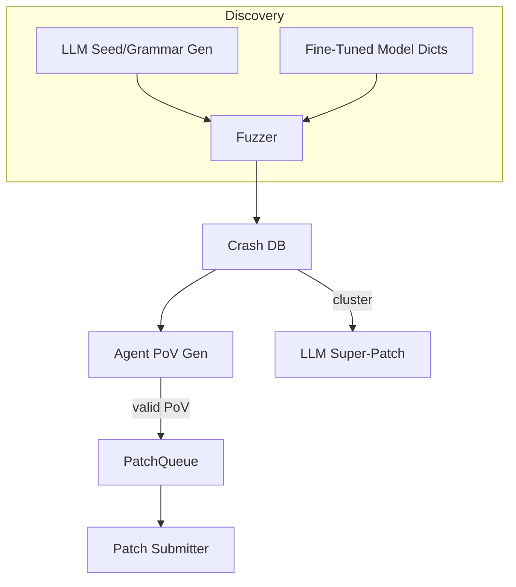

# AI 지원 퍼징 및 자동화된 취약점 발견

{{#include ../banners/hacktricks-training.md}}

## 개요
대규모 언어 모델(LLM)은 의미적으로 풍부한 입력을 생성하고, 문법을 진화시키며, 크래시 데이터를 추론하고, 여러 버그를 한꺼번에 해결하는 패치를 제안하기까지 함으로써 기존 취약점 연구 파이프라인을 크게 강화할 수 있습니다. 이 페이지에서는 DARPA의 AI Cyber Challenge(AIxCC) 결선 및 기타 공개 연구에서 관찰된 가장 효과적인 패턴을 모았습니다.<sup>[[4]](#references)</sup><sup>[[5]](#references)</sup>

아래 내용은 특정 대회 시스템을 설명하는 것이 아니라, 각자의 워크플로에서 재현할 수 있도록 기법을 추상화한 것입니다.

---

## 1. LLM이 생성하는 시드 입력

기존의 커버리지 기반 퍼저(AFL++, libFuzzer, Honggfuzz…)는 작은 시드 코퍼스에서 시작해 바이트를 무작위로 변이합니다. 대상 입력 형식이 복잡하면(SQL, URL, 사용자 지정 바이너리 프로토콜) 무작위 변이로 인해 흥미로운 분기에 도달하기 전에 구문이 깨지는 경우가 많습니다.

LLM은 *시드 생성기*를 출력해 이 초기화 문제를 해결할 수 있습니다. 시드 생성기는 **구문은 올바르면서 보안상 의미 있는 입력을 출력하는** 짧은 스크립트입니다. 예를 들면 다음과 같습니다.

```prompt
SYSTEM: You are a helpful security engineer.
USER:
Write a Python3 program that prints 200 unique SQL injection strings targeting common anti-pattern mistakes (missing quotes, numeric context, stacked queries).  Ensure length ≤ 256 bytes / string so they survive common length limits.
```

```python
# gen_sqli_seeds.py (truncated)
PAYLOADS = [
    "1 OR 1=1 -- ",
    "' UNION SELECT NULL,NULL--",
    "0; DROP TABLE users;--",
    ...
]
for p in PAYLOADS:
    print(p)
```

한 번 실행하고 출력을 fuzzer의 초기 코퍼스에 직접 입력하세요:

```bash
python3 gen_sqli_seeds.py > seeds.txt
afl-fuzz -i seeds.txt -o findings/ -- ./target @@
```

Benefits:
1. 의미적 유효성 → 초기에 더 깊은 coverage 확보.
2. 재생성 가능: prompt를 조정해 XSS, path traversal, binary blobs 등에 집중할 수 있습니다.
3. 저렴함 (GPT-3.5 사용 시 1¢ 미만).

### Tips
* 피상적인 필터를 우회할 수 있도록 payload 길이와 인코딩(UTF-8, URL-encoded, UTF-16-LE)을 *다양화*하라고 모델에 지시합니다.
* *하나의 독립 실행형 스크립트*를 요청하면 JSON 형식 오류를 방지할 수 있습니다.

---

## 2. Grammar-Evolution Fuzzing

더 강력한 변형 방식은 구체적인 seed 대신 LLM이 **grammar를 진화**시키도록 하는 것입니다. 워크플로("Grammar Guy" 패턴)는 다음과 같습니다.

1. prompt를 통해 초기 ANTLR/Peach/LibFuzzer grammar를 생성합니다.
2. N분 동안 fuzzing을 수행하고 coverage metrics(적중한 edges / blocks)를 수집합니다.
3. 테스트되지 않은 프로그램 영역을 요약하고, 그 요약을 모델에 다시 입력합니다:
   ```prompt
   The previous grammar triggered 12 % of the program edges.  Functions not reached: parse_auth, handle_upload.  Add / modify rules to cover these.
   ```
4. 새 규칙을 병합하고, 다시 fuzzing한 다음 반복합니다.

의사 코드 골격:

```python
for epoch in range(MAX_EPOCHS):
    grammar = llm.refine(grammar, feedback=coverage_stats)
    save(grammar, f"grammar_{epoch}.txt")
    coverage_stats = run_fuzzer(grammar)
```

핵심 사항:
* *budget*을 유지하세요. 각 개선에는 tokens가 사용됩니다.
* 모델이 다시 작성하는 대신 편집하도록 `diff` + `patch` 지침을 사용하세요.
* Δcoverage < ε이면 중단하세요.

---

## 3. Local-LLM libFuzzer Harness 설계

분석가의 워크스테이션 밖으로 내보낼 수 없는 소스의 경우, 로컬 code model을 사용해 fuzzer 바이트와 C/C++ API 사이의 작은 adapter를 작성할 수 있습니다. 유용한 보안 경계는 명확합니다. **모델은 테스트 인프라를 작성하고 수정하며, coverage-guided mutation은 입력을 탐색하고, sanitizers는 잘못된 연산을 보고하며, 사람은 harness를 검토하고 발견 사항을 분류합니다**.<sup>[[9]](#references)</sup>

LLM에 의존하지 않는 engine 수준의 corpus, feedback, snapshot 및 stateful-fuzzing 기법은 일반 [Fuzzing Methodology](../generic-methodologies-and-resources/fuzzing.md)를 참조하세요.

대상 헤더에서 정확한 선언을 복사해 시작하고 출력 형식을 제한하세요. 범위를 좁힌 prompt는 존재하지 않는 API를 만들어 내는 일을 줄이고 결과를 쉽게 검토할 수 있게 합니다.<sup>[[8]](#references)[[9]](#references)</sup>

```prompt
Write a libFuzzer target for this exact declaration:
int parse_records(const uint8_t *data, size_t size);

Output only C code. Implement LLVMFuzzerTestOneInput, include the
declaration, pass data and size unchanged, and do not use files,
network access, randomness, clocks, threads, or persistent state.
```

원시 바이트 파서의 경우, 예상 결과는 다음보다 복잡하지 않아야 합니다:<sup>[[6]](#references)[[9]](#references)</sup>

```c
#include <stddef.h>
#include <stdint.h>

extern int parse_records(const uint8_t *, size_t);

int LLVMFuzzerTestOneInput(const uint8_t *data, size_t size) {
    (void)parse_records(data, size);
    return 0;
}
```

컴파일은 첫 번째 검증 단계일 뿐입니다. CPU 시간을 들이기 전에 생성된 모든 target이 다음 불변 조건을 만족하는지 검토하세요:<sup>[[6]](#references)[[8]](#references)[[9]](#references)</sup>

- **정확한 API:** 실제 헤더와 기존 호출 코드를 기준으로 타입, 소유권 규칙, 초기화, teardown, 호출 규약을 비교합니다.
- **Harness 안전성:** `data`에서 읽는 모든 코드를 보호합니다. sanitizer가 발견한 문제는 생성된 glue가 아니라 target에서 발생해야 합니다.
- **재현성:** 결과가 `data`와 `size`의 함수가 되도록 합니다. 외부 I/O, 시간, 제어되지 않는 난수, join되지 않은 스레드, 호출 간 유지되는 상태를 제거합니다.
- **처리량:** 동작에 영향을 주지 않는 경우에만 비용이 큰 불변 상태를 한 번 초기화하고, 입력 크기를 제한하며, 로깅을 억제하고, 입력별 할당을 해제합니다.
- **도달 가능성:** 의도한 함수와 분기가 실행되는지 확인합니다. 컴파일은 되지만 거부 경로만 실행하는 target은 눈에 띄지 않는 실패입니다.

### 구조 인식 target: 버그를 숨기지 않고 불변 조건 유지하기

대부분의 raw 입력이 magic, 길이, 버전 또는 체크섬 검사에서 실패한다면, fuzz bytes를 **타입이 지정된 필드 데이터**로 사용하고 유효한 객체를 다시 구성합니다. 포맷 상수는 고정하고 의미 필드와 payload bytes는 변경 가능하게 두며, 재구성된 payload에서 무결성 메타데이터를 계산합니다. `FuzzedDataProvider`는 제한된 타입 값을 가져오는 데 유용하지만, 생성되는 할당과 변환의 제한은 adapter에서 처리해야 합니다.<sup>[[9]](#references)</sup>

<details>
<summary>구조 인식 C++ target 예시</summary>

```cpp
#include <fuzzer/FuzzedDataProvider.h>
#include <stddef.h>
#include <stdint.h>
#include <vector>

extern "C" int parse_message(const uint8_t *, size_t);

extern "C" int LLVMFuzzerTestOneInput(const uint8_t *data, size_t size) {
    FuzzedDataProvider fdp(data, size);
    uint8_t version = fdp.ConsumeIntegral<uint8_t>();
    auto body = fdp.ConsumeRemainingBytes<uint8_t>();
    if (body.size() > UINT16_MAX) body.resize(UINT16_MAX);
    uint16_t len = static_cast<uint16_t>(body.size());
    std::vector<uint8_t> msg = {0x8b, 'M', 'S', 'G', version,
                                static_cast<uint8_t>(len >> 8),
                                static_cast<uint8_t>(len)};
    msg.insert(msg.end(), body.begin(), body.end());
    (void)parse_message(msg.data(), msg.size());
    return 0;
}
```

</details>

모든 질문에 하나의 구조 복구 타깃만 사용하지 마세요. 길이와 체크섬을 계산해 유효한 상태의 깊은 부분을 탐색하는 타깃 하나와, 하네스 자체의 읽기와 할당만 제한하면서 **선언된** 메타데이터는 fuzzer가 제어하도록 두는 타깃을 별도로 유지하세요. 두 번째 타깃은 자동 복구로 사라질 수 있는 길이 불일치 및 무결성 오류 공격 표면을 보존합니다.<sup>[[9]](#references)</sup>

### 시드, 사전, sanitizer, coverage 피드백

모델에게 바이너리를 직접 출력하라고 요청하는 대신, 바이너리 시드를 파일로 작성하는 스크립트를 생성하도록 요청하세요. 빈 객체, 최소 객체, 일반적인 객체, 경계에서 유효한 객체를 시드로 사용한 다음, 매직 값, 태그, enum 인코딩, 파서 키워드를 추출해 검토된 사전에 넣으세요. libFuzzer는 `-dict=`로 해당 사전을 사용할 수 있으며, 새로운 coverage를 드러내는 변이는 코퍼스에 보존합니다.<sup>[[6]](#references)[[9]](#references)</sup>

```text
magic="\x8bMSG"
version_min="\x00"
version_max="\xff"
config_tag="CONFIG"
```

보완적인 계측을 적용해 동일한 타깃을 빌드합니다. ASan과 UBSan은 하나의 fuzzing 바이너리에서 함께 사용할 수 있습니다. 별도의 MSan 빌드를 만들고, 계측되지 않은 코드로 인해 보고가 발생하지 않도록 해당 빌드의 종속성도 계측합니다.<sup>[[6]](#references)[[9]](#references)</sup>

```bash
clang++ -g -O1 -fsanitize=fuzzer,address,undefined \
  -fno-sanitize-recover=undefined target.cc harness.cc -o fuzz_target
./fuzz_target corpus -dict=msg.dict -max_len=65535

clang++ -g -O1 -fsanitize=fuzzer,memory \
  target.cc harness.cc -o fuzz_target_msan
```

각 모델 revision의 evaluator로 coverage를 사용하세요. libFuzzer 출력에서 `cov`/`ft`가 초반부터 평탄하고 corpus가 정적이라면 framing이 잘못되었거나, 초기에 지나치게 제한적인 return이 있거나, 잘못된 함수를 호출하고 있다는 뜻일 수 있습니다. `exec/s`가 낮다면 비용이 많이 드는 setup, I/O, allocation 또는 누수된 state가 원인일 수 있습니다. `NEW`는 coverage feature가 바뀌었다는 것만 증명할 뿐, 의도한 parser에 도달했다는 뜻은 아닙니다.<sup>[[6]](#references)[[9]](#references)</sup>

소스 수준의 feedback을 얻으려면 coverage 빌드를 만들고 fuzzing한 뒤, uncovered 함수와 해당 함수의 guarding condition만 모델에 제공하세요. 결과로 나온 harness/seed/dictionary diff를 검증하고 다시 측정하세요:<sup>[[7]](#references)[[8]](#references)[[9]](#references)</sup>

```bash
clang++ -g -O1 -fsanitize=fuzzer \
  -fprofile-instr-generate -fcoverage-mapping target.cc harness.cc -o fuzz_cov
mkdir -p profiles
LLVM_PROFILE_FILE='profiles/%p.profraw' ./fuzz_cov -max_total_time=300 corpus
llvm-profdata merge -sparse profiles/*.profraw -o fuzz.profdata
llvm-cov report ./fuzz_cov -instr-profile=fuzz.profdata
llvm-cov show ./fuzz_cov -instr-profile=fuzz.profdata \
  --show-branches=count --region-coverage-lt=1 target.cc
```

따라서 확장 가능한 루프는 **생성 → 컴파일/링크 → sanitizer를 적용해 smoke-test → 대상 커버리지 측정 → 관련성이 가장 높은 최소한의 커버리지/소스 컨텍스트 제공 → 수정 → 재측정**입니다. OSS-Fuzz-Gen도 생성된 대상을 그대로 그럴듯한 코드로 받아들이는 대신, 컴파일 가능성, 런타임 오류, 커버리지, 기존 대상 대비 커버리지 개선 여부를 평가해 같은 원칙을 적용합니다.<sup>[[7]](#references)[[8]](#references)</sup>

---

<a id="3-agent-based-pov-exploit-generation" hidden>3. 에이전트 기반 PoV(익스플로잇) 생성</a>

## 4. 에이전트 기반 PoV(익스플로잇) 생성

크래시를 찾은 뒤에도 이를 결정적으로 재현하는 **취약점 증명(PoV)**이 필요합니다.

확장 가능한 방법은 여러 경량 워커(프로세스, 스레드 또는 컨테이너)를 실행하고, 각 워커에 서로 다른 모델이나 샘플링 설정을 사용하는 것입니다. AIxCC 결선 진출팀 설문에는 구체적인 규모 사례가 나와 있습니다. 한 팀은 AI 중심 PoV 생성에 **수천 개의 동시 에이전트**를 사용했고, 다른 팀은 **300~500개의 fuzzing 에이전트**를 조율하면서 LLM은 더 높은 수준의 의미 추론에 활용했습니다.<sup>[[4]](#references)</sup>

파이프라인:
1. 정적/동적 분석으로 *버그 후보*를 생성합니다(크래시 PC, 입력 슬라이스, sanitizer 메시지가 포함된 struct).
2. 오케스트레이터가 후보를 에이전트에 배포합니다.
3. 에이전트의 추론 단계:
   a. `gdb`와 입력을 사용해 로컬에서 버그를 재현합니다.
   b. 최소 익스플로잇 페이로드를 제안합니다.
   c. sandbox에서 익스플로잇을 검증합니다. 성공하면 제출합니다.
4. 실패한 시도는 커버리지 fuzzing을 위한 **새 seed로 다시 대기열에 추가**됩니다(피드백 루프).

장점:
* 병렬화로 단일 에이전트의 낮은 신뢰성을 보완합니다.
* 관찰된 성공률에 따라 temp / 모델 크기를 자동 조정합니다.

---

<a id="4-directed-fuzzing-with-fine-tuned-code-models" hidden>4. Fine-Tuned Code Models를 활용한 Directed Fuzzing</a>

## 5. Fine-Tuned Code Models를 활용한 Directed Fuzzing

취약점 패턴(integer overflow, buffer copy, format string)이 표시된 C/C++ 소스 코드로 open-weight 모델(예: Llama-7B)을 fine-tune합니다. 그런 다음:

1. 정적 분석을 실행해 함수 목록과 AST를 얻습니다.
2. 모델에 프롬프트를 입력합니다. *“함수 X에서 메모리 안전성을 깨뜨릴 가능성이 높은 mutation dictionary 항목을 제시해 주세요.”*
3. 해당 토큰을 사용자 지정 `AFL_CUSTOM_MUTATOR`에 삽입합니다.

`sprintf` 래퍼의 출력 예:
```
{"pattern":"%99999999s"}
{"pattern":"AAAAAAAA....<1024>....%n"}
```

실제 대상에서 경험적으로 crash까지 걸리는 시간을 2배 이상 단축합니다.

---

<a id="5-ai-guided-patching-strategies" hidden>5. AI-Guided Patching Strategies</a>

## 6. AI 기반 패치 전략

<a id="51-super-patches" hidden>5.1 Super Patches</a>

### 6.1 슈퍼 패치
모델에 crash 시그니처를 *클러스터링*하고 공통 근본 원인을 제거하는 **단일 패치**를 제안하도록 요청합니다. 한 번 제출해 여러 버그를 수정하면, 잘못된 패치마다 점수가 깎이는 환경에서 정확도 페널티를 줄일 수 있습니다.

프롬프트 개요:
```
Here are 10 stack traces + file snippets.  Identify the shared mistake and generate a unified diff fixing all occurrences.
```

{{#ref}}
../generic-methodologies-and-resources/fuzzing.md
{{#endref}}

<a id="52-speculative-patch-ratio" hidden>5.2 Speculative Patch Ratio</a>

### 6.2 추측성 패치 비율
PoV로 검증된 확정 패치와 *추측성* 패치(PoV 없음)를 1:​N 비율로 번갈아 처리하는 큐를 구현합니다. 이 비율은 점수 규칙에 맞게 조정합니다(예: 추측성 패치 2개 : 확정 패치 1개). 비용 모델이 페널티와 점수를 모니터링하고 N을 자동 조정합니다.

---

<a id="6-deterministic-file-by-file-ai-code-review" hidden>6. Deterministic File-by-File AI Code Review</a>

## 7. 결정론적 파일별 AI 코드 리뷰

AI 지원 리뷰에서 자주 발생하는 실패 유형은 에이전트 하나에 저장소 전체를 검사하게 하고, 적절한 파일과 grep 검색어를 선택하리라 기대하는 것입니다. 더 신뢰할 수 있는 방법은 **저장소 전체를 빠짐없이 검사하도록 강제하는 것**입니다:<sup>[[1]](#references)</sup>

1. 소스 파일을 열거합니다.
2. 최소한의 맥락(진입점, import, 인접한 라우트/호출자)과 함께 **한 번에 파일 하나씩** 전달합니다.
3. 각 파일에 대해 소스, 싱크, 누락된 검증, 익스플로잇 전제 조건, 신뢰도를 포함한 **구조화된 보고서**를 요구합니다.<sup>[[3]](#references)</sup>
4. **source→sink 패턴**을 기준으로 보고서를 중복 제거하고, 위험도가 높은 항목은 직접 검증합니다.

토큰을 많이 사용하고 잡음도 많지만, 광범위한 에이전트 리뷰에서 자주 놓치는 **단순하면서 영향력이 큰 source/sink 버그**를 찾는 데 매우 효과적입니다.

### 우선순위를 둘 만한 트리아지 패턴

- **동적 PHP include/dispatch**: 공격자가 제어하는 라우트/컨트롤러/모듈 이름이 엄격한 허용 목록 및 경로 정규화 없이 `require_once()`, `include()`, 또는 `include_once()`로 전달되는 경우.
- **관리자/계정 워크플로의 셸 실행**: 사용자 이름, 도메인, FTP 계정 또는 기타 식별자가 `exec()`, `system()`, `shell_exec()`, `passthru()`, `proc_open()`, 또는 `popen()`에 전달되는 경우.
- **구조화된 입력의 fan-in**: 동일한 매개변수를 `$_GET`, `$_POST`, JSON, XML 또는 프레임워크의 body parser에서 받아 나중에 파일시스템이나 OS 명령 싱크에서 재사용하는 경우.

### 이 방법으로 효과적으로 찾을 수 있는 실용적인 버그 클래스 두 가지

- **PHP 컨트롤러 디스패치 LFI/RCE**: 요청으로 제어하는 컨트롤러 이름을 허용 목록이나 경로 정규화 없이 `require_once()`에 연결하면 `../` 같은 traversal 시퀀스를 통해 의도하지 않은 로컬 `.php` 파일을 PHP가 포함하게 만들 수 있습니다. 공격자가 심어 둔 파일이나 그 밖에 유용한 PHP 파일을 포함하도록 만들 수 있다면 LFI가 코드 실행으로 이어집니다. [File Inclusion / Path Traversal](../pentesting-web/file-inclusion/README.md)을 참조하세요.<sup>[[1]](#references)</sup>
- **호스팅/관리자 패널의 인증된 command injection**: 사용자 이름과 같은 계정 관리 필드를 셸 명령에 삽입하는 경우, 낮은 권한의 인증된 사용자가 일반적인 생성/삭제 작업을 RCE로 바꿀 수 있습니다. 패널이 더 높은 권한을 가진 서비스 계정으로 명령을 실행하면 영향이 커집니다. [Command Injection](../pentesting-web/command-injection.md)을 참조하세요.<sup>[[1]](#references)</sup>

### 실용적인 리뷰 참고 사항

- LLM을 익스플로잇 생성기가 아닌 **source/sink 리뷰어**로 먼저 활용합니다.
- **공격자가 제어하는 필드**, **정규화/검증의 공백**, **위험한 싱크**를 명시적으로 나열하도록 요청합니다.
- 대규모 저장소에서는 더 강력한 모델을 사용하는 단일 자율 에이전트 실행보다 결정론적인 파일별 리뷰가 더 신뢰할 만한 경우가 많습니다.<sup>[[2]](#references)</sup>
- 익스플로잇 가능성이 여러 파일에 걸친 가정, 역할의 의미 또는 제품별 위협 모델에 좌우되는 **Broken Access Control** 및 기타 비즈니스 로직 버그에서는 결과가 약할 수 있습니다.

---

## 모바일 진입점 taskflow

저장소 전체를 대상으로 하는 단일 프롬프트는 위협 모델을 뒤섞고 외부에서 접근 가능한 컴포넌트부터 민감한 싱크까지의 경로를 놓치는 경우가 많습니다. 더 나은 워크플로는 감사를 상태를 유지하는 taskflow로 나누는 것입니다. 먼저 애플리케이션/컴포넌트를 분류하고, 공격자가 제어할 수 있는 진입점을 목록화한 다음, 각 진입점에 도달 가능성 메타데이터를 추가하고, 마지막으로 플랫폼별 취약점 클래스를 기준으로 각각을 검토합니다. GitHub Security Lab의 모바일 taskflow는 Android, iOS, 크로스 플랫폼 저장소에 이 패턴을 적용합니다.<sup>[[14]](#references)[[15]](#references)</sup>

Android에서는 최소한 다음을 기록합니다:<sup>[[14]](#references)[[15]](#references)</sup>

- 권한을 포함한 exported Activity, Service, Receiver, Provider
- intent action, deep-link scheme/host/path, MIME filter, App Link
- 공격자가 제어할 수 있는 action, data URI, `ClipData`, extra, URI 권한 부여 플래그
- WebView 내비게이션 입력과 `addJavascriptInterface` bridge
- 이후의 권한 있는 작업, 가져온 리소스, 네트워크 대상

그런 다음 각 진입점을 맥락에 따라 분류합니다. 호출자 권한 부여/confused-deputy 동작, intent redirection, broadcast spoofing 또는 정보 노출, 안전하지 않은 import, WebView 스크립팅과 bridge 노출, origin 간 자격 증명 또는 쿠키 이동 여부를 명시적으로 확인합니다. **엄격한 체크리스트 검토**와 **광범위한 적대적 검토**를 모두 수행합니다. 익스플로잇 세부 사항을 중복해서 설명하지 말고, 발견 사항을 [Intent Injection](../mobile-pentesting/android-app-pentesting/intent-injection.md) 및 [WebView Attacks](../mobile-pentesting/android-app-pentesting/webview-attacks.md)에 연결합니다.<sup>[[15]](#references)</sup>

현재 공개 소스 taskflow는 Codespace에서 다음 명령으로 실행할 수 있습니다:<sup>[[14]](#references)</sup>

```bash
./scripts/audit/run_audit.sh owner/repository
```

결과는 SQLite의 `audit_result` 테이블에 기록됩니다.<sup>[[14]](#references)</sup> 취약한 것으로 표시된 행은 검증된 발견 사항이 아니라 **단서**로 취급하세요. 각 단서에 대해 모델이 공격자가 제어하는 소스, 민감한 싱크, 전제 조건, 예상 영향을 명시하도록 한 다음, 최소한의 PoC를 만들도록 요청하세요. 디버거나 계측을 사용해 원본 빌드에서 해당 PoC를 실행하세요. 이렇게 하면 도달할 수 없는 분기, 비현실적인 애플리케이션 상태, 외부 스토리지 데이터가 비공개 데이터보다 우선하지 않는 경우, 심각도를 실질적으로 낮추는 완화 조치와 같은 일반적인 정적 분석 오류를 찾아낼 수 있습니다.<sup>[[15]](#references)</sup>

---

## 8. 계측된 오라클을 활용한 패턴 기반 커널 감사

커널 규모의 대상을 분석할 때는 에이전트에게 전체 트리에서 임의의 버그를 찾도록 요청하지 마세요. 과거 취약점 지식을 정적 쿼리로 변환하고, 노출된 공격 표면에 따라 결과의 우선순위를 정한 다음, 계측된 커널을 실행 오라클로 사용하는 편이 토큰 효율적인 워크플로입니다.<sup>[[11]](#references)</sup>

### 패턴 데이터베이스 → CodeQL/Semgrep → 집중 검토

위험한 API, 검증 누락 패턴, 위험한 소스-싱크 흐름, 이전에 수정된 버그 형태를 포함하는 소규모 지식 베이스를 구축하세요. 모델에게 **한 번에 하나의 패턴씩** 검토 휴리스틱과 CodeQL/Semgrep 규칙으로 변환하도록 요청한 뒤, 결정론적 규칙을 전체 트리에 실행하세요. 코드 검토를 위해 모델에 전달하기 전에 일치 항목을 그룹화하고 중복을 제거하세요. 원시 스캐너 출력에는 가치가 낮은 후보가 수천 개 포함될 수 있습니다. 적격한 연구 또는 오픈소스 대상 이외의 용도로 이 접근 방식을 사용하기 전에 CodeQL의 현재 라이선스를 확인하세요.<sup>[[11]](#references)</sup>

규칙 일치 밀도와 공격자 도달 가능성을 모두 고려해 하위 시스템의 우선순위를 정하고, 일치 횟수만으로 판단하지 마세요. 권한 없는 프로세스, 샌드박스, 컨테이너, jail 또는 게스트 환경에서 접근할 수 있는 커널 인터페이스는 내부 전용 코드보다 더 높은 비중을 두어야 합니다. 에이전트가 호출자, 검증기, 수명 규칙을 파악할 수 있도록 검토 단위를 충분히 작게 유지하고, “취약점을 아무거나 찾아라” 대신 명시된 취약점 유형이나 제어 흐름 패턴을 프롬프트로 제시하세요. 새로운 격리 경계로 인해 네임스페이스 또는 jail의 root 사용자가 접근할 수 있게 된 레거시 권한 인터페이스는 특히 주의 깊게 살펴볼 가치가 있습니다.<sup>[[11]](#references)</sup>

각 후보에 대해 악용을 시도하기 전에 명시적인 필드 흐름 기록을 요구하세요.<sup>[[11]](#references)</sup>

```text
entrypoint -> privilege check -> parser -> validation/normalization
           -> later rewrite -> dangerous sink
attacker controls: <fields and lengths>
constraints:       <values rewritten, rejected, or preserved>
observable result: <sanitizer report, assertion, panic, or clean exit>
```

### KASAN telemetry를 가설 오라클로 사용하기

KASAN과 유용한 진단 assertion을 활성화한 일회용 VM에서 대상 커널을 실행합니다. 의심되는 손상이 재현되거나 기각될 때까지 에이전트가 **소스 가설 → 최소 userland 트리거 → VM 실행 → KASAN/assertion 추적 → 수정된 가설** 순서로 반복하도록 합니다. 각 반복에서는 관련 stack trace와 인접한 소스 코드만 반환합니다. 이렇게 하면 추론에 필요한 맥락을 유지하면서, 모델의 확신이 아니라 런타임 증거를 통과 기준으로 삼을 수 있습니다.<sup>[[11]](#references)</sup>

계측 빌드가 최종 exploitability 환경은 아닙니다. Assertion은 손상을 일으키는 작업 전에 실행을 중단할 수 있지만, 동일한 assertion이 production kernel에서는 컴파일 단계에서 제외될 수 있습니다. 변경하지 않은 트리거를 정확한 production configuration에서 다시 테스트하고, 커널 빌드와 configuration을 기록하며, **도달 가능성**, **메모리 손상**, **제어 가능한 primitive**, **보안 영향**을 각각 별개의 주장으로 구분합니다.<sup>[[11]](#references)[[12]](#references)</sup>

CVE-2026-3038은 exploit 템플릿이 아니라 유용한 검증 사례입니다. 권한이 없는 FreeBSD `RTM_GET` 요청은 선택적 검증과 응답 재작성 과정을 거치면서 크기가 초과된 `RTAX_AUTHOR` sockaddr를 유지할 수 있었습니다. 이후 `rtsock_msg_buffer()`가 사용자 제어 `sa_len`을 128바이트 스택 `sockaddr_storage`에 복사했습니다. 최대 255바이트 복사로 127바이트 덮어쓰기가 발생했습니다. 계측 빌드에서는 진단 assertion이 잘못된 길이를 포착했지만, GENERIC 커널에서는 복사 작업에 도달한 뒤 손상된 canary를 검사할 때 panic이 발생했습니다. 이는 권한 없는 denial of service를 입증하지만, 독립적인 권한 상승까지 입증하지는 않습니다. 안정적으로 제어하려면 먼저 canary disclosure와 같은 추가 primitive가 필요합니다. 관련된 binary-exploitation 경계는 [Stack Canaries](../binary-exploitation/common-binary-protections-and-bypasses/stack-canaries/index.html)를 참조하세요.<sup>[[11]](#references)[[12]](#references)[[13]](#references)</sup>

### Exploit 전제 조건을 속여 충족하는 사례 거부하기

PoV 또는 exploit을 승인하기 전에 별도의 검토자/에이전트가 고정된 기준에 따라 주장을 반증하도록 합니다. 검토 시 다음 조건을 모두 확인해야 합니다.<sup>[[11]](#references)</sup>

- 해당 경로에 도달할 수 있도록 대상 소스, 커널, 취약한 모듈을 수정하지 않았습니다.
- helper module, synthetic gadget, 비활성화된 mitigation, 추가 권한 또는 사용할 수 없는 인터페이스를 도입하지 않았습니다.
- 깨끗한 snapshot에서 주장된 호출자 ID와 containment 제한을 적용한 상태로 트리거가 시작됩니다.
- 결과가 여전히 버그에 의존합니다. 잘못된 필드를 제거하거나 버그만 패치하면 체인이 작동하지 않아야 합니다.
- crash, overread 또는 overwrite는 해당 primitive로만 보고합니다. 코드 실행 또는 권한 상승에는 독립적인 증거가 필요합니다.

마지막 반사실 검사는 순환 논리에 기반한 시연을 잡아냅니다. 전제 조건만으로 이미 주장한 영향을 얻을 수 있다면(예: `nosuid` 없이 마운트된 파일시스템에서 공격자가 제공한 SUID 콘텐츠를 실행하는 경우), 메모리 안전성 버그가 그 영향을 만든 것이 아닙니다.<sup>[[11]](#references)</sup>

---

## 익숙하지 않은 코드베이스에서 감사 가능한 에이전트 지원 연구

[graph-first fuzz-target workflow](../generic-methodologies-and-resources/fuzzing.md#graph-first-fuzz-target-selection-and-mutation-triage)는 entrypoint 도달 가능성을 다루고, [agentic SAST pipelines](../network-services-pentesting/pentesting-web/code-review-tools.md#agentic-sast-pipelines)는 단계별 검토와 증거 기준을 다룹니다. 이 결정론적 결과를 모델의 가설과 분리해 두면, 승격된 모든 단서에 소스 위치, 경로 증거, 동적 측정값이 포함됩니다.<sup>[[10]](#references)</sup>

### 데이터 흐름을 지어내지 않고 객체 수명 증거 연관 짓기

정적 분석은 공격자가 제어하는 길이가 한 함수에 저장되고, 같은 객체 필드가 훨씬 뒤에 copy sink에 도달하는 것을 찾을 수 있지만, callback, reconnect 또는 객체 수명에 걸친 연결 관계를 입증하지 못할 수 있습니다. 두 결과를 별도로 보존하고, 객체/필드 기준으로 묶으며, 누락된 연결 관계를 명시적인 triage 질문으로 남깁니다. 에이전트는 관계를 제안할 수 있지만, 소스 코드 검토나 런타임 계측을 통해 이를 입증해야 합니다.<sup>[[10]](#references)</sup>

각 후보에 대해 다음을 기록합니다.

- 구체적인 entrypoint와 공격자가 제어하는 바이트
- 관련 필드의 모든 producer와 producer별 검증
- sink, 대상 버퍼 용량, 도달에 필요한 빌드/런타임 조건
- 직접 harness 호출이 아니라 노출된 entrypoint에서 시작하는 실제 call stack
- 가설을 확인하거나 기각하는 최소한의 동적 결과

겉보기에 안전한 경로 하나만으로 필드가 전역적으로 안전하다고 판단하지 않습니다. 두 번째 producer가 첫 번째 경로의 경계 검증 없이 같은 필드에 값을 설정할 수 있습니다. 경로를 각각 테스트하고, debug assertion이 production의 메모리 손상을 테스트에서만 발생하는 조기 중단으로 바꿀 수 있으므로 배포 환경과 동등한 빌드 옵션으로 harness를 실행합니다.<sup>[[10]](#references)</sup>

### Disclosure와 exploitation을 위한 측정 기준

초기화되지 않은 메모리 disclosure가 의심되면 새 할당을 식별 가능한 바이트로 채우고, 정확히 그 marker가 출력되는 패킷에 도달하는지 확인합니다. Exploitation에는 **제어 가능한 overwrite → 유용한 victim object → disclosure → pointer/base 복구 → control-flow hijack → 조합된 payload**와 같은 측정 기준을 적용합니다. Harness가 현재 속성을 입증했을 때만 에이전트가 다음 단계로 진행합니다. 그럴듯한 설명은 기준을 통과한 것이 아닙니다. [FreeRDP 사례](../binary-exploitation/libc-heap/heap-overflow.md#cross-path-length-reuse-and-stale-output-disclosure)는 검증 중 보존해야 하는 경로와 빌드 제약을 보여줍니다.<sup>[[10]](#references)</sup>

---

LLM 지원 exploit 개발에 단계별 L0–L4 검증을 적용한 커널 사례 연구는 다음을 참조하세요.

{{#ref}}
../binary-exploitation/freebsd-kernel-exploitation-vnet-jail-escape.md
{{#endref}}

## Debugger 지원 crash triage

Crash triage, 함수 분석, 제어 가능한 heap-chunk 도달 가능성을 위한 Mona v3 workflow는 [Exploiting Tools](../binary-exploitation/basic-stack-binary-exploitation-methodology/tools/#mona-v3-debugger-context-requests-for-crash-triage)에 있습니다.

---

## 모든 내용을 종합하기

End-to-end CRS(Cyber Reasoning System)는 다음과 같이 구성할 수 있습니다.



---

## References

- [1] [Project Black - 사이버 보안을 위한 로컬 AI: phpIPAM LFI 및 myVesta 인증된 RCE 발견](https://projectblack.io/blog/local-ai-for-cyber-security)
- [2] [Strix](https://github.com/usestrix/strix)
- [3] [GitHub Copilot 커뮤니티 security-review 스킬](https://github.com/github/awesome-copilot/blob/main/skills/security-review/SKILL.md)
- [4] [Trail of Bits – AIxCC 결승전: 기록으로 돌아보기](https://blog.trailofbits.com/2025/08/07/aixcc-finals-tale-of-the-tape/)
- [5] [CTF Radiooo AIxCC 결승 진출팀 인터뷰](https://www.youtube.com/@ctfradiooo)
- [6] [LLVM — libFuzzer: 커버리지 기반 fuzz testing 라이브러리](https://llvm.org/docs/LibFuzzer.html)
- [7] [Google — OSS-Fuzz-Gen](https://github.com/google/oss-fuzz-gen)
- [8] [Google Online Security Blog — Fuzzing 강화: AI로 더 많은 취약점 발견하기](https://security.googleblog.com/2024/11/leveling-up-fuzzing-finding-more.html)
- [9] [8kSec — 로컬 LLM을 활용한 AI 지원 fuzzing harness 생성](https://8ksec.io/ai-assisted-fuzzing-harness-local-llm)
- [10] [Quarkslab — AI Agent에서 RCE까지: 취약점 연구 워크플로 구축](https://blog.quarkslab.com/from-ai-agents-to-rce-building-a-vulnerability-research-workflow.html)
- [11] [Praetorian — FreeBSoD: 언어 모델을 활용한 커널 버그 발견 및 exploit (2부 중 1부)](https://praetorian.com/blog/ai-vulnerability-research-freebsd-kernel)
- [12] [FreeBSD-SA-26:05.route — routing socket을 통한 로컬 DoS 및 잠재적 권한 상승](https://www.freebsd.org/security/advisories/FreeBSD-SA-26:05.route.asc)
- [13] [FreeBSD-SA-26:05.route 소스 패치](https://security.FreeBSD.org/patches/SA-26:05/route.patch)
- [14] [GitHub Security Lab - SecLab Taskflows](https://github.com/GitHubSecurityLab/seclab-taskflows)
- [15] [GitHub Security Lab - 오픈 소스 AI 보안 agent로 Android 취약점 24개를 발견한 방법](https://github.blog/security/how-we-found-24-android-vulnerabilities-using-our-open-source-ai-security-agent)
{{#include ../banners/hacktricks-training.md}}
