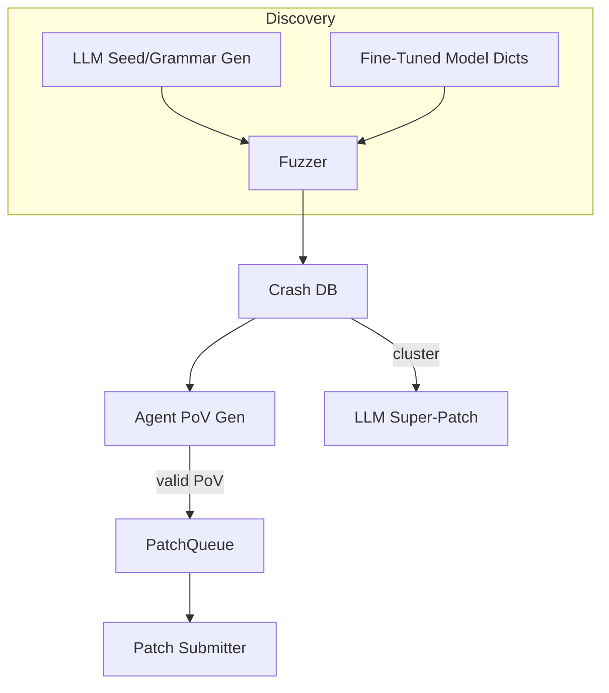

# AI支援Fuzzingと自動脆弱性発見

{{#include ../banners/hacktricks-training.md}}

## 概要
大規模言語モデル（LLM）は、意味的に豊かな入力の生成、文法の進化、クラッシュデータの推論、さらには複数のバグを含むパッチの提案によって、従来の脆弱性調査パイプラインを大幅に強化できます。このページでは、DARPAのAI Cyber Challenge（AIxCC）決勝戦やその他の公開研究で確認された、最も効果的なパターンをまとめます。<sup>[[4]](#references)</sup><sup>[[5]](#references)</sup>

以下は、特定の競技システムの説明ではなく、独自のワークフローで再現できるよう、手法を抽象化したものです。

---

## 1. LLMが生成するSeed入力

従来のcoverage-guided fuzzer（AFL++、libFuzzer、Honggfuzzなど）は、小規模なseedコーパスから始め、バイト列を手当たり次第に変異させます。ターゲットの入力形式が複雑な場合（SQL、URL、カスタムバイナリプロトコルなど）、ランダムな変異では、興味深い分岐に到達する前に構文が壊れてしまうことがよくあります。

LLMは、**構文的に正しく、セキュリティ上重要な入力**を出力する短いスクリプト、つまり*seed generator*を作成することで、この初期化の問題を解決できます。たとえば、次のようになります。

```prompt
SYSTEM: You are a helpful security engineer.
USER:
Write a Python3 program that prints 200 unique SQL injection strings targeting common anti-pattern mistakes (missing quotes, numeric context, stacked queries).  Ensure length ≤ 256 bytes / string so they survive common length limits.
```

```python
# gen_sqli_seeds.py (truncated)
PAYLOADS = [
    "1 OR 1=1 -- ",
    "' UNION SELECT NULL,NULL--",
    "0; DROP TABLE users;--",
    ...
]
for p in PAYLOADS:
    print(p)
```

一度実行し、出力をそのまま fuzzer の初期コーパスに投入します:

```bash
python3 gen_sqli_seeds.py > seeds.txt
afl-fuzz -i seeds.txt -o findings/ -- ./target @@
```

Benefits:
1. 意味的に妥当 → 早い段階でより深くカバーできる。
2. 再生成可能: プロンプトを調整して、XSS、path traversal、binary blobs などに焦点を当てられる。
3. 低コスト（GPT-3.5なら 1 ¢ 未満）。

### Tips
* 表面的なフィルターを回避できるよう、payload の長さとエンコーディング（UTF-8、URL-encoded、UTF-16-LE）を*多様化*するようモデルに指示する。
* *単体で完結するスクリプトを1つ*生成するよう依頼する — JSON のフォーマットに関する問題を避けられる。

---

## 2. Grammar-Evolution Fuzzing

より強力な亜種では、具体的な seed ではなく、LLM に**grammar を進化**させる。ワークフロー（「Grammar Guy」パターン）は次のとおり。

1. プロンプトを使って、初期の ANTLR/Peach/LibFuzzer grammar を生成する。
2. N 分間 fuzz し、coverage metrics（ヒットした edges / blocks）を収集する。
3. 未カバーのプログラム領域を要約し、その要約をモデルにフィードバックする:
   ```prompt
   The previous grammar triggered 12 % of the program edges.  Functions not reached: parse_auth, handle_upload.  Add / modify rules to cover these.
   ```
4. 新しいルールをマージし、再度 fuzzing して、繰り返す。

擬似コードの骨組み:

```python
for epoch in range(MAX_EPOCHS):
    grammar = llm.refine(grammar, feedback=coverage_stats)
    save(grammar, f"grammar_{epoch}.txt")
    coverage_stats = run_fuzzer(grammar)
```

要点:
* *budget*を維持する – 各改良でトークンを消費します。
* モデルに書き直させるのではなく編集させるため、`diff` + `patch`の指示を使います。
* Δcoverage < ε になったら停止します。

---

## 3. Local-LLM libFuzzer ハーネス設計

アナリストのワークステーション外に持ち出せないソースコードの場合、ローカルのコードモデルを使って、fuzzerのバイト列とC/C++ APIをつなぐ小さなアダプターを作成できます。重要なのは、セキュリティ境界を明確にすることです。**モデルはテスト基盤を作成・改良し、カバレッジ誘導型ミューテーションが入力を探索し、sanitizerが不正な操作を報告し、人間がハーネスをレビューして発見事項をトリアージします**。<sup>[[9]](#references)</sup>

LLMに依存しないエンジンレベルのコーパス、フィードバック、スナップショット、ステートフルファジングの手法については、一般的な[Fuzzing Methodology](../generic-methodologies-and-resources/fuzzing.md)を参照してください。

まず、対象ヘッダーから正確な宣言をコピーし、出力形式を制約します。プロンプトを絞ることで、APIの捏造を減らし、結果をレビューしやすくできます。<sup>[[8]](#references)[[9]](#references)</sup>

```prompt
Write a libFuzzer target for this exact declaration:
int parse_records(const uint8_t *data, size_t size);

Output only C code. Implement LLVMFuzzerTestOneInput, include the
declaration, pass data and size unchanged, and do not use files,
network access, randomness, clocks, threads, or persistent state.
```

raw byte parser の期待される結果は、次のようにシンプルなものです:<sup>[[6]](#references)[[9]](#references)</sup>

```c
#include <stddef.h>
#include <stdint.h>

extern int parse_records(const uint8_t *, size_t);

int LLVMFuzzerTestOneInput(const uint8_t *data, size_t size) {
    (void)parse_records(data, size);
    return 0;
}
```

コンパイルは最初の検証ゲートにすぎません。CPU時間を費やす前に、生成されたすべての target が以下の不変条件を満たしているか確認してください:<sup>[[6]](#references)[[8]](#references)[[9]](#references)</sup>

- **正確な API:** 型、所有権ルール、初期化、後処理、呼び出し規約を、実際のヘッダーおよび既存の呼び出し元と照合します。
- **ハーネスの安全性:** `data` から読み取る箇所すべてにガードを設けます。sanitizer の検出結果は、生成された glue ではなく target に起因する必要があります。
- **再現性:** 結果が `data` と `size` の関数になるようにします。外部 I/O、時刻、制御されていない乱数、join されていないスレッド、呼び出し間で残存する状態を取り除きます。
- **スループット:** 動作に影響しない場合に限り、高コストな不変状態を一度だけ初期化し、入力サイズを制限し、ログ出力を抑制し、入力ごとの割り当てを解放します。
- **到達可能性:** 意図した関数と分岐が実行されることを確認します。コンパイルはできても拒否パスしか実行しない target は、気づかれにくい失敗です。

### 構造を考慮した target: バグを隠さず不変条件を維持する

ほとんどの raw 入力がマジック値、長さ、バージョン、チェックサムのゲートで失敗する場合は、fuzz バイトを**型付きフィールドの素材**として使い、有効なオブジェクトを再構築します。フォーマット定数を固定し、意味フィールドとペイロードのバイト列は変更可能なままにして、再構築したペイロードから整合性メタデータを導出します。`FuzzedDataProvider` は、上限付きの型付き値を消費するのに便利ですが、生成される割り当てと変換の制限はアダプター側で行います。<sup>[[9]](#references)</sup>

<details>
<summary>構造を考慮した C++ target の例</summary>

```cpp
#include <fuzzer/FuzzedDataProvider.h>
#include <stddef.h>
#include <stdint.h>
#include <vector>

extern "C" int parse_message(const uint8_t *, size_t);

extern "C" int LLVMFuzzerTestOneInput(const uint8_t *data, size_t size) {
    FuzzedDataProvider fdp(data, size);
    uint8_t version = fdp.ConsumeIntegral<uint8_t>();
    auto body = fdp.ConsumeRemainingBytes<uint8_t>();
    if (body.size() > UINT16_MAX) body.resize(UINT16_MAX);
    uint16_t len = static_cast<uint16_t>(body.size());
    std::vector<uint8_t> msg = {0x8b, 'M', 'S', 'G', version,
                                static_cast<uint8_t>(len >> 8),
                                static_cast<uint8_t>(len)};
    msg.insert(msg.end(), body.begin(), body.end());
    (void)parse_message(msg.data(), msg.size());
    return 0;
}
```

</details>

すべての質問に対して、構造を修復するターゲットを1つだけ使わないでください。長さやチェックサムを導出して深い有効状態を探索するターゲットと、ハーネス自身の読み取りと割り当てだけに上限を設け、**宣言された**メタデータはfuzzerの制御下に置く別のターゲットを用意してください。2つ目のターゲットは、自動修復によって失われる不一致の長さや不正な整合性情報の攻撃対象領域を維持します。<sup>[[9]](#references)</sup>

### Seeds、辞書、sanitizer、coverage feedback

バイナリを直接出力するよう求めるのではなく、バイナリのseedを書き出すスクリプトをモデルに生成させてください。空のオブジェクト、最小限のオブジェクト、典型的なオブジェクト、有効な境界値のオブジェクトをseedにし、その後、magic value、tag、enum encoding、parser keywordを抽出して、レビュー済みの辞書にまとめます。libFuzzerは`-dict=`でその辞書を受け付け、新しいcoverageを見つけたmutationをcorpusに保持します。<sup>[[6]](#references)[[9]](#references)</sup>

```text
magic="\x8bMSG"
version_min="\x00"
version_max="\xff"
config_tag="CONFIG"
```

同じターゲットを補完的な instrumentation でビルドします。ASan と UBSan は同じ fuzzing binary を共有できますが、未 instrument 化コードが原因のレポートを避けるため、MSan は別ビルドにし、依存関係も instrument 化してください。<sup>[[6]](#references)[[9]](#references)</sup>

```bash
clang++ -g -O1 -fsanitize=fuzzer,address,undefined \
  -fno-sanitize-recover=undefined target.cc harness.cc -o fuzz_target
./fuzz_target corpus -dict=msg.dict -max_len=65535

clang++ -g -O1 -fsanitize=fuzzer,memory \
  target.cc harness.cc -o fuzz_target_msan
```

各モデル改訂の評価指標としてcoverageを使います。libFuzzerの出力で、`cov`/`ft`が早期に横ばいになり、corpusも変化しない場合は、フレーミングの不備、早すぎる段階での過度に制限的なreturn、または呼び出し先の誤りが考えられます。`exec/s`が低い場合は、セットアップ、I/O、メモリ確保、または状態のリークにコストがかかっている可能性があります。`NEW`が示すのはcoverage featureに変化があったことだけで、意図したparserに到達した証明にはなりません。<sup>[[6]](#references)[[9]](#references)</sup>

ソースレベルのフィードバックを得るには、coverage buildを作成してfuzzし、未カバーの関数と、その関数を保護する条件だけをモデルに渡します。生成されたharness/seed/dictionaryのdiffを確認し、もう一度計測します。<sup>[[7]](#references)[[8]](#references)[[9]](#references)</sup>

```bash
clang++ -g -O1 -fsanitize=fuzzer \
  -fprofile-instr-generate -fcoverage-mapping target.cc harness.cc -o fuzz_cov
mkdir -p profiles
LLVM_PROFILE_FILE='profiles/%p.profraw' ./fuzz_cov -max_total_time=300 corpus
llvm-profdata merge -sparse profiles/*.profraw -o fuzz.profdata
llvm-cov report ./fuzz_cov -instr-profile=fuzz.profdata
llvm-cov show ./fuzz_cov -instr-profile=fuzz.profdata \
  --show-branches=count --region-coverage-lt=1 target.cc
```

スケーラブルなループは、**生成 → compile/link → sanitizer 下で smoke-test → target coverage を測定 → 関連性の高い最小限の coverage/source context を提供 → 修正 → 再測定**です。OSS-Fuzz-Gen も同じ原則を適用し、もっともらしいコードをそのまま受け入れるのではなく、生成した target のコンパイル可否、runtime failure、coverage、および既存 target に対する coverage の改善を評価します。<sup>[[7]](#references)[[8]](#references)</sup>

---

<a id="3-agent-based-pov-exploit-generation" hidden>3. Agent-Based PoV (Exploit) Generation</a>

## 4. Agent-Based PoV (Exploit) Generation

crash が見つかった後も、それを確実に再現する **proof-of-vulnerability (PoV)** が必要です。

スケーラブルな方法は、多数の軽量な worker（process、thread、container）を起動し、それぞれ異なる model や sampling configuration を使用させることです。AIxCC finalist survey には、具体的な規模の例が示されています。あるチームは AI-first PoV generation に **数千の concurrent agent** を使い、別のチームは **300–500 の fuzzing agent** を統括し、より高度な semantic reasoning には LLM を割り当てました。<sup>[[4]](#references)</sup>

Pipeline:
1. Static/dynamic analysis により *bug candidate*（crash PC、input slice、sanitizer message を含む struct）を生成する。
2. Orchestrator が candidate を agent に配布する。
3. Agent の推論ステップ:
   a. `gdb` + input を使ってローカルで bug を再現する。
   b. 最小限の exploit payload を提案する。
   c. sandbox 内で exploit を検証する。成功したら → submit する。
4. 失敗した試行は、coverage fuzzing 用の **新しい seed として再キューイング** される（feedback loop）。

利点:
* 並列化により、単一 agent の信頼性の低さを補える。
* 観測された成功率に応じて、temp / model size を自動調整できる。

---

<a id="4-directed-fuzzing-with-fine-tuned-code-models" hidden>4. Directed Fuzzing with Fine-Tuned Code Models</a>

## 5. Directed Fuzzing with Fine-Tuned Code Models

脆弱性パターン（integer overflow、buffer copy、format string）のラベルが付いた C/C++ source を使って、open-weight model（例: Llama-7B）を fine-tune します。その後:

1. Static analysis を実行し、function list と AST を取得する。
2. model に次のように prompt する: *“Give mutation dictionary entries that are likely to break memory safety in function X”*
3. その token をカスタム `AFL_CUSTOM_MUTATOR` に挿入する。

`sprintf` wrapper での出力例:
```
{"pattern":"%99999999s"}
{"pattern":"AAAAAAAA....<1024>....%n"}
```

実際のターゲットでは、クラッシュまでの時間が2倍以上短縮されます。

---

<a id="5-ai-guided-patching-strategies" hidden>5. AIによるパッチ戦略</a>

## 6. AIによるパッチ戦略

<a id="51-super-patches" hidden>5.1 スーパー・パッチ</a>

### 6.1 スーパー・パッチ
モデルにクラッシュシグネチャを*クラスタリング*し、共通する根本原因を取り除く**単一のパッチ**を提案するよう依頼します。一度の提出で複数のバグを修正できるため、誤ったパッチごとに減点される環境では、精度によるペナルティを減らせます。

プロンプトの概要：
```
Here are 10 stack traces + file snippets.  Identify the shared mistake and generate a unified diff fixing all occurrences.
```

{{#ref}}
../generic-methodologies-and-resources/fuzzing.md
{{#endref}}

<a id="52-speculative-patch-ratio" hidden>5.2 推測的パッチ比率</a>

### 6.2 推測的パッチ比率
PoVで検証済みの確定パッチと、PoVのない*推測的*パッチを、スコアリングルールに合わせて調整した1:​Nの比率（例: 推測的パッチ2件 : 確定パッチ1件）で交互に処理するキューを実装します。コストモデルがペナルティとポイントを監視し、Nを自動調整します。

---

決定論的なファイル単位のソースレビュー、モバイルのエントリーポイントに関するタスクフロー、カーネルパターンの監査、証拠に基づく脆弱性検証については、[AI支援によるソースレビューと脆弱性検証](AI-Assisted-Source-Review-and-Vulnerability-Validation.md)を参照してください。

---

## デバッガ支援によるクラッシュのトリアージ

クラッシュのトリアージ、関数解析、制御されたヒープチャンクへの到達可能性を扱うMona v3のワークフローについては、[Exploitツール](../binary-exploitation/basic-stack-binary-exploitation-methodology/tools/#mona-v3-debugger-context-requests-for-crash-triage)を参照してください。

---

## 全体のまとめ
エンドツーエンドのCRS（Cyber Reasoning System）は、次のように各コンポーネントを接続できます。



---

## References

- [4] [Trail of Bits – AIxCC決勝：試合の全貌](https://blog.trailofbits.com/2025/08/07/aixcc-finals-tale-of-the-tape/)
- [5] [CTF Radiooo AIxCCファイナリストインタビュー](https://www.youtube.com/@ctfradiooo)
- [6] [LLVM — libFuzzer：coverage-guided fuzz testingのためのライブラリ](https://llvm.org/docs/LibFuzzer.html)
- [7] [Google — OSS-Fuzz-Gen](https://github.com/google/oss-fuzz-gen)
- [8] [Google Online Security Blog — Fuzzingをレベルアップ：AIでより多くの脆弱性を発見](https://security.googleblog.com/2024/11/leveling-up-fuzzing-finding-more.html)
- [9] [8kSec — ローカルLLMを使ったAI支援によるfuzzing harnessの生成](https://8ksec.io/ai-assisted-fuzzing-harness-local-llm)
{{#include ../banners/hacktricks-training.md}}
