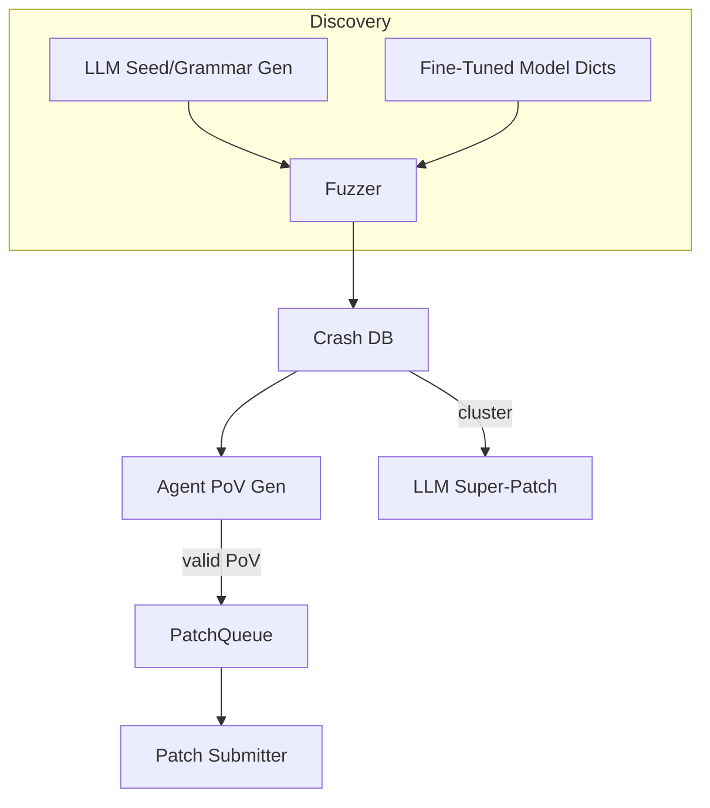

# AI-ondersteunde Fuzzing & Outomatiese Kwesbaarheidsontdekking

{{#include ../banners/hacktricks-training.md}}

## Oorsig
Groottaalmodelle (LLM’s) kan tradisionele kwesbaarheidsnavorsingsprosesse aansienlik versterk deur semanties ryk invoere te genereer, grammatikas te ontwikkel, oor crash-data te redeneer en selfs regstellings vir verskeie foute voor te stel. Hierdie bladsy versamel die doeltreffendste patrone wat tydens die finale rondte van DARPA se AI Cyber Challenge (AIxCC) en ander openbare navorsing waargeneem is.<sup>[[4]](#references)</sup><sup>[[5]](#references)</sup>

Wat volg, is nie ’n beskrywing van een spesifieke kompetisiestelsel nie, maar ’n abstraksie van die tegnieke sodat jy dit in jou eie werkstrome kan herhaal.

---

## 1. LLM-gegenereerde Seed-invoere

Tradisionele dekkinggeleide fuzzers (AFL++, libFuzzer, Honggfuzz…) begin met ’n klein corpus van seeds en muteer grepe blindelings. Wanneer die teiken se invoerformaat kompleks is (SQL, URL’s, pasgemaakte binêre protokolle), breek lukrake mutasies gewoonlik die sintaksis voordat interessante vertakkings bereik word.

LLM’s kan hierdie aanvangsprobleem oplos deur *seed generators* uit te voer – kort skripte wat **sintaksisgeldige, maar sekuriteitsrelevante invoere** lewer. Byvoorbeeld:

```prompt
SYSTEM: You are a helpful security engineer.
USER:
Write a Python3 program that prints 200 unique SQL injection strings targeting common anti-pattern mistakes (missing quotes, numeric context, stacked queries).  Ensure length ≤ 256 bytes / string so they survive common length limits.
```

```python
# gen_sqli_seeds.py (truncated)
PAYLOADS = [
    "1 OR 1=1 -- ",
    "' UNION SELECT NULL,NULL--",
    "0; DROP TABLE users;--",
    ...
]
for p in PAYLOADS:
    print(p)
```

Voer dit een keer uit en voeg die uitvoer direk by die fuzzer se aanvanklike corpus:

```bash
python3 gen_sqli_seeds.py > seeds.txt
afl-fuzz -i seeds.txt -o findings/ -- ./target @@
```

Voordele:
1. Semantiese geldigheid → dieper coverage vroeg.
2. Kan weer gegenereer word: pas die prompt aan om op XSS, path traversal, binary blobs, ens. te fokus.
3. Goedkoop (< 1 ¢ met GPT-3.5).

### Wenke
* Gee die model opdrag om payload-lengte en encoding (UTF-8, URL-encoded, UTF-16-LE) te *diversifiseer* om oppervlakkige filters te omseil.
* Vra vir ’n *enkele selfstandige script* – dit voorkom probleme met JSON-formatering.

---

## 2. Grammar-Evolution Fuzzing

’n Kragtiger variant is om die LLM ’n grammar te laat **ontwikkel** in plaas van konkrete seeds. Die werkvloei (“Grammar Guy”-patroon) is:

1. Genereer ’n aanvanklike ANTLR/Peach/LibFuzzer-grammar via ’n prompt.
2. Fuzz vir N minute en versamel coverage-metrieke (edges / blocks wat getref is).
3. Som onbedekte programareas op en voer die opsomming terug na die model:
   ```prompt
   The previous grammar triggered 12 % of the program edges.  Functions not reached: parse_auth, handle_upload.  Add / modify rules to cover these.
   ```
4. Voeg die nuwe reëls saam, fuzz weer, herhaal.

Pseudo-code skeleton:

```python
for epoch in range(MAX_EPOCHS):
    grammar = llm.refine(grammar, feedback=coverage_stats)
    save(grammar, f"grammar_{epoch}.txt")
    coverage_stats = run_fuzzer(grammar)
```

Sleutelpunte:
* Hou ’n *begroting* — elke verfyning gebruik tokens.
* Gebruik `diff`- en `patch`-instruksies sodat die model wysigings maak eerder as om alles te herskryf.
* Stop wanneer Δcoverage < ε.

---

## 3. Plaaslike-LLM libFuzzer-harnasingenieurswese

Vir bronkode wat nie ’n ontleder se werkstasie mag verlaat nie, kan ’n plaaslike kodemodel die klein adapter tussen fuzzer-grepe en ’n C/C++-API opstel. Die nuttige sekuriteitsgrens is duidelik: **die model skryf en hersien toetsinfrastruktuur; coverage-geleide mutasie verken insette; sanitizers rapporteer ongeldige bewerkings; ’n mens hersien die harnas en triageer bevindings**.<sup>[[9]](#references)</sup>

Vir enjinvlak-tegnieke vir corpora, terugvoer, momentopnames en stateful-fuzzing wat nie van ’n LLM afhanklik is nie, sien die algemene [Fuzzing Methodology](../generic-methodologies-and-resources/fuzzing.md).

Begin met die presiese deklarasie wat uit die teiken se header gekopieer is, en beperk die uitvoerformaat. ’n Eng prompt verminder versinde API’s en maak die resultaat maklik om te hersien:<sup>[[8]](#references)[[9]](#references)</sup>

```prompt
Write a libFuzzer target for this exact declaration:
int parse_records(const uint8_t *data, size_t size);

Output only C code. Implement LLVMFuzzerTestOneInput, include the
declaration, pass data and size unchanged, and do not use files,
network access, randomness, clocks, threads, or persistent state.
```

Vir ’n parser van rou grepe behoort die verwagte resultaat nie ingewikkelder te wees as:<sup>[[6]](#references)[[9]](#references)</sup>

```c
#include <stddef.h>
#include <stdint.h>

extern int parse_records(const uint8_t *, size_t);

int LLVMFuzzerTestOneInput(const uint8_t *data, size_t size) {
    (void)parse_records(data, size);
    return 0;
}
```

Kompilasie is slegs die eerste valideringshek. Kontroleer elke gegenereerde teiken teen hierdie invariantes voordat jy SVE-tyd daaraan bestee:<sup>[[6]](#references)[[8]](#references)[[9]](#references)</sup>

- **Presiese API:** vergelyk tipes, eienaarskapreëls, inisialisering, afbreek en aanroepkonvensie met die werklike header en bestaande aanroepe.
- **Veilige harness:** beskerm elke lees vanaf `data`; bevindings van sanitiseerder moet in die teiken ontstaan, nie in gegenereerde verbindingskode nie.
- **Herhaalbaarheid:** maak die resultaat ’n funksie van `data` en `size`; verwyder eksterne I/O, tyd, onbeheerde willekeur, nie-saamgevoegde drade en toestand wat tussen aanroepe voortbestaan.
- **Deurset:** inisialiseer duur onveranderlike toestand slegs een keer wanneer dit nie gedrag kan beïnvloed nie, beperk die invoergrootte, onderdruk aantekening en maak per-invoer-toekennings vry.
- **Bereikbaarheid:** verifieer dat die bedoelde funksies en vertakkings uitgevoer word. ’n Teiken wat kompileer, maar slegs verwerpingspaaie toets, is ’n stille mislukking.

### Struktuurbewuste teikens: behou invariantes sonder om foute te verberg

As die meeste rou invoere ’n hek vir magiese waardes, lengte, weergawe of kontrolesom nie slaag nie, gebruik die fuzz-grepe as **getipeerde veldmateriaal** en bou ’n geldige objek weer op. Stel formaatkonstantes vas, laat semantiese velde en loonvraggreep veranderlik, en lei integriteitsmetadata af van die gerekonstrueerde loonvrag. `FuzzedDataProvider` is nuttig om begrensde getipeerde waardes te verbruik, terwyl die adapter steeds verantwoordelik is om enige gegenereerde toekenning en omskakeling te beperk.<sup>[[9]](#references)</sup>

<details>
<summary>Voorbeeld van ’n struktuurbewuste C++-teiken</summary>

```cpp
#include <fuzzer/FuzzedDataProvider.h>
#include <stddef.h>
#include <stdint.h>
#include <vector>

extern "C" int parse_message(const uint8_t *, size_t);

extern "C" int LLVMFuzzerTestOneInput(const uint8_t *data, size_t size) {
    FuzzedDataProvider fdp(data, size);
    uint8_t version = fdp.ConsumeIntegral<uint8_t>();
    auto body = fdp.ConsumeRemainingBytes<uint8_t>();
    if (body.size() > UINT16_MAX) body.resize(UINT16_MAX);
    uint16_t len = static_cast<uint16_t>(body.size());
    std::vector<uint8_t> msg = {0x8b, 'M', 'S', 'G', version,
                                static_cast<uint8_t>(len >> 8),
                                static_cast<uint8_t>(len)};
    msg.insert(msg.end(), body.begin(), body.end());
    (void)parse_message(msg.data(), msg.size());
    return 0;
}
```

</details>

Moenie een struktuurherstellende teiken vir elke vraag gebruik nie. Onderhou een teiken wat lengtes/tjeksomme aflei om diep geldige toestande te verken, en ’n ander een wat die **verklaarde** metadata deur die fuzzer laat beheer, terwyl slegs die harnas se eie leesbewerkings en geheuetoekennings beperk word. Die tweede teiken behou aanvalsvlakke met lengtes wat nie ooreenstem nie en swak integriteit, wat outomatiese herstel andersins sou uitwis.<sup>[[9]](#references)</sup>

### Sade, woordeboeke, sanitizers en terugvoer oor dekking

Vra die model om ’n script te genereer wat binêre sade skryf, eerder as om dit te vra om binêre data direk uit te druk. Saai leë, minimale, tipiese en grensgeldige objekte; onttrek dan magiese waardes, etikette, enum-koderings en parser-sleutelwoorde in ’n nagegane woordeboek. libFuzzer aanvaar dié woordeboek met `-dict=`, en hou mutasies wat nuwe dekking in die korpus blootlê.<sup>[[6]](#references)[[9]](#references)</sup>

```text
magic="\x8bMSG"
version_min="\x00"
version_max="\xff"
config_tag="CONFIG"
```

Bou dieselfde teiken met aanvullende instrumentasie. ASan en UBSan kan ’n fuzzing-binêre deel; gebruik ’n afsonderlike MSan-bou en instrumenteer sy afhanklikhede om verslae weens ongeïnstrumenteerde kode te vermy.<sup>[[6]](#references)[[9]](#references)</sup>

```bash
clang++ -g -O1 -fsanitize=fuzzer,address,undefined \
  -fno-sanitize-recover=undefined target.cc harness.cc -o fuzz_target
./fuzz_target corpus -dict=msg.dict -max_len=65535

clang++ -g -O1 -fsanitize=fuzzer,memory \
  target.cc harness.cc -o fuzz_target_msan
```

Gebruik coverage as die beoordelaar vir elke modelhersiening. In libFuzzer-uitvoer dui vroeë plat `cov`/`ft` en ’n statiese corpus gewoonlik op swak framing, ’n te beperkende vroeë terugkeer of die verkeerde oproep; lae `exec/s` dui op duur opstelling, I/O, geheuetoewysing of toestand wat uitlek. `NEW` bewys net dat ’n coverage-funksie verander het, nie dat die bedoelde parser bereik is nie.<sup>[[6]](#references)[[9]](#references)</sup>

Vir terugvoer op bronvlak, bou ’n coverage-weergawe, fuzz dit en gee die model slegs die ongedekte funksies plus hul beskermende voorwaardes. Verifieer die verskil in die harness/seed/dictionary en meet weer:<sup>[[7]](#references)[[8]](#references)[[9]](#references)</sup>

```bash
clang++ -g -O1 -fsanitize=fuzzer \
  -fprofile-instr-generate -fcoverage-mapping target.cc harness.cc -o fuzz_cov
mkdir -p profiles
LLVM_PROFILE_FILE='profiles/%p.profraw' ./fuzz_cov -max_total_time=300 corpus
llvm-profdata merge -sparse profiles/*.profraw -o fuzz.profdata
llvm-cov report ./fuzz_cov -instr-profile=fuzz.profdata
llvm-cov show ./fuzz_cov -instr-profile=fuzz.profdata \
  --show-branches=count --region-coverage-lt=1 target.cc
```

Die skaalbare lus is dus **genereer → compileer/skakel → voer smoke-toets onder sanitizers uit → meet teikendekking → verskaf die kleinste relevante dekking-/bron-konteks → hersien → meet weer**. OSS-Fuzz-Gen pas dieselfde beginsel toe deur gegenereerde teikens te evalueer vir kompileerbaarheid, looptydfoute, dekking en dekkingverbetering teenoor bestaande teikens, eerder as om geloofwaardige kode sonder meer te aanvaar.<sup>[[7]](#references)[[8]](#references)</sup>

---

## 4. Agentgebaseerde PoV (Exploit)-generering

Nadat ’n crash gevind is, het jy steeds ’n **proof-of-vulnerability (PoV)** nodig wat dit deterministies veroorsaak.

’n Skaalbare benadering is om baie liggewigwerkers (prosesse, drade of houers) te begin, wat elkeen ’n ander model of sampling-konfigurasie gebruik. Die AIxCC-finalisopname gee konkrete voorbeelde van die skaal: een span het **duisende gelyktydige agents** vir PoV-generering waar AI eerste kom, gebruik, terwyl ’n ander **300–500 fuzzing-agents** gekoördineer het en LLM’s vir hoërvlak-semantiese redenasie gereserveer het.<sup>[[4]](#references)</sup>

Pyplyn:
1. Statiese/dinamiese analise lewer *bug-kandidate* op (struct met crash-PC, input-sny en sanitizer-boodskap).
2. Die orkestraator versprei die kandidate onder agents.
3. Die agent se redenasiestappe:
   a. Reproduseer die bug plaaslik met `gdb` + input.
   b. Stel ’n minimale exploit-payload voor.
   c. Valideer die exploit in ’n sandbox. Indien suksesvol → dien in.
4. Mislukte pogings word **as nuwe seeds vir coverage-fuzzing terug in die tou geplaas** (terugvoerlus).

Voordele:
* Parallellisering verberg die onbetroubaarheid van ’n enkele agent.
* Outomatiese verstelling van temp/modelgrootte op grond van die waargenome sukseskoers.

---

## 5. Gerigte Fuzzing met Fynafgestemde kodemodelle

Fynstem ’n model met oop gewigte (bv. Llama-7B) op C/C++-bronkode wat met kwesbaarheidspatrone gemerk is (heelgetaloorloop, buffera kopie, formaatstring). Doen dan die volgende:

1. Voer statiese analise uit om ’n funksielys + AST te kry.
2. Gee die model die opdrag: *“Gee mutation-dictionary-inskrywings wat waarskynlik geheueveiligheid in funksie X sal breek”*.
3. Voeg daardie tokens by ’n pasgemaakte `AFL_CUSTOM_MUTATOR`.

Voorbeelduitset vir ’n `sprintf`-omhulsel:
```
{"pattern":"%99999999s"}
{"pattern":"AAAAAAAA....<1024>....%n"}
```

Empiries verkort dit die tyd-tot-ineenstorting met >2× op werklike teikens.

---

## 6. KI-geleide patching-strategieë

### 6.1 Super Patches
Vra die model om crash-handtekeninge te *groepeer* en ’n **enkele patch** voor te stel wat die gemeenskaplike hoofoorsaak verwyder. Dien dit een keer in en herstel verskeie foute → minder akkuraatheidsaftrekkings in omgewings waar elke verkeerde patch punte kos.

Prompt-uiteensetting:
```
Here are 10 stack traces + file snippets.  Identify the shared mistake and generate a unified diff fixing all occurrences.
```

{{#ref}}
../generic-methodologies-and-resources/fuzzing.md
{{#endref}}

### 6.2 Spekulatiewe Patch-verhouding
Implementeer ’n queue waarin bevestigde, PoV-gevalideerde patches en *spekulatiewe* patches (sonder PoV) teen ’n 1:​N-verhouding afgewissel word, aangepas by die puntetoekenningsreëls (bv. 2 spekulatiewe : 1 bevestigde). ’n Koste-model monitor strawwe teenoor punte en pas N outomaties aan.

---

## 7. Deterministiese KI-kodehersiening lêer vir lêer

’n Algemene mislukkingspatroon in KI-ondersteunde hersiening is om een agent te vra om ’n hele repository te inspekteer en te hoop dat dit die regte lêers en grep-terme kies. ’n Betroubaarder patroon is om **dekking van die repository af te dwing**:<sup>[[1]](#references)</sup>

1. Lys die bronlêers.
2. Stuur **een lêer op ’n slag** saam met minimale konteks (ingangspunt, imports, nabygeleë routes/callers).
3. Vereis ’n **gestruktureerde verslag** vir elke lêer: sources, sink, ontbrekende validasie, exploit-voorwaardes en sekerheid.<sup>[[3]](#references)</sup>
4. Verwyder duplikate uit verslae volgens **source→sink-patroon** en valideer die hoërisiko-gevalle met die hand.

Dit verg baie tokens en lewer geraas op, maar is baie doeltreffend om **eenvoudige source/sink-foute met groot impak** te vind wat breë agentiese hersienings dikwels miskyk.

### Triage-patrone wat prioriteit verdien

- **Dinamiese PHP include/dispatch**: aanvaller-beheerde roete-/beheerder-/module-name wat na `require_once()`, `include()` of `include_once()` vloei sonder streng allowlisting en padkanonisering.
- **Shell-uitvoering in admin-/rekeningwerkvloeie**: gebruikersname, domeine, FTP-rekeninge of ander identifiseerders wat `exec()`, `system()`, `shell_exec()`, `passthru()`, `proc_open()` of `popen()` bereik.
- **Saamvloeiing van gestruktureerde invoer**: dieselfde parameter word aanvaar vanaf `$_GET`, `$_POST`, JSON, XML of raamwerk-body-parsers, en later hergebruik in lêerstelsel- of OS-opdrag-sinks.

### Twee praktiese bugklasse wat hierdie metode goed vind

- **PHP controller-dispatch LFI/RCE**: as ’n versoek-beheerde controller-name sonder ’n allowlist/padnormalisering aan `require_once()` gekoppel word, kan traversal-reekse soos `../` veroorsaak dat PHP ’n onbedoelde plaaslike `.php`-lêer insluit. As die aanvaller die include na ’n geplante of andersins bruikbare PHP-lêer kan rig, word die LFI kode-uitvoering. Sien [File Inclusion / Path Traversal](../pentesting-web/file-inclusion/README.md).<sup>[[1]](#references)</sup>
- **Geoutentiseerde command injection in hosting-/admin-panele**: as rekeningbestuurvelde soos gebruikersname in shell-opdragte ingesluit word, kan ’n geoutentiseerde gebruiker met lae voorregte ’n gewone skep-/skrap-aksie in RCE omskep. Die impak neem toe wanneer die paneel die opdrag as ’n meer bevoorregte diensrekening uitvoer. Sien [Command Injection](../pentesting-web/command-injection.md).<sup>[[1]](#references)</sup>

### Praktiese hersieningsnotas

- Gebruik die LLM eers as ’n **source/sink-hersiener**, nie as ’n exploit-generator nie.
- Vra dit om uitdruklik die **aanvaller-beheerde veld**, die **leemte in normalisering/validasie** en die **gevaarlike sink** te lys.
- Vir groot repos is deterministiese hersiening lêer vir lêer dikwels betroubaarder as ’n enkele outonome agentlopie, selfs wanneer laasgenoemde ’n sterker model gebruik.<sup>[[2]](#references)</sup>
- Verwag swakker resultate met **Broken Access Control** en ander besigheidslogika-bugs waar exploitbaarheid afhang van aannames oor verskeie lêers, rolsemantiek of produkspesifieke bedreigingsmodelle.

---

## 8. Patroongeleide kernelauditering met ’n geïnstrumenteerde oracle

Moenie ’n agent vra om arbitrêre bugs deur die hele boom te vind vir ’n teiken so groot soos ’n kernel nie. ’n Meer tokendoeltreffende werkvloei omskep historiese kennis oor kwesbaarhede in statiese navrae, rangskik die resultate volgens blootgestelde aanvaloppervlak en gebruik ’n geïnstrumenteerde kernel as ’n uitvoeringsoracle.<sup>[[11]](#references)</sup>

### Patroondatabasis → CodeQL/Semgrep → gefokusde hersiening

Bou ’n klein kennisbasis met gevaarlike APIs, patrone van ontbrekende validasie, riskante source-to-sink-vloeie en voorheen reggestelde bugvorme. Vra die model om **een patroon op ’n slag** in hersieningsheuristieke en CodeQL/Semgrep-reëls om te skakel, en voer dan daardie deterministiese reëls oor die volledige boom uit. Groepeer die ooreenstemmings en verwyder duplikate voordat jy die kode aan die model teruggee; rou skandeerderuitsette kan duisende kandidate van min waarde bevat. Gaan CodeQL se huidige lisensie na voordat jy hierdie benadering buite geskikte navorsings- of oopbron-teikens gebruik.<sup>[[11]](#references)</sup>

Prioritiseer substelsels aan die hand van sowel **reëltreftdigtheid** as **aanvallertoeganklikheid**, eerder as net die aantal treffers. Kernelkoppelvlakke wat toeganklik is vir prosesse sonder voorregte, sandboxes, containers, jails of gasgaste-kontekste verdien meer gewig as kode wat slegs intern toeganklik is. Hou die hersieningseenheid klein genoeg sodat die agent callers, validators en leeftydreëls kan onthou, en vra vir ’n benoemde kwesbaarheidsklas of beheer-vloeipatroon in plaas van “vind enige kwesbaarheid”. Verouderde bevoorregte koppelvlakke is besonder interessant wanneer ’n nuwer inperkingsgrens dit toeganklik maak vir ’n namespaced- of jailed root-gebruiker.<sup>[[11]](#references)</sup>

Vereis vir elke kandidaat ’n uitdruklike field-flow-rekord voordat jy probeer om dit uit te buit.<sup>[[11]](#references)</sup>

```text
entrypoint -> privilege check -> parser -> validation/normalization
           -> later rewrite -> dangerous sink
attacker controls: <fields and lengths>
constraints:       <values rewritten, rejected, or preserved>
observable result: <sanitizer report, assertion, panic, or clean exit>
```

### Gebruik KASAN-telemetrie as ’n hipotese-orakel

Laat die teikenkernel in ’n weggooibare VM loop met KASAN en nuttige diagnostiese assertions geaktiveer. Die agent moet herhaal deur **bronhipotese → minimale gebruikersland-sneller → VM-uitvoering → KASAN-/assertion-nasporing → hersiene hipotese** totdat die vermoedelike korrupsie gereproduseer of verwerp is. Gee by elke herhaling slegs die relevante stack trace en nabygeleë bronkode terug; dit behou die redenasiekonteks en maak looptyd-bewyse, nie modelvertroue nie, die aanvaardingsmaatstaf.<sup>[[11]](#references)</sup>

’n Geïnstrumenteerde bou is nie die finale exploitability-omgewing nie. Assertions kan uitvoering stop voordat die korrumperende bewerking plaasvind, terwyl dieselfde assertion uit ’n produksiekern saamgestel kan wees. Toets die onveranderde sneller weer teen die presiese produksiekonfigurasie, teken die kernel-bou en konfigurasie aan, en onderskei **bereikbaarheid**, **geheuekorrupsie**, **beheerde primitief** en **sekuriteitsimpak** as afsonderlike bewerings.<sup>[[11]](#references)[[12]](#references)</sup>

CVE-2026-3038 is ’n nuttige valideringsvoorbeeld, nie ’n exploit-sjabloon nie. ’n Onbevoorregte FreeBSD `RTM_GET`-versoek kon ’n oorgroot `RTAX_AUTHOR`-sockaddr deur selektiewe validering en antwoordherskrywing behou totdat `rtsock_msg_buffer()` sy gebruikerkontroleerde `sa_len` na ’n 128-greep stack-`sockaddr_storage` gekopieer het. Die maksimum kopie van 255 grepe het ’n oorwegende skrywing van 127 grepe veroorsaak; ’n diagnostiese assertion het die verkeerde lengte in die geïnstrumenteerde bou opgevang, terwyl ’n GENERIC-kern die kopie bereik het en daarna in paniek geraak het toe die beskadigde canary nagegaan is. Dit bewys ’n onbevoorregte diensweiering, nie selfstandige privilege escalation nie: betroubare beheer sou eers ’n ander primitief vereis, soos ’n canary-lek. Sien [Stack Canaries](../binary-exploitation/common-binary-protections-and-bypasses/stack-canaries/index.html) vir die ooreenstemmende grens van binary exploitation.<sup>[[11]](#references)[[12]](#references)[[13]](#references)</sup>

### Verwerp kullery met exploit-voorvereistes

Laat ’n afsonderlike beoordelaar/agent probeer om ’n PoV of exploit op grond van vaste kriteria te weerlê voordat dit aanvaar word. Die beoordeling moet al die volgende voorwaardes bevestig.<sup>[[11]](#references)</sup>

- Die teikenbronkode, kernel en kwesbare module is nie gewysig om die pad bereikbaar te maak nie.
- Geen helpermodule, sintetiese gadget, gedeaktiveerde mitigering, ekstra privilege of onbeskikbare koppelvlak is bygevoeg nie.
- Die sneller begin met die beweerde oproeperidentiteit en inperkingsbeperkings op ’n skoon snapshot.
- Die beweerde resultaat hang steeds van die fout af: die ketting moet breek as die misvormde veld verwyder word of slegs die fout reggemaak word.
- ’n Crash, oorlees of oorwegende skrywing word slegs as daardie primitief gerapporteer; code execution of privilege escalation vereis onafhanklike bewyse.

Hierdie laaste teenfeitlike kontrole vang sirkelredenasie-demonstrasies uit: as die voorvereistes reeds die beweerde impak moontlik maak (byvoorbeeld deur aanvaller-voorsiene SUID-inhoud uit te voer vanaf ’n lêerstelsel wat sonder `nosuid` gemonteer is), het die geheueveiligheidsfout nie daardie impak veroorsaak nie.<sup>[[11]](#references)</sup>

---

## Ouditbare agentondersteunde navorsing oor onbekende kodebasisse

Die [grafiek-eerste-werkvloei vir fuzz-teikens](../generic-methodologies-and-resources/fuzzing.md#graph-first-fuzz-target-selection-and-mutation-triage) dek reeds bereikbaarheid van toegangspunte, terwyl [agentiese SAST-pyplyne](../network-services-pentesting/pentesting-web/code-review-tools.md#agentic-sast-pipelines) gefaseerde beoordeling en bewyshekke dek. Hou daardie deterministiese resultate apart van die model se hipoteses sodat elke bevorderde leidraad bronliggings, padbewyse en ’n dinamiese meting behou.<sup>[[10]](#references)</sup>

### Korrelleer bewyse oor objeklewensduur sonder om datavloei te versin

Statiese analise kan vind dat ’n aanvallerbeheerde lengte in een funksie gestoor word en dat dieselfde objekveld veel later ’n kopieerbestemming bereik, maar dalk nie die verband oor callbacks, herverbindings of objeklewensduur kan bewys nie. Bewaar albei bevindings afsonderlik, groepeer volgens objek/veld en maak die ontbrekende skakel ’n uitdruklike triage-vraag. Die agent mag die verband voorstel, maar bronkode-oorsig of looptydinstrumentering moet dit bewys.<sup>[[10]](#references)</sup>

Teken vir elke kandidaat die volgende aan:

- die konkrete toegangspunt en aanvallerbeheerde grepe;
- elke vervaardiger van die betrokke veld, insluitend validering wat spesifiek vir elke vervaardiger geld;
- die sink, bestemmingskapasiteit en bou-/looptydvoorwaardes wat nodig is om dit te bereik;
- ’n werklike oproepstapel vanaf die blootgestelde toegangspunt, nie net ’n direkte harness-aanroep nie;
- die kleinste dinamiese resultaat wat die hipotese bevestig of verwerp.

’n Pad wat veilig lyk, maak ’n veld nie wêreldwyd veilig nie. ’n Tweede vervaardiger kan dieselfde veld vul sonder die eerste pad se limiet. Toets paaie afsonderlik en laat die harness met bouopsies wat met die ontplooiing ooreenstem loop, want debug-assertions kan ’n produksiegeheuekorrupsie in ’n vroeë, slegs-toets-onderbreking verander.<sup>[[10]](#references)</sup>

### Meethekke vir openbaarmaking en exploitation

Vul vars allokasies met ’n herkenbare greep vir vermoedelike openbaarmaking van ongeïnisialiseerde geheue, en verifieer dat die presiese merker die uitgestuurde pakkie bereik. Vereis vir exploitation gemete hekke soos **beheerde oorwegende skrywing → nuttige slagofferobjek → openbaarmaking → wyser-/basisherwinning → kaping van beheervloei → saamgestelde payload**. ’n Agent vorder slegs wanneer die harness die huidige eienskap bewys; ’n geloofwaardige vertelling beteken nie dat ’n hek geslaag is nie. Die [FreeRDP-geval](../binary-exploitation/libc-heap/heap-overflow.md#cross-path-length-reuse-and-stale-output-disclosure) wys die pad- en boubeperkings wat tydens validering behoue moet bly.<sup>[[10]](#references)</sup>

---

## Sit alles bymekaar
’n End-tot-end CRS (Cyber Reasoning System) kan die komponente soos volg verbind:



---

## References

- [1] [Project Black - Plaaslike AI vir Kuberveiligheid: Vind phpIPAM LFI en myVesta Geauthentiseerde RCE](https://projectblack.io/blog/local-ai-for-cyber-security)
- [2] [Strix](https://github.com/usestrix/strix)
- [3] [GitHub Copilot-gemeenskap se security-review-skill](https://github.com/github/awesome-copilot/blob/main/skills/security-review/SKILL.md)
- [4] [Trail of Bits – AIxCC-eindstryde: Die verloop van sake](https://blog.trailofbits.com/2025/08/07/aixcc-finals-tale-of-the-tape/)
- [5] [CTF Radiooo AIxCC-finalis-onderhoude](https://www.youtube.com/@ctfradiooo)
- [6] [LLVM — libFuzzer: ’n biblioteek vir dekkinggeleide fuzz-toetsing](https://llvm.org/docs/LibFuzzer.html)
- [7] [Google — OSS-Fuzz-Gen](https://github.com/google/oss-fuzz-gen)
- [8] [Google Online Security Blog — Verbeter Fuzzing: Vind meer kwesbaarhede met AI](https://security.googleblog.com/2024/11/leveling-up-fuzzing-finding-more.html)
- [9] [8kSec — AI-ondersteunde generering van fuzz-harnasse met ’n plaaslike LLM](https://8ksec.io/ai-assisted-fuzzing-harness-local-llm)
- [10] [Quarkslab — Van AI-agente tot RCE: Bou ’n werkvloei vir kwesbaarheidnavorsing](https://blog.quarkslab.com/from-ai-agents-to-rce-building-a-vulnerability-research-workflow.html)
- [11] [Praetorian — FreeBSoD: Benut taalmodelle om kernfoute te vind en uit te buit (Deel 1 van 2)](https://praetorian.com/blog/ai-vulnerability-research-freebsd-kernel)
- [12] [FreeBSD-SA-26:05.route — Plaaslike DoS en moontlike voorregverhoging via roeteringsokette](https://www.freebsd.org/security/advisories/FreeBSD-SA-26:05.route.asc)
- [13] [FreeBSD-SA-26:05.route-bronpleister](https://security.FreeBSD.org/patches/SA-26:05/route.patch)
{{#include ../banners/hacktricks-training.md}}
