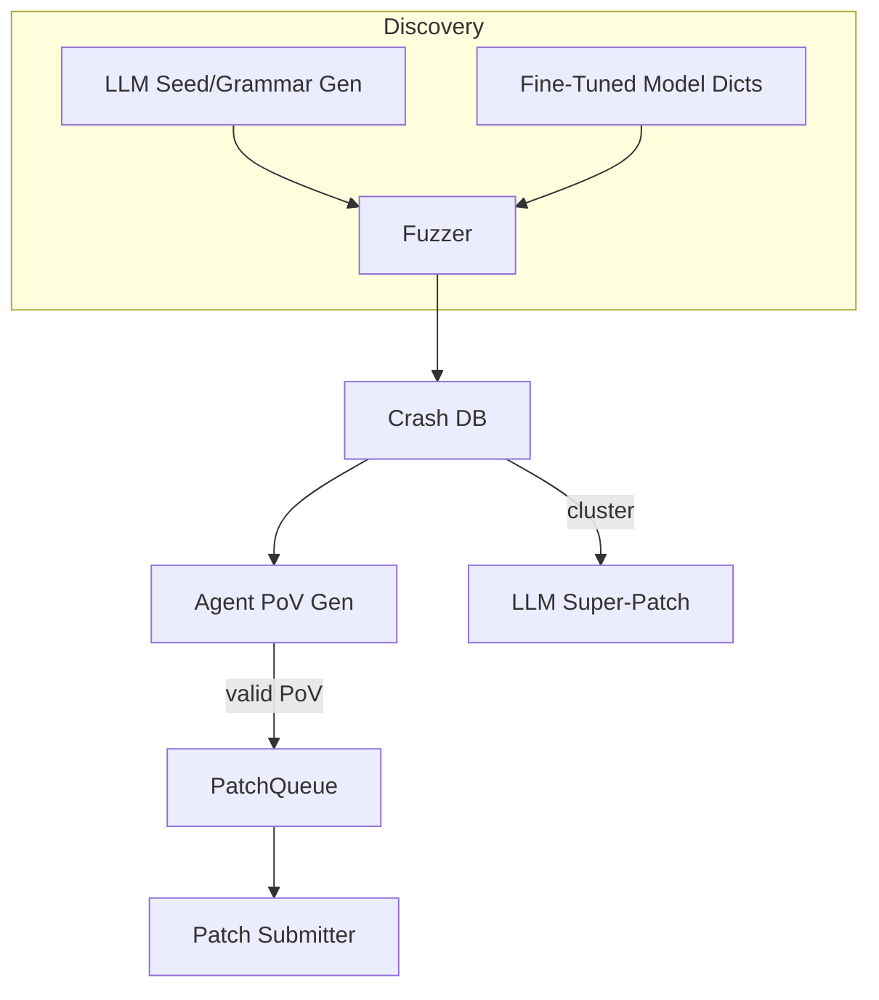

# KI-ondersteunde Fuzzing & Outomatiese Ontdekking van Kwesbaarhede

{{#include ../banners/hacktricks-training.md}}

## Oorsig
Groottaalmodelle (LLM’s) kan tradisionele navorsingsprosesse vir kwesbaarhede aansienlik versterk deur semanties ryk invoer te genereer, grammatika te ontwikkel, oor crash-data te redeneer en selfs patches vir verskeie foute voor te stel. Hierdie bladsy versamel die doeltreffendste patrone wat tydens DARPA se AI Cyber Challenge (AIxCC)-eindronde en ander openbare navorsing waargeneem is.<sup>[[4]](#references)</sup><sup>[[5]](#references)</sup>

Wat volg, is nie ’n beskrywing van een spesifieke kompetisiestelsel nie, maar ’n abstraksie van die tegnieke sodat jy dit in jou eie werkvloeie kan herhaal.

---

## 1. KI-gegenereerde saad-invoer

Tradisionele coverage-guided fuzzers (AFL++, libFuzzer, Honggfuzz…) begin met ’n klein korpus van sade en muteer grepe lukraak. Wanneer die teiken se invoerformaat kompleks is (SQL, URL’s, pasgemaakte binêre protokolle), breek lukrake mutasies gewoonlik die sintaksis voordat interessante vertakkings bereik word.

LLM’s kan hierdie aanvangsprobleem oplos deur *saadgenerators* te skep – kort skrifte wat **sintaksis-korrekte maar sekuriteitsrelevante invoer** uitvoer. Byvoorbeeld:

```prompt
SYSTEM: You are a helpful security engineer.
USER:
Write a Python3 program that prints 200 unique SQL injection strings targeting common anti-pattern mistakes (missing quotes, numeric context, stacked queries).  Ensure length ≤ 256 bytes / string so they survive common length limits.
```

```python
# gen_sqli_seeds.py (truncated)
PAYLOADS = [
    "1 OR 1=1 -- ",
    "' UNION SELECT NULL,NULL--",
    "0; DROP TABLE users;--",
    ...
]
for p in PAYLOADS:
    print(p)
```

Voer dit een keer uit en voer die uitvoer direk in die fuzzer se aanvanklike corpus in:

```bash
python3 gen_sqli_seeds.py > seeds.txt
afl-fuzz -i seeds.txt -o findings/ -- ./target @@
```

Voordele:
1. Semantiese geldigheid → groter dekking vroegtydig.
2. Kan weer gegenereer word: pas die prompt aan om op XSS, path traversal, binary blobs, ens. te fokus.
3. Goedkoop (< 1 ¢ met GPT-3.5).

### Wenke
* Gee die model opdrag om die payload-lengte en encoding te *diversifiseer* (UTF-8, URL-encoded, UTF-16-LE) om oppervlakkige filters te omseil.
* Vra vir ’n *enkele selfstandige script* – dit vermy haakplekke met JSON-formatering.

---

## 2. Grammar-Evolution Fuzzing

’n Kragtiger variant is om die LLM ’n grammar te laat **ontwikkel** in plaas van konkrete seeds. Die werkvloei (die “Grammar Guy”-patroon) is:

1. Genereer ’n aanvanklike ANTLR/Peach/LibFuzzer-grammar via ’n prompt.
2. Fuzz vir N minute en versamel dekkingsmaatstawwe (getrefde edges / blocks).
3. Som die ongedekte programareas op en voer die opsomming terug na die model:
   ```prompt
   The previous grammar triggered 12 % of the program edges.  Functions not reached: parse_auth, handle_upload.  Add / modify rules to cover these.
   ```
4. Voeg die nuwe reëls saam, fuzz weer, herhaal.

Pseudokode-skelet:

```python
for epoch in range(MAX_EPOCHS):
    grammar = llm.refine(grammar, feedback=coverage_stats)
    save(grammar, f"grammar_{epoch}.txt")
    coverage_stats = run_fuzzer(grammar)
```

Sleutelpunte:
* Hou ’n *begroting* – elke verfyning gebruik tokens.
* Gebruik `diff` + `patch`-instruksies sodat die model wysigings aanbring eerder as om alles te herskryf.
* Hou op wanneer Δcoverage < ε.

---

## 3. Plaaslike-LLM libFuzzer-harnasingenieurswese

Vir bronkode wat nie ’n ontleder se werkstasie mag verlaat nie, kan ’n plaaslike kodemodel die klein adapter tussen fuzzer-grepe en ’n C/C++-API opstel. Die nuttige sekuriteitsgrens is duidelik: **die model skryf en hersien toetsinfrastruktuur; coverage-geleide mutasie verken invoere; sanitizers rapporteer ongeldige bewerkings; ’n mens hersien die harnas en triageer bevindinge**.<sup>[[9]](#references)</sup>

Sien die algemene [Fuzzing Methodology](../generic-methodologies-and-resources/fuzzing.md) vir enjinvlak-tegnieke vir korpus, terugvoer, momentopnames en stateful-fuzzing wat nie van ’n LLM afhanklik is nie.

Begin met die presiese deklarasie wat uit die teiken se koplêer gekopieer is en beperk die uitvoerformaat. ’n Eng prompt verminder versinde API’s en maak die resultaat maklik om te hersien:<sup>[[8]](#references)[[9]](#references)</sup>

```prompt
Write a libFuzzer target for this exact declaration:
int parse_records(const uint8_t *data, size_t size);

Output only C code. Implement LLVMFuzzerTestOneInput, include the
declaration, pass data and size unchanged, and do not use files,
network access, randomness, clocks, threads, or persistent state.
```

Vir 'n parser van rou grepe behoort die verwagte resultaat nie ingewikkelder te wees as:<sup>[[6]](#references)[[9]](#references)</sup>

```c
#include <stddef.h>
#include <stdint.h>

extern int parse_records(const uint8_t *, size_t);

int LLVMFuzzerTestOneInput(const uint8_t *data, size_t size) {
    (void)parse_records(data, size);
    return 0;
}
```

Kompilering is slegs die eerste validasiedrempel. Gaan elke gegenereerde teiken aan die hand van hierdie invariantes na voordat jy SVE-tyd daaraan bestee:<sup>[[6]](#references)[[8]](#references)[[9]](#references)</sup>

- **Presiese API:** vergelyk tipes, eienaarskapreëls, inisialisering, afbreek en oproepkonvensie met die werklike koplêer en bestaande oproepers.
- **Veilige harness:** beveilig elke leesaksie vanaf `data`; sanitizer-bevindings moet uit die teiken kom, nie uit gegenereerde gomkode nie.
- **Herhaalbaarheid:** maak die resultaat ’n funksie van `data` en `size`; verwyder eksterne I/O, tyd, onbeheerde ewekansigheid, onsaamgevoegde drade en toestand wat tussen oproepe voortbestaan.
- **Deurset:** inisialiseer duur onveranderlike toestand slegs een keer, en net wanneer dit nie gedrag kan beïnvloed nie; beperk die invoergrootte, onderdruk logging en maak per-invoer-toekennings vry.
- **Bereikbaarheid:** verifieer dat die bedoelde funksies en vertakkings uitgevoer word. ’n Teiken wat kompilering slaag, maar slegs verwerpingspaaie toets, is ’n stille mislukking.

### Struktuurbewuste teikens: behou invariantes sonder om foute te verberg

As die meeste rou invoere by ’n hek vir magic, lengte, weergawe of kontrolesom misluk, gebruik die fuzz-grepe as **getikte veldmateriaal** en bou ’n geldige objek weer op. Stel formaatkonstantes vas, laat semantiese velde en loonvraggrepe veranderlik, en lei integriteitsmetadata af van die gerekonstrueerde loonvrag. `FuzzedDataProvider` is nuttig om begrensde getikte waardes te verbruik, terwyl die adapter steeds verantwoordelik is om enige gegenereerde toekenning en omskakeling te beperk.<sup>[[9]](#references)</sup>

<details>
<summary>Voorbeeld van ’n struktuurbewuste C++-teiken</summary>

```cpp
#include <fuzzer/FuzzedDataProvider.h>
#include <stddef.h>
#include <stdint.h>
#include <vector>

extern "C" int parse_message(const uint8_t *, size_t);

extern "C" int LLVMFuzzerTestOneInput(const uint8_t *data, size_t size) {
    FuzzedDataProvider fdp(data, size);
    uint8_t version = fdp.ConsumeIntegral<uint8_t>();
    auto body = fdp.ConsumeRemainingBytes<uint8_t>();
    if (body.size() > UINT16_MAX) body.resize(UINT16_MAX);
    uint16_t len = static_cast<uint16_t>(body.size());
    std::vector<uint8_t> msg = {0x8b, 'M', 'S', 'G', version,
                                static_cast<uint8_t>(len >> 8),
                                static_cast<uint8_t>(len)};
    msg.insert(msg.end(), body.begin(), body.end());
    (void)parse_message(msg.data(), msg.size());
    return 0;
}
```

</details>

Moenie vir elke vraag een struktuurherstellende target gebruik nie. Hou een target wat lengtes en checksums aflei om diep geldige toestande te verken, en nog een wat die **verklaarde** metadata deur die fuzzer laat beheer, terwyl slegs die harness se eie leesbewerkings en allokasies beperk word. Die tweede target behou aanvalsoppervlaktes met lengtewanverhoudings en swak integriteit wat outomatiese herstel andersins sou uitwis.<sup>[[9]](#references)</sup>

### Seeds, woordeboeke, sanitizers en dekkingterugvoer

Vra die model om ’n script te genereer wat binêre seeds skryf, eerder as om dit te vra om binêre data direk uit te druk. Gebruik leë, minimale, tipiese en grensgeldige objekte as seeds; haal dan magic waardes, tags, enum-koderings en parser-sleutelwoorde uit en voeg dit by ’n nagegane woordeboek. libFuzzer aanvaar daardie woordeboek met `-dict=`, en hou mutasies wat nuwe dekking in die corpus blootlê.<sup>[[6]](#references)[[9]](#references)</sup>

```text
magic="\x8bMSG"
version_min="\x00"
version_max="\xff"
config_tag="CONFIG"
```

Bou dieselfde teiken met aanvullende instrumentasie. ASan en UBSan kan ’n fuzzing-binary deel; gebruik ’n aparte MSan-bou en instrumenteer sy afhanklikhede om verslae weens nie-geinstrumenteerde kode te vermy.<sup>[[6]](#references)[[9]](#references)</sup>

```bash
clang++ -g -O1 -fsanitize=fuzzer,address,undefined \
  -fno-sanitize-recover=undefined target.cc harness.cc -o fuzz_target
./fuzz_target corpus -dict=msg.dict -max_len=65535

clang++ -g -O1 -fsanitize=fuzzer,memory \
  target.cc harness.cc -o fuzz_target_msan
```

Behandel dekking as die evalueerder vir elke modelweergawe. In libFuzzer-uitvoer dui vroeë plat `cov`/`ft` en ’n statiese corpus gewoonlik op swak framing, ’n té beperkende vroeë return of die verkeerde oproep; lae `exec/s` dui op duur opstelling, I/O, toekenning of toestand wat uitlek. `NEW` bewys net dat ’n dekkingskenmerk verander het, nie dat die beoogde parser bereik is nie.<sup>[[6]](#references)[[9]](#references)</sup>

Vir terugvoer op bronkodevlak, bou ’n coverage-weergawe, fuzz dit en gee die model slegs die ongedekte funksies plus hul bewakingsvoorwaardes. Verifieer die resulterende harness/seed/dictionary-diff en meet weer:<sup>[[7]](#references)[[8]](#references)[[9]](#references)</sup>

```bash
clang++ -g -O1 -fsanitize=fuzzer \
  -fprofile-instr-generate -fcoverage-mapping target.cc harness.cc -o fuzz_cov
mkdir -p profiles
LLVM_PROFILE_FILE='profiles/%p.profraw' ./fuzz_cov -max_total_time=300 corpus
llvm-profdata merge -sparse profiles/*.profraw -o fuzz.profdata
llvm-cov report ./fuzz_cov -instr-profile=fuzz.profdata
llvm-cov show ./fuzz_cov -instr-profile=fuzz.profdata \
  --show-branches=count --region-coverage-lt=1 target.cc
```

Die skaalbare lus is dus **genereer → compileer/skakel → voer ’n rooktoets met sanitizers uit → meet teikendekking → verskaf die kleinste relevante dekking-/bronkontext → hersien → meet weer**. OSS-Fuzz-Gen pas dieselfde beginsel toe deur gegenereerde teikens te evalueer op grond van of hulle compileer, runtime-foute, dekking en dekkingverbetering teenoor bestaande teikens, eerder as om geloofwaardige kode op sigwaarde te aanvaar.<sup>[[7]](#references)[[8]](#references)</sup>

---

<a id="3-agent-based-pov-exploit-generation" hidden>3. Agentgebaseerde PoV (Exploit)-generering</a>

## 4. Agentgebaseerde PoV (Exploit)-generering

Nadat ’n crash gevind is, benodig jy steeds ’n **proof-of-vulnerability (PoV)** wat dit deterministies aktiveer.

’n Skaalbare benadering is om baie liggewigwerkers (prosesse, threads of containers) te begin, wat elk ’n ander model- of sampling-konfigurasie gebruik. Die AIxCC-finaliste-opname gee konkrete voorbeelde van die skaal: een span het **duisende gelyktydige agents** vir AI-first PoV-generering gebruik, terwyl ’n ander **300–500 fuzzing-agents** georkestreer het en LLM’s vir semantiese redenering op ’n hoër vlak gereserveer het.<sup>[[4]](#references)</sup>

Pyplyn:
1. Statiese/dinamiese analise lewer *bug-kandidate* op (struct met crash-PC, input-slice, sanitizer-boodskap).
2. Orchestrator versprei kandidate aan agents.
3. Agent se redeneerstappe:
   a. Reproduseer die bug plaaslik met `gdb` + input.
   b. Stel ’n minimale exploit-payload voor.
   c. Valideer die exploit in ’n sandbox.  As dit slaag → dien in.
4. Mislukte pogings word **weer as nuwe seeds in die coverage fuzzing-ry geplaas** (terugvoerlus).

Voordele:
* Parallelisering verberg die onbetroubaarheid van ’n enkele agent.
* Outomatiese verstelling van temp / modelgrootte op grond van die waargenome sukseskoers.

---

<a id="4-directed-fuzzing-with-fine-tuned-code-models" hidden>4. Gerigte Fuzzing met Fine-Tuned Code Models</a>

## 5. Gerigte Fuzzing met Fine-Tuned Code Models

Fine-tune ’n model met oop gewigte (bv. Llama-7B) op C/C++-broncode wat met kwesbaarheidspatrone gemerk is (integer overflow, buffer copy, format string).  Doen dan die volgende:

1. Voer statiese analise uit om ’n funksielys + AST te kry.
2. Prompt die model: *“Gee mutation dictionary-inskrywings wat waarskynlik memory safety in funksie X sal ondermyn”*.
3. Voeg daardie tokens in ’n pasgemaakte `AFL_CUSTOM_MUTATOR` in.

Voorbeelduitset vir ’n `sprintf`-wrapper:
```
{"pattern":"%99999999s"}
{"pattern":"AAAAAAAA....<1024>....%n"}
```

Empiries verkort dit die tyd-tot-crash met >2× op werklike teikens.

---

<a id="5-ai-guided-patching-strategies" hidden>5. KI-geleide patchingstrategieë</a>

## 6. KI-geleide patchingstrategieë

<a id="51-super-patches" hidden>5.1 Super patches</a>

### 6.1 Super patches
Vra die model om crash-signature te *groepeer* en ’n **enkele patch** voor te stel wat die gemeenskaplike grondoorsaak verwyder. Dien dit een keer in en maak verskeie foute reg → minder akkuraatheidsboetes in omgewings waar elke verkeerde patch punte kos.

Promptraamwerk:
```
Here are 10 stack traces + file snippets.  Identify the shared mistake and generate a unified diff fixing all occurrences.
```

{{#ref}}
../generic-methodologies-and-resources/fuzzing.md
{{#endref}}

<a id="52-speculative-patch-ratio" hidden>5.2 Spekulatiewe Patch-verhouding</a>

### 6.2 Spekulatiewe Patch-verhouding
Implementeer ’n tou waarin bevestigde, PoV-geverifieerde patches en *spekulatiewe* patches (sonder PoV) afgewissel word teen ’n 1:​N-verhouding wat by die puntetoekenningsreëls aangepas is (bv. 2 spekulatief : 1 bevestig). ’n Kostemodel hou boetes teenoor punte dop en pas N outomaties aan.

---

<a id="6-deterministic-file-by-file-ai-code-review" hidden>6. Deterministiese lêer-vir-lêer AI-kodehersiening</a>

## 7. Deterministiese lêer-vir-lêer AI-kodehersiening

’n Gereelde foutmodus in AI-ondersteunde hersiening is om een agent te vra om ’n hele repository te inspekteer en te hoop dat dit die regte lêers en grep-terme kies. ’n Betroubaarder patroon is om **repository-dekking af te dwing**:<sup>[[1]](#references)</sup>

1. Lys die bronlêers.
2. Stuur **een lêer op ’n slag** saam met minimale konteks (ingangspunt, imports, nabygeleë roetes/oproepers).
3. Vereis ’n **gestruktureerde verslag** vir elke lêer: bronne, sink, ontbrekende validering, voorvereistes vir uitbuiting en vertroue.<sup>[[3]](#references)</sup>
4. Verwyder duplikate uit verslae volgens **source→sink-patroon** en valideer die hoërisiko-gevalle met die hand.

Dit gebruik baie tokens en lewer geraas op, maar is baie doeltreffend om **eenvoudige bron/sink-foute met groot impak** te vind wat breë agentiese hersienings dikwels miskyk.

### Triagepatrone wat prioriteit verdien

- **Dinamiese PHP-include/dispatch**: aanvallerbeheerde roete-/kontroleerder-/modulename vloei na `require_once()`, `include()` of `include_once()` sonder streng allowlisting en padkanonisering.
- **Shell-uitvoering in admin-/rekeningwerkvloeie**: gebruikersname, domeine, FTP-rekeninge of ander identifiseerders bereik `exec()`, `system()`, `shell_exec()`, `passthru()`, `proc_open()` of `popen()`.
- **Saamvloeiing van gestruktureerde invoer**: dieselfde parameter word aanvaar uit `$_GET`, `$_POST`, JSON, XML of raamwerk-liggaamontleders en later hergebruik in lêerstelsel- of OS-opdrag-sinks.

### Twee praktiese bugklasse wat hierdie metode goed vind

- **PHP-beheerder-dispatch-LFI/RCE**: as ’n versoekbeheerde beheerdernaam sonder ’n allowlist of padnormalisering aan `require_once()` gekoppel word, kan traversal-reekse soos `../` PHP ’n onbedoelde plaaslike `.php`-lêer laat insluit. As die aanvaller die insluiting na ’n geplante of andersins bruikbare PHP-lêer kan rig, word die LFI kode-uitvoering. Sien [Lêerinsluiting / Padtraversering](../pentesting-web/file-inclusion/README.md).<sup>[[1]](#references)</sup>
- **Geoutentiseerde opdraginspuiting in hosting-/adminpanele**: as rekeningbestuurvelde soos gebruikersname in shell-opdragte ingebed word, kan ’n geoutentiseerde gebruiker met lae voorregte ’n gewone skep-/skrap-aksie in RCE omskep. Die impak neem toe wanneer die paneel die opdrag as ’n diensrekening met meer voorregte uitvoer. Sien [Opdraginspuiting](../pentesting-web/command-injection.md).<sup>[[1]](#references)</sup>

### Praktiese hersieningsnotas

- Gebruik die LLM eers as ’n **source/sink-hersiener**, nie as ’n exploitgenerator nie.
- Vra dit om uitdruklik die **aanvallerbeheerde veld**, die **gaping in normalisering/validering** en die **gevaarlike sink** te lys.
- Vir groot repositories is deterministiese hersiening per lêer dikwels betroubaarder as ’n enkele outonome agentlopie, selfs wanneer laasgenoemde ’n sterker model gebruik.<sup>[[2]](#references)</sup>
- Verwag swakker resultate met **Broken Access Control** en ander besigheidslogikabugs waar uitbuitbaarheid afhang van aannames oor verskeie lêers, rolsemantiek of produkspesifieke bedreigingsmodelle.

---

## Mobiele toegangspunt-taakvloeie

’n Enkele prompt vir die hele repository meng dikwels bedreigingsmodelle en verloor die pad vanaf ’n ekstern bereikbare komponent na ’n sensitiewe sink. ’n Sterker werkvloei verdeel die oudit in stateful taakvloeie: klassifiseer eers toepassings/komponente, inventariseer dan aanvallerbeheerde toegangspunte, verryk elke toegangspunt met bereikbaarheidsmetadata en hersien uiteindelik elkeen aan die hand van platformspesifieke kwesbaarheidsklasse. GitHub Security Lab se mobiele taakvloeie implementeer hierdie patroon vir Android-, iOS- en kruisplatform-repositories.<sup>[[14]](#references)[[15]](#references)</sup>

Teken vir Android minstens die volgende aan:<sup>[[14]](#references)[[15]](#references)</sup>

- uitgevoerde Activities, Services, Receivers en Providers, insluitend toestemmings;
- intent-aksies, deep-link-skemas/gashere/paaie, MIME-filters en App Links;
- aanvallerbeheerde aksies, data-URI’s, `ClipData`, extras en URI-toestemmingsvlae;
- WebView-navigasie-invoer en `addJavascriptInterface`-brûe;
- daaropvolgende bevoorregte bewerkings, ingevoerde hulpbronne en netwerkbestemmings.

Klassifiseer dan elke toegangspunt binne konteks. Vra uitdruklik oor oproepermagtiging/confused-deputy-gedrag, intent-herleiding, broadcast-vervalsing of -openbaarmaking, onveilige imports, WebView-skriptering en blootstelling van brûe, asook die verskuiwing van geloofsbriewe of koekies tussen origins. Voer beide ’n **streng kontrolelystoorsig** en ’n **breër adversariële oorsig** uit. Koppel bevindings aan [Intent Injection](../mobile-pentesting/android-app-pentesting/intent-injection.md) en [WebView Attacks](../mobile-pentesting/android-app-pentesting/webview-attacks.md) eerder as om die uitbuitingsbesonderhede te dupliseer.<sup>[[15]](#references)</sup>

Die huidige oopbron-taakvloeie kan vanuit hul Codespace geloods word met:<sup>[[14]](#references)</sup>

```bash
./scripts/audit/run_audit.sh owner/repository
```

Resultate word in SQLite in die `audit_result`-tabel geskryf.<sup>[[14]](#references)</sup> Behandel rye wat as kwesbaar gemerk is as **leidrade**, nie as geverifieerde bevindings nie. Vereis vir elke leidraad dat die model die aanvallerbeheerde bron, sensitiewe sink, voorwaardes en verwagte impak vermeld, en vra dit dan om ’n minimale PoC te skep. Voer daardie PoC teen die oorspronklike bouwerk uit onder ’n debugger of met instrumentasie. Dit vang algemene foute in statiese analise op, soos onbereikbare vertakkings, onrealistiese toepassingstoestand, eksterne-bergingdata wat voorrang aan private data verloor, en versagtingsmaatreëls wat die erns aansienlik verminder.<sup>[[15]](#references)</sup>

---

## 8. Patroongerigte Kernel-ouditering met ’n Geïnstrumenteerde Oracle

Vir ’n teiken so groot soos ’n kernel, moenie ’n agent vra om arbitrêre foute regdeur die hele boom te vind nie. ’n Meer token-doeltreffende werkvloei omskep kennis van historiese kwesbaarhede in statiese navrae, rangskik die resultate volgens blootgestelde attack surface, en gebruik ’n geïnstrumenteerde kernel as ’n uitvoeringsoracle.<sup>[[11]](#references)</sup>

### Patroondatabasis → CodeQL/Semgrep → Gerigte hersiening

Bou ’n klein kennisbasis met gevaarlike API’s, patrone van ontbrekende validering, riskante source-to-sink-vloeie en voorheen reggestelde foutpatrone. Vra die model om **een patroon op ’n slag** in hersieningsheuristieke en CodeQL/Semgrep-reëls om te skakel, en voer dan daardie deterministiese reëls oor die volledige boom uit. Groepeer en dedupliseer die ooreenstemmings voordat jy kode aan die model teruggee; rou skandeerderuitvoer kan duisende kandidate met min waarde bevat. Gaan CodeQL se huidige lisensie na voordat jy hierdie benadering buite kwalifiserende navorsings- of oopbron-teikens gebruik.<sup>[[11]](#references)</sup>

Prioritiseer substelsels op grond van sowel **reël-trefferdigtheid** as **aanvallertoeganklikheid**, eerder as net die aantal treffers. Kernel-koppelvlakke wat bereikbaar is vanaf onbevoorregte prosesse, sandboxes, houers, jails of gastekontekste, verdien meer gewig as kode wat slegs intern bereikbaar is. Hou die hersieningseenheid klein genoeg sodat die agent oproepers, valideerders en lewensduurreëls kan behou, en vra vir ’n benoemde kwesbaarheidsklas of beheervloeipatroon in plaas van “vind enige kwesbaarheid”. Verouderde bevoorregte koppelvlakke is besonder interessant wanneer ’n nuwer inperkingsgrens dit bereikbaar maak vir ’n namespaced- of jailed-rootgebruiker.<sup>[[11]](#references)</sup>

Vereis vir elke kandidaat ’n eksplisiete veldvloeirekord voordat jy uitbuiting probeer.<sup>[[11]](#references)</sup>

```text
entrypoint -> privilege check -> parser -> validation/normalization
           -> later rewrite -> dangerous sink
attacker controls: <fields and lengths>
constraints:       <values rewritten, rejected, or preserved>
observable result: <sanitizer report, assertion, panic, or clean exit>
```

### Gebruik KASAN-telemetrie as ’n hipotese-orakel

Laat die teikenkernel in ’n weggooibare VM loop met KASAN en nuttige diagnostiese assertions aangeskakel. Die agent moet herhaal deur **bronhipotese → minimale userland-trigger → VM-uitvoering → KASAN-/assertion-nasporing → hersiene hipotese** totdat die vermoedelike korrupsie gereproduseer of verwerp is. Stuur net die relevante stack trace en nabygeleë bronkode met elke iterasie terug; dit behou die redenasiekonteks terwyl dinamiese bewyse, nie modelvertroue nie, die aanvaardingsmaatstaf is.<sup>[[11]](#references)</sup>

’n Geïnstrumenteerde bou is nie die finale exploitability-omgewing nie. Assertions kan uitvoering stop voordat die korrupterende bewerking plaasvind, terwyl dieselfde assertion uit ’n produksiekernel weggelaat kan wees. Toets die onveranderde trigger weer teen die presiese produksiekonfigurasie, teken die kernel-bou en konfigurasie aan, en onderskei **bereikbaarheid**, **geheuekorrupsie**, **beheerde primitief** en **sekuriteitsimpak** as afsonderlike aansprake.<sup>[[11]](#references)[[12]](#references)</sup>

CVE-2026-3038 is ’n nuttige valideringsvoorbeeld, nie ’n exploit-sjabloon nie. ’n Onbevoorregte FreeBSD `RTM_GET`-versoek kon ’n oorgroot `RTAX_AUTHOR`-sockaddr deur selektiewe validering en antwoordherskrywing behou, totdat `rtsock_msg_buffer()` die gebruikerbeheerde `sa_len` na ’n 128-greep stack-`sockaddr_storage` gekopieer het. Die maksimum kopie van 255 grepe het ’n oorbeskrywing van 127 grepe veroorsaak; ’n diagnostiese assertion het die verkeerde lengte in die geïnstrumenteerde bou opgevang, terwyl ’n GENERIC-kernel die kopie bereik het en daarna paniekerig geraak het toe die beskadigde canary nagegaan is. Dit bewys ’n onbevoorregte ontkenning van diens, nie selfstandige voorregte-eskalasie nie: betroubare beheer sou eers ’n ander primitief vereis, soos ’n canary-lek. Sien [Stack Canaries](../binary-exploitation/common-binary-protections-and-bypasses/stack-canaries/index.html) vir die ooreenstemmende grens vir binary exploitation.<sup>[[11]](#references)[[12]](#references)[[13]](#references)</sup>

### Verwerp kullery met exploit-voorvereistes

Laat ’n afsonderlike beoordelaar/agent probeer om ’n PoV of exploit te weerlê aan die hand van vaste kriteria voordat dit aanvaar word. Die beoordeling moet al die volgende voorwaardes bevestig.<sup>[[11]](#references)</sup>

- Die teikenbronkode, kernel en kwesbare module is nie gewysig om die pad bereikbaar te maak nie.
- Geen helpermodule, sintetiese gadget, verswakte versagting, ekstra voorreg of onbeskikbare koppelvlak is bygevoeg nie.
- Die trigger begin met die beweerde oproeperidentiteit en inperkingsbeperkings, op ’n skoon snapshot.
- Die beweerde resultaat hang steeds van die fout af: die verwydering van die misvormde veld of die herstel van slegs die fout moet die ketting breek.
- ’n Omval, oorlees of oorbeskrywing word slegs as daardie primitief gerapporteer; kode-uitvoering of voorregte-eskalasie vereis onafhanklike bewyse.

Hierdie laaste teenfeitlike kontrole vang sirkelredenasies in demonstrasies vas: as die voorvereistes reeds die beweerde impak toelaat (byvoorbeeld, die uitvoering van aanvallerbeheerde SUID-inhoud vanaf ’n lêerstelsel wat sonder `nosuid` gemonteer is), het die geheueveiligheidsfout nie daardie impak veroorsaak nie.<sup>[[11]](#references)</sup>

---

## Ouditbare agent-ondersteunde navorsing oor onbekende kodebasisse

Die [graph-first-werkvloei vir fuzz-teikens](../generic-methodologies-and-resources/fuzzing.md#graph-first-fuzz-target-selection-and-mutation-triage) dek reeds bereikbaarheid van toegangspunte, terwyl [agentiese SAST-pyplyne](../network-services-pentesting/pentesting-web/code-review-tools.md#agentic-sast-pipelines) gefaseerde hersiening en bewyshekke dek. Hou daardie deterministiese resultate apart van die model se hipoteses, sodat elke bevorderde leidraad bronliggings, padbewyse en ’n dinamiese meting behou.<sup>[[10]](#references)</sup>

### Korrelleer bewyse oor objeklewensduur sonder om datavloei te versin

Statiese analise kan vind dat ’n aanvallerbeheerde lengte in een funksie gestoor word en dat dieselfde objekveld veel later ’n kopieersink bereik, maar dalk nie die verband oor callbacks, heraansluitings of objeklewensduur heen bewys nie. Hou albei bevindings afsonderlik, groepeer hulle volgens objek/veld en maak die ontbrekende skakel ’n uitdruklike triagevraag. Die agent mag die verband voorstel, maar bronkodehersiening of looptydinstrumentasie moet dit bewys.<sup>[[10]](#references)</sup>

Teken vir elke kandidaat die volgende aan:

- die konkrete toegangspunt en aanvallerbeheerde grepe;
- elke produsent van die betrokke veld, insluitend die validering wat spesifiek vir elke produsent geld;
- die sink, bestemmingskapasiteit en bou-/looptydvoorwaardes wat nodig is om dit te bereik;
- ’n werklike oproepstapel vanaf die blootgestelde toegangspunt, nie net ’n direkte harness-aanroep nie;
- die kleinste dinamiese resultaat wat die hipotese bevestig of verwerp.

’n Pad wat veilig lyk, maak nie ’n veld wêreldwyd veilig nie. ’n Tweede produsent kan dieselfde veld invul sonder die grenskontrole van die eerste pad. Toets paaie afsonderlik en laat die harness loop met bouopsies wat met die ontplooiing ooreenstem, aangesien debug-assertions ’n geheuekorrupsie in produksie in ’n vroeë, slegs-toets-omval kan verander.<sup>[[10]](#references)</sup>

### Meethekke vir openbaarmaking en exploitation

Vul vars allokasies met ’n herkenbare greep vir vermoedelike openbaarmaking van ongeïnisialiseerde geheue, en verifieer dat presies daardie merker die uitgestuurde pakkie bereik. Vereis vir exploitation meetbare hekke soos **beheerde oorbeskrywing → bruikbare slagofferobjek → openbaarmaking → wyser-/basisherwinning → beheer-vloei-oorname → saamgestelde payload**. ’n Agent vorder slegs wanneer die harness die huidige eienskap bewys; ’n geloofwaardige verhaal beteken nie dat ’n hek geslaag is nie. Die [FreeRDP-geval](../binary-exploitation/libc-heap/heap-overflow.md#cross-path-length-reuse-and-stale-output-disclosure) wys die pad- en boubeperkings wat tydens validering behoue moet bly.<sup>[[10]](#references)</sup>

---

Vir ’n kernelgevallestudie wat gefaseerde L0–L4-validering op LLM-ondersteunde exploit-ontwikkeling toepas, sien:

{{#ref}}
../binary-exploitation/freebsd-kernel-exploitation-vnet-jail-escape.md
{{#endref}}

## Crash-triage met debugger-ondersteuning

Mona v3-werkvloeie vir crash-triage, funksie-analise en beheerde bereikbaarheid van heap-chunks is in [Exploiting Tools](../binary-exploitation/basic-stack-binary-exploitation-methodology/tools/#mona-v3-debugger-context-requests-for-crash-triage).

---

## Sit alles bymekaar
’n End-tot-end CRS (Cyber Reasoning System) kan die komponente soos volg verbind:



---

## References

- [1] [Project Black - Plaaslike AI vir Kuber-sekuriteit: Vind phpIPAM LFI en geverifieerde myVesta RCE](https://projectblack.io/blog/local-ai-for-cyber-security)
- [2] [Strix](https://github.com/usestrix/strix)
- [3] [GitHub Copilot community security-review-vaardigheid](https://github.com/github/awesome-copilot/blob/main/skills/security-review/SKILL.md)
- [4] [Trail of Bits – AIxCC-finale: Die verhaal van die meting](https://blog.trailofbits.com/2025/08/07/aixcc-finals-tale-of-the-tape/)
- [5] [CTF Radiooo AIxCC-finalis-onderhoude](https://www.youtube.com/@ctfradiooo)
- [6] [LLVM — libFuzzer: 'n biblioteek vir coverage-guided fuzz testing](https://llvm.org/docs/LibFuzzer.html)
- [7] [Google — OSS-Fuzz-Gen](https://github.com/google/oss-fuzz-gen)
- [8] [Google Online Security Blog — Neem fuzzing na 'n hoër vlak: Vind meer kwesbaarhede met AI](https://security.googleblog.com/2024/11/leveling-up-fuzzing-finding-more.html)
- [9] [8kSec — AI-ondersteunde generering van fuzzing-harnasse met 'n plaaslike LLM](https://8ksec.io/ai-assisted-fuzzing-harness-local-llm)
- [10] [Quarkslab — Van AI-agente tot RCE: Bou 'n werkvloei vir kwesbaarheidnavorsing](https://blog.quarkslab.com/from-ai-agents-to-rce-building-a-vulnerability-research-workflow.html)
- [11] [Praetorian — FreeBSoD: Gebruik taalmodelle om kernelfoute te vind en uit te buit (Deel 1 van 2)](https://praetorian.com/blog/ai-vulnerability-research-freebsd-kernel)
- [12] [FreeBSD-SA-26:05.route — Plaaslike DoS en moontlike voorregteverhoging via roeteringsokke](https://www.freebsd.org/security/advisories/FreeBSD-SA-26:05.route.asc)
- [13] [FreeBSD-SA-26:05.route-bronkodepleister](https://security.FreeBSD.org/patches/SA-26:05/route.patch)
- [14] [GitHub Security Lab - SecLab Taskflows](https://github.com/GitHubSecurityLab/seclab-taskflows)
- [15] [GitHub Security Lab - Hoe ons 24 Android-kwesbaarhede gevind het met 'n oopbron-AI-sekuriteitsagent](https://github.blog/security/how-we-found-24-android-vulnerabilities-using-our-open-source-ai-security-agent)
{{#include ../banners/hacktricks-training.md}}
