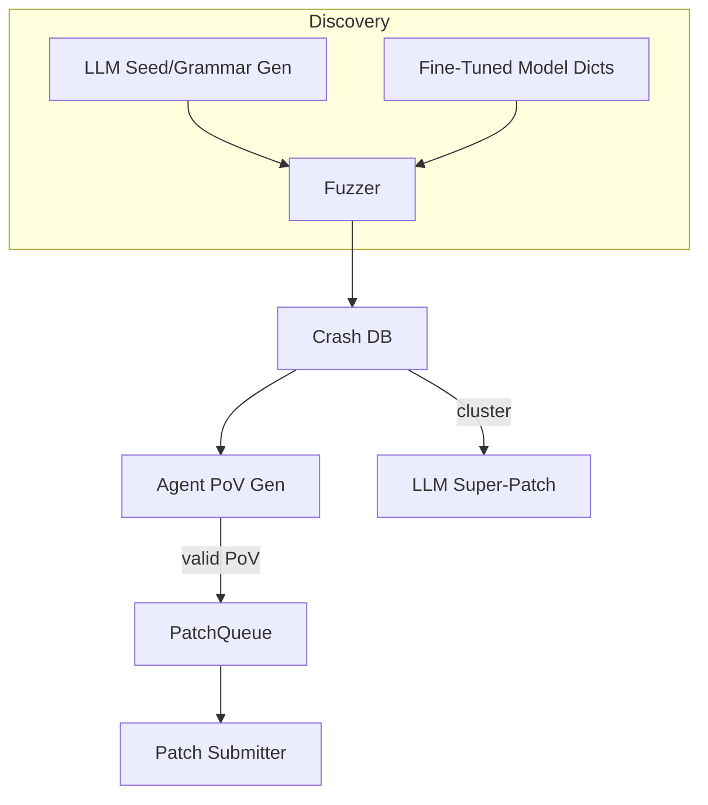

# AI-Assisted Fuzzing & Otomatik Güvenlik Açığı Keşfi

{{#include ../banners/hacktricks-training.md}}

## Genel Bakış
Büyük dil modelleri (LLM’ler), anlamsal açıdan zengin girdiler üreterek, gramerleri geliştirerek, crash verileri üzerinde akıl yürüterek ve hatta birden fazla bug içeren yamalar önererek geleneksel güvenlik açığı araştırma süreçlerini büyük ölçüde güçlendirebilir. Bu sayfada, DARPA’nın AI Cyber Challenge (AIxCC) finallerinde ve diğer kamuya açık araştırmalarda gözlemlenen en etkili yöntemler derlenmiştir.<sup>[[4]](#references)</sup><sup>[[5]](#references)</sup>

Aşağıda belirli bir yarışma sisteminin açıklaması değil, bu teknikleri kendi iş akışlarınızda yeniden uygulayabilmeniz için bir soyutlama sunulmaktadır.

---

## 1. LLM Tarafından Üretilen Seed Girdileri

Geleneksel coverage-guided fuzzer’lar (AFL++, libFuzzer, Honggfuzz…) küçük bir seed havuzuyla başlar ve baytları rastgele değiştirir. Hedef girdi biçimi karmaşık olduğunda (SQL, URL’ler, özel ikili protokoller), rastgele değişiklikler genellikle ilgi çekici dallara ulaşılmadan önce sözdizimini bozar.

LLM’ler, **sözdizimi doğru ancak güvenlik açısından anlamlı girdiler** üreten kısa betikler olan *seed generator’lar* oluşturarak bu başlangıç sorununu çözebilir. Örneğin:

```prompt
SYSTEM: You are a helpful security engineer.
USER:
Write a Python3 program that prints 200 unique SQL injection strings targeting common anti-pattern mistakes (missing quotes, numeric context, stacked queries).  Ensure length ≤ 256 bytes / string so they survive common length limits.
```

```python
# gen_sqli_seeds.py (truncated)
PAYLOADS = [
    "1 OR 1=1 -- ",
    "' UNION SELECT NULL,NULL--",
    "0; DROP TABLE users;--",
    ...
]
for p in PAYLOADS:
    print(p)
```

Bir kez çalıştırın ve çıktıyı doğrudan fuzzer’ın başlangıç corpus’una aktarın:

```bash
python3 gen_sqli_seeds.py > seeds.txt
afl-fuzz -i seeds.txt -o findings/ -- ./target @@
```

Benefits:
1. Anlamsal geçerlilik → daha en baştan derin kapsam.
2. Yeniden üretilebilir: XSS, path traversal, binary blobs vb. konulara odaklanmak için prompt'u değiştirin.
3. Ucuz (< 1 ¢ with GPT-3.5).

### Tips
* Yüzeysel filtreleri aşmak için modele payload uzunluğunu ve encoding'i (UTF-8, URL-encoded, UTF-16-LE) *çeşitlendirmesini* söyleyin.
* JSON biçimlendirme sorunlarını önlemek için *tek ve kendi içinde eksiksiz bir script* isteyin.

---

## 2. Grammar-Evolution Fuzzing

Daha güçlü bir varyant, somut seed'ler yerine LLM'in bir grammar'ı **geliştirmesini** sağlamaktır. İş akışı (“Grammar Guy” pattern) şöyledir:

1. Prompt aracılığıyla başlangıç niteliğinde bir ANTLR/Peach/LibFuzzer grammar'ı oluşturun.
2. N dakika fuzzing yapın ve coverage metriklerini (hit olan edge / block'ları) toplayın.
3. Kapsanmayan program alanlarını özetleyip bu özeti modele geri besleyin:
   ```prompt
   The previous grammar triggered 12 % of the program edges.  Functions not reached: parse_auth, handle_upload.  Add / modify rules to cover these.
   ```
4. Yeni kuralları birleştirin, fuzzing'i yeniden çalıştırın ve tekrarlayın.

Sözde kod iskeleti:

```python
for epoch in range(MAX_EPOCHS):
    grammar = llm.refine(grammar, feedback=coverage_stats)
    save(grammar, f"grammar_{epoch}.txt")
    coverage_stats = run_fuzzer(grammar)
```

Önemli noktalar:
* Bir *bütçe* belirleyin; her iyileştirme tokens kullanır.
* Modelin baştan yazmak yerine düzenleme yapması için `diff` + `patch` talimatlarını kullanın.
* Δcoverage < ε olduğunda durun.

---

## 3. Local-LLM libFuzzer Harness Mühendisliği

Analistin iş istasyonundan çıkarılamayacak kaynak kodlar için yerel bir code model, fuzzer baytları ile bir C/C++ API’si arasındaki küçük adaptörü taslak olarak hazırlayabilir. Yararlı güvenlik sınırı açıktır: **model test altyapısını yazar ve gözden geçirir; coverage-guided mutation girdileri keşfeder; sanitizers geçersiz işlemleri bildirir; bir insan harness’i inceler ve bulguları değerlendirir**.<sup>[[9]](#references)</sup>

LLM’e bağlı olmayan engine düzeyindeki corpus, feedback, snapshot ve stateful-fuzzing teknikleri için genel [Fuzzing Methodology](../generic-methodologies-and-resources/fuzzing.md) bölümüne bakın.

Hedef header’dan alınan tam bildirimle başlayın ve çıktı biçimini kısıtlayın. Dar kapsamlı bir prompt, uydurma API’leri azaltır ve sonucu incelemeyi kolaylaştırır:<sup>[[8]](#references)[[9]](#references)</sup>

```prompt
Write a libFuzzer target for this exact declaration:
int parse_records(const uint8_t *data, size_t size);

Output only C code. Implement LLVMFuzzerTestOneInput, include the
declaration, pass data and size unchanged, and do not use files,
network access, randomness, clocks, threads, or persistent state.
```

Ham bayt ayrıştırıcısı için beklenen sonuç bundan daha karmaşık olmamalıdır:<sup>[[6]](#references)[[9]](#references)</sup>

```c
#include <stddef.h>
#include <stdint.h>

extern int parse_records(const uint8_t *, size_t);

int LLVMFuzzerTestOneInput(const uint8_t *data, size_t size) {
    (void)parse_records(data, size);
    return 0;
}
```

Derleme yalnızca ilk doğrulama aşamasıdır. CPU zamanını harcamadan önce oluşturulan her target'ı şu değişmezlere göre inceleyin:<sup>[[6]](#references)[[8]](#references)[[9]](#references)</sup>

- **Exact API:** Türleri, sahiplik kurallarını, başlatmayı, temizlemeyi ve çağrı kuralını gerçek header ve mevcut çağıran kodla karşılaştırın.
- **Harness safety:** `data` üzerinden yapılan her okumayı korumaya alın; sanitizer bulguları, oluşturulan glue koddan değil target'tan kaynaklanmalıdır.
- **Repeatability:** Sonucu `data` ve `size` değerlerine bağlı kılın; harici I/O'yu, zamanı, kontrolsüz rastgeleliği, birleştirilmemiş thread'leri ve çağrılar arasında kalan durumu kaldırın.
- **Throughput:** Davranışı etkilemediğinden emin olduğunuz durumlarda pahalı ve değişmez durumu yalnızca bir kez başlatın, girdi boyutunu sınırlandırın, loglamayı kapatın ve girdi başına ayrılan belleği serbest bırakın.
- **Reachability:** Amaçlanan işlevlerin ve dalların çalıştığını doğrulayın. Derlenen ancak yalnızca reddetme yollarını çalıştıran bir target, sessiz bir başarısızlıktır.

### Yapı farkındalıklı target'lar: hataları gizlemeden değişmezleri koruyun

Ham girdilerin çoğu magic, uzunluk, sürüm veya checksum kontrolünden geçemiyorsa, fuzz baytlarını **türlü alan verisi** olarak kullanıp geçerli bir nesne yeniden oluşturun. Biçim sabitlerini sabit tutun, anlamsal alanları ve payload baytlarını değiştirilebilir bırakın, bütünlük metadata'sını ise yeniden oluşturulan payload'dan türetin. `FuzzedDataProvider`, sınırlandırılmış tür değerlerini tüketmek için kullanışlıdır; oluşturulan tüm bellek ayırmalarını ve dönüşümleri sınırlandırmaktan ise adapter sorumludur.<sup>[[9]](#references)</sup>

<details>
<summary>Yapı farkındalıklı C++ target örneği</summary>

```cpp
#include <fuzzer/FuzzedDataProvider.h>
#include <stddef.h>
#include <stdint.h>
#include <vector>

extern "C" int parse_message(const uint8_t *, size_t);

extern "C" int LLVMFuzzerTestOneInput(const uint8_t *data, size_t size) {
    FuzzedDataProvider fdp(data, size);
    uint8_t version = fdp.ConsumeIntegral<uint8_t>();
    auto body = fdp.ConsumeRemainingBytes<uint8_t>();
    if (body.size() > UINT16_MAX) body.resize(UINT16_MAX);
    uint16_t len = static_cast<uint16_t>(body.size());
    std::vector<uint8_t> msg = {0x8b, 'M', 'S', 'G', version,
                                static_cast<uint8_t>(len >> 8),
                                static_cast<uint8_t>(len)};
    msg.insert(msg.end(), body.begin(), body.end());
    (void)parse_message(msg.data(), msg.size());
    return 0;
}
```

</details>

Her soru için aynı yapıyı onaran target'ı kullanmayın. Derin ve geçerli durumları keşfetmek için uzunlukları/checksum'ları hesaplayan bir target, fuzzer'ın kontrolünde **beyan edilen** metadata'yı tutarken yalnızca harness'in kendi okuma ve bellek ayırma işlemlerini sınırlandıran başka bir target kullanın. İkinci target, otomatik düzeltmenin yok edeceği uzunluk uyuşmazlıklarını ve hatalı bütünlük verilerine yönelik saldırı yüzeylerini korur.<sup>[[9]](#references)</sup>

### Seed'ler, sözlükler, sanitizer'lar ve coverage geri bildirimi

Modelden doğrudan binary yazdırmasını istemek yerine, binary seed'ler yazan bir script oluşturmasını isteyin. Boş, minimal, tipik ve sınır değerlerinde geçerli nesnelerle seed oluşturun; ardından magic değerlerini, tag'leri, enum kodlamalarını ve parser anahtar sözcüklerini gözden geçirilmiş bir sözlüğe çıkarın. libFuzzer bu sözlüğü `-dict=` ile kabul eder ve corpus'ta yeni coverage sağlayan mutasyonları tutar.<sup>[[6]](#references)[[9]](#references)</sup>

```text
magic="\x8bMSG"
version_min="\x00"
version_max="\xff"
config_tag="CONFIG"
```

Aynı hedefi tamamlayıcı enstrümantasyonla derleyin. ASan ve UBSan aynı fuzzing ikilisini paylaşabilir; enstrümante edilmemiş koddan kaynaklanan raporları önlemek için ayrı bir MSan derlemesi yapın ve bağımlılıklarını da enstrümante edin.<sup>[[6]](#references)[[9]](#references)</sup>

```bash
clang++ -g -O1 -fsanitize=fuzzer,address,undefined \
  -fno-sanitize-recover=undefined target.cc harness.cc -o fuzz_target
./fuzz_target corpus -dict=msg.dict -max_len=65535

clang++ -g -O1 -fsanitize=fuzzer,memory \
  target.cc harness.cc -o fuzz_target_msan
```

Coverage'ı her model revizyonu için değerlendirme ölçütü olarak ele alın. libFuzzer çıktısında `cov`/`ft` değerlerinin erkenden düzleşmesi ve corpus'un değişmemesi genellikle hatalı framing'e, aşırı kısıtlayıcı bir early return'e veya yanlış çağrıya işaret eder; düşük `exec/s` ise maliyetli kurulum, I/O, bellek ayırma ya da sızan duruma işaret eder. `NEW`, yalnızca bir coverage özelliğinin değiştiğini kanıtlar; hedeflenen parser'a ulaşıldığını değil.<sup>[[6]](#references)[[9]](#references)</sup>

Kaynak düzeyinde geri bildirim için bir coverage build alın, fuzzing yapın ve modele yalnızca coverage elde edilmemiş işlevleri ve bunları koruyan koşulları verin. Ortaya çıkan harness/seed/dictionary diff'ini doğrulayın ve yeniden ölçüm yapın:<sup>[[7]](#references)[[8]](#references)[[9]](#references)</sup>

```bash
clang++ -g -O1 -fsanitize=fuzzer \
  -fprofile-instr-generate -fcoverage-mapping target.cc harness.cc -o fuzz_cov
mkdir -p profiles
LLVM_PROFILE_FILE='profiles/%p.profraw' ./fuzz_cov -max_total_time=300 corpus
llvm-profdata merge -sparse profiles/*.profraw -o fuzz.profdata
llvm-cov report ./fuzz_cov -instr-profile=fuzz.profdata
llvm-cov show ./fuzz_cov -instr-profile=fuzz.profdata \
  --show-branches=count --region-coverage-lt=1 target.cc
```

Ölçeklenebilir döngü bu nedenle **üret → derle/bağla → sanitizer’lar altında smoke test yap → hedef coverage’ını ölç → en küçük ilgili coverage/kaynak bağlamını sağla → gözden geçir → yeniden ölç** şeklindedir. OSS-Fuzz-Gen de makul görünen kodu olduğu gibi kabul etmek yerine, üretilen hedefleri derlenebilirlik, çalışma zamanı hataları, coverage ve mevcut hedeflere kıyasla coverage iyileşmesi açısından değerlendirerek aynı ilkeyi uygular.<sup>[[7]](#references)[[8]](#references)</sup>

---

<a id="3-agent-based-pov-exploit-generation" hidden>3. Agent Tabanlı PoV (Exploit) Üretimi</a>

## 4. Agent Tabanlı PoV (Exploit) Üretimi

Bir crash bulduktan sonra, crash’i deterministik olarak tetikleyen bir **vulnerability kanıtına (PoV)** hâlâ ihtiyacınız vardır.

Ölçeklenebilir bir yaklaşım, her biri farklı bir model veya örnekleme yapılandırması kullanan çok sayıda hafif worker’ı (process, thread veya container) başlatmaktır. AIxCC finalistleri anketi ölçeğe dair somut örnekler sunuyor: bir ekip, PoV üretimini öncelikli olarak AI ile yapmak için **binlerce eşzamanlı agent** kullanırken, başka bir ekip **300–500 fuzzing agent** koordine etti ve LLM’leri üst düzey anlamsal akıl yürütme için ayırdı.<sup>[[4]](#references)</sup>

Pipeline:
1. Statik/dinamik analiz, *bug adayları* üretir (crash PC’si, input dilimi ve sanitizer mesajı içeren struct).
2. Orchestrator adayları agent’lara dağıtır.
3. Agent’ın akıl yürütme adımları:
   a. Bug’ı `gdb` + input ile yerel olarak yeniden üretir.
   b. Minimum exploit payload’ını önerir.
   c. Exploit’i sandbox’ta doğrular. Başarılıysa → gönderir.
4. Başarısız denemeler, coverage fuzzing için **yeni seed’ler olarak yeniden kuyruğa alınır** (geri bildirim döngüsü).

Avantajlar:
* Paralelleştirme, tek bir agent’ın güvenilmezliğini gizler.
* Gözlemlenen başarı oranına göre temp/model boyutunun otomatik ayarlanması.

---

<a id="4-directed-fuzzing-with-fine-tuned-code-models" hidden>4. İnce Ayar Yapılmış Code Model’leriyle Yönlendirilmiş Fuzzing</a>

## 5. İnce Ayar Yapılmış Code Model’leriyle Yönlendirilmiş Fuzzing

Bir open-weight modeli (ör. Llama-7B), vulnerability pattern’leriyle (integer overflow, buffer copy, format string) etiketlenmiş C/C++ kaynak kodu üzerinde fine-tune edin. Ardından:

1. Fonksiyon listesi + AST elde etmek için statik analiz çalıştırın.
2. Modele şu prompt’u verin: *“X fonksiyonunda memory safety’yi bozma olasılığı yüksek mutation dictionary girdileri ver”*.
3. Bu token’ları özel bir `AFL_CUSTOM_MUTATOR` içine ekleyin.

Bir `sprintf` wrapper’ı için örnek çıktı:
```
{"pattern":"%99999999s"}
{"pattern":"AAAAAAAA....<1024>....%n"}
```

Gerçek hedeflerde ampirik olarak crash'e kadar geçen süreyi >2× azaltır.

---

<a id="5-ai-guided-patching-strategies" hidden>5. AI Kılavuzlu Yama Stratejileri</a>

## 6. AI Kılavuzlu Yama Stratejileri

<a id="51-super-patches" hidden>5.1 Süper Yamalar</a>

### 6.1 Süper Yamalar
Modelden crash imzalarını *kümelemesini* ve ortak kök nedeni ortadan kaldıran **tek bir yama** önermesini isteyin. Bir kez gönderin, birden fazla hatayı düzeltin → yanlış yamaların puan kaybettirdiği ortamlarda daha az doğruluk cezası.

Prompt taslağı:
```
Here are 10 stack traces + file snippets.  Identify the shared mistake and generate a unified diff fixing all occurrences.
```

{{#ref}}
../generic-methodologies-and-resources/fuzzing.md
{{#endref}}

<a id="52-speculative-patch-ratio" hidden>5.2 Spekülatif Yama Oranı</a>

### 6.2 Spekülatif Yama Oranı
Doğrulanmış PoV ile onaylanmış yamalarla *spekülatif* yamaları (PoV yok) puanlama kurallarına göre ayarlanmış 1:N oranında (ör. 2 spekülatif : 1 doğrulanmış) sırayla işleyen bir kuyruk uygulayın. Bir maliyet modeli, cezaları ve puanları izler ve N değerini otomatik olarak ayarlar.

---

<a id="6-deterministic-file-by-file-ai-code-review" hidden>6. Deterministik Dosya Dosya AI Kod İncelemesi</a>

## 7. Deterministik Dosya Dosya AI Kod İncelemesi

AI destekli incelemede sık görülen bir başarısızlık biçimi, tek bir ajandan tüm depoyu incelemesini istemek ve doğru dosyaları ve grep terimlerini seçmesini ummaktır. Daha güvenilir bir yöntem, **depo kapsamını zorunlu kılmaktır**:<sup>[[1]](#references)</sup>

1. Kaynak dosyaları listeleyin.
2. **Her seferinde tek bir dosyayı**, asgari bağlamla (entrypoint, import'lar, yakındaki route'lar/çağıranlar) gönderin.
3. Her dosya için kaynakları, sink'i, eksik doğrulamayı, exploit önkoşullarını ve güven düzeyini içeren **yapılandırılmış bir rapor** isteyin.<sup>[[3]](#references)</sup>
4. Raporları **source→sink örüntüsüne** göre tekilleştirin ve yüksek riskli olanları elle doğrulayın.

Bu yöntem çok token kullanır ve gürültülüdür; ancak kapsamlı agentic incelemelerin sıklıkla gözden kaçırdığı **basit ve yüksek etkili source/sink hatalarını** ortaya çıkarmada oldukça etkilidir.

### Öncelik verilmeye değer triyaj örüntüleri

- **Dinamik PHP include/dispatch**: Saldırganın kontrolündeki route/controller/module adlarının, katı bir allowlist ve path canonicalisation olmadan `require_once()`, `include()` veya `include_once()` işlevlerine aktarılması.
- **Admin/hesap iş akışlarında shell çalıştırma**: Kullanıcı adlarının, domain'lerin, FTP hesaplarının veya diğer tanımlayıcıların `exec()`, `system()`, `shell_exec()`, `passthru()`, `proc_open()` ya da `popen()` işlevlerine ulaşması.
- **Yapılandırılmış girdilerin bir noktada birleşmesi**: Aynı parametrenin `$_GET`, `$_POST`, JSON, XML veya framework body parser'ları üzerinden kabul edilip daha sonra dosya sistemi ya da OS-command sink'lerinde yeniden kullanılması.

### Bu yöntemin iyi bulduğu iki pratik hata sınıfı

- **PHP controller-dispatch LFI/RCE**: İstek tarafından kontrol edilen bir controller adı, allowlist/path normalisation olmadan `require_once()` içine birleştirilirse `../` gibi traversal dizileri PHP'nin istenmeyen bir yerel `.php` dosyasını include etmesine yol açabilir. Saldırgan include yolunu önceden yerleştirilmiş veya başka şekilde kullanışlı bir PHP dosyasına yönlendirebilirse LFI, code execution'a dönüşür. Bkz. [File Inclusion / Path Traversal](../pentesting-web/file-inclusion/README.md).<sup>[[1]](#references)</sup>
- **Hosting/admin panellerinde kimliği doğrulanmış command injection**: Kullanıcı adları gibi hesap yönetimi alanları shell komutlarına ekleniyorsa, düşük ayrıcalıklı kimliği doğrulanmış bir kullanıcı normal bir oluşturma/silme işlemini RCE'ye dönüştürebilir. Panel komutu daha ayrıcalıklı bir servis hesabı olarak çalıştırıyorsa etki artar. Bkz. [Command Injection](../pentesting-web/command-injection.md).<sup>[[1]](#references)</sup>

### Pratik inceleme notları

- LLM'yi öncelikle bir **source/sink inceleyicisi** olarak kullanın; exploit oluşturucu olarak değil.
- Açıkça **saldırganın kontrolündeki alanı**, **normalizasyon/doğrulama açığını** ve **tehlikeli sink'i** listelemesini isteyin.
- Büyük depolarda deterministik, dosya bazlı inceleme genellikle daha güçlü bir model kullansa bile tek bir otonom agent çalıştırmasından daha güvenilirdir.<sup>[[2]](#references)</sup>
- Exploit edilebilirliğin dosyalar arası varsayımlara, rol anlamlarına veya ürüne özgü tehdit modellerine bağlı olduğu **Broken Access Control** ve diğer business-logic hatalarında daha zayıf sonuçlar bekleyin.

---

## 8. Instrumented Oracle ile Örüntü Rehberliğinde Kernel Denetimi

Kernel boyutunda bir hedef için ajandan tüm ağaçta gelişigüzel hatalar bulmasını istemeyin. Daha az token kullanan bir iş akışı; geçmiş güvenlik açığı bilgisini statik sorgulara dönüştürür, sonuçları saldırı yüzeyinin açıklığına göre sıralar ve instrumented bir kernel'i çalıştırma oracle'ı olarak kullanır.<sup>[[11]](#references)</sup>

### Örüntü veritabanı → CodeQL/Semgrep → odaklı inceleme

Tehlikeli API'leri, eksik doğrulama örüntülerini, riskli source-to-sink akışlarını ve daha önce düzeltilmiş hata biçimlerini içeren küçük bir bilgi tabanı oluşturun. Modelden her seferinde **tek bir örüntüyü** inceleme sezgilerine ve CodeQL/Semgrep kurallarına dönüştürmesini isteyin; ardından bu deterministik kuralları tüm ağaç üzerinde çalıştırın. Eşleşmeleri modele kod olarak geri vermeden önce gruplayıp tekilleştirin; ham tarayıcı çıktısı düşük değerli binlerce aday içerebilir. Bu yaklaşımı uygun araştırma veya açık kaynak hedefleri dışında kullanmadan önce CodeQL'in güncel lisansını kontrol edin.<sup>[[11]](#references)</sup>

Alt sistemlere yalnızca eşleşme sayısına göre değil, **kural eşleşmesi yoğunluğu** ve **saldırganın erişebilirliğini** birlikte değerlendirerek öncelik verin. Ayrıcalıksız süreçlerden, sandbox'lardan, container'lardan, jail'lerden veya guest bağlamlarından erişilebilen kernel arayüzlerine, yalnızca içeriden kullanılan koddan daha fazla ağırlık verin. İnceleme birimini, ajanın çağıranları, doğrulayıcıları ve yaşam döngüsü kurallarını hatırlayabileceği kadar küçük tutun; “herhangi bir güvenlik açığı bul” demek yerine belirli bir güvenlik açığı sınıfını veya control-flow örüntüsünü belirtin. Yeni bir containment boundary, namespaced veya jailed root kullanıcısının erişimini mümkün kıldığında eski ayrıcalıklı arayüzler özellikle ilgi çekicidir.<sup>[[11]](#references)</sup>

Her aday için exploit girişiminde bulunmadan önce açık bir field-flow kaydı isteyin.<sup>[[11]](#references)</sup>

```text
entrypoint -> privilege check -> parser -> validation/normalization
           -> later rewrite -> dangerous sink
attacker controls: <fields and lengths>
constraints:       <values rewritten, rejected, or preserved>
observable result: <sanitizer report, assertion, panic, or clean exit>
```

### KASAN telemetrisini hipotez oracle'ı olarak kullanın

Hedef kernel'i, KASAN ve kullanışlı tanılama assertions etkinleştirilmiş, geçici bir VM'de çalıştırın. Agent, şüphelenilen bozulma yeniden üretilene veya elenene kadar **kaynak hipotezi → minimal userland tetikleyicisi → VM'de çalıştırma → KASAN/assertion izi → gözden geçirilmiş hipotez** döngüsünü izlemelidir. Her yinelemede yalnızca ilgili stack trace'i ve yakındaki kaynak kodu döndürün; bu, akıl yürütme bağlamını korurken kabul ölçütünü model güveni değil, çalışma zamanı kanıtı yapar.<sup>[[11]](#references)</sup>

Instrumented build, nihai exploitability ortamı değildir. Assertions, bozulmaya yol açan işlemden önce yürütmeyi durdurabilir; aynı assertion production kernel'de derleme dışında bırakılmış olabilir. Değiştirilmemiş tetikleyiciyi tam production configuration'a karşı yeniden test edin, kernel build'ini ve configuration'ı kaydedin ve **erişilebilirlik**, **bellek bozulması**, **kontrollü primitive** ve **güvenlik etkisini** ayrı iddialar olarak ele alın.<sup>[[11]](#references)[[12]](#references)</sup>

CVE-2026-3038, exploit şablonu olarak değil, yararlı bir doğrulama örneği olarak kullanılabilir. Yetkisiz bir FreeBSD `RTM_GET` isteği, seçici doğrulama ve yanıt yeniden yazımı boyunca büyük boyutlu bir `RTAX_AUTHOR` sockaddr'ı koruyarak `rtsock_msg_buffer()` fonksiyonunun kullanıcı denetimindeki `sa_len` değerini 128 byte'lık stack `sockaddr_storage` içine kopyalamasına neden olabiliyordu. En fazla 255 byte'lık kopyalama, 127 byte'lık bir taşmaya yol açtı; instrumented build'de tanılama assertion'ı hatalı uzunluğu yakalarken, GENERIC kernel kopyalamaya ulaşıyor ve bozulmuş canary denetlendiğinde panic veriyordu. Bu, yetkisiz bir hizmet engelleme saldırısını kanıtlar; tek başına privilege escalation'ı değil: güvenilir kontrol için önce canary disclosure gibi başka bir primitive gerekir. İlgili binary-exploitation sınırı için bkz. [Stack Canaries](../binary-exploitation/common-binary-protections-and-bypasses/stack-canaries/index.html).<sup>[[11]](#references)[[12]](#references)[[13]](#references)</sup>

### Exploit önkoşullarını hileyle aşan PoV'ları reddedin

Bir PoV veya exploit'i kabul etmeden önce, ayrı bir reviewer/agent'tan sabit ölçütlere göre geçersiz kılmaya çalışmasını isteyin. İnceleme, aşağıdaki koşulların tümünü doğrulamalıdır.<sup>[[11]](#references)</sup>

- Hedef kaynak kodu, kernel ve vulnerable module, yolu erişilebilir kılmak için değiştirilmemiş olmalı.
- Herhangi bir helper module, synthetic gadget, devre dışı mitigation, ek privilege veya kullanılamayan interface eklenmemiş olmalı.
- Tetikleyici, temiz bir snapshot'ta iddia edilen caller identity ve containment kısıtlamalarıyla başlamalı.
- İddia edilen sonuç hâlâ bug'a bağlı olmalı: hatalı biçimlendirilmiş alanı kaldırmak veya yalnızca bug'ı yamamak zinciri bozmalı.
- Bir crash, overread veya overwrite yalnızca o primitive olarak raporlanmalı; code execution veya privilege escalation için bağımsız kanıt gerekir.

Bu son karşı-olgusal kontrol, döngüsel kanıtlamaları yakalar: önkoşullar iddia edilen etkiyi zaten sağlıyorsa (örneğin, `nosuid` olmadan mount edilmiş bir filesystem'den saldırganın sağladığı SUID içeriği çalıştırmak), bellek güvenliği bug'ı bu etkiyi yaratmamıştır.<sup>[[11]](#references)</sup>

---

## Bilinmeyen Codebase'lerde Denetlenebilir, Agent Destekli Araştırma

[Graph-first fuzz-target workflow](../generic-methodologies-and-resources/fuzzing.md#graph-first-fuzz-target-selection-and-mutation-triage) entrypoint erişilebilirliğini, [agentic SAST pipelines](../network-services-pentesting/pentesting-web/code-review-tools.md#agentic-sast-pipelines) ise aşamalı incelemeyi ve kanıt eşiklerini zaten kapsıyor. Her doğrulanmış bulgunun kaynak konumlarını, yol kanıtını ve dinamik ölçümünü koruması için bu deterministik sonuçları modelin hipotezlerinden ayrı tutun.<sup>[[10]](#references)</sup>

### Veri akışı uydurmadan nesne ömrü kanıtlarını ilişkilendirin

Static analysis, saldırgan denetimindeki bir uzunluğun bir fonksiyonda saklandığını ve aynı nesne alanının çok daha sonra bir copy sink'e ulaştığını bulabilir; ancak callback'ler, yeniden bağlantılar veya nesne ömrü boyunca bu bağlantıyı kanıtlayamayabilir. Her iki bulguyu ayrı ayrı koruyun, nesne/alan bazında kümelendirin ve eksik bağlantıyı açık bir triage sorusu hâline getirin. Agent ilişkiyi önerebilir, ancak bunu kaynak kodu incelemesi veya runtime instrumentation kanıtlamalıdır.<sup>[[10]](#references)</sup>

Her aday için şunları kaydedin:

- somut entrypoint ve saldırgan denetimindeki byte'lar;
- ilgili alanı oluşturan her üretici ve her üreticiye özgü doğrulama;
- sink, hedef kapasitesi ve ona ulaşmak için gereken build/runtime koşulları;
- doğrudan harness çağrısı değil, açığa açık entrypoint'ten alınmış gerçek bir call stack;
- hipotezi doğrulayan veya reddeden en küçük dinamik sonuç.

Güvenli görünen bir yol, alanın tamamını güvenli kılmaz. İkinci bir üretici, aynı alanı ilk yolun sınırı olmadan doldurabilir. Yolları ayrı ayrı test edin ve debug assertions production'daki bellek bozulmasını test sırasında erken abort'a dönüştürebileceğinden, harness'i deployment'a eşdeğer build seçenekleriyle çalıştırın.<sup>[[10]](#references)</sup>

### Disclosure ve exploitation için ölçüm eşikleri

Şüphelenilen uninitialized-memory disclosure için, yeni allocation'ları tanınabilir bir byte ile doldurun ve tam olarak bu marker'ın gönderilen pakete ulaştığını doğrulayın. Exploitation için **kontrollü overwrite → kullanışlı victim object → disclosure → pointer/base recovery → control-flow hijack → birleştirilmiş payload** gibi ölçülebilir eşikler belirleyin. Agent ancak harness mevcut özelliği kanıtladığında ilerler; makul görünen bir anlatım, eşiğin geçildiği anlamına gelmez. [FreeRDP örneği](../binary-exploitation/libc-heap/heap-overflow.md#cross-path-length-reuse-and-stale-output-disclosure), doğrulama sırasında korunması gereken yol ve build kısıtlarını gösterir.<sup>[[10]](#references)</sup>

---

LLM destekli exploit geliştirmeye aşamalı L0–L4 doğrulamasını uygulayan bir kernel vaka incelemesi için bkz.:

{{#ref}}
../binary-exploitation/freebsd-kernel-exploitation-vnet-jail-escape.md
{{#endref}}

## Hepsini Bir Araya Getirme
Uçtan uca bir CRS (Cyber Reasoning System), bileşenleri şu şekilde birbirine bağlayabilir:



---

## References

- [1] [Project Black - Siber Güvenlik için Yerel AI: phpIPAM LFI ve myVesta Kimlik Doğrulamalı RCE Bulma](https://projectblack.io/blog/local-ai-for-cyber-security)
- [2] [Strix](https://github.com/usestrix/strix)
- [3] [GitHub Copilot topluluk güvenlik incelemesi skill'i](https://github.com/github/awesome-copilot/blob/main/skills/security-review/SKILL.md)
- [4] [Trail of Bits – AIxCC finalleri: Mücadelenin özeti](https://blog.trailofbits.com/2025/08/07/aixcc-finals-tale-of-the-tape/)
- [5] [CTF Radiooo AIxCC finalist röportajları](https://www.youtube.com/@ctfradiooo)
- [6] [LLVM — libFuzzer: coverage-guided fuzz testing için bir kütüphane](https://llvm.org/docs/LibFuzzer.html)
- [7] [Google — OSS-Fuzz-Gen](https://github.com/google/oss-fuzz-gen)
- [8] [Google Online Security Blog — Fuzzing'i ileri taşımak: AI ile daha fazla güvenlik açığı bulma](https://security.googleblog.com/2024/11/leveling-up-fuzzing-finding-more.html)
- [9] [8kSec — Yerel bir LLM ile AI destekli Fuzzing Harness oluşturma](https://8ksec.io/ai-assisted-fuzzing-harness-local-llm)
- [10] [Quarkslab — AI ajanlarından RCE'ye: Bir güvenlik açığı araştırma iş akışı oluşturma](https://blog.quarkslab.com/from-ai-agents-to-rce-building-a-vulnerability-research-workflow.html)
- [11] [Praetorian — FreeBSoD: Kernel hatalarını bulup istismar etmek için dil modellerinden yararlanma (2 bölümden 1.si)](https://praetorian.com/blog/ai-vulnerability-research-freebsd-kernel)
- [12] [FreeBSD-SA-26:05.route — Routing socket'leri üzerinden yerel DoS ve olası ayrıcalık yükseltme](https://www.freebsd.org/security/advisories/FreeBSD-SA-26:05.route.asc)
- [13] [FreeBSD-SA-26:05.route kaynak yaması](https://security.FreeBSD.org/patches/SA-26:05/route.patch)
{{#include ../banners/hacktricks-training.md}}
