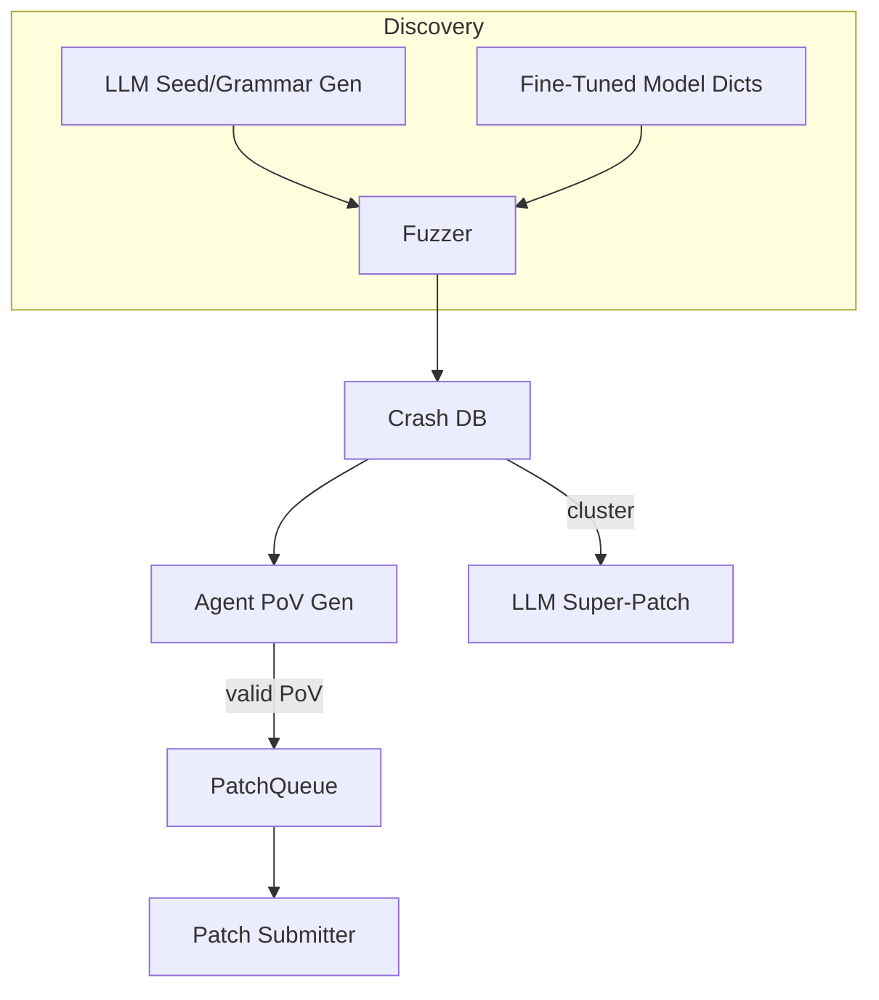

# Fuzzing assisté par l’IA et découverte automatisée de vulnérabilités

{{#include ../banners/hacktricks-training.md}}

## Vue d’ensemble
Les grands modèles de langage (LLM) peuvent considérablement renforcer les workflows traditionnels de recherche de vulnérabilités : ils génèrent des entrées riches sur le plan sémantique, font évoluer des grammaires, raisonnent à partir des données de crash et proposent même des correctifs pour plusieurs bugs. Cette page rassemble les approches les plus efficaces observées lors de la finale du DARPA AI Cyber Challenge (AIxCC) et dans d’autres travaux de recherche publics.<sup>[[4]](#references)</sup><sup>[[5]](#references)</sup>

Ce qui suit ne décrit pas un système particulier conçu pour une compétition, mais présente une abstraction des techniques afin que vous puissiez les reproduire dans vos propres workflows.

---

## 1. Entrées seed générées par des LLM

Les fuzzers traditionnels guidés par la couverture (AFL++, libFuzzer, Honggfuzz…) commencent par un petit corpus de seeds et mutent les octets à l’aveugle. Lorsque le format d’entrée cible est complexe (SQL, URL, protocoles binaires personnalisés), les mutations aléatoires cassent généralement la syntaxe avant que les branches intéressantes ne soient atteintes.

Les LLM peuvent résoudre ce problème d’amorçage en générant des *générateurs de seed* — de courts scripts qui produisent des **entrées syntaxiquement correctes et pertinentes pour la sécurité**. Par exemple :

```prompt
SYSTEM: You are a helpful security engineer.
USER:
Write a Python3 program that prints 200 unique SQL injection strings targeting common anti-pattern mistakes (missing quotes, numeric context, stacked queries).  Ensure length ≤ 256 bytes / string so they survive common length limits.
```

```python
# gen_sqli_seeds.py (truncated)
PAYLOADS = [
    "1 OR 1=1 -- ",
    "' UNION SELECT NULL,NULL--",
    "0; DROP TABLE users;--",
    ...
]
for p in PAYLOADS:
    print(p)
```

Exécutez-le une fois et transmettez directement la sortie au corpus initial du fuzzer :

```bash
python3 gen_sqli_seeds.py > seeds.txt
afl-fuzz -i seeds.txt -o findings/ -- ./target @@
```

Benefits:
1. Validité sémantique → couverture plus approfondie dès le début.
2. Régénérable : ajustez le prompt pour cibler XSS, path traversal, blobs binaires, etc.
3. Peu coûteux (< 1 ¢ avec GPT-3.5).

### Conseils
* Demandez au modèle de *diversifier* la longueur et l’encodage des payloads (UTF-8, encodage URL, UTF-16-LE) afin de contourner les filtres superficiels.
* Demandez un *script autonome unique* – cela évite les problèmes de formatage JSON.

---

## 2. Grammar-Evolution Fuzzing

Une variante plus puissante consiste à laisser le LLM **faire évoluer une grammaire** au lieu de seeds concrètes. Le workflow (pattern « Grammar Guy ») est le suivant :

1. Générez une grammaire ANTLR/Peach/LibFuzzer initiale à l’aide d’un prompt.
2. Lancez le fuzzing pendant N minutes et collectez des métriques de couverture (arêtes / blocs atteints).
3. Résumez les zones du programme non couvertes et renvoyez le résumé au modèle :
   ```prompt
   The previous grammar triggered 12 % of the program edges.  Functions not reached: parse_auth, handle_upload.  Add / modify rules to cover these.
   ```
4. Fusionnez les nouvelles règles, relancez le fuzzing, répétez.

Squelette de pseudo-code :

```python
for epoch in range(MAX_EPOCHS):
    grammar = llm.refine(grammar, feedback=coverage_stats)
    save(grammar, f"grammar_{epoch}.txt")
    coverage_stats = run_fuzzer(grammar)
```

Points clés :
* Gardez un *budget* : chaque amélioration utilise des tokens.
* Utilisez des instructions `diff` + `patch` pour que le modèle modifie le code au lieu de le réécrire.
* Arrêtez-vous lorsque Δcoverage < ε.

---

## 3. Ingénierie de harness libFuzzer avec un LLM local

Pour du code source qui ne peut pas quitter le poste de travail d’un analyste, un modèle de code local peut rédiger le petit adaptateur entre les octets du fuzzer et une API C/C++. La frontière de sécurité est claire : **le modèle écrit et révise l’infrastructure de test ; la mutation guidée par la couverture explore les entrées ; les sanitizers signalent les opérations invalides ; un humain examine le harness et trie les résultats**.<sup>[[9]](#references)</sup>

Pour les techniques de corpus, de feedback, de snapshot et de fuzzing avec état au niveau du moteur qui ne dépendent pas d’un LLM, consultez la [méthodologie de fuzzing](../generic-methodologies-and-resources/fuzzing.md).

Commencez par copier la déclaration exacte de l’en-tête cible et imposez un format de sortie. Un prompt ciblé limite l’invention d’API et facilite l’examen du résultat :<sup>[[8]](#references)[[9]](#references)</sup>

```prompt
Write a libFuzzer target for this exact declaration:
int parse_records(const uint8_t *data, size_t size);

Output only C code. Implement LLVMFuzzerTestOneInput, include the
declaration, pass data and size unchanged, and do not use files,
network access, randomness, clocks, threads, or persistent state.
```

Pour un analyseur d’octets bruts, le résultat attendu ne devrait pas être plus compliqué que :<sup>[[6]](#references)[[9]](#references)</sup>

```c
#include <stddef.h>
#include <stdint.h>

extern int parse_records(const uint8_t *, size_t);

int LLVMFuzzerTestOneInput(const uint8_t *data, size_t size) {
    (void)parse_records(data, size);
    return 0;
}
```

La compilation n’est que la première étape de validation. Vérifiez chaque cible générée par rapport aux invariants suivants avant d’y consacrer du temps CPU :<sup>[[6]](#references)[[8]](#references)[[9]](#references)</sup>

- **API exacte :** comparez les types, les règles de propriété, l’initialisation, le nettoyage et la convention d’appel avec l’en-tête réel et les appelants existants.
- **Sécurité du harness :** protégez chaque lecture de `data` ; les problèmes détectés par les sanitizers doivent provenir de la cible, et non du code généré servant de liaison.
- **Reproductibilité :** faites en sorte que le résultat dépende de `data` et de `size` ; supprimez les E/S externes, l’utilisation du temps, l’aléatoire non contrôlé, les threads non joints et tout état persistant entre les appels.
- **Débit :** initialisez une seule fois l’état immuable coûteux, uniquement si cela ne peut pas influer sur le comportement, limitez la taille des entrées, désactivez la journalisation et libérez les allocations propres à chaque entrée.
- **Atteignabilité :** vérifiez que les fonctions et branches visées sont exécutées. Une cible qui compile, mais n’exerce que les chemins de rejet, échoue sans le signaler.

### Cibles tenant compte de la structure : préserver les invariants sans masquer les bugs

Si la plupart des entrées brutes échouent à un contrôle de magic, de longueur, de version ou de checksum, utilisez les octets du fuzzing comme **données de champs typés** et reconstruisez un objet valide. Fixez les constantes de format, laissez les champs sémantiques et les octets de la charge utile modifiables, et dérivez les métadonnées d’intégrité à partir de la charge utile reconstruite. `FuzzedDataProvider` est utile pour consommer des valeurs typées et bornées, tandis que l’adaptateur reste chargé de limiter toute allocation et conversion générées.<sup>[[9]](#references)</sup>

<details>
<summary>Exemple de cible C++ tenant compte de la structure</summary>

```cpp
#include <fuzzer/FuzzedDataProvider.h>
#include <stddef.h>
#include <stdint.h>
#include <vector>

extern "C" int parse_message(const uint8_t *, size_t);

extern "C" int LLVMFuzzerTestOneInput(const uint8_t *data, size_t size) {
    FuzzedDataProvider fdp(data, size);
    uint8_t version = fdp.ConsumeIntegral<uint8_t>();
    auto body = fdp.ConsumeRemainingBytes<uint8_t>();
    if (body.size() > UINT16_MAX) body.resize(UINT16_MAX);
    uint16_t len = static_cast<uint16_t>(body.size());
    std::vector<uint8_t> msg = {0x8b, 'M', 'S', 'G', version,
                                static_cast<uint8_t>(len >> 8),
                                static_cast<uint8_t>(len)};
    msg.insert(msg.end(), body.begin(), body.end());
    (void)parse_message(msg.data(), msg.size());
    return 0;
}
```

</details>

N’utilisez pas une seule cible qui répare la structure pour toutes les questions. Maintenez une cible qui calcule les longueurs et les sommes de contrôle afin d’explorer des états valides profonds, et une autre qui laisse les métadonnées **déclarées** sous le contrôle du fuzzer, tout en limitant uniquement les lectures et les allocations propres au harness. La seconde cible préserve les surfaces d’attaque liées aux longueurs incohérentes et aux problèmes d’intégrité que la réparation automatique éliminerait autrement.<sup>[[9]](#references)</sup>

### Seeds, dictionnaires, sanitizers et retour de couverture

Demandez au modèle de générer un script qui écrit des seeds binaires plutôt que de lui demander d’afficher directement des données binaires. Créez des seeds à partir d’objets vides, minimaux, typiques et valides aux limites, puis extrayez les valeurs magiques, les tags, les encodages d’enum et les mots-clés du parseur pour constituer un dictionnaire révisé. libFuzzer accepte ce dictionnaire avec `-dict=`, et conserve dans le corpus les mutations qui révèlent de nouvelles couvertures.<sup>[[6]](#references)[[9]](#references)</sup>

```text
magic="\x8bMSG"
version_min="\x00"
version_max="\xff"
config_tag="CONFIG"
```

Construisez la même cible avec une instrumentation complémentaire. ASan et UBSan peuvent partager un binaire de fuzzing ; utilisez une compilation MSan distincte et instrumentez ses dépendances afin d’éviter les rapports causés par du code non instrumenté.<sup>[[6]](#references)[[9]](#references)</sup>

```bash
clang++ -g -O1 -fsanitize=fuzzer,address,undefined \
  -fno-sanitize-recover=undefined target.cc harness.cc -o fuzz_target
./fuzz_target corpus -dict=msg.dict -max_len=65535

clang++ -g -O1 -fsanitize=fuzzer,memory \
  target.cc harness.cc -o fuzz_target_msan
```

Traitez la couverture comme critère d’évaluation de chaque révision du modèle. Dans la sortie de libFuzzer, des valeurs `cov`/`ft` qui stagnent tôt et un corpus statique indiquent généralement un mauvais framing, un retour anticipé trop restrictif ou un mauvais appel ; un faible `exec/s` indique une initialisation coûteuse, des E/S, des allocations ou un état qui fuit. `NEW` prouve uniquement qu’une caractéristique de couverture a changé, pas que le parseur visé a été atteint.<sup>[[6]](#references)[[9]](#references)</sup>

Pour obtenir un retour au niveau du code source, créez un build avec couverture, lancez le fuzzing et ne donnez au modèle que les fonctions non couvertes ainsi que leurs conditions de garde. Vérifiez les différences du harness/seed/dictionary, puis mesurez à nouveau :<sup>[[7]](#references)[[8]](#references)[[9]](#references)</sup>

```bash
clang++ -g -O1 -fsanitize=fuzzer \
  -fprofile-instr-generate -fcoverage-mapping target.cc harness.cc -o fuzz_cov
mkdir -p profiles
LLVM_PROFILE_FILE='profiles/%p.profraw' ./fuzz_cov -max_total_time=300 corpus
llvm-profdata merge -sparse profiles/*.profraw -o fuzz.profdata
llvm-cov report ./fuzz_cov -instr-profile=fuzz.profdata
llvm-cov show ./fuzz_cov -instr-profile=fuzz.profdata \
  --show-branches=count --region-coverage-lt=1 target.cc
```

La boucle évolutive est donc **générer → compiler/lier → effectuer un test de fumée avec les sanitizers → mesurer la couverture de la cible → fournir le contexte minimal pertinent de couverture/source → réviser → mesurer à nouveau**. OSS-Fuzz-Gen applique le même principe en évaluant les cibles générées selon leur compilabilité, les erreurs à l’exécution, la couverture et l’amélioration de la couverture par rapport aux cibles existantes, au lieu d’accepter du code plausible sans vérification.<sup>[[7]](#references)[[8]](#references)</sup>

---

<a id="3-agent-based-pov-exploit-generation" hidden>3. Agent-Based PoV (Exploit) Generation</a>

## 4. Génération de PoV (Exploit) à base d’agents

Après avoir trouvé un crash, il vous faut encore une **preuve de vulnérabilité (PoV)** qui le déclenche de manière déterministe.

Une approche évolutive consiste à lancer de nombreux workers légers (processus, threads ou conteneurs), chacun utilisant un modèle ou une configuration d’échantillonnage différent. L’enquête auprès des finalistes de l’AIxCC fournit des exemples concrets d’échelle : une équipe a utilisé **des milliers d’agents simultanés** pour générer des PoV avec une approche AI-first, tandis qu’une autre a orchestré **300–500 agents de fuzzing** et réservé les LLM au raisonnement sémantique de plus haut niveau.<sup>[[4]](#references)</sup>

Pipeline :
1. L’analyse statique/dynamique produit des *candidats de bug* (structure avec PC du crash, extrait d’entrée, message du sanitizer).
2. L’orchestrateur distribue les candidats aux agents.
3. Étapes de raisonnement de l’agent :
   a. Reproduire le bug localement avec `gdb` + l’entrée.
   b. Proposer un payload d’exploit minimal.
   c. Valider l’exploit dans un sandbox. En cas de succès → soumission.
4. Les tentatives échouées sont **remises en file d’attente comme nouvelles seeds** pour le fuzzing de couverture (boucle de rétroaction).

Avantages :
* La parallélisation compense le manque de fiabilité d’un agent seul.
* Ajustement automatique de temp / de la taille du modèle en fonction du taux de réussite observé.

---

<a id="4-directed-fuzzing-with-fine-tuned-code-models" hidden>4. Directed Fuzzing with Fine-Tuned Code Models</a>

## 5. Fuzzing dirigé avec des modèles de code fine-tunés

Fine-tunez un modèle à poids ouverts (p. ex. Llama-7B) sur du code source C/C++ annoté avec des motifs de vulnérabilité (débordement d’entier, copie de buffer, chaîne de format). Puis :

1. Exécutez une analyse statique pour obtenir la liste des fonctions et l’AST.
2. Demandez au modèle : *« Donne des entrées de dictionnaire de mutations susceptibles de compromettre la sécurité mémoire dans la fonction X »*.
3. Insérez ces tokens dans un `AFL_CUSTOM_MUTATOR` personnalisé.

Exemple de sortie pour un wrapper `sprintf` :
```
{"pattern":"%99999999s"}
{"pattern":"AAAAAAAA....<1024>....%n"}
```

Empiriquement, cela réduit de plus de 2× le temps avant crash sur des cibles réelles.

---

<a id="5-ai-guided-patching-strategies" hidden>5. Stratégies de patching guidées par l’IA</a>

## 6. Stratégies de patching guidées par l’IA

<a id="51-super-patches" hidden>5.1 Super Patches</a>

### 6.1 Super Patches
Demandez au modèle de *regrouper* les signatures de crash et de proposer un **patch unique** qui élimine la cause racine commune. Soumettez-le une seule fois pour corriger plusieurs bugs → moins de pénalités de précision dans les environnements où chaque patch incorrect coûte des points.

Plan du prompt :
```
Here are 10 stack traces + file snippets.  Identify the shared mistake and generate a unified diff fixing all occurrences.
```

{{#ref}}
../generic-methodologies-and-resources/fuzzing.md
{{#endref}}

<a id="52-speculative-patch-ratio" hidden>5.2 Ratio de patchs spéculatifs</a>

### 6.2 Ratio de patchs spéculatifs
Mettez en place une file d’attente où les patchs confirmés, validés par PoV, et les patchs *spéculatifs* (sans PoV) sont intercalés selon un ratio de 1:​N adapté aux règles de notation (par exemple, 2 spéculatifs pour 1 confirmé). Un modèle de coûts surveille les pénalités par rapport aux points et ajuste N automatiquement.

---

<a id="6-deterministic-file-by-file-ai-code-review" hidden>6. Revue de code par IA, déterministe et fichier par fichier</a>

## 7. Revue de code par IA, déterministe et fichier par fichier

Un échec fréquent des revues assistées par IA consiste à demander à un agent d’inspecter tout un dépôt en espérant qu’il choisisse les bons fichiers et les bons termes à rechercher avec grep. Une approche plus fiable consiste à **imposer une couverture complète du dépôt** :<sup>[[1]](#references)</sup>

1. Énumérer les fichiers source.
2. Envoyer **un fichier à la fois**, avec un contexte minimal (point d’entrée, imports, routes/appelants proches).
3. Exiger un **rapport structuré** pour chaque fichier : sources, sink, validation manquante, préconditions d’exploitation et niveau de confiance.<sup>[[3]](#references)</sup>
4. Dédupliquer les rapports selon le **schéma source→sink** et valider manuellement les éléments à haut risque.

Cette méthode consomme beaucoup de tokens et génère du bruit, mais elle permet très efficacement de repérer les **bugs simples source/sink à fort impact**, souvent manqués par les revues agentiques plus générales.

### Schémas de triage à prioriser

- **Inclusion/dispatch dynamique en PHP** : noms de routes, contrôleurs ou modules contrôlés par l’attaquant et transmis à `require_once()`, `include()` ou `include_once()` sans liste d’autorisation stricte ni canonicalisation des chemins.
- **Exécution de commandes shell dans les workflows d’administration/de compte** : noms d’utilisateur, domaines, comptes FTP ou autres identifiants transmis à `exec()`, `system()`, `shell_exec()`, `passthru()`, `proc_open()` ou `popen()`.
- **Convergence d’entrées structurées** : même paramètre accepté depuis `$_GET`, `$_POST`, JSON, XML ou les parseurs de corps des frameworks, puis réutilisé dans des sinks du système de fichiers ou de commandes OS.

### Deux catégories pratiques de bugs que cette méthode repère bien

- **LFI/RCE via le dispatch de contrôleurs PHP** : si un nom de contrôleur contrôlé par la requête est concaténé dans `require_once()` sans liste d’autorisation ni normalisation du chemin, des séquences de traversal telles que `../` peuvent amener PHP à inclure un fichier `.php` local non prévu. Si l’attaquant peut faire pointer l’inclusion vers un fichier PHP implanté ou autrement utile, la LFI devient une exécution de code. Voir [File Inclusion / Path Traversal](../pentesting-web/file-inclusion/README.md).<sup>[[1]](#references)</sup>
- **Injection de commandes authentifiée dans les panneaux d’hébergement/d’administration** : si des champs de gestion de compte, comme les noms d’utilisateur, sont intégrés à des commandes shell, un utilisateur authentifié à faibles privilèges peut transformer une opération normale de création/suppression en RCE. L’impact augmente si le panneau exécute la commande avec un compte de service plus privilégié. Voir [Command Injection](../pentesting-web/command-injection.md).<sup>[[1]](#references)</sup>

### Conseils pratiques pour la revue

- Utilisez le LLM d’abord comme **outil d’analyse source/sink**, et non comme générateur d’exploits.
- Demandez-lui d’indiquer explicitement le **champ contrôlé par l’attaquant**, la **lacune de normalisation/validation** et le **sink dangereux**.
- Pour les grands dépôts, une revue déterministe fichier par fichier est souvent plus fiable qu’une seule exécution d’agent autonome, même si celle-ci utilise un modèle plus puissant.<sup>[[2]](#references)</sup>
- Attendez-vous à des résultats moins bons pour le **Broken Access Control** et les autres bugs de logique métier, dont l’exploitabilité dépend d’hypothèses entre fichiers, de la sémantique des rôles ou de modèles de menace propres au produit.

---

## Flux de tâches pour les points d’entrée mobiles

Une seule instruction couvrant tout un dépôt mélange souvent les modèles de menace et perd le chemin entre un composant accessible de l’extérieur et un sink sensible. Un workflow plus efficace divise l’audit en flux de tâches avec état : d’abord classer les applications/composants, puis inventorier les points d’entrée contrôlés par l’attaquant, enrichir chaque point d’entrée avec des métadonnées d’accessibilité, et enfin examiner chacun d’eux au regard des classes de vulnérabilités propres à la plateforme. Les taskflows mobiles de GitHub Security Lab appliquent cette méthode aux dépôts Android, iOS et multiplateformes.<sup>[[14]](#references)[[15]](#references)</sup>

Pour Android, consignez au minimum :<sup>[[14]](#references)[[15]](#references)</sup>

- les Activities, Services, Receivers et Providers exportés, avec leurs permissions ;
- les actions d’intent, les schémas/hôtes/chemins de deep link, les filtres MIME et les App Links ;
- les actions contrôlées par l’attaquant, les URI de données, `ClipData`, les extras et les indicateurs d’octroi d’URI ;
- les entrées de navigation de WebView et les bridges `addJavascriptInterface` ;
- les opérations privilégiées en aval, les ressources importées et les destinations réseau.

Classez ensuite chaque point d’entrée dans son contexte. Examinez explicitement l’autorisation de l’appelant et les comportements de deputy confus, la redirection d’intent, l’usurpation ou la divulgation par broadcast, les imports non sécurisés, l’exposition au scripting et aux bridges WebView, ainsi que le transfert d’identifiants ou de cookies entre origines. Effectuez à la fois une **vérification stricte par checklist** et une **analyse contradictoire plus large**. Reliez les résultats à [Intent Injection](../mobile-pentesting/android-app-pentesting/intent-injection.md) et [WebView Attacks](../mobile-pentesting/android-app-pentesting/webview-attacks.md) au lieu de répéter les détails d’exploitation.<sup>[[15]](#references)</sup>

Les taskflows open source actuels peuvent être lancés depuis leur Codespace avec :<sup>[[14]](#references)</sup>

```bash
./scripts/audit/run_audit.sh owner/repository
```

Les résultats sont écrits dans SQLite, dans la table `audit_result`.<sup>[[14]](#references)</sup> Considérez les lignes marquées comme vulnérables comme des **pistes**, et non comme des constats vérifiés. Pour chaque piste, demandez au modèle d’indiquer la source contrôlée par l’attaquant, le sink sensible, les préconditions et l’impact attendu, puis de créer un PoC minimal. Exécutez ce PoC sur la build d’origine avec un débogueur ou un outil d’instrumentation. Cela permet de détecter des erreurs courantes de l’analyse statique, comme les branches inatteignables, les états d’application irréalistes, la perte de priorité des données du stockage externe au profit des données privées et les mesures d’atténuation qui réduisent considérablement la gravité.<sup>[[15]](#references)</sup>

---

## 8. Audit du noyau guidé par des motifs avec un oracle instrumenté

Pour une cible de la taille d’un noyau, ne demandez pas à un agent de trouver des bugs arbitraires dans toute l’arborescence. Un workflow plus économe en tokens transforme les connaissances sur les vulnérabilités historiques en requêtes statiques, classe les résultats selon la surface d’attaque exposée et utilise un noyau instrumenté comme oracle d’exécution.<sup>[[11]](#references)</sup>

### Base de données de motifs → CodeQL/Semgrep → examen ciblé

Créez une petite base de connaissances contenant des API dangereuses, des motifs de validation manquante, des flux risqués de source à sink et des formes de bugs corrigées par le passé. Demandez au modèle de traduire **un seul motif à la fois** en heuristiques d’examen et en règles CodeQL/Semgrep, puis exécutez ces règles déterministes sur l’ensemble de l’arborescence. Regroupez et dédupliquez les correspondances avant de transmettre le code au modèle ; la sortie brute du scanner peut contenir des milliers de candidats de faible valeur. Vérifiez la licence actuelle de CodeQL avant d’utiliser cette approche en dehors des cibles de recherche admissibles ou open source.<sup>[[11]](#references)</sup>

Priorisez les sous-systèmes en fonction à la fois de la **densité des correspondances avec les règles** et de l’**accessibilité pour l’attaquant**, plutôt que du seul nombre de correspondances. Les interfaces du noyau accessibles depuis des processus non privilégiés, des sandbox, des conteneurs, des jails ou des contextes invités doivent avoir davantage de poids que le code à usage interne uniquement. Gardez l’unité d’examen suffisamment petite pour que l’agent puisse retenir les appelants, les validateurs et les règles de durée de vie, et demandez-lui de rechercher une classe de vulnérabilité ou un motif de flux de contrôle précis, plutôt que de « trouver n’importe quelle vulnérabilité ». Les interfaces privilégiées héritées sont particulièrement intéressantes lorsqu’une nouvelle frontière de confinement les rend accessibles à un utilisateur root dans un espace de noms ou une jail.<sup>[[11]](#references)</sup>

Pour chaque candidat, exigez un relevé explicite des flux de données avant toute tentative d’exploitation.<sup>[[11]](#references)</sup>

```text
entrypoint -> privilege check -> parser -> validation/normalization
           -> later rewrite -> dangerous sink
attacker controls: <fields and lengths>
constraints:       <values rewritten, rejected, or preserved>
observable result: <sanitizer report, assertion, panic, or clean exit>
```

### Utiliser la télémétrie KASAN comme oracle d’hypothèses

Exécutez le noyau cible dans une VM jetable avec KASAN et des assertions diagnostiques utiles activées. L’agent doit itérer selon le cycle **hypothèse sur le code source → déclencheur minimal en espace utilisateur → exécution dans la VM → trace KASAN/assertion → hypothèse révisée**, jusqu’à ce que la corruption suspectée soit reproduite ou rejetée. À chaque itération, ne renvoyez que la trace de pile pertinente et le code source voisin ; cela préserve le contexte de raisonnement tout en faisant des preuves d’exécution, et non de la confiance du modèle, le critère d’acceptation.<sup>[[11]](#references)</sup>

Une compilation instrumentée ne représente pas l’environnement final d’exploitabilité. Les assertions peuvent interrompre l’exécution avant l’opération de corruption, tandis que la même assertion peut être désactivée dans un noyau de production. Retestez le déclencheur inchangé avec la configuration exacte de production, consignez la compilation et la configuration du noyau, et distinguez **accessibilité**, **corruption mémoire**, **primitive contrôlée** et **impact sur la sécurité** en tant qu’affirmations distinctes.<sup>[[11]](#references)[[12]](#references)</sup>

CVE-2026-3038 est un exemple utile de validation, et non un modèle d’exploitation. Une requête `RTM_GET` non privilégiée sous FreeBSD pouvait conserver un sockaddr `RTAX_AUTHOR` trop grand malgré une validation sélective et une réécriture de la réponse, jusqu’à ce que `rtsock_msg_buffer()` copie son `sa_len` contrôlé par l’utilisateur dans un `sockaddr_storage` de pile de 128 octets. La copie maximale de 255 octets produisait un débordement de 127 octets ; une assertion diagnostique détectait la longueur incorrecte dans la compilation instrumentée, tandis qu’un noyau GENERIC atteignait la copie, puis paniquait lors de la vérification du canari corrompu. Cela prouve un déni de service non privilégié, et non une escalade de privilèges autonome : une maîtrise fiable nécessiterait d’abord une autre primitive, telle qu’une divulgation du canari. Consultez [Stack Canaries](../binary-exploitation/common-binary-protections-and-bypasses/stack-canaries/index.html) pour la limite correspondante en binary exploitation.<sup>[[11]](#references)[[12]](#references)[[13]](#references)</sup>

### Rejeter les préconditions d’exploitation artificielles

Avant d’accepter un PoV ou un exploit, demandez à un réviseur/agent distinct de tenter de le réfuter selon des critères fixes. L’examen doit confirmer toutes les conditions suivantes.<sup>[[11]](#references)</sup>

- Le code source cible, le noyau et le module vulnérable n’ont pas été modifiés pour rendre le chemin accessible.
- Aucun module auxiliaire, gadget synthétique, mécanisme d’atténuation désactivé, privilège supplémentaire ou interface indisponible n’a été introduit.
- Le déclencheur démarre avec l’identité d’appelant revendiquée et les restrictions de confinement, sur un instantané propre.
- Le résultat revendiqué dépend toujours du bug : supprimer le champ malformé ou corriger uniquement le bug doit interrompre la chaîne.
- Un crash, une lecture hors limites ou une écriture hors limites est signalé uniquement comme cette primitive ; l’exécution de code ou l’escalade de privilèges exige des preuves indépendantes.

Cette dernière vérification contrefactuelle permet de détecter les démonstrations circulaires : si les prérequis accordent déjà l’impact revendiqué (par exemple, exécuter du contenu SUID fourni par l’attaquant depuis un système de fichiers monté sans `nosuid`), le bug de sécurité mémoire n’a pas créé cet impact.<sup>[[11]](#references)</sup>

---

## Recherche auditable assistée par agent sur des bases de code inconnues

Le [workflow de fuzzing ciblant d’abord le graphe](../generic-methodologies-and-resources/fuzzing.md#graph-first-fuzz-target-selection-and-mutation-triage) couvre déjà l’accessibilité des points d’entrée, tandis que les [pipelines SAST agentiques](../network-services-pentesting/pentesting-web/code-review-tools.md#agentic-sast-pipelines) couvrent l’examen par étapes et les critères de validation des preuves. Séparez ces résultats déterministes des hypothèses du modèle afin que chaque piste retenue conserve les emplacements dans le code source, les preuves de chemin et une mesure dynamique.<sup>[[10]](#references)</sup>

### Corréler les preuves sur la durée de vie des objets sans inventer de flux de données

L’analyse statique peut repérer une longueur contrôlée par l’attaquant, stockée dans une fonction, puis constater que le même champ d’objet atteint bien plus tard un point de copie, sans toutefois parvenir à prouver le lien entre les deux via des callbacks, des reconnexions ou la durée de vie de l’objet. Conservez séparément ces deux résultats, regroupez-les par objet/champ et formulez explicitement l’arête manquante comme question de triage. L’agent peut suggérer le lien, mais l’examen du code source ou l’instrumentation à l’exécution doit le prouver.<sup>[[10]](#references)</sup>

Pour chaque candidat, consignez :

- le point d’entrée concret et les octets contrôlés par l’attaquant ;
- chaque producteur du champ concerné, y compris la validation propre à chaque producteur ;
- le point d’écriture, la capacité de destination et les conditions de compilation/d’exécution nécessaires pour l’atteindre ;
- une véritable pile d’appels depuis le point d’entrée exposé, et pas seulement un appel direct depuis un harness ;
- le plus petit résultat dynamique permettant de confirmer ou de rejeter l’hypothèse.

Un chemin apparemment sûr ne garantit pas la sécurité globale d’un champ. Un second producteur peut renseigner le même champ sans appliquer la limite du premier chemin. Testez les chemins séparément et exécutez le harness avec des options de compilation équivalentes au déploiement, car les assertions de débogage peuvent transformer une corruption mémoire en production en un arrêt anticipé propre aux tests.<sup>[[10]](#references)</sup>

### Critères de mesure pour la divulgation et l’exploitation

Pour une suspicion de divulgation de mémoire non initialisée, remplissez les allocations neuves avec un octet reconnaissable et vérifiez que le marqueur exact apparaît dans le paquet émis. Pour l’exploitation, exigez des critères mesurés tels que **écrasement contrôlé → objet victime utile → divulgation → récupération du pointeur/de la base → détournement du flux de contrôle → payload composé**. L’agent ne passe à l’étape suivante que lorsque le harness prouve la propriété actuelle ; un scénario plausible ne constitue pas un critère validé. Le [cas FreeRDP](../binary-exploitation/libc-heap/heap-overflow.md#cross-path-length-reuse-and-stale-output-disclosure) illustre les contraintes de chemin et de compilation à préserver pendant la validation.<sup>[[10]](#references)</sup>

---

Pour une étude de cas noyau appliquant une validation par étapes L0–L4 au développement d’exploits assisté par LLM, consultez :

{{#ref}}
../binary-exploitation/freebsd-kernel-exploitation-vnet-jail-escape.md
{{#endref}}

## Triage de crash assisté par débogueur

Les workflows Mona v3 pour le triage de crash, l’analyse de fonctions et l’accessibilité contrôlée des blocs du heap se trouvent dans [Exploiting Tools](../binary-exploitation/basic-stack-binary-exploitation-methodology/tools/#mona-v3-debugger-context-requests-for-crash-triage).

---

## Tout assembler
Un CRS (Cyber Reasoning System) de bout en bout peut relier les composants comme suit :



---

## References

- [1] [Project Black - IA locale pour la cybersécurité : découverte d’une LFI dans phpIPAM et d’une RCE authentifiée dans myVesta](https://projectblack.io/blog/local-ai-for-cyber-security)
- [2] [Strix](https://github.com/usestrix/strix)
- [3] [Skill security-review de la communauté GitHub Copilot](https://github.com/github/awesome-copilot/blob/main/skills/security-review/SKILL.md)
- [4] [Trail of Bits – Finales de l’AIxCC : le bilan](https://blog.trailofbits.com/2025/08/07/aixcc-finals-tale-of-the-tape/)
- [5] [Entretiens avec les finalistes de l’AIxCC par CTF Radiooo](https://www.youtube.com/@ctfradiooo)
- [6] [LLVM — libFuzzer : une bibliothèque pour le fuzzing guidé par la couverture](https://llvm.org/docs/LibFuzzer.html)
- [7] [Google — OSS-Fuzz-Gen](https://github.com/google/oss-fuzz-gen)
- [8] [Blog Google Online Security — Améliorer le fuzzing : découvrir davantage de vulnérabilités grâce à l’IA](https://security.googleblog.com/2024/11/leveling-up-fuzzing-finding-more.html)
- [9] [8kSec — Génération de harness de fuzzing assistée par l’IA avec un LLM local](https://8ksec.io/ai-assisted-fuzzing-harness-local-llm)
- [10] [Quarkslab — Des agents IA à la RCE : créer un workflow de recherche de vulnérabilités](https://blog.quarkslab.com/from-ai-agents-to-rce-building-a-vulnerability-research-workflow.html)
- [11] [Praetorian — FreeBSoD : utiliser les modèles de langage pour trouver et exploiter des bugs du kernel (partie 1 sur 2)](https://praetorian.com/blog/ai-vulnerability-research-freebsd-kernel)
- [12] [FreeBSD-SA-26:05.route — DoS local et possible élévation de privilèges via les sockets de routage](https://www.freebsd.org/security/advisories/FreeBSD-SA-26:05.route.asc)
- [13] [Patch source de FreeBSD-SA-26:05.route](https://security.FreeBSD.org/patches/SA-26:05/route.patch)
- [14] [GitHub Security Lab - Flux de tâches SecLab](https://github.com/GitHubSecurityLab/seclab-taskflows)
- [15] [GitHub Security Lab - Comment nous avons découvert 24 vulnérabilités Android à l’aide d’un agent de sécurité IA open source](https://github.blog/security/how-we-found-24-android-vulnerabilities-using-our-open-source-ai-security-agent)
{{#include ../banners/hacktricks-training.md}}
