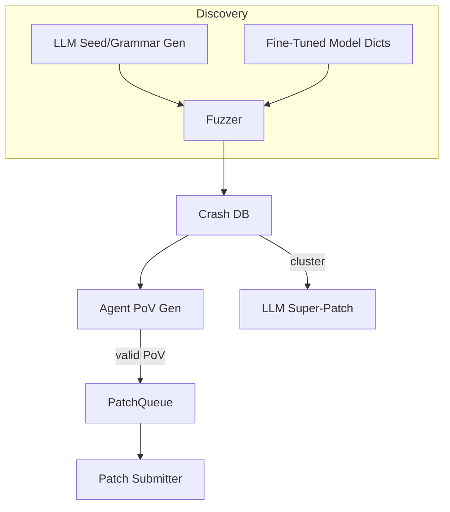

# Fuzzing wspomagany przez AI i automatyczne wykrywanie podatności

{{#include ../banners/hacktricks-training.md}}

## Przegląd
Duże modele językowe (LLM) mogą znacznie usprawnić tradycyjne procesy badania podatności, generując semantycznie bogate dane wejściowe, rozwijając gramatyki, analizując dane o awariach, a nawet proponując poprawki obejmujące wiele błędów. Na tej stronie zebrano najskuteczniejsze wzorce zaobserwowane podczas finałów DARPA AI Cyber Challenge (AIxCC) oraz w innych publicznie dostępnych badaniach.<sup>[[4]](#references)</sup><sup>[[5]](#references)</sup>

Poniżej nie opisano jednego konkretnego systemu konkursowego, lecz przedstawiono zestaw technik, które możesz odtworzyć we własnych procesach.

---

## 1. Dane wejściowe seedów generowane przez LLM

Tradycyjne fuzzery sterowane pokryciem kodu (AFL++, libFuzzer, Honggfuzz…) zaczynają od niewielkiego korpusu seedów i ślepo mutują bajty. Gdy format danych wejściowych programu docelowego jest złożony (SQL, URL-e, niestandardowe protokoły binarne), losowe mutacje zwykle psują składnię, zanim zostaną osiągnięte interesujące gałęzie kodu.

LLM-y mogą rozwiązać ten problem początkowy, generując *generatory seedów* — krótkie skrypty, które tworzą **poprawne składniowo dane wejściowe istotne z punktu widzenia bezpieczeństwa**. Na przykład:

```prompt
SYSTEM: You are a helpful security engineer.
USER:
Write a Python3 program that prints 200 unique SQL injection strings targeting common anti-pattern mistakes (missing quotes, numeric context, stacked queries).  Ensure length ≤ 256 bytes / string so they survive common length limits.
```

```python
# gen_sqli_seeds.py (truncated)
PAYLOADS = [
    "1 OR 1=1 -- ",
    "' UNION SELECT NULL,NULL--",
    "0; DROP TABLE users;--",
    ...
]
for p in PAYLOADS:
    print(p)
```

Uruchom raz i przekaż wynik bezpośrednio do początkowego korpusu fuzzera:

```bash
python3 gen_sqli_seeds.py > seeds.txt
afl-fuzz -i seeds.txt -o findings/ -- ./target @@
```

Korzyści:
1. Poprawność semantyczna → większe pokrycie już na wczesnym etapie.
2. Możliwość ponownego generowania: zmień prompt, aby skupić się na XSS, path traversal, binary blobs itp.
3. Niski koszt (< 1 ¢ z GPT-3.5).

### Wskazówki
* Poleć modelowi *zróżnicować* długość payloadów i kodowanie (UTF-8, URL-encoded, UTF-16-LE), aby ominąć powierzchowne filtry.
* Poproś o *pojedynczy, samodzielny skrypt* – pozwoli uniknąć problemów z formatowaniem JSON.

---

## 2. Fuzzing z ewolucją gramatyki

Potężniejszym wariantem jest umożliwienie LLM **ewolucji gramatyki** zamiast konkretnych seedów. Przepływ pracy (wzorzec „Grammar Guy”) wygląda następująco:

1. Wygeneruj początkową gramatykę ANTLR/Peach/LibFuzzer za pomocą promptu.
2. Wykonuj fuzzing przez N minut i zbieraj metryki pokrycia (trafione krawędzie / bloki).
3. Podsumuj niepokryte obszary programu i przekaż podsumowanie z powrotem modelowi:
   ```prompt
   The previous grammar triggered 12 % of the program edges.  Functions not reached: parse_auth, handle_upload.  Add / modify rules to cover these.
   ```
4. Połącz nowe reguły, ponownie uruchom fuzzing i powtarzaj.

Szkielet pseudokodu:

```python
for epoch in range(MAX_EPOCHS):
    grammar = llm.refine(grammar, feedback=coverage_stats)
    save(grammar, f"grammar_{epoch}.txt")
    coverage_stats = run_fuzzer(grammar)
```

Key points:
* Zachowaj *budżet* – każde udoskonalenie zużywa tokeny.
* Używaj instrukcji `diff` + `patch`, aby model edytował kod zamiast przepisywać go od nowa.
* Zakończ, gdy Δcoverage < ε.

---

## 3. Inżynieria harnessa libFuzzer z lokalnym LLM

Jeśli kod źródłowy nie może opuścić stacji roboczej analityka, lokalny model kodujący może przygotować mały adapter między bajtami fuzzera a API C/C++. Granica bezpieczeństwa jest jasno określona: **model tworzy i poprawia infrastrukturę testową; mutacja sterowana pokryciem eksploruje dane wejściowe; sanitizery zgłaszają nieprawidłowe operacje; człowiek sprawdza harness i analizuje ustalenia**.<sup>[[9]](#references)</sup>

Aby poznać techniki dotyczące corpus, feedbacku, snapshotów i stateful fuzzingu na poziomie silnika, które nie zależą od LLM, zobacz ogólną [metodologię fuzzingu](../generic-methodologies-and-resources/fuzzing.md).

Zacznij od dokładnej deklaracji skopiowanej z nagłówka celu i określ format wyjściowy. Wąski prompt ogranicza wymyślanie API i ułatwia sprawdzenie wyniku:<sup>[[8]](#references)[[9]](#references)</sup>

```prompt
Write a libFuzzer target for this exact declaration:
int parse_records(const uint8_t *data, size_t size);

Output only C code. Implement LLVMFuzzerTestOneInput, include the
declaration, pass data and size unchanged, and do not use files,
network access, randomness, clocks, threads, or persistent state.
```

W przypadku parsera surowych bajtów oczekiwany wynik nie powinien być bardziej skomplikowany niż:<sup>[[6]](#references)[[9]](#references)</sup>

```c
#include <stddef.h>
#include <stdint.h>

extern int parse_records(const uint8_t *, size_t);

int LLVMFuzzerTestOneInput(const uint8_t *data, size_t size) {
    (void)parse_records(data, size);
    return 0;
}
```

Kompilacja to dopiero pierwszy etap walidacji. Zanim poświęcisz na to czas procesora, sprawdź każdy wygenerowany target pod kątem następujących niezmienników:<sup>[[6]](#references)[[8]](#references)[[9]](#references)</sup>

- **Dokładne API:** porównaj typy, zasady zarządzania własnością, inicjalizację, sprzątanie i konwencję wywołań z rzeczywistym nagłówkiem oraz istniejącymi wywołaniami.
- **Bezpieczeństwo harnessu:** zabezpiecz każdy odczyt z `data`; problemy wykryte przez sanitizery muszą pochodzić z targetu, a nie z wygenerowanego kodu pośredniczącego.
- **Powtarzalność:** wynik ma być funkcją `data` i `size`; usuń zewnętrzne operacje wejścia/wyjścia, zależność od czasu, niekontrolowaną losowość, nieoczekujące wątki oraz stan utrzymujący się między wywołaniami.
- **Przepustowość:** inicjalizuj kosztowny, niezmienny stan tylko raz i tylko wtedy, gdy nie wpływa to na działanie; ogranicz rozmiar wejścia, wycisz logowanie i zwalniaj alokacje dla każdego wejścia.
- **Osiągalność:** sprawdź, czy wykonywane są zamierzone funkcje i gałęzie. Target, który się kompiluje, ale sprawdza wyłącznie ścieżki odrzucenia, to cicha porażka.

### Targety uwzględniające strukturę: zachowuj niezmienniki, nie ukrywając błędów

Jeśli większość surowych wejść nie przechodzi kontroli magicznej wartości, długości, wersji lub sumy kontrolnej, użyj bajtów fuzzingu jako **materiału na typowane pola** i odtwórz prawidłowy obiekt. Ustaw stałe formatu, pozostaw pola semantyczne i bajty payloadu zmienne, a metadane integralności wylicz na podstawie odtworzonego payloadu. `FuzzedDataProvider` przydaje się do pobierania ograniczonych wartości typowanych, a adapter nadal odpowiada za ograniczenie każdej wygenerowanej alokacji i konwersji.<sup>[[9]](#references)</sup>

<details>
<summary>Przykład targetu C++ uwzględniającego strukturę</summary>

```cpp
#include <fuzzer/FuzzedDataProvider.h>
#include <stddef.h>
#include <stdint.h>
#include <vector>

extern "C" int parse_message(const uint8_t *, size_t);

extern "C" int LLVMFuzzerTestOneInput(const uint8_t *data, size_t size) {
    FuzzedDataProvider fdp(data, size);
    uint8_t version = fdp.ConsumeIntegral<uint8_t>();
    auto body = fdp.ConsumeRemainingBytes<uint8_t>();
    if (body.size() > UINT16_MAX) body.resize(UINT16_MAX);
    uint16_t len = static_cast<uint16_t>(body.size());
    std::vector<uint8_t> msg = {0x8b, 'M', 'S', 'G', version,
                                static_cast<uint8_t>(len >> 8),
                                static_cast<uint8_t>(len)};
    msg.insert(msg.end(), body.begin(), body.end());
    (void)parse_message(msg.data(), msg.size());
    return 0;
}
```

</details>

Nie używaj jednego celu naprawiającego struktury dla każdego pytania. Utrzymuj jeden cel, który wylicza długości/sumy kontrolne, aby eksplorować głębokie, prawidłowe stany, oraz drugi, w którym fuzzer kontroluje **zadeklarowane** metadane, a ograniczone są wyłącznie odczyty i alokacje wykonywane przez harness. Drugi cel zachowuje powierzchnie ataku związane z niezgodnymi długościami i nieprawidłową integralnością, które automatyczna naprawa w przeciwnym razie by wyeliminowała.<sup>[[9]](#references)</sup>

### Ziarna, słowniki, sanitizery i informacja zwrotna o pokryciu

Poproś model o wygenerowanie skryptu zapisującego ziarna binarne, zamiast prosić go o bezpośrednie wypisanie danych binarnych. Przygotuj ziarna z pustymi, minimalnymi, typowymi i poprawnymi granicznymi obiektami, a następnie wyodrębnij wartości magiczne, tagi, kodowania enumów i słowa kluczowe parsera do sprawdzonego słownika. libFuzzer przyjmuje taki słownik za pomocą `-dict=`, a mutacje ujawniające nowe pokrycie zachowuje w korpusie.<sup>[[6]](#references)[[9]](#references)</sup>

```text
magic="\x8bMSG"
version_min="\x00"
version_max="\xff"
config_tag="CONFIG"
```

Zbuduj ten sam target z uzupełniającą się instrumentacją. ASan i UBSan mogą współdzielić binarny plik fuzzingu; użyj osobnego builda MSan i zinstrumentuj jego zależności, aby uniknąć zgłoszeń wywołanych przez niezinstrumentowany kod.<sup>[[6]](#references)[[9]](#references)</sup>

```bash
clang++ -g -O1 -fsanitize=fuzzer,address,undefined \
  -fno-sanitize-recover=undefined target.cc harness.cc -o fuzz_target
./fuzz_target corpus -dict=msg.dict -max_len=65535

clang++ -g -O1 -fsanitize=fuzzer,memory \
  target.cc harness.cc -o fuzz_target_msan
```

Traktuj pokrycie jako kryterium oceny każdej wersji modelu. W wynikach libFuzzer wczesne wypłaszczenie `cov`/`ft` i statyczny corpus zwykle oznaczają nieprawidłowe ramkowanie, zbyt restrykcyjny wczesny zwrot albo niewłaściwe wywołanie; niska wartość `exec/s` wskazuje na kosztowną konfigurację, I/O, alokację lub wyciek stanu. `NEW` dowodzi jedynie, że zmieniła się funkcja pokrycia, a nie że osiągnięto zamierzony parser.<sup>[[6]](#references)[[9]](#references)</sup>

Aby uzyskać informacje zwrotne na poziomie kodu źródłowego, przygotuj kompilację z pomiarem pokrycia, uruchom fuzzing i przekaż modelowi wyłącznie niepokryte funkcje wraz z warunkami, które je chronią. Zweryfikuj różnicę w harness/seed/dictionary i ponownie wykonaj pomiar:<sup>[[7]](#references)[[8]](#references)[[9]](#references)</sup>

```bash
clang++ -g -O1 -fsanitize=fuzzer \
  -fprofile-instr-generate -fcoverage-mapping target.cc harness.cc -o fuzz_cov
mkdir -p profiles
LLVM_PROFILE_FILE='profiles/%p.profraw' ./fuzz_cov -max_total_time=300 corpus
llvm-profdata merge -sparse profiles/*.profraw -o fuzz.profdata
llvm-cov report ./fuzz_cov -instr-profile=fuzz.profdata
llvm-cov show ./fuzz_cov -instr-profile=fuzz.profdata \
  --show-branches=count --region-coverage-lt=1 target.cc
```

Skalowalna pętla wygląda więc następująco: **generowanie → kompilacja/linkowanie → testy dymne z sanitizerami → pomiar pokrycia celu → dostarczenie najmniejszego istotnego kontekstu pokrycia/kodu źródłowego → korekta → ponowny pomiar**. OSS-Fuzz-Gen stosuje tę samą zasadę: ocenia wygenerowane cele pod kątem możliwości kompilacji, błędów czasu wykonywania, pokrycia i poprawy pokrycia w porównaniu z istniejącymi celami, zamiast uznawać wiarygodnie wyglądający kod za poprawny bez weryfikacji.<sup>[[7]](#references)[[8]](#references)</sup>

---

## 4. Generowanie PoV (Exploit) z użyciem agentów

Po znalezieniu crasha nadal potrzebujesz **proof-of-vulnerability (PoV)**, który deterministycznie go wywołuje.

Skalowalne podejście polega na uruchomieniu wielu lekkich workerów (procesów, wątków lub kontenerów), z których każdy korzysta z innego modelu lub konfiguracji próbkowania. Ankieta finalistów AIxCC podaje konkretne przykłady skali: jeden zespół użył **tysięcy równoległych agentów** do generowania PoV z użyciem AI, a inny koordynował pracę **300–500 agentów fuzzingowych**, wykorzystując LLM-y do bardziej zaawansowanego rozumowania semantycznego.<sup>[[4]](#references)</sup>

Pipeline:
1. Analiza statyczna/dynamiczna tworzy *kandydatów na błędy* (struct z adresem crasha PC, fragmentem inputu, komunikatem sanitizera).
2. Orchestrator rozdziela kandydatów między agentów.
3. Kroki rozumowania agenta:
   a. Odtworzenie błędu lokalnie za pomocą `gdb` + inputu.
   b. Zaproponowanie minimalnego payloadu exploitującego błąd.
   c. Weryfikacja exploita w sandboxie.  Jeśli się powiedzie → zgłoszenie.
4. Nieudane próby są **ponownie dodawane do kolejki jako nowe seedy** na potrzeby fuzzingu pokrycia (pętla sprzężenia zwrotnego).

Zalety:
* Równoległość maskuje zawodność pojedynczego agenta.
* Automatyczne dostrajanie temp / rozmiaru modelu na podstawie zaobserwowanego wskaźnika powodzenia.

---

## 5. Directed Fuzzing z dostrojonymi modelami kodu

Dostrój model z otwartymi wagami (np. Llama-7B) na kodzie źródłowym C/C++ oznaczonym wzorcami podatności (przepełnienie liczby całkowitej, kopiowanie bufora, format string). Następnie:

1. Uruchom analizę statyczną, aby uzyskać listę funkcji + AST.
2. Wyślij do modelu prompt: *„Podaj wpisy słownika mutacji, które mogą naruszyć bezpieczeństwo pamięci w funkcji X”*.
3. Wstaw te tokeny do niestandardowego `AFL_CUSTOM_MUTATOR`.

Przykładowy wynik dla wrappera `sprintf`:
```
{"pattern":"%99999999s"}
{"pattern":"AAAAAAAA....<1024>....%n"}
```

Empirycznie skraca to czas do crasha ponad dwukrotnie na rzeczywistych celach.

---

## 6. Strategie patchowania wspomagane przez AI

### 6.1 Super Patches
Poproś model o *pogrupowanie* sygnatur crashy i zaproponowanie **jednego patcha**, który usuwa wspólną przyczynę źródłową. Zgłoś go raz, napraw kilka błędów → mniej kar za dokładność w środowiskach, w których każdy błędny patch kosztuje punkty.

Zarys promptu:
```
Here are 10 stack traces + file snippets.  Identify the shared mistake and generate a unified diff fixing all occurrences.
```

### 6.2 Współczynnik spekulatywnych poprawek
Wdróż kolejkę, w której potwierdzone poprawki zweryfikowane za pomocą PoV są przeplatane *spekulatywnymi* poprawkami (bez PoV) w proporcji 1:N dostosowanej do zasad punktacji (np. 2 spekulatywne : 1 potwierdzona). Model kosztów monitoruje kary i punkty oraz samodzielnie dostosowuje N.

---

## 7. Deterministyczny przegląd kodu AI plik po pliku

Częstym błędem podczas przeglądu wspomaganego przez AI jest proszenie jednego agenta o sprawdzenie całego repozytorium i liczenie na to, że wybierze właściwe pliki oraz terminy do grep. Bardziej niezawodny wzorzec polega na **wymuszeniu pokrycia repozytorium**:<sup>[[1]](#references)</sup>

1. Wylicz pliki źródłowe.
2. Przekazuj **po jednym pliku naraz** wraz z minimalnym kontekstem (entrypoint, importy, pobliskie routes/callers).
3. Wymagaj **ustrukturyzowanego raportu** dla każdego pliku: sources, sink, brakująca walidacja, warunki wstępne exploita i poziom pewności.<sup>[[3]](#references)</sup>
4. Usuń duplikaty raportów według **wzorców source→sink** i ręcznie zweryfikuj te o wysokim ryzyku.

To podejście zużywa dużo tokenów i generuje szum, ale jest bardzo skuteczne w wykrywaniu **prostych błędów source/sink o dużym wpływie**, które często umykają szeroko zakrojonym przeglądom agentic.

### Wzorce do priorytetowego triage

- **Dynamiczne dołączanie/dispatch w PHP**: kontrolowane przez atakującego nazwy route/controller/module trafiają do `require_once()`, `include()` lub `include_once()` bez ścisłej allowlisty i kanonikalizacji ścieżki.
- **Wykonywanie poleceń powłoki w przepływach administracyjnych/zarządzania kontem**: nazwy użytkowników, domeny, konta FTP lub inne identyfikatory trafiają do `exec()`, `system()`, `shell_exec()`, `passthru()`, `proc_open()` lub `popen()`.
- **Zbieganie danych ze strukturyzowanych wejść**: ten sam parametr jest przyjmowany z `$_GET`, `$_POST`, JSON, XML lub parserów body frameworka, a następnie wykorzystywany w sinkach związanych z systemem plików lub poleceniami systemowymi.

### Dwie praktyczne klasy błędów, które ta metoda dobrze wykrywa

- **LFI/RCE przez dispatch kontrolera PHP**: jeśli nazwa kontrolera kontrolowana przez żądanie jest łączona z `require_once()` bez allowlisty lub normalizacji ścieżki, sekwencje traversal, takie jak `../`, mogą spowodować, że PHP dołączy niezamierzony lokalny plik `.php`. Jeśli atakujący może wskazać spreparowany lub w inny sposób przydatny plik PHP, LFI prowadzi do wykonania kodu. Zobacz [File Inclusion / Path Traversal](../pentesting-web/file-inclusion/README.md).<sup>[[1]](#references)</sup>
- **Uwierzytelnione command injection w panelach hostingowych/administracyjnych**: jeśli pola zarządzania kontem, takie jak nazwy użytkowników, są osadzane w poleceniach powłoki, uwierzytelniony użytkownik o niskich uprawnieniach może zmienić zwykłą operację tworzenia/usuwania w RCE. Skutki są poważniejsze, gdy panel wykonuje polecenie jako konto usługi o wyższych uprawnieniach. Zobacz [Command Injection](../pentesting-web/command-injection.md).<sup>[[1]](#references)</sup>

### Praktyczne uwagi dotyczące przeglądu

- Najpierw używaj LLM jako **recenzenta source/sink**, a nie generatora exploitów.
- Poproś o jawne wskazanie **pola kontrolowanego przez atakującego**, **luki w normalizacji/walidacji** oraz **niebezpiecznego sinka**.
- W dużych repozytoriach deterministyczny przegląd plik po pliku jest często bardziej niezawodny niż pojedyncze uruchomienie autonomicznego agenta, nawet jeśli korzysta on z mocniejszego modelu.<sup>[[2]](#references)</sup>
- Spodziewaj się słabszych wyników w przypadku **Broken Access Control** i innych błędów logiki biznesowej, których exploitatability zależy od założeń dotyczących wielu plików, semantyki ról lub specyficznych dla produktu modeli zagrożeń.

---

## Audytowalne badania wspomagane przez agentów w nieznanych bazach kodu

Opisany już [workflow wyboru celu fuzzowania oparty na grafie](../generic-methodologies-and-resources/fuzzing.md#graph-first-fuzz-target-selection-and-mutation-triage) obejmuje osiągalność entrypointów, a [agentic SAST pipelines](../network-services-pentesting/pentesting-web/code-review-tools.md#agentic-sast-pipelines) — etapowy przegląd i bramki dowodowe. Oddziel te deterministyczne wyniki od hipotez modelu, aby każdy rozwinięty trop zachował lokalizacje w kodzie źródłowym, dowody ścieżki i pomiar dynamiczny.<sup>[[10]](#references)</sup>

### Koreluj dowody dotyczące czasu życia obiektu bez zmyślania przepływu danych

Analiza statyczna może wykryć, że kontrolowana przez atakującego długość jest zapisywana w jednej funkcji, a to samo pole obiektu trafia znacznie później do sinka kopiowania, ale nie potrafić udowodnić związku między nimi przez callbacki, ponowne połączenia lub czas życia obiektu. Zachowaj oba ustalenia osobno, pogrupuj je według obiektu/pola i jawnie określ brakującą krawędź jako pytanie do triage. Agent może zasugerować ten związek, ale musi go potwierdzić przegląd kodu źródłowego lub instrumentacja czasu działania.<sup>[[10]](#references)</sup>

Dla każdego kandydata zapisz:

- konkretny entrypoint i bajty kontrolowane przez atakującego;
- wszystkich producentów odpowiedniego pola, w tym walidację specyficzną dla każdego producenta;
- sink, pojemność miejsca docelowego oraz warunki kompilacji/czasu działania wymagane do jego osiągnięcia;
- rzeczywisty stos wywołań z udostępnionego entrypointu, a nie tylko bezpośrednie wywołanie harnessu;
- najmniejszy wynik dynamiczny, który potwierdza lub odrzuca hipotezę.

Pozornie bezpieczna ścieżka nie oznacza, że pole jest bezpieczne w każdym przypadku. Drugi producent może wypełnić to samo pole bez ograniczenia zastosowanego na pierwszej ścieżce. Testuj ścieżki niezależnie i uruchamiaj harness z opcjami kompilacji równoważnymi środowisku wdrożeniowemu, ponieważ asercje debugowania mogą zmienić produkcyjne uszkodzenie pamięci w przedwczesne przerwanie występujące wyłącznie podczas testów.<sup>[[10]](#references)</sup>

### Bramki pomiarowe dla ujawniania danych i exploita

W przypadku podejrzenia ujawnienia niezainicjalizowanej pamięci wypełnij świeżo zaalokowaną pamięć rozpoznawalnym bajtem i sprawdź, czy dokładny znacznik trafia do wysłanego pakietu. W przypadku exploita wymagaj zmierzonych etapów, takich jak **kontrolowane nadpisanie → użyteczny obiekt ofiary → ujawnienie danych → odzyskanie wskaźnika/bazy → przejęcie przepływu sterowania → złożony payload**. Agent przechodzi dalej tylko wtedy, gdy harness potwierdzi bieżącą właściwość; wiarygodna narracja nie oznacza zaliczenia etapu. [Przypadek FreeRDP](../binary-exploitation/libc-heap/heap-overflow.md#cross-path-length-reuse-and-stale-output-disclosure) pokazuje ścieżkę i ograniczenia kompilacji, które należy zachować podczas weryfikacji.<sup>[[10]](#references)</sup>

---

## Łącząc wszystko w całość
Kompleksowy CRS (Cyber Reasoning System) może łączyć komponenty w następujący sposób:



---

## References

- [1] [Project Black - Lokalne AI dla cyberbezpieczeństwa: znajdowanie LFI w phpIPAM i uwierzytelnionego RCE w myVesta](https://projectblack.io/blog/local-ai-for-cyber-security)
- [2] [Strix](https://github.com/usestrix/strix)
- [3] [Umiejętność security-review społeczności GitHub Copilot](https://github.com/github/awesome-copilot/blob/main/skills/security-review/SKILL.md)
- [4] [Trail of Bits – finały AIxCC: zapis przebiegu rywalizacji](https://blog.trailofbits.com/2025/08/07/aixcc-finals-tale-of-the-tape/)
- [5] [Wywiady z finalistami AIxCC w CTF Radiooo](https://www.youtube.com/@ctfradiooo)
- [6] [LLVM — libFuzzer: biblioteka do fuzz testów sterowanych pokryciem kodu](https://llvm.org/docs/LibFuzzer.html)
- [7] [Google — OSS-Fuzz-Gen](https://github.com/google/oss-fuzz-gen)
- [8] [Google Online Security Blog — Rozwijanie fuzzingu: znajdowanie większej liczby luk dzięki AI](https://security.googleblog.com/2024/11/leveling-up-fuzzing-finding-more.html)
- [9] [8kSec — Generowanie harnessów do fuzzingu wspomagane przez AI z użyciem lokalnego LLM](https://8ksec.io/ai-assisted-fuzzing-harness-local-llm)
- [10] [Quarkslab — Od agentów AI do RCE: tworzenie workflow do badania podatności](https://blog.quarkslab.com/from-ai-agents-to-rce-building-a-vulnerability-research-workflow.html)
{{#include ../banners/hacktricks-training.md}}
