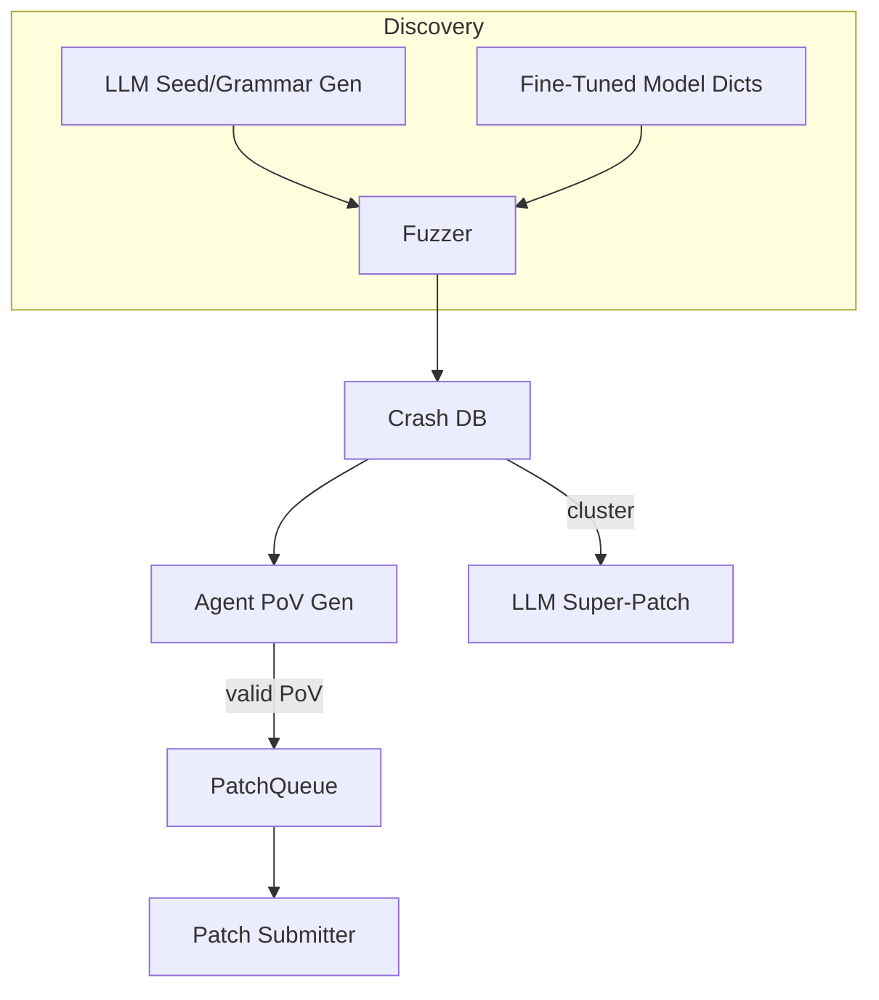

# Fuzzing assistito dall'IA e scoperta automatizzata delle vulnerabilità

{{#include ../banners/hacktricks-training.md}}

## Panoramica
I modelli linguistici di grandi dimensioni (LLM) possono potenziare notevolmente le pipeline tradizionali di ricerca delle vulnerabilità generando input semanticamente ricchi, evolvendo grammatiche, ragionando sui dati dei crash e persino proponendo patch che correggono più bug. Questa pagina raccoglie le strategie più efficaci osservate durante le finali della DARPA AI Cyber Challenge (AIxCC) e in altre ricerche pubbliche.<sup>[[4]](#references)</sup><sup>[[5]](#references)</sup>

Quanto segue non descrive un sistema specifico di una competizione, ma astrae le tecniche per consentirti di riprodurle nei tuoi flussi di lavoro.

---

## 1. Input seed generati dagli LLM

I fuzzer tradizionali guidati dalla copertura (AFL++, libFuzzer, Honggfuzz…) iniziano con un piccolo corpus di seed e mutano i byte alla cieca. Quando il formato di input del target è complesso (SQL, URL, protocolli binari personalizzati), le mutazioni casuali di solito compromettono la sintassi prima di raggiungere rami interessanti.

Gli LLM possono risolvere questo problema iniziale generando *generatori di seed*: brevi script che producono **input sintatticamente corretti ma rilevanti per la sicurezza**. Per esempio:

```prompt
SYSTEM: You are a helpful security engineer.
USER:
Write a Python3 program that prints 200 unique SQL injection strings targeting common anti-pattern mistakes (missing quotes, numeric context, stacked queries).  Ensure length ≤ 256 bytes / string so they survive common length limits.
```

```python
# gen_sqli_seeds.py (truncated)
PAYLOADS = [
    "1 OR 1=1 -- ",
    "' UNION SELECT NULL,NULL--",
    "0; DROP TABLE users;--",
    ...
]
for p in PAYLOADS:
    print(p)
```

Eseguilo una volta e inserisci direttamente l'output nel corpus iniziale del fuzzer:

```bash
python3 gen_sqli_seeds.py > seeds.txt
afl-fuzz -i seeds.txt -o findings/ -- ./target @@
```

Benefits:
1. Validità semantica → copertura più profonda fin da subito.
2. Rigenerabili: modifica il prompt per concentrarti su XSS, path traversal, blob binari, ecc.
3. Economici (< 1 ¢ con GPT-3.5).

### Suggerimenti
* Istruisci il modello a *diversificare* la lunghezza dei payload e le codifiche (UTF-8, URL-encoded, UTF-16-LE) per aggirare i filtri superficiali.
* Chiedi un *unico script autonomo*: evita problemi di formattazione JSON.

---

## 2. Grammar-Evolution Fuzzing

Una variante più potente consiste nel far **evolvere una grammatica** all'LLM invece di seed concreti. Il workflow (pattern “Grammar Guy”) è:

1. Genera una grammatica iniziale ANTLR/Peach/LibFuzzer tramite prompt.
2. Esegui il fuzzing per N minuti e raccogli metriche di copertura (edge / block raggiunti).
3. Riassumi le aree del programma non coperte e reinserisci il riepilogo nel modello:
   ```prompt
   The previous grammar triggered 12 % of the program edges.  Functions not reached: parse_auth, handle_upload.  Add / modify rules to cover these.
   ```
4. Unisci le nuove regole, rifai il fuzzing e ripeti.

Scheletro di pseudocodice:

```python
for epoch in range(MAX_EPOCHS):
    grammar = llm.refine(grammar, feedback=coverage_stats)
    save(grammar, f"grammar_{epoch}.txt")
    coverage_stats = run_fuzzer(grammar)
```

Punti chiave:
* Mantieni un *budget*: ogni perfezionamento usa token.
* Usa istruzioni `diff` + `patch` affinché il modello modifichi il codice invece di riscriverlo.
* Fermati quando Δcoverage < ε.

---

## 3. Progettazione dell'harness libFuzzer con LLM locale

Per il codice sorgente che non può lasciare la workstation di un analista, un modello di codice locale può generare il piccolo adapter tra i byte del fuzzer e un'API C/C++. Il confine di sicurezza utile è esplicito: **il modello scrive e rivede l'infrastruttura di test; la mutazione guidata dalla coverage esplora gli input; i sanitizer segnalano le operazioni non valide; una persona esamina l'harness e analizza i risultati**.<sup>[[9]](#references)</sup>

Per le tecniche di corpus, feedback, snapshot e stateful fuzzing a livello di engine che non dipendono da un LLM, consulta la [metodologia generale di fuzzing](../generic-methodologies-and-resources/fuzzing.md).

Inizia con la dichiarazione esatta copiata dall'header di destinazione e vincola il formato dell'output. Un prompt circoscritto riduce le API inventate e rende il risultato facile da esaminare:<sup>[[8]](#references)[[9]](#references)</sup>

```prompt
Write a libFuzzer target for this exact declaration:
int parse_records(const uint8_t *data, size_t size);

Output only C code. Implement LLVMFuzzerTestOneInput, include the
declaration, pass data and size unchanged, and do not use files,
network access, randomness, clocks, threads, or persistent state.
```

Per un parser di byte grezzi, il risultato atteso non dovrebbe essere più complicato di:<sup>[[6]](#references)[[9]](#references)</sup>

```c
#include <stddef.h>
#include <stdint.h>

extern int parse_records(const uint8_t *, size_t);

int LLVMFuzzerTestOneInput(const uint8_t *data, size_t size) {
    (void)parse_records(data, size);
    return 0;
}
```

La compilazione è solo il primo passaggio di validazione. Prima di dedicarvi tempo di CPU, verifica ogni target generato rispetto a questi invarianti:<sup>[[6]](#references)[[8]](#references)[[9]](#references)</sup>

- **API esatta:** confronta tipi, regole di ownership, inizializzazione, teardown e convenzione di chiamata con l’header reale e i caller esistenti.
- **Sicurezza dell’harness:** proteggi ogni lettura da `data`; i risultati dei sanitizer devono originarsi nel target, non nel glue generato.
- **Ripetibilità:** fai in modo che il risultato dipenda da `data` e `size`; rimuovi I/O esterno, tempo, casualità non controllata, thread non uniti e stato che persiste tra una chiamata e l’altra.
- **Throughput:** inizializza una sola volta lo stato immutabile costoso solo se questo non può influire sul comportamento, limita la dimensione dell’input, sopprimi i log e libera le allocazioni per input.
- **Raggiungibilità:** verifica che vengano eseguite le funzioni e i branch previsti. Un target che compila ma esercita solo percorsi di rifiuto è un errore silenzioso.

### Target consapevoli della struttura: preservare gli invarianti senza nascondere i bug

Se la maggior parte degli input raw non supera un controllo di magic, lunghezza, versione o checksum, usa i byte di fuzz come materiale per campi tipizzati e ricostruisci un oggetto valido. Fissa le costanti del formato, lascia modificabili i campi semantici e i byte del payload e ricava i metadati di integrità dal payload ricostruito. `FuzzedDataProvider` è utile per consumare valori tipizzati con limiti, mentre l’adapter resta responsabile di limitare qualsiasi allocazione e conversione generata.<sup>[[9]](#references)</sup>

<details>
<summary>Esempio di target C++ consapevole della struttura</summary>

```cpp
#include <fuzzer/FuzzedDataProvider.h>
#include <stddef.h>
#include <stdint.h>
#include <vector>

extern "C" int parse_message(const uint8_t *, size_t);

extern "C" int LLVMFuzzerTestOneInput(const uint8_t *data, size_t size) {
    FuzzedDataProvider fdp(data, size);
    uint8_t version = fdp.ConsumeIntegral<uint8_t>();
    auto body = fdp.ConsumeRemainingBytes<uint8_t>();
    if (body.size() > UINT16_MAX) body.resize(UINT16_MAX);
    uint16_t len = static_cast<uint16_t>(body.size());
    std::vector<uint8_t> msg = {0x8b, 'M', 'S', 'G', version,
                                static_cast<uint8_t>(len >> 8),
                                static_cast<uint8_t>(len)};
    msg.insert(msg.end(), body.begin(), body.end());
    (void)parse_message(msg.data(), msg.size());
    return 0;
}
```

</details>

Non usare un unico target che ripara la struttura per tutte le domande. Mantieni un target che calcola lunghezze/checksum per esplorare stati validi profondi e un altro che lascia i metadati **dichiarati** sotto il controllo del fuzzer, limitando soltanto le letture e le allocazioni del harness. Il secondo target preserva le superfici di attacco con lunghezze discordanti e integrità non valida, che la correzione automatica altrimenti eliminerebbe.<sup>[[9]](#references)</sup>

### Seed, dizionari, sanitizer e feedback sulla copertura

Chiedi al modello di generare uno script che scriva seed binari, invece di chiedergli di stampare direttamente dati binari. Usa come seed oggetti vuoti, minimi, tipici e validi ai valori limite; poi estrai valori magic, tag, codifiche di enum e parole chiave del parser in un dizionario revisionato. libFuzzer accetta quel dizionario con `-dict=` e mantiene nel corpus le mutazioni che rivelano nuova copertura.<sup>[[6]](#references)[[9]](#references)</sup>

```text
magic="\x8bMSG"
version_min="\x00"
version_max="\xff"
config_tag="CONFIG"
```

Compila lo stesso target con strumentazione complementare. ASan e UBSan possono condividere un binario di fuzzing; usa una build separata con MSan e strumentane le dipendenze per evitare segnalazioni causate da codice non strumentato.<sup>[[6]](#references)[[9]](#references)</sup>

```bash
clang++ -g -O1 -fsanitize=fuzzer,address,undefined \
  -fno-sanitize-recover=undefined target.cc harness.cc -o fuzz_target
./fuzz_target corpus -dict=msg.dict -max_len=65535

clang++ -g -O1 -fsanitize=fuzzer,memory \
  target.cc harness.cc -o fuzz_target_msan
```

Considera la copertura come criterio di valutazione per ogni revisione del modello. Nell’output di libFuzzer, valori di `cov`/`ft` piatti fin dalle prime fasi e un corpus statico di solito indicano un framing errato, un early return troppo restrittivo o una call sbagliata; un `exec/s` basso indica setup costoso, I/O, allocazioni o stato non ripristinato. `NEW` dimostra solo che una feature di copertura è cambiata, non che sia stato raggiunto il parser previsto.<sup>[[6]](#references)[[9]](#references)</sup>

Per ottenere feedback a livello di sorgente, crea una build con copertura, esegui il fuzzing e fornisci al modello solo le funzioni non coperte e le relative condizioni di accesso. Verifica le modifiche a harness/seed/dictionary e misura di nuovo:<sup>[[7]](#references)[[8]](#references)[[9]](#references)</sup>

```bash
clang++ -g -O1 -fsanitize=fuzzer \
  -fprofile-instr-generate -fcoverage-mapping target.cc harness.cc -o fuzz_cov
mkdir -p profiles
LLVM_PROFILE_FILE='profiles/%p.profraw' ./fuzz_cov -max_total_time=300 corpus
llvm-profdata merge -sparse profiles/*.profraw -o fuzz.profdata
llvm-cov report ./fuzz_cov -instr-profile=fuzz.profdata
llvm-cov show ./fuzz_cov -instr-profile=fuzz.profdata \
  --show-branches=count --region-coverage-lt=1 target.cc
```

Il ciclo scalabile è quindi **genera → compila/collega → esegui smoke test con i sanitizer → misura la copertura del target → fornisci il contesto minimo e pertinente relativo alla copertura/al codice sorgente → rivedi → misura di nuovo**. OSS-Fuzz-Gen applica lo stesso principio, valutando i target generati in base alla compilabilità, agli errori di runtime, alla copertura e al miglioramento della copertura rispetto ai target esistenti, invece di accettare codice plausibile in base al solo aspetto.<sup>[[7]](#references)[[8]](#references)</sup>

---

## 4. Generazione di PoV (exploit) basata su agenti

Dopo aver trovato un crash, serve comunque una **proof-of-vulnerability (PoV)** che lo provochi in modo deterministico.

Un approccio scalabile consiste nell’avviare molti worker leggeri (processi, thread o container), ciascuno con un modello o una configurazione di sampling diversi. La survey sui finalisti di AIxCC fornisce esempi concreti di questa scala: un team ha usato **migliaia di agenti simultanei** per la generazione di PoV basata innanzitutto sull’AI, mentre un altro ha orchestrato **300–500 agenti di fuzzing** e ha riservato gli LLM al ragionamento semantico di livello superiore.<sup>[[4]](#references)</sup>

Pipeline:
1. L’analisi statica/dinamica produce *bug candidate* (struct con crash PC, input slice, messaggio del sanitizer).
2. L’orchestrator distribuisce i candidate agli agenti.
3. Passaggi di ragionamento dell’agente:
   a. Riprodurre il bug localmente con `gdb` + input.
   b. Suggerire un payload di exploit minimo.
   c. Validare l’exploit in sandbox. Se riesce → inviare.
4. I tentativi falliti vengono **riaccodati come nuovi seed** per il coverage fuzzing (feedback loop).

Vantaggi:
* La parallelizzazione nasconde l’inaffidabilità del singolo agente.
* Auto-tuning di temp / dimensione del modello in base al tasso di successo osservato.

---

## 5. Fuzzing mirato con modelli di codice fine-tuned

Esegui il fine-tuning di un modello open-weight (es. Llama-7B) usando codice sorgente C/C++ etichettato con pattern di vulnerabilità (integer overflow, buffer copy, format string). Quindi:

1. Esegui l’analisi statica per ottenere l’elenco delle funzioni + AST.
2. Prompta il modello: *“Fornisci voci per un dizionario di mutazioni che probabilmente comprometteranno la memory safety nella funzione X”*.
3. Inserisci quei token in un `AFL_CUSTOM_MUTATOR` personalizzato.

Esempio di output per un wrapper `sprintf`:
```
{"pattern":"%99999999s"}
{"pattern":"AAAAAAAA....<1024>....%n"}
```

Empiricamente, questo riduce di oltre 2× il tempo necessario a provocare un crash su target reali.

---

## 6. Strategie di patching guidate dall'IA

### 6.1 Super Patch
Chiedi al modello di *raggruppare* le firme dei crash e proporre una **singola patch** che elimini la causa radice comune. Invia una sola patch per correggere diversi bug → meno penalità di accuratezza negli ambienti in cui ogni patch errata costa punti.

Schema del prompt:
```
Here are 10 stack traces + file snippets.  Identify the shared mistake and generate a unified diff fixing all occurrences.
```

{{#ref}}
../generic-methodologies-and-resources/fuzzing.md
{{#endref}}

### 6.2 Rapporto di patch speculative
Implementa una coda in cui le patch confermate e validate tramite PoV e quelle *speculative* (senza PoV) si alternano con un rapporto 1:​N, calibrato in base alle regole di punteggio (ad es. 2 speculative : 1 confermata). Un modello dei costi monitora penalità e punti e regola automaticamente N.

---

## 7. Code review AI deterministica file per file

Un errore frequente nelle review assistite dall’AI è chiedere a un agente di ispezionare un intero repository, sperando che scelga i file e i termini grep giusti. Un approccio più affidabile consiste nel **forzare la copertura del repository**:<sup>[[1]](#references)</sup>

1. Elenca i file sorgente.
2. Invia **un file alla volta** insieme al contesto minimo (entrypoint, import, route e chiamanti vicini).
3. Richiedi un **report strutturato** per ogni file: sorgenti, sink, validazione mancante, precondizioni di exploit e livello di confidenza.<sup>[[3]](#references)</sup>
4. Deduplica i report in base ai **pattern source→sink** e convalida manualmente quelli ad alto rischio.

Questo approccio richiede molti token e produce rumore, ma è molto efficace nell’individuare **bug semplici ad alto impatto nei flussi source/sink**, spesso trascurati dalle review agentiche più ampie.

### Pattern di triage da prioritizzare

- **Include/dispatch dinamici in PHP**: nomi di route/controller/moduli controllati dall’attaccante che arrivano a `require_once()`, `include()` o `include_once()` senza una allowlist rigorosa e la canonicalizzazione dei percorsi.
- **Esecuzione di shell nei flussi di lavoro amministrativi/account**: nomi utente, domini, account FTP o altri identificatori che arrivano a `exec()`, `system()`, `shell_exec()`, `passthru()`, `proc_open()` o `popen()`.
- **Convergenza di input strutturati**: lo stesso parametro accettato da `$_GET`, `$_POST`, JSON, XML o dai parser del body del framework e poi riutilizzato in sink del filesystem o di comandi del sistema operativo.

### Due classi di bug pratiche che questo metodo individua bene

- **LFI/RCE nel dispatch dei controller PHP**: se il nome del controller controllato dalla richiesta viene concatenato in `require_once()` senza allowlist o normalizzazione del percorso, sequenze di traversal come `../` possono indurre PHP a includere un file `.php` locale non previsto. Se l’attaccante può indirizzare l’include verso un file PHP predisposto o comunque utile, la LFI si trasforma in esecuzione di codice. Vedi [File Inclusion / Path Traversal](../pentesting-web/file-inclusion/README.md).<sup>[[1]](#references)</sup>
- **Command injection autenticata nei pannelli di hosting/amministrazione**: se campi di gestione degli account come i nomi utente vengono incorporati in comandi shell, un utente autenticato con privilegi ridotti può trasformare una normale operazione di creazione/eliminazione in RCE. L’impatto aumenta quando il pannello esegue il comando con un account di servizio più privilegiato. Vedi [Command Injection](../pentesting-web/command-injection.md).<sup>[[1]](#references)</sup>

### Note pratiche per la review

- Usa l’LLM prima di tutto come **revisore source/sink**, non come generatore di exploit.
- Chiedigli di elencare esplicitamente il **campo controllato dall’attaccante**, la **lacuna nella normalizzazione/validazione** e il **sink pericoloso**.
- Nei repository di grandi dimensioni, la review deterministica file per file è spesso più affidabile di una singola esecuzione di un agente autonomo, anche quando quest’ultimo usa un modello più potente.<sup>[[2]](#references)</sup>
- Aspettati risultati meno efficaci per **Broken Access Control** e altri bug di business logic, la cui sfruttabilità dipende da ipotesi tra più file, semantica dei ruoli o modelli di minaccia specifici del prodotto.

---

## 8. Audit del kernel guidato da pattern con un oracle strumentato

Per un target delle dimensioni di un kernel, non chiedere a un agente di trovare bug arbitrari nell’intero albero del codice. Un flusso di lavoro più efficiente in termini di token trasforma le conoscenze storiche sulle vulnerabilità in query statiche, classifica i risultati in base alla superficie di attacco esposta e usa un kernel strumentato come oracle di esecuzione.<sup>[[11]](#references)</sup>

### Database di pattern → CodeQL/Semgrep → review mirata

Crea una piccola knowledge base che contenga API pericolose, pattern di validazione mancante, flussi rischiosi da sorgente a sink e forme di bug già corrette. Chiedi al modello di tradurre **un pattern alla volta** in euristiche di review e regole CodeQL/Semgrep, quindi esegui queste regole deterministiche sull’intero albero del codice. Raggruppa e deduplica i risultati prima di fornire il codice al modello: l’output grezzo dello scanner può contenere migliaia di candidati di scarso valore. Prima di usare questo approccio al di fuori dei target di ricerca idonei o open source, verifica la licenza attuale di CodeQL.<sup>[[11]](#references)</sup>

Assegna priorità ai sottosistemi considerando sia la **densità dei riscontri delle regole** sia la **raggiungibilità da parte dell’attaccante**, non solo il numero di riscontri. Le interfacce del kernel raggiungibili da processi senza privilegi, sandbox, container, jail o contesti guest meritano un peso maggiore rispetto al codice accessibile solo internamente. Mantieni l’unità di review abbastanza piccola da consentire all’agente di tenere conto dei chiamanti, dei validatori e delle regole di durata; chiedigli di esaminare una classe di vulnerabilità o un pattern di control flow specifici, anziché «trovare qualsiasi vulnerabilità». Le interfacce privilegiate legacy sono particolarmente interessanti quando un nuovo confine di isolamento le rende raggiungibili da un utente root con namespace o confinato in una jail.<sup>[[11]](#references)</sup>

Per ogni candidato, richiedi un record esplicito del flusso dei campi prima di tentare lo sfruttamento.<sup>[[11]](#references)</sup>

```text
entrypoint -> privilege check -> parser -> validation/normalization
           -> later rewrite -> dangerous sink
attacker controls: <fields and lengths>
constraints:       <values rewritten, rejected, or preserved>
observable result: <sanitizer report, assertion, panic, or clean exit>
```

### Usa la telemetria di KASAN come oracolo per le ipotesi

Esegui il kernel target in una VM usa e getta con KASAN e asserzioni diagnostiche utili abilitate. L'agente dovrebbe iterare attraverso **ipotesi sul codice sorgente → trigger minimale in userland → esecuzione nella VM → trace di KASAN/asserzioni → ipotesi rivista** finché la corruzione sospetta non viene riprodotta o esclusa. A ogni iterazione, restituisci solo lo stack trace pertinente e il codice sorgente circostante: così si preserva il contesto per il ragionamento e si fa sì che siano le evidenze di runtime, non la confidenza del modello, a determinare l'accettazione.<sup>[[11]](#references)</sup>

Una build strumentata non è l'ambiente finale per valutare la sfruttabilità. Le asserzioni possono interrompere l'esecuzione prima dell'operazione che causa la corruzione, mentre la stessa asserzione potrebbe essere esclusa dalla compilazione in un kernel di produzione. Ritesta il trigger invariato con la configurazione di produzione esatta, registra la build e la configurazione del kernel e tratta **raggiungibilità**, **corruzione della memoria**, **primitiva controllata** e **impatto sulla sicurezza** come affermazioni distinte.<sup>[[11]](#references)[[12]](#references)</sup>

CVE-2026-3038 è un utile esempio di validazione, non un modello di exploit. Una richiesta `RTM_GET` non privilegiata su FreeBSD poteva mantenere un sockaddr `RTAX_AUTHOR` sovradimensionato attraverso la validazione selettiva e la riscrittura della risposta, fino a quando `rtsock_msg_buffer()` copiava il campo `sa_len`, controllato dall'utente, in uno `sockaddr_storage` da 128 byte sullo stack. La copia massima di 255 byte produceva un overwrite di 127 byte; una asserzione diagnostica rilevava la lunghezza errata nella build strumentata, mentre un kernel GENERIC raggiungeva la copia e poi andava in panic quando veniva controllato il canary corrotto. Questo dimostra un denial of service non privilegiato, non un'escalation di privilegi autonoma: per un controllo affidabile sarebbe prima necessaria un'altra primitiva, come la divulgazione di un canary. Vedi [Stack Canaries](../binary-exploitation/common-binary-protections-and-bypasses/stack-canaries/index.html) per il corrispondente limite della binary exploitation.<sup>[[11]](#references)[[12]](#references)[[13]](#references)</sup>

### Rifiuta di barare sui prerequisiti dell'exploit

Prima di accettare un PoV o un exploit, chiedi a un revisore/agente separato di provare a confutarlo usando criteri fissi. La revisione deve confermare tutte le condizioni seguenti.<sup>[[11]](#references)</sup>

- Il sorgente target, il kernel e il modulo vulnerabile non sono stati modificati per rendere raggiungibile il percorso.
- Non sono stati introdotti moduli di supporto, gadget sintetici, mitigazioni disabilitate, privilegi aggiuntivi o interfacce non disponibili.
- Il trigger parte dall'identità dichiarata del chiamante e con le restrizioni di contenimento previste, su uno snapshot pulito.
- Il risultato dichiarato dipende ancora dal bug: rimuovere il campo malformato o correggere solo il bug deve interrompere la catena.
- Un crash, un overread o un overwrite viene riportato solo come tale primitiva; l'esecuzione di codice o l'escalation di privilegi richiedono evidenze indipendenti.

Quest'ultimo controllo controfattuale individua le dimostrazioni circolari: se i prerequisiti garantiscono già l'impatto dichiarato (per esempio, eseguire contenuti SUID forniti dall'attaccante da un filesystem montato senza `nosuid`), il bug di memory safety non ha prodotto quell'impatto.<sup>[[11]](#references)</sup>

---

## Ricerca verificabile assistita da agenti su codebase sconosciute

Il [workflow di selezione dei fuzz target graph-first](../generic-methodologies-and-resources/fuzzing.md#graph-first-fuzz-target-selection-and-mutation-triage) tratta già la raggiungibilità degli entrypoint, mentre le [pipeline agentic SAST](../network-services-pentesting/pentesting-web/code-review-tools.md#agentic-sast-pipelines) coprono le revisioni per fasi e i criteri di evidenza. Mantieni separati questi risultati deterministici dalle ipotesi del modello, così ogni pista promossa conserva le posizioni nel sorgente, le evidenze sul percorso e una misurazione dinamica.<sup>[[10]](#references)</sup>

### Correlare le evidenze sul ciclo di vita degli oggetti senza inventare flussi di dati

L'analisi statica può individuare una lunghezza controllata dall'attaccante che viene memorizzata in una funzione e lo stesso campo dell'oggetto che raggiunge molto più tardi un sink di copia, senza però riuscire a dimostrare il collegamento attraverso callback, riconnessioni o il ciclo di vita dell'oggetto. Conserva separatamente entrambi i risultati, raggruppali per oggetto/campo e rendi esplicita la relazione mancante come domanda di triage. L'agente può suggerire il collegamento, ma la revisione del sorgente o la strumentazione di runtime deve dimostrarlo.<sup>[[10]](#references)</sup>

Per ogni candidato, registra:

- l'entrypoint concreto e i byte controllati dall'attaccante;
- ogni produttore del campo pertinente, inclusa la validazione specifica per ciascun produttore;
- il sink, la capacità della destinazione e le condizioni di build/runtime necessarie per raggiungerlo;
- uno stack di chiamate reale dall'entrypoint esposto, non solo un'invocazione diretta dell'harness;
- il risultato dinamico minimo che conferma o respinge l'ipotesi.

Un percorso apparentemente sicuro non rende sicuro un campo a livello globale. Un secondo produttore potrebbe valorizzare lo stesso campo senza il limite applicato nel primo percorso. Testa i percorsi separatamente ed esegui l'harness con opzioni di build equivalenti a quelle di deployment, perché le asserzioni di debug possono trasformare una corruzione della memoria in produzione in un'interruzione anticipata valida solo nei test.<sup>[[10]](#references)</sup>

### Criteri di misurazione per la divulgazione e lo sfruttamento

Se sospetti una divulgazione di memoria non inizializzata, riempi le allocazioni fresche con un byte riconoscibile e verifica che il marker esatto raggiunga il pacchetto emesso. Per lo sfruttamento, richiedi criteri misurati come **overwrite controllato → oggetto vittima utile → divulgazione → recupero di puntatori/base → dirottamento del flusso di controllo → payload composto**. L'agente procede solo quando l'harness dimostra la proprietà corrente; una narrazione plausibile non supera il criterio. Il [caso FreeRDP](../binary-exploitation/libc-heap/heap-overflow.md#cross-path-length-reuse-and-stale-output-disclosure) mostra il percorso e i vincoli di build da preservare durante la validazione.<sup>[[10]](#references)</sup>

---

## Mettere tutto insieme
Un CRS (Cyber Reasoning System) end-to-end può collegare i componenti in questo modo:



---

## References

- [1] [Project Black - IA locale per la cybersecurity: individuazione di LFI in phpIPAM e RCE autenticata in myVesta](https://projectblack.io/blog/local-ai-for-cyber-security)
- [2] [Strix](https://github.com/usestrix/strix)
- [3] [Skill di GitHub Copilot community per la revisione della sicurezza](https://github.com/github/awesome-copilot/blob/main/skills/security-review/SKILL.md)
- [4] [Trail of Bits – Finali AIxCC: resoconto della competizione](https://blog.trailofbits.com/2025/08/07/aixcc-finals-tale-of-the-tape/)
- [5] [Interviste ai finalisti di AIxCC di CTF Radiooo](https://www.youtube.com/@ctfradiooo)
- [6] [LLVM — libFuzzer: una libreria per il fuzz testing guidato dalla copertura](https://llvm.org/docs/LibFuzzer.html)
- [7] [Google — OSS-Fuzz-Gen](https://github.com/google/oss-fuzz-gen)
- [8] [Google Online Security Blog — Potenziare il fuzzing: trovare più vulnerabilità con l'AI](https://security.googleblog.com/2024/11/leveling-up-fuzzing-finding-more.html)
- [9] [8kSec — Generazione di harness per il fuzzing assistita dall'AI con un LLM locale](https://8ksec.io/ai-assisted-fuzzing-harness-local-llm)
- [10] [Quarkslab — Dagli agenti AI a RCE: creare un workflow di ricerca delle vulnerabilità](https://blog.quarkslab.com/from-ai-agents-to-rce-building-a-vulnerability-research-workflow.html)
- [11] [Praetorian — FreeBSoD: usare i modelli linguistici per trovare ed eseguire exploit di bug nel kernel (parte 1 di 2)](https://praetorian.com/blog/ai-vulnerability-research-freebsd-kernel)
- [12] [FreeBSD-SA-26:05.route — DoS locale e possibile escalation dei privilegi tramite socket di routing](https://www.freebsd.org/security/advisories/FreeBSD-SA-26:05.route.asc)
- [13] [Patch sorgente di FreeBSD-SA-26:05.route](https://security.FreeBSD.org/patches/SA-26:05/route.patch)
{{#include ../banners/hacktricks-training.md}}
