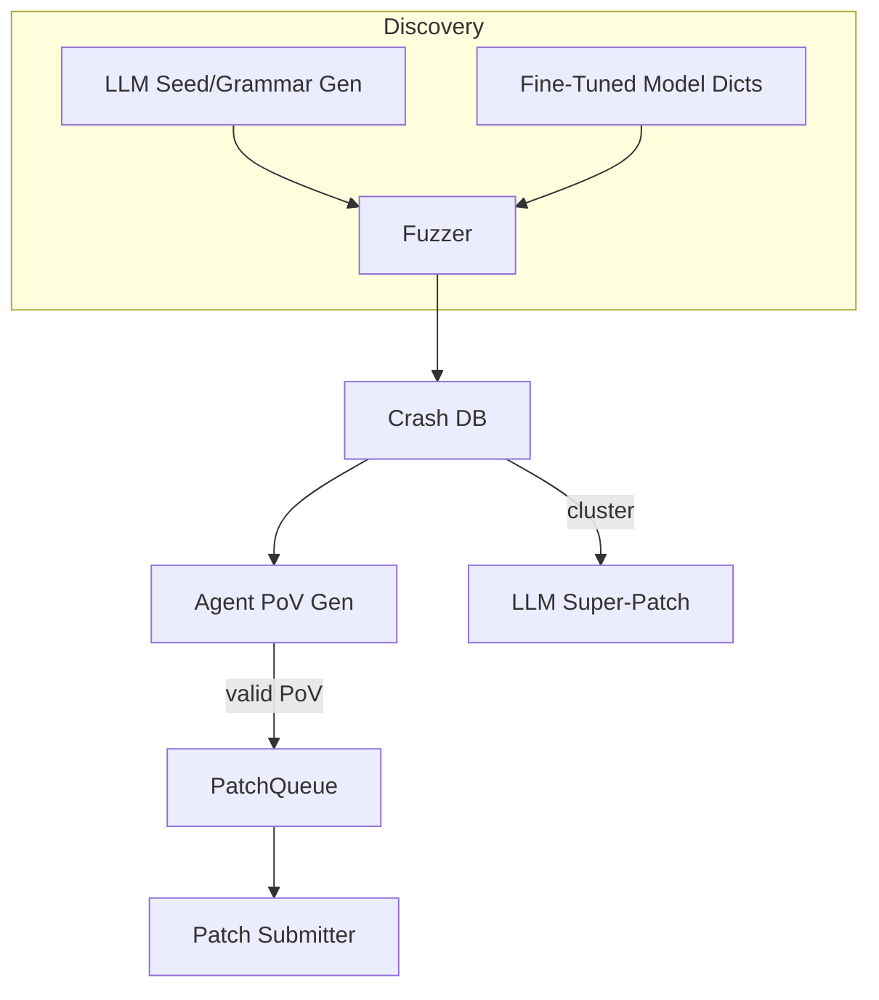

# Fuzzing assistito dall’IA e individuazione automatizzata delle vulnerabilità

{{#include ../banners/hacktricks-training.md}}

## Panoramica
I modelli linguistici di grandi dimensioni (LLM) possono potenziare notevolmente le tradizionali pipeline di ricerca delle vulnerabilità generando input semanticamente ricchi, evolvendo grammatiche, ragionando sui dati dei crash e persino proponendo patch per più bug. Questa pagina raccoglie gli approcci più efficaci osservati durante le finali della DARPA AI Cyber Challenge (AIxCC) e in altre ricerche pubbliche.<sup>[[4]](#references)</sup><sup>[[5]](#references)</sup>

Quello che segue non descrive un sistema specifico usato in una competizione, ma astrae le tecniche affinché possiate riprodurle nei vostri workflow.

---

## 1. Input seed generati dagli LLM

I tradizionali fuzzer guidati dalla copertura (AFL++, libFuzzer, Honggfuzz…) partono da un piccolo corpus di seed e mutano i byte alla cieca. Quando il formato di input del target è complesso (SQL, URL, protocolli binari personalizzati), le mutazioni casuali di solito rompono la sintassi prima di raggiungere rami interessanti.

Gli LLM possono risolvere questo problema iniziale generando *generatori di seed*: brevi script che producono **input sintatticamente corretti ma rilevanti per la sicurezza**. Ad esempio:

```prompt
SYSTEM: You are a helpful security engineer.
USER:
Write a Python3 program that prints 200 unique SQL injection strings targeting common anti-pattern mistakes (missing quotes, numeric context, stacked queries).  Ensure length ≤ 256 bytes / string so they survive common length limits.
```

```python
# gen_sqli_seeds.py (truncated)
PAYLOADS = [
    "1 OR 1=1 -- ",
    "' UNION SELECT NULL,NULL--",
    "0; DROP TABLE users;--",
    ...
]
for p in PAYLOADS:
    print(p)
```

Eseguilo una volta e inserisci direttamente l'output nel corpus iniziale del fuzzer:

```bash
python3 gen_sqli_seeds.py > seeds.txt
afl-fuzz -i seeds.txt -o findings/ -- ./target @@
```

Vantaggi:
1. Validità semantica → copertura più approfondita fin da subito.
2. Rigenerabile: modifica il prompt per concentrarti su XSS, path traversal, blob binari, ecc.
3. Economico (< 1 ¢ con GPT-3.5).

### Suggerimenti
* Chiedi al modello di *diversificare* la lunghezza e la codifica dei payload (UTF-8, URL-encoded, UTF-16-LE) per aggirare i filtri superficiali.
* Chiedi un *singolo script autonomo*: evita problemi di formattazione JSON.

---

## 2. Fuzzing con evoluzione della grammatica

Una variante più potente consiste nel lasciare che l’LLM **evolva una grammatica** invece di seed concreti. Il workflow (pattern “Grammar Guy”) è:

1. Genera una grammatica iniziale ANTLR/Peach/LibFuzzer tramite un prompt.
2. Esegui il fuzzing per N minuti e raccogli metriche di copertura (archi / blocchi raggiunti).
3. Riassumi le aree del programma non coperte e invia il riepilogo al modello:
   ```prompt
   The previous grammar triggered 12 % of the program edges.  Functions not reached: parse_auth, handle_upload.  Add / modify rules to cover these.
   ```
4. Unisci le nuove regole, esegui di nuovo il fuzzing e ripeti.

Scheletro di pseudocodice:

```python
for epoch in range(MAX_EPOCHS):
    grammar = llm.refine(grammar, feedback=coverage_stats)
    save(grammar, f"grammar_{epoch}.txt")
    coverage_stats = run_fuzzer(grammar)
```

Punti chiave:
* Mantieni un *budget*: ogni raffinamento consuma token.
* Usa istruzioni `diff` + `patch`, in modo che il modello modifichi il codice invece di riscriverlo.
* Fermati quando Δcoverage < ε.

---

## 3. Progettazione di harness libFuzzer con LLM locali

Per il codice che non può lasciare la workstation dell’analista, un modello locale può generare il piccolo adapter tra i byte del fuzzer e un’API C/C++. Il confine di sicurezza utile è esplicito: **il modello scrive e rivede l’infrastruttura di test; la mutazione guidata dalla coverage esplora gli input; i sanitizer segnalano le operazioni non valide; una persona esamina l’harness e classifica i risultati**.<sup>[[9]](#references)</sup>

Per le tecniche di corpus, feedback, snapshot e stateful fuzzing a livello di engine, che non dipendono da un LLM, consulta la [metodologia generale di fuzzing](../generic-methodologies-and-resources/fuzzing.md).

Inizia dalla dichiarazione esatta copiata dall’header del target e vincola il formato dell’output. Un prompt circoscritto riduce il rischio che vengano inventate API e rende il risultato facile da esaminare:<sup>[[8]](#references)[[9]](#references)</sup>

```prompt
Write a libFuzzer target for this exact declaration:
int parse_records(const uint8_t *data, size_t size);

Output only C code. Implement LLVMFuzzerTestOneInput, include the
declaration, pass data and size unchanged, and do not use files,
network access, randomness, clocks, threads, or persistent state.
```

Per un parser di byte grezzi, il risultato atteso non dovrebbe essere più complicato di:<sup>[[6]](#references)[[9]](#references)</sup>

```c
#include <stddef.h>
#include <stdint.h>

extern int parse_records(const uint8_t *, size_t);

int LLVMFuzzerTestOneInput(const uint8_t *data, size_t size) {
    (void)parse_records(data, size);
    return 0;
}
```

La compilazione è solo il primo passaggio di convalida. Prima di dedicarvi tempo CPU, verificate ogni target generato rispetto a questi invarianti:<sup>[[6]](#references)[[8]](#references)[[9]](#references)</sup>

- **API esatta:** confrontate i tipi, le regole di ownership, l'inizializzazione, la pulizia e la calling convention con l'header reale e i caller esistenti.
- **Sicurezza dell'harness:** proteggete ogni lettura da `data`; i risultati del sanitizer devono provenire dal target, non dal glue generato.
- **Ripetibilità:** fate in modo che il risultato dipenda da `data` e `size`; rimuovete I/O esterno, tempo, casualità non controllata, thread non attesi e stato che persiste tra le chiamate.
- **Throughput:** inizializzate una sola volta lo stato immutabile costoso, ma solo se ciò non può influire sul comportamento; limitate la dimensione dell'input, sopprimete i log e liberate le allocazioni per ogni input.
- **Raggiungibilità:** verificate che vengano eseguite le funzioni e i branch previsti. Un target che compila ma esercita solo i percorsi di rifiuto è un errore silenzioso.

### Target consapevoli della struttura: preservare gli invarianti senza nascondere i bug

Se la maggior parte degli input grezzi non supera un controllo di magic, lunghezza, versione o checksum, usate i byte di fuzzing come materiale per campi tipizzati e ricostruite un oggetto valido. Fissate le costanti del formato, lasciate mutabili i campi semantici e i byte del payload e calcolate i metadati di integrità a partire dal payload ricostruito. `FuzzedDataProvider` è utile per consumare valori tipizzati con limiti, mentre l'adapter resta responsabile di limitare ogni allocazione e conversione generata.<sup>[[9]](#references)</sup>

<details>
<summary>Esempio di target C++ consapevole della struttura</summary>

```cpp
#include <fuzzer/FuzzedDataProvider.h>
#include <stddef.h>
#include <stdint.h>
#include <vector>

extern "C" int parse_message(const uint8_t *, size_t);

extern "C" int LLVMFuzzerTestOneInput(const uint8_t *data, size_t size) {
    FuzzedDataProvider fdp(data, size);
    uint8_t version = fdp.ConsumeIntegral<uint8_t>();
    auto body = fdp.ConsumeRemainingBytes<uint8_t>();
    if (body.size() > UINT16_MAX) body.resize(UINT16_MAX);
    uint16_t len = static_cast<uint16_t>(body.size());
    std::vector<uint8_t> msg = {0x8b, 'M', 'S', 'G', version,
                                static_cast<uint8_t>(len >> 8),
                                static_cast<uint8_t>(len)};
    msg.insert(msg.end(), body.begin(), body.end());
    (void)parse_message(msg.data(), msg.size());
    return 0;
}
```

</details>

Non usare un solo target che ripara la struttura per ogni domanda. Mantieni un target che calcola lunghezze/checksum per esplorare stati validi più profondi e un altro che lascia i metadati **dichiarati** sotto il controllo del fuzzer, limitando solo le letture e le allocazioni del harness. Il secondo target preserva le superfici di attacco con lunghezze discordanti e integrità non valida, che la riparazione automatica eliminerebbe altrimenti.<sup>[[9]](#references)</sup>

### Seed, dizionari, sanitizer e feedback sulla copertura

Chiedi al modello di generare uno script che scriva seed binari invece di chiedergli di stamparli direttamente. Includi nel corpus oggetti vuoti, minimi, tipici e validi ai limiti; poi estrai valori magic, tag, codifiche degli enum e keyword del parser e inseriscili in un dizionario revisionato. libFuzzer accetta il dizionario con `-dict=` e mantiene nel corpus le mutazioni che rivelano nuova copertura.<sup>[[6]](#references)[[9]](#references)</sup>

```text
magic="\x8bMSG"
version_min="\x00"
version_max="\xff"
config_tag="CONFIG"
```

Compila lo stesso target con strumentazione complementare. ASan e UBSan possono condividere un binario per il fuzzing; usa una build MSan separata e strumentane le dipendenze per evitare segnalazioni causate da codice non strumentato.<sup>[[6]](#references)[[9]](#references)</sup>

```bash
clang++ -g -O1 -fsanitize=fuzzer,address,undefined \
  -fno-sanitize-recover=undefined target.cc harness.cc -o fuzz_target
./fuzz_target corpus -dict=msg.dict -max_len=65535

clang++ -g -O1 -fsanitize=fuzzer,memory \
  target.cc harness.cc -o fuzz_target_msan
```

Considera la coverage come criterio di valutazione per ogni revisione del modello. Nell’output di libFuzzer, valori `cov`/`ft` che si appiattiscono presto e un corpus statico indicano di solito un framing errato, un early return troppo restrittivo o la chiamata sbagliata; un valore basso di `exec/s` indica setup costoso, I/O, allocazioni o stato non ripulito. `NEW` dimostra solo che una feature di coverage è cambiata, non che sia stato raggiunto il parser previsto.<sup>[[6]](#references)[[9]](#references)</sup>

Per ottenere feedback a livello di sorgente, crea una build con coverage, esegui il fuzzing e fornisci al modello solo le funzioni non coperte e le relative condizioni di protezione. Verifica le differenze di harness/seed/dictionary e misura di nuovo:<sup>[[7]](#references)[[8]](#references)[[9]](#references)</sup>

```bash
clang++ -g -O1 -fsanitize=fuzzer \
  -fprofile-instr-generate -fcoverage-mapping target.cc harness.cc -o fuzz_cov
mkdir -p profiles
LLVM_PROFILE_FILE='profiles/%p.profraw' ./fuzz_cov -max_total_time=300 corpus
llvm-profdata merge -sparse profiles/*.profraw -o fuzz.profdata
llvm-cov report ./fuzz_cov -instr-profile=fuzz.profdata
llvm-cov show ./fuzz_cov -instr-profile=fuzz.profdata \
  --show-branches=count --region-coverage-lt=1 target.cc
```

Il ciclo scalabile è quindi **generate → compile/link → smoke-test under sanitizers → measure target coverage → provide the smallest relevant coverage/source context → revise → re-measure**. OSS-Fuzz-Gen applica lo stesso principio valutando i target generati in base alla compilabilità, agli errori di runtime, alla coverage e al miglioramento della coverage rispetto ai target esistenti, invece di accettare codice plausibile senza verificarlo.<sup>[[7]](#references)[[8]](#references)</sup>

---

<a id="3-agent-based-pov-exploit-generation" hidden>3. Generazione di PoV (Exploit) basata su agenti</a>

## 4. Generazione di PoV (Exploit) basata su agenti

Dopo aver trovato un crash, serve comunque una **proof-of-vulnerability (PoV)** che lo provochi in modo deterministico.

Un approccio scalabile consiste nell’avviare molti worker leggeri (processi, thread o container), ognuno con un modello o una configurazione di sampling diversi. Il sondaggio sui finalisti di AIxCC fornisce esempi concreti di questa scala: un team ha usato **migliaia di agenti concorrenti** per generare PoV con un approccio AI-first, mentre un altro ha orchestrato **300–500 agenti di fuzzing** e ha riservato gli LLM al ragionamento semantico di livello superiore.<sup>[[4]](#references)</sup>

Pipeline:
1. L’analisi statica/dinamica produce *candidati di bug* (struct con crash PC, input slice e messaggio del sanitizer).
2. L’orchestrator distribuisce i candidati agli agenti.
3. Fasi di ragionamento dell’agente:
   a. Riprodurre il bug localmente con `gdb` + input.
   b. Proporre un payload di exploit minimo.
   c. Validare l’exploit in sandbox. Se riesce → inviare.
4. I tentativi falliti vengono **accodati di nuovo come nuovi seed** per il coverage fuzzing (feedback loop).

Vantaggi:
* La parallelizzazione compensa l’inaffidabilità del singolo agente.
* Ottimizzazione automatica della temp / dimensione del modello in base al tasso di successo osservato.

---

<a id="4-directed-fuzzing-with-fine-tuned-code-models" hidden>4. Fuzzing mirato con modelli di codice fine-tuned</a>

## 5. Fuzzing mirato con modelli di codice fine-tuned

Eseguire il fine-tuning di un modello open-weight (ad es. Llama-7B) su sorgenti C/C++ etichettate con pattern di vulnerabilità (integer overflow, buffer copy, format string). Poi:

1. Eseguire l’analisi statica per ottenere l’elenco delle funzioni + AST.
2. Chiedere al modello: *“Fornisci voci di mutation dictionary che possano compromettere la memory safety nella funzione X”*.
3. Inserire quei token in un `AFL_CUSTOM_MUTATOR` personalizzato.

Esempio di output per un wrapper di `sprintf`:
```
{"pattern":"%99999999s"}
{"pattern":"AAAAAAAA....<1024>....%n"}
```

Empiricamente, questo riduce di oltre 2× il tempo necessario a causare un crash su target reali.

---

<a id="5-ai-guided-patching-strategies" hidden>5. Strategie di patching guidate dall’IA</a>

## 6. Strategie di patching guidate dall’IA

<a id="51-super-patches" hidden>5.1 Super Patch</a>

### 6.1 Super Patch
Chiedi al modello di *raggruppare* le firme dei crash e di proporre una **singola patch** che elimini la causa radice comune. Invia una sola patch e correggi diversi bug → meno penalità di accuratezza negli ambienti in cui ogni patch errata costa punti.

Schema del prompt:
```
Here are 10 stack traces + file snippets.  Identify the shared mistake and generate a unified diff fixing all occurrences.
```

{{#ref}}
../generic-methodologies-and-resources/fuzzing.md
{{#endref}}

<a id="52-speculative-patch-ratio" hidden>5.2 Speculative Patch Ratio</a>

### 6.2 Rapporto delle patch speculative
Implementa una coda in cui le patch confermate e validate con PoV e quelle *speculative* (senza PoV) si alternano con un rapporto 1:N, regolato in base alle regole di punteggio (ad es. 2 speculative : 1 confermata). Un modello dei costi monitora penalità e punti e regola N automaticamente.

---

Per revisioni deterministiche del codice sorgente, file per file, flussi di attività per gli entry point mobile, audit dei pattern del kernel e validazione delle vulnerabilità basata su evidenze, consulta [AI-assisted source review and vulnerability validation](AI-Assisted-Source-Review-and-Vulnerability-Validation.md).

---

## Triage dei crash assistito dal debugger

I workflow di Mona v3 per il triage dei crash, l'analisi delle funzioni e la raggiungibilità controllata degli heap chunk sono descritti in [Exploiting Tools](../binary-exploitation/basic-stack-binary-exploitation-methodology/tools/#mona-v3-debugger-context-requests-for-crash-triage).

---

## Riunire tutti i componenti
Un CRS (Cyber Reasoning System) end-to-end può collegare i componenti nel modo seguente:



---

## References

- [4] [Trail of Bits – Finali AIxCC: la cronaca della sfida](https://blog.trailofbits.com/2025/08/07/aixcc-finals-tale-of-the-tape/)
- [5] [Interviste ai finalisti AIxCC di CTF Radiooo](https://www.youtube.com/@ctfradiooo)
- [6] [LLVM — libFuzzer: una libreria per il fuzz testing guidato dalla copertura](https://llvm.org/docs/LibFuzzer.html)
- [7] [Google — OSS-Fuzz-Gen](https://github.com/google/oss-fuzz-gen)
- [8] [Google Online Security Blog — Potenziare il fuzzing: trovare più vulnerabilità con l'AI](https://security.googleblog.com/2024/11/leveling-up-fuzzing-finding-more.html)
- [9] [8kSec — Generazione di harness per il fuzzing assistita dall'AI con un LLM locale](https://8ksec.io/ai-assisted-fuzzing-harness-local-llm)
{{#include ../banners/hacktricks-training.md}}
