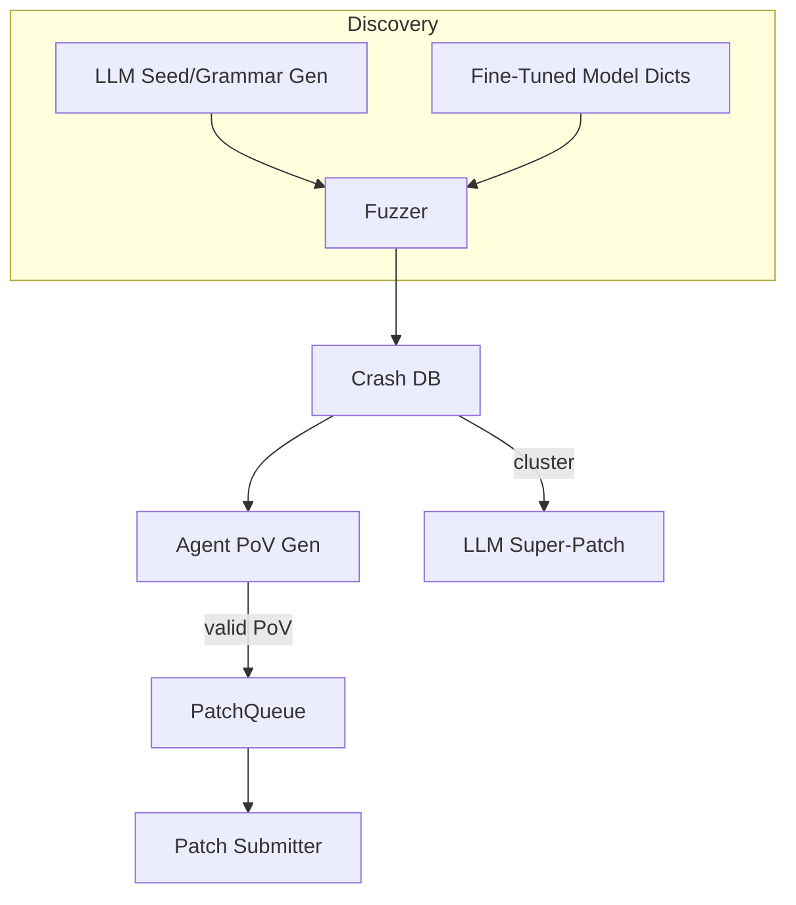

# AI-सहायता प्राप्त Fuzzing और स्वचालित Vulnerability खोज

{{#include ../banners/hacktricks-training.md}}

## अवलोकन
Large-language models (LLMs), semantically rich inputs जनरेट करके, grammars को विकसित करके, crash data पर reasoning करके, और यहाँ तक कि multi-bug patches प्रस्तावित करके, पारंपरिक vulnerability-research pipelines को काफी बेहतर बना सकते हैं। इस पेज में DARPA’s AI Cyber Challenge (AIxCC) finals और अन्य सार्वजनिक research के दौरान देखे गए सबसे प्रभावी patterns संकलित किए गए हैं।<sup>[[4]](#references)</sup><sup>[[5]](#references)</sup>

यहाँ किसी एक विशिष्ट competition system का वर्णन नहीं है, बल्कि तकनीकों का सार दिया गया है, ताकि आप उन्हें अपने workflows में दोहरा सकें।

---

## 1. LLM द्वारा जनरेट किए गए Seed Inputs

पारंपरिक coverage–guided fuzzers (AFL++, libFuzzer, Honggfuzz…) seeds के एक छोटे corpus से शुरुआत करते हैं और bytes को बिना सोचे-समझे mutate करते हैं। जब target input format जटिल होता है (SQL, URLs, custom binary protocols), तो random mutations आम तौर पर दिलचस्प branches तक पहुँचने से पहले ही syntax को तोड़ देते हैं।

LLMs इस bootstrap समस्या को *seed generators* — ऐसे छोटे scripts जो **syntax-correct लेकिन security-relevant inputs** आउटपुट करते हैं — बनाकर हल कर सकते हैं। उदाहरण के लिए:

```prompt
SYSTEM: You are a helpful security engineer.
USER:
Write a Python3 program that prints 200 unique SQL injection strings targeting common anti-pattern mistakes (missing quotes, numeric context, stacked queries).  Ensure length ≤ 256 bytes / string so they survive common length limits.
```

```python
# gen_sqli_seeds.py (truncated)
PAYLOADS = [
    "1 OR 1=1 -- ",
    "' UNION SELECT NULL,NULL--",
    "0; DROP TABLE users;--",
    ...
]
for p in PAYLOADS:
    print(p)
```

इसे एक बार चलाएँ और आउटपुट सीधे fuzzer के शुरुआती corpus में दें:

```bash
python3 gen_sqli_seeds.py > seeds.txt
afl-fuzz -i seeds.txt -o findings/ -- ./target @@
```

लाभ:
1. Semantic validity → शुरुआत में ही अधिक गहरी coverage।
2. दोबारा जनरेट किया जा सकता है: XSS, path traversal, binary blobs आदि पर ध्यान केंद्रित करने के लिए prompt में बदलाव करें।
3. सस्ता (< GPT-3.5 के साथ 1 ¢)।

### सुझाव
* मॉडल को payload की लंबाई और encoding (UTF-8, URL-encoded, UTF-16-LE) में *विविधता* लाने का निर्देश दें, ताकि सतही filters को बायपास किया जा सके।
* एक *single self-contained script* माँगें — इससे JSON formatting की समस्याएँ नहीं होतीं।

---

## 2. Grammar-Evolution Fuzzing

एक अधिक शक्तिशाली तरीका यह है कि ठोस seeds के बजाय LLM से **grammar विकसित** करवाया जाए। इसका workflow (“Grammar Guy” pattern) यह है:

1. prompt के ज़रिए शुरुआती ANTLR/Peach/LibFuzzer grammar जनरेट करें।
2. N मिनट तक fuzz करें और coverage metrics (hit हुए edges / blocks) इकट्ठा करें।
3. प्रोग्राम के उन हिस्सों का सारांश बनाएँ जो uncovered हैं और वह सारांश मॉडल को वापस दें:
   ```prompt
   The previous grammar triggered 12 % of the program edges.  Functions not reached: parse_auth, handle_upload.  Add / modify rules to cover these.
   ```
4. नए rules merge करें, फिर fuzz करें और दोहराएँ।

Pseudo-code का ढाँचा:

```python
for epoch in range(MAX_EPOCHS):
    grammar = llm.refine(grammar, feedback=coverage_stats)
    save(grammar, f"grammar_{epoch}.txt")
    coverage_stats = run_fuzzer(grammar)
```

मुख्य बिंदु:
* *बजट* बनाए रखें – हर refinement में tokens खर्च होते हैं।
* मॉडल से दोबारा लिखवाने के बजाय edits करवाने के लिए `diff` + `patch` निर्देशों का उपयोग करें।
* Δcoverage < ε होने पर रुक जाएँ।

---

## 3. Local-LLM libFuzzer Harness का निर्माण

ऐसे source code के लिए जिसे analyst के workstation से बाहर नहीं जाना चाहिए, एक local code model fuzzer bytes और C/C++ API के बीच छोटा adapter तैयार कर सकता है। उपयोगी security boundary स्पष्ट है: **मॉडल test infrastructure लिखता और संशोधित करता है; coverage-guided mutation inputs को explore करता है; sanitizers invalid operations की रिपोर्ट करते हैं; और एक human harness की समीक्षा करके findings को triage करता है**।<sup>[[9]](#references)</sup>

ऐसी engine-level corpus, feedback, snapshot और stateful-fuzzing techniques के लिए जो किसी LLM पर निर्भर नहीं हैं, सामान्य [Fuzzing Methodology](../generic-methodologies-and-resources/fuzzing.md) देखें।

Target header से सटीक declaration कॉपी करके शुरू करें और output format को सीमित रखें। संकीर्ण prompt से गढ़े हुए APIs कम होते हैं और नतीजे की समीक्षा करना आसान हो जाता है:<sup>[[8]](#references)[[9]](#references)</sup>

```prompt
Write a libFuzzer target for this exact declaration:
int parse_records(const uint8_t *data, size_t size);

Output only C code. Implement LLVMFuzzerTestOneInput, include the
declaration, pass data and size unchanged, and do not use files,
network access, randomness, clocks, threads, or persistent state.
```

एक raw byte parser के लिए, अपेक्षित परिणाम इससे अधिक जटिल नहीं होना चाहिए:<sup>[[6]](#references)[[9]](#references)</sup>

```c
#include <stddef.h>
#include <stdint.h>

extern int parse_records(const uint8_t *, size_t);

int LLVMFuzzerTestOneInput(const uint8_t *data, size_t size) {
    (void)parse_records(data, size);
    return 0;
}
```

कंपाइलेशन केवल पहला validation gate है। CPU समय खर्च करने से पहले, इन invariants के अनुसार हर generated target की समीक्षा करें:<sup>[[6]](#references)[[8]](#references)[[9]](#references)</sup>

- **Exact API:** types, ownership rules, initialization, teardown और calling convention की तुलना वास्तविक header और मौजूदा callers से करें।
- **Harness safety:** `data` से हर read को guard करें; sanitizer findings target में उत्पन्न होनी चाहिए, generated glue में नहीं।
- **Repeatability:** नतीजे को `data` और `size` का function बनाएँ; external I/O, समय, अनियंत्रित randomness, join न किए गए threads और calls के बीच बनी रहने वाली state हटाएँ।
- **Throughput:** महँगी immutable state को केवल तभी एक बार initialize करें, जब इससे behavior प्रभावित न हो; input size सीमित करें, logging बंद करें और हर input के लिए किए गए allocations को free करें।
- **Reachability:** सत्यापित करें कि इच्छित functions और branches execute हों। ऐसा target जो compile तो होता है, लेकिन केवल rejection paths को exercise करता है, वह चुपचाप विफल है।

### Structure-aware targets: bugs छिपाए बिना invariants बनाए रखें

अगर ज़्यादातर raw inputs किसी magic, length, version या checksum gate पर विफल होते हैं, तो fuzz bytes को **typed field material** की तरह इस्तेमाल करें और एक valid object फिर से बनाएँ। Format constants को स्थिर रखें, semantic fields और payload bytes को mutable छोड़ें, और reconstructed payload से integrity metadata निकालें। `FuzzedDataProvider` bounded typed values का उपयोग करने के लिए काम का है, जबकि generated allocation और conversion को सीमित करने की ज़िम्मेदारी adapter की रहती है।<sup>[[9]](#references)</sup>

<details>
<summary>Structure-aware C++ target का उदाहरण</summary>

```cpp
#include <fuzzer/FuzzedDataProvider.h>
#include <stddef.h>
#include <stdint.h>
#include <vector>

extern "C" int parse_message(const uint8_t *, size_t);

extern "C" int LLVMFuzzerTestOneInput(const uint8_t *data, size_t size) {
    FuzzedDataProvider fdp(data, size);
    uint8_t version = fdp.ConsumeIntegral<uint8_t>();
    auto body = fdp.ConsumeRemainingBytes<uint8_t>();
    if (body.size() > UINT16_MAX) body.resize(UINT16_MAX);
    uint16_t len = static_cast<uint16_t>(body.size());
    std::vector<uint8_t> msg = {0x8b, 'M', 'S', 'G', version,
                                static_cast<uint8_t>(len >> 8),
                                static_cast<uint8_t>(len)};
    msg.insert(msg.end(), body.begin(), body.end());
    (void)parse_message(msg.data(), msg.size());
    return 0;
}
```

</details>

हर प्रश्न के लिए एक ही structure-repairing target का उपयोग न करें। एक target ऐसा रखें जो deep valid states तलाशने के लिए lengths/checksums की गणना करे, और दूसरा ऐसा जो **declared** metadata को fuzzer के नियंत्रण में रखे, जबकि केवल harness की अपनी reads और allocations को सीमित करे। दूसरा target mismatched-length और bad-integrity attack surfaces को बनाए रखता है, जिन्हें automatic repair अन्यथा मिटा देता।<sup>[[9]](#references)</sup>

### Seeds, dictionaries, sanitizers, और coverage feedback

मॉडल से binary सीधे प्रिंट करने के बजाय ऐसी script बनाने को कहें जो binary seeds लिखे। Empty, minimal, typical और boundary-valid objects से शुरुआत करें; फिर magic values, tags, enum encodings और parser keywords को निकालकर reviewed dictionary में रखें। libFuzzer उस dictionary को `-dict=` के साथ स्वीकार करता है और corpus में उन mutations को बनाए रखता है जो नई coverage उजागर करते हैं।<sup>[[6]](#references)[[9]](#references)</sup>

```text
magic="\x8bMSG"
version_min="\x00"
version_max="\xff"
config_tag="CONFIG"
```

पूरक instrumentation के साथ वही target बनाएँ। ASan और UBSan एक fuzzing binary साझा कर सकते हैं; uninstrumented code के कारण reports से बचने के लिए अलग MSan build बनाएँ और उसकी dependencies को instrument करें।<sup>[[6]](#references)[[9]](#references)</sup>

```bash
clang++ -g -O1 -fsanitize=fuzzer,address,undefined \
  -fno-sanitize-recover=undefined target.cc harness.cc -o fuzz_target
./fuzz_target corpus -dict=msg.dict -max_len=65535

clang++ -g -O1 -fsanitize=fuzzer,memory \
  target.cc harness.cc -o fuzz_target_msan
```

हर model revision के लिए coverage को evaluator मानें। libFuzzer output में शुरुआती चरण में सपाट `cov`/`ft` और static corpus का आम तौर पर मतलब होता है कि framing गलत है, शुरुआती चरण में बहुत restrictive return है, या गलत call हो रही है; कम `exec/s` से महंगे setup, I/O, allocation या leaked state का संकेत मिलता है। `NEW` सिर्फ़ यह साबित करता है कि coverage feature बदला है, यह नहीं कि इच्छित parser तक पहुँचा गया।<sup>[[6]](#references)[[9]](#references)</sup>

source-level feedback के लिए coverage build बनाएँ, उसे fuzz करें और model को सिर्फ़ uncovered functions तथा उनकी guarding conditions दें। परिणामी harness/seed/dictionary diff की पुष्टि करें और फिर से मापें:<sup>[[7]](#references)[[8]](#references)[[9]](#references)</sup>

```bash
clang++ -g -O1 -fsanitize=fuzzer \
  -fprofile-instr-generate -fcoverage-mapping target.cc harness.cc -o fuzz_cov
mkdir -p profiles
LLVM_PROFILE_FILE='profiles/%p.profraw' ./fuzz_cov -max_total_time=300 corpus
llvm-profdata merge -sparse profiles/*.profraw -o fuzz.profdata
llvm-cov report ./fuzz_cov -instr-profile=fuzz.profdata
llvm-cov show ./fuzz_cov -instr-profile=fuzz.profdata \
  --show-branches=count --region-coverage-lt=1 target.cc
```

इसलिए scalable loop है **generate → compile/link → sanitizers के तहत smoke-test → target coverage मापें → सबसे छोटा relevant coverage/source context दें → revise करें → फिर से मापें**। OSS-Fuzz-Gen इसी principle को लागू करता है: generated targets को compilability, runtime failures, coverage और मौजूदा targets की तुलना में coverage improvement के आधार पर evaluate करता है, न कि केवल plausible दिखने वाले code को स्वीकार करके।<sup>[[7]](#references)[[8]](#references)</sup>

---

<a id="3-agent-based-pov-exploit-generation" hidden>3. Agent-Based PoV (Exploit) Generation</a>

## 4. Agent-Based PoV (Exploit) Generation

Crash मिलने के बाद भी आपको एक **proof-of-vulnerability (PoV)** चाहिए, जो उसे deterministically trigger करे।

एक scalable तरीका है कई lightweight workers (processes, threads या containers) शुरू करना, जिनमें से हर worker अलग model या sampling configuration का उपयोग करे। AIxCC finalist survey में scale के ठोस उदाहरण दिए गए हैं: एक team ने AI-first PoV generation के लिए **हज़ारों concurrent agents** का उपयोग किया, जबकि दूसरी team ने **300–500 fuzzing agents** orchestrate किए और उच्च-स्तरीय semantic reasoning के लिए LLMs का उपयोग किया।<sup>[[4]](#references)</sup>

Pipeline:
1. Static/dynamic analysis से *bug candidates* बनते हैं (crash PC, input slice, sanitizer msg वाला struct)।
2. Orchestrator candidates को agents में बाँटता है।
3. Agent के reasoning steps:
   a. `gdb` + input के साथ bug को local रूप से reproduce करें।
   b. Minimal exploit payload सुझाएँ।
   c. Sandbox में exploit validate करें। अगर सफल हो → submit करें।
4. असफल attempts को coverage fuzzing के लिए **नए seeds के रूप में फिर से queue में डाला जाता है** (feedback loop)।

फ़ायदे:
* Parallelisation से single-agent की unreliability का असर कम होता है।
* देखी गई success-rate के आधार पर temp / model size की auto-tuning।

---

<a id="4-directed-fuzzing-with-fine-tuned-code-models" hidden>4. Directed Fuzzing with Fine-Tuned Code Models</a>

## 5. Directed Fuzzing with Fine-Tuned Code Models

Vulnerability patterns (integer overflow, buffer copy, format string) के साथ label किए गए C/C++ source पर open-weight model (जैसे Llama-7B) को fine-tune करें। फिर:

1. Function list + AST पाने के लिए static analysis चलाएँ।
2. Model को prompt दें: *“Function X में memory safety को बिगाड़ने की संभावना वाले mutation dictionary entries दें”*।
3. उन tokens को custom `AFL_CUSTOM_MUTATOR` में डालें।

`sprintf` wrapper के लिए output का उदाहरण:
```
{"pattern":"%99999999s"}
{"pattern":"AAAAAAAA....<1024>....%n"}
```

वास्तविक targets पर अनुभवजन्य रूप से इससे time-to-crash 2× से अधिक कम हो जाता है।

---

<a id="5-ai-guided-patching-strategies" hidden>5. AI-निर्देशित Patching रणनीतियाँ</a>

## 6. AI-निर्देशित Patching रणनीतियाँ

<a id="51-super-patches" hidden>5.1 Super Patches</a>

### 6.1 Super Patches
मॉडल से crash signatures को *समूहबद्ध* करने और एक **single patch** सुझाने को कहें, जो सामान्य root cause को दूर करे। एक बार सबमिट करें, कई bugs ठीक करें → उन environments में accuracy penalties कम होंगी जहाँ हर गलत patch के लिए points कटते हैं।

Prompt की रूपरेखा:
```
Here are 10 stack traces + file snippets.  Identify the shared mistake and generate a unified diff fixing all occurrences.
```

{{#ref}}
../generic-methodologies-and-resources/fuzzing.md
{{#endref}}

<a id="52-speculative-patch-ratio" hidden>5.2 Speculative Patch Ratio</a>

### 6.2 Speculative Patch Ratio
एक queue लागू करें, जिसमें पुष्टि किए गए PoV-validated patches और *speculative* patches (बिना PoV) को 1:N के अनुपात में बारी-बारी से रखा जाए। इस अनुपात को scoring rules के अनुसार समायोजित करें (उदाहरण के लिए, 2 speculative : 1 confirmed)। एक cost model penalties और points पर नज़र रखता है और N को अपने-आप समायोजित करता है।

---

<a id="6-deterministic-file-by-file-ai-code-review" hidden>6. Deterministic File-by-File AI Code Review</a>

## 7. Deterministic File-by-File AI Code Review

AI-assisted review में अक्सर यह विफलता देखने को मिलती है कि एक agent से पूरे repository की जाँच करने को कहा जाता है और उम्मीद की जाती है कि वह सही files और grep terms चुन लेगा। इससे अधिक भरोसेमंद तरीका है **repository coverage को बाध्य करना**:<sup>[[1]](#references)</sup>

1. Source files की सूची बनाएँ।
2. **एक बार में एक file** के साथ न्यूनतम context (entrypoint, imports, आस-पास के routes/callers) भेजें।
3. हर file के लिए **structured report** माँगें: sources, sink, छूटी हुई validation, exploit की preconditions और confidence।<sup>[[3]](#references)</sup>
4. Reports को **source→sink pattern** के आधार पर deduplicate करें और उच्च-जोखिम वाले मामलों की मैन्युअल रूप से पुष्टि करें।

इसमें बहुत tokens लगते हैं और noise भी अधिक होता है, लेकिन broad agentic reviews में अक्सर छूट जाने वाले **सरल, उच्च-प्रभाव वाले source/sink bugs** सामने लाने में यह बहुत प्रभावी है।

### प्राथमिकता देने लायक triage patterns

- **Dynamic PHP include/dispatch**: attacker-controlled route/controller/module names का `require_once()`, `include()` या `include_once()` तक पहुँचना, जबकि सख्त allowlisting और path canonicalisation न हो।
- **Admin/account workflows में shell execution**: usernames, domains, FTP accounts या अन्य identifiers का `exec()`, `system()`, `shell_exec()`, `passthru()`, `proc_open()` या `popen()` तक पहुँचना।
- **Structured input fan-in**: एक ही parameter का `$_GET`, `$_POST`, JSON, XML या framework body parsers से स्वीकार होना और बाद में filesystem या OS-command sinks में दोबारा इस्तेमाल होना।

### इस तरीके से अच्छी तरह मिलने वाली bug की दो व्यावहारिक श्रेणियाँ

- **PHP controller-dispatch LFI/RCE**: यदि request-controlled controller name को बिना allowlist/path normalisation के `require_once()` में जोड़ा जाता है, तो `../` जैसे traversal sequences के ज़रिए PHP से अनचाही स्थानीय `.php` file शामिल कराई जा सकती है। यदि attacker include को किसी पहले से रखी गई या अन्यथा उपयोगी PHP file की ओर निर्देशित कर सकता है, तो LFI code execution में बदल जाता है। [File Inclusion / Path Traversal](../pentesting-web/file-inclusion/README.md) देखें।<sup>[[1]](#references)</sup>
- **Hosting/admin panels में authenticated command injection**: यदि usernames जैसे account-management fields को shell commands में शामिल किया जाता है, तो कम विशेषाधिकार वाला authenticated user सामान्य create/delete action को RCE में बदल सकता है। जब panel command को अधिक विशेषाधिकार वाले service account के रूप में चलाता है, तो इसका प्रभाव बढ़ जाता है। [Command Injection](../pentesting-web/command-injection.md) देखें।<sup>[[1]](#references)</sup>

### व्यावहारिक review notes

- LLM का इस्तेमाल पहले **source/sink reviewer** के रूप में करें, exploit generator के रूप में नहीं।
- उससे साफ़-साफ़ **attacker-controlled field**, **normalization/validation gap** और **खतरनाक sink** की सूची माँगें।
- बड़े repos के लिए, एक अकेले autonomous agent run की तुलना में per-file deterministic review अक्सर अधिक भरोसेमंद होता है—भले ही autonomous run में अधिक शक्तिशाली model का उपयोग किया गया हो।<sup>[[2]](#references)</sup>
- **Broken Access Control** और अन्य business-logic bugs पर कमज़ोर नतीजों की अपेक्षा रखें, जहाँ exploitability अलग-अलग files की धारणाओं, role semantics या product-specific threat models पर निर्भर करती है।

---

## Mobile entry-point taskflows

पूरे repository के लिए दिया गया एक prompt अक्सर अलग-अलग threat models को मिला देता है और externally reachable component से sensitive sink तक का रास्ता खो देता है। एक बेहतर workflow audit को stateful taskflows में बाँटता है: पहले applications/components को classify करें, फिर attacker-controlled entry points की सूची बनाएँ, हर entry point में reachability metadata जोड़ें, और अंत में platform-specific vulnerability classes के आधार पर उनकी जाँच करें। GitHub Security Lab के mobile taskflows Android, iOS और cross-platform repositories के लिए यह तरीका लागू करते हैं।<sup>[[14]](#references)[[15]](#references)</sup>

Android के लिए, कम-से-कम यह दर्ज करें:<sup>[[14]](#references)[[15]](#references)</sup>

- exported Activities, Services, Receivers और Providers, permissions सहित;
- intent actions, deep-link schemes/hosts/paths, MIME filters और App Links;
- attacker-controlled actions, data URIs, `ClipData`, extras और URI-grant flags;
- WebView navigation inputs और `addJavascriptInterface` bridges;
- downstream privileged operations, imported resources और network destinations।

फिर हर entry point को उसके context में classify करें। Caller authorization/confused-deputy behavior, intent redirection, broadcast spoofing या disclosure, unsafe imports, WebView scripting और bridge exposure, तथा origins के बीच credentials या cookies के स्थानांतरण पर स्पष्ट रूप से सवाल करें। **Strict checklist pass** और **broader adversarial pass**, दोनों चलाएँ। Exploitation की जानकारी दोहराने के बजाय findings को [Intent Injection](../mobile-pentesting/android-app-pentesting/intent-injection.md) और [WebView Attacks](../mobile-pentesting/android-app-pentesting/webview-attacks.md) से link करें।<sup>[[15]](#references)</sup>

मौजूदा open-source taskflows को उनके Codespace से इस तरह launch किया जा सकता है:<sup>[[14]](#references)</sup>

```bash
./scripts/audit/run_audit.sh owner/repository
```

परिणाम SQLite के `audit_result` table में लिखे जाते हैं।<sup>[[14]](#references)</sup> Vulnerable के रूप में चिह्नित rows को सत्यापित निष्कर्ष नहीं, बल्कि **leads** मानें। हर lead के लिए मॉडल से attacker-controlled source, sensitive sink, preconditions और अपेक्षित impact बताने को कहें, फिर उससे एक न्यूनतम PoC बनाने को कहें। उस PoC को debugger या instrumentation के तहत original build पर चलाएँ। इससे static analysis की आम गलतियाँ पकड़ में आती हैं, जैसे unreachable branches, अवास्तविक application state, private data के आगे external-storage data की precedence खो देना, और ऐसे mitigations जो severity को काफी कम कर देते हैं।<sup>[[15]](#references)</sup>

---

## 8. Instrumented Oracle के साथ Pattern-Guided Kernel Auditing

Kernel-आकार के target के लिए agent से पूरे tree में मनमाने bugs ढूँढ़ने को न कहें। अधिक token-efficient workflow में ऐतिहासिक vulnerability जानकारी को static queries में बदलें, exposed attack surface के आधार पर नतीजों को rank करें, और instrumented kernel को execution oracle के रूप में इस्तेमाल करें।<sup>[[11]](#references)</sup>

### Pattern database → CodeQL/Semgrep → केंद्रित समीक्षा

एक छोटा knowledge base बनाएँ, जिसमें dangerous APIs, missing-validation patterns, जोखिमपूर्ण source-to-sink flows और पहले ठीक किए गए bug shapes शामिल हों। मॉडल से कहें कि वह **एक बार में एक pattern** को review heuristics और CodeQL/Semgrep rules में बदले, फिर उन deterministic rules को पूरे tree पर चलाएँ। Code वापस मॉडल को देने से पहले matches को group और deduplicate करें; scanner का raw output हज़ारों कम-मूल्य वाले candidates दे सकता है। पात्र research या open-source targets के बाहर इस तरीके का उपयोग करने से पहले CodeQL का मौजूदा license जाँचें।<sup>[[11]](#references)</sup>

Subsystems को केवल hit count के आधार पर नहीं, बल्कि **rule-hit density** और **attacker reachability**, दोनों के आधार पर प्राथमिकता दें। Unprivileged processes, sandboxes, containers, jails या guest contexts से पहुँच योग्य kernel interfaces को internal-only code से अधिक महत्व दें। Review unit इतना छोटा रखें कि agent callers, validators और lifetime rules याद रख सके; और “कोई भी vulnerability ढूँढ़ो” कहने के बजाय किसी नामित vulnerability class या control-flow pattern के लिए prompt दें। Legacy privileged interfaces खास तौर पर दिलचस्प हैं, जब कोई नया containment boundary उन्हें namespaced या jailed root user के लिए reachable बना देता है।<sup>[[11]](#references)</sup>

हर candidate के लिए exploitation की कोशिश करने से पहले स्पष्ट field-flow record देना अनिवार्य करें।<sup>[[11]](#references)</sup>

```text
entrypoint -> privilege check -> parser -> validation/normalization
           -> later rewrite -> dangerous sink
attacker controls: <fields and lengths>
constraints:       <values rewritten, rejected, or preserved>
observable result: <sanitizer report, assertion, panic, or clean exit>
```

### KASAN telemetry को hypothesis oracle के रूप में इस्तेमाल करें

Target kernel को KASAN और उपयोगी diagnostic assertions सक्षम करके disposable VM में चलाएँ। Agent को **source hypothesis → minimal userland trigger → VM execution → KASAN/assertion trace → revised hypothesis** के चक्र को तब तक दोहराना चाहिए, जब तक संदिग्ध corruption दोबारा न हो जाए या hypothesis खारिज न हो जाए। हर iteration में केवल संबंधित stack trace और उसके आसपास का source लौटाएँ; इससे reasoning के लिए context बना रहता है और acceptance gate model confidence के बजाय runtime evidence होता है।<sup>[[11]](#references)</sup>

Instrumented build, exploitability जाँचने का अंतिम environment नहीं है। Assertions, corrupting operation से पहले execution रोक सकती हैं, जबकि वही assertion production kernel में compile out हो सकती है। बिना बदलाव वाले trigger को exact production configuration के विरुद्ध फिर से चलाएँ, kernel build और configuration दर्ज करें, और **reachability**, **memory corruption**, **controlled primitive**, तथा **security impact** को अलग-अलग दावों के रूप में पहचानें।<sup>[[11]](#references)[[12]](#references)</sup>

CVE-2026-3038, exploit template के बजाय एक उपयोगी validation उदाहरण है। एक unprivileged FreeBSD `RTM_GET` request, selective validation और reply rewriting के दौरान oversized `RTAX_AUTHOR` sockaddr को बनाए रख सकती थी, जब तक कि `rtsock_msg_buffer()` ने user-controlled `sa_len` को 128-byte stack `sockaddr_storage` में copy नहीं कर दिया। अधिकतम 255-byte copy से 127-byte overwrite हुआ; instrumented build में diagnostic assertion ने गलत length पकड़ ली, जबकि GENERIC kernel copy तक पहुँचा और फिर corrupted canary की जाँच के दौरान panic हो गया। यह unprivileged denial of service साबित करता है, अपने-आप में privilege escalation नहीं: भरोसेमंद control के लिए पहले किसी अन्य primitive, जैसे canary disclosure, की आवश्यकता होगी। संबंधित binary-exploitation सीमा के लिए [Stack Canaries](../binary-exploitation/common-binary-protections-and-bypasses/stack-canaries/index.html) देखें।<sup>[[11]](#references)[[12]](#references)[[13]](#references)</sup>

### Exploit की prerequisites को दरकिनार करने की कोशिशें खारिज करें

PoV या exploit स्वीकार करने से पहले, किसी अलग reviewer/agent से तय मानदंडों के आधार पर उसे गलत साबित करने की कोशिश करवाएँ। Review में नीचे दी गई सभी शर्तों की पुष्टि होनी चाहिए।<sup>[[11]](#references)</sup>

- Path को reachable बनाने के लिए target source, kernel या vulnerable module में बदलाव नहीं किया गया।
- कोई helper module, synthetic gadget, disabled mitigation, अतिरिक्त privilege या अनुपलब्ध interface शामिल नहीं किया गया।
- Trigger, clean snapshot पर दावे की गई caller identity और containment restrictions के साथ शुरू होता है।
- दावा किया गया परिणाम अब भी bug पर निर्भर करता है: malformed field हटाने या केवल bug patch करने से chain टूटनी चाहिए।
- Crash, overread या overwrite को केवल उसी primitive के रूप में रिपोर्ट किया गया है; code execution या privilege escalation के लिए स्वतंत्र evidence आवश्यक है।

यह आखिरी counterfactual जाँच circular demonstrations पकड़ती है: यदि prerequisites पहले से ही दावा किया गया impact दे रही हैं (उदाहरण के लिए, `nosuid` के बिना mount किए गए filesystem से attacker द्वारा दिया गया SUID content चलाना), तो memory-safety bug ने वह impact पैदा नहीं किया।<sup>[[11]](#references)</sup>

---

## अपरिचित Codebase पर Auditable Agent-Assisted Research

[Graph-first fuzz-target workflow](../generic-methodologies-and-resources/fuzzing.md#graph-first-fuzz-target-selection-and-mutation-triage) में entrypoint reachability पहले से शामिल है, जबकि [agentic SAST pipelines](../network-services-pentesting/pentesting-web/code-review-tools.md#agentic-sast-pipelines) में staged review और evidence gates शामिल हैं। इन deterministic results को model की hypotheses से अलग रखें, ताकि हर आगे बढ़ाए गए lead के साथ source locations, path evidence और dynamic measurement मौजूद रहें।<sup>[[10]](#references)</sup>

### Data flow गढ़े बिना object-lifetime evidence का सहसंबंध करें

Static analysis को एक function में store की गई attacker-controlled length और बहुत बाद में copy sink तक पहुँचने वाला वही object field मिल सकता है, लेकिन callbacks, reconnects या object lifetime के पार उनके बीच संबंध साबित करना संभव न हो। दोनों findings अलग-अलग सुरक्षित रखें, उन्हें object/field के आधार पर समूहित करें और छूटे हुए edge को triage के स्पष्ट प्रश्न के रूप में दर्ज करें। Agent संबंध का सुझाव दे सकता है, लेकिन source review या runtime instrumentation से उसे साबित करना होगा।<sup>[[10]](#references)</sup>

हर candidate के लिए दर्ज करें:

- ठोस entrypoint और attacker-controlled bytes;
- संबंधित field के हर producer, जिसमें हर producer के लिए विशिष्ट validation शामिल हो;
- sink, destination capacity और वहाँ तक पहुँचने के लिए आवश्यक build/runtime conditions;
- exposed entrypoint से मिला वास्तविक call stack, केवल direct harness invocation नहीं;
- hypothesis की पुष्टि या खंडन करने वाला सबसे छोटा dynamic result।

कोई path सुरक्षित दिखने से field हर जगह सुरक्षित सिद्ध नहीं होता। दूसरा producer उसी field को पहले path की bound के बिना भर सकता है। Paths की स्वतंत्र रूप से जाँच करें और deployment-equivalent build options के साथ harness चलाएँ, क्योंकि debug assertions production memory corruption को test-only early abort में बदल सकती हैं।<sup>[[10]](#references)</sup>

### Disclosure और exploitation के लिए measurement gates

Uninitialized-memory disclosure के संदेह में, नई allocations को पहचानने योग्य byte से भरें और सत्यापित करें कि वही marker emitted packet तक पहुँचता है। Exploitation के लिए **controlled overwrite → useful victim object → disclosure → pointer/base recovery → control-flow hijack → composed payload** जैसे मापे गए gates आवश्यक रखें। Agent तभी आगे बढ़े, जब harness मौजूदा property साबित करे; विश्वसनीय लगने वाली कहानी gate पार करना नहीं है। Validation के दौरान सुरक्षित रखे जाने वाले path और build constraints के लिए [FreeRDP case](../binary-exploitation/libc-heap/heap-overflow.md#cross-path-length-reuse-and-stale-output-disclosure) देखें।<sup>[[10]](#references)</sup>

---

LLM-assisted exploit development पर staged L0–L4 validation लागू करने वाले kernel case study के लिए देखें:

{{#ref}}
../binary-exploitation/freebsd-kernel-exploitation-vnet-jail-escape.md
{{#endref}}

## सभी हिस्सों को एक साथ जोड़ना
एक end-to-end CRS (Cyber Reasoning System) components को इस तरह जोड़ सकता है:



---

## References

- [1] [Project Black - साइबर सुरक्षा के लिए Local AI: phpIPAM LFI और myVesta Authenticated RCE खोजना](https://projectblack.io/blog/local-ai-for-cyber-security)
- [2] [Strix](https://github.com/usestrix/strix)
- [3] [GitHub Copilot समुदाय का security-review skill](https://github.com/github/awesome-copilot/blob/main/skills/security-review/SKILL.md)
- [4] [Trail of Bits – AIxCC फ़ाइनल: मुकाबले का लेखा-जोखा](https://blog.trailofbits.com/2025/08/07/aixcc-finals-tale-of-the-tape/)
- [5] [CTF Radiooo AIxCC फ़ाइनलिस्ट के इंटरव्यू](https://www.youtube.com/@ctfradiooo)
- [6] [LLVM — libFuzzer: coverage-guided fuzz testing के लिए एक library](https://llvm.org/docs/LibFuzzer.html)
- [7] [Google — OSS-Fuzz-Gen](https://github.com/google/oss-fuzz-gen)
- [8] [Google Online Security Blog — Fuzzing को अगले स्तर पर ले जाना: AI की मदद से अधिक vulnerabilities खोजना](https://security.googleblog.com/2024/11/leveling-up-fuzzing-finding-more.html)
- [9] [8kSec — Local LLM की मदद से fuzzing harness बनाना](https://8ksec.io/ai-assisted-fuzzing-harness-local-llm)
- [10] [Quarkslab — AI Agents से RCE तक: Vulnerability Research Workflow बनाना](https://blog.quarkslab.com/from-ai-agents-to-rce-building-a-vulnerability-research-workflow.html)
- [11] [Praetorian — FreeBSoD: Kernel Bugs खोजने और exploit करने के लिए भाषा मॉडल का उपयोग (2 में से भाग 1)](https://praetorian.com/blog/ai-vulnerability-research-freebsd-kernel)
- [12] [FreeBSD-SA-26:05.route — Routing sockets के ज़रिए Local DoS और संभावित privilege escalation](https://www.freebsd.org/security/advisories/FreeBSD-SA-26:05.route.asc)
- [13] [FreeBSD-SA-26:05.route स्रोत patch](https://security.FreeBSD.org/patches/SA-26:05/route.patch)
- [14] [GitHub Security Lab - SecLab Taskflows](https://github.com/GitHubSecurityLab/seclab-taskflows)
- [15] [GitHub Security Lab - ओपन-सोर्स AI security agent की मदद से Android की 24 vulnerabilities कैसे खोजीं](https://github.blog/security/how-we-found-24-android-vulnerabilities-using-our-open-source-ai-security-agent)
{{#include ../banners/hacktricks-training.md}}
