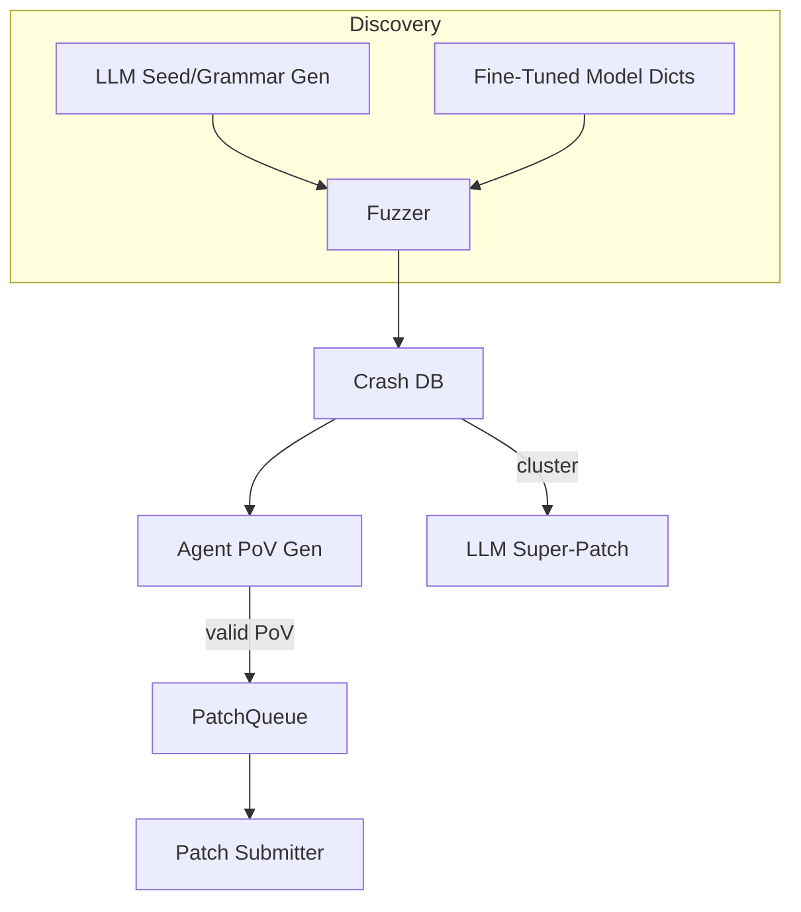

# Fuzzing wspomagany przez AI i automatyczne wykrywanie podatności

{{#include ../banners/hacktricks-training.md}}

## Przegląd
Duże modele językowe (LLM) mogą znacznie usprawnić tradycyjne procesy badania podatności, generując semantycznie bogate dane wejściowe, rozwijając gramatyki, analizując dane o awariach, a nawet proponując poprawki obejmujące wiele błędów. Ta strona przedstawia najskuteczniejsze wzorce zaobserwowane podczas finałów DARPA AI Cyber Challenge (AIxCC) oraz w innych publicznych badaniach.<sup>[[4]](#references)</sup><sup>[[5]](#references)</sup>

Poniższy opis nie dotyczy konkretnego systemu konkursowego, lecz przedstawia techniki w uogólnionej formie, aby można je było odtworzyć we własnych procesach.

---

## 1. Dane wejściowe seedów generowane przez LLM

Tradycyjne fuzzery sterowane pokryciem (AFL++, libFuzzer, Honggfuzz…) rozpoczynają pracę od niewielkiego zbioru seedów i bezładnie mutują bajty. Gdy format danych wejściowych programu jest złożony (SQL, URL-e, niestandardowe protokoły binarne), losowe mutacje zwykle psują składnię, zanim zostaną osiągnięte interesujące gałęzie.

LLM mogą rozwiązać ten problem początkowy, generując *generatory seedów* — krótkie skrypty, które tworzą **poprawne składniowo, ale istotne z punktu widzenia bezpieczeństwa dane wejściowe**. Na przykład:

```prompt
SYSTEM: You are a helpful security engineer.
USER:
Write a Python3 program that prints 200 unique SQL injection strings targeting common anti-pattern mistakes (missing quotes, numeric context, stacked queries).  Ensure length ≤ 256 bytes / string so they survive common length limits.
```

```python
# gen_sqli_seeds.py (truncated)
PAYLOADS = [
    "1 OR 1=1 -- ",
    "' UNION SELECT NULL,NULL--",
    "0; DROP TABLE users;--",
    ...
]
for p in PAYLOADS:
    print(p)
```

Uruchom raz i przekaż wynik bezpośrednio do początkowego korpusu fuzzera:

```bash
python3 gen_sqli_seeds.py > seeds.txt
afl-fuzz -i seeds.txt -o findings/ -- ./target @@
```

Benefits:
1. Poprawność semantyczna → głębsze pokrycie od samego początku.
2. Możliwość ponownego generowania: zmień prompt, aby skupić się na XSS, path traversal, binary blobs itd.
3. Niski koszt (< 1 ¢ z GPT-3.5).

### Tips
* Poleć modelowi *zróżnicować* długość payloadów i kodowanie (UTF-8, URL-encoded, UTF-16-LE), aby ominąć powierzchowne filtry.
* Poproś o *pojedynczy, samowystarczalny skrypt* – unikniesz problemów z formatowaniem JSON.

---

## 2. Grammar-Evolution Fuzzing

Bardziej zaawansowany wariant polega na tym, by pozwolić LLM **rozwijać gramatykę** zamiast konkretnych seedów. Przepływ pracy (wzorzec „Grammar Guy”) wygląda następująco:

1. Wygeneruj początkową gramatykę ANTLR/Peach/LibFuzzer za pomocą promptu.
2. Prowadź fuzzing przez N minut i zbieraj metryki pokrycia (trafione krawędzie / bloki).
3. Podsumuj niepokryte obszary programu i przekaż podsumowanie z powrotem modelowi:
   ```prompt
   The previous grammar triggered 12 % of the program edges.  Functions not reached: parse_auth, handle_upload.  Add / modify rules to cover these.
   ```
4. Scal nowe reguły, ponownie uruchom fuzzing i powtórz.

Szkielet pseudokodu:

```python
for epoch in range(MAX_EPOCHS):
    grammar = llm.refine(grammar, feedback=coverage_stats)
    save(grammar, f"grammar_{epoch}.txt")
    coverage_stats = run_fuzzer(grammar)
```

Kluczowe punkty:
* Trzymaj się *budżetu* — każde dopracowanie zużywa tokeny.
* Używaj instrukcji `diff` + `patch`, aby model edytował kod zamiast przepisywać go od nowa.
* Zakończ, gdy Δcoverage < ε.

---

## 3. Inżynieria harnessa libFuzzer z pomocą lokalnego LLM

Jeśli kod źródłowy nie może opuścić stacji roboczej analityka, lokalny model kodu może przygotować niewielki adapter między bajtami fuzzera a API C/C++. Granica bezpieczeństwa jest jasno określona: **model tworzy i modyfikuje infrastrukturę testową; mutacja sterowana coverage eksploruje wejścia; sanitizery zgłaszają nieprawidłowe operacje; człowiek sprawdza harness i analizuje zgłoszone problemy**.<sup>[[9]](#references)</sup>

Techniki pracy z corpus, feedbackiem, snapshotami i fuzzingiem stanowym na poziomie engine, które nie wymagają LLM, opisano w ogólnej [metodyce fuzzingu](../generic-methodologies-and-resources/fuzzing.md).

Zacznij od dokładnej deklaracji skopiowanej z nagłówka celu i narzuć format wyjściowy. Wąski prompt ogranicza wymyślanie API i ułatwia sprawdzenie wyniku:<sup>[[8]](#references)[[9]](#references)</sup>

```prompt
Write a libFuzzer target for this exact declaration:
int parse_records(const uint8_t *data, size_t size);

Output only C code. Implement LLVMFuzzerTestOneInput, include the
declaration, pass data and size unchanged, and do not use files,
network access, randomness, clocks, threads, or persistent state.
```

W przypadku parsera surowych bajtów oczekiwany wynik nie powinien być bardziej skomplikowany niż:<sup>[[6]](#references)[[9]](#references)</sup>

```c
#include <stddef.h>
#include <stdint.h>

extern int parse_records(const uint8_t *, size_t);

int LLVMFuzzerTestOneInput(const uint8_t *data, size_t size) {
    (void)parse_records(data, size);
    return 0;
}
```

Kompilacja to dopiero pierwszy etap walidacji. Przed przeznaczeniem na cel czasu procesora sprawdź każdy wygenerowany target pod kątem tych niezmienników:<sup>[[6]](#references)[[8]](#references)[[9]](#references)</sup>

- **Dokładne API:** porównaj typy, zasady zarządzania własnością, inicjalizację, sprzątanie i konwencję wywołań z rzeczywistym nagłówkiem oraz istniejącymi wywołującymi.
- **Bezpieczeństwo harnessu:** zabezpiecz każdy odczyt z `data`; błędy wykryte przez sanitizery muszą pochodzić z targetu, a nie z wygenerowanego kodu pośredniczącego.
- **Powtarzalność:** wynik musi być funkcją `data` i `size`; usuń zewnętrzne operacje wejścia/wyjścia, zależność od czasu, niekontrolowaną losowość, niepołączone wątki oraz stan zachowywany między wywołaniami.
- **Przepustowość:** inicjalizuj kosztowny, niezmienny stan tylko raz i tylko wtedy, gdy nie wpływa to na zachowanie; ogranicz rozmiar wejścia, wyłącz logowanie i zwalniaj alokacje dla każdego wejścia.
- **Osiągalność:** sprawdź, czy wykonywane są zamierzone funkcje i gałęzie. Target, który się kompiluje, ale sprawdza tylko ścieżki odrzucenia, to niezauważona porażka.

### Targety uwzględniające strukturę: zachowuj niezmienniki, nie ukrywając błędów

Jeśli większość surowych wejść nie przechodzi weryfikacji magicznej wartości, długości, wersji lub sumy kontrolnej, użyj bajtów fuzzera jako **materiału pól typowanych** i odbuduj prawidłowy obiekt. Ustaw stałe formatu, pozostaw pola semantyczne i bajty payloadu zmienne, a metadane integralności wylicz na podstawie odtworzonego payloadu. `FuzzedDataProvider` przydaje się do pobierania ograniczonych wartości typowanych, natomiast adapter nadal odpowiada za ograniczanie każdej wygenerowanej alokacji i konwersji.<sup>[[9]](#references)</sup>

<details>
<summary>Przykładowy target C++ uwzględniający strukturę</summary>

```cpp
#include <fuzzer/FuzzedDataProvider.h>
#include <stddef.h>
#include <stdint.h>
#include <vector>

extern "C" int parse_message(const uint8_t *, size_t);

extern "C" int LLVMFuzzerTestOneInput(const uint8_t *data, size_t size) {
    FuzzedDataProvider fdp(data, size);
    uint8_t version = fdp.ConsumeIntegral<uint8_t>();
    auto body = fdp.ConsumeRemainingBytes<uint8_t>();
    if (body.size() > UINT16_MAX) body.resize(UINT16_MAX);
    uint16_t len = static_cast<uint16_t>(body.size());
    std::vector<uint8_t> msg = {0x8b, 'M', 'S', 'G', version,
                                static_cast<uint8_t>(len >> 8),
                                static_cast<uint8_t>(len)};
    msg.insert(msg.end(), body.begin(), body.end());
    (void)parse_message(msg.data(), msg.size());
    return 0;
}
```

</details>

Nie używaj jednego celu naprawiającego strukturę do każdego pytania. Utrzymuj jeden cel, który wylicza długości/sumy kontrolne, aby eksplorować głębokie, poprawne stany, oraz drugi, który pozostawia **deklarowane** metadane pod kontrolą fuzzera, ograniczając jedynie odczyty i alokacje wykonywane przez harness. Drugi cel zachowuje powierzchnie ataku związane z niezgodnymi długościami i błędną integralnością, które automatyczna naprawa w przeciwnym razie by usunęła.<sup>[[9]](#references)</sup>

### Ziarna, słowniki, sanitizery i informacja zwrotna z pokrycia

Poproś model o wygenerowanie skryptu zapisującego binarne ziarna, zamiast prosić go o bezpośrednie wypisanie danych binarnych. Przygotuj ziarna dla pustych, minimalnych, typowych i poprawnych obiektów brzegowych, a następnie wyodrębnij wartości magiczne, tagi, kodowania enumów i słowa kluczowe parsera do sprawdzonego słownika. libFuzzer przyjmuje ten słownik za pomocą `-dict=` i zachowuje w korpusie mutacje, które ujawniają nowe pokrycie.<sup>[[6]](#references)[[9]](#references)</sup>

```text
magic="\x8bMSG"
version_min="\x00"
version_max="\xff"
config_tag="CONFIG"
```

Zbuduj ten sam cel z uzupełniającą instrumentacją. ASan i UBSan mogą współdzielić plik binarny do fuzzingu; użyj osobnej kompilacji MSan i instrumentuj jej zależności, aby uniknąć zgłoszeń powodowanych przez nieinstrumentowany kod.<sup>[[6]](#references)[[9]](#references)</sup>

```bash
clang++ -g -O1 -fsanitize=fuzzer,address,undefined \
  -fno-sanitize-recover=undefined target.cc harness.cc -o fuzz_target
./fuzz_target corpus -dict=msg.dict -max_len=65535

clang++ -g -O1 -fsanitize=fuzzer,memory \
  target.cc harness.cc -o fuzz_target_msan
```

Traktuj coverage jako kryterium oceny każdej rewizji modelu. W wynikach libFuzzer wczesne wypłaszczenie `cov`/`ft` i statyczny corpus zwykle oznaczają nieprawidłowe ramkowanie, zbyt restrykcyjny wczesny return albo niewłaściwe wywołanie; niskie `exec/s` wskazuje na kosztowną konfigurację, operacje I/O, alokację lub wyciek stanu. `NEW` dowodzi jedynie, że zmieniła się funkcja coverage, a nie że dotarto do zamierzonego parsera.<sup>[[6]](#references)[[9]](#references)</sup>

Aby uzyskać informacje zwrotne na poziomie źródła, utwórz build z coverage, uruchom fuzzing i przekaż modelowi tylko niepokryte funkcje wraz z warunkami, które je chronią. Zweryfikuj różnice w harness/seed/dictionary i ponownie wykonaj pomiary:<sup>[[7]](#references)[[8]](#references)[[9]](#references)</sup>

```bash
clang++ -g -O1 -fsanitize=fuzzer \
  -fprofile-instr-generate -fcoverage-mapping target.cc harness.cc -o fuzz_cov
mkdir -p profiles
LLVM_PROFILE_FILE='profiles/%p.profraw' ./fuzz_cov -max_total_time=300 corpus
llvm-profdata merge -sparse profiles/*.profraw -o fuzz.profdata
llvm-cov report ./fuzz_cov -instr-profile=fuzz.profdata
llvm-cov show ./fuzz_cov -instr-profile=fuzz.profdata \
  --show-branches=count --region-coverage-lt=1 target.cc
```

Skalowalna pętla wygląda więc następująco: **generuj → kompiluj/linkuj → wykonaj smoke test z włączonymi sanitizerami → zmierz pokrycie targetu → przekaż najmniejszy istotny kontekst dotyczący pokrycia/kodu źródłowego → popraw → zmierz ponownie**. OSS-Fuzz-Gen stosuje tę samą zasadę, oceniając wygenerowane targety pod kątem możliwości kompilacji, błędów w czasie działania, pokrycia i poprawy pokrycia względem istniejących targetów, zamiast uznawać wiarygodnie wyglądający kod za poprawny.<sup>[[7]](#references)[[8]](#references)</sup>

---

<a id="3-agent-based-pov-exploit-generation" hidden>3. Generowanie PoV (exploita) oparte na agentach</a>

## 4. Generowanie PoV (exploita) oparte na agentach

Po znalezieniu crasha nadal potrzebujesz **proof-of-vulnerability (PoV)**, który deterministycznie go wywołuje.

Skalowalne podejście polega na uruchomieniu wielu lekkich workerów (procesów, wątków lub kontenerów), z których każdy używa innego modelu lub konfiguracji próbkowania. Przegląd finalistów AIxCC podaje konkretne przykłady takiej skali: jeden zespół użył **tysięcy równoległych agentów** do generowania PoV w podejściu AI-first, a inny orkiestrzył działanie **300–500 agentów fuzzingowych** i wykorzystywał LLM-y do bardziej zaawansowanego rozumowania semantycznego.<sup>[[4]](#references)</sup>

Pipeline:
1. Analiza statyczna/dynamiczna wskazuje *kandydatów na błędy* (struct z crash PC, fragmentem wejścia i komunikatem sanitizera).
2. Orkiestrator przydziela kandydatów agentom.
3. Etapy rozumowania agenta:
   a. Odtwórz błąd lokalnie za pomocą `gdb` i wejścia.
   b. Zaproponuj minimalny payload exploita.
   c. Zweryfikuj exploit w sandboxie. Jeśli się powiedzie → prześlij.
4. Nieudane próby są **ponownie kolejkowane jako nowe seeds** do fuzzingu z pokryciem (pętla sprzężenia zwrotnego).

Zalety:
* Równoległość maskuje zawodność pojedynczego agenta.
* Automatyczne dostrajanie parametru temp / rozmiaru modelu na podstawie zaobserwowanego współczynnika sukcesu.

---

<a id="4-directed-fuzzing-with-fine-tuned-code-models" hidden>4. Ukierunkowany fuzzing z dostrojonymi modelami kodu</a>

## 5. Ukierunkowany fuzzing z dostrojonymi modelami kodu

Dostrój model z otwartymi wagami (np. Llama-7B) na kodzie źródłowym C/C++ oznaczonym wzorcami podatności (przepełnienie liczby całkowitej, kopiowanie do bufora, format string). Następnie:

1. Uruchom analizę statyczną, aby uzyskać listę funkcji i AST.
2. Zapytaj model: *„Podaj wpisy słownika mutacji, które prawdopodobnie naruszą bezpieczeństwo pamięci w funkcji X”*.
3. Wstaw te tokeny do własnego `AFL_CUSTOM_MUTATOR`.

Przykładowy wynik dla wrappera `sprintf`:
```
{"pattern":"%99999999s"}
{"pattern":"AAAAAAAA....<1024>....%n"}
```

Empirycznie skraca to czas do awarii ponad 2-krotnie na rzeczywistych celach.

---

<a id="5-ai-guided-patching-strategies" hidden>5. Strategie patchowania wspomaganego przez AI</a>

## 6. Strategie patchowania wspomaganego przez AI

<a id="51-super-patches" hidden>5.1 Superpatche</a>

### 6.1 Superpatche
Poproś model o *pogrupowanie* sygnatur awarii i zaproponowanie **pojedynczego patcha**, który usuwa wspólną przyczynę źródłową. Zgłoś go raz, napraw kilka błędów → mniej kar za brak dokładności w środowiskach, w których każdy błędny patch kosztuje punkty.

Zarys promptu:
```
Here are 10 stack traces + file snippets.  Identify the shared mistake and generate a unified diff fixing all occurrences.
```

{{#ref}}
../generic-methodologies-and-resources/fuzzing.md
{{#endref}}

<a id="52-speculative-patch-ratio" hidden>5.2 Wskaźnik spekulatywnych poprawek</a>

### 6.2 Wskaźnik spekulatywnych poprawek
Zaimplementuj kolejkę, w której przeplatają się potwierdzone poprawki zweryfikowane przez PoV i poprawki *spekulatywne* (bez PoV), w proporcji 1:​N dostosowanej do zasad punktacji (np. 2 spekulatywne : 1 potwierdzona). Model kosztów monitoruje kary i punkty oraz samodzielnie dostosowuje N.

---

<a id="6-deterministic-file-by-file-ai-code-review" hidden>6. Deterministyczny przegląd kodu AI plik po pliku</a>

## 7. Deterministyczny przegląd kodu AI plik po pliku

Częstym trybem porażki podczas przeglądu wspomaganego przez AI jest poproszenie jednego agenta o sprawdzenie całego repozytorium i liczenie na to, że wybierze właściwe pliki i terminy grep. Bardziej niezawodny wzorzec polega na **wymuszeniu pokrycia repozytorium**:<sup>[[1]](#references)</sup>

1. Wylicz pliki źródłowe.
2. Przekazuj **po jednym pliku naraz** wraz z minimalnym kontekstem (entrypoint, importy, pobliskie trasy/wywołujący).
3. Wymagaj **ustrukturyzowanego raportu** dla każdego pliku: źródła, sink, brakująca walidacja, warunki wstępne exploita i poziom pewności.<sup>[[3]](#references)</sup>
4. Usuwaj duplikaty raportów według **wzorca source→sink** i ręcznie weryfikuj te o wysokim ryzyku.

To podejście zużywa dużo tokenów i generuje szum, ale bardzo skutecznie wykrywa **proste błędy source/sink o dużym wpływie**, które często umykają szerokim, agentowym przeglądom.

### Wzorce do priorytetowej triage

- **Dynamiczne dołączanie/dispatch w PHP**: kontrolowane przez atakującego nazwy tras/kontrolerów/modułów trafiają do `require_once()`, `include()` lub `include_once()` bez ścisłej listy dozwolonych wartości i kanonikalizacji ścieżek.
- **Wykonywanie poleceń powłoki w procesach administracyjnych/zarządzania kontem**: nazwy użytkowników, domeny, konta FTP lub inne identyfikatory trafiają do `exec()`, `system()`, `shell_exec()`, `passthru()`, `proc_open()` lub `popen()`.
- **Zbieganie się ustrukturyzowanych danych wejściowych**: ten sam parametr jest przyjmowany z `$_GET`, `$_POST`, JSON, XML lub parserów treści żądań frameworka, a następnie ponownie używany w sinkach systemu plików lub poleceń systemu operacyjnego.

### Dwie praktyczne klasy błędów, które ta metoda dobrze wykrywa

- **LFI/RCE przez dispatch kontrolera PHP**: jeśli nazwa kontrolera pochodząca z żądania jest łączona z `require_once()` bez listy dozwolonych wartości/normalizacji ścieżki, sekwencje traversal, takie jak `../`, mogą sprawić, że PHP dołączy niezamierzony lokalny plik `.php`. Jeśli atakujący może skierować dołączanie na umieszczony lub w inny sposób przydatny plik PHP, LFI prowadzi do wykonania kodu. Zobacz [File Inclusion / Path Traversal](../pentesting-web/file-inclusion/README.md).<sup>[[1]](#references)</sup>
- **Uwierzytelnione command injection w panelach hostingowych/administracyjnych**: jeśli pola zarządzania kontami, takie jak nazwy użytkowników, są osadzane w poleceniach powłoki, uwierzytelniony użytkownik o niskich uprawnieniach może zamienić zwykłą operację tworzenia/usuwania w RCE. Wpływ jest większy, gdy panel wykonuje polecenie jako konto usługi o wyższych uprawnieniach. Zobacz [Command Injection](../pentesting-web/command-injection.md).<sup>[[1]](#references)</sup>

### Praktyczne wskazówki dotyczące przeglądu

- Najpierw używaj LLM jako narzędzia do przeglądu **source/sink**, a nie generatora exploitów.
- Poproś go o jednoznaczne wskazanie **pola kontrolowanego przez atakującego**, **braku normalizacji/walidacji** i **niebezpiecznego sinka**.
- W dużych repozytoriach deterministyczny przegląd plik po pliku jest często bardziej niezawodny niż pojedyncze uruchomienie autonomicznego agenta, nawet jeśli ten ostatni korzysta z mocniejszego modelu.<sup>[[2]](#references)</sup>
- Spodziewaj się słabszych wyników w przypadku **Broken Access Control** i innych błędów logiki biznesowej, których exploitatowalność zależy od założeń obejmujących wiele plików, semantyki ról lub specyficznych dla produktu modeli zagrożeń.

---

## 8. Audyt jądra oparty na wzorcach z instrumentowanym oracle

W przypadku celu wielkości jądra nie proś agenta o szukanie dowolnych błędów w całym drzewie. Bardziej oszczędny pod względem tokenów proces przekształca wiedzę o historycznych podatnościach w zapytania statyczne, szereguje wyniki według dostępnej powierzchni ataku i wykorzystuje instrumentowane jądro jako oracle wykonania.<sup>[[11]](#references)</sup>

### Baza wzorców → CodeQL/Semgrep → ukierunkowany przegląd

Zbuduj niewielką bazę wiedzy zawierającą niebezpieczne API, wzorce braku walidacji, ryzykowne przepływy source-to-sink oraz kształty wcześniej naprawionych błędów. Poproś model o przekształcenie **jednego wzorca naraz** w heurystyki przeglądu i reguły CodeQL/Semgrep, a następnie uruchom te deterministyczne reguły na całym drzewie. Zgrupuj i usuń duplikaty wyników, zanim przekażesz kod modelowi; surowe wyniki skanera mogą zawierać tysiące kandydatów o niewielkiej wartości. Przed użyciem tego podejścia poza kwalifikującymi się celami badawczymi lub open source sprawdź aktualną licencję CodeQL.<sup>[[11]](#references)</sup>

Ustalaj priorytety podsystemów na podstawie zarówno **zagęszczenia trafień reguł**, jak i **dostępności dla atakującego**, a nie samej liczby trafień. Interfejsy jądra dostępne z nieuprzywilejowanych procesów, sandboxów, kontenerów, jaili lub kontekstów gościa zasługują na większą wagę niż kod dostępny wyłącznie wewnętrznie. Utrzymuj jednostkę przeglądu na tyle małą, by agent mógł zachować kontekst wywołujących, walidatorów i zasad zarządzania czasem życia, a w prompcie wskazuj konkretną klasę podatności lub wzorzec przepływu sterowania, zamiast prosić o „znalezienie dowolnej podatności”. Szczególnie interesujące są starsze uprzywilejowane interfejsy, gdy nowsza granica izolacji udostępnia je użytkownikowi root w przestrzeni nazw lub jailu.<sup>[[11]](#references)</sup>

W przypadku każdego kandydata wymagaj jawnego zapisu przepływu pól przed podjęciem próby exploita.<sup>[[11]](#references)</sup>

```text
entrypoint -> privilege check -> parser -> validation/normalization
           -> later rewrite -> dangerous sink
attacker controls: <fields and lengths>
constraints:       <values rewritten, rejected, or preserved>
observable result: <sanitizer report, assertion, panic, or clean exit>
```

### Użyj telemetrii KASAN jako wyroczni hipotez

Uruchom docelowe jądro w jednorazowej maszynie wirtualnej z włączonym KASAN i przydatnymi asercjami diagnostycznymi. Agent powinien iterować według schematu **hipoteza dotycząca kodu źródłowego → minimalny wyzwalacz w userlandzie → wykonanie w maszynie wirtualnej → ślad KASAN/asercji → poprawiona hipoteza**, aż podejrzewana korupcja zostanie odtworzona lub odrzucona. Przy każdej iteracji zwracaj tylko istotny ślad stosu i pobliski kod źródłowy; zachowuje to kontekst potrzebny do analizy i sprawia, że o akceptacji decydują dowody z uruchomienia, a nie pewność modelu.<sup>[[11]](#references)</sup>

Instrumentowana kompilacja nie jest środowiskiem do ostatecznej oceny możliwości wykorzystania błędu. Asercje mogą zatrzymać wykonanie przed operacją powodującą korupcję, a ta sama asercja może być pominięta w kompilacji produkcyjnej jądra. Ponownie przetestuj niezmieniony wyzwalacz na dokładnej konfiguracji produkcyjnej, zapisz wersję kompilacji i konfigurację jądra oraz rozdziel **osiągalność**, **korupcję pamięci**, **kontrolowaną prymitywę** i **wpływ na bezpieczeństwo** jako osobne twierdzenia.<sup>[[11]](#references)[[12]](#references)</sup>

CVE-2026-3038 to użyteczny przykład walidacji, a nie szablon exploita. Nieuprzywilejowane żądanie FreeBSD `RTM_GET` mogło zachować zbyt duży sockaddr `RTAX_AUTHOR` mimo selektywnej walidacji i przepisywania odpowiedzi, aż `rtsock_msg_buffer()` skopiowało kontrolowane przez użytkownika `sa_len` do 128-bajtowego `sockaddr_storage` na stosie. Kopia o maksymalnej długości 255 bajtów powodowała nadpisanie 127 bajtów; asercja diagnostyczna wykrywała nieprawidłową długość w instrumentowanej kompilacji, natomiast jądro GENERIC wykonywało kopię, a następnie ulegało awarii podczas sprawdzania uszkodzonego canary. Dowodzi to nieuprzywilejowanej odmowy usługi, a nie samodzielnej eskalacji uprawnień: niezawodne przejęcie kontroli wymagałoby najpierw innej prymitywy, na przykład ujawnienia canary. Zobacz [Stack Canaries](../binary-exploitation/common-binary-protections-and-bypasses/stack-canaries/index.html), aby poznać odpowiadającą temu granicę binary exploitation.<sup>[[11]](#references)[[12]](#references)[[13]](#references)</sup>

### Odrzucaj oszukiwanie w kwestii warunków wstępnych exploita

Przed zaakceptowaniem PoV lub exploita poproś niezależnego recenzenta/agenta o próbę obalenia go według ustalonych kryteriów. Recenzja musi potwierdzić wszystkie poniższe warunki.<sup>[[11]](#references)</sup>

- Kod źródłowy celu, jądro ani podatny moduł nie zostały zmodyfikowane, aby umożliwić osiągnięcie danej ścieżki.
- Nie dodano modułu pomocniczego, syntetycznego gadżetu, wyłączonego zabezpieczenia, dodatkowych uprawnień ani niedostępnego interfejsu.
- Wyzwalacz uruchamia się z deklarowaną tożsamością wywołującego i ograniczeniami izolacji, na czystej migawce.
- Deklarowany wynik nadal zależy od błędu: usunięcie nieprawidłowego pola lub załatanie samego błędu musi przerwać łańcuch.
- Awaria, odczyt poza zakresem lub nadpisanie są zgłaszane wyłącznie jako dana prymitywa; wykonanie kodu lub eskalacja uprawnień wymagają niezależnych dowodów.

Ta ostatnia weryfikacja kontrfaktyczna wychwytuje demonstracje oparte na błędnym kole: jeśli warunki wstępne już zapewniają deklarowany wpływ (na przykład wykonanie treści SUID dostarczonej przez atakującego z systemu plików zamontowanego bez `nosuid`), błąd bezpieczeństwa pamięci nie spowodował tego wpływu.<sup>[[11]](#references)</sup>

---

## Audytowalne badanie nieznanych baz kodu wspomagane przez agentów

[graph-first fuzz-target workflow](../generic-methodologies-and-resources/fuzzing.md#graph-first-fuzz-target-selection-and-mutation-triage) obejmuje już osiągalność punktów wejścia, a [agentic SAST pipelines](../network-services-pentesting/pentesting-web/code-review-tools.md#agentic-sast-pipelines) — etapową weryfikację i bramki dowodowe. Trzymaj te deterministyczne wyniki oddzielnie od hipotez modelu, aby każdy awansowany trop zachował lokalizacje w kodzie źródłowym, dowody dotyczące ścieżki i pomiar dynamiczny.<sup>[[10]](#references)</sup>

### Koreluj dowody dotyczące cyklu życia obiektu, nie wymyślając przepływu danych

Analiza statyczna może wykryć, że kontrolowana przez atakującego długość jest zapisywana w jednej funkcji, a to samo pole obiektu trafia do miejsca kopiowania znacznie później, ale nie potrafić udowodnić związku między nimi przez callbacki, ponowne połączenia lub cykl życia obiektu. Zachowaj oba ustalenia osobno, grupuj je według obiektu/pola i wyraźnie sformułuj brakujące powiązanie jako pytanie do triage. Agent może zasugerować taki związek, ale musi on zostać potwierdzony przez analizę kodu źródłowego lub instrumentację uruchomieniową.<sup>[[10]](#references)</sup>

Dla każdego kandydata zapisz:

- konkretny punkt wejścia i bajty kontrolowane przez atakującego;
- każdego producenta odpowiedniego pola, łącznie z walidacją właściwą dla danego producenta;
- miejsce docelowe, pojemność bufora oraz warunki kompilacji/uruchomienia wymagane do osiągnięcia tego miejsca;
- rzeczywisty stos wywołań z wystawionego punktu wejścia, a nie tylko bezpośrednie wywołanie harnessu;
- najmniejszy wynik dynamiczny, który potwierdza lub odrzuca hipotezę.

Pozornie bezpieczna ścieżka nie oznacza, że pole jest bezpieczne globalnie. Drugi producent może wypełnić to samo pole bez ograniczenia z pierwszej ścieżki. Testuj ścieżki niezależnie i uruchamiaj harness z opcjami kompilacji równoważnymi wdrożeniu, ponieważ asercje debugowania mogą zamienić produkcyjną korupcję pamięci w przedwczesne przerwanie występujące wyłącznie w testach.<sup>[[10]](#references)</sup>

### Bramki pomiarowe dla ujawnienia i wykorzystania błędu

W przypadku podejrzenia ujawnienia niezainicjalizowanej pamięci wypełnij świeże alokacje rozpoznawalnym bajtem i sprawdź, czy dokładnie ten znacznik trafia do wysyłanego pakietu. Wymagaj dla wykorzystania błędu zmierzonych etapów, takich jak **kontrolowane nadpisanie → przydatny obiekt ofiary → ujawnienie → odzyskanie wskaźnika/bazy → przejęcie przepływu sterowania → złożony payload**. Agent przechodzi dalej tylko wtedy, gdy harness potwierdzi bieżącą właściwość; wiarygodna narracja nie oznacza zaliczenia etapu. Przypadek [FreeRDP](../binary-exploitation/libc-heap/heap-overflow.md#cross-path-length-reuse-and-stale-output-disclosure) pokazuje ścieżkę i ograniczenia kompilacji, które należy zachować podczas walidacji.<sup>[[10]](#references)</sup>

---

Przykład analizy jądra z etapową walidacją L0–L4 w procesie tworzenia exploitów wspomaganym przez LLM znajdziesz tutaj:

{{#ref}}
../binary-exploitation/freebsd-kernel-exploitation-vnet-jail-escape.md
{{#endref}}

## Złożenie wszystkiego w całość
Kompleksowy CRS (Cyber Reasoning System) może łączyć te komponenty w następujący sposób:



---

## References

- [1] [Project Black - Lokalna AI dla cyberbezpieczeństwa: wykrywanie LFI w phpIPAM i uwierzytelnionego RCE w myVesta](https://projectblack.io/blog/local-ai-for-cyber-security)
- [2] [Strix](https://github.com/usestrix/strix)
- [3] [Umiejętność security-review społeczności GitHub Copilot](https://github.com/github/awesome-copilot/blob/main/skills/security-review/SKILL.md)
- [4] [Trail of Bits – Finały AIxCC: analiza wydarzeń](https://blog.trailofbits.com/2025/08/07/aixcc-finals-tale-of-the-tape/)
- [5] [CTF Radiooo: wywiady z finalistami AIxCC](https://www.youtube.com/@ctfradiooo)
- [6] [LLVM — libFuzzer: biblioteka do testowania fuzzingiem sterowanym pokryciem kodu](https://llvm.org/docs/LibFuzzer.html)
- [7] [Google — OSS-Fuzz-Gen](https://github.com/google/oss-fuzz-gen)
- [8] [Google Online Security Blog — Wyższy poziom fuzzingu: wykrywanie większej liczby podatności z pomocą AI](https://security.googleblog.com/2024/11/leveling-up-fuzzing-finding-more.html)
- [9] [8kSec — Generowanie harnessów fuzzingowych z pomocą AI przy użyciu lokalnego LLM](https://8ksec.io/ai-assisted-fuzzing-harness-local-llm)
- [10] [Quarkslab — Od agentów AI do RCE: tworzenie przepływu pracy badania podatności](https://blog.quarkslab.com/from-ai-agents-to-rce-building-a-vulnerability-research-workflow.html)
- [11] [Praetorian — FreeBSoD: wykorzystanie modeli językowych do znajdowania i wykorzystywania błędów jądra (część 1 z 2)](https://praetorian.com/blog/ai-vulnerability-research-freebsd-kernel)
- [12] [FreeBSD-SA-26:05.route — lokalny DoS i możliwe podniesienie uprawnień za pośrednictwem gniazd routingu](https://www.freebsd.org/security/advisories/FreeBSD-SA-26:05.route.asc)
- [13] [FreeBSD-SA-26:05.route: łatka źródłowa](https://security.FreeBSD.org/patches/SA-26:05/route.patch)
{{#include ../banners/hacktricks-training.md}}
