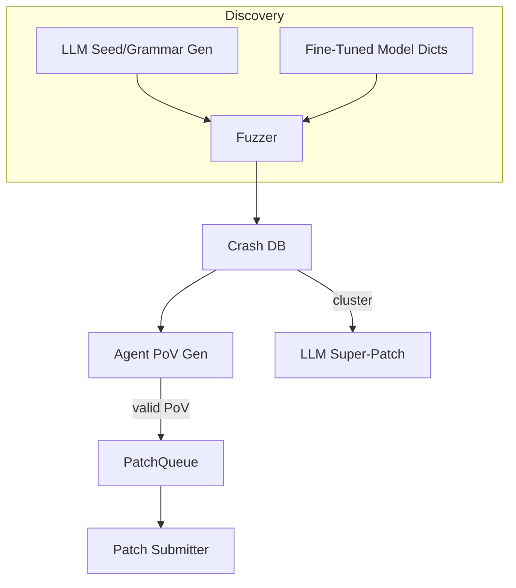

# Fuzzing asistido por IA y descubrimiento automatizado de vulnerabilidades

{{#include ../banners/hacktricks-training.md}}

## Descripción general
Los modelos de lenguaje grandes (LLM) pueden potenciar enormemente los flujos de trabajo tradicionales de investigación de vulnerabilidades al generar entradas semánticamente ricas, evolucionar gramáticas, razonar sobre datos de fallos e incluso proponer parches para múltiples bugs. Esta página recopila los patrones más eficaces observados durante las finales del AI Cyber Challenge (AIxCC) de DARPA y otras investigaciones públicas.<sup>[[4]](#references)</sup><sup>[[5]](#references)</sup>

Lo que sigue no es una descripción de un sistema específico de competición, sino una abstracción de las técnicas para que puedas reproducirlas en tus propios flujos de trabajo.

---

## 1. Entradas semilla generadas por LLM

Los fuzzers tradicionales guiados por cobertura (AFL++, libFuzzer, Honggfuzz…) comienzan con un pequeño corpus de semillas y mutan bytes a ciegas. Cuando el formato de entrada objetivo es complejo (SQL, URLs, protocolos binarios personalizados), las mutaciones aleatorias suelen romper la sintaxis antes de alcanzar ramas interesantes.

Los LLM pueden resolver este problema inicial generando *generadores de semillas*: scripts breves que producen **entradas sintácticamente correctas pero relevantes para la seguridad**. Por ejemplo:

```prompt
SYSTEM: You are a helpful security engineer.
USER:
Write a Python3 program that prints 200 unique SQL injection strings targeting common anti-pattern mistakes (missing quotes, numeric context, stacked queries).  Ensure length ≤ 256 bytes / string so they survive common length limits.
```

```python
# gen_sqli_seeds.py (truncated)
PAYLOADS = [
    "1 OR 1=1 -- ",
    "' UNION SELECT NULL,NULL--",
    "0; DROP TABLE users;--",
    ...
]
for p in PAYLOADS:
    print(p)
```

Ejecuta una vez y alimenta la salida directamente al corpus inicial del fuzzer:

```bash
python3 gen_sqli_seeds.py > seeds.txt
afl-fuzz -i seeds.txt -o findings/ -- ./target @@
```

Beneficios:
1. Validez semántica → mayor cobertura desde el principio.
2. Regenerable: modifica el prompt para enfocarlo en XSS, path traversal, blobs binarios, etc.
3. Barato (< 1 ¢ con GPT-3.5).

### Consejos
* Indica al modelo que *diversifique* la longitud y la codificación de los payloads (UTF-8, URL-encoded, UTF-16-LE) para eludir filtros superficiales.
* Pide un *único script autónomo*: evita problemas de formato JSON.

---

## 2. Grammar-Evolution Fuzzing

Una variante más potente consiste en dejar que el LLM **evolucione una gramática** en lugar de semillas concretas. El flujo de trabajo (patrón “Grammar Guy”) es:

1. Genera una gramática inicial de ANTLR/Peach/LibFuzzer mediante un prompt.
2. Ejecuta fuzzing durante N minutos y recopila métricas de cobertura (aristas / bloques alcanzados).
3. Resume las áreas del programa que no se han cubierto y vuelve a introducir el resumen en el modelo:
   ```prompt
   The previous grammar triggered 12 % of the program edges.  Functions not reached: parse_auth, handle_upload.  Add / modify rules to cover these.
   ```
4. Combina las nuevas reglas, vuelve a ejecutar fuzzing y repite.

Esqueleto de pseudocódigo:

```python
for epoch in range(MAX_EPOCHS):
    grammar = llm.refine(grammar, feedback=coverage_stats)
    save(grammar, f"grammar_{epoch}.txt")
    coverage_stats = run_fuzzer(grammar)
```

Puntos clave:
* Mantén un *presupuesto*: cada refinamiento consume tokens.
* Usa instrucciones `diff` + `patch` para que el modelo edite en lugar de reescribir.
* Detente cuando Δcoverage < ε.

---

## 3. Ingeniería de harness para libFuzzer con LLM local

Cuando el código fuente no puede salir de la estación de trabajo de un analista, un modelo de código local puede redactar el pequeño adaptador entre los bytes del fuzzer y una API de C/C++. El límite de seguridad útil es explícito: **el modelo escribe y revisa la infraestructura de pruebas; la mutación guiada por cobertura explora entradas; los sanitizers informan de operaciones no válidas; una persona revisa el harness y clasifica los hallazgos**.<sup>[[9]](#references)</sup>

Para consultar técnicas de corpus, feedback, snapshot y fuzzing con estado a nivel de motor que no dependen de un LLM, consulta la [Metodología de Fuzzing](../generic-methodologies-and-resources/fuzzing.md).

Empieza con la declaración exacta copiada del encabezado de destino y limita el formato de salida. Un prompt específico reduce las API inventadas y facilita la revisión del resultado:<sup>[[8]](#references)[[9]](#references)</sup>

```prompt
Write a libFuzzer target for this exact declaration:
int parse_records(const uint8_t *data, size_t size);

Output only C code. Implement LLVMFuzzerTestOneInput, include the
declaration, pass data and size unchanged, and do not use files,
network access, randomness, clocks, threads, or persistent state.
```

Para un parser de bytes en bruto, el resultado esperado no debería ser más complicado que:<sup>[[6]](#references)[[9]](#references)</sup>

```c
#include <stddef.h>
#include <stdint.h>

extern int parse_records(const uint8_t *, size_t);

int LLVMFuzzerTestOneInput(const uint8_t *data, size_t size) {
    (void)parse_records(data, size);
    return 0;
}
```

La compilación es solo la primera etapa de validación. Revisa cada target generado con respecto a estas invariantes antes de dedicarle tiempo de CPU:<sup>[[6]](#references)[[8]](#references)[[9]](#references)</sup>

- **API exacta:** compara los tipos, las reglas de ownership, la inicialización, el teardown y la convención de llamada con el header real y los callers existentes.
- **Seguridad del harness:** protege cada lectura de `data`; los hallazgos del sanitizer deben originarse en el target, no en el glue generado.
- **Repetibilidad:** haz que el resultado dependa de `data` y `size`; elimina la E/S externa, el tiempo, la aleatoriedad no controlada, los threads sin unir y el estado que persista entre llamadas.
- **Throughput:** inicializa el estado inmutable costoso una sola vez, solo si esto no afecta el comportamiento; limita el tamaño de entrada, suprime el logging y libera las asignaciones por entrada.
- **Alcanzabilidad:** verifica que se ejecuten las funciones y ramas previstas. Un target que compila, pero solo recorre rutas de rechazo, es un fallo silencioso.

### Targets conscientes de la estructura: preserva las invariantes sin ocultar bugs

Si la mayoría de las entradas sin procesar no superan una comprobación de magic, longitud, versión o checksum, usa los bytes de fuzzing como **material para campos tipados** y reconstruye un objeto válido. Fija las constantes del formato, deja mutables los campos semánticos y los bytes del payload, y deriva los metadatos de integridad del payload reconstruido. `FuzzedDataProvider` resulta útil para consumir valores tipados acotados, mientras que el adapter sigue siendo responsable de limitar cualquier asignación y conversión generadas.<sup>[[9]](#references)</sup>

<details>
<summary>Ejemplo de target C++ consciente de la estructura</summary>

```cpp
#include <fuzzer/FuzzedDataProvider.h>
#include <stddef.h>
#include <stdint.h>
#include <vector>

extern "C" int parse_message(const uint8_t *, size_t);

extern "C" int LLVMFuzzerTestOneInput(const uint8_t *data, size_t size) {
    FuzzedDataProvider fdp(data, size);
    uint8_t version = fdp.ConsumeIntegral<uint8_t>();
    auto body = fdp.ConsumeRemainingBytes<uint8_t>();
    if (body.size() > UINT16_MAX) body.resize(UINT16_MAX);
    uint16_t len = static_cast<uint16_t>(body.size());
    std::vector<uint8_t> msg = {0x8b, 'M', 'S', 'G', version,
                                static_cast<uint8_t>(len >> 8),
                                static_cast<uint8_t>(len)};
    msg.insert(msg.end(), body.begin(), body.end());
    (void)parse_message(msg.data(), msg.size());
    return 0;
}
```

</details>

No uses un único target que repare estructuras para todas las preguntas. Mantén un target que derive longitudes/sumas de comprobación para explorar estados válidos profundos, y otro que mantenga los metadatos **declarados** bajo el control del fuzzer y limite únicamente las lecturas y asignaciones de memoria propias del harness. El segundo target conserva las superficies de ataque de longitudes incoherentes e integridad incorrecta que la reparación automática eliminaría.<sup>[[9]](#references)</sup>

### Semillas, diccionarios, sanitizers y feedback de cobertura

Pídele al modelo que genere un script que escriba semillas binarias en lugar de pedirle que imprima directamente datos binarios. Usa objetos vacíos, mínimos, típicos y válidos en los límites; luego extrae los valores mágicos, tags, codificaciones de enum y palabras clave del parser para crear un diccionario revisado. libFuzzer acepta ese diccionario con `-dict=`, y conserva en el corpus las mutaciones que revelan nueva cobertura.<sup>[[6]](#references)[[9]](#references)</sup>

```text
magic="\x8bMSG"
version_min="\x00"
version_max="\xff"
config_tag="CONFIG"
```

Compila el mismo objetivo con instrumentación complementaria. ASan y UBSan pueden compartir un binario de fuzzing; usa una compilación independiente con MSan e instrumenta sus dependencias para evitar informes causados por código no instrumentado.<sup>[[6]](#references)[[9]](#references)</sup>

```bash
clang++ -g -O1 -fsanitize=fuzzer,address,undefined \
  -fno-sanitize-recover=undefined target.cc harness.cc -o fuzz_target
./fuzz_target corpus -dict=msg.dict -max_len=65535

clang++ -g -O1 -fsanitize=fuzzer,memory \
  target.cc harness.cc -o fuzz_target_msan
```

Trata la cobertura como el evaluador de cada revisión del modelo. En la salida de libFuzzer, valores `cov`/`ft` que se estancan pronto y un corpus estático suelen indicar un encuadre incorrecto, un retorno anticipado demasiado restrictivo o una llamada equivocada; un `exec/s` bajo apunta a una configuración costosa, E/S, asignaciones o estado filtrado. `NEW` solo demuestra que cambió una característica de cobertura, no que se alcanzó el parser previsto.<sup>[[6]](#references)[[9]](#references)</sup>

Para obtener feedback a nivel de código fuente, genera una compilación con cobertura, haz fuzzing y proporciona al modelo únicamente las funciones no cubiertas y sus condiciones de protección. Verifica el diff del harness/seed/dictionary y vuelve a medir:<sup>[[7]](#references)[[8]](#references)[[9]](#references)</sup>

```bash
clang++ -g -O1 -fsanitize=fuzzer \
  -fprofile-instr-generate -fcoverage-mapping target.cc harness.cc -o fuzz_cov
mkdir -p profiles
LLVM_PROFILE_FILE='profiles/%p.profraw' ./fuzz_cov -max_total_time=300 corpus
llvm-profdata merge -sparse profiles/*.profraw -o fuzz.profdata
llvm-cov report ./fuzz_cov -instr-profile=fuzz.profdata
llvm-cov show ./fuzz_cov -instr-profile=fuzz.profdata \
  --show-branches=count --region-coverage-lt=1 target.cc
```

El ciclo escalable es, por tanto, **generar → compilar/enlazar → hacer smoke-test con sanitizers → medir la cobertura del objetivo → proporcionar el contexto mínimo relevante de cobertura/código fuente → revisar → volver a medir**. OSS-Fuzz-Gen aplica el mismo principio: evalúa los objetivos generados según su capacidad de compilar, los fallos en tiempo de ejecución, la cobertura y la mejora de cobertura frente a los objetivos existentes, en lugar de aceptar código plausible sin más.<sup>[[7]](#references)[[8]](#references)</sup>

---

<a id="3-agent-based-pov-exploit-generation" hidden>3. Generación de PoV (Exploit) basada en agentes</a>

## 4. Generación de PoV (Exploit) basada en agentes

Una vez encontrado un crash, aún necesitas un **proof-of-vulnerability (PoV)** que lo desencadene de forma determinista.

Un enfoque escalable consiste en iniciar muchos workers ligeros (procesos, hilos o contenedores), cada uno con un modelo o una configuración de muestreo diferente. La encuesta a los finalistas de AIxCC ofrece ejemplos concretos de esta escala: un equipo usó **miles de agentes concurrentes** para generar PoV con un enfoque AI-first, mientras que otro coordinó **300–500 agentes de fuzzing** y reservó los LLM para el razonamiento semántico de alto nivel.<sup>[[4]](#references)</sup>

Pipeline:
1. El análisis estático/dinámico produce *candidatos a bugs* (struct con crash PC, fragmento de input y mensaje de sanitizer).
2. El orquestador distribuye los candidatos entre los agentes.
3. Pasos de razonamiento del agente:
   a. Reproducir el bug localmente con `gdb` + input.
   b. Proponer un payload de exploit mínimo.
   c. Validar el exploit en un sandbox. Si funciona → enviar.
4. Los intentos fallidos se **vuelven a poner en cola como nuevas seeds** para el fuzzing de cobertura (bucle de feedback).

Ventajas:
* La paralelización oculta la falta de fiabilidad de un solo agente.
* Ajuste automático de temp / tamaño del modelo según la tasa de éxito observada.

---

<a id="4-directed-fuzzing-with-fine-tuned-code-models" hidden>4. Fuzzing dirigido con modelos de código ajustados</a>

## 5. Fuzzing dirigido con modelos de código ajustados

Ajusta un modelo de pesos abiertos (p. ej., Llama-7B) con código fuente C/C++ etiquetado con patrones de vulnerabilidad (desbordamiento de enteros, copia de búfer, format string). Luego:

1. Ejecuta un análisis estático para obtener la lista de funciones + AST.
2. Pídele al modelo: *“Dame entradas para el diccionario de mutaciones que probablemente vulneren la seguridad de memoria en la función X”*.
3. Inserta esos tokens en un `AFL_CUSTOM_MUTATOR` personalizado.

Ejemplo de salida para un wrapper de `sprintf`:
```
{"pattern":"%99999999s"}
{"pattern":"AAAAAAAA....<1024>....%n"}
```

Empíricamente, esto reduce el time-to-crash en más de 2× en objetivos reales.

---

<a id="5-ai-guided-patching-strategies" hidden>5. Estrategias de patching guiadas por IA</a>

## 6. Estrategias de patching guiadas por IA

<a id="51-super-patches" hidden>5.1 Super Patches</a>

### 6.1 Super Patches
Pídele al modelo que *agrupe* las firmas de crash y proponga un **único patch** que elimine la causa raíz común. Envíalo una vez y corrige varios bugs → menos penalizaciones de precisión en entornos donde cada patch incorrecto cuesta puntos.

Esquema del prompt:
```
Here are 10 stack traces + file snippets.  Identify the shared mistake and generate a unified diff fixing all occurrences.
```

{{#ref}}
../generic-methodologies-and-resources/fuzzing.md
{{#endref}}

<a id="52-speculative-patch-ratio" hidden>5.2 Speculative Patch Ratio</a>

### 6.2 Proporción de parches especulativos
Implementa una cola donde los parches confirmados y validados mediante PoV se intercalen con parches *especulativos* (sin PoV) en una proporción de 1:N ajustada a las reglas de puntuación (p. ej., 2 especulativos : 1 confirmado). Un modelo de costos supervisa las penalizaciones frente a los puntos y ajusta N automáticamente.

---

Para revisiones de código fuente deterministas, archivo por archivo, taskflows de puntos de entrada móviles, auditorías de patrones del kernel y validación de vulnerabilidades condicionada por evidencias, consulta [Revisión de código fuente asistida por IA y validación de vulnerabilidades](AI-Assisted-Source-Review-and-Vulnerability-Validation.md).

---

## Triaje de crashes asistido por debugger

Los workflows de Mona v3 para el triaje de crashes, el análisis de funciones y la alcanzabilidad controlada de heap chunks están en [Herramientas de explotación](../binary-exploitation/basic-stack-binary-exploitation-methodology/tools/#mona-v3-debugger-context-requests-for-crash-triage).

---

## Integración de todos los componentes
Un CRS (Cyber Reasoning System) integral puede conectar los componentes de la siguiente manera:



---

## References

- [4] [Trail of Bits – AIxCC finals: crónica del desenlace](https://blog.trailofbits.com/2025/08/07/aixcc-finals-tale-of-the-tape/)
- [5] [Entrevistas de CTF Radiooo a los finalistas de AIxCC](https://www.youtube.com/@ctfradiooo)
- [6] [LLVM — libFuzzer: una biblioteca para pruebas de fuzzing guiadas por cobertura](https://llvm.org/docs/LibFuzzer.html)
- [7] [Google — OSS-Fuzz-Gen](https://github.com/google/oss-fuzz-gen)
- [8] [Google Online Security Blog — Cómo mejorar el fuzzing: encontrar más vulnerabilidades con IA](https://security.googleblog.com/2024/11/leveling-up-fuzzing-finding-more.html)
- [9] [8kSec — Generación de harnesses para fuzzing asistida por IA con un LLM local](https://8ksec.io/ai-assisted-fuzzing-harness-local-llm)
{{#include ../banners/hacktricks-training.md}}
