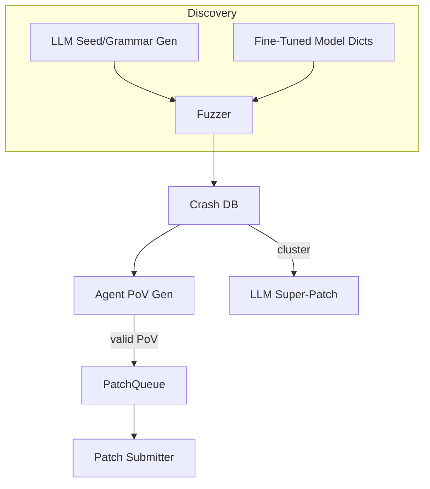

# Fuzzing assistito dall’AI e scoperta automatizzata delle vulnerabilità

{{#include ../banners/hacktricks-training.md}}

## Panoramica
I modelli linguistici di grandi dimensioni (LLM) possono potenziare notevolmente le pipeline tradizionali di ricerca delle vulnerabilità generando input semanticamente ricchi, facendo evolvere grammatiche, ragionando sui dati dei crash e persino proponendo patch per più bug. Questa pagina raccoglie le strategie più efficaci osservate durante le finali dell’AI Cyber Challenge (AIxCC) della DARPA e in altre ricerche pubbliche.<sup>[[4]](#references)</sup><sup>[[5]](#references)</sup>

Quella che segue non è la descrizione di un sistema specifico usato in una competizione, ma un’astrazione delle tecniche, così da poterle riprodurre nei propri workflow.

---

## 1. Input seed generati da LLM

I fuzzer tradizionali guidati dalla coverage (AFL++, libFuzzer, Honggfuzz…) partono da un piccolo corpus di seed e mutano i byte alla cieca. Quando il formato di input del target è complesso (SQL, URL, protocolli binari personalizzati), le mutazioni casuali di solito ne rompono la sintassi prima di raggiungere rami interessanti.

Gli LLM possono risolvere questo problema iniziale generando *seed generator*: brevi script che producono **input sintatticamente corretti ma rilevanti per la sicurezza**. Per esempio:

```prompt
SYSTEM: You are a helpful security engineer.
USER:
Write a Python3 program that prints 200 unique SQL injection strings targeting common anti-pattern mistakes (missing quotes, numeric context, stacked queries).  Ensure length ≤ 256 bytes / string so they survive common length limits.
```

```python
# gen_sqli_seeds.py (truncated)
PAYLOADS = [
    "1 OR 1=1 -- ",
    "' UNION SELECT NULL,NULL--",
    "0; DROP TABLE users;--",
    ...
]
for p in PAYLOADS:
    print(p)
```

Eseguilo una volta e inserisci direttamente l'output nel corpus iniziale del fuzzer:

```bash
python3 gen_sqli_seeds.py > seeds.txt
afl-fuzz -i seeds.txt -o findings/ -- ./target @@
```

Benefits:
1. Validità semantica → copertura più ampia fin dall'inizio.
2. Rigenerabili: modifica il prompt per concentrarti su XSS, path traversal, blob binari, ecc.
3. Economici (< 1 ¢ con GPT-3.5).

### Suggerimenti
* Chiedi al modello di *diversificare* la lunghezza e la codifica dei payload (UTF-8, URL-encoded, UTF-16-LE) per aggirare i filtri superficiali.
* Chiedi un *singolo script autonomo*: evita problemi di formattazione JSON.

---

## 2. Fuzzing con evoluzione della grammatica

Una variante più potente consiste nel lasciare che l'LLM **evolva una grammatica** invece di seed concreti. Il flusso di lavoro (pattern “Grammar Guy”) è:

1. Genera tramite prompt una grammatica ANTLR/Peach/LibFuzzer iniziale.
2. Esegui il fuzzing per N minuti e raccogli metriche di copertura (edge / blocchi raggiunti).
3. Riassumi le aree del programma non coperte e invia il riepilogo al modello:
   ```prompt
   The previous grammar triggered 12 % of the program edges.  Functions not reached: parse_auth, handle_upload.  Add / modify rules to cover these.
   ```
4. Unisci le nuove regole, esegui nuovamente il fuzzing, ripeti.

Scheletro di pseudocodice:

```python
for epoch in range(MAX_EPOCHS):
    grammar = llm.refine(grammar, feedback=coverage_stats)
    save(grammar, f"grammar_{epoch}.txt")
    coverage_stats = run_fuzzer(grammar)
```

Punti chiave:
* Mantieni un *budget*: ogni perfezionamento usa token.
* Usa istruzioni `diff` + `patch` in modo che il modello modifichi il codice invece di riscriverlo.
* Fermati quando Δcoverage < ε.

---

## 3. Progettazione di harness libFuzzer con LLM locale

Per il codice che non può lasciare la workstation di un analista, un modello di codice locale può preparare il piccolo adapter tra i byte del fuzzer e un'API C/C++. Il confine di sicurezza utile è esplicito: **il modello scrive e rivede l'infrastruttura di test; la mutation guidata dalla coverage esplora gli input; i sanitizer segnalano le operazioni non valide; una persona esamina l'harness e analizza i risultati**.<sup>[[9]](#references)</sup>

Per tecniche di corpus, feedback, snapshot e stateful fuzzing a livello di engine che non dipendono da un LLM, consulta la [metodologia generale di fuzzing](../generic-methodologies-and-resources/fuzzing.md).

Inizia dalla dichiarazione esatta copiata dall'header del target e vincola il formato dell'output. Un prompt circoscritto riduce il rischio che vengano inventate API e rende il risultato facile da esaminare:<sup>[[8]](#references)[[9]](#references)</sup>

```prompt
Write a libFuzzer target for this exact declaration:
int parse_records(const uint8_t *data, size_t size);

Output only C code. Implement LLVMFuzzerTestOneInput, include the
declaration, pass data and size unchanged, and do not use files,
network access, randomness, clocks, threads, or persistent state.
```

Per un parser di byte grezzi, il risultato atteso non dovrebbe essere più complicato di:<sup>[[6]](#references)[[9]](#references)</sup>

```c
#include <stddef.h>
#include <stdint.h>

extern int parse_records(const uint8_t *, size_t);

int LLVMFuzzerTestOneInput(const uint8_t *data, size_t size) {
    (void)parse_records(data, size);
    return 0;
}
```

La compilazione è solo il primo passaggio di convalida. Prima di dedicarvi tempo CPU, verificate che ogni target generato rispetti questi invarianti:<sup>[[6]](#references)[[8]](#references)[[9]](#references)</sup>

- **API esatta:** confrontate tipi, regole di ownership, inizializzazione, teardown e convenzioni di chiamata con l’header reale e i caller esistenti.
- **Sicurezza dell’harness:** proteggete ogni lettura da `data`; i risultati dei sanitizer devono provenire dal target, non dal glue generato.
- **Ripetibilità:** fate in modo che il risultato dipenda da `data` e `size`; eliminate I/O esterno, dipendenze dal tempo, casualità non controllata, thread non attesi e stato persistente tra una chiamata e l’altra.
- **Throughput:** inizializzate una sola volta lo stato immutabile costoso, ma solo se questo non può influire sul comportamento; limitate la dimensione dell’input, disabilitate il logging e liberate le allocazioni per ogni input.
- **Raggiungibilità:** verificate che le funzioni e i branch previsti vengano eseguiti. Un target che compila ma esercita solo i percorsi di rifiuto è un fallimento silenzioso.

### Target consapevoli della struttura: preservare gli invarianti senza nascondere i bug

Se la maggior parte degli input grezzi non supera un controllo di magic, lunghezza, versione o checksum, usate i byte del fuzzing come materiale per campi tipizzati e ricostruite un oggetto valido. Fissate le costanti del formato, lasciate modificabili i campi semantici e i byte del payload e ricavate i metadati di integrità dal payload ricostruito. `FuzzedDataProvider` è utile per consumare valori tipizzati con limiti, mentre l’adapter resta responsabile di limitare le allocazioni e le conversioni generate.<sup>[[9]](#references)</sup>

<details>
<summary>Esempio di target C++ consapevole della struttura</summary>

```cpp
#include <fuzzer/FuzzedDataProvider.h>
#include <stddef.h>
#include <stdint.h>
#include <vector>

extern "C" int parse_message(const uint8_t *, size_t);

extern "C" int LLVMFuzzerTestOneInput(const uint8_t *data, size_t size) {
    FuzzedDataProvider fdp(data, size);
    uint8_t version = fdp.ConsumeIntegral<uint8_t>();
    auto body = fdp.ConsumeRemainingBytes<uint8_t>();
    if (body.size() > UINT16_MAX) body.resize(UINT16_MAX);
    uint16_t len = static_cast<uint16_t>(body.size());
    std::vector<uint8_t> msg = {0x8b, 'M', 'S', 'G', version,
                                static_cast<uint8_t>(len >> 8),
                                static_cast<uint8_t>(len)};
    msg.insert(msg.end(), body.begin(), body.end());
    (void)parse_message(msg.data(), msg.size());
    return 0;
}
```

</details>

Non usare un unico target che ripara la struttura per ogni domanda. Mantieni un target che calcola lunghezze/checksum per esplorare stati validi profondi e un altro che lascia i metadati **dichiarati** sotto il controllo del fuzzer, limitando solo le letture e le allocazioni effettuate dall'harness. Il secondo target preserva le superfici d'attacco con lunghezze non corrispondenti e integrità non valida, che la riparazione automatica cancellerebbe.<sup>[[9]](#references)</sup>

### Seed, dizionari, sanitizer e feedback sulla copertura

Chiedi al modello di generare uno script che scriva seed binari, invece di chiedergli di stampare direttamente dati binari. Crea seed con oggetti vuoti, minimi, tipici e validi ai limiti; poi estrai valori magici, tag, codifiche degli enum e parole chiave del parser per inserirli in un dizionario revisionato. libFuzzer accetta il dizionario con `-dict=` e mantiene nel corpus le mutazioni che espongono nuova copertura.<sup>[[6]](#references)[[9]](#references)</sup>

```text
magic="\x8bMSG"
version_min="\x00"
version_max="\xff"
config_tag="CONFIG"
```

Compila lo stesso target con strumentazione complementare. ASan e UBSan possono condividere un binario per il fuzzing; usa una build separata con MSan e strumenta le sue dipendenze per evitare segnalazioni causate da codice non strumentato.<sup>[[6]](#references)[[9]](#references)</sup>

```bash
clang++ -g -O1 -fsanitize=fuzzer,address,undefined \
  -fno-sanitize-recover=undefined target.cc harness.cc -o fuzz_target
./fuzz_target corpus -dict=msg.dict -max_len=65535

clang++ -g -O1 -fsanitize=fuzzer,memory \
  target.cc harness.cc -o fuzz_target_msan
```

Considera la coverage come criterio di valutazione per ogni revisione del modello. Nell’output di libFuzzer, valori `cov`/`ft` piatti fin dalle prime fasi e un corpus statico di solito indicano un framing errato, un early return troppo restrittivo o una chiamata sbagliata; un `exec/s` basso punta a setup costoso, I/O, allocazioni o stato non ripulito. `NEW` dimostra solo che una feature di coverage è cambiata, non che sia stato raggiunto il parser previsto.<sup>[[6]](#references)[[9]](#references)</sup>

Per ottenere feedback a livello di sorgente, crea una build con coverage, esegui il fuzzing e fornisci al modello solo le funzioni non coperte e le relative condizioni di protezione. Verifica il diff di harness/seed/dictionary e misura di nuovo:<sup>[[7]](#references)[[8]](#references)[[9]](#references)</sup>

```bash
clang++ -g -O1 -fsanitize=fuzzer \
  -fprofile-instr-generate -fcoverage-mapping target.cc harness.cc -o fuzz_cov
mkdir -p profiles
LLVM_PROFILE_FILE='profiles/%p.profraw' ./fuzz_cov -max_total_time=300 corpus
llvm-profdata merge -sparse profiles/*.profraw -o fuzz.profdata
llvm-cov report ./fuzz_cov -instr-profile=fuzz.profdata
llvm-cov show ./fuzz_cov -instr-profile=fuzz.profdata \
  --show-branches=count --region-coverage-lt=1 target.cc
```

Il loop scalabile è quindi **generate → compile/link → smoke-test sotto i sanitizer → misurare la coverage del target → fornire il contesto minimo pertinente di coverage/codice sorgente → revisionare → misurare di nuovo**. OSS-Fuzz-Gen applica lo stesso principio, valutando i target generati in base alla compilabilità, agli errori runtime, alla coverage e al miglioramento della coverage rispetto ai target esistenti, invece di accettare codice plausibile senza verificarlo.<sup>[[7]](#references)[[8]](#references)</sup>

---

<a id="3-agent-based-pov-exploit-generation" hidden>3. Generazione di PoV (Exploit) basata su agenti</a>

## 4. Generazione di PoV (Exploit) basata su agenti

Dopo aver trovato un crash, serve comunque una **proof-of-vulnerability (PoV)** che lo provochi in modo deterministico.

Un approccio scalabile consiste nell'avviare molti worker leggeri (processi, thread o container), ciascuno con un modello o una configurazione di campionamento diversi. Il sondaggio dei finalisti di AIxCC fornisce esempi concreti di questa scala: un team ha usato **migliaia di agenti concorrenti** per la generazione di PoV basata innanzitutto sull'AI, mentre un altro ha orchestrato **300–500 agenti di fuzzing** e ha riservato gli LLM al ragionamento semantico di livello superiore.<sup>[[4]](#references)</sup>

Pipeline:
1. L'analisi statica/dinamica produce *candidati bug* (struct con crash PC, input slice, messaggio del sanitizer).
2. L'orchestrator distribuisce i candidati agli agenti.
3. Passaggi di ragionamento dell'agente:
   a. Riprodurre localmente il bug con `gdb` + input.
   b. Proporre un payload exploit minimo.
   c. Convalidare l'exploit in sandbox. Se ha successo → inviare.
4. I tentativi falliti vengono **reinseriti in coda come nuovi seed** per il coverage fuzzing (feedback loop).

Vantaggi:
* La parallelizzazione nasconde l'inaffidabilità di un singolo agente.
* Auto-tuning della temperatura / dimensione del modello in base al tasso di successo osservato.

---

<a id="4-directed-fuzzing-with-fine-tuned-code-models" hidden>4. Fuzzing mirato con modelli di codice fine-tuned</a>

## 5. Fuzzing mirato con modelli di codice fine-tuned

Eseguire il fine-tuning di un modello open-weight (ad esempio Llama-7B) su codice sorgente C/C++ etichettato con pattern di vulnerabilità (integer overflow, buffer copy, format string). Poi:

1. Eseguire l'analisi statica per ottenere l'elenco delle funzioni + AST.
2. Promptare il modello: *“Fornisci voci di un dizionario di mutazioni che potrebbero compromettere la memory safety nella funzione X”*.
3. Inserire quei token in un `AFL_CUSTOM_MUTATOR` personalizzato.

Esempio di output per un wrapper `sprintf`:
```
{"pattern":"%99999999s"}
{"pattern":"AAAAAAAA....<1024>....%n"}
```

Empiricamente, questo riduce di oltre 2× il tempo necessario a provocare un crash sui target reali.

---

<a id="5-ai-guided-patching-strategies" hidden>5. Strategie di patching guidate dall'AI</a>

## 6. Strategie di patching guidate dall'AI

<a id="51-super-patches" hidden>5.1 Patch super</a>

### 6.1 Patch super
Chiedi al modello di *raggruppare* le firme dei crash e proporre un'**unica patch** che elimini la causa principale comune.  Inviala una sola volta e correggi diversi bug → meno penalità di precisione negli ambienti in cui ogni patch errata costa punti.

Schema del prompt:
```
Here are 10 stack traces + file snippets.  Identify the shared mistake and generate a unified diff fixing all occurrences.
```

{{#ref}}
../generic-methodologies-and-resources/fuzzing.md
{{#endref}}

<a id="52-speculative-patch-ratio" hidden>5.2 Speculative Patch Ratio</a>

### 6.2 Rapporto di patch speculative
Implementa una coda in cui le patch confermate e validate tramite PoV e quelle *speculative* (senza PoV) si alternano con un rapporto 1:​N, calibrato sulle regole di punteggio (ad es. 2 speculative : 1 confirmed). Un modello dei costi monitora penalità e punti e regola N automaticamente.

---

<a id="6-deterministic-file-by-file-ai-code-review" hidden>6. Revisione del codice con AI deterministica, file per file</a>

## 7. Revisione del codice con AI deterministica, file per file

Un errore frequente nelle revisioni assistite dall'AI consiste nel chiedere a un agente di ispezionare un intero repository, sperando che scelga i file giusti e i termini di ricerca appropriati. Un approccio più affidabile consiste nel **forzare la copertura del repository**:<sup>[[1]](#references)</sup>

1. Elenca i file sorgente.
2. Invia **un file alla volta** con il minimo contesto necessario (entrypoint, importazioni, route e chiamanti vicini).
3. Richiedi un **report strutturato** per ogni file: sorgenti, sink, validazione mancante, precondizioni di exploit e livello di confidenza.<sup>[[3]](#references)</sup>
4. Deduplica i report in base al **pattern source→sink** e convalida manualmente quelli ad alto rischio.

Questo approccio richiede molti token e produce rumore, ma è molto efficace nell'individuare **bug semplici ad alto impatto tra sorgente e sink**, spesso trascurati dalle revisioni agentiche più ampie.

### Pattern da prioritizzare nel triage

- **Include/dispatch dinamico in PHP**: nomi di route/controller/moduli controllati dall'attaccante che arrivano a `require_once()`, `include()` o `include_once()` senza una allowlist rigorosa e la canonicalizzazione dei percorsi.
- **Esecuzione di shell nei flussi di lavoro di amministrazione/account**: nomi utente, domini, account FTP o altri identificatori che arrivano a `exec()`, `system()`, `shell_exec()`, `passthru()`, `proc_open()` o `popen()`.
- **Fan-in di input strutturati**: lo stesso parametro viene accettato da `$_GET`, `$_POST`, JSON, XML o dai parser del body del framework e poi riutilizzato in sink del filesystem o di comandi del sistema operativo.

### Due classi pratiche di bug che questo metodo individua bene

- **LFI/RCE tramite dispatch di controller PHP**: se il nome di un controller controllato dalla richiesta viene concatenato in `require_once()` senza allowlist o normalizzazione del percorso, sequenze di traversal come `../` possono indurre PHP a includere un file `.php` locale non previsto. Se l'attaccante può indirizzare l'include a un file PHP appositamente collocato o comunque utile, la LFI diventa esecuzione di codice. Vedi [File Inclusion / Path Traversal](../pentesting-web/file-inclusion/README.md).<sup>[[1]](#references)</sup>
- **Command injection autenticata nei pannelli di hosting/amministrazione**: se campi di gestione degli account, come i nomi utente, vengono inseriti nei comandi shell, un utente autenticato con privilegi limitati può trasformare una normale operazione di creazione/eliminazione in RCE. L'impatto aumenta se il pannello esegue il comando con un account di servizio più privilegiato. Vedi [Command Injection](../pentesting-web/command-injection.md).<sup>[[1]](#references)</sup>

### Note pratiche per la revisione

- Usa l'LLM innanzitutto come **revisore di source/sink**, non come generatore di exploit.
- Chiedigli di elencare esplicitamente il **campo controllato dall'attaccante**, la **lacuna di normalizzazione/validazione** e il **sink pericoloso**.
- Nei repository di grandi dimensioni, la revisione deterministica file per file è spesso più affidabile di una singola esecuzione di un agente autonomo, anche quando quest'ultimo usa un modello più potente.<sup>[[2]](#references)</sup>
- Aspettati risultati meno efficaci per **Broken Access Control** e altri bug di business logic, la cui exploitability dipende da presupposti distribuiti tra più file, semantica dei ruoli o modelli di minaccia specifici del prodotto.

---

## Flussi di lavoro per gli entry point mobile

Un singolo prompt esteso all'intero repository spesso mescola modelli di minaccia e fa perdere il percorso da un componente raggiungibile dall'esterno a un sink sensibile. Un flusso di lavoro più efficace suddivide l'audit in taskflow con stato: prima classifica applicazioni/componenti, poi inventaria gli entry point controllati dall'attaccante, arricchisce ciascun entry point con metadati di raggiungibilità e infine lo esamina rispetto alle classi di vulnerabilità specifiche della piattaforma. I taskflow mobile di GitHub Security Lab applicano questo pattern ai repository Android, iOS e multipiattaforma.<sup>[[14]](#references)[[15]](#references)</sup>

Per Android, registra almeno:<sup>[[14]](#references)[[15]](#references)</sup>

- Activities, Services, Receivers e Providers esportati, incluse le autorizzazioni;
- azioni degli intent, schemi/host/path dei deep link, filtri MIME e App Links;
- azioni controllate dall'attaccante, URI dei dati, `ClipData`, extras e flag di concessione degli URI;
- input di navigazione delle WebView e bridge `addJavascriptInterface`;
- operazioni privilegiate a valle, risorse importate e destinazioni di rete.

Poi classifica ciascun entry point nel suo contesto. Chiedi esplicitamente di autorizzazione del chiamante e comportamento da confused deputy, intent redirection, spoofing o divulgazione tramite broadcast, importazioni non sicure, scripting nelle WebView ed esposizione dei bridge, nonché trasferimento di credenziali o cookie tra origini. Esegui sia un **passaggio con checklist rigorosa** sia un **passaggio avversariale più ampio**. Collega i risultati a [Intent Injection](../mobile-pentesting/android-app-pentesting/intent-injection.md) e [WebView Attacks](../mobile-pentesting/android-app-pentesting/webview-attacks.md), invece di duplicare i dettagli dell'exploitation.<sup>[[15]](#references)</sup>

I taskflow open source attuali possono essere avviati dal loro Codespace con:<sup>[[14]](#references)</sup>

```bash
./scripts/audit/run_audit.sh owner/repository
```

I risultati vengono scritti nella tabella `audit_result` di SQLite.<sup>[[14]](#references)</sup> Considera le righe contrassegnate come vulnerabili come **piste**, non come risultati verificati. Per ogni pista, chiedi al modello di indicare la fonte controllata dall'attaccante, il sink sensibile, i prerequisiti e l'impatto previsto, quindi chiedigli di creare una PoC minima. Esegui la PoC sulla build originale sotto un debugger o con strumentazione. In questo modo si individuano errori comuni dell'analisi statica, come rami irraggiungibili, stati dell'applicazione irrealistici, dati provenienti da storage esterno che perdono la precedenza rispetto ai dati privati e mitigazioni che riducono significativamente la gravità.<sup>[[15]](#references)</sup>

---

## 8. Analisi del kernel guidata da pattern con un oracolo strumentato

Per un target grande quanto un kernel, non chiedere a un agente di cercare bug arbitrari nell'intero albero del codice. Un workflow più efficiente in termini di token trasforma le conoscenze sulle vulnerabilità storiche in query statiche, ordina i risultati in base alla superficie di attacco esposta e usa un kernel strumentato come oracolo di esecuzione.<sup>[[11]](#references)</sup>

### Database di pattern → CodeQL/Semgrep → revisione mirata

Crea una piccola knowledge base che contenga API pericolose, pattern di validazione mancante, flussi rischiosi dalla sorgente al sink e forme di bug già corrette. Chiedi al modello di tradurre **un pattern alla volta** in euristiche di revisione e regole CodeQL/Semgrep, quindi esegui queste regole deterministiche sull'intero albero del codice. Raggruppa e deduplica i risultati prima di fornire il codice al modello; l'output grezzo degli scanner può contenere migliaia di candidati di scarso valore. Prima di usare questo approccio al di fuori di target idonei per la ricerca o open source, verifica la licenza attuale di CodeQL.<sup>[[11]](#references)</sup>

Assegna la priorità ai sottosistemi considerando sia la **densità dei risultati delle regole** sia la **raggiungibilità da parte dell'attaccante**, anziché basarti solo sul numero di risultati. Le interfacce del kernel raggiungibili da processi non privilegiati, sandbox, container, jail o contesti guest meritano più peso rispetto al codice accessibile solo internamente. Mantieni l'unità di revisione abbastanza piccola da permettere all'agente di tenere conto dei chiamanti, dei validatori e delle regole di durata, e chiedigli di esaminare una classe di vulnerabilità o un pattern di flusso di controllo specifico, invece di «trovare qualsiasi vulnerabilità». Le vecchie interfacce privilegiate sono particolarmente interessanti quando un nuovo confine di contenimento le rende raggiungibili da un utente root con namespace o confinato in una jail.<sup>[[11]](#references)</sup>

Per ogni candidato, richiedi un record esplicito del flusso dei dati prima di tentare lo sfruttamento.<sup>[[11]](#references)</sup>

```text
entrypoint -> privilege check -> parser -> validation/normalization
           -> later rewrite -> dangerous sink
attacker controls: <fields and lengths>
constraints:       <values rewritten, rejected, or preserved>
observable result: <sanitizer report, assertion, panic, or clean exit>
```

### Usa la telemetria KASAN come oracolo per le ipotesi

Esegui il kernel target in una VM usa e getta con KASAN e asserzioni diagnostiche utili abilitate. L’agente dovrebbe iterare attraverso **ipotesi sul sorgente → trigger minimo in userland → esecuzione nella VM → trace KASAN/asserzione → ipotesi rivista** finché la corruzione sospetta non viene riprodotta o esclusa. Restituisci solo lo stack trace rilevante e il sorgente circostante a ogni iterazione: in questo modo si preserva il contesto utile al ragionamento e si fa sì che siano le evidenze di runtime, non la fiducia del modello, a determinare l’accettazione.<sup>[[11]](#references)</sup>

Una build strumentata non è l’ambiente finale per valutare la sfruttabilità. Le asserzioni possono interrompere l’esecuzione prima dell’operazione che causa la corruzione, mentre la stessa asserzione potrebbe essere esclusa dalla compilazione di un kernel di produzione. Riesegui il trigger invariato con la configurazione esatta di produzione, registra la build e la configurazione del kernel e tratta **raggiungibilità**, **corruzione della memoria**, **primitiva controllata** e **impatto sulla sicurezza** come affermazioni separate.<sup>[[11]](#references)[[12]](#references)</sup>

CVE-2026-3038 è un utile esempio di convalida, non un modello di exploit. Una richiesta `RTM_GET` non privilegiata di FreeBSD poteva mantenere un sockaddr `RTAX_AUTHOR` sovradimensionato attraverso una convalida selettiva e la riscrittura della risposta, finché `rtsock_msg_buffer()` non copiava il valore `sa_len`, controllato dall’utente, in uno `sockaddr_storage` sullo stack da 128 byte. La copia massima di 255 byte causava un overwrite di 127 byte; nell’eventuale build strumentata, un’asserzione diagnostica rilevava la lunghezza errata, mentre un kernel GENERIC raggiungeva la copia e poi andava in panic al controllo del canary corrotto. Questo dimostra un denial of service non privilegiato, non un’escalation dei privilegi autonoma: per ottenere un controllo affidabile sarebbe prima necessaria un’altra primitiva, come la divulgazione del canary. Consulta [Stack Canaries](../binary-exploitation/common-binary-protections-and-bypasses/stack-canaries/index.html) per il corrispondente limite nella binary exploitation.<sup>[[11]](#references)[[12]](#references)[[13]](#references)</sup>

### Rifiuta di aggirare i prerequisiti dell’exploit

Prima di accettare un PoV o un exploit, chiedi a un revisore/agente separato di provare a confutarlo sulla base di criteri prestabiliti. La revisione deve confermare tutte le seguenti condizioni.<sup>[[11]](#references)</sup>

- Il sorgente target, il kernel e il modulo vulnerabile non sono stati modificati per rendere raggiungibile il percorso.
- Non sono stati introdotti moduli helper, gadget sintetici, mitigazioni disabilitate, privilegi aggiuntivi o interfacce non disponibili.
- Il trigger parte con l’identità del chiamante dichiarata e i vincoli di contenimento previsti, su uno snapshot pulito.
- Il risultato dichiarato dipende ancora dal bug: rimuovere il campo malformato o correggere soltanto il bug deve interrompere la catena.
- Un crash, un overread o un overwrite viene riportato solo come tale primitiva; l’esecuzione di codice o l’escalation dei privilegi richiedono evidenze indipendenti.

Quest’ultimo controllo controfattuale rileva le dimostrazioni circolari: se i prerequisiti garantiscono già l’impatto dichiarato (per esempio, eseguire contenuto SUID fornito dall’attaccante da un filesystem montato senza `nosuid`), il bug di memory safety non ha causato quell’impatto.<sup>[[11]](#references)</sup>

---

## Ricerca verificabile assistita da agenti su codebase sconosciute

Il [workflow di selezione dei fuzz target graph-first](../generic-methodologies-and-resources/fuzzing.md#graph-first-fuzz-target-selection-and-mutation-triage) tratta già la raggiungibilità degli entrypoint, mentre le [pipeline SAST agentiche](../network-services-pentesting/pentesting-web/code-review-tools.md#agentic-sast-pipelines) trattano la revisione per fasi e i criteri di verifica delle evidenze. Mantieni separati questi risultati deterministici dalle ipotesi del modello, così ogni pista promossa conserva i riferimenti nel sorgente, le evidenze sul percorso e una misurazione dinamica.<sup>[[10]](#references)</sup>

### Correlare le evidenze sul ciclo di vita degli oggetti senza inventare flussi di dati

L’analisi statica può trovare una lunghezza controllata dall’attaccante memorizzata in una funzione e lo stesso campo dell’oggetto che raggiunge molto più tardi un sink di copia, senza però riuscire a dimostrare il collegamento tra callback, riconnessioni o ciclo di vita dell’oggetto. Conserva separatamente entrambi i risultati, raggruppali per oggetto/campo e formula esplicitamente come domanda di triage il collegamento mancante. L’agente può suggerire la relazione, ma la revisione del sorgente o la strumentazione runtime devono provarla.<sup>[[10]](#references)</sup>

Per ogni candidato, registra:

- l’entrypoint concreto e i byte controllati dall’attaccante;
- ogni produttore del campo rilevante, compresa la convalida specifica di ciascun produttore;
- il sink, la capacità della destinazione e le condizioni di build/runtime necessarie per raggiungerlo;
- uno stack di chiamate reale dall’entrypoint esposto, non solo un’invocazione diretta dell’harness;
- il risultato dinamico minimo che conferma o respinge l’ipotesi.

Un percorso apparentemente sicuro non rende sicuro un campo in tutti i casi. Un secondo produttore potrebbe valorizzare lo stesso campo senza applicare il limite previsto nel primo percorso. Verifica i percorsi separatamente ed esegui l’harness con opzioni di build equivalenti a quelle di deployment, perché le asserzioni di debug possono trasformare una corruzione della memoria in produzione in un arresto anticipato presente solo nei test.<sup>[[10]](#references)</sup>

### Criteri di misurazione per la divulgazione e lo sfruttamento

Per una sospetta divulgazione di memoria non inizializzata, riempi le nuove allocazioni con un byte riconoscibile e verifica che il marker esatto raggiunga il pacchetto emesso. Per lo sfruttamento, richiedi criteri misurabili come **overwrite controllato → oggetto vittima utile → divulgazione → recupero di puntatori/base → dirottamento del flusso di controllo → payload composto**. L’agente procede solo quando l’harness dimostra la proprietà corrente; una ricostruzione plausibile non equivale a un criterio superato. Il [caso FreeRDP](../binary-exploitation/libc-heap/heap-overflow.md#cross-path-length-reuse-and-stale-output-disclosure) illustra il percorso e i vincoli di build da preservare durante la convalida.<sup>[[10]](#references)</sup>

---

Per un caso di studio sul kernel che applica la convalida a fasi L0–L4 allo sviluppo di exploit assistito da LLM, consulta:

{{#ref}}
../binary-exploitation/freebsd-kernel-exploitation-vnet-jail-escape.md
{{#endref}}

## Triage dei crash assistito dal debugger

I workflow Mona v3 per il triage dei crash, l’analisi delle funzioni e la raggiungibilità controllata dei chunk heap si trovano in [Exploiting Tools](../binary-exploitation/basic-stack-binary-exploitation-methodology/tools/#mona-v3-debugger-context-requests-for-crash-triage).

---

## Mettere tutto insieme
Un CRS (Cyber Reasoning System) end-to-end può collegare i componenti in questo modo:



---

## References

- [1] [Project Black - AI locale per la sicurezza informatica: individuazione di LFI in phpIPAM e RCE autenticata in myVesta](https://projectblack.io/blog/local-ai-for-cyber-security)
- [2] [Strix](https://github.com/usestrix/strix)
- [3] [Skill security-review della community di GitHub Copilot](https://github.com/github/awesome-copilot/blob/main/skills/security-review/SKILL.md)
- [4] [Trail of Bits – Finali AIxCC: resoconto della gara](https://blog.trailofbits.com/2025/08/07/aixcc-finals-tale-of-the-tape/)
- [5] [Interviste ai finalisti di AIxCC di CTF Radiooo](https://www.youtube.com/@ctfradiooo)
- [6] [LLVM — libFuzzer: una libreria per il fuzz testing guidato dalla copertura](https://llvm.org/docs/LibFuzzer.html)
- [7] [Google — OSS-Fuzz-Gen](https://github.com/google/oss-fuzz-gen)
- [8] [Google Online Security Blog — Potenziare il fuzzing: trovare più vulnerabilità con l'AI](https://security.googleblog.com/2024/11/leveling-up-fuzzing-finding-more.html)
- [9] [8kSec — Generazione di harness per il fuzzing assistita dall'AI con un LLM locale](https://8ksec.io/ai-assisted-fuzzing-harness-local-llm)
- [10] [Quarkslab — Dagli agenti AI alla RCE: creare un workflow per la ricerca di vulnerabilità](https://blog.quarkslab.com/from-ai-agents-to-rce-building-a-vulnerability-research-workflow.html)
- [11] [Praetorian — FreeBSoD: usare i modelli linguistici per trovare e sfruttare bug del kernel (Parte 1 di 2)](https://praetorian.com/blog/ai-vulnerability-research-freebsd-kernel)
- [12] [FreeBSD-SA-26:05.route — DoS locale e possibile escalation dei privilegi tramite socket di routing](https://www.freebsd.org/security/advisories/FreeBSD-SA-26:05.route.asc)
- [13] [Patch sorgente di FreeBSD-SA-26:05.route](https://security.FreeBSD.org/patches/SA-26:05/route.patch)
- [14] [GitHub Security Lab - SecLab Taskflows](https://github.com/GitHubSecurityLab/seclab-taskflows)
- [15] [GitHub Security Lab - Come abbiamo trovato 24 vulnerabilità Android usando un agente di sicurezza AI open source](https://github.blog/security/how-we-found-24-android-vulnerabilities-using-our-open-source-ai-security-agent)
{{#include ../banners/hacktricks-training.md}}
