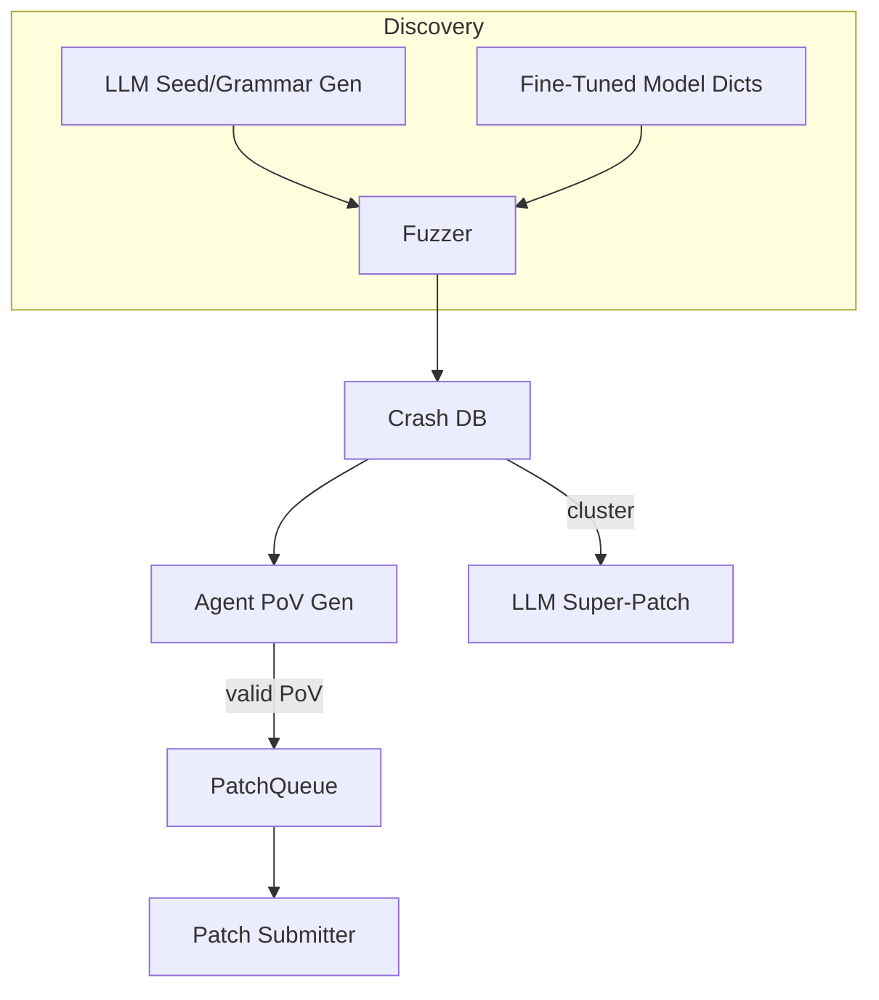

# AI-Assisted Fuzzing & Automated Vulnerability Discovery

{{#include ../banners/hacktricks-training.md}}

## 概要
大規模言語モデル（LLM）は、意味的に豊かな入力の生成、文法の進化、クラッシュデータの分析、さらには複数のバグを修正するパッチの提案によって、従来の脆弱性調査パイプラインを大幅に強化できます。このページでは、DARPAのAI Cyber Challenge（AIxCC）決勝戦やその他の公開研究で確認された、特に効果的なパターンを紹介します。<sup>[[4]](#references)</sup><sup>[[5]](#references)</sup>

以下は特定のコンペティションシステムの説明ではなく、独自のワークフローで再現できるよう、手法を抽象化したものです。

---

## 1. LLMが生成するSeed Input

従来のカバレッジガイド型fuzzer（AFL++、libFuzzer、Honggfuzzなど）は、少数のseedから始め、バイト列をやみくもに変異させます。対象の入力形式が複雑な場合（SQL、URL、独自のバイナリプロトコルなど）、ランダムな変異では通常、興味深い分岐に到達する前に構文が壊れてしまいます。

LLMは、*seed generator*（**構文的に正しく、かつセキュリティ上重要な入力**を出力する短いスクリプト）を生成することで、この初期化の問題を解決できます。たとえば：

```prompt
SYSTEM: You are a helpful security engineer.
USER:
Write a Python3 program that prints 200 unique SQL injection strings targeting common anti-pattern mistakes (missing quotes, numeric context, stacked queries).  Ensure length ≤ 256 bytes / string so they survive common length limits.
```

```python
# gen_sqli_seeds.py (truncated)
PAYLOADS = [
    "1 OR 1=1 -- ",
    "' UNION SELECT NULL,NULL--",
    "0; DROP TABLE users;--",
    ...
]
for p in PAYLOADS:
    print(p)
```

一度実行し、出力をファザーの初期コーパスに直接投入します：

```bash
python3 gen_sqli_seeds.py > seeds.txt
afl-fuzz -i seeds.txt -o findings/ -- ./target @@
```

Benefits:
1. 意味的妥当性 → 早い段階でより深いカバレッジを実現。
2. 再生成可能: プロンプトを調整して、XSS、path traversal、binary blobs などに焦点を当てられる。
3. 低コスト（GPT-3.5なら 1 ¢ 未満）。

### Tips
* 表面的なフィルターを回避するため、ペイロードの長さとエンコーディング（UTF-8、URL-encoded、UTF-16-LE）を*多様化*するようモデルに指示する。
* *単独で実行できるスクリプトを1つ*生成するよう依頼する。JSON形式の問題を避けられる。

---

## 2. Grammar-Evolution Fuzzing

より強力な手法では、具体的な seed ではなく、LLM に**文法を進化させる**。ワークフロー（「Grammar Guy」パターン）は次のとおり。

1. プロンプトを使って、初期の ANTLR/Peach/LibFuzzer 文法を生成する。
2. N 分間 fuzzing を実行し、カバレッジ指標（ヒットした edge / block）を収集する。
3. 未カバーのプログラム領域を要約し、その要約をモデルにフィードバックする:
   ```prompt
   The previous grammar triggered 12 % of the program edges.  Functions not reached: parse_auth, handle_upload.  Add / modify rules to cover these.
   ```
4. 新しいルールをマージし、再度 fuzzing して、繰り返します。

Pseudo-code の骨組み：

```python
for epoch in range(MAX_EPOCHS):
    grammar = llm.refine(grammar, feedback=coverage_stats)
    save(grammar, f"grammar_{epoch}.txt")
    coverage_stats = run_fuzzer(grammar)
```

要点:
* *budget*を維持する – 各 refinement で tokens を消費します。
* `diff` + `patch` instructions を使い、モデルに書き直しではなく編集させます。
* Δcoverage < ε になったら停止します。

---

## 3. Local-LLM libFuzzer Harness Engineering

analyst workstation の外に持ち出せない source については、local code model を使って、fuzzer の bytes と C/C++ API の間をつなぐ小さな adapter を作成できます。重要なのは、security boundary を明確にすることです。**モデルが test infrastructure を作成・修正し、coverage-guided mutation が input を探索し、sanitizer が不正な操作を報告し、人間が harness をレビューして findings をトリアージします**。<sup>[[9]](#references)</sup>

LLM に依存しない engine-level の corpus、feedback、snapshot、stateful-fuzzing の techniques については、一般的な [Fuzzing Methodology](../generic-methodologies-and-resources/fuzzing.md) を参照してください。

まず、target header から正確な declaration をコピーし、出力形式を制約します。prompt を絞ることで、API の捏造を減らし、結果をレビューしやすくできます。<sup>[[8]](#references)[[9]](#references)</sup>

```prompt
Write a libFuzzer target for this exact declaration:
int parse_records(const uint8_t *data, size_t size);

Output only C code. Implement LLVMFuzzerTestOneInput, include the
declaration, pass data and size unchanged, and do not use files,
network access, randomness, clocks, threads, or persistent state.
```

raw byte parserでは、期待される結果は次のように単純であるべきです:<sup>[[6]](#references)[[9]](#references)</sup>

```c
#include <stddef.h>
#include <stdint.h>

extern int parse_records(const uint8_t *, size_t);

int LLVMFuzzerTestOneInput(const uint8_t *data, size_t size) {
    (void)parse_records(data, size);
    return 0;
}
```

コンパイルは最初の検証ゲートにすぎません。CPU時間を費やす前に、生成された各ターゲットが以下の不変条件を満たしているか確認してください:<sup>[[6]](#references)[[8]](#references)[[9]](#references)</sup>

- **APIの正確性:** 型、所有権ルール、初期化、ティアダウン、呼び出し規約を、実際のヘッダーおよび既存の呼び出し元と照合します。
- **Harnessの安全性:** `data` から読み取る箇所すべてをガードします。sanitizerで検出される問題は、生成されたグルーコードではなく、ターゲットに起因する必要があります。
- **再現性:** 結果を `data` と `size` のみに基づくものにします。外部I/O、時刻、制御されていない乱数、joinされていないスレッド、呼び出し間で残る状態を取り除きます。
- **スループット:** 動作に影響しない場合に限り、高コストな不変状態を一度だけ初期化し、入力サイズに上限を設け、ログ出力を抑制し、入力ごとの割り当てを解放します。
- **到達可能性:** 意図した関数や分岐が実行されることを確認します。コンパイルできても拒否経路しか実行しないターゲットは、気づかれにくい失敗です。

### 構造認識型ターゲット: バグを隠さずに不変条件を維持する

生の入力の大半がマジック値、長さ、バージョン、チェックサムのゲートで失敗する場合は、fuzz bytesを**型付きフィールドの素材**として使い、有効なオブジェクトを再構築します。フォーマット定数を固定し、意味フィールドとペイロードのバイト列は変更可能なままにして、再構築したペイロードから整合性メタデータを導出します。`FuzzedDataProvider`は、上限付きの型付き値を取り出すのに便利ですが、生成される割り当てや変換に上限を設ける責任は、引き続きアダプターにあります。<sup>[[9]](#references)</sup>

<details>
<summary>構造認識型C++ターゲットの例</summary>

```cpp
#include <fuzzer/FuzzedDataProvider.h>
#include <stddef.h>
#include <stdint.h>
#include <vector>

extern "C" int parse_message(const uint8_t *, size_t);

extern "C" int LLVMFuzzerTestOneInput(const uint8_t *data, size_t size) {
    FuzzedDataProvider fdp(data, size);
    uint8_t version = fdp.ConsumeIntegral<uint8_t>();
    auto body = fdp.ConsumeRemainingBytes<uint8_t>();
    if (body.size() > UINT16_MAX) body.resize(UINT16_MAX);
    uint16_t len = static_cast<uint16_t>(body.size());
    std::vector<uint8_t> msg = {0x8b, 'M', 'S', 'G', version,
                                static_cast<uint8_t>(len >> 8),
                                static_cast<uint8_t>(len)};
    msg.insert(msg.end(), body.begin(), body.end());
    (void)parse_message(msg.data(), msg.size());
    return 0;
}
```

</details>

すべての質問に対して、1つの構造修復用targetを使わないでください。深い有効状態を探索できるよう、長さやチェックサムを導出するtargetを1つ用意し、もう1つは、ハーネス自身の読み取りと割り当てのみを制限しつつ、**宣言された**メタデータをfuzzerの制御下に置きます。2つ目のtargetは、自動修復によって消されてしまう、長さの不一致や不正なintegrity値の攻撃対象領域を維持します。<sup>[[9]](#references)</sup>

### Seeds、辞書、sanitizer、coverage feedback

バイナリを直接出力させるのではなく、バイナリseedを書き込むscriptを生成するようモデルに依頼します。空のオブジェクト、最小オブジェクト、典型的なオブジェクト、境界値として有効なオブジェクトをseedにし、その後、magic value、tag、enum encoding、parser keywordを抽出して、レビュー済みの辞書にまとめます。libFuzzerは`-dict=`で辞書を受け取り、新しいcoverageを発見するmutationをcorpusに保持します。<sup>[[6]](#references)[[9]](#references)</sup>

```text
magic="\x8bMSG"
version_min="\x00"
version_max="\xff"
config_tag="CONFIG"
```

補完的な instrumentation を使って同じ target をビルドします。ASan と UBSan は同じ fuzzing binary で併用できます。未計装コードに起因するレポートを避けるため、MSan は別途ビルドし、その依存関係も instrument してください。<sup>[[6]](#references)[[9]](#references)</sup>

```bash
clang++ -g -O1 -fsanitize=fuzzer,address,undefined \
  -fno-sanitize-recover=undefined target.cc harness.cc -o fuzz_target
./fuzz_target corpus -dict=msg.dict -max_len=65535

clang++ -g -O1 -fsanitize=fuzzer,memory \
  target.cc harness.cc -o fuzz_target_msan
```

各モデルの revision を評価する指標として coverage を扱います。libFuzzer の出力で `cov`/`ft` が早期に横ばいになり、corpus がほとんど変化しない場合は、フレーミングの不備、制約が厳しすぎる早期 return、または呼び出し先の誤りが考えられます。`exec/s` が低い場合は、セットアップ、I/O、allocation、または state のリークに時間がかかっている可能性があります。`NEW` が示すのは coverage feature が変化したことだけであり、意図した parser に到達した証拠にはなりません。<sup>[[6]](#references)[[9]](#references)</sup>

source-level の feedback を得るには、coverage build を作成して fuzzing を行い、未カバーの関数と、それらをガードする条件だけをモデルに与えます。生成された harness/seed/dictionary の diff を検証し、再度測定します。<sup>[[7]](#references)[[8]](#references)[[9]](#references)</sup>

```bash
clang++ -g -O1 -fsanitize=fuzzer \
  -fprofile-instr-generate -fcoverage-mapping target.cc harness.cc -o fuzz_cov
mkdir -p profiles
LLVM_PROFILE_FILE='profiles/%p.profraw' ./fuzz_cov -max_total_time=300 corpus
llvm-profdata merge -sparse profiles/*.profraw -o fuzz.profdata
llvm-cov report ./fuzz_cov -instr-profile=fuzz.profdata
llvm-cov show ./fuzz_cov -instr-profile=fuzz.profdata \
  --show-branches=count --region-coverage-lt=1 target.cc
```

スケーラブルなループは、**生成 → compile/link → sanitizer 下でスモークテスト → ターゲットのカバレッジを測定 → 関連性の高い最小限のカバレッジ／ソースコンテキストを提供 → 修正 → 再測定**です。OSS-Fuzz-Gen も同じ原則を適用し、生成したターゲットを、もっともらしいコードをそのまま受け入れるのではなく、コンパイル可能性、実行時エラー、カバレッジ、および既存のターゲットに対するカバレッジの改善度に基づいて評価します。<sup>[[7]](#references)[[8]](#references)</sup>

---

<a id="3-agent-based-pov-exploit-generation" hidden>3. Agent-Based PoV (Exploit) Generation</a>

## 4. Agent-Based PoV (Exploit) Generation

crash が見つかった後は、それを確実に発生させる **proof-of-vulnerability (PoV)** も必要です。

スケーラブルな方法は、多数の軽量な worker（プロセス、スレッド、またはコンテナ）を起動し、それぞれ異なるモデルやサンプリング設定を使わせることです。AIxCC finalist survey では、具体的な規模の例が示されています。あるチームは AI-first PoV 生成に **数千の同時稼働エージェント**を使い、別のチームは **300～500 の fuzzing agent**をオーケストレーションし、LLM はより高度な意味的推論に限定していました。<sup>[[4]](#references)</sup>

Pipeline:
1. Static/dynamic analysis により *bug candidate*（crash PC、input slice、sanitizer msg を含む struct）を生成する。
2. Orchestrator が candidate を agent に配布する。
3. Agent の推論手順:
   a. `gdb` と input を使って、ローカルで bug を再現する。
   b. 最小限の exploit payload を提案する。
   c. sandbox で exploit を検証する。成功した場合は送信する。
4. 失敗した試行は、coverage fuzzing の **新しい seed として再キューイング**される（フィードバックループ）。

利点:
* 並列化によって、単一 agent の信頼性の低さを補える。
* 観測された成功率に基づき、temp / model size を自動調整できる。

---

<a id="4-directed-fuzzing-with-fine-tuned-code-models" hidden>4. Directed Fuzzing with Fine-Tuned Code Models</a>

## 5. Directed Fuzzing with Fine-Tuned Code Models

脆弱性パターン（integer overflow、buffer copy、format string）をラベル付けした C/C++ ソースで、open-weight model（例: Llama-7B）を fine-tune します。その後:

1. Static analysis を実行し、関数リストと AST を取得する。
2. モデルに次のように prompt する: *“関数 X の memory safety を破壊しやすい mutation dictionary のエントリを提示してください”*。
3. それらの token をカスタム `AFL_CUSTOM_MUTATOR` に挿入する。

`sprintf` wrapper に対する出力例:
```
{"pattern":"%99999999s"}
{"pattern":"AAAAAAAA....<1024>....%n"}
```

実際のターゲットでは、これによりクラッシュまでの時間が 2 倍以上短縮されます。

---

<a id="5-ai-guided-patching-strategies" hidden>5. AI によるパッチ戦略</a>

## 6. AI によるパッチ戦略

<a id="51-super-patches" hidden>5.1 スーパー・パッチ</a>

### 6.1 スーパー・パッチ
モデルにクラッシュシグネチャを*クラスタリング*し、共通の根本原因を取り除く**単一のパッチ**を提案するよう依頼します。一度提出するだけで複数のバグを修正できるため、誤ったパッチごとにポイントが減点される環境では、精度によるペナルティを抑えられます。

プロンプトの概要：
```
Here are 10 stack traces + file snippets.  Identify the shared mistake and generate a unified diff fixing all occurrences.
```

{{#ref}}
../generic-methodologies-and-resources/fuzzing.md
{{#endref}}

<a id="52-speculative-patch-ratio" hidden>5.2 Speculative Patch Ratio</a>

### 6.2 Speculative Patch Ratio
PoVで検証済みのパッチと、PoVのない*推測的な*パッチを、スコアリングルールに合わせて調整した1:​Nの比率（例: 推測的パッチ2件 : 検証済みパッチ1件）で交互に処理するキューを実装する。コストモデルでペナルティとポイントを監視し、Nを自動調整する。

---

<a id="6-deterministic-file-by-file-ai-code-review" hidden>6. Deterministic File-by-File AI Code Review</a>

## 7. Deterministic File-by-File AI Code Review

AI支援レビューでよくある失敗パターンは、1つのエージェントにリポジトリ全体を調査させ、適切なファイルやgrep用語を選ぶことを期待することだ。より確実な方法は、**リポジトリ全体を漏れなく調査するよう強制する**ことだ:<sup>[[1]](#references)</sup>

1. ソースファイルを列挙する。
2. 最小限のコンテキスト（エントリポイント、import、近接するルート/呼び出し元）とともに、**一度に1ファイルずつ**送る。
3. 各ファイルについて、ソース、シンク、検証不足、悪用の前提条件、確信度を含む**構造化レポート**を要求する。<sup>[[3]](#references)</sup>
4. **ソース→シンクのパターン**でレポートを重複排除し、リスクの高いものを手動で検証する。

この方法はトークン消費が多く、ノイズも増えるが、広範なエージェント型レビューでは見逃されがちな**単純で影響の大きいソース/シンクのバグ**を見つけるうえで非常に効果的だ。

### 優先順位を上げる価値のあるトリアージパターン

- **動的なPHP include/dispatch**: 攻撃者が制御できるルート/コントローラー/モジュール名が、厳格なallowlistやパスの正規化なしに`require_once()`、`include()`、`include_once()`へ渡される。
- **管理者/アカウントのワークフローにおけるシェル実行**: ユーザー名、ドメイン、FTPアカウントなどの識別子が、`exec()`、`system()`、`shell_exec()`、`passthru()`、`proc_open()`、`popen()`に渡される。
- **構造化入力の集約**: 同じパラメーターが`$_GET`、`$_POST`、JSON、XML、またはフレームワークのbody parserから受け付けられ、その後ファイルシステムやOSコマンドのシンクで再利用される。

### この方法で見つけやすい、実用的な2種類のバグ

- **PHPのコントローラーディスパッチにおけるLFI/RCE**: リクエストで制御されるコントローラー名がallowlistやパスの正規化なしに`require_once()`へ連結されると、`../`などのtraversalシーケンスにより、意図しないローカルの`.php`ファイルがPHPにincludeされる可能性がある。攻撃者が細工した、または別の形で有用なPHPファイルをinclude先に指定できれば、LFIはコード実行につながる。[File Inclusion / Path Traversal](../pentesting-web/file-inclusion/README.md)を参照。<sup>[[1]](#references)</sup>
- **ホスティング/管理パネルにおける認証済みコマンドインジェクション**: ユーザー名などのアカウント管理フィールドがシェルコマンドに埋め込まれている場合、低権限の認証済みユーザーが通常の作成/削除操作をRCEにつなげる可能性がある。パネルがより特権の高いサービスアカウントとしてコマンドを実行する場合、影響はさらに大きくなる。[Command Injection](../pentesting-web/command-injection.md)を参照。<sup>[[1]](#references)</sup>

### 実践的なレビューの注意点

- LLMはまず、エクスプロイト生成器ではなく**ソース/シンクのレビュー担当**として使う。
- **攻撃者が制御できるフィールド**、**正規化/検証の不足箇所**、**危険なシンク**を明示するよう求める。
- 大規模なリポジトリでは、強力なモデルを使う単一の自律エージェント実行よりも、決定論的なファイル単位のレビューのほうが信頼性の高いことが多い。<sup>[[2]](#references)</sup>
- **Broken Access Control**や、悪用可能性がファイル間の前提、ロールの意味、製品固有の脅威モデルに依存するその他のビジネスロジックのバグでは、結果が弱くなることを想定する。

---

## モバイルのエントリポイント・タスクフロー

リポジトリ全体を対象にした単一のプロンプトでは、脅威モデルが混在し、外部から到達可能なコンポーネントから機密性の高いシンクまでの経路が見失われがちだ。より効果的なワークフローでは、監査を状態を保持するタスクフローに分割する。まずアプリケーション/コンポーネントを分類し、次に攻撃者が制御できるエントリポイントを一覧化し、各エントリポイントに到達可能性のメタデータを付与してから、プラットフォーム固有の脆弱性クラスに照らして個別にレビューする。GitHub Security Labのモバイル向けタスクフローは、Android、iOS、クロスプラットフォームのリポジトリでこのパターンを実装している。<sup>[[14]](#references)[[15]](#references)</sup>

Androidでは、少なくとも次の項目を記録する:<sup>[[14]](#references)[[15]](#references)</sup>

- exportedされたActivity、Service、Receiver、Providerと、それぞれのpermission。
- intent action、deep-linkのscheme/host/path、MIME filter、App Link。
- 攻撃者が制御できるaction、data URI、`ClipData`、extra、URI grant flag。
- WebViewのnavigation入力と`addJavascriptInterface` bridge。
- 下流の特権操作、importされたリソース、ネットワークの送信先。

次に、各エントリポイントをコンテキストに照らして分類する。呼び出し元の認可/confused-deputyの挙動、intent redirection、broadcast spoofingや情報開示、安全でないimport、WebViewのスクリプト実行とbridgeの露出、origin間でのcredentialやcookieの移動について、明示的に確認する。**厳格なチェックリストによるレビュー**と、**より広範な敵対的レビュー**の両方を実施する。エクスプロイトの詳細を重複させるのではなく、調査結果を[Intent Injection](../mobile-pentesting/android-app-pentesting/intent-injection.md)と[WebView Attacks](../mobile-pentesting/android-app-pentesting/webview-attacks.md)に関連付ける。<sup>[[15]](#references)</sup>

現在のopen-sourceタスクフローは、Codespaceから次のように起動できる:<sup>[[14]](#references)</sup>

```bash
./scripts/audit/run_audit.sh owner/repository
```

結果は SQLite の `audit_result` テーブルに書き込まれます。<sup>[[14]](#references)</sup> 脆弱とマークされた行は、検証済みの finding ではなく**手掛かり**として扱ってください。各手掛かりについて、攻撃者が制御できるソース、機密性の高いシンク、前提条件、想定される影響をモデルに明示させてから、最小限の PoC を作成するよう依頼してください。その PoC を、デバッガまたはインストゥルメンテーションを使い、元のビルドに対して実行します。これにより、到達不能な分岐、現実離れしたアプリケーション状態、外部ストレージのデータよりプライベートデータが優先されるケース、深刻度を実質的に下げる緩和策など、一般的な静的解析の誤りを検出できます。<sup>[[15]](#references)</sup>

---

## 8. インストゥルメント済みオラクルを用いたパターン主導のカーネル監査

カーネル規模のターゲットでは、ツリー全体から任意のバグを見つけるようエージェントに指示しないでください。よりトークン効率の高いワークフローでは、過去の脆弱性に関する知識を静的クエリに変換し、攻撃対象領域への露出度に基づいて結果をランク付けし、インストゥルメント済みカーネルを実行オラクルとして使用します。<sup>[[11]](#references)</sup>

### パターンデータベース → CodeQL/Semgrep → 絞り込んだレビュー

危険な API、検証不足のパターン、リスクのあるソースからシンクへのデータフロー、過去に修正されたバグの形を含む、小規模なナレッジベースを構築してください。モデルに**一度に1つのパターン**をレビューのヒューリスティックと CodeQL/Semgrep ルールに変換させてから、それらの決定論的なルールをツリー全体に適用します。コードをモデルに渡す前に、マッチ結果をグループ化して重複を除去してください。スキャナーの生出力には、価値の低い候補が何千件も含まれることがあります。対象が適格な研究またはオープンソースに該当しない場合は、この方法を使用する前に CodeQL の最新のライセンスを確認してください。<sup>[[11]](#references)</sup>

ヒット数だけでなく、**ルールのヒット密度**と**攻撃者からの到達可能性**の両方を用いてサブシステムの優先順位を決めてください。非特権プロセス、サンドボックス、コンテナ、jail、ゲスト環境から到達可能なカーネルインターフェースは、内部専用コードよりも高く評価する必要があります。エージェントが呼び出し元、バリデーター、ライフタイムのルールを把握できる程度にレビュー単位を小さく保ち、「脆弱性を何でも見つけて」ではなく、名前を指定した脆弱性クラスや制御フローパターンについて尋ねてください。新しい封じ込め境界によって、namespaced または jailed root ユーザーから到達可能になった場合、従来の特権インターフェースは特に注目に値します。<sup>[[11]](#references)</sup>

各候補について、悪用を試みる前に、明示的なフィールドフローレコードを作成させてください。<sup>[[11]](#references)</sup>

```text
entrypoint -> privilege check -> parser -> validation/normalization
           -> later rewrite -> dangerous sink
attacker controls: <fields and lengths>
constraints:       <values rewritten, rejected, or preserved>
observable result: <sanitizer report, assertion, panic, or clean exit>
```

### 仮説オラクルとして KASAN telemetry を使う

KASAN と有用な診断アサーションを有効にした使い捨て VM で、対象の kernel を実行します。エージェントには、疑わしい破損が再現または否定されるまで、**ソース上の仮説 → 最小限の userland トリガー → VM での実行 → KASAN/アサーションのトレース → 仮説の修正**を繰り返させます。各イテレーションでは、関連するスタックトレースと周辺のソースだけを返します。これにより推論に必要な文脈を保ちつつ、受け入れの判断基準をモデルの確信度ではなく、実行時の証拠に置けます。<sup>[[11]](#references)</sup>

計測用ビルドは、最終的な exploitability の検証環境ではありません。アサーションによって破損を起こす操作の前に実行が停止する一方、同じアサーションが production kernel ではコンパイル時に除去される場合があります。変更していないトリガーを正確な production configuration に対して再テストし、kernel のビルドと configuration を記録してください。また、**到達可能性**、**メモリ破損**、**制御可能なプリミティブ**、**セキュリティへの影響**を、別々の主張として区別してください。<sup>[[11]](#references)[[12]](#references)</sup>

CVE-2026-3038 は exploit のテンプレートではなく、有用な検証例です。権限のない FreeBSD の `RTM_GET` リクエストは、選択的な検証と応答の書き換えを通じて、サイズ超過の `RTAX_AUTHOR` sockaddr を保持し、最終的に `rtsock_msg_buffer()` がユーザー制御の `sa_len` を 128 バイトのスタック `sockaddr_storage` にコピーする状態に至る可能性がありました。最大 255 バイトのコピーによって 127 バイトの上書きが発生します。計測用ビルドでは診断アサーションが不正な長さを検出しましたが、GENERIC kernel ではコピーが実行され、その後、破損した canary の検査時に panic が発生しました。これは権限のない denial of service を証明するものであり、単独での privilege escalation を証明するものではありません。確実に制御するには、まず canary の leak など別のプリミティブが必要になります。対応する binary-exploitation の境界については、[Stack Canaries](../binary-exploitation/common-binary-protections-and-bypasses/stack-canaries/index.html) を参照してください。<sup>[[11]](#references)[[12]](#references)[[13]](#references)</sup>

### exploit の前提条件を不正に満たす行為を排除する

PoV や exploit を受け入れる前に、別の reviewer/agent に固定基準に照らして反証を試みさせます。レビューでは、以下の条件すべてを確認する必要があります。<sup>[[11]](#references)</sup>

- 対象のソース、kernel、脆弱な module を変更して、該当経路を到達可能にしていない。
- helper module、合成 gadget、無効化された mitigation、追加の権限、利用できない interface を導入していない。
- トリガーが、クリーンな snapshot 上で、主張されている caller の identity と containment の制約から開始される。
- 主張されている結果が、依然としてこの bug に依存している。不正なフィールドを取り除くか、bug だけを修正した場合に、攻撃の連鎖が失敗する。
- crash、overread、overwrite は、それぞれのプリミティブとしてのみ報告される。code execution や privilege escalation には独立した証拠が必要である。

最後の反事実チェックにより、循環した実証を検出できます。前提条件がすでに主張されている影響を与えている場合（たとえば、`nosuid` なしで mount された filesystem から、攻撃者が用意した SUID コンテンツを実行できる場合）、そのメモリ安全性の bug が影響をもたらしたわけではありません。<sup>[[11]](#references)</sup>

---

## 不慣れなコードベースにおける、監査可能なエージェント支援型リサーチ

[graph-first fuzz-target workflow](../generic-methodologies-and-resources/fuzzing.md#graph-first-fuzz-target-selection-and-mutation-triage) では entrypoint の到達可能性を、[agentic SAST pipelines](../network-services-pentesting/pentesting-web/code-review-tools.md#agentic-sast-pipelines) では段階的なレビューと証拠によるゲートを扱っています。これらの決定論的な結果はモデルの仮説と分けておき、採用したすべての有望な手掛かりにソースの位置、経路の証拠、動的な測定結果が残るようにしてください。<sup>[[10]](#references)</sup>

### データフローを捏造せずにオブジェクトのライフタイムに関する証拠を関連付ける

静的解析では、攻撃者が制御する長さがある関数で保存され、かなり後に同じオブジェクトのフィールドが copy sink に到達することを検出できても、callback、reconnect、オブジェクトのライフタイムをまたぐつながりを証明できない場合があります。両方の検出結果を別々に保持し、オブジェクト/フィールドごとにまとめ、不足しているエッジを明示的なトリアージ項目にします。エージェントは関係性を提案できますが、ソースのレビューまたは runtime instrumentation による証明が必要です。<sup>[[10]](#references)</sup>

候補ごとに、以下を記録します。

- 具体的な entrypoint と、攻撃者が制御するバイト列。
- 関連フィールドのすべての producer。各 producer に固有の検証も含める。
- sink、宛先の容量、および到達に必要なビルド/runtime 条件。
- 直接的な harness の呼び出しだけでなく、公開された entrypoint からの実際の call stack。
- 仮説を確認または否定する、最小限の動的な結果。

一見安全な経路があっても、そのフィールド全体が安全だとは限りません。別の producer が、最初の経路の上限チェックを経ずに同じフィールドに値を設定する可能性があります。経路を個別にテストし、debug assertion によって production のメモリ破損がテスト時のみの早期 abort に変わる可能性があるため、deployment と同等のビルドオプションで harness を実行してください。<sup>[[10]](#references)</sup>

### 情報漏えいと exploit の測定ゲート

未初期化メモリの情報漏えいが疑われる場合は、新しく確保したメモリを識別可能なバイトで埋め、その正確なマーカーが送信パケットに現れることを確認します。exploit については、**制御可能な上書き → 有用な victim object → 情報漏えい → pointer/base の復元 → control-flow hijack → payload の組み立て**など、測定可能なゲートを要求します。harness が現在の性質を証明した場合に限り、エージェントは次に進みます。もっともらしい説明だけではゲートを通過したことになりません。[FreeRDP case](../binary-exploitation/libc-heap/heap-overflow.md#cross-path-length-reuse-and-stale-output-disclosure) では、検証時に維持すべき経路とビルド上の制約が示されています。<sup>[[10]](#references)</sup>

---

LLM 支援型 exploit 開発に段階的な L0–L4 検証を適用した kernel のケーススタディについては、以下を参照してください。

{{#ref}}
../binary-exploitation/freebsd-kernel-exploitation-vnet-jail-escape.md
{{#endref}}

## 全体をまとめる
エンドツーエンドの CRS（Cyber Reasoning System）は、次のように各コンポーネントを接続できます。



---

## References

- [1] [Project Black - サイバーセキュリティ向けローカルAI：phpIPAMのLFIとmyVestaの認証済みRCEの発見](https://projectblack.io/blog/local-ai-for-cyber-security)
- [2] [Strix](https://github.com/usestrix/strix)
- [3] [GitHub Copilotコミュニティのsecurity-reviewスキル](https://github.com/github/awesome-copilot/blob/main/skills/security-review/SKILL.md)
- [4] [Trail of Bits — AIxCC決勝：対決の記録](https://blog.trailofbits.com/2025/08/07/aixcc-finals-tale-of-the-tape/)
- [5] [CTF RadioooによるAIxCCファイナリストへのインタビュー](https://www.youtube.com/@ctfradiooo)
- [6] [LLVM — libFuzzer：カバレッジ誘導型ファズテスト用ライブラリ](https://llvm.org/docs/LibFuzzer.html)
- [7] [Google — OSS-Fuzz-Gen](https://github.com/google/oss-fuzz-gen)
- [8] [Google Online Security Blog — ファジングの強化：AIでより多くの脆弱性を発見](https://security.googleblog.com/2024/11/leveling-up-fuzzing-finding-more.html)
- [9] [8kSec — ローカルLLMを使ったAI支援型ファジングハーネス生成](https://8ksec.io/ai-assisted-fuzzing-harness-local-llm)
- [10] [Quarkslab — AIエージェントからRCEへ：脆弱性調査ワークフローの構築](https://blog.quarkslab.com/from-ai-agents-to-rce-building-a-vulnerability-research-workflow.html)
- [11] [Praetorian — FreeBSoD：言語モデルを活用したカーネルバグの発見と悪用（全2回の第1回）](https://praetorian.com/blog/ai-vulnerability-research-freebsd-kernel)
- [12] [FreeBSD-SA-26:05.route — ルーティングソケット経由のローカルDoSと、権限昇格の可能性](https://www.freebsd.org/security/advisories/FreeBSD-SA-26:05.route.asc)
- [13] [FreeBSD-SA-26:05.routeのソースパッチ](https://security.FreeBSD.org/patches/SA-26:05/route.patch)
- [14] [GitHub Security Lab — SecLab Taskflows](https://github.com/GitHubSecurityLab/seclab-taskflows)
- [15] [GitHub Security Lab — オープンソースAIセキュリティエージェントを使って24件のAndroid脆弱性を発見した方法](https://github.blog/security/how-we-found-24-android-vulnerabilities-using-our-open-source-ai-security-agent)
{{#include ../banners/hacktricks-training.md}}
