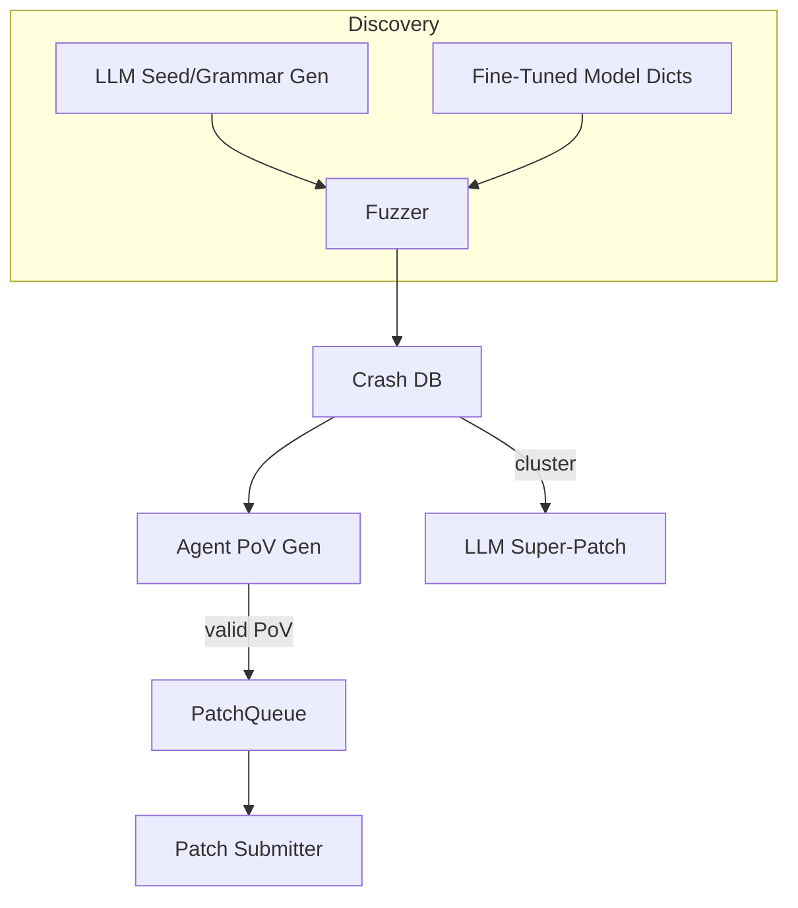

# AI 지원 Fuzzing 및 자동화된 취약점 발견

{{#include ../banners/hacktricks-training.md}}

## 개요
대규모 언어 모델(LLM)은 의미적으로 풍부한 입력을 생성하고, 문법을 발전시키며, 크래시 데이터를 추론하고, 여러 버그를 한 번에 수정하는 패치까지 제안하여 기존 취약점 연구 파이프라인의 성능을 크게 높일 수 있습니다. 이 페이지에서는 DARPA의 AI Cyber Challenge(AIxCC) 결승전과 기타 공개 연구에서 관찰된 가장 효과적인 패턴을 정리합니다.<sup>[[4]](#references)</sup><sup>[[5]](#references)</sup>

이어지는 내용은 특정 대회 시스템을 설명하는 것이 아니라, 자체 워크플로에서 재현할 수 있도록 기법을 추상화한 것입니다.

---

## 1. LLM 생성 Seed 입력

기존 coverage-guided fuzzer(AFL++, libFuzzer, Honggfuzz 등)는 소규모 seed corpus로 시작해 바이트를 무작위로 변이합니다. 대상 입력 형식이 복잡한 경우(SQL, URL, 사용자 지정 바이너리 프로토콜 등), 무작위 변이는 대개 흥미로운 분기에 도달하기 전에 문법을 깨뜨립니다.

LLM은 *seed generator*를 출력해 이 초기 설정 문제를 해결할 수 있습니다. 이 generator는 **문법에 맞으면서 보안과 관련된 입력을 출력하는** 짧은 스크립트입니다. 예를 들면 다음과 같습니다.

```prompt
SYSTEM: You are a helpful security engineer.
USER:
Write a Python3 program that prints 200 unique SQL injection strings targeting common anti-pattern mistakes (missing quotes, numeric context, stacked queries).  Ensure length ≤ 256 bytes / string so they survive common length limits.
```

```python
# gen_sqli_seeds.py (truncated)
PAYLOADS = [
    "1 OR 1=1 -- ",
    "' UNION SELECT NULL,NULL--",
    "0; DROP TABLE users;--",
    ...
]
for p in PAYLOADS:
    print(p)
```

한 번 실행한 뒤 출력을 fuzzer의 초기 corpus에 직접 공급합니다:

```bash
python3 gen_sqli_seeds.py > seeds.txt
afl-fuzz -i seeds.txt -o findings/ -- ./target @@
```

Benefits:
1. 의미적 유효성 → 초기에 더 깊은 coverage를 확보.
2. 재생성 가능: prompt를 조정해 XSS, path traversal, binary blobs 등에 집중.
3. 저렴함 (GPT-3.5 사용 시 1¢ 미만).

### Tips
* 피상적인 필터를 우회할 수 있도록 payload 길이와 인코딩(UTF-8, URL-encoded, UTF-16-LE)을 *다양화*하도록 모델에 지시합니다.
* *하나의 독립 실행형 스크립트*를 요청하면 JSON 형식 관련 문제를 피할 수 있습니다.

---

## 2. Grammar-Evolution Fuzzing

더 강력한 변형 방식은 구체적인 seed 대신 LLM이 **grammar를 진화**시키도록 하는 것입니다. 워크플로(“Grammar Guy” 패턴)는 다음과 같습니다.

1. prompt를 통해 초기 ANTLR/Peach/LibFuzzer grammar를 생성합니다.
2. N분 동안 fuzzing을 수행하고 coverage metrics(적중한 edge / block)를 수집합니다.
3. coverage되지 않은 프로그램 영역을 요약하고 그 요약을 모델에 다시 입력합니다:
   ```prompt
   The previous grammar triggered 12 % of the program edges.  Functions not reached: parse_auth, handle_upload.  Add / modify rules to cover these.
   ```
4. 새 규칙을 병합하고, 다시 fuzzing한 뒤 반복합니다.

의사 코드 골격:

```python
for epoch in range(MAX_EPOCHS):
    grammar = llm.refine(grammar, feedback=coverage_stats)
    save(grammar, f"grammar_{epoch}.txt")
    coverage_stats = run_fuzzer(grammar)
```

핵심 사항:
* *예산*을 정해 둡니다. 각 개선에는 토큰이 사용됩니다.
* 모델이 전체를 다시 작성하는 대신 편집하도록 `diff` + `patch` 지침을 사용합니다.
* Δcoverage < ε이면 중단합니다.

---

## 3. Local-LLM libFuzzer Harness 엔지니어링

분석가의 워크스테이션 밖으로 내보낼 수 없는 소스의 경우, 로컬 코드 모델을 사용해 퍼저 바이트와 C/C++ API 사이의 작은 어댑터를 작성할 수 있습니다. 유용한 보안 경계는 명확합니다. **모델은 테스트 인프라를 작성하고 수정하며, coverage-guided mutation은 입력을 탐색하고, sanitizers는 잘못된 연산을 보고하며, 사람은 harness를 검토하고 발견 사항을 분류합니다.**<sup>[[9]](#references)</sup>

LLM에 의존하지 않는 엔진 수준의 corpus, feedback, snapshot 및 stateful-fuzzing 기법은 일반 [Fuzzing Methodology](../generic-methodologies-and-resources/fuzzing.md)를 참조하세요.

대상 헤더에서 정확한 선언을 복사해 시작하고 출력 형식을 제한합니다. 범위를 좁힌 프롬프트는 API를 지어내는 일을 줄이고 결과물을 쉽게 검토할 수 있게 합니다.<sup>[[8]](#references)[[9]](#references)</sup>

```prompt
Write a libFuzzer target for this exact declaration:
int parse_records(const uint8_t *data, size_t size);

Output only C code. Implement LLVMFuzzerTestOneInput, include the
declaration, pass data and size unchanged, and do not use files,
network access, randomness, clocks, threads, or persistent state.
```

raw byte 파서의 예상 결과는 다음보다 복잡하지 않아야 합니다:<sup>[[6]](#references)[[9]](#references)</sup>

```c
#include <stddef.h>
#include <stdint.h>

extern int parse_records(const uint8_t *, size_t);

int LLVMFuzzerTestOneInput(const uint8_t *data, size_t size) {
    (void)parse_records(data, size);
    return 0;
}
```

컴파일은 첫 번째 검증 단계일 뿐입니다. CPU 시간을 들이기 전에 생성된 각 target이 다음 불변 조건을 충족하는지 검토하세요:<sup>[[6]](#references)[[8]](#references)[[9]](#references)</sup>

- **정확한 API:** 타입, 소유권 규칙, 초기화, 해제 및 호출 규약을 실제 헤더 및 기존 호출자와 비교합니다.
- **Harness 안전성:** `data`에서 읽을 때마다 가드를 적용합니다. sanitizer에서 발견되는 문제는 생성된 glue가 아니라 target에서 발생해야 합니다.
- **재현성:** 결과가 `data`와 `size`에만 의존하도록 합니다. 외부 I/O, 시간, 통제되지 않는 난수, join되지 않은 스레드, 호출 간 유지되는 상태를 제거합니다.
- **처리량:** 동작에 영향을 주지 않는 경우에만 비용이 큰 불변 상태를 한 번 초기화하고, 입력 크기를 제한하며, 로깅을 억제하고, 입력별 할당을 해제합니다.
- **도달 가능성:** 의도한 함수와 분기가 실행되는지 확인합니다. 컴파일은 되지만 거부 경로만 실행하는 target은 조용한 실패입니다.

### 구조를 인식하는 target: 버그를 숨기지 않고 불변 조건 유지하기

대부분의 원시 입력이 magic, 길이, 버전 또는 체크섬 검사에서 거부된다면, fuzz 바이트를 **타입이 지정된 필드 값**으로 사용해 유효한 객체를 다시 구성하세요. 형식 상수는 고정하고, 의미 필드와 payload 바이트는 변경 가능하게 두며, 재구성된 payload에서 무결성 메타데이터를 계산합니다. `FuzzedDataProvider`는 범위가 제한된 타입 값을 가져오는 데 유용하지만, 생성되는 할당과 변환을 제한하는 책임은 adapter에 있습니다.<sup>[[9]](#references)</sup>

<details>
<summary>구조를 인식하는 C++ target 예제</summary>

```cpp
#include <fuzzer/FuzzedDataProvider.h>
#include <stddef.h>
#include <stdint.h>
#include <vector>

extern "C" int parse_message(const uint8_t *, size_t);

extern "C" int LLVMFuzzerTestOneInput(const uint8_t *data, size_t size) {
    FuzzedDataProvider fdp(data, size);
    uint8_t version = fdp.ConsumeIntegral<uint8_t>();
    auto body = fdp.ConsumeRemainingBytes<uint8_t>();
    if (body.size() > UINT16_MAX) body.resize(UINT16_MAX);
    uint16_t len = static_cast<uint16_t>(body.size());
    std::vector<uint8_t> msg = {0x8b, 'M', 'S', 'G', version,
                                static_cast<uint8_t>(len >> 8),
                                static_cast<uint8_t>(len)};
    msg.insert(msg.end(), body.begin(), body.end());
    (void)parse_message(msg.data(), msg.size());
    return 0;
}
```

</details>

모든 질문에 하나의 구조 복구 타깃만 사용하지 마세요. 길이와 체크섬을 계산해 유효한 내부 상태를 깊이 탐색하는 타깃 하나와, **선언된** 메타데이터는 fuzzer가 제어하게 두되 하네스 자체의 읽기와 할당만 제한하는 타깃을 별도로 유지하세요. 두 번째 타깃은 자동 복구로 사라질 수 있는 길이 불일치 및 무결성 오류 공격 표면을 보존합니다.<sup>[[9]](#references)</sup>

### 시드, 사전, sanitizer, 커버리지 피드백

모델에 바이너리를 직접 출력하게 하는 대신 바이너리 시드를 기록하는 스크립트를 생성하도록 요청하세요. 빈 객체, 최소 객체, 일반적인 객체, 경계값이면서 유효한 객체를 시드로 사용한 다음, 매직 값, 태그, enum 인코딩, 파서 키워드를 추출해 검토된 사전에 추가하세요. libFuzzer는 `-dict=` 옵션으로 해당 사전을 받아들이며, 새로운 커버리지를 드러내는 변이를 corpus에 보존합니다.<sup>[[6]](#references)[[9]](#references)</sup>

```text
magic="\x8bMSG"
version_min="\x00"
version_max="\xff"
config_tag="CONFIG"
```

상호 보완적인 instrumentation을 적용해 동일한 타깃을 빌드하세요. ASan과 UBSan은 하나의 fuzzing 바이너리에서 함께 사용할 수 있습니다. 보고서가 instrumentation되지 않은 코드로 인해 발생하는 것을 방지하려면 별도의 MSan 빌드를 사용하고 해당 빌드의 의존성에도 instrumentation을 적용하세요.<sup>[[6]](#references)[[9]](#references)</sup>

```bash
clang++ -g -O1 -fsanitize=fuzzer,address,undefined \
  -fno-sanitize-recover=undefined target.cc harness.cc -o fuzz_target
./fuzz_target corpus -dict=msg.dict -max_len=65535

clang++ -g -O1 -fsanitize=fuzzer,memory \
  target.cc harness.cc -o fuzz_target_msan
```

각 모델 revision의 평가 기준으로 coverage를 사용하세요. libFuzzer 출력에서 `cov`/`ft`가 초반부터 정체되고 corpus가 대체로 변하지 않는다면 잘못된 framing, 지나치게 제한적인 early return 또는 잘못된 호출일 가능성이 큽니다. `exec/s`가 낮다면 비용이 큰 초기 설정, I/O, 메모리 할당 또는 누수된 상태를 의심하세요. `NEW`는 coverage feature가 바뀌었다는 것만 증명할 뿐, 의도한 parser에 도달했다는 뜻은 아닙니다.<sup>[[6]](#references)[[9]](#references)</sup>

소스 수준의 피드백을 얻으려면 coverage 빌드를 만들고 fuzzing한 뒤, 미커버된 함수와 이를 보호하는 조건만 모델에 제공하세요. 그 결과로 나온 harness/seed/dictionary diff를 확인하고 다시 측정하세요:<sup>[[7]](#references)[[8]](#references)[[9]](#references)</sup>

```bash
clang++ -g -O1 -fsanitize=fuzzer \
  -fprofile-instr-generate -fcoverage-mapping target.cc harness.cc -o fuzz_cov
mkdir -p profiles
LLVM_PROFILE_FILE='profiles/%p.profraw' ./fuzz_cov -max_total_time=300 corpus
llvm-profdata merge -sparse profiles/*.profraw -o fuzz.profdata
llvm-cov report ./fuzz_cov -instr-profile=fuzz.profdata
llvm-cov show ./fuzz_cov -instr-profile=fuzz.profdata \
  --show-branches=count --region-coverage-lt=1 target.cc
```

따라서 확장 가능한 반복 과정은 **생성 → 컴파일/링크 → sanitizer를 사용해 smoke-test → 타깃 커버리지 측정 → 관련성이 가장 높은 최소한의 커버리지/소스 컨텍스트 제공 → 수정 → 재측정**입니다. OSS-Fuzz-Gen도 그럴듯한 코드를 그대로 받아들이는 대신, 생성된 타깃의 컴파일 가능 여부, 런타임 오류, 커버리지 및 기존 타깃 대비 커버리지 개선 여부를 평가해 같은 원칙을 적용합니다.<sup>[[7]](#references)[[8]](#references)</sup>

---

<a id="3-agent-based-pov-exploit-generation" hidden>3. 에이전트 기반 PoV (Exploit) 생성</a>

## 4. 에이전트 기반 PoV (Exploit) 생성

크래시를 찾은 뒤에도 이를 결정론적으로 트리거하는 **취약점 증명(proof-of-vulnerability, PoV)**이 필요합니다.

확장 가능한 방법은 여러 경량 worker(프로세스, 스레드 또는 컨테이너)를 실행하고, 각 worker가 서로 다른 모델이나 샘플링 설정을 사용하게 하는 것입니다. AIxCC 결선 진출팀 설문에는 구체적인 규모 사례가 나옵니다. 한 팀은 AI 우선 PoV 생성에 **수천 개의 동시 실행 에이전트**를 사용했고, 다른 팀은 **300~500개의 fuzzing 에이전트**를 조율하면서 상위 수준의 의미 추론에 LLM을 활용했습니다.<sup>[[4]](#references)</sup>

파이프라인:
1. 정적/동적 분석으로 *버그 후보*를 생성합니다(crash PC, 입력 슬라이스, sanitizer 메시지가 포함된 구조체).
2. Orchestrator가 후보를 에이전트에 배포합니다.
3. 에이전트의 추론 단계:
   a. `gdb`와 입력을 사용해 로컬에서 버그를 재현합니다.
   b. 최소한의 exploit payload를 제안합니다.
   c. sandbox에서 exploit을 검증합니다. 성공하면 제출합니다.
4. 실패한 시도는 커버리지 fuzzing을 위한 **새 seed로 다시 대기열에 추가**됩니다(피드백 루프).

장점:
* 병렬화를 통해 단일 에이전트의 신뢰성 부족을 보완합니다.
* 관찰된 성공률에 따라 임시값/모델 크기를 자동 조정합니다.

---

<a id="4-directed-fuzzing-with-fine-tuned-code-models" hidden>4. Fine-Tuned Code Models를 사용한 Directed Fuzzing</a>

## 5. Fine-Tuned Code Models를 사용한 Directed Fuzzing

취약점 패턴(integer overflow, buffer copy, format string)이 라벨링된 C/C++ 소스로 open-weight 모델(예: Llama-7B)을 fine-tune합니다. 그런 다음:

1. 정적 분석을 실행해 함수 목록과 AST를 가져옵니다.
2. 모델에 다음과 같이 프롬프트합니다: *“함수 X의 memory safety를 깨뜨릴 가능성이 높은 mutation dictionary 항목을 제시하세요.”*
3. 해당 토큰을 사용자 지정 `AFL_CUSTOM_MUTATOR`에 삽입합니다.

`sprintf` wrapper의 출력 예시:
```
{"pattern":"%99999999s"}
{"pattern":"AAAAAAAA....<1024>....%n"}
```

실제 타깃에서는 실험적으로 크래시까지 걸리는 시간이 2배 이상 단축됩니다.

---

<a id="5-ai-guided-patching-strategies" hidden>5. AI 기반 패치 전략</a>

## 6. AI 기반 패치 전략

<a id="51-super-patches" hidden>5.1 슈퍼 패치</a>

### 6.1 슈퍼 패치
모델에 크래시 시그니처를 *클러스터링*하고 공통 근본 원인을 제거하는 **단일 패치**를 제안하도록 요청하세요. 한 번 제출해 여러 버그를 수정하면, 잘못된 패치 하나마다 점수를 잃는 환경에서 정확도 페널티를 줄일 수 있습니다.

프롬프트 개요:
```
Here are 10 stack traces + file snippets.  Identify the shared mistake and generate a unified diff fixing all occurrences.
```

{{#ref}}
../generic-methodologies-and-resources/fuzzing.md
{{#endref}}

<a id="52-speculative-patch-ratio" hidden>5.2 Speculative Patch Ratio</a>

### 6.2 Speculative Patch Ratio
확인된 PoV 검증 패치와 *추측성* 패치(PoV 없음)가 점수 규칙에 맞춰 조정된 1:N 비율(예: 추측성 패치 2개 : 확인된 패치 1개)로 번갈아 처리되도록 큐를 구현합니다. 비용 모델은 페널티와 점수를 모니터링하고 N을 자동 조정합니다.

---

<a id="6-deterministic-file-by-file-ai-code-review" hidden>6. Deterministic File-by-File AI Code Review</a>

## 7. 결정론적 파일별 AI 코드 리뷰

AI 지원 리뷰에서 자주 발생하는 실패 유형은 에이전트 하나에 저장소 전체를 검사하게 한 뒤 적절한 파일과 grep 검색어를 선택하길 기대하는 것입니다. 더 신뢰할 수 있는 방식은 **저장소의 모든 파일을 빠짐없이 검사하도록 강제하는 것**입니다:<sup>[[1]](#references)</sup>

1. 소스 파일을 열거합니다.
2. 최소한의 맥락(진입점, import, 인접한 라우트/호출자)과 함께 **한 번에 파일 하나씩** 전달합니다.
3. 각 파일에 대해 출처, sink, 누락된 검증, 익스플로잇 전제 조건, 신뢰도를 포함한 **구조화된 보고서**를 요구합니다.<sup>[[3]](#references)</sup>
4. **출처→sink 패턴**별로 보고서를 중복 제거하고, 위험도가 높은 항목을 수동으로 검증합니다.

토큰 소모가 많고 노이즈도 있지만, 광범위한 에이전트 리뷰에서 자주 놓치는 **단순하면서 영향이 큰 source/sink 버그**를 찾아내는 데 매우 효과적입니다.

### 우선순위를 둘 만한 분류 패턴

- **동적 PHP include/dispatch**: 공격자가 제어하는 라우트/컨트롤러/모듈 이름이 엄격한 allowlist와 경로 정규화 없이 `require_once()`, `include()`, `include_once()`로 전달되는 경우.
- **관리자/계정 워크플로의 셸 실행**: 사용자 이름, 도메인, FTP 계정 또는 기타 식별자가 `exec()`, `system()`, `shell_exec()`, `passthru()`, `proc_open()`, `popen()`에 도달하는 경우.
- **구조화된 입력의 다중 유입**: 동일한 매개변수를 `$_GET`, `$_POST`, JSON, XML 또는 프레임워크의 body parser에서 받아들인 뒤 파일 시스템이나 OS 명령 sink에서 재사용하는 경우.

### 이 방식으로 잘 찾아낼 수 있는 실용적인 버그 유형 두 가지

- **PHP 컨트롤러 디스패치 LFI/RCE**: 요청에서 제어 가능한 컨트롤러 이름을 allowlist나 경로 정규화 없이 `require_once()`에 연결하면 `../` 같은 경로 순회 문자열로 인해 의도하지 않은 로컬 `.php` 파일을 PHP가 포함할 수 있습니다. 공격자가 삽입했거나 다른 용도로 활용할 수 있는 PHP 파일을 포함시킬 수 있다면 LFI가 코드 실행으로 이어집니다. [File Inclusion / Path Traversal](../pentesting-web/file-inclusion/README.md)를 참고하세요.<sup>[[1]](#references)</sup>
- **호스팅/관리자 패널의 인증된 명령어 삽입**: 사용자 이름 같은 계정 관리 필드를 셸 명령에 삽입하면 권한이 낮은 인증 사용자가 일반적인 생성/삭제 작업을 RCE로 바꿀 수 있습니다. 패널이 더 높은 권한의 서비스 계정으로 명령을 실행할 경우 영향이 커집니다. [Command Injection](../pentesting-web/command-injection.md)을 참고하세요.<sup>[[1]](#references)</sup>

### 실용적인 리뷰 참고 사항

- LLM을 익스플로잇 생성기보다 먼저 **source/sink 리뷰어**로 사용합니다.
- **공격자가 제어하는 필드**, **정규화/검증의 누락 지점**, **위험한 sink**를 명시적으로 나열하도록 요청합니다.
- 대규모 저장소에서는 더 강력한 모델을 쓰는 단일 자율 에이전트 실행보다 결정론적 파일별 리뷰가 더 신뢰할 수 있는 경우가 많습니다.<sup>[[2]](#references)</sup>
- 익스플로잇 가능성이 여러 파일에 걸친 가정, 역할 의미 또는 제품별 위협 모델에 좌우되는 **Broken Access Control** 및 기타 비즈니스 로직 버그에서는 결과가 약할 수 있습니다.

---

## 모바일 진입점 taskflow

저장소 전체를 대상으로 하는 단일 프롬프트는 위협 모델을 뒤섞고 외부에서 접근 가능한 구성요소부터 민감한 sink까지의 경로를 놓치는 경우가 많습니다. 더 나은 워크플로는 감사를 상태를 유지하는 taskflow로 나누는 것입니다. 먼저 애플리케이션/구성요소를 분류하고, 공격자가 제어할 수 있는 진입점을 목록화한 다음, 각 진입점에 도달성 메타데이터를 추가하고, 마지막으로 플랫폼별 취약점 유형에 따라 하나씩 검토합니다. GitHub Security Lab의 모바일 taskflow는 Android, iOS 및 크로스 플랫폼 저장소에서 이 패턴을 구현합니다.<sup>[[14]](#references)[[15]](#references)</sup>

Android의 경우 최소한 다음을 기록합니다:<sup>[[14]](#references)[[15]](#references)</sup>

- 권한을 포함한 exported Activity, Service, Receiver, Provider
- intent action, deep link scheme/host/path, MIME filter, App Link
- 공격자가 제어할 수 있는 action, data URI, `ClipData`, extra, URI 권한 부여 플래그
- WebView 탐색 입력과 `addJavascriptInterface` 브리지
- 이후에 수행되는 권한 있는 작업, 가져온 리소스, 네트워크 대상

그런 다음 각 진입점을 맥락에 맞춰 분류합니다. 호출자 권한 확인/혼란된 대리인 동작, intent redirection, broadcast spoofing 또는 정보 노출, 안전하지 않은 import, WebView 스크립팅 및 브리지 노출, origin 간 자격 증명 또는 쿠키 이동 여부를 명시적으로 확인합니다. **엄격한 체크리스트 점검**과 **광범위한 적대적 점검**을 모두 수행합니다. 익스플로잇 세부 사항을 중복해서 설명하기보다 발견 사항을 [Intent Injection](../mobile-pentesting/android-app-pentesting/intent-injection.md) 및 [WebView Attacks](../mobile-pentesting/android-app-pentesting/webview-attacks.md)에 연결합니다.<sup>[[15]](#references)</sup>

현재 오픈소스 taskflow는 Codespace에서 다음 명령으로 실행할 수 있습니다:<sup>[[14]](#references)</sup>

```bash
./scripts/audit/run_audit.sh owner/repository
```

결과는 SQLite의 `audit_result` 테이블에 기록됩니다.<sup>[[14]](#references)</sup> 취약하다고 표시된 행은 검증된 발견 사항이 아니라 **단서**로 취급하세요. 각 단서에 대해 모델이 공격자가 제어하는 소스, 민감한 싱크, 전제 조건, 예상 영향을 명시하도록 한 다음, 최소한의 PoC를 만들도록 요청하세요. 디버거나 계측 도구를 사용해 원본 빌드에서 PoC를 실행하세요. 이렇게 하면 도달할 수 없는 분기, 비현실적인 애플리케이션 상태, 외부 저장소 데이터가 비공개 데이터보다 우선순위를 잃는 경우, 심각도를 실질적으로 낮추는 완화책 등 흔한 정적 분석 오류를 잡아낼 수 있습니다.<sup>[[15]](#references)</sup>

---

## 8. 계측 오라클을 이용한 패턴 기반 커널 감사

커널 규모의 대상을 다룰 때 에이전트에게 전체 트리에서 임의의 버그를 찾으라고 요청하지 마세요. 토큰 효율이 더 높은 워크플로에서는 과거 취약점 지식을 정적 쿼리로 변환하고, 노출된 공격 표면을 기준으로 결과의 우선순위를 정한 다음, 계측된 커널을 실행 오라클로 사용합니다.<sup>[[11]](#references)</sup>

### 패턴 데이터베이스 → CodeQL/Semgrep → 집중 검토

위험한 API, 누락된 검증 패턴, 위험한 소스-싱크 흐름, 이전에 수정된 버그 유형을 포함하는 작은 지식 베이스를 만드세요. 모델에게 **한 번에 하나의 패턴만** 검토 휴리스틱과 CodeQL/Semgrep 규칙으로 변환하도록 요청한 다음, 이 결정론적 규칙을 전체 트리에서 실행하세요. 결과를 모델에 전달하기 전에 일치 항목을 그룹화하고 중복을 제거하세요. 원시 스캐너 출력에는 가치가 낮은 후보가 수천 개 포함될 수 있습니다. 적격한 연구 대상이나 오픈 소스 대상이 아닌 곳에서 이 방식을 사용하기 전에 CodeQL의 현재 라이선스를 확인하세요.<sup>[[11]](#references)</sup>

규칙 적중 수만 보지 말고 **규칙 적중 밀도**와 **공격자 도달 가능성**을 모두 고려해 하위 시스템의 우선순위를 정하세요. 비특권 프로세스, 샌드박스, 컨테이너, jail 또는 게스트 환경에서 접근할 수 있는 커널 인터페이스는 내부 전용 코드보다 더 높은 가중치를 두어야 합니다. 에이전트가 호출자, 검증기, 수명 규칙을 유지할 수 있도록 검토 단위를 충분히 작게 유지하고, “취약점을 아무거나 찾아라” 대신 명시된 취약점 유형이나 제어 흐름 패턴을 검토하도록 요청하세요. 새로운 격리 경계로 인해 네임스페이스 또는 jail의 root 사용자가 접근할 수 있게 된 레거시 권한 인터페이스는 특히 주의해서 살펴볼 만합니다.<sup>[[11]](#references)</sup>

각 후보에 대해 익스플로잇을 시도하기 전에 명시적인 필드 흐름 기록을 요구하세요.<sup>[[11]](#references)</sup>

```text
entrypoint -> privilege check -> parser -> validation/normalization
           -> later rewrite -> dangerous sink
attacker controls: <fields and lengths>
constraints:       <values rewritten, rejected, or preserved>
observable result: <sanitizer report, assertion, panic, or clean exit>
```

### 가설 오라클로 KASAN 텔레메트리 사용

KASAN과 유용한 진단 assertion을 활성화한 일회용 VM에서 대상 커널을 실행합니다. 에이전트는 의심되는 손상이 재현되거나 기각될 때까지 **소스 가설 → 최소 userland 트리거 → VM 실행 → KASAN/assertion 추적 → 수정된 가설**을 반복해야 합니다. 각 반복에서는 관련 스택 추적과 주변 소스만 반환합니다. 이렇게 하면 추론에 필요한 맥락을 유지하면서 모델의 확신이 아니라 런타임 증거를 승인 기준으로 삼을 수 있습니다.<sup>[[11]](#references)</sup>

계측 빌드는 최종 exploitability 환경이 아닙니다. assertion이 손상 유발 연산 전에 실행을 중단할 수 있지만, 같은 assertion이 production 커널에서는 컴파일 과정에서 제외될 수 있습니다. 변경하지 않은 트리거를 정확한 production 구성에서 다시 테스트하고, 커널 빌드 및 구성을 기록하며, **도달 가능성**, **메모리 손상**, **제어 가능한 primitive**, **보안 영향**을 별개의 주장으로 구분합니다.<sup>[[11]](#references)[[12]](#references)</sup>

CVE-2026-3038은 exploit 템플릿이 아니라 유용한 검증 사례입니다. 권한 없는 FreeBSD `RTM_GET` 요청은 선택적 검증과 응답 재작성 과정을 거쳐 크기가 초과된 `RTAX_AUTHOR` sockaddr를 유지할 수 있었고, 결국 `rtsock_msg_buffer()`가 사용자 제어 `sa_len`을 128바이트 스택 `sockaddr_storage`에 복사했습니다. 최대 255바이트 복사로 127바이트 덮어쓰기가 발생했습니다. 계측 빌드에서는 진단 assertion이 잘못된 길이를 포착했지만, GENERIC 커널은 복사에 도달한 뒤 손상된 canary를 검사할 때 panic이 발생했습니다. 이는 권한 없는 서비스 거부를 입증하지만, 단독 권한 상승을 입증하지는 않습니다. 안정적인 제어를 위해서는 먼저 canary disclosure와 같은 다른 primitive가 필요합니다. 해당 binary exploitation 경계는 [Stack Canaries](../binary-exploitation/common-binary-protections-and-bypasses/stack-canaries/index.html)를 참고하세요.<sup>[[11]](#references)[[12]](#references)[[13]](#references)</sup>

### 익스플로잇 전제 조건 속임수 배제

PoV나 exploit을 승인하기 전에 별도의 검토자/에이전트가 고정된 기준에 따라 이를 반증하도록 합니다. 검토에서는 다음 조건을 모두 확인해야 합니다.<sup>[[11]](#references)</sup>

- 경로에 도달할 수 있도록 대상 소스, 커널, 취약 모듈을 수정하지 않았습니다.
- helper module, synthetic gadget, 비활성화된 mitigation, 추가 권한 또는 사용할 수 없는 인터페이스를 도입하지 않았습니다.
- 깨끗한 snapshot에서 주장된 caller identity와 containment 제한으로 트리거를 시작합니다.
- 주장된 결과가 여전히 버그에 의존합니다. 잘못된 필드를 제거하거나 버그만 패치하면 체인이 작동하지 않아야 합니다.
- crash, overread, overwrite는 해당 primitive로만 보고합니다. code execution이나 권한 상승에는 독립적인 증거가 필요합니다.

마지막 반사실 검사는 순환 논증에 의한 시연을 찾아냅니다. 예를 들어 `nosuid` 없이 마운트된 파일시스템에서 공격자가 제공한 SUID 콘텐츠를 실행하는 등 전제 조건이 이미 주장된 영향을 부여한다면, 메모리 안전성 버그가 그 영향을 일으킨 것이 아닙니다.<sup>[[11]](#references)</sup>

---

## 익숙하지 않은 코드베이스에서 감사 가능한 에이전트 지원 연구

[그래프 우선 fuzz-target 워크플로](../generic-methodologies-and-resources/fuzzing.md#graph-first-fuzz-target-selection-and-mutation-triage)는 이미 진입점 도달 가능성을 다루고, [에이전트 기반 SAST 파이프라인](../network-services-pentesting/pentesting-web/code-review-tools.md#agentic-sast-pipelines)은 단계별 검토와 증거 게이트를 다룹니다. 이 결정론적 결과를 모델의 가설과 분리해 두어, 승격된 모든 단서에 소스 위치, 경로 증거, 동적 측정값이 남도록 합니다.<sup>[[10]](#references)</sup>

### 데이터 흐름을 지어내지 않고 객체 수명 증거 상호 연관시키기

정적 분석은 공격자가 제어하는 길이가 한 함수에서 저장되고, 동일한 객체 필드가 훨씬 뒤에 copy sink에 도달하는 것을 찾아낼 수 있지만 callback, reconnect 또는 객체 수명 전반에 걸친 연결을 입증하지 못할 수 있습니다. 두 결과를 별도로 유지하고 객체/필드를 기준으로 묶은 뒤, 빠진 연결을 명시적인 triage 질문으로 남깁니다. 에이전트는 관계를 제안할 수 있지만, 이를 입증하려면 소스 검토 또는 런타임 계측이 필요합니다.<sup>[[10]](#references)</sup>

각 후보에 대해 다음을 기록합니다.

- 구체적인 진입점과 공격자가 제어하는 바이트
- 관련 필드의 모든 producer 및 각 producer에 특화된 검증
- sink, 대상 용량, 도달에 필요한 빌드/런타임 조건
- 직접적인 harness 호출만이 아니라 노출된 진입점에서 시작되는 실제 호출 스택
- 가설을 확인하거나 기각하는 가장 작은 동적 결과

겉보기에 안전한 경로가 있다고 해서 필드 전체가 안전하다는 뜻은 아닙니다. 두 번째 producer는 첫 번째 경로의 제한 없이 같은 필드를 채울 수 있습니다. 경로를 각각 테스트하고, debug assertion이 production 메모리 손상을 테스트 전용의 조기 중단으로 바꿀 수 있으므로 배포 환경과 동등한 빌드 옵션으로 harness를 실행합니다.<sup>[[10]](#references)</sup>

### disclosure 및 exploitation을 위한 측정 게이트

초기화되지 않은 메모리 disclosure가 의심되면 새 할당 영역을 식별하기 쉬운 바이트로 채우고, 정확히 그 marker가 전송 패킷에 도달하는지 확인합니다. exploitation의 경우 **제어 가능한 overwrite → 유용한 victim object → disclosure → 포인터/기준 주소 복구 → control-flow hijack → payload 결합**과 같은 측정 게이트를 요구합니다. 에이전트는 harness가 현재 속성을 입증한 경우에만 다음 단계로 넘어갑니다. 그럴듯한 설명만으로는 게이트를 통과하지 못합니다. 검증 중 보존해야 할 경로와 빌드 제약은 [FreeRDP 사례](../binary-exploitation/libc-heap/heap-overflow.md#cross-path-length-reuse-and-stale-output-disclosure)에 나와 있습니다.<sup>[[10]](#references)</sup>

---

LLM 지원 exploit 개발에 단계별 L0–L4 검증을 적용한 커널 사례 연구는 다음을 참고하세요.

{{#ref}}
../binary-exploitation/freebsd-kernel-exploitation-vnet-jail-escape.md
{{#endref}}

## 전체 과정 통합
엔드투엔드 CRS (Cyber Reasoning System)는 구성 요소를 다음과 같이 연결할 수 있습니다.



---

## References

- [1] [Project Black - 사이버 보안을 위한 로컬 AI: phpIPAM LFI 및 myVesta 인증된 RCE 발견](https://projectblack.io/blog/local-ai-for-cyber-security)
- [2] [Strix](https://github.com/usestrix/strix)
- [3] [GitHub Copilot 커뮤니티 security-review skill](https://github.com/github/awesome-copilot/blob/main/skills/security-review/SKILL.md)
- [4] [Trail of Bits – AIxCC 결승전: 경기 기록](https://blog.trailofbits.com/2025/08/07/aixcc-finals-tale-of-the-tape/)
- [5] [CTF Radiooo AIxCC 결승 진출팀 인터뷰](https://www.youtube.com/@ctfradiooo)
- [6] [LLVM — libFuzzer: 커버리지 기반 퍼징 테스트를 위한 라이브러리](https://llvm.org/docs/LibFuzzer.html)
- [7] [Google — OSS-Fuzz-Gen](https://github.com/google/oss-fuzz-gen)
- [8] [Google Online Security Blog — 퍼징 강화: AI로 더 많은 취약점 찾기](https://security.googleblog.com/2024/11/leveling-up-fuzzing-finding-more.html)
- [9] [8kSec — 로컬 LLM을 사용한 AI 지원 퍼징 하네스 생성](https://8ksec.io/ai-assisted-fuzzing-harness-local-llm)
- [10] [Quarkslab — AI 에이전트에서 RCE까지: 취약점 연구 워크플로 구축](https://blog.quarkslab.com/from-ai-agents-to-rce-building-a-vulnerability-research-workflow.html)
- [11] [Praetorian — FreeBSoD: 언어 모델을 활용한 커널 버그 발견 및 익스플로잇 (2부 중 1부)](https://praetorian.com/blog/ai-vulnerability-research-freebsd-kernel)
- [12] [FreeBSD-SA-26:05.route — 라우팅 소켓을 통한 로컬 DoS 및 잠재적 권한 상승](https://www.freebsd.org/security/advisories/FreeBSD-SA-26:05.route.asc)
- [13] [FreeBSD-SA-26:05.route 소스 패치](https://security.FreeBSD.org/patches/SA-26:05/route.patch)
- [14] [GitHub Security Lab - SecLab Taskflows](https://github.com/GitHubSecurityLab/seclab-taskflows)
- [15] [GitHub Security Lab - 오픈 소스 AI 보안 에이전트를 사용해 Android 취약점 24개를 발견한 방법](https://github.blog/security/how-we-found-24-android-vulnerabilities-using-our-open-source-ai-security-agent)
{{#include ../banners/hacktricks-training.md}}
