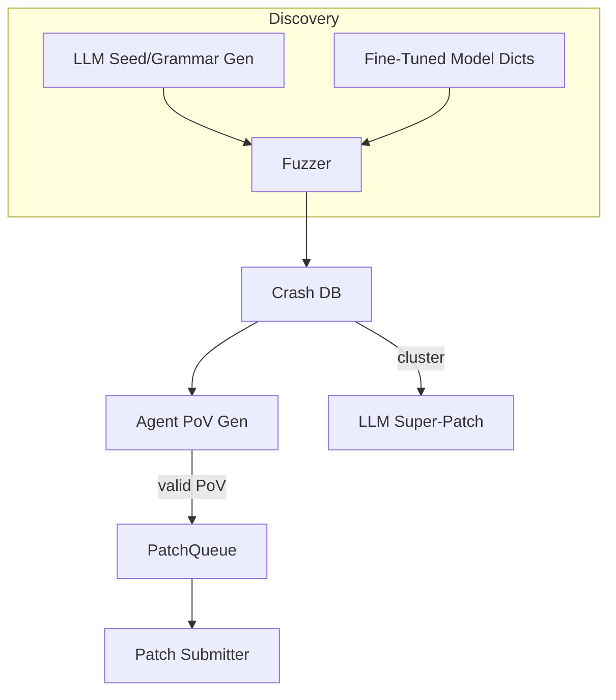

# KI-gestütztes Fuzzing & automatisierte Schwachstellenerkennung

{{#include ../banners/hacktricks-training.md}}

## Überblick
Large Language Models (LLMs) können herkömmliche Vulnerability-Research-Pipelines deutlich leistungsfähiger machen, indem sie semantisch reichhaltige Eingaben generieren, Grammatiken weiterentwickeln, Crash-Daten analysieren und sogar Patches für mehrere Bugs vorschlagen. Diese Seite fasst die effektivsten Muster zusammen, die während des Finales der DARPA AI Cyber Challenge (AIxCC) und in anderen öffentlichen Forschungsarbeiten beobachtet wurden.<sup>[[4]](#references)</sup><sup>[[5]](#references)</sup>

Im Folgenden wird kein konkretes Wettbewerbssystem beschrieben, sondern eine Abstraktion der Techniken, damit Sie sie in Ihren eigenen Workflows reproduzieren können.

---

## 1. Von LLMs generierte Seed-Eingaben

Herkömmliche coverage-guided Fuzzer (AFL++, libFuzzer, Honggfuzz …) starten mit einem kleinen Seed-Korpus und mutieren Bytes blind. Wenn das Eingabeformat des Ziels komplex ist (SQL, URLs, benutzerdefinierte Binärprotokolle), zerstören zufällige Mutationen meist die Syntax, bevor interessante Branches erreicht werden.

LLMs können dieses Bootstrap-Problem lösen, indem sie *Seed-Generatoren* ausgeben – kurze Skripte, die **syntaktisch korrekte, aber sicherheitsrelevante Eingaben** erzeugen. Zum Beispiel:

```prompt
SYSTEM: You are a helpful security engineer.
USER:
Write a Python3 program that prints 200 unique SQL injection strings targeting common anti-pattern mistakes (missing quotes, numeric context, stacked queries).  Ensure length ≤ 256 bytes / string so they survive common length limits.
```

```python
# gen_sqli_seeds.py (truncated)
PAYLOADS = [
    "1 OR 1=1 -- ",
    "' UNION SELECT NULL,NULL--",
    "0; DROP TABLE users;--",
    ...
]
for p in PAYLOADS:
    print(p)
```

Einmal ausführen und die Ausgabe direkt in den initialen Corpus des Fuzzers einspeisen:

```bash
python3 gen_sqli_seeds.py > seeds.txt
afl-fuzz -i seeds.txt -o findings/ -- ./target @@
```

Benefits:
1. Semantische Gültigkeit → frühere tiefere Abdeckung.
2. Erneut generierbar: Passe den Prompt an, um den Fokus auf XSS, Path Traversal, Binary Blobs usw. zu legen.
3. Günstig (< 1 ¢ mit GPT-3.5).

### Tipps
* Weise das Modell an, Payload-Längen und Encodings (UTF-8, URL-encoded, UTF-16-LE) zu *diversifizieren*, um oberflächliche Filter zu umgehen.
* Bitte um ein *einzelnes, eigenständiges Skript* – das vermeidet Probleme mit der JSON-Formatierung.

---

## 2. Grammar-Evolution Fuzzing

Eine leistungsfähigere Variante besteht darin, das LLM eine Grammatik **entwickeln** zu lassen, statt konkrete Seeds. Der Workflow (Muster „Grammar Guy“) sieht so aus:

1. Generiere per Prompt eine anfängliche ANTLR-/Peach-/LibFuzzer-Grammatik.
2. Führe für N Minuten Fuzzing aus und erfasse Coverage-Metriken (getroffene Edges / Blocks).
3. Fasse nicht abgedeckte Programmbereiche zusammen und gib die Zusammenfassung an das Modell zurück:
   ```prompt
   The previous grammar triggered 12 % of the program edges.  Functions not reached: parse_auth, handle_upload.  Add / modify rules to cover these.
   ```
4. Führe die neuen Regeln zusammen, fuzze erneut und wiederhole den Vorgang.

Pseudo-Code-Skelett:

```python
for epoch in range(MAX_EPOCHS):
    grammar = llm.refine(grammar, feedback=coverage_stats)
    save(grammar, f"grammar_{epoch}.txt")
    coverage_stats = run_fuzzer(grammar)
```

Wichtige Punkte:
* Ein *Budget* einhalten – jede Verfeinerung verbraucht Tokens.
* `diff`- und `patch`-Anweisungen verwenden, damit das Modell Änderungen vornimmt, statt alles neu zu schreiben.
* Stoppen, wenn Δcoverage < ε.

---

## 3. Entwicklung eines Harness für lokales LLM und libFuzzer

Wenn Quellcode den Arbeitsplatz eines Analysten nicht verlassen darf, kann ein lokales Code-Modell den kleinen Adapter zwischen den Fuzzer-Bytes und einer C/C++-API entwerfen. Die Sicherheitsgrenze ist klar definiert: **Das Modell schreibt und überarbeitet die Testinfrastruktur; coverage-guided mutation erkundet Eingaben; Sanitizer melden ungültige Operationen; ein Mensch prüft den Harness und bewertet die Ergebnisse**.<sup>[[9]](#references)</sup>

Für Engine-Techniken zu Corpus, Feedback, Snapshots und Stateful Fuzzing, die nicht von einem LLM abhängen, siehe die allgemeine [Fuzzing-Methodik](../generic-methodologies-and-resources/fuzzing.md).

Beginne mit der exakten Deklaration aus dem Header des Ziels und schränke das Ausgabeformat ein. Ein eng gefasster Prompt reduziert erfundene APIs und erleichtert die Prüfung des Ergebnisses:<sup>[[8]](#references)[[9]](#references)</sup>

```prompt
Write a libFuzzer target for this exact declaration:
int parse_records(const uint8_t *data, size_t size);

Output only C code. Implement LLVMFuzzerTestOneInput, include the
declaration, pass data and size unchanged, and do not use files,
network access, randomness, clocks, threads, or persistent state.
```

Für einen Parser für Rohbytes sollte das erwartete Ergebnis nicht komplizierter sein als:<sup>[[6]](#references)[[9]](#references)</sup>

```c
#include <stddef.h>
#include <stdint.h>

extern int parse_records(const uint8_t *, size_t);

int LLVMFuzzerTestOneInput(const uint8_t *data, size_t size) {
    (void)parse_records(data, size);
    return 0;
}
```

Compilation ist nur das erste Validierungstor. Prüfe jedes generierte Target anhand dieser Invarianten, bevor du CPU-Zeit dafür aufwendest:<sup>[[6]](#references)[[8]](#references)[[9]](#references)</sup>

- **Exakte API:** Vergleiche Typen, Ownership-Regeln, Initialisierung, Teardown und Calling Convention mit dem echten Header und bestehenden Aufrufern.
- **Harness-Sicherheit:** Sichere jeden Lesezugriff auf `data` ab; Sanitizer-Befunde müssen im Target entstehen, nicht im generierten Glue-Code.
- **Reproduzierbarkeit:** Das Ergebnis muss eine Funktion von `data` und `size` sein; entferne externe I/O, Zeitabhängigkeiten, unkontrollierte Zufallswerte, nicht verbundene Threads und zwischen Aufrufen erhaltenen Zustand.
- **Durchsatz:** Initialisiere aufwendigen unveränderlichen Zustand nur dann einmalig, wenn dies das Verhalten nicht beeinflussen kann, begrenze die Eingabegröße, unterdrücke Logging und gib pro Eingabe angelegte Speicherbereiche frei.
- **Erreichbarkeit:** Prüfe, ob die vorgesehenen Funktionen und Zweige ausgeführt werden. Ein Target, das kompiliert, aber nur Ablehnungspfade durchläuft, ist ein stiller Fehlschlag.

### Struktur-aware Targets: Invarianten bewahren, ohne Bugs zu verbergen

Wenn die meisten Rohdaten an einer Magic-, Längen-, Versions- oder Prüfsummenprüfung scheitern, verwende die Fuzz-Bytes als **Material für typisierte Felder** und baue ein gültiges Objekt neu auf. Setze Formatkonstanten fest, lasse semantische Felder und Payload-Bytes veränderbar und leite Integritätsmetadaten aus der rekonstruierten Payload ab. `FuzzedDataProvider` ist nützlich, um begrenzte typisierte Werte zu konsumieren; der Adapter bleibt dafür verantwortlich, jede erzeugte Allokation und Konvertierung zu begrenzen.<sup>[[9]](#references)</sup>

<details>
<summary>Beispiel für ein struktur-aware C++-Target</summary>

```cpp
#include <fuzzer/FuzzedDataProvider.h>
#include <stddef.h>
#include <stdint.h>
#include <vector>

extern "C" int parse_message(const uint8_t *, size_t);

extern "C" int LLVMFuzzerTestOneInput(const uint8_t *data, size_t size) {
    FuzzedDataProvider fdp(data, size);
    uint8_t version = fdp.ConsumeIntegral<uint8_t>();
    auto body = fdp.ConsumeRemainingBytes<uint8_t>();
    if (body.size() > UINT16_MAX) body.resize(UINT16_MAX);
    uint16_t len = static_cast<uint16_t>(body.size());
    std::vector<uint8_t> msg = {0x8b, 'M', 'S', 'G', version,
                                static_cast<uint8_t>(len >> 8),
                                static_cast<uint8_t>(len)};
    msg.insert(msg.end(), body.begin(), body.end());
    (void)parse_message(msg.data(), msg.size());
    return 0;
}
```

</details>

Verwende nicht für jede Frage dasselbe strukturreparierende Target. Behalte ein Target bei, das Längen und Prüfsummen ableitet, um tiefe gültige Zustände zu erkunden, und ein weiteres, bei dem die **deklarierte** Metadaten weiterhin vom Fuzzer kontrolliert werden, während nur die eigenen Lesevorgänge und Speicherzuweisungen des Harness begrenzt werden. Das zweite Target erhält Angriffsflächen mit nicht übereinstimmenden Längen und fehlerhafter Integrität, die durch automatische Reparatur sonst beseitigt würden.<sup>[[9]](#references)</sup>

### Seeds, Wörterbücher, Sanitizer und Coverage-Feedback

Bitte das Modell, ein Skript zu erzeugen, das binäre Seeds schreibt, statt es direkt Binärdaten ausgeben zu lassen. Erstelle Seeds für leere, minimale, typische und gültige Grenzfall-Objekte; extrahiere dann Magic Values, Tags, Enum-Kodierungen und Parser-Schlüsselwörter in ein geprüftes Wörterbuch. libFuzzer akzeptiert dieses Wörterbuch mit `-dict=` und behält Mutationen, die neue Coverage im Corpus aufdecken.<sup>[[6]](#references)[[9]](#references)</sup>

```text
magic="\x8bMSG"
version_min="\x00"
version_max="\xff"
config_tag="CONFIG"
```

Erstellen Sie dasselbe Ziel mit ergänzender Instrumentierung. ASan und UBSan können sich ein Fuzzing-Binary teilen; verwenden Sie einen separaten MSan-Build und instrumentieren Sie dessen Abhängigkeiten, um Meldungen durch nicht instrumentierten Code zu vermeiden.<sup>[[6]](#references)[[9]](#references)</sup>

```bash
clang++ -g -O1 -fsanitize=fuzzer,address,undefined \
  -fno-sanitize-recover=undefined target.cc harness.cc -o fuzz_target
./fuzz_target corpus -dict=msg.dict -max_len=65535

clang++ -g -O1 -fsanitize=fuzzer,memory \
  target.cc harness.cc -o fuzz_target_msan
```

Behandle coverage als Evaluator für jede Modellrevision. In der libFuzzer-Ausgabe deuten früh stagnierende `cov`/`ft`-Werte und ein statisches Corpus meist auf fehlerhaftes Framing, einen zu restriktiven early return oder den falschen Aufruf hin; eine niedrige `exec/s`-Rate weist auf kostspieliges Setup, I/O, Allokationen oder durchgesickerten Zustand hin. `NEW` beweist nur, dass sich ein Coverage-Feature geändert hat, nicht, dass der beabsichtigte Parser erreicht wurde.<sup>[[6]](#references)[[9]](#references)</sup>

Erstelle für Feedback auf Quelltextebene einen Coverage-Build, fuzze ihn und gib dem Modell nur die nicht abgedeckten Funktionen samt ihren Guard-Bedingungen. Überprüfe die resultierenden Harness-/Seed-/Dictionary-Diffs und miss erneut:<sup>[[7]](#references)[[8]](#references)[[9]](#references)</sup>

```bash
clang++ -g -O1 -fsanitize=fuzzer \
  -fprofile-instr-generate -fcoverage-mapping target.cc harness.cc -o fuzz_cov
mkdir -p profiles
LLVM_PROFILE_FILE='profiles/%p.profraw' ./fuzz_cov -max_total_time=300 corpus
llvm-profdata merge -sparse profiles/*.profraw -o fuzz.profdata
llvm-cov report ./fuzz_cov -instr-profile=fuzz.profdata
llvm-cov show ./fuzz_cov -instr-profile=fuzz.profdata \
  --show-branches=count --region-coverage-lt=1 target.cc
```

Die skalierbare Schleife lautet daher **generieren → kompilieren/linken → Smoke-Test unter Sanitizern → Target-Coverage messen → den kleinsten relevanten Coverage-/Quellcodekontext bereitstellen → überarbeiten → erneut messen**. OSS-Fuzz-Gen wendet dasselbe Prinzip an, indem es generierte Targets auf Kompilierbarkeit, Laufzeitfehler, Coverage und Coverage-Verbesserungen gegenüber bestehenden Targets prüft, anstatt plausibel wirkenden Code einfach als gegeben hinzunehmen.<sup>[[7]](#references)[[8]](#references)</sup>

---

## 4. Agentenbasierte PoV- (Exploit-)Generierung

Nachdem ein Crash gefunden wurde, benötigst du weiterhin einen **Proof of Vulnerability (PoV)**, der ihn deterministisch auslöst.

Ein skalierbarer Ansatz besteht darin, viele leichtgewichtige Worker (Prozesse, Threads oder Container) zu starten, die jeweils ein anderes Modell oder eine andere Sampling-Konfiguration verwenden. Die Umfrage unter den AIxCC-Finalisten nennt konkrete Beispiele für diese Größenordnung: Ein Team verwendete **Tausende gleichzeitig laufende Agents** für eine AI-first-PoV-Generierung, während ein anderes **300–500 Fuzzing-Agents** orchestrierte und LLMs für übergeordnete semantische Schlussfolgerungen einsetzte.<sup>[[4]](#references)</sup>

Pipeline:
1. Statische/dynamische Analyse liefert *Bug-Kandidaten* (struct mit Crash-PC, Input-Slice, Sanitizer-Meldung).
2. Der Orchestrator verteilt die Kandidaten an Agents.
3. Schlussfolgerungsschritte des Agents:
   a. Bug lokal mit `gdb` und Input reproduzieren.
   b. Minimales Exploit-Payload vorschlagen.
   c. Exploit in einer Sandbox validieren. Bei Erfolg → einreichen.
4. Fehlgeschlagene Versuche werden als neue Seeds für Coverage-Fuzzing **erneut in die Warteschlange gestellt** (Feedback-Schleife).

Vorteile:
* Parallelisierung gleicht die Unzuverlässigkeit einzelner Agents aus.
* Automatische Anpassung von Temp./Modellgröße anhand der beobachteten Erfolgsrate.

---

## 5. Directed Fuzzing mit feinabgestimmten Code-Modellen

Ein Modell mit offenen Gewichten (z. B. Llama-7B) anhand von C/C++-Quellcode feinabstimmen, der mit Schwachstellenmustern (Integer-Overflow, Buffer-Copy, Format-String) gekennzeichnet ist. Dann:

1. Statische Analyse ausführen, um eine Funktionsliste und den AST zu erhalten.
2. Das Modell auffordern: *„Gib Mutation-Dictionary-Einträge aus, die wahrscheinlich die Memory-Safety in Funktion X verletzen“*.
3. Diese Tokens in einen benutzerdefinierten `AFL_CUSTOM_MUTATOR` einfügen.

Beispielausgabe für einen `sprintf`-Wrapper:
```
{"pattern":"%99999999s"}
{"pattern":"AAAAAAAA....<1024>....%n"}
```

Empirisch verkürzt dies die Zeit bis zum Crash bei realen Zielen um >2×.

---

## 6. KI-gestützte Patching-Strategien

### 6.1 Super Patches
Bitte das Modell, Crash-Signaturen zu *gruppieren* und einen **einzigen Patch** vorzuschlagen, der die gemeinsame Ursache beseitigt. Einmal einreichen, mehrere Bugs beheben → weniger Genauigkeitsabzüge in Umgebungen, in denen jeder falsche Patch Punkte kostet.

Prompt-Gliederung:
```
Here are 10 stack traces + file snippets.  Identify the shared mistake and generate a unified diff fixing all occurrences.
```

### 6.2 Verhältnis spekulativer Patches
Implementiere eine Queue, in der durch PoV validierte bestätigte Patches und *spekulative* Patches (ohne PoV) in einem an die Scoring-Regeln angepassten Verhältnis von 1:​N abwechseln (z. B. 2 spekulative : 1 bestätigter Patch). Ein Kostenmodell überwacht Strafen und Punkte und passt N selbstständig an.

---

## 7. Deterministisches KI-Code-Review Datei für Datei

Ein häufiges Fehlermuster bei KI-gestützten Reviews ist, einen Agenten ein ganzes Repository untersuchen zu lassen und darauf zu hoffen, dass er die richtigen Dateien und grep-Begriffe auswählt. Ein zuverlässigeres Muster ist, eine **vollständige Abdeckung des Repositorys zu erzwingen**:<sup>[[1]](#references)</sup>

1. Quelldateien auflisten.
2. **Jeweils eine Datei** zusammen mit minimalem Kontext senden (Entry-Point, Imports, benachbarte Routen/Aufrufer).
3. Für jede Datei einen **strukturierten Bericht** verlangen: Quellen, Sink, fehlende Validierung, Exploit-Voraussetzungen und Konfidenz.<sup>[[3]](#references)</sup>
4. Berichte nach **Source→Sink-Muster** deduplizieren und die risikoreichsten manuell validieren.

Das ist tokenintensiv und erzeugt Rauschen, aber es eignet sich sehr gut dazu, **einfache Source-/Sink-Bugs mit hohen Auswirkungen** aufzudecken, die bei umfassenden agentischen Reviews oft übersehen werden.

### Triage-Muster, die Vorrang haben sollten

- **Dynamisches PHP-Include/Dispatch**: Vom Angreifer kontrollierte Routen-/Controller-/Modulnamen gelangen ohne strikte Allowlist und Pfadkanonisierung in `require_once()`, `include()` oder `include_once()`.
- **Shell-Ausführung in Admin-/Account-Workflows**: Benutzernamen, Domains, FTP-Accounts oder andere Bezeichner gelangen in `exec()`, `system()`, `shell_exec()`, `passthru()`, `proc_open()` oder `popen()`.
- **Zusammenführung strukturierter Eingaben**: Derselbe Parameter wird über `$_GET`, `$_POST`, JSON, XML oder Framework-Body-Parser akzeptiert und später in Dateisystem- oder OS-Command-Sinks wiederverwendet.

### Zwei praktische Bug-Klassen, die diese Methode gut findet

- **PHP-Controller-Dispatch-LFI/RCE**: Wird ein request-gesteuerter Controllername ohne Allowlist/Pfadnormalisierung an `require_once()` angehängt, können Traversal-Sequenzen wie `../` dazu führen, dass PHP eine unbeabsichtigte lokale `.php`-Datei einbindet. Kann der Angreifer das Include auf eine platzierte oder anderweitig nützliche PHP-Datei richten, wird aus der LFI Codeausführung. Siehe [File Inclusion / Path Traversal](../pentesting-web/file-inclusion/README.md).<sup>[[1]](#references)</sup>
- **Authentifizierte Command Injection in Hosting-/Admin-Panels**: Werden Account-Verwaltungsfelder wie Benutzernamen in Shell-Befehle eingebettet, kann ein authentifizierter Benutzer mit geringen Berechtigungen eine normale Erstellungs-/Löschaktion in RCE umwandeln. Die Auswirkungen nehmen zu, wenn das Panel den Befehl als privilegierteres Servicekonto ausführt. Siehe [Command Injection](../pentesting-web/command-injection.md).<sup>[[1]](#references)</sup>

### Praktische Hinweise zum Review

- Nutze das LLM zunächst als **Source-/Sink-Reviewer**, nicht als Exploit-Generator.
- Fordere es auf, das **vom Angreifer kontrollierte Feld**, die **Lücke bei Normalisierung/Validierung** und den **gefährlichen Sink** ausdrücklich aufzulisten.
- Bei großen Repos ist ein deterministisches Review Datei für Datei oft zuverlässiger als ein einzelner autonomer Agentenlauf, selbst wenn letzterer ein stärkeres Modell verwendet.<sup>[[2]](#references)</sup>
- Bei **Broken Access Control** und anderen Business-Logic-Bugs sind schwächere Ergebnisse zu erwarten, wenn die Exploitierbarkeit von Annahmen über mehrere Dateien, Rollenbedeutungen oder produktspezifische Threat Models abhängt.

---

## Auditierbare agentengestützte Recherche in unbekannten Codebasen

Der [graph-first Fuzz-Target-Workflow](../generic-methodologies-and-resources/fuzzing.md#graph-first-fuzz-target-selection-and-mutation-triage) behandelt bereits die Erreichbarkeit von Entry-Points, während [agentische SAST-Pipelines](../network-services-pentesting/pentesting-web/code-review-tools.md#agentic-sast-pipelines) gestufte Reviews und Evidence Gates abdecken. Halte diese deterministischen Ergebnisse getrennt von den Hypothesen des Modells, damit jeder weiterverfolgte Hinweis Quellcodepositionen, Pfadbelege und eine dynamische Messung enthält.<sup>[[10]](#references)</sup>

### Hinweise zur Objektlebensdauer korrelieren, ohne Datenflüsse zu erfinden

Statische Analyse kann eine vom Angreifer kontrollierte Länge finden, die in einer Funktion gespeichert wird, sowie dasselbe Objektfeld, das viel später einen Copy-Sink erreicht. Dabei kann sie jedoch daran scheitern, die Verbindung über Callbacks, Reconnects oder die Objektlebensdauer hinweg nachzuweisen. Bewahre beide Befunde getrennt auf, gruppiere sie nach Objekt/Feld und formuliere die fehlende Verbindung ausdrücklich als Triage-Frage. Der Agent kann den Zusammenhang vorschlagen, aber ein Code-Review oder Runtime-Instrumentierung muss ihn belegen.<sup>[[10]](#references)</sup>

Erfasse für jeden Kandidaten:

- den konkreten Entry-Point und die vom Angreifer kontrollierten Bytes;
- jeden Producer des relevanten Felds, einschließlich der für jeden Producer spezifischen Validierung;
- den Sink, die Zielkapazität und die Build-/Runtime-Bedingungen, die für dessen Erreichbarkeit erforderlich sind;
- einen echten Call-Stack vom exponierten Entry-Point aus, nicht nur einen direkten Harness-Aufruf;
- das kleinstmögliche dynamische Ergebnis, das die Hypothese bestätigt oder widerlegt.

Ein scheinbar sicherer Pfad macht ein Feld nicht generell unbedenklich. Ein zweiter Producer kann dasselbe Feld ohne die Begrenzung des ersten Pfads befüllen. Teste Pfade unabhängig voneinander und führe den Harness mit den für die Bereitstellung äquivalenten Build-Optionen aus, da Debug-Assertions eine Memory Corruption in der Produktion in einen vorzeitigen, nur beim Test auftretenden Abbruch verwandeln können.<sup>[[10]](#references)</sup>

### Messkriterien für Disclosure und Exploitation

Bei vermuteter Offenlegung nicht initialisierten Speichers solltest du frische Allokationen mit einem erkennbaren Byte-Muster füllen und überprüfen, ob genau dieses Muster im ausgegebenen Paket ankommt. Für Exploitation müssen messbare Kriterien erfüllt sein, etwa **kontrolliertes Überschreiben → brauchbares Victim-Objekt → Disclosure → Wiederherstellung von Pointer/Base → Hijacking des Control Flow → zusammengesetzte Payload**. Ein Agent kommt nur dann weiter, wenn der Harness die aktuelle Eigenschaft nachweist; eine plausible Erklärung erfüllt kein Kriterium. Der [FreeRDP-Fall](../binary-exploitation/libc-heap/heap-overflow.md#cross-path-length-reuse-and-stale-output-disclosure) zeigt den Pfad und die Build-Bedingungen, die bei der Validierung erhalten bleiben müssen.<sup>[[10]](#references)</sup>

---

## Alles zusammenführen
Ein durchgängiges CRS (Cyber Reasoning System) kann die Komponenten folgendermaßen verbinden:



---

## References

- [1] [Project Black – Lokale KI für Cybersicherheit: phpIPAM-LFI und authentifiziertes myVesta-RCE finden](https://projectblack.io/blog/local-ai-for-cyber-security)
- [2] [Strix](https://github.com/usestrix/strix)
- [3] [GitHub Copilot Community-Skill für Security-Review](https://github.com/github/awesome-copilot/blob/main/skills/security-review/SKILL.md)
- [4] [Trail of Bits – AIxCC-Finale: Eine Bestandsaufnahme](https://blog.trailofbits.com/2025/08/07/aixcc-finals-tale-of-the-tape/)
- [5] [CTF Radiooo: Interviews mit AIxCC-Finalisten](https://www.youtube.com/@ctfradiooo)
- [6] [LLVM – libFuzzer: Eine Bibliothek für coverage-guided Fuzz-Tests](https://llvm.org/docs/LibFuzzer.html)
- [7] [Google – OSS-Fuzz-Gen](https://github.com/google/oss-fuzz-gen)
- [8] [Google Online Security Blog – Fuzzing auf ein neues Level bringen: Mit KI mehr Schwachstellen finden](https://security.googleblog.com/2024/11/leveling-up-fuzzing-finding-more.html)
- [9] [8kSec – KI-gestützte Fuzzing-Harness-Generierung mit einem lokalen LLM](https://8ksec.io/ai-assisted-fuzzing-harness-local-llm)
- [10] [Quarkslab – Von KI-Agenten zu RCE: Aufbau eines Workflows zur Schwachstellenforschung](https://blog.quarkslab.com/from-ai-agents-to-rce-building-a-vulnerability-research-workflow.html)
{{#include ../banners/hacktricks-training.md}}
