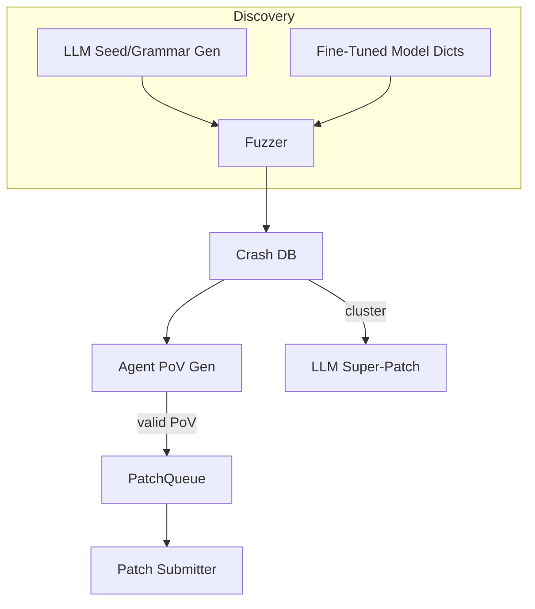

# Fuzzing assistito dall'AI e rilevamento automatico delle vulnerabilità

{{#include ../banners/hacktricks-training.md}}

## Panoramica
I modelli linguistici di grandi dimensioni (LLM) possono potenziare notevolmente le pipeline tradizionali di ricerca delle vulnerabilità generando input semanticamente ricchi, evolvendo grammatiche, ragionando sui dati dei crash e persino proponendo patch per più bug. Questa pagina raccoglie gli approcci più efficaci osservati nelle finali della AI Cyber Challenge (AIxCC) della DARPA e in altre ricerche pubbliche.<sup>[[4]](#references)</sup><sup>[[5]](#references)</sup>

Quello che segue non descrive un singolo sistema usato in una competizione, ma astrae le tecniche per consentirti di riprodurle nei tuoi workflow.

---

## 1. Input seed generati da LLM

I fuzzer tradizionali guidati dalla coverage (AFL++, libFuzzer, Honggfuzz…) partono da un piccolo corpus di seed e mutano i byte alla cieca. Quando il formato di input del target è complesso (SQL, URL, protocolli binari personalizzati), le mutazioni casuali di solito ne rompono la sintassi prima che vengano raggiunti rami interessanti.

Gli LLM possono risolvere questo problema di bootstrap generando *generatori di seed*: brevi script che producono **input sintatticamente corretti ma rilevanti per la sicurezza**. Per esempio:

```prompt
SYSTEM: You are a helpful security engineer.
USER:
Write a Python3 program that prints 200 unique SQL injection strings targeting common anti-pattern mistakes (missing quotes, numeric context, stacked queries).  Ensure length ≤ 256 bytes / string so they survive common length limits.
```

```python
# gen_sqli_seeds.py (truncated)
PAYLOADS = [
    "1 OR 1=1 -- ",
    "' UNION SELECT NULL,NULL--",
    "0; DROP TABLE users;--",
    ...
]
for p in PAYLOADS:
    print(p)
```

Eseguilo una volta e inserisci direttamente l'output nel corpus iniziale del fuzzer:

```bash
python3 gen_sqli_seeds.py > seeds.txt
afl-fuzz -i seeds.txt -o findings/ -- ./target @@
```

Benefici:
1. Validità semantica → maggiore copertura fin da subito.
2. Rigenerabile: modifica il prompt per concentrarti su XSS, path traversal, binary blob, ecc.
3. Economico (< 1 ¢ con GPT-3.5).

### Suggerimenti
* Chiedi al modello di *diversificare* la lunghezza e la codifica dei payload (UTF-8, URL-encoded, UTF-16-LE) per aggirare i filtri superficiali.
* Chiedi un *singolo script autonomo* per evitare problemi di formattazione JSON.

---

## 2. Fuzzing con evoluzione della grammatica

Una variante più potente consiste nel lasciare che l’LLM **evolva una grammatica** invece di seed concreti. Il workflow (pattern “Grammar Guy”) è:

1. Genera una grammatica iniziale ANTLR/Peach/LibFuzzer tramite prompt.
2. Esegui il fuzzing per N minuti e raccogli metriche di copertura (edges / blocchi raggiunti).
3. Riassumi le aree del programma non coperte e invia il riepilogo al modello:
   ```prompt
   The previous grammar triggered 12 % of the program edges.  Functions not reached: parse_auth, handle_upload.  Add / modify rules to cover these.
   ```
4. Unisci le nuove regole, esegui di nuovo il fuzzing e ripeti.

Scheletro di pseudocodice:

```python
for epoch in range(MAX_EPOCHS):
    grammar = llm.refine(grammar, feedback=coverage_stats)
    save(grammar, f"grammar_{epoch}.txt")
    coverage_stats = run_fuzzer(grammar)
```

Punti chiave:
* Mantieni un *budget*: ogni perfezionamento consuma token.
* Usa istruzioni `diff` + `patch` affinché il modello modifichi il codice invece di riscriverlo.
* Fermati quando Δcoverage < ε.

---

## 3. Progettazione di harness libFuzzer con LLM locale

Per il codice che non può lasciare la workstation di un analista, un modello di codice locale può preparare il piccolo adapter tra i byte del fuzzer e un'API C/C++. Il confine di sicurezza utile è esplicito: **il modello scrive e rivede l'infrastruttura di test; la mutazione guidata dalla coverage esplora gli input; i sanitizer segnalano le operazioni non valide; una persona esamina l'harness e valuta i risultati**.<sup>[[9]](#references)</sup>

Per le tecniche di corpus, feedback, snapshot e stateful fuzzing a livello di engine che non dipendono da un LLM, consulta la [Metodologia di fuzzing](../generic-methodologies-and-resources/fuzzing.md).

Inizia con la dichiarazione esatta copiata dall'header target e vincola il formato dell'output. Un prompt circoscritto riduce il rischio di API inventate e rende il risultato facile da esaminare:<sup>[[8]](#references)[[9]](#references)</sup>

```prompt
Write a libFuzzer target for this exact declaration:
int parse_records(const uint8_t *data, size_t size);

Output only C code. Implement LLVMFuzzerTestOneInput, include the
declaration, pass data and size unchanged, and do not use files,
network access, randomness, clocks, threads, or persistent state.
```

Per un parser di byte grezzi, il risultato atteso non dovrebbe essere più complicato di:<sup>[[6]](#references)[[9]](#references)</sup>

```c
#include <stddef.h>
#include <stdint.h>

extern int parse_records(const uint8_t *, size_t);

int LLVMFuzzerTestOneInput(const uint8_t *data, size_t size) {
    (void)parse_records(data, size);
    return 0;
}
```

La compilazione è solo il primo passaggio di validazione. Prima di dedicarvi tempo di CPU, verifica ogni target generato rispetto a questi invarianti:<sup>[[6]](#references)[[8]](#references)[[9]](#references)</sup>

- **API esatta:** confronta tipi, regole di ownership, inizializzazione, teardown e convenzione di chiamata con l’header reale e i caller esistenti.
- **Sicurezza dell’harness:** proteggi ogni lettura da `data`; i risultati del sanitizer devono originarsi nel target, non nella colla generata.
- **Ripetibilità:** fai in modo che il risultato dipenda da `data` e `size`; rimuovi I/O esterno, tempo, casualità non controllata, thread non uniti e stato che persiste tra le chiamate.
- **Throughput:** inizializza una sola volta lo stato immutabile costoso, solo quando ciò non può influire sul comportamento; limita la dimensione dell’input, sopprimi il logging e libera le allocazioni per input.
- **Raggiungibilità:** verifica che vengano eseguiti le funzioni e i branch previsti. Un target che compila ma esercita solo i percorsi di rifiuto è un errore silenzioso.

### Target consapevoli della struttura: preservare gli invarianti senza nascondere i bug

Se la maggior parte degli input grezzi non supera un controllo di magic, lunghezza, versione o checksum, usa i byte di fuzzing come materiale per campi tipizzati e ricostruisci un oggetto valido. Fissa le costanti del formato, lascia mutabili i campi semantici e i byte del payload e ricava i metadati di integrità dal payload ricostruito. `FuzzedDataProvider` è utile per consumare valori tipizzati con limiti, mentre l’adapter resta responsabile di limitare qualsiasi allocazione e conversione generata.<sup>[[9]](#references)</sup>

<details>
<summary>Esempio di target C++ consapevole della struttura</summary>

```cpp
#include <fuzzer/FuzzedDataProvider.h>
#include <stddef.h>
#include <stdint.h>
#include <vector>

extern "C" int parse_message(const uint8_t *, size_t);

extern "C" int LLVMFuzzerTestOneInput(const uint8_t *data, size_t size) {
    FuzzedDataProvider fdp(data, size);
    uint8_t version = fdp.ConsumeIntegral<uint8_t>();
    auto body = fdp.ConsumeRemainingBytes<uint8_t>();
    if (body.size() > UINT16_MAX) body.resize(UINT16_MAX);
    uint16_t len = static_cast<uint16_t>(body.size());
    std::vector<uint8_t> msg = {0x8b, 'M', 'S', 'G', version,
                                static_cast<uint8_t>(len >> 8),
                                static_cast<uint8_t>(len)};
    msg.insert(msg.end(), body.begin(), body.end());
    (void)parse_message(msg.data(), msg.size());
    return 0;
}
```

</details>

Non usare un unico target che ripara la struttura per ogni domanda. Mantieni un target che ricava lunghezze/checksum per esplorare stati validi profondi e un altro che lascia i metadati **dichiarati** sotto il controllo del fuzzer, limitando solo le letture e le allocazioni eseguite dall'harness. Il secondo target preserva le superfici d'attacco con lunghezze non corrispondenti e integrità non valida, che la riparazione automatica altrimenti cancellerebbe.<sup>[[9]](#references)</sup>

### Seed, dizionari, sanitizer e feedback sulla copertura

Chiedi al modello di generare uno script che scriva seed binari, anziché chiedergli di stampare direttamente dati binari. Crea seed di oggetti vuoti, minimi, tipici e validi ai limiti; poi estrai valori magic, tag, codifiche enum e parole chiave del parser in un dizionario revisionato. libFuzzer accetta quel dizionario con `-dict=` e conserva nel corpus le mutazioni che rivelano nuova copertura.<sup>[[6]](#references)[[9]](#references)</sup>

```text
magic="\x8bMSG"
version_min="\x00"
version_max="\xff"
config_tag="CONFIG"
```

Compila lo stesso target con una strumentazione complementare. ASan e UBSan possono condividere un binario di fuzzing; usa una build separata con MSan e strumenta le sue dipendenze per evitare segnalazioni causate da codice non strumentato.<sup>[[6]](#references)[[9]](#references)</sup>

```bash
clang++ -g -O1 -fsanitize=fuzzer,address,undefined \
  -fno-sanitize-recover=undefined target.cc harness.cc -o fuzz_target
./fuzz_target corpus -dict=msg.dict -max_len=65535

clang++ -g -O1 -fsanitize=fuzzer,memory \
  target.cc harness.cc -o fuzz_target_msan
```

Considera la coverage come criterio di valutazione per ogni revisione del modello. Nell’output di libFuzzer, valori di `cov`/`ft` che si appiattiscono subito e un corpus statico di solito indicano un framing errato, un early return troppo restrittivo o la chiamata sbagliata; un valore basso di `exec/s` segnala setup, I/O o allocazioni costosi, oppure stato non ripulito. `NEW` dimostra solo che una feature di coverage è cambiata, non che sia stato raggiunto il parser previsto.<sup>[[6]](#references)[[9]](#references)</sup>

Per ottenere feedback a livello di sorgente, crea una build con coverage, esegui il fuzzing e fornisci al modello solo le funzioni non coperte e le relative condizioni di protezione. Verifica le modifiche a harness, seed e dictionary e misura di nuovo:<sup>[[7]](#references)[[8]](#references)[[9]](#references)</sup>

```bash
clang++ -g -O1 -fsanitize=fuzzer \
  -fprofile-instr-generate -fcoverage-mapping target.cc harness.cc -o fuzz_cov
mkdir -p profiles
LLVM_PROFILE_FILE='profiles/%p.profraw' ./fuzz_cov -max_total_time=300 corpus
llvm-profdata merge -sparse profiles/*.profraw -o fuzz.profdata
llvm-cov report ./fuzz_cov -instr-profile=fuzz.profdata
llvm-cov show ./fuzz_cov -instr-profile=fuzz.profdata \
  --show-branches=count --region-coverage-lt=1 target.cc
```

Il loop scalabile è quindi **generate → compile/link → smoke-test under sanitizers → measure target coverage → provide the smallest relevant coverage/source context → revise → re-measure**. OSS-Fuzz-Gen applica lo stesso principio valutando i target generati in base alla compilabilità, agli errori di runtime, alla coverage e al miglioramento della coverage rispetto ai target esistenti, invece di accettare codice plausibile senza verificarlo.<sup>[[7]](#references)[[8]](#references)</sup>

---

## 4. Generazione di PoV (Exploit) basata su agenti

Dopo aver trovato un crash, serve comunque un **proof-of-vulnerability (PoV)** che lo attivi in modo deterministico.

Un approccio scalabile consiste nell'avviare molti worker leggeri (processi, thread o container), ciascuno con un modello o una configurazione di campionamento diversi. La survey sui finalisti AIxCC fornisce esempi concreti di questa scala: un team ha usato **migliaia di agenti concorrenti** per la generazione di PoV basata prima di tutto sull'AI, mentre un altro ha orchestrato **300–500 agenti di fuzzing** e ha riservato gli LLM al ragionamento semantico di livello superiore.<sup>[[4]](#references)</sup>

Pipeline:
1. L'analisi statica/dinamica produce *candidati di bug* (struct con crash PC, input slice, messaggio del sanitizer).
2. L'orchestratore distribuisce i candidati agli agenti.
3. Passaggi di ragionamento dell'agente:
   a. Riprodurre il bug localmente con `gdb` + input.
   b. Suggerire un payload di exploit minimo.
   c. Convalidare l'exploit in sandbox. Se ha successo → inviare.
4. I tentativi falliti vengono **rimessi in coda come nuovi seed** per la coverage fuzzing (feedback loop).

Vantaggi:
* Il parallelismo nasconde l'inaffidabilità del singolo agente.
* Auto-tuning di temp / dimensione del modello in base al tasso di successo osservato.

---

## 5. Fuzzing diretto con modelli di codice fine-tuned

Esegui il fine-tuning di un modello open-weight (ad es. Llama-7B) su codice sorgente C/C++ etichettato con pattern di vulnerabilità (integer overflow, buffer copy, format string). Poi:

1. Esegui l'analisi statica per ottenere l'elenco delle funzioni + AST.
2. Chiedi al modello: *“Fornisci voci per un dizionario di mutazioni che potrebbero compromettere la memory safety nella funzione X”*.
3. Inserisci quei token in un `AFL_CUSTOM_MUTATOR` personalizzato.

Esempio di output per un wrapper `sprintf`:
```
{"pattern":"%99999999s"}
{"pattern":"AAAAAAAA....<1024>....%n"}
```

Empiricamente, questo riduce di oltre 2× il tempo necessario a provocare un crash su target reali.

---

## 6. Strategie di patching guidate dall’AI

### 6.1 Super Patches
Chiedi al modello di *raggruppare* le signature dei crash e proporre una **singola patch** che elimini la causa radice comune.  Invia una sola patch per correggere diversi bug → meno penalità di accuratezza negli ambienti in cui ogni patch errata costa punti.

Schema del prompt:
```
Here are 10 stack traces + file snippets.  Identify the shared mistake and generate a unified diff fixing all occurrences.
```

### 6.2 Rapporto di patch speculative
Implementa una coda in cui le patch confermate e validate tramite PoV e quelle *speculative* (senza PoV) si alternano con un rapporto 1:​N, regolato in base alle regole di scoring (ad es. 2 speculative : 1 confermata). Un modello dei costi monitora penalità e punti e regola autonomamente N.

---

## 7. Code review AI deterministica, file per file

Un errore frequente nelle review assistite dall'AI è chiedere a un agente di ispezionare un intero repository, sperando che scelga i file e i termini grep corretti. Un approccio più affidabile consiste nel **forzare la copertura del repository**:<sup>[[1]](#references)</sup>

1. Elenca i file sorgente.
2. Invia **un file alla volta** insieme al contesto minimo (entrypoint, importazioni, route/chiamanti vicini).
3. Richiedi un **report strutturato** per ogni file: sorgenti, sink, validazione mancante, precondizioni dell'exploit e livello di confidenza.<sup>[[3]](#references)</sup>
4. Deduplica i report in base ai **pattern source→sink** e verifica manualmente quelli ad alto rischio.

Questo approccio consuma molti token e genera rumore, ma è molto efficace nel far emergere **bug semplici ad alto impatto nei source/sink** che spesso sfuggono alle review agentiche più ampie.

### Pattern di triage da prioritizzare

- **Include/dispatch PHP dinamici**: nomi di route/controller/moduli controllati dall'attaccante che arrivano a `require_once()`, `include()` o `include_once()` senza una allowlist rigorosa e la canonicalizzazione dei percorsi.
- **Esecuzione di shell nei flussi di lavoro amministrativi/account**: nomi utente, domini, account FTP o altri identificatori che arrivano a `exec()`, `system()`, `shell_exec()`, `passthru()`, `proc_open()` o `popen()`.
- **Fan-in di input strutturati**: lo stesso parametro accettato da `$_GET`, `$_POST`, JSON, XML o dai parser del body del framework, e successivamente riutilizzato in sink del filesystem o di comandi OS.

### Due classi di bug pratiche che questo metodo individua bene

- **LFI/RCE tramite dispatch dei controller PHP**: se il nome del controller, controllato dalla richiesta, viene concatenato in `require_once()` senza allowlist o normalizzazione del percorso, sequenze di traversal come `../` possono indurre PHP a includere un file `.php` locale non previsto. Se l'attaccante può indirizzare l'include a un file PHP preparato o comunque utile, la LFI diventa esecuzione di codice. Vedi [File Inclusion / Path Traversal](../pentesting-web/file-inclusion/README.md).<sup>[[1]](#references)</sup>
- **Command injection autenticata nei pannelli di hosting/amministrazione**: se i campi di gestione degli account, come i nomi utente, vengono inseriti nei comandi shell, un utente autenticato con privilegi limitati può trasformare una normale operazione di creazione/eliminazione in RCE. L'impatto aumenta quando il pannello esegue il comando come un account di servizio con privilegi superiori. Vedi [Command Injection](../pentesting-web/command-injection.md).<sup>[[1]](#references)</sup>

### Note pratiche per la review

- Usa prima l'LLM come **reviewer di source/sink**, non come generatore di exploit.
- Chiedigli di elencare esplicitamente il **campo controllato dall'attaccante**, la **lacuna di normalizzazione/validazione** e il **sink pericoloso**.
- Nei repository di grandi dimensioni, la review deterministica file per file è spesso più affidabile di una singola esecuzione di un agente autonomo, anche se quest'ultimo usa un modello più potente.<sup>[[2]](#references)</sup>
- Aspettati risultati meno efficaci per **Broken Access Control** e altri bug di logica di business, in cui l'exploitability dipende da ipotesi tra file, semantica dei ruoli o modelli di minaccia specifici del prodotto.

---

## Ricerca verificabile assistita da agenti su codebase sconosciute

Il [workflow graph-first fuzz-target](../generic-methodologies-and-resources/fuzzing.md#graph-first-fuzz-target-selection-and-mutation-triage) copre già la raggiungibilità degli entrypoint, mentre le [pipeline agentiche SAST](../network-services-pentesting/pentesting-web/code-review-tools.md#agentic-sast-pipelines) coprono la review a fasi e i controlli delle evidenze. Mantieni separati questi risultati deterministici dalle ipotesi del modello, così ogni pista promossa conserva le posizioni nel sorgente, le evidenze del percorso e una misurazione dinamica.<sup>[[10]](#references)</sup>

### Correlare le evidenze sul ciclo di vita degli oggetti senza inventare flussi di dati

L'analisi statica può individuare una lunghezza controllata dall'attaccante memorizzata in una funzione e lo stesso campo di un oggetto che raggiunge molto più tardi un sink di copia, ma non riuscire a dimostrare il collegamento attraverso callback, riconnessioni o il ciclo di vita dell'oggetto. Conserva separatamente entrambi i risultati, raggruppali per oggetto/campo e rendi esplicita la connessione mancante come domanda di triage. L'agente può suggerire la relazione, ma deve essere dimostrata tramite la revisione del sorgente o l'instrumentazione runtime.<sup>[[10]](#references)</sup>

Per ogni candidato, registra:

- l'entrypoint concreto e i byte controllati dall'attaccante;
- ogni produttore del campo rilevante, inclusa la validazione specifica di ciascun produttore;
- il sink, la capacità di destinazione e le condizioni di build/runtime necessarie per raggiungerlo;
- uno stack di chiamate reale a partire dall'entrypoint esposto, non soltanto un'invocazione diretta dell'harness;
- il risultato dinamico minimo che conferma o respinge l'ipotesi.

Un percorso apparentemente sicuro non rende sicuro un campo in generale. Un secondo produttore potrebbe valorizzare lo stesso campo senza il limite applicato nel primo percorso. Verifica i percorsi separatamente ed esegui l'harness con opzioni di build equivalenti a quelle di deployment, perché le asserzioni di debug possono trasformare una corruzione della memoria in produzione in un'interruzione anticipata valida solo nei test.<sup>[[10]](#references)</sup>

### Criteri di misurazione per disclosure e sfruttamento

Per sospette disclosure di memoria non inizializzata, riempi le nuove allocazioni con un byte riconoscibile e verifica che il marcatore esatto raggiunga il pacchetto emesso. Per lo sfruttamento, richiedi criteri misurati come **sovrascrittura controllata → oggetto vittima utile → disclosure → recupero di puntatore/base → dirottamento del flusso di controllo → payload composto**. Un agente procede solo quando l'harness dimostra la proprietà corrente; una spiegazione plausibile non equivale al superamento di un criterio. Il [caso FreeRDP](../binary-exploitation/libc-heap/heap-overflow.md#cross-path-length-reuse-and-stale-output-disclosure) mostra il percorso e i vincoli di build da mantenere durante la convalida.<sup>[[10]](#references)</sup>

---

## Mettere tutto insieme
Un CRS (Cyber Reasoning System) end-to-end può collegare i componenti in questo modo:



---

## References

- [1] [Project Black - AI locale per la Cyber Security: trovare LFI in phpIPAM e RCE autenticato in myVesta](https://projectblack.io/blog/local-ai-for-cyber-security)
- [2] [Strix](https://github.com/usestrix/strix)
- [3] [Skill di revisione della sicurezza della community di GitHub Copilot](https://github.com/github/awesome-copilot/blob/main/skills/security-review/SKILL.md)
- [4] [Trail of Bits – Finali AIxCC: il resoconto della gara](https://blog.trailofbits.com/2025/08/07/aixcc-finals-tale-of-the-tape/)
- [5] [Interviste ai finalisti di AIxCC di CTF Radiooo](https://www.youtube.com/@ctfradiooo)
- [6] [LLVM — libFuzzer: una libreria per il fuzz testing guidato dalla copertura](https://llvm.org/docs/LibFuzzer.html)
- [7] [Google — OSS-Fuzz-Gen](https://github.com/google/oss-fuzz-gen)
- [8] [Google Online Security Blog — Potenziare il fuzzing: trovare più vulnerabilità con l'AI](https://security.googleblog.com/2024/11/leveling-up-fuzzing-finding-more.html)
- [9] [8kSec — Generazione assistita dall'AI di harness di fuzzing con un LLM locale](https://8ksec.io/ai-assisted-fuzzing-harness-local-llm)
- [10] [Quarkslab — Dagli agenti AI alla RCE: creare un workflow di ricerca delle vulnerabilità](https://blog.quarkslab.com/from-ai-agents-to-rce-building-a-vulnerability-research-workflow.html)
{{#include ../banners/hacktricks-training.md}}
