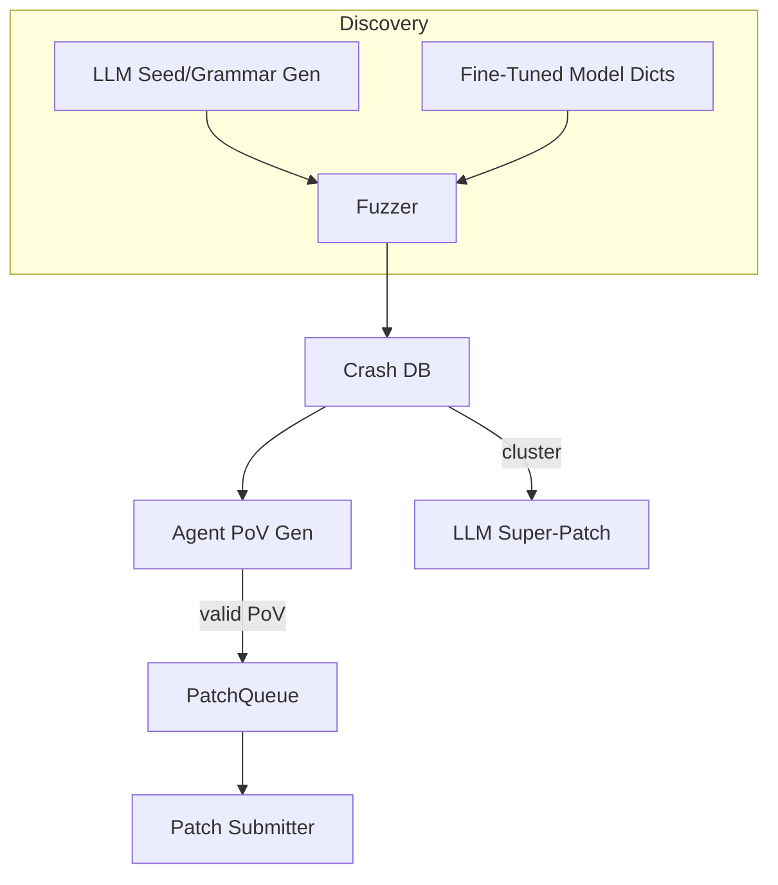

# AI-Assisted Fuzzing & Automated Vulnerability Discovery

{{#include ../banners/hacktricks-training.md}}

## 概述
大型语言模型（LLM）可以通过生成语义丰富的输入、演进语法、分析崩溃数据，甚至提出修复多个 bug 的补丁，大幅增强传统漏洞研究流程。本文汇总了 DARPA 的 AI Cyber Challenge（AIxCC）决赛和其他公开研究中观察到的最有效模式。<sup>[[4]](#references)</sup><sup>[[5]](#references)</sup>

以下内容并非对某个特定竞赛系统的描述，而是对相关技术的抽象，方便你在自己的工作流程中复现。

---

## 1. LLM 生成的种子输入

传统的覆盖率引导型 fuzzer（AFL++、libFuzzer、Honggfuzz……）从一个小型种子语料库开始，并盲目地变异字节。当目标输入格式很复杂（如 SQL、URL、自定义二进制协议）时，随机变异通常会在触及有趣分支之前破坏语法。

LLM 可以通过生成 *种子生成器* 来解决这个启动问题——这些简短脚本会输出**语法正确且与安全相关的输入**。例如：

```prompt
SYSTEM: You are a helpful security engineer.
USER:
Write a Python3 program that prints 200 unique SQL injection strings targeting common anti-pattern mistakes (missing quotes, numeric context, stacked queries).  Ensure length ≤ 256 bytes / string so they survive common length limits.
```

```python
# gen_sqli_seeds.py (truncated)
PAYLOADS = [
    "1 OR 1=1 -- ",
    "' UNION SELECT NULL,NULL--",
    "0; DROP TABLE users;--",
    ...
]
for p in PAYLOADS:
    print(p)
```

运行一次，并将输出直接馈入 fuzzer 的初始语料库：

```bash
python3 gen_sqli_seeds.py > seeds.txt
afl-fuzz -i seeds.txt -o findings/ -- ./target @@
```

Benefits:
1. 语义有效性 → 更早获得更深的覆盖率。
2. 可重新生成：调整 prompt，即可聚焦于 XSS、path traversal、binary blobs 等。
3. 成本低（使用 GPT-3.5 时低于 1 ¢）。

### Tips
* 指示模型让 payload 的长度和编码（UTF-8、URL-encoded、UTF-16-LE）*多样化*，以绕过浅层过滤器。
* 要求生成*单个自包含脚本*，避免 JSON 格式问题。

---

## 2. Grammar-Evolution Fuzzing

一种更强大的变体是让 LLM **演进 grammar**，而不是生成具体的种子。工作流程（“Grammar Guy”模式）如下：

1. 通过 prompt 生成初始的 ANTLR/Peach/LibFuzzer grammar。
2. 进行 N 分钟的 fuzzing，并收集覆盖率指标（命中的边 / 块）。
3. 总结尚未覆盖的程序区域，并将总结反馈给模型：
   ```prompt
   The previous grammar triggered 12 % of the program edges.  Functions not reached: parse_auth, handle_upload.  Add / modify rules to cover these.
   ```
4. 合并新规则，重新 fuzz，然后重复。

伪代码框架：

```python
for epoch in range(MAX_EPOCHS):
    grammar = llm.refine(grammar, feedback=coverage_stats)
    save(grammar, f"grammar_{epoch}.txt")
    coverage_stats = run_fuzzer(grammar)
```

关键要点：
* 控制 *预算*——每次优化都会消耗 tokens。
* 使用 `diff` + `patch` 指令，让模型编辑而不是重写。
* 当 Δcoverage < ε 时停止。

---

## 3. 本地 LLM libFuzzer Harness 工程

对于不能离开分析人员工作站的源代码，本地代码模型可以起草一个小型适配器，用于将 fuzzer 字节转换为 C/C++ API 调用。明确的安全边界很重要：**模型编写并修改测试基础设施；coverage-guided mutation 探索输入；sanitizer 报告无效操作；由人工审查 harness 并对发现进行分类**。<sup>[[9]](#references)</sup>

对于不依赖 LLM 的引擎级 corpus、反馈、快照和有状态 fuzzing 技术，请参阅通用的 [Fuzzing 方法论](../generic-methodologies-and-resources/fuzzing.md)。

从目标头文件中复制准确的声明，并限制输出格式。范围狭窄的提示词能减少虚构的 API，也便于审查：<sup>[[8]](#references)[[9]](#references)</sup>

```prompt
Write a libFuzzer target for this exact declaration:
int parse_records(const uint8_t *data, size_t size);

Output only C code. Implement LLVMFuzzerTestOneInput, include the
declaration, pass data and size unchanged, and do not use files,
network access, randomness, clocks, threads, or persistent state.
```

对于原始字节解析器，预期结果不应比以下内容更复杂：<sup>[[6]](#references)[[9]](#references)</sup>

```c
#include <stddef.h>
#include <stdint.h>

extern int parse_records(const uint8_t *, size_t);

int LLVMFuzzerTestOneInput(const uint8_t *data, size_t size) {
    (void)parse_records(data, size);
    return 0;
}
```

编译只是第一道验证关卡。在为每个生成的目标耗费 CPU 时间之前，先根据以下不变量逐一检查：<sup>[[6]](#references)[[8]](#references)[[9]](#references)</sup>

- **Exact API：** 对照真实头文件和现有调用方，检查类型、所有权规则、初始化、清理和调用约定。
- **Harness safety：** 对从 `data` 读取的每个位置都进行保护；sanitizer 发现的问题必须源自目标本身，而不是生成的 glue code。
- **Repeatability：** 使结果仅由 `data` 和 `size` 决定；移除外部 I/O、时间、不可控的随机性、未加入的线程，以及在调用之间持续存在的状态。
- **Throughput：** 仅在不会影响行为时才初始化一次开销较大的不可变状态；限制输入大小，抑制日志，并释放每次输入产生的分配。
- **Reachability：** 验证预期函数和分支确实会执行。目标虽能编译，却只触发拒绝路径，就是一种隐性失败。

### 结构感知目标：保留不变量，同时不掩盖漏洞

如果大多数原始输入都无法通过 magic、长度、版本或校验和检查，就将 fuzz 字节用作**类型化字段材料**，并重建有效对象。固定格式常量，让语义字段和 payload 字节保持可变，并根据重建后的 payload 推导完整性元数据。`FuzzedDataProvider` 可用于读取有界的类型化值，而 adapter 仍负责限制任何生成的分配和转换。<sup>[[9]](#references)</sup>

<details>
<summary>结构感知 C++ 目标示例</summary>

```cpp
#include <fuzzer/FuzzedDataProvider.h>
#include <stddef.h>
#include <stdint.h>
#include <vector>

extern "C" int parse_message(const uint8_t *, size_t);

extern "C" int LLVMFuzzerTestOneInput(const uint8_t *data, size_t size) {
    FuzzedDataProvider fdp(data, size);
    uint8_t version = fdp.ConsumeIntegral<uint8_t>();
    auto body = fdp.ConsumeRemainingBytes<uint8_t>();
    if (body.size() > UINT16_MAX) body.resize(UINT16_MAX);
    uint16_t len = static_cast<uint16_t>(body.size());
    std::vector<uint8_t> msg = {0x8b, 'M', 'S', 'G', version,
                                static_cast<uint8_t>(len >> 8),
                                static_cast<uint8_t>(len)};
    msg.insert(msg.end(), body.begin(), body.end());
    (void)parse_message(msg.data(), msg.size());
    return 0;
}
```

</details>

不要对每个问题都使用同一个会修复结构的 target。维护一个会推导长度/校验和以探索深层有效状态的 target，另一个则让 fuzzer 控制**声明的**元数据，只限制 harness 自身的读取和分配。第二个 target 能保留自动修复原本会抹去的长度不匹配和完整性校验错误攻击面。<sup>[[9]](#references)</sup>

### Seeds、字典、sanitizer 和覆盖率反馈

让模型生成用于写入二进制 seeds 的脚本，而不是让它直接输出二进制内容。为对象准备空、最小、典型和边界有效的 seeds；然后提取 magic 值、标签、枚举编码和解析器关键字，整理成经过审核的字典。libFuzzer 可通过 `-dict=` 接受该字典，并会将能发现新覆盖率的变异保留在 corpus 中。<sup>[[6]](#references)[[9]](#references)</sup>

```text
magic="\x8bMSG"
version_min="\x00"
version_max="\xff"
config_tag="CONFIG"
```

使用互补的插桩方式构建同一目标。ASan 和 UBSan 可以共用一个 fuzzing 二进制文件；MSan 则应单独构建，并对其依赖项进行插桩，以避免未插桩代码导致误报。<sup>[[6]](#references)[[9]](#references)</sup>

```bash
clang++ -g -O1 -fsanitize=fuzzer,address,undefined \
  -fno-sanitize-recover=undefined target.cc harness.cc -o fuzz_target
./fuzz_target corpus -dict=msg.dict -max_len=65535

clang++ -g -O1 -fsanitize=fuzzer,memory \
  target.cc harness.cc -o fuzz_target_msan
```

将 coverage 视为评估每次模型修订的标准。在 libFuzzer 输出中，`cov`/`ft` 早早趋于平坦且 corpus 静态不变，通常意味着 framing 不当、过早返回的限制过严，或调用了错误的函数；`exec/s` 较低则说明 setup、I/O、分配开销较大，或存在状态泄漏。`NEW` 只能证明某个 coverage feature 发生了变化，不能证明已触达预期的 parser。<sup>[[6]](#references)[[9]](#references)</sup>

若要获取源代码级反馈，先构建 coverage 版本并进行 fuzz，然后只向模型提供未覆盖的函数及其守卫条件。检查生成的 harness/seed/dictionary 差异，并再次测量：<sup>[[7]](#references)[[8]](#references)[[9]](#references)</sup>

```bash
clang++ -g -O1 -fsanitize=fuzzer \
  -fprofile-instr-generate -fcoverage-mapping target.cc harness.cc -o fuzz_cov
mkdir -p profiles
LLVM_PROFILE_FILE='profiles/%p.profraw' ./fuzz_cov -max_total_time=300 corpus
llvm-profdata merge -sparse profiles/*.profraw -o fuzz.profdata
llvm-cov report ./fuzz_cov -instr-profile=fuzz.profdata
llvm-cov show ./fuzz_cov -instr-profile=fuzz.profdata \
  --show-branches=count --region-coverage-lt=1 target.cc
```

因此，可扩展的循环是 **生成 → 编译/链接 → 在 sanitizers 下进行冒烟测试 → 衡量目标覆盖率 → 提供最小且相关的覆盖率/源代码上下文 → 修订 → 重新衡量**。OSS-Fuzz-Gen 采用相同原则：评估生成的目标是否可编译、是否出现运行时故障、覆盖率如何，以及相较于现有目标的覆盖率提升，而不是仅凭代码看起来合理就予以接受。<sup>[[7]](#references)[[8]](#references)</sup>

---

<a id="3-agent-based-pov-exploit-generation" hidden>3. Agent-Based PoV (Exploit) Generation</a>

## 4. 基于 Agent 的 PoV（Exploit）生成

找到 crash 后，你仍然需要一个能确定性触发它的 **漏洞证明（PoV）**。

一种可扩展的方法是启动许多轻量级 worker（进程、线程或容器），每个 worker 使用不同的模型或采样配置。AIxCC 决赛队伍调查报告给出了具体的规模示例：一个团队使用 **数千个并发 agent** 来优先通过 AI 生成 PoV，而另一个团队则协调 **300–500 个 fuzzing agent**，并将 LLM 留给更高层次的语义推理。<sup>[[4]](#references)</sup>

流程：
1. 静态/动态分析生成 *bug 候选项*（包含 crash PC、输入片段、sanitizer 消息的 struct）。
2. Orchestrator 将候选项分发给 agent。
3. Agent 推理步骤：
   a. 使用 `gdb` + 输入在本地复现 bug。
   b. 提出最小 exploit payload。
   c. 在 sandbox 中验证 exploit。如果成功 → 提交。
4. 失败的尝试会**重新排入队列，作为 coverage fuzzing 的新种子**（反馈循环）。

优势：
* 并行化可弥补单个 agent 的不可靠性。
* 根据观察到的成功率，自动调整 temp / 模型大小。

---

<a id="4-directed-fuzzing-with-fine-tuned-code-models" hidden>4. Directed Fuzzing with Fine-Tuned Code Models</a>

## 5. 使用微调代码模型进行定向 Fuzzing

使用带有漏洞模式（整数溢出、缓冲区复制、格式字符串）标签的 C/C++ 源代码，对开放权重模型（例如 Llama-7B）进行微调。然后：

1. 运行静态分析，获取函数列表和 AST。
2. 提示模型：*“给出可能破坏函数 X 内存安全性的 mutation dictionary 条目”*。
3. 将这些 token 插入自定义的 `AFL_CUSTOM_MUTATOR`。

`sprintf` wrapper 的输出示例：
```
{"pattern":"%99999999s"}
{"pattern":"AAAAAAAA....<1024>....%n"}
```

从实测来看，这能让真实目标的崩溃时间缩短 2 倍以上。

---

<a id="5-ai-guided-patching-strategies" hidden>5. AI 引导的补丁策略</a>

## 6. AI 引导的补丁策略

<a id="51-super-patches" hidden>5.1 超级补丁</a>

### 6.1 超级补丁
让模型对崩溃特征进行*聚类*，并提出一个**单一补丁**，以消除共同的根本原因。只提交一次，即可修复多个 bug → 在每次错误补丁都会扣分的环境中，减少准确率损失。

提示词大纲：
```
Here are 10 stack traces + file snippets.  Identify the shared mistake and generate a unified diff fixing all occurrences.
```

{{#ref}}
../generic-methodologies-and-resources/fuzzing.md
{{#endref}}

<a id="52-speculative-patch-ratio" hidden>5.2 推测性补丁比例</a>

### 6.2 推测性补丁比例
实现一个队列，以按评分规则调整的 1:​N 比例交替处理已确认且经 PoV 验证的补丁和*推测性*补丁（无 PoV）（例如 2 个推测性补丁 : 1 个已确认补丁）。成本模型会监控惩罚与得分，并自动调整 N。

---

有关确定性的逐文件源码审查、移动端入口 taskflow、内核模式审计，以及基于证据的漏洞验证，请参阅 [AI 辅助源码审查与漏洞验证](AI-Assisted-Source-Review-and-Vulnerability-Validation.md)。

---

## 调试器辅助的崩溃分诊

用于崩溃分诊、函数分析和受控堆块可达性分析的 Mona v3 工作流，参见 [Exploiting Tools](../binary-exploitation/basic-stack-binary-exploitation-methodology/tools/#mona-v3-debugger-context-requests-for-crash-triage)。

---

## 整合所有内容
端到端的 CRS（Cyber Reasoning System）可以按如下方式连接这些组件：



---

## References

- [4] [Trail of Bits — AIxCC 决赛：实力盘点](https://blog.trailofbits.com/2025/08/07/aixcc-finals-tale-of-the-tape/)
- [5] [CTF Radiooo AIxCC 决赛入围者访谈](https://www.youtube.com/@ctfradiooo)
- [6] [LLVM — libFuzzer：用于 coverage-guided fuzz testing 的库](https://llvm.org/docs/LibFuzzer.html)
- [7] [Google — OSS-Fuzz-Gen](https://github.com/google/oss-fuzz-gen)
- [8] [Google Online Security Blog — 提升 fuzzing：借助 AI 发现更多漏洞](https://security.googleblog.com/2024/11/leveling-up-fuzzing-finding-more.html)
- [9] [8kSec — 使用本地 LLM 进行 AI 辅助的 fuzzing harness 生成](https://8ksec.io/ai-assisted-fuzzing-harness-local-llm)
{{#include ../banners/hacktricks-training.md}}
