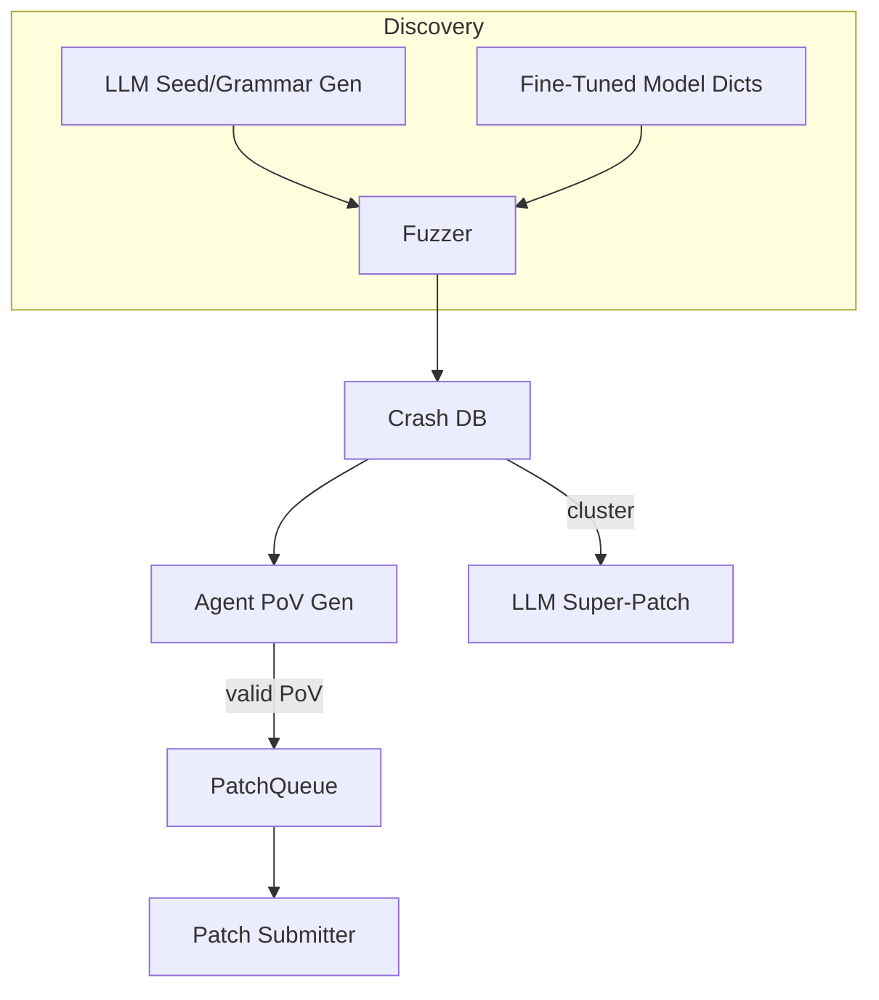

# Fuzzing Assistido por IA e Descoberta Automatizada de Vulnerabilidades

{{#include ../banners/hacktricks-training.md}}

## Visão geral
Os modelos de linguagem de grande escala (LLMs) podem turbinar os fluxos tradicionais de pesquisa de vulnerabilidades gerando entradas semanticamente ricas, evoluindo gramáticas, raciocinando sobre dados de falhas e até propondo patches para múltiplos bugs. Esta página reúne os padrões mais eficazes observados nas finais do AI Cyber Challenge (AIxCC) da DARPA e em outras pesquisas públicas.<sup>[[4]](#references)</sup><sup>[[5]](#references)</sup>

O que segue não é uma descrição de um sistema específico de competição, mas uma abstração das técnicas para que você possa reproduzi-las em seus próprios fluxos de trabalho.

---

## 1. Entradas seed geradas por LLMs

Fuzzers tradicionais guiados por cobertura (AFL++, libFuzzer, Honggfuzz…) começam com um pequeno corpus de seeds e fazem mutações cegas nos bytes. Quando o formato de entrada do alvo é complexo (SQL, URLs, protocolos binários personalizados), mutações aleatórias geralmente quebram a sintaxe antes que ramificações interessantes sejam alcançadas.

Os LLMs podem resolver esse problema inicial produzindo *geradores de seeds* – scripts curtos que geram **entradas sintaticamente corretas, mas relevantes para a segurança**. Por exemplo:

```prompt
SYSTEM: You are a helpful security engineer.
USER:
Write a Python3 program that prints 200 unique SQL injection strings targeting common anti-pattern mistakes (missing quotes, numeric context, stacked queries).  Ensure length ≤ 256 bytes / string so they survive common length limits.
```

```python
# gen_sqli_seeds.py (truncated)
PAYLOADS = [
    "1 OR 1=1 -- ",
    "' UNION SELECT NULL,NULL--",
    "0; DROP TABLE users;--",
    ...
]
for p in PAYLOADS:
    print(p)
```

Execute uma vez e alimente a saída diretamente no corpus inicial do fuzzer:

```bash
python3 gen_sqli_seeds.py > seeds.txt
afl-fuzz -i seeds.txt -o findings/ -- ./target @@
```

Benefícios:
1. Validade semântica → cobertura mais profunda desde o início.
2. Regerável: ajuste o prompt para focar em XSS, path traversal, blobs binários etc.
3. Barato (< 1 ¢ com GPT-3.5).

### Dicas
* Instrua o modelo a *diversificar* o comprimento dos payloads e a codificação (UTF-8, URL-encoded, UTF-16-LE) para contornar filtros superficiais.
* Peça um *único script autocontido* – evita problemas de formatação JSON.

---

## 2. Grammar-Evolution Fuzzing

Uma variante mais poderosa é deixar o LLM **evoluir uma grammar** em vez de seeds concretas. O workflow (padrão “Grammar Guy”) é:

1. Gere uma grammar inicial de ANTLR/Peach/LibFuzzer usando um prompt.
2. Faça fuzzing por N minutos e colete métricas de cobertura (arestas / blocos atingidos).
3. Resuma as áreas do programa não cobertas e envie o resumo de volta ao modelo:
   ```prompt
   The previous grammar triggered 12 % of the program edges.  Functions not reached: parse_auth, handle_upload.  Add / modify rules to cover these.
   ```
4. Mescle as novas regras, faça fuzzing novamente e repita.

Esqueleto de pseudocódigo:

```python
for epoch in range(MAX_EPOCHS):
    grammar = llm.refine(grammar, feedback=coverage_stats)
    save(grammar, f"grammar_{epoch}.txt")
    coverage_stats = run_fuzzer(grammar)
```

Pontos-chave:
* Mantenha um *orçamento* – cada refinamento consome tokens.
* Use instruções de `diff` + `patch` para que o modelo edite em vez de reescrever.
* Pare quando Δcoverage < ε.

---

## 3. Engenharia de Harness do libFuzzer com LLM local

Para código-fonte que não pode sair da estação de trabalho do analista, um modelo de código local pode criar o pequeno adaptador entre os bytes do fuzzer e uma API C/C++. O limite de segurança útil é explícito: **o modelo escreve e revisa a infraestrutura de teste; a mutação guiada por coverage explora entradas; os sanitizers reportam operações inválidas; uma pessoa revisa o harness e faz a triagem dos achados**.<sup>[[9]](#references)</sup>

Para técnicas de corpus, feedback, snapshot e fuzzing com estado no nível do engine que não dependem de um LLM, consulte a [Metodologia de Fuzzing](../generic-methodologies-and-resources/fuzzing.md) geral.

Comece com a declaração exata copiada do header de destino e restrinja o formato da saída. Um prompt específico reduz APIs inventadas e facilita a revisão do resultado:<sup>[[8]](#references)[[9]](#references)</sup>

```prompt
Write a libFuzzer target for this exact declaration:
int parse_records(const uint8_t *data, size_t size);

Output only C code. Implement LLVMFuzzerTestOneInput, include the
declaration, pass data and size unchanged, and do not use files,
network access, randomness, clocks, threads, or persistent state.
```

Para um parser de bytes brutos, o resultado esperado não deve ser mais complicado do que:<sup>[[6]](#references)[[9]](#references)</sup>

```c
#include <stddef.h>
#include <stdint.h>

extern int parse_records(const uint8_t *, size_t);

int LLVMFuzzerTestOneInput(const uint8_t *data, size_t size) {
    (void)parse_records(data, size);
    return 0;
}
```

A compilação é apenas a primeira etapa de validação. Revise cada target gerado em relação a estas invariantes antes de gastar tempo de CPU nele:<sup>[[6]](#references)[[8]](#references)[[9]](#references)</sup>

- **API exata:** compare os tipos, as regras de propriedade, a inicialização, a finalização e a convenção de chamada com o cabeçalho real e os chamadores existentes.
- **Segurança do harness:** proteja cada leitura de `data`; os problemas detectados pelo sanitizer devem ter origem no target, não no código de cola gerado.
- **Repetibilidade:** faça com que o resultado seja uma função de `data` e `size`; remova I/O externo, dependência do tempo, aleatoriedade não controlada, threads que não foram aguardadas e estado que persista entre chamadas.
- **Vazão:** inicialize o estado imutável custoso uma única vez, somente quando isso não puder afetar o comportamento; limite o tamanho da entrada, suprima o registro de logs e libere as alocações feitas para cada entrada.
- **Alcançabilidade:** verifique se as funções e ramificações pretendidas são executadas. Um target que compila, mas só exercita caminhos de rejeição, é uma falha silenciosa.

### Targets com reconhecimento de estrutura: preserve invariantes sem ocultar bugs

Se a maioria das entradas brutas falhar em uma verificação de magic, tamanho, versão ou checksum, use os bytes de fuzz como **material para campos tipados** e reconstrua um objeto válido. Fixe as constantes do formato, mantenha os campos semânticos e os bytes do payload mutáveis e derive os metadados de integridade a partir do payload reconstruído. `FuzzedDataProvider` é útil para consumir valores tipados com limites, enquanto o adaptador continua responsável por limitar qualquer alocação e conversão geradas.<sup>[[9]](#references)</sup>

<details>
<summary>Exemplo de target C++ com reconhecimento de estrutura</summary>

```cpp
#include <fuzzer/FuzzedDataProvider.h>
#include <stddef.h>
#include <stdint.h>
#include <vector>

extern "C" int parse_message(const uint8_t *, size_t);

extern "C" int LLVMFuzzerTestOneInput(const uint8_t *data, size_t size) {
    FuzzedDataProvider fdp(data, size);
    uint8_t version = fdp.ConsumeIntegral<uint8_t>();
    auto body = fdp.ConsumeRemainingBytes<uint8_t>();
    if (body.size() > UINT16_MAX) body.resize(UINT16_MAX);
    uint16_t len = static_cast<uint16_t>(body.size());
    std::vector<uint8_t> msg = {0x8b, 'M', 'S', 'G', version,
                                static_cast<uint8_t>(len >> 8),
                                static_cast<uint8_t>(len)};
    msg.insert(msg.end(), body.begin(), body.end());
    (void)parse_message(msg.data(), msg.size());
    return 0;
}
```

</details>

Não use um único alvo que repara estruturas para todas as perguntas. Mantenha um alvo que derive comprimentos/checksums para explorar estados válidos profundos e outro que deixe os metadados **declarados** sob controle do fuzzer, limitando apenas as leituras e alocações do próprio harness. O segundo alvo preserva superfícies de ataque com comprimentos incompatíveis e integridade inválida que o reparo automático apagaria.<sup>[[9]](#references)</sup>

### Seeds, dicionários, sanitizers e feedback de cobertura

Peça ao modelo para gerar um script que grave seeds binárias, em vez de pedir que ele imprima dados binários diretamente. Crie seeds com objetos vazios, mínimos, típicos e válidos nos limites; depois extraia valores mágicos, tags, codificações de enum e palavras-chave do parser para um dicionário revisado. O libFuzzer aceita esse dicionário com `-dict=` e mantém no corpus as mutações que revelam nova cobertura.<sup>[[6]](#references)[[9]](#references)</sup>

```text
magic="\x8bMSG"
version_min="\x00"
version_max="\xff"
config_tag="CONFIG"
```

Compile o mesmo alvo com instrumentação complementar. ASan e UBSan podem compartilhar um binário de fuzzing; use uma compilação separada com MSan e instrumente suas dependências para evitar relatórios causados por código não instrumentado.<sup>[[6]](#references)[[9]](#references)</sup>

```bash
clang++ -g -O1 -fsanitize=fuzzer,address,undefined \
  -fno-sanitize-recover=undefined target.cc harness.cc -o fuzz_target
./fuzz_target corpus -dict=msg.dict -max_len=65535

clang++ -g -O1 -fsanitize=fuzzer,memory \
  target.cc harness.cc -o fuzz_target_msan
```

Trate a coverage como o critério de avaliação de cada revisão do modelo. Na saída do libFuzzer, `cov`/`ft` que ficam estáveis desde o início e um corpus estático geralmente indicam framing inadequado, um retorno antecipado restritivo demais ou uma chamada incorreta; `exec/s` baixo aponta para configuração dispendiosa, I/O, alocação ou estado vazado. `NEW` só prova que um recurso de coverage mudou, não que o parser pretendido foi alcançado.<sup>[[6]](#references)[[9]](#references)</sup>

Para obter feedback no nível do código-fonte, faça um build com coverage, execute o fuzzing e forneça ao modelo apenas as funções não cobertas e suas condições de proteção. Verifique as alterações no harness/seed/dictionary e meça novamente:<sup>[[7]](#references)[[8]](#references)[[9]](#references)</sup>

```bash
clang++ -g -O1 -fsanitize=fuzzer \
  -fprofile-instr-generate -fcoverage-mapping target.cc harness.cc -o fuzz_cov
mkdir -p profiles
LLVM_PROFILE_FILE='profiles/%p.profraw' ./fuzz_cov -max_total_time=300 corpus
llvm-profdata merge -sparse profiles/*.profraw -o fuzz.profdata
llvm-cov report ./fuzz_cov -instr-profile=fuzz.profdata
llvm-cov show ./fuzz_cov -instr-profile=fuzz.profdata \
  --show-branches=count --region-coverage-lt=1 target.cc
```

O loop escalável é, portanto, **gerar → compilar/vincular → executar teste smoke com sanitizers → medir a cobertura do alvo → fornecer o contexto mínimo relevante de cobertura/código-fonte → revisar → medir novamente**. O OSS-Fuzz-Gen aplica o mesmo princípio, avaliando os alvos gerados quanto à compilabilidade, falhas em tempo de execução, cobertura e melhoria da cobertura em relação aos alvos existentes, em vez de aceitar código plausível sem verificar.<sup>[[7]](#references)[[8]](#references)</sup>

---

## 4. Geração de PoV (Exploit) baseada em agentes

Depois que uma falha é encontrada, você ainda precisa de uma **prova de vulnerabilidade (PoV)** que a acione de forma determinística.

Uma abordagem escalável é iniciar muitos workers leves (processos, threads ou contêineres), cada um usando um modelo ou uma configuração de sampling diferente. A pesquisa com os finalistas do AIxCC apresenta exemplos concretos de escala: uma equipe usou **milhares de agentes concorrentes** para geração de PoV com AI-first, enquanto outra orquestrou **300–500 agentes de fuzzing** e reservou LLMs para raciocínio semântico de nível mais alto.<sup>[[4]](#references)</sup>

Pipeline:
1. A análise estática/dinâmica produz *candidatos a bugs* (struct com crash PC, trecho da entrada e mensagem do sanitizer).
2. O orquestrador distribui os candidatos aos agentes.
3. Etapas de raciocínio do agente:
   a. Reproduzir o bug localmente com `gdb` + entrada.
   b. Sugerir um payload de exploit mínimo.
   c. Validar o exploit em sandbox.  Se tiver sucesso → enviar.
4. Tentativas malsucedidas são **reenfileiradas como novas seeds** para fuzzing de cobertura (ciclo de feedback).

Vantagens:
* A paralelização reduz o impacto da falta de confiabilidade de um único agente.
* Ajuste automático da temperatura / tamanho do modelo com base na taxa de sucesso observada.

---

## 5. Fuzzing direcionado com modelos de código ajustados

Faça fine-tune de um modelo open-weight (por exemplo, Llama-7B) com código-fonte C/C++ rotulado com padrões de vulnerabilidade (integer overflow, cópia de buffer, format string).  Em seguida:

1. Execute análise estática para obter a lista de funções + AST.
2. Solicite ao modelo: *“Forneça entradas de dicionário de mutação que provavelmente comprometam a segurança da memória na função X”*.
3. Insira esses tokens em um `AFL_CUSTOM_MUTATOR` personalizado.

Exemplo de saída para um wrapper de `sprintf`:
```
{"pattern":"%99999999s"}
{"pattern":"AAAAAAAA....<1024>....%n"}
```

Empiricamente, isso reduz o tempo até a falha em mais de 2× em alvos reais.

---

## 6. Estratégias de aplicação de patches guiadas por IA

### 6.1 Super Patches
Peça ao modelo para *agrupar* as assinaturas de falha e propor um **único patch** que elimine a causa raiz comum. Envie uma vez, corrija vários bugs → menos penalidades de precisão em ambientes onde cada patch incorreto custa pontos.

Esboço do prompt:
```
Here are 10 stack traces + file snippets.  Identify the shared mistake and generate a unified diff fixing all occurrences.
```

{{#ref}}
../generic-methodologies-and-resources/fuzzing.md
{{#endref}}

### 6.2 Proporção de Patches Especulativos
Implemente uma fila em que patches confirmados e validados por PoV e patches *especulativos* (sem PoV) sejam intercalados numa proporção 1:​N ajustada às regras de pontuação (por exemplo, 2 especulativos : 1 confirmado). Um modelo de custos monitora penalidades versus pontos e ajusta N automaticamente.

---

## 7. Revisão Determinística de Código com IA, Arquivo por Arquivo

Um modo de falha frequente na revisão assistida por IA é pedir a um agente que inspecione um repositório inteiro e esperar que escolha os arquivos e termos de grep certos. Um padrão mais confiável é **forçar a cobertura do repositório**:<sup>[[1]](#references)</sup>

1. Enumerar os arquivos de código-fonte.
2. Enviar **um arquivo de cada vez** com o mínimo de contexto (entrypoint, imports, rotas/chamadores próximos).
3. Exigir um **relatório estruturado** para cada arquivo: sources, sink, validação ausente, precondições de exploit e nível de confiança.<sup>[[3]](#references)</sup>
4. Eliminar relatórios duplicados por **padrão source→sink** e validar manualmente os casos de alto risco.

Isso consome muitos tokens e gera ruído, mas é muito eficaz para revelar **bugs simples de alto impacto envolvendo source/sink** que revisões agentic amplas frequentemente não detectam.

### Padrões de triagem que vale a pena priorizar

- **Inclusão/dispatch dinâmico em PHP**: nomes de rota/controlador/módulo controlados pelo atacante que chegam a `require_once()`, `include()` ou `include_once()` sem allowlist estrita e canonicalização de caminhos.
- **Execução de shell em fluxos de trabalho de administração/conta**: nomes de usuário, domínios, contas FTP ou outros identificadores que chegam a `exec()`, `system()`, `shell_exec()`, `passthru()`, `proc_open()` ou `popen()`.
- **Convergência de entradas estruturadas**: o mesmo parâmetro é aceito de `$_GET`, `$_POST`, JSON, XML ou parsers de corpo do framework e depois reutilizado em sinks de sistema de arquivos ou comandos do SO.

### Duas classes práticas de bugs que este método encontra bem

- **LFI/RCE por dispatch de controlador PHP**: se um nome de controlador controlado pela requisição for concatenado em `require_once()` sem allowlist/normalização de caminho, sequências de traversal como `../` podem fazer o PHP incluir um arquivo `.php` local não pretendido. Se o atacante puder direcionar a inclusão para um arquivo PHP plantado ou útil de outra forma, a LFI se transforma em execução de código. Consulte [File Inclusion / Path Traversal](../pentesting-web/file-inclusion/README.md).<sup>[[1]](#references)</sup>
- **Command injection autenticada em painéis de hospedagem/administração**: se campos de gerenciamento de contas, como nomes de usuário, forem inseridos em comandos de shell, um usuário autenticado com poucos privilégios poderá transformar uma ação normal de criação/exclusão em RCE. O impacto aumenta quando o painel executa o comando como uma conta de serviço mais privilegiada. Consulte [Command Injection](../pentesting-web/command-injection.md).<sup>[[1]](#references)</sup>

### Observações práticas sobre a revisão

- Use o LLM primeiro como **revisor de source/sink**, não como gerador de exploits.
- Peça que ele liste explicitamente o **campo controlado pelo atacante**, a **lacuna de normalização/validação** e o **sink perigoso**.
- Em repositórios grandes, a revisão determinística arquivo por arquivo costuma ser mais confiável do que uma única execução de agente autônomo, mesmo quando esta usa um modelo mais poderoso.<sup>[[2]](#references)</sup>
- Espere resultados mais fracos em **Broken Access Control** e outros bugs de lógica de negócio cuja explorabilidade dependa de pressupostos entre arquivos, semântica de papéis ou modelos de ameaça específicos do produto.

---

## 8. Auditoria de Kernel Guiada por Padrões com um Oráculo Instrumentado

Para um alvo do tamanho de um kernel, não peça a um agente que encontre bugs arbitrários na árvore inteira. Um fluxo de trabalho mais eficiente em tokens transforma o conhecimento histórico sobre vulnerabilidades em consultas estáticas, classifica os resultados pela superfície de ataque exposta e usa um kernel instrumentado como oráculo de execução.<sup>[[11]](#references)</sup>

### Banco de padrões → CodeQL/Semgrep → revisão focada

Crie uma pequena base de conhecimento com APIs perigosas, padrões de validação ausente, fluxos arriscados de source a sink e formatos de bugs corrigidos anteriormente. Peça ao modelo que traduza **um padrão de cada vez** em heurísticas de revisão e regras CodeQL/Semgrep; em seguida, execute essas regras determinísticas sobre a árvore completa. Agrupe e elimine correspondências duplicadas antes de enviar o código de volta ao modelo; a saída bruta do scanner pode conter milhares de candidatos de pouco valor. Verifique a licença atual do CodeQL antes de usar essa abordagem fora de alvos de pesquisa elegíveis ou de código aberto.<sup>[[11]](#references)</sup>

Priorize subsistemas considerando tanto a **densidade de ocorrências das regras** quanto a **acessibilidade pelo atacante**, em vez de apenas a quantidade de ocorrências. Interfaces do kernel acessíveis a processos sem privilégios, sandboxes, containers, jails ou contextos de guest merecem mais peso do que código acessível apenas internamente. Mantenha a unidade de revisão pequena o suficiente para que o agente retenha os chamadores, validadores e regras de ciclo de vida; peça uma classe de vulnerabilidade ou um padrão de fluxo de controle específico em vez de “encontre qualquer vulnerabilidade”. Interfaces privilegiadas legadas são especialmente interessantes quando um novo limite de contenção as torna acessíveis a um usuário root com namespace ou confinado a uma jail.<sup>[[11]](#references)</sup>

Para cada candidato, exija um registro explícito do fluxo dos campos antes de tentar a exploração.<sup>[[11]](#references)</sup>

```text
entrypoint -> privilege check -> parser -> validation/normalization
           -> later rewrite -> dangerous sink
attacker controls: <fields and lengths>
constraints:       <values rewritten, rejected, or preserved>
observable result: <sanitizer report, assertion, panic, or clean exit>
```

### Use a telemetria do KASAN como oráculo de hipóteses

Execute o kernel-alvo em uma VM descartável com KASAN e assertions de diagnóstico úteis habilitados. O agente deve iterar por **hipótese sobre o código-fonte → trigger mínimo em userland → execução na VM → trace do KASAN/assertion → hipótese revisada** até que a corrupção suspeita seja reproduzida ou descartada. Retorne apenas o stack trace relevante e o trecho de código-fonte próximo a cada iteração; isso preserva o contexto para o raciocínio e faz com que as evidências de execução, não a confiança do modelo, sejam o critério de aceitação.<sup>[[11]](#references)</sup>

Um build instrumentado não representa o ambiente final de exploitabilidade. Assertions podem interromper a execução antes da operação que causa a corrupção, enquanto a mesma assertion pode ser removida de um kernel de produção. Teste novamente o mesmo trigger, sem alterações, na configuração de produção exata, registre o build e a configuração do kernel e trate **alcançabilidade**, **corrupção de memória**, **primitive controlada** e **impacto de segurança** como afirmações separadas.<sup>[[11]](#references)[[12]](#references)</sup>

CVE-2026-3038 é um exemplo útil de validação, não um modelo de exploit. Uma solicitação `RTM_GET` sem privilégios no FreeBSD podia preservar um sockaddr `RTAX_AUTHOR` grande demais por meio de validação seletiva e reescrita da resposta, até que `rtsock_msg_buffer()` copiasse o `sa_len` controlado pelo usuário para um `sockaddr_storage` de 128 bytes na stack. A cópia máxima de 255 bytes causava uma sobrescrita de 127 bytes; uma assertion de diagnóstico detectou o comprimento inválido no build instrumentado, enquanto um kernel GENERIC chegava à cópia e depois entrava em panic quando o canary corrompido era verificado. Isso comprova uma negação de serviço sem privilégios, não uma escalada de privilégios por si só: o controle confiável exigiria primeiro outra primitive, como a divulgação do canary. Consulte [Stack Canaries](../binary-exploitation/common-binary-protections-and-bypasses/stack-canaries/index.html) para o limite correspondente de binary exploitation.<sup>[[11]](#references)[[12]](#references)[[13]](#references)</sup>

### Rejeite trapaças com pré-condições de exploit

Antes de aceitar um PoV ou exploit, peça a um revisor/agente independente que tente refutá-lo com base em critérios fixos. A revisão deve confirmar todas as condições a seguir.<sup>[[11]](#references)</sup>

- O código-fonte do alvo, o kernel e o módulo vulnerável não foram modificados para tornar o caminho alcançável.
- Nenhum módulo auxiliar, gadget sintético, mitigação desativada, privilégio adicional ou interface indisponível foi introduzido.
- O trigger começa com a identidade de usuário e as restrições de contenção alegadas, em um snapshot limpo.
- O resultado alegado ainda depende do bug: remover o campo malformado ou corrigir apenas o bug deve interromper a cadeia.
- Um crash, overread ou overwrite é relatado apenas como essa primitive; execução de código ou escalada de privilégios exige evidências independentes.

Esta última verificação contrafactual detecta demonstrações circulares: se os pré-requisitos já concedem o impacto alegado (por exemplo, executar conteúdo SUID fornecido pelo atacante em um filesystem montado sem `nosuid`), o bug de segurança de memória não causou esse impacto.<sup>[[11]](#references)</sup>

---

## Pesquisa auditável assistida por agentes em bases de código desconhecidas

O [graph-first fuzz-target workflow](../generic-methodologies-and-resources/fuzzing.md#graph-first-fuzz-target-selection-and-mutation-triage) já cobre a alcançabilidade dos entrypoints, enquanto [agentic SAST pipelines](../network-services-pentesting/pentesting-web/code-review-tools.md#agentic-sast-pipelines) cobre a revisão em etapas e os critérios de evidência. Mantenha esses resultados determinísticos separados das hipóteses do modelo para que cada pista promovida preserve as localizações no código-fonte, as evidências do caminho e uma medição dinâmica.<sup>[[10]](#references)</sup>

### Correlacione evidências de ciclo de vida de objetos sem inventar fluxo de dados

A análise estática pode encontrar um comprimento controlado pelo atacante sendo armazenado em uma função e o mesmo campo de objeto chegando a um ponto de cópia muito depois, mas não conseguir provar a conexão entre callbacks, reconexões ou o ciclo de vida do objeto. Preserve os dois achados separadamente, agrupe-os por objeto/campo e transforme a aresta ausente em uma pergunta explícita de triagem. O agente pode sugerir a relação, mas a revisão do código-fonte ou a instrumentação em tempo de execução precisa comprová-la.<sup>[[10]](#references)</sup>

Para cada candidato, registre:

- o entrypoint concreto e os bytes controlados pelo atacante;
- todos os produtores do campo relevante, incluindo a validação específica de cada produtor;
- o ponto de consumo, a capacidade do destino e as condições de build/execução necessárias para alcançá-lo;
- um call stack real desde o entrypoint exposto, não apenas uma invocação direta pelo harness;
- o menor resultado dinâmico que confirme ou rejeite a hipótese.

Um caminho aparentemente seguro não torna um campo globalmente seguro. Um segundo produtor pode preencher o mesmo campo sem aplicar o limite usado no primeiro caminho. Teste os caminhos de forma independente e execute o harness com opções de build equivalentes às da implantação, pois assertions de depuração podem transformar uma corrupção de memória em produção em uma interrupção antecipada, exclusiva do teste.<sup>[[10]](#references)</sup>

### Critérios de medição para divulgação e exploração

Para suspeitas de divulgação de memória não inicializada, preencha novas alocações com um byte reconhecível e verifique se o marcador exato chega ao pacote emitido. Para exploração, exija critérios medidos, como **sobrescrita controlada → objeto vítima útil → divulgação → recuperação de ponteiro/base → sequestro do fluxo de controle → payload composto**. O agente só avança quando o harness comprova a propriedade atual; uma narrativa plausível não satisfaz um critério. O [FreeRDP case](../binary-exploitation/libc-heap/heap-overflow.md#cross-path-length-reuse-and-stale-output-disclosure) mostra o caminho e as restrições de build que precisam ser preservados durante a validação.<sup>[[10]](#references)</sup>

---

## Juntando tudo

Um CRS (Cyber Reasoning System) de ponta a ponta pode conectar os componentes desta forma:



---

## References

- [1] [Project Black - IA local para cibersegurança: encontrando LFI no phpIPAM e RCE autenticado no myVesta](https://projectblack.io/blog/local-ai-for-cyber-security)
- [2] [Strix](https://github.com/usestrix/strix)
- [3] [Skill de revisão de segurança da comunidade do GitHub Copilot](https://github.com/github/awesome-copilot/blob/main/skills/security-review/SKILL.md)
- [4] [Trail of Bits – finais do AIxCC: análise dos resultados](https://blog.trailofbits.com/2025/08/07/aixcc-finals-tale-of-the-tape/)
- [5] [Entrevistas com finalistas do AIxCC pelo CTF Radiooo](https://www.youtube.com/@ctfradiooo)
- [6] [LLVM — libFuzzer: uma biblioteca para testes fuzz guiados por cobertura](https://llvm.org/docs/LibFuzzer.html)
- [7] [Google — OSS-Fuzz-Gen](https://github.com/google/oss-fuzz-gen)
- [8] [Blog de segurança online do Google — Elevando o nível do fuzzing: encontrando mais vulnerabilidades com IA](https://security.googleblog.com/2024/11/leveling-up-fuzzing-finding-more.html)
- [9] [8kSec — Geração de harness para fuzzing assistida por IA com um LLM local](https://8ksec.io/ai-assisted-fuzzing-harness-local-llm)
- [10] [Quarkslab — De agentes de IA a RCE: criando um fluxo de trabalho de pesquisa de vulnerabilidades](https://blog.quarkslab.com/from-ai-agents-to-rce-building-a-vulnerability-research-workflow.html)
- [11] [Praetorian — FreeBSoD: usando modelos de linguagem para encontrar e explorar bugs no kernel (Parte 1 de 2)](https://praetorian.com/blog/ai-vulnerability-research-freebsd-kernel)
- [12] [FreeBSD-SA-26:05.route — DoS local e possível escalonamento de privilégios via sockets de roteamento](https://www.freebsd.org/security/advisories/FreeBSD-SA-26:05.route.asc)
- [13] [Patch do código-fonte do FreeBSD-SA-26:05.route](https://security.FreeBSD.org/patches/SA-26:05/route.patch)
{{#include ../banners/hacktricks-training.md}}
