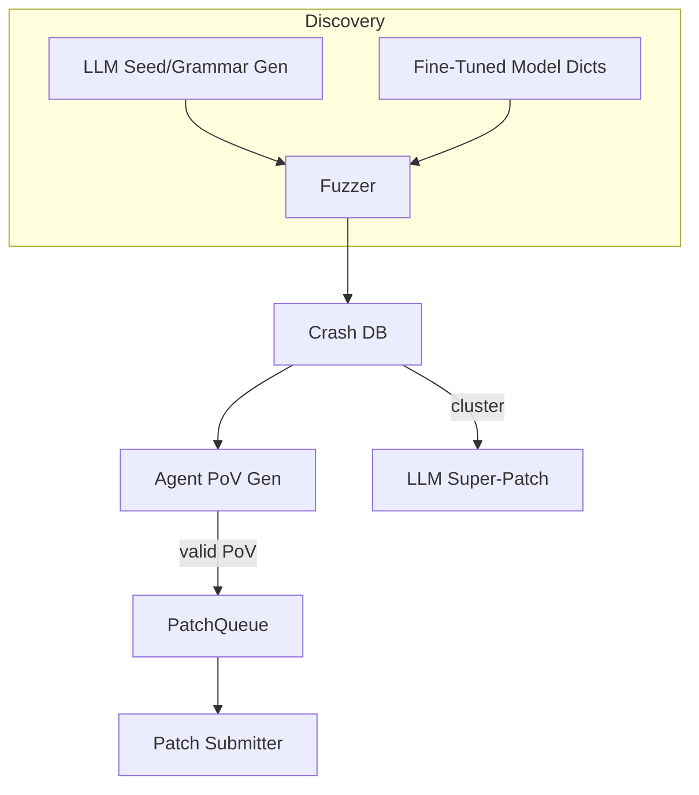

# Fuzzing assisté par l’IA et découverte automatisée de vulnérabilités

{{#include ../banners/hacktricks-training.md}}

## Aperçu
Les grands modèles de langage (LLM) peuvent considérablement renforcer les processus traditionnels de recherche de vulnérabilités en générant des entrées riches sur le plan sémantique, en faisant évoluer des grammaires, en raisonnant à partir des données de crash et même en proposant des correctifs couvrant plusieurs bugs. Cette page rassemble les approches les plus efficaces observées lors de la finale de l’AI Cyber Challenge (AIxCC) de la DARPA et dans d’autres travaux de recherche publics.<sup>[[4]](#references)</sup><sup>[[5]](#references)</sup>

Ce qui suit ne décrit pas un système utilisé dans une compétition particulière, mais présente une abstraction des techniques afin que vous puissiez les reproduire dans vos propres workflows.

---

## 1. Entrées seed générées par LLM

Les fuzzers traditionnels guidés par la couverture (AFL++, libFuzzer, Honggfuzz…) commencent avec un petit corpus de seeds et mutent les octets à l’aveugle. Lorsque le format d’entrée de la cible est complexe (SQL, URL, protocoles binaires personnalisés), les mutations aléatoires cassent généralement la syntaxe avant que les branches intéressantes ne soient atteintes.

Les LLM peuvent résoudre ce problème d’amorçage en produisant des *générateurs de seeds* : de courts scripts qui génèrent des **entrées syntaxiquement correctes, mais pertinentes pour la sécurité**. Par exemple :

```prompt
SYSTEM: You are a helpful security engineer.
USER:
Write a Python3 program that prints 200 unique SQL injection strings targeting common anti-pattern mistakes (missing quotes, numeric context, stacked queries).  Ensure length ≤ 256 bytes / string so they survive common length limits.
```

```python
# gen_sqli_seeds.py (truncated)
PAYLOADS = [
    "1 OR 1=1 -- ",
    "' UNION SELECT NULL,NULL--",
    "0; DROP TABLE users;--",
    ...
]
for p in PAYLOADS:
    print(p)
```

Exécutez une fois et injectez directement la sortie dans le corpus initial du fuzzer :

```bash
python3 gen_sqli_seeds.py > seeds.txt
afl-fuzz -i seeds.txt -o findings/ -- ./target @@
```

Benefits:
1. Validité sémantique → couverture plus approfondie dès le début.
2. Régénérable : modifiez le prompt pour cibler XSS, le path traversal, les blobs binaires, etc.
3. Peu coûteux (< 1 ¢ avec GPT-3.5).

### Conseils
* Demandez au modèle de *diversifier* la longueur et l’encodage des payloads (UTF-8, URL-encoded, UTF-16-LE) pour contourner les filtres superficiels.
* Demandez un *script autonome unique* — cela évite les problèmes de formatage JSON.

---

## 2. Grammar-Evolution Fuzzing

Une variante plus puissante consiste à laisser le LLM **faire évoluer une grammaire** plutôt que des seeds concrets. Le workflow (pattern « Grammar Guy ») est le suivant :

1. Générer une grammaire ANTLR/Peach/LibFuzzer initiale à l’aide d’un prompt.
2. Lancer le fuzzing pendant N minutes et collecter les métriques de couverture (edges / blocs atteints).
3. Résumer les zones du programme non couvertes et renvoyer ce résumé au modèle :
   ```prompt
   The previous grammar triggered 12 % of the program edges.  Functions not reached: parse_auth, handle_upload.  Add / modify rules to cover these.
   ```
4. Fusionnez les nouvelles règles, relancez le fuzzing, répétez.

Squelette de pseudo-code :

```python
for epoch in range(MAX_EPOCHS):
    grammar = llm.refine(grammar, feedback=coverage_stats)
    save(grammar, f"grammar_{epoch}.txt")
    coverage_stats = run_fuzzer(grammar)
```

Points clés :
* Gardez un *budget* : chaque amélioration consomme des tokens.
* Utilisez des instructions `diff` et `patch` pour que le modèle modifie le code plutôt que de le réécrire.
* Arrêtez-vous lorsque Δcoverage < ε.

---

## 3. Ingénierie de harness libFuzzer avec un LLM local

Pour le code qui ne peut pas quitter le poste de travail d’un analyste, un modèle de code local peut rédiger le petit adaptateur entre les octets du fuzzer et une API C/C++. La frontière de sécurité utile est explicite : **le modèle écrit et révise l’infrastructure de test ; la mutation guidée par la couverture explore les entrées ; les sanitizers signalent les opérations invalides ; un humain examine le harness et évalue les résultats**.<sup>[[9]](#references)</sup>

Pour les techniques de corpus, de feedback, de snapshot et de fuzzing avec état au niveau du moteur, qui ne dépendent pas d’un LLM, consultez la [méthodologie de fuzzing](../generic-methodologies-and-resources/fuzzing.md).

Commencez par copier la déclaration exacte depuis l’en-tête cible et imposez le format de sortie. Un prompt précis réduit les API inventées et facilite l’examen du résultat :<sup>[[8]](#references)[[9]](#references)</sup>

```prompt
Write a libFuzzer target for this exact declaration:
int parse_records(const uint8_t *data, size_t size);

Output only C code. Implement LLVMFuzzerTestOneInput, include the
declaration, pass data and size unchanged, and do not use files,
network access, randomness, clocks, threads, or persistent state.
```

Pour un analyseur d’octets bruts, le résultat attendu ne devrait pas être plus compliqué que :<sup>[[6]](#references)[[9]](#references)</sup>

```c
#include <stddef.h>
#include <stdint.h>

extern int parse_records(const uint8_t *, size_t);

int LLVMFuzzerTestOneInput(const uint8_t *data, size_t size) {
    (void)parse_records(data, size);
    return 0;
}
```

La compilation n’est que la première étape de validation. Vérifiez chaque cible générée au regard de ces invariants avant d’y consacrer du temps CPU :<sup>[[6]](#references)[[8]](#references)[[9]](#references)</sup>

- **API exacte :** comparez les types, les règles de propriété, l’initialisation, le nettoyage et la convention d’appel avec l’en-tête réel et les appelants existants.
- **Sécurité du harness :** protégez chaque lecture depuis `data` ; les problèmes détectés par les sanitizers doivent provenir de la cible, et non du code de liaison généré.
- **Reproductibilité :** faites en sorte que le résultat dépende de `data` et de `size` ; supprimez les E/S externes, le temps, l’aléatoire non contrôlé, les threads non joints et tout état persistant entre les appels.
- **Débit :** n’initialisez l’état immuable coûteux qu’une seule fois, et uniquement si cela ne peut pas modifier le comportement ; limitez la taille des entrées, désactivez les journaux et libérez les allocations propres à chaque entrée.
- **Atteignabilité :** vérifiez que les fonctions et branches visées sont exécutées. Une cible qui compile mais n’exerce que les chemins de rejet constitue un échec silencieux.

### Cibles tenant compte de la structure : préserver les invariants sans masquer les bugs

Si la plupart des entrées brutes échouent à cause d’un contrôle de valeur magique, de longueur, de version ou de somme de contrôle, utilisez les octets de fuzzing comme **matière pour les champs typés** et reconstruisez un objet valide. Fixez les constantes du format, laissez les champs sémantiques et les octets de charge utile modifiables, et dérivez les métadonnées d’intégrité à partir de la charge utile reconstruite. `FuzzedDataProvider` permet de consommer des valeurs typées bornées, tandis que l’adaptateur reste chargé de limiter toute allocation et conversion générées.<sup>[[9]](#references)</sup>

<details>
<summary>Exemple de cible C++ tenant compte de la structure</summary>

```cpp
#include <fuzzer/FuzzedDataProvider.h>
#include <stddef.h>
#include <stdint.h>
#include <vector>

extern "C" int parse_message(const uint8_t *, size_t);

extern "C" int LLVMFuzzerTestOneInput(const uint8_t *data, size_t size) {
    FuzzedDataProvider fdp(data, size);
    uint8_t version = fdp.ConsumeIntegral<uint8_t>();
    auto body = fdp.ConsumeRemainingBytes<uint8_t>();
    if (body.size() > UINT16_MAX) body.resize(UINT16_MAX);
    uint16_t len = static_cast<uint16_t>(body.size());
    std::vector<uint8_t> msg = {0x8b, 'M', 'S', 'G', version,
                                static_cast<uint8_t>(len >> 8),
                                static_cast<uint8_t>(len)};
    msg.insert(msg.end(), body.begin(), body.end());
    (void)parse_message(msg.data(), msg.size());
    return 0;
}
```

</details>

N’utilisez pas une seule cible qui répare les structures pour toutes les questions. Maintenez une cible qui déduit les longueurs et les sommes de contrôle afin d’explorer des états valides profonds, et une autre qui laisse les métadonnées **déclarées** sous le contrôle du fuzzer, tout en limitant uniquement les lectures et les allocations propres au harness. La seconde cible préserve les surfaces d’attaque liées aux longueurs incohérentes et aux problèmes d’intégrité que la réparation automatique effacerait autrement.<sup>[[9]](#references)</sup>

### Seeds, dictionnaires, sanitizers et feedback de couverture

Demandez au modèle de générer un script qui écrit des seeds binaires plutôt que de lui demander d’afficher directement des données binaires. Créez des seeds pour des objets vides, minimaux, typiques et valides aux limites ; puis extrayez les valeurs magiques, les tags, les encodages d’enum et les mots-clés du parser dans un dictionnaire révisé. libFuzzer accepte ce dictionnaire avec `-dict=`, et conserve dans le corpus les mutations qui révèlent de nouvelles couvertures.<sup>[[6]](#references)[[9]](#references)</sup>

```text
magic="\x8bMSG"
version_min="\x00"
version_max="\xff"
config_tag="CONFIG"
```

Compilez la même cible avec une instrumentation complémentaire. ASan et UBSan peuvent partager un binaire de fuzzing ; utilisez une compilation MSan séparée et instrumentez ses dépendances pour éviter les rapports causés par du code non instrumenté.<sup>[[6]](#references)[[9]](#references)</sup>

```bash
clang++ -g -O1 -fsanitize=fuzzer,address,undefined \
  -fno-sanitize-recover=undefined target.cc harness.cc -o fuzz_target
./fuzz_target corpus -dict=msg.dict -max_len=65535

clang++ -g -O1 -fsanitize=fuzzer,memory \
  target.cc harness.cc -o fuzz_target_msan
```

Traitez la couverture comme critère d’évaluation à chaque révision du modèle. Dans la sortie de libFuzzer, des valeurs `cov`/`ft` qui stagnent tôt et un corpus statique indiquent généralement un mauvais cadrage, un retour anticipé trop restrictif ou un appel incorrect ; un faible `exec/s` indique une initialisation coûteuse, des E/S, des allocations ou un état qui fuit. `NEW` prouve uniquement qu’une caractéristique de couverture a changé, pas que le parseur visé a été atteint.<sup>[[6]](#references)[[9]](#references)</sup>

Pour obtenir un retour au niveau du code source, créez un build avec couverture, lancez le fuzzing et ne fournissez au modèle que les fonctions non couvertes et leurs conditions de garde. Vérifiez les différences du harness, du seed et du dictionnaire, puis mesurez à nouveau :<sup>[[7]](#references)[[8]](#references)[[9]](#references)</sup>

```bash
clang++ -g -O1 -fsanitize=fuzzer \
  -fprofile-instr-generate -fcoverage-mapping target.cc harness.cc -o fuzz_cov
mkdir -p profiles
LLVM_PROFILE_FILE='profiles/%p.profraw' ./fuzz_cov -max_total_time=300 corpus
llvm-profdata merge -sparse profiles/*.profraw -o fuzz.profdata
llvm-cov report ./fuzz_cov -instr-profile=fuzz.profdata
llvm-cov show ./fuzz_cov -instr-profile=fuzz.profdata \
  --show-branches=count --region-coverage-lt=1 target.cc
```

La boucle évolutive est donc **générer → compiler/lier → effectuer un smoke test avec les sanitizers → mesurer la couverture de la cible → fournir le contexte source/de couverture pertinent le plus réduit possible → réviser → mesurer à nouveau**. OSS-Fuzz-Gen applique le même principe en évaluant les cibles générées selon leur compilabilité, leurs échecs à l’exécution, leur couverture et l’amélioration de couverture par rapport aux cibles existantes, plutôt que d’accepter du code plausible sans vérification.<sup>[[7]](#references)[[8]](#references)</sup>

---

<a id="3-agent-based-pov-exploit-generation" hidden>3. Génération de PoV (exploit) par agents</a>

## 4. Génération de PoV (exploit) par agents

Après avoir trouvé un crash, il vous faut encore un **proof-of-vulnerability (PoV)** qui le déclenche de façon déterministe.

Une approche évolutive consiste à lancer de nombreux workers légers (processus, threads ou conteneurs), chacun utilisant un modèle ou une configuration d’échantillonnage différente. L’étude des finalistes de l’AIxCC donne des exemples concrets d’échelle : une équipe a utilisé **des milliers d’agents concurrents** pour générer des PoV en privilégiant l’IA, tandis qu’une autre a orchestré **300–500 agents de fuzzing** et réservé les LLM au raisonnement sémantique de plus haut niveau.<sup>[[4]](#references)</sup>

Pipeline :
1. L’analyse statique/dynamique produit des *candidats de bug* (structure avec le PC du crash, une tranche de l’entrée et le message du sanitizer).
2. L’orchestrateur distribue les candidats aux agents.
3. Étapes de raisonnement de l’agent :
   a. Reproduire le bug localement avec `gdb` et l’entrée.
   b. Proposer un payload d’exploit minimal.
   c. Valider l’exploit dans un sandbox. En cas de succès → soumettre.
4. Les tentatives échouées sont **remises en file d’attente comme nouvelles seeds** pour le fuzzing de couverture (boucle de rétroaction).

Avantages :
* La parallélisation compense le manque de fiabilité d’un agent unique.
* Ajustement automatique de la température / de la taille du modèle selon le taux de réussite observé.

---

<a id="4-directed-fuzzing-with-fine-tuned-code-models" hidden>4. Fuzzing dirigé avec des modèles de code fine-tunés</a>

## 5. Fuzzing dirigé avec des modèles de code fine-tunés

Fine-tunez un modèle à poids ouverts (par exemple, Llama-7B) sur du code source C/C++ étiqueté avec des motifs de vulnérabilité (débordement d’entier, copie de buffer, chaîne de format). Ensuite :

1. Exécutez une analyse statique pour obtenir la liste des fonctions et l’AST.
2. Demandez au modèle : *« Donnez des entrées de dictionnaire de mutation susceptibles de compromettre la sécurité mémoire dans la fonction X »*.
3. Insérez ces tokens dans un `AFL_CUSTOM_MUTATOR` personnalisé.

Exemple de sortie pour un wrapper `sprintf` :
```
{"pattern":"%99999999s"}
{"pattern":"AAAAAAAA....<1024>....%n"}
```

Empiriquement, cela réduit le temps avant le crash de plus de 2× sur des cibles réelles.

---

<a id="5-ai-guided-patching-strategies" hidden>5. Stratégies de correctifs guidées par l’IA</a>

## 6. Stratégies de correctifs guidées par l’IA

<a id="51-super-patches" hidden>5.1 Super-patchs</a>

### 6.1 Super-patchs
Demandez au modèle de *regrouper* les signatures de crash et de proposer un **correctif unique** qui élimine la cause racine commune. Soumettez une seule fois, corrigez plusieurs bugs → moins de pénalités de précision dans les environnements où chaque correctif erroné coûte des points.

Structure de prompt :
```
Here are 10 stack traces + file snippets.  Identify the shared mistake and generate a unified diff fixing all occurrences.
```

{{#ref}}
../generic-methodologies-and-resources/fuzzing.md
{{#endref}}

<a id="52-speculative-patch-ratio" hidden>5.2 Ratio de correctifs spéculatifs</a>

### 6.2 Ratio de correctifs spéculatifs
Mettez en place une file où les correctifs confirmés et validés par PoV et les correctifs *spéculatifs* (sans PoV) sont entrelacés selon un ratio de 1:N adapté aux règles de scoring (p. ex. 2 spéculatifs : 1 confirmé). Un modèle de coût surveille les pénalités par rapport aux points et ajuste automatiquement N.

---

Pour une analyse déterministe du code source fichier par fichier, les flux de tâches des points d’entrée mobiles, les audits de modèles du noyau et la validation de vulnérabilités conditionnée par des preuves, consultez [Analyse du code source assistée par IA et validation des vulnérabilités](AI-Assisted-Source-Review-and-Vulnerability-Validation.md).

---

## Triage des crashs assisté par un débogueur

Les workflows Mona v3 pour le triage des crashs, l’analyse des fonctions et l’atteignabilité contrôlée des chunks du heap sont décrits dans [Outils d’exploitation](../binary-exploitation/basic-stack-binary-exploitation-methodology/tools/#mona-v3-debugger-context-requests-for-crash-triage).

---

## Assemblage de tous les éléments
Un CRS (système de raisonnement cyber) de bout en bout peut relier les composants comme suit :



---

## References

- [4] [Trail of Bits – AIxCC finals : le récit des faits](https://blog.trailofbits.com/2025/08/07/aixcc-finals-tale-of-the-tape/)
- [5] [Entretiens de CTF Radiooo avec les finalistes d’AIxCC](https://www.youtube.com/@ctfradiooo)
- [6] [LLVM — libFuzzer : une bibliothèque pour les tests de fuzzing guidés par la couverture](https://llvm.org/docs/LibFuzzer.html)
- [7] [Google — OSS-Fuzz-Gen](https://github.com/google/oss-fuzz-gen)
- [8] [Google Online Security Blog — Améliorer le fuzzing : découvrir davantage de vulnérabilités grâce à l’IA](https://security.googleblog.com/2024/11/leveling-up-fuzzing-finding-more.html)
- [9] [8kSec — Génération de harness de fuzzing assistée par l’IA avec un LLM local](https://8ksec.io/ai-assisted-fuzzing-harness-local-llm)
{{#include ../banners/hacktricks-training.md}}
