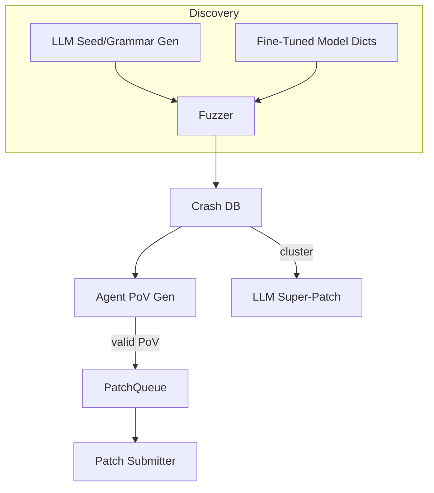

# Fuzzing assisté par IA et découverte automatisée de vulnérabilités

{{#include ../banners/hacktricks-training.md}}

## Vue d’ensemble
Les grands modèles de langage (LLM) peuvent considérablement renforcer les workflows traditionnels de recherche de vulnérabilités en générant des entrées riches sur le plan sémantique, en faisant évoluer des grammaires, en raisonnant sur les données de crash et même en proposant des correctifs couvrant plusieurs bugs. Cette page rassemble les approches les plus efficaces observées lors de la finale de l’AI Cyber Challenge (AIxCC) de la DARPA et dans d’autres travaux de recherche publics.<sup>[[4]](#references)</sup><sup>[[5]](#references)</sup>

Ce qui suit ne décrit pas le système d’une compétition particulière, mais présente une synthèse des techniques afin que vous puissiez les reproduire dans vos propres workflows.

---

## 1. Entrées initiales générées par des LLM

Les fuzzers traditionnels guidés par la couverture (AFL++, libFuzzer, Honggfuzz…) démarrent avec un petit corpus de seeds et mutent des octets à l’aveugle. Lorsque le format d’entrée de la cible est complexe (SQL, URL, protocoles binaires personnalisés), les mutations aléatoires brisent généralement la syntaxe avant que les branches intéressantes ne soient atteintes.

Les LLM peuvent résoudre ce problème d’amorçage en générant des *générateurs de seeds* — de courts scripts qui produisent des **entrées syntaxiquement correctes, mais pertinentes du point de vue de la sécurité**. Par exemple :

```prompt
SYSTEM: You are a helpful security engineer.
USER:
Write a Python3 program that prints 200 unique SQL injection strings targeting common anti-pattern mistakes (missing quotes, numeric context, stacked queries).  Ensure length ≤ 256 bytes / string so they survive common length limits.
```

```python
# gen_sqli_seeds.py (truncated)
PAYLOADS = [
    "1 OR 1=1 -- ",
    "' UNION SELECT NULL,NULL--",
    "0; DROP TABLE users;--",
    ...
]
for p in PAYLOADS:
    print(p)
```

Exécutez-le une fois et injectez directement la sortie dans le corpus initial du fuzzer :

```bash
python3 gen_sqli_seeds.py > seeds.txt
afl-fuzz -i seeds.txt -o findings/ -- ./target @@
```

Avantages :
1. Validité sémantique → couverture plus approfondie dès le début.
2. Régénérable : modifiez le prompt pour cibler XSS, le path traversal, les blobs binaires, etc.
3. Peu coûteux (< 1 ¢ avec GPT-3.5).

### Conseils
* Demandez au modèle de *diversifier* la longueur et l’encodage des payloads (UTF-8, URL-encoded, UTF-16-LE) pour contourner les filtres superficiels.
* Demandez un *script autonome unique* – cela évite les problèmes de formatage JSON.

---

## 2. Grammar-Evolution Fuzzing

Une variante plus puissante consiste à laisser le LLM **faire évoluer une grammaire** plutôt que des seeds concrètes. Le workflow (pattern « Grammar Guy ») est le suivant :

1. Générer une grammaire ANTLR/Peach/LibFuzzer initiale à l’aide d’un prompt.
2. Effectuer du fuzzing pendant N minutes et recueillir des métriques de couverture (arêtes / blocs atteints).
3. Résumer les zones du programme non couvertes et renvoyer le résumé au modèle :
   ```prompt
   The previous grammar triggered 12 % of the program edges.  Functions not reached: parse_auth, handle_upload.  Add / modify rules to cover these.
   ```
4. Fusionnez les nouvelles règles, relancez le fuzzing, recommencez.

Squelette de pseudo-code :

```python
for epoch in range(MAX_EPOCHS):
    grammar = llm.refine(grammar, feedback=coverage_stats)
    save(grammar, f"grammar_{epoch}.txt")
    coverage_stats = run_fuzzer(grammar)
```

Points clés :
* Gardez un *budget* : chaque affinement consomme des tokens.
* Utilisez les instructions `diff` + `patch` pour que le modèle modifie le code au lieu de le réécrire.
* Arrêtez-vous lorsque Δcoverage < ε.

---

## 3. Ingénierie de harness libFuzzer avec un LLM local

Lorsque le code source ne peut pas quitter le poste de travail d’un analyste, un modèle de code local peut rédiger le petit adaptateur entre les octets du fuzzer et une API C/C++. La frontière de sécurité utile est explicite : **le modèle écrit et révise l’infrastructure de test ; la mutation guidée par la couverture explore les entrées ; les sanitizers signalent les opérations invalides ; un humain examine le harness et analyse les résultats**.<sup>[[9]](#references)</sup>

Pour les techniques de corpus, de feedback, de snapshot et de fuzzing avec état au niveau du moteur qui ne dépendent pas d’un LLM, consultez la [méthodologie de fuzzing](../generic-methodologies-and-resources/fuzzing.md).

Commencez par copier la déclaration exacte depuis l’en-tête cible et imposez le format de sortie. Un prompt ciblé réduit le risque d’invention d’API et facilite la vérification du résultat :<sup>[[8]](#references)[[9]](#references)</sup>

```prompt
Write a libFuzzer target for this exact declaration:
int parse_records(const uint8_t *data, size_t size);

Output only C code. Implement LLVMFuzzerTestOneInput, include the
declaration, pass data and size unchanged, and do not use files,
network access, randomness, clocks, threads, or persistent state.
```

Pour un parseur d’octets bruts, le résultat attendu ne devrait pas être plus compliqué que :<sup>[[6]](#references)[[9]](#references)</sup>

```c
#include <stddef.h>
#include <stdint.h>

extern int parse_records(const uint8_t *, size_t);

int LLVMFuzzerTestOneInput(const uint8_t *data, size_t size) {
    (void)parse_records(data, size);
    return 0;
}
```

La compilation n’est que la première étape de validation. Vérifiez chaque cible générée par rapport aux invariants suivants avant d’y consacrer du temps CPU :<sup>[[6]](#references)[[8]](#references)[[9]](#references)</sup>

- **API exacte :** comparez les types, les règles de propriété, l’initialisation, le nettoyage et la convention d’appel avec l’en-tête réel et les appelants existants.
- **Sécurité du harness :** protégez chaque lecture depuis `data` ; les problèmes détectés par les sanitizers doivent provenir de la cible, et non du code glue généré.
- **Répétabilité :** faites dépendre le résultat de `data` et `size` ; supprimez les E/S externes, l’utilisation de l’heure, l’aléatoire non contrôlé, les threads non joints et tout état persistant entre les appels.
- **Débit :** n’initialisez l’état immuable coûteux qu’une seule fois, et uniquement si cela ne peut pas modifier le comportement ; limitez la taille des entrées, désactivez la journalisation et libérez les allocations propres à chaque entrée.
- **Accessibilité :** vérifiez que les fonctions et branches visées sont exécutées. Une cible qui compile, mais n’exerce que les chemins de rejet, constitue un échec silencieux.

### Cibles tenant compte de la structure : préserver les invariants sans masquer les bugs

Si la plupart des entrées brutes échouent à un contrôle de magic, de longueur, de version ou de checksum, utilisez les octets de fuzzing comme **matière première pour des champs typés** et reconstruisez un objet valide. Fixez les constantes de format, laissez les champs sémantiques et les octets de payload modifiables, et calculez les métadonnées d’intégrité à partir du payload reconstruit. `FuzzedDataProvider` est utile pour consommer des valeurs typées bornées, tandis que l’adaptateur reste responsable de limiter toute allocation et conversion générée.<sup>[[9]](#references)</sup>

<details>
<summary>Exemple de cible C++ tenant compte de la structure</summary>

```cpp
#include <fuzzer/FuzzedDataProvider.h>
#include <stddef.h>
#include <stdint.h>
#include <vector>

extern "C" int parse_message(const uint8_t *, size_t);

extern "C" int LLVMFuzzerTestOneInput(const uint8_t *data, size_t size) {
    FuzzedDataProvider fdp(data, size);
    uint8_t version = fdp.ConsumeIntegral<uint8_t>();
    auto body = fdp.ConsumeRemainingBytes<uint8_t>();
    if (body.size() > UINT16_MAX) body.resize(UINT16_MAX);
    uint16_t len = static_cast<uint16_t>(body.size());
    std::vector<uint8_t> msg = {0x8b, 'M', 'S', 'G', version,
                                static_cast<uint8_t>(len >> 8),
                                static_cast<uint8_t>(len)};
    msg.insert(msg.end(), body.begin(), body.end());
    (void)parse_message(msg.data(), msg.size());
    return 0;
}
```

</details>

N’utilisez pas une seule cible qui répare les structures pour toutes les questions. Maintenez une cible qui calcule les longueurs et les checksums afin d’explorer des états profonds valides, et une autre qui laisse les métadonnées **déclarées** sous le contrôle du fuzzer, tout en limitant uniquement les lectures et les allocations du harness. La seconde cible préserve les surfaces d’attaque liées aux longueurs incohérentes et aux erreurs d’intégrité, que la réparation automatique effacerait autrement.<sup>[[9]](#references)</sup>

### Seeds, dictionnaires, sanitizers et retour de couverture

Demandez au modèle de générer un script qui écrit des seeds binaires plutôt que de lui demander d’afficher directement du binaire. Initialisez le corpus avec des objets vides, minimaux, typiques et valides aux limites ; extrayez ensuite les valeurs magiques, les tags, les encodages d’enums et les mots-clés du parser dans un dictionnaire vérifié. libFuzzer accepte ce dictionnaire avec `-dict=`, et conserve dans le corpus les mutations qui révèlent de nouvelles couvertures.<sup>[[6]](#references)[[9]](#references)</sup>

```text
magic="\x8bMSG"
version_min="\x00"
version_max="\xff"
config_tag="CONFIG"
```

Compilez la même cible avec une instrumentation complémentaire. ASan et UBSan peuvent partager un même binaire de fuzzing ; utilisez une compilation MSan séparée et instrumentez ses dépendances pour éviter les rapports causés par du code non instrumenté.<sup>[[6]](#references)[[9]](#references)</sup>

```bash
clang++ -g -O1 -fsanitize=fuzzer,address,undefined \
  -fno-sanitize-recover=undefined target.cc harness.cc -o fuzz_target
./fuzz_target corpus -dict=msg.dict -max_len=65535

clang++ -g -O1 -fsanitize=fuzzer,memory \
  target.cc harness.cc -o fuzz_target_msan
```

Traitez la couverture comme critère d’évaluation pour chaque révision du modèle. Dans la sortie de libFuzzer, une `cov`/`ft` qui stagne dès le début et un corpus statique indiquent généralement un mauvais cadrage, un retour anticipé trop restrictif ou un appel incorrect ; un faible `exec/s` pointe vers une initialisation coûteuse, des E/S, des allocations ou un état qui fuit. `NEW` prouve seulement qu’une caractéristique de couverture a changé, pas que le parseur visé a été atteint.<sup>[[6]](#references)[[9]](#references)</sup>

Pour obtenir un retour au niveau du code source, créez une build avec couverture, lancez le fuzzing et ne fournissez au modèle que les fonctions non couvertes et leurs conditions de garde. Vérifiez ensuite les modifications du harness/seed/dictionary, puis mesurez à nouveau :<sup>[[7]](#references)[[8]](#references)[[9]](#references)</sup>

```bash
clang++ -g -O1 -fsanitize=fuzzer \
  -fprofile-instr-generate -fcoverage-mapping target.cc harness.cc -o fuzz_cov
mkdir -p profiles
LLVM_PROFILE_FILE='profiles/%p.profraw' ./fuzz_cov -max_total_time=300 corpus
llvm-profdata merge -sparse profiles/*.profraw -o fuzz.profdata
llvm-cov report ./fuzz_cov -instr-profile=fuzz.profdata
llvm-cov show ./fuzz_cov -instr-profile=fuzz.profdata \
  --show-branches=count --region-coverage-lt=1 target.cc
```

La boucle scalable est donc **générer → compiler/lier → effectuer un smoke test sous sanitizers → mesurer la couverture de la cible → fournir le contexte minimal pertinent sur la couverture/le code source → réviser → mesurer à nouveau**. OSS-Fuzz-Gen applique le même principe en évaluant si les cibles générées sont compilables, si elles provoquent des erreurs à l’exécution, leur couverture et l’amélioration de la couverture par rapport aux cibles existantes, au lieu d’accepter du code plausible au premier abord.<sup>[[7]](#references)[[8]](#references)</sup>

---

<a id="3-agent-based-pov-exploit-generation" hidden>3. Agent-Based PoV (Exploit) Generation</a>

## 4. Génération de PoV (exploit) basée sur des agents

Après avoir découvert un crash, il vous faut encore une **preuve de vulnérabilité (PoV)** qui le déclenche de manière déterministe.

Une approche scalable consiste à lancer de nombreux workers légers (processus, threads ou conteneurs), chacun utilisant un modèle ou une configuration d’échantillonnage différente. L’enquête auprès des finalistes de l’AIxCC donne des exemples concrets d’échelle : une équipe a utilisé **des milliers d’agents concurrents** pour générer des PoV en priorité avec l’IA, tandis qu’une autre a coordonné **300 à 500 agents de fuzzing** et réservé les LLM au raisonnement sémantique de plus haut niveau.<sup>[[4]](#references)</sup>

Pipeline :
1. L’analyse statique/dynamique produit des *candidats de bug* (struct contenant le PC du crash, la tranche d’entrée et le message du sanitizer).
2. L’orchestrateur distribue les candidats aux agents.
3. Étapes de raisonnement de l’agent :
   a. Reproduire le bug localement avec `gdb` et l’entrée.
   b. Proposer un payload d’exploit minimal.
   c. Valider l’exploit dans un sandbox. En cas de succès → soumettre.
4. Les tentatives échouées sont **réinjectées comme nouvelles seeds** pour le fuzzing de couverture (boucle de rétroaction).

Avantages :
* La parallélisation masque le manque de fiabilité d’un agent individuel.
* Auto-ajustement de la température et de la taille du modèle en fonction du taux de réussite observé.

---

<a id="4-directed-fuzzing-with-fine-tuned-code-models" hidden>4. Directed Fuzzing with Fine-Tuned Code Models</a>

## 5. Fuzzing dirigé avec des modèles de code fine-tunés

Fine-tuner un modèle à poids ouverts (par ex. Llama-7B) sur du code source C/C++ étiqueté selon des motifs de vulnérabilité (débordement d’entier, copie de buffer, format string). Puis :

1. Exécuter une analyse statique pour obtenir la liste des fonctions et l’AST.
2. Inviter le modèle : *« Donne des entrées de dictionnaire de mutation susceptibles de compromettre la sécurité mémoire dans la fonction X »*.
3. Insérer ces tokens dans un `AFL_CUSTOM_MUTATOR` personnalisé.

Exemple de sortie pour un wrapper `sprintf` :
```
{"pattern":"%99999999s"}
{"pattern":"AAAAAAAA....<1024>....%n"}
```

Empiriquement, cela réduit le temps avant le crash de plus de 2× sur des cibles réelles.

---

<a id="5-ai-guided-patching-strategies" hidden>5. Stratégies de patching guidées par l’IA</a>

## 6. Stratégies de patching guidées par l’IA

<a id="51-super-patches" hidden>5.1 Super patches</a>

### 6.1 Super patches
Demandez au modèle de *regrouper* les signatures de crash et de proposer un **patch unique** qui élimine la cause racine commune.  Soumettez-le une seule fois et corrigez plusieurs bugs → moins de pénalités de précision dans les environnements où chaque patch incorrect coûte des points.

Aperçu du prompt :
```
Here are 10 stack traces + file snippets.  Identify the shared mistake and generate a unified diff fixing all occurrences.
```

{{#ref}}
../generic-methodologies-and-resources/fuzzing.md
{{#endref}}

<a id="52-speculative-patch-ratio" hidden>5.2 Ratio de correctifs spéculatifs</a>

### 6.2 Ratio de correctifs spéculatifs
Mettez en place une file d’attente où les correctifs confirmés et validés par PoV sont intercalés avec les correctifs *spéculatifs* (sans PoV), selon un ratio 1:​N ajusté aux règles de score (p. ex. 2 spéculatifs : 1 confirmé). Un modèle de coûts surveille les pénalités par rapport aux points et ajuste automatiquement N.

---

<a id="6-deterministic-file-by-file-ai-code-review" hidden>6. Revue de code IA déterministe, fichier par fichier</a>

## 7. Revue de code IA déterministe, fichier par fichier

Un échec fréquent des revues assistées par IA consiste à demander à un agent d’inspecter tout un dépôt en espérant qu’il choisisse les bons fichiers et les bons termes de recherche. Une approche plus fiable consiste à **imposer la couverture du dépôt** :<sup>[[1]](#references)</sup>

1. Énumérez les fichiers source.
2. Envoyez **un seul fichier à la fois**, avec un contexte minimal (point d’entrée, imports, routes/appelants à proximité).
3. Exigez un **rapport structuré** pour chaque fichier : sources, puits, validations manquantes, préconditions d’exploitation et niveau de confiance.<sup>[[3]](#references)</sup>
4. Dédupliquez les rapports selon le **schéma source→puits** et validez manuellement les cas à haut risque.

Cette méthode consomme beaucoup de tokens et génère du bruit, mais elle permet très efficacement de repérer des **bugs simples à fort impact entre source et puits** que les revues agentiques plus larges manquent souvent.

### Schémas de triage à privilégier

- **Inclusion/dispatch dynamique en PHP** : noms de routes, de contrôleurs ou de modules contrôlés par l’attaquant transmis à `require_once()`, `include()` ou `include_once()` sans liste d’autorisation stricte ni canonicalisation des chemins.
- **Exécution de commandes shell dans les workflows d’administration/de compte** : noms d’utilisateur, domaines, comptes FTP ou autres identifiants transmis à `exec()`, `system()`, `shell_exec()`, `passthru()`, `proc_open()` ou `popen()`.
- **Convergence des entrées structurées** : même paramètre accepté depuis `$_GET`, `$_POST`, JSON, XML ou les analyseurs de corps du framework, puis réutilisé dans des puits liés au système de fichiers ou aux commandes du système d’exploitation.

### Deux catégories de bugs pratiques que cette méthode détecte bien

- **LFI/RCE via le dispatch de contrôleurs PHP** : si un nom de contrôleur contrôlé par une requête est concaténé à `require_once()` sans liste d’autorisation ni normalisation du chemin, des séquences de traversée telles que `../` peuvent amener PHP à inclure un fichier `.php` local non prévu. Si l’attaquant peut faire pointer l’inclusion vers un fichier PHP qu’il a placé ou qui lui est utile, la LFI devient une exécution de code. Voir [File Inclusion / Path Traversal](../pentesting-web/file-inclusion/README.md).<sup>[[1]](#references)</sup>
- **Injection de commandes authentifiée dans les panneaux d’hébergement/d’administration** : si des champs de gestion de compte, tels que les noms d’utilisateur, sont intégrés à des commandes shell, un utilisateur authentifié avec de faibles privilèges peut transformer une action normale de création/suppression en RCE. L’impact augmente lorsque le panneau exécute la commande avec un compte de service plus privilégié. Voir [Command Injection](../pentesting-web/command-injection.md).<sup>[[1]](#references)</sup>

### Notes pratiques de revue

- Utilisez d’abord le LLM comme **outil de revue des sources et des puits**, pas comme générateur d’exploits.
- Demandez-lui d’indiquer explicitement le **champ contrôlé par l’attaquant**, la **lacune de normalisation/validation** et le **puits dangereux**.
- Pour les grands dépôts, une revue déterministe fichier par fichier est souvent plus fiable qu’une seule exécution d’un agent autonome, même si celui-ci utilise un modèle plus puissant.<sup>[[2]](#references)</sup>
- Attendez-vous à de moins bons résultats sur les **Broken Access Control** et les autres bugs de logique métier dont l’exploitabilité dépend d’hypothèses inter-fichiers, de la sémantique des rôles ou de modèles de menace propres au produit.

---

## Flux de tâches des points d’entrée mobiles

Une seule invite couvrant tout un dépôt mélange souvent les modèles de menace et perd le chemin entre un composant accessible de l’extérieur et un puits sensible. Un workflow plus robuste divise l’audit en flux de tâches avec état : d’abord classer les applications/composants, puis répertorier les points d’entrée contrôlés par l’attaquant, enrichir chaque point d’entrée avec des métadonnées d’accessibilité, et enfin examiner chacun d’eux au regard des classes de vulnérabilités propres à la plateforme. Les flux de tâches mobiles de GitHub Security Lab appliquent cette approche aux dépôts Android, iOS et multiplateformes.<sup>[[14]](#references)[[15]](#references)</sup>

Pour Android, consignez au minimum :<sup>[[14]](#references)[[15]](#references)</sup>

- les Activities, Services, Receivers et Providers exportés, y compris leurs permissions ;
- les actions d’intent, les schémas/hôtes/chemins de liens profonds, les filtres MIME et les App Links ;
- les actions contrôlées par l’attaquant, les URI de données, `ClipData`, les extras et les indicateurs d’octroi d’URI ;
- les entrées de navigation WebView et les bridges `addJavascriptInterface` ;
- les opérations privilégiées en aval, les ressources importées et les destinations réseau.

Classez ensuite chaque point d’entrée dans son contexte. Posez explicitement des questions sur l’autorisation de l’appelant et le comportement de confused deputy, la redirection d’intent, l’usurpation ou la divulgation de broadcasts, les imports non sécurisés, les scripts WebView et l’exposition des bridges, ainsi que le transfert d’identifiants ou de cookies entre origines. Effectuez à la fois une **vérification stricte par checklist** et une **analyse contradictoire plus large**. Reliez les résultats à [Intent Injection](../mobile-pentesting/android-app-pentesting/intent-injection.md) et [WebView Attacks](../mobile-pentesting/android-app-pentesting/webview-attacks.md) plutôt que de répéter les détails de l’exploitation.<sup>[[15]](#references)</sup>

Les flux de tâches open source actuels peuvent être lancés depuis leur Codespace avec :<sup>[[14]](#references)</sup>

```bash
./scripts/audit/run_audit.sh owner/repository
```

Les résultats sont écrits dans la table `audit_result` de SQLite.<sup>[[14]](#references)</sup> Traitez les lignes marquées comme vulnérables comme des **pistes**, et non comme des résultats vérifiés. Pour chaque piste, demandez au modèle d’indiquer la source contrôlée par l’attaquant, la cible sensible, les préconditions et l’impact attendu, puis de créer un PoC minimal. Exécutez ce PoC sur la build d’origine avec un débogueur ou un outil d’instrumentation. Cela permet de détecter des erreurs courantes d’analyse statique, telles que les branches inatteignables, les états d’application irréalistes, les données du stockage externe qui perdent leur priorité face aux données privées, ainsi que les mesures d’atténuation qui réduisent sensiblement la gravité.<sup>[[15]](#references)</sup>

---

## 8. Audit du kernel guidé par des patterns avec un oracle instrumenté

Pour une cible de la taille d’un kernel, ne demandez pas à un agent de trouver des bugs arbitraires dans toute l’arborescence. Un workflow plus économe en tokens transforme les connaissances sur les vulnérabilités historiques en requêtes statiques, classe les résultats selon la surface d’attaque exposée et utilise un kernel instrumenté comme oracle d’exécution.<sup>[[11]](#references)</sup>

### Base de données de patterns → CodeQL/Semgrep → examen ciblé

Constituez une petite base de connaissances contenant des API dangereuses, des patterns de validation manquante, des flux risqués de la source à la cible et des formes de bugs déjà corrigés. Demandez au modèle de traduire **un pattern à la fois** en heuristiques d’examen et en règles CodeQL/Semgrep, puis exécutez ces règles déterministes sur l’arborescence complète. Regroupez et dédupliquez les correspondances avant de transmettre le code au modèle ; les résultats bruts du scanner peuvent contenir des milliers de candidats de faible valeur. Vérifiez la licence actuelle de CodeQL avant d’utiliser cette approche en dehors de cibles de recherche admissibles ou open source.<sup>[[11]](#references)</sup>

Priorisez les sous-systèmes en fonction à la fois de la **densité des résultats des règles** et de l’**accessibilité pour l’attaquant**, plutôt qu’en fonction du seul nombre de résultats. Les interfaces du kernel accessibles aux processus non privilégiés, aux sandboxes, aux conteneurs, aux jails ou aux environnements invités méritent davantage de poids que le code réservé à un usage interne. Gardez l’unité d’examen suffisamment petite pour que l’agent puisse prendre en compte les appelants, les validateurs et les règles de durée de vie, et demandez-lui de rechercher une classe de vulnérabilité ou un pattern de flux de contrôle précis plutôt que de « trouver n’importe quelle vulnérabilité ». Les interfaces privilégiées anciennes sont particulièrement intéressantes lorsqu’une nouvelle frontière de confinement les rend accessibles à un utilisateur root dans un namespace ou une jail.<sup>[[11]](#references)</sup>

Pour chaque candidat, exigez un relevé explicite du flux des champs avant toute tentative d’exploitation.<sup>[[11]](#references)</sup>

```text
entrypoint -> privilege check -> parser -> validation/normalization
           -> later rewrite -> dangerous sink
attacker controls: <fields and lengths>
constraints:       <values rewritten, rejected, or preserved>
observable result: <sanitizer report, assertion, panic, or clean exit>
```

### Utiliser la télémétrie KASAN comme oracle d’hypothèse

Exécutez le kernel cible dans une VM jetable avec KASAN et des assertions de diagnostic utiles activées. L’agent doit répéter le cycle **hypothèse sur le code source → trigger minimal en userland → exécution dans la VM → trace KASAN/assertion → hypothèse révisée** jusqu’à ce que la corruption suspectée soit reproduite ou réfutée. À chaque itération, ne renvoyez que la trace de pile pertinente et le code source environnant ; cela préserve le contexte de raisonnement et fait des preuves d’exécution, plutôt que de la confiance du modèle, le critère d’acceptation.<sup>[[11]](#references)</sup>

Une compilation instrumentée n’est pas l’environnement final pour évaluer l’exploitabilité. Les assertions peuvent interrompre l’exécution avant l’opération qui corrompt la mémoire, alors que la même assertion peut être désactivée dans un kernel de production. Réexécutez le trigger inchangé avec la configuration exacte de production, consignez la compilation et la configuration du kernel, et distinguez **accessibilité**, **corruption mémoire**, **primitive contrôlée** et **impact sur la sécurité** comme des affirmations distinctes.<sup>[[11]](#references)[[12]](#references)</sup>

CVE-2026-3038 est un bon exemple de validation, pas un modèle d’exploit. Une requête FreeBSD `RTM_GET` non privilégiée pouvait préserver un sockaddr `RTAX_AUTHOR` surdimensionné en passant par une validation sélective et une réécriture de la réponse, jusqu’à ce que `rtsock_msg_buffer()` copie son `sa_len` contrôlé par l’utilisateur dans un `sockaddr_storage` de 128 octets sur la pile. La copie maximale de 255 octets provoquait un débordement de 127 octets ; une assertion de diagnostic détectait la longueur incorrecte dans la compilation instrumentée, tandis qu’un kernel GENERIC atteignait la copie, puis paniquait lorsque le canari corrompu était vérifié. Cela prouve un déni de service non privilégié, pas une escalade de privilèges à elle seule : pour obtenir un contrôle fiable, il faudrait d’abord une autre primitive, comme une divulgation du canari. Voir [Stack Canaries](../binary-exploitation/common-binary-protections-and-bypasses/stack-canaries/index.html) pour la limite correspondante en exploitation binaire.<sup>[[11]](#references)[[12]](#references)[[13]](#references)</sup>

### Rejeter les contournements des préconditions d’exploit

Avant d’accepter un PoV ou un exploit, demandez à un évaluateur/agent distinct de tenter de le réfuter selon des critères fixes. L’évaluation doit confirmer toutes les conditions suivantes.<sup>[[11]](#references)</sup>

- Le code source cible, le kernel et le module vulnérable n’ont pas été modifiés pour rendre le chemin accessible.
- Aucun module auxiliaire, gadget synthétique, mécanisme d’atténuation désactivé, privilège supplémentaire ou interface indisponible n’a été introduit.
- Le trigger démarre avec l’identité de l’appelant revendiquée et les restrictions de confinement, sur un instantané propre.
- Le résultat revendiqué dépend toujours du bug : la suppression du champ malformé ou l’application d’un correctif au seul bug doit rompre la chaîne.
- Un crash, une lecture hors limites ou une écriture hors limites ne sont présentés que comme la primitive correspondante ; l’exécution de code ou l’escalade de privilèges exige des preuves indépendantes.

Cette dernière vérification contrefactuelle détecte les démonstrations circulaires : si les prérequis accordent déjà l’impact revendiqué (par exemple, exécuter du contenu SUID fourni par l’attaquant depuis un système de fichiers monté sans `nosuid`), le bug de sécurité mémoire n’a pas créé cet impact.<sup>[[11]](#references)</sup>

---

## Recherche auditable assistée par agent sur des bases de code inconnues

Le [workflow de sélection des cibles de fuzzing fondé sur les graphes](../generic-methodologies-and-resources/fuzzing.md#graph-first-fuzz-target-selection-and-mutation-triage) couvre déjà l’accessibilité des points d’entrée, tandis que les [pipelines SAST agentiques](../network-services-pentesting/pentesting-web/code-review-tools.md#agentic-sast-pipelines) couvrent les évaluations par étapes et les seuils de validation des preuves. Gardez ces résultats déterministes séparés des hypothèses du modèle afin que chaque piste retenue conserve les emplacements dans le code source, les preuves de chemin et une mesure dynamique.<sup>[[10]](#references)</sup>

### Corréler les preuves de durée de vie des objets sans inventer de flux de données

L’analyse statique peut détecter qu’une longueur contrôlée par l’attaquant est stockée dans une fonction, puis que le même champ d’objet atteint un point de copie bien plus tard, sans toutefois parvenir à prouver le lien entre les deux à travers les callbacks, les reconnexions ou la durée de vie de l’objet. Conservez les deux résultats séparément, regroupez-les par objet/champ et formulez explicitement le lien manquant comme une question de triage. L’agent peut suggérer cette relation, mais une revue du code source ou une instrumentation à l’exécution doit la prouver.<sup>[[10]](#references)</sup>

Pour chaque candidat, consignez :

- le point d’entrée concret et les octets contrôlés par l’attaquant ;
- chaque producteur du champ concerné, y compris la validation propre à chaque producteur ;
- le point d’utilisation, la capacité de destination et les conditions de compilation/d’exécution nécessaires pour l’atteindre ;
- une véritable pile d’appels depuis le point d’entrée exposé, et pas seulement un appel direct au harness ;
- le plus petit résultat dynamique permettant de confirmer ou de réfuter l’hypothèse.

Un chemin apparemment sûr ne garantit pas que le champ soit sûr dans l’ensemble. Un second producteur peut renseigner le même champ sans appliquer la limite du premier chemin. Testez les chemins séparément et exécutez le harness avec des options de compilation équivalentes à celles du déploiement, car les assertions de débogage peuvent transformer une corruption mémoire en production en interruption anticipée propre aux tests.<sup>[[10]](#references)</sup>

### Seuils de mesure pour la divulgation et l’exploitation

Pour une suspicion de divulgation de mémoire non initialisée, remplissez les allocations fraîches avec un octet reconnaissable et vérifiez que le marqueur exact apparaît dans le paquet émis. Pour l’exploitation, exigez des seuils mesurés tels que **écriture contrôlée → objet victime utile → divulgation → récupération du pointeur/de la base → détournement du flux de contrôle → payload composé**. L’agent ne progresse que lorsque le harness prouve la propriété actuelle ; un récit plausible ne suffit pas à franchir un seuil. Le [cas FreeRDP](../binary-exploitation/libc-heap/heap-overflow.md#cross-path-length-reuse-and-stale-output-disclosure) montre les contraintes de chemin et de compilation à préserver pendant la validation.<sup>[[10]](#references)</sup>

---

Pour une étude de cas kernel appliquant une validation progressive L0–L4 au développement d’exploits assisté par LLM, voir :

{{#ref}}
../binary-exploitation/freebsd-kernel-exploitation-vnet-jail-escape.md
{{#endref}}

## Pour tout assembler
Un CRS (Cyber Reasoning System) de bout en bout peut relier les composants comme suit :



---

## References

- [1] [Project Black - IA locale pour la cybersécurité : découverte d’une LFI dans phpIPAM et d’une RCE authentifiée dans myVesta](https://projectblack.io/blog/local-ai-for-cyber-security)
- [2] [Strix](https://github.com/usestrix/strix)
- [3] [Compétence security-review de la communauté GitHub Copilot](https://github.com/github/awesome-copilot/blob/main/skills/security-review/SKILL.md)
- [4] [Trail of Bits – Finales AIxCC : le bilan](https://blog.trailofbits.com/2025/08/07/aixcc-finals-tale-of-the-tape/)
- [5] [Interviews des finalistes AIxCC par CTF Radiooo](https://www.youtube.com/@ctfradiooo)
- [6] [LLVM — libFuzzer : une bibliothèque pour les tests fuzz guidés par la couverture](https://llvm.org/docs/LibFuzzer.html)
- [7] [Google — OSS-Fuzz-Gen](https://github.com/google/oss-fuzz-gen)
- [8] [Blog Google Online Security — Améliorer le fuzzing : trouver plus de vulnérabilités grâce à l’IA](https://security.googleblog.com/2024/11/leveling-up-fuzzing-finding-more.html)
- [9] [8kSec — Génération de harness de fuzzing assistée par l’IA avec un LLM local](https://8ksec.io/ai-assisted-fuzzing-harness-local-llm)
- [10] [Quarkslab — Des agents IA à la RCE : créer un workflow de recherche de vulnérabilités](https://blog.quarkslab.com/from-ai-agents-to-rce-building-a-vulnerability-research-workflow.html)
- [11] [Praetorian — FreeBSoD : utiliser des modèles de langage pour trouver et exploiter des bugs du kernel (partie 1 sur 2)](https://praetorian.com/blog/ai-vulnerability-research-freebsd-kernel)
- [12] [FreeBSD-SA-26:05.route — DoS local et possible élévation de privilèges via des sockets de routage](https://www.freebsd.org/security/advisories/FreeBSD-SA-26:05.route.asc)
- [13] [Patch source FreeBSD-SA-26:05.route](https://security.FreeBSD.org/patches/SA-26:05/route.patch)
- [14] [GitHub Security Lab - SecLab Taskflows](https://github.com/GitHubSecurityLab/seclab-taskflows)
- [15] [GitHub Security Lab - Comment nous avons découvert 24 vulnérabilités Android à l’aide d’un agent de sécurité IA open source](https://github.blog/security/how-we-found-24-android-vulnerabilities-using-our-open-source-ai-security-agent)
{{#include ../banners/hacktricks-training.md}}
