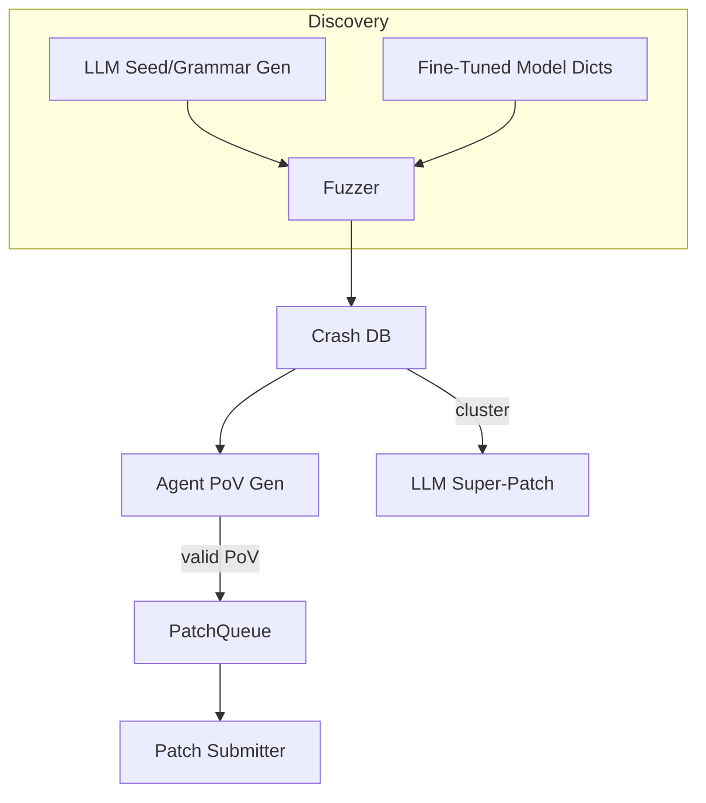

# Fuzzing có hỗ trợ AI & Phát hiện lỗ hổng tự động

{{#include ../banners/hacktricks-training.md}}

## Tổng quan
Các mô hình ngôn ngữ lớn (LLM) có thể tăng cường đáng kể các quy trình nghiên cứu lỗ hổng truyền thống bằng cách tạo ra đầu vào giàu ngữ nghĩa, phát triển grammar, phân tích dữ liệu crash và thậm chí đề xuất các bản vá xử lý nhiều lỗi. Trang này tổng hợp những phương pháp hiệu quả nhất được ghi nhận trong vòng chung kết DARPA AI Cyber Challenge (AIxCC) và các nghiên cứu công khai khác.<sup>[[4]](#references)</sup><sup>[[5]](#references)</sup>

Phần sau không mô tả một hệ thống cụ thể của cuộc thi nào, mà khái quát các kỹ thuật để bạn có thể áp dụng lại trong quy trình làm việc của mình.

---

## 1. Đầu vào seed do LLM tạo

Các fuzzer truyền thống được dẫn hướng bằng coverage (AFL++, libFuzzer, Honggfuzz…) bắt đầu với một corpus nhỏ gồm các seed rồi đột biến byte một cách mù quáng. Khi định dạng đầu vào của mục tiêu phức tạp (SQL, URL, giao thức nhị phân tùy chỉnh), các đột biến ngẫu nhiên thường phá vỡ cú pháp trước khi chạm tới những nhánh thú vị.

LLM có thể giải quyết vấn đề khởi tạo này bằng cách tạo ra *các trình tạo seed* – những script ngắn xuất ra **các đầu vào đúng cú pháp nhưng liên quan đến bảo mật**. Ví dụ:

```prompt
SYSTEM: You are a helpful security engineer.
USER:
Write a Python3 program that prints 200 unique SQL injection strings targeting common anti-pattern mistakes (missing quotes, numeric context, stacked queries).  Ensure length ≤ 256 bytes / string so they survive common length limits.
```

```python
# gen_sqli_seeds.py (truncated)
PAYLOADS = [
    "1 OR 1=1 -- ",
    "' UNION SELECT NULL,NULL--",
    "0; DROP TABLE users;--",
    ...
]
for p in PAYLOADS:
    print(p)
```

Chạy một lần và đưa đầu ra trực tiếp vào corpus ban đầu của fuzzer:

```bash
python3 gen_sqli_seeds.py > seeds.txt
afl-fuzz -i seeds.txt -o findings/ -- ./target @@
```

Benefits:
1. Tính hợp lệ ngữ nghĩa → bao phủ sâu hơn từ sớm.
2. Có thể tạo lại: điều chỉnh prompt để tập trung vào XSS, path traversal, binary blobs, v.v.
3. Chi phí thấp (< 1 ¢ với GPT-3.5).

### Tips
* Hướng dẫn model *đa dạng hóa* độ dài payload và cách mã hóa (UTF-8, URL-encoded, UTF-16-LE) để vượt qua các bộ lọc sơ sài.
* Yêu cầu một *script độc lập duy nhất* – tránh trục trặc về định dạng JSON.

---

## 2. Grammar-Evolution Fuzzing

Một biến thể mạnh mẽ hơn là để LLM **phát triển grammar** thay vì các seed cụ thể. Quy trình (“Grammar Guy”) như sau:

1. Tạo grammar ANTLR/Peach/LibFuzzer ban đầu bằng prompt.
2. Fuzz trong N phút và thu thập các chỉ số coverage (các edge / block được chạm tới).
3. Tóm tắt các khu vực của chương trình chưa được bao phủ và đưa phần tóm tắt trở lại model:
   ```prompt
   The previous grammar triggered 12 % of the program edges.  Functions not reached: parse_auth, handle_upload.  Add / modify rules to cover these.
   ```
4. Gộp các quy tắc mới, fuzz lại, lặp lại.

Khung pseudo-code:

```python
for epoch in range(MAX_EPOCHS):
    grammar = llm.refine(grammar, feedback=coverage_stats)
    save(grammar, f"grammar_{epoch}.txt")
    coverage_stats = run_fuzzer(grammar)
```

Các điểm chính:
* Giữ một *ngân sách* – mỗi lần tinh chỉnh đều tiêu tốn token.
* Dùng hướng dẫn `diff` + `patch` để model chỉnh sửa thay vì viết lại.
* Dừng khi Δcoverage < ε.

---

## 3. Thiết kế Harness libFuzzer cho Local-LLM

Với mã nguồn không thể rời khỏi máy trạm của chuyên gia phân tích, một code model chạy cục bộ có thể tạo bản nháp adapter nhỏ để chuyển đổi giữa các byte của fuzzer và API C/C++. Ranh giới bảo mật hữu ích ở đây được xác định rõ: **model viết và chỉnh sửa hạ tầng kiểm thử; mutation có hướng dẫn coverage khám phá các đầu vào; sanitizers báo cáo những thao tác không hợp lệ; con người rà soát harness và phân loại các phát hiện**.<sup>[[9]](#references)</sup>

Để tìm hiểu các kỹ thuật corpus, feedback, snapshot và stateful fuzzing ở cấp engine không phụ thuộc vào LLM, hãy xem [Phương pháp Fuzzing](../generic-methodologies-and-resources/fuzzing.md).

Hãy bắt đầu bằng khai báo chính xác được sao chép từ header của mục tiêu và giới hạn định dạng đầu ra. Prompt hẹp giúp giảm việc model bịa ra API và khiến kết quả dễ rà soát:<sup>[[8]](#references)[[9]](#references)</sup>

```prompt
Write a libFuzzer target for this exact declaration:
int parse_records(const uint8_t *data, size_t size);

Output only C code. Implement LLVMFuzzerTestOneInput, include the
declaration, pass data and size unchanged, and do not use files,
network access, randomness, clocks, threads, or persistent state.
```

Đối với một trình phân tích cú pháp byte thô, kết quả mong đợi không nên phức tạp hơn:<sup>[[6]](#references)[[9]](#references)</sup>

```c
#include <stddef.h>
#include <stdint.h>

extern int parse_records(const uint8_t *, size_t);

int LLVMFuzzerTestOneInput(const uint8_t *data, size_t size) {
    (void)parse_records(data, size);
    return 0;
}
```

Biên dịch chỉ là cổng kiểm định đầu tiên. Hãy kiểm tra mọi target được tạo ra theo các bất biến sau trước khi tiêu tốn thời gian CPU vào chúng:<sup>[[6]](#references)[[8]](#references)[[9]](#references)</sup>

- **Exact API:** so sánh kiểu dữ liệu, quy tắc sở hữu, khởi tạo, giải phóng và calling convention với header thực tế và các bên gọi hiện có.
- **Độ an toàn của harness:** bảo vệ mọi thao tác đọc từ `data`; các phát hiện từ sanitizer phải bắt nguồn từ target, không phải glue code được tạo ra.
- **Tính lặp lại:** đảm bảo kết quả là hàm của `data` và `size`; loại bỏ I/O bên ngoài, thời gian, tính ngẫu nhiên không được kiểm soát, các thread chưa được join và trạng thái tồn tại giữa các lần gọi.
- **Thông lượng:** chỉ khởi tạo trạng thái bất biến tốn kém một lần khi việc này không ảnh hưởng đến hành vi, giới hạn kích thước đầu vào, tắt logging và giải phóng các vùng nhớ được cấp phát cho từng đầu vào.
- **Khả năng tiếp cận:** xác minh rằng các hàm và nhánh dự kiến được thực thi. Target biên dịch được nhưng chỉ chạy qua các nhánh từ chối là một lỗi âm thầm.

### Target nhận biết cấu trúc: bảo toàn các bất biến mà không che giấu lỗi

Nếu hầu hết đầu vào thô bị loại ở bước kiểm tra magic, độ dài, phiên bản hoặc checksum, hãy dùng các byte fuzz làm **dữ liệu cho các trường có kiểu** rồi dựng lại một đối tượng hợp lệ. Cố định các hằng số định dạng, giữ cho các trường ngữ nghĩa và byte payload có thể thay đổi, đồng thời tính metadata kiểm tra tính toàn vẹn từ payload đã dựng lại. `FuzzedDataProvider` hữu ích để lấy các giá trị có kiểu với giới hạn, còn adapter chịu trách nhiệm giới hạn mọi vùng nhớ được cấp phát và thao tác chuyển đổi.<sup>[[9]](#references)</sup>

<details>
<summary>Ví dụ target C++ nhận biết cấu trúc</summary>

```cpp
#include <fuzzer/FuzzedDataProvider.h>
#include <stddef.h>
#include <stdint.h>
#include <vector>

extern "C" int parse_message(const uint8_t *, size_t);

extern "C" int LLVMFuzzerTestOneInput(const uint8_t *data, size_t size) {
    FuzzedDataProvider fdp(data, size);
    uint8_t version = fdp.ConsumeIntegral<uint8_t>();
    auto body = fdp.ConsumeRemainingBytes<uint8_t>();
    if (body.size() > UINT16_MAX) body.resize(UINT16_MAX);
    uint16_t len = static_cast<uint16_t>(body.size());
    std::vector<uint8_t> msg = {0x8b, 'M', 'S', 'G', version,
                                static_cast<uint8_t>(len >> 8),
                                static_cast<uint8_t>(len)};
    msg.insert(msg.end(), body.begin(), body.end());
    (void)parse_message(msg.data(), msg.size());
    return 0;
}
```

</details>

Đừng sử dụng một target tự sửa cấu trúc cho mọi câu hỏi. Duy trì một target tự suy ra độ dài/checksum để khám phá các trạng thái hợp lệ sâu, và một target khác để fuzzer kiểm soát metadata **được khai báo**, đồng thời chỉ giới hạn các thao tác đọc và cấp phát của harness. Target thứ hai giữ lại các bề mặt tấn công có độ dài không khớp và tính toàn vẹn sai mà việc tự động sửa sẽ xóa bỏ.<sup>[[9]](#references)</sup>

### Seed, dictionary, sanitizer và phản hồi coverage

Yêu cầu model tạo script ghi các seed nhị phân thay vì yêu cầu in trực tiếp dữ liệu nhị phân. Tạo seed từ các object rỗng, tối thiểu, điển hình và hợp lệ ở ranh giới; sau đó trích xuất các giá trị magic, tag, cách mã hóa enum và từ khóa parser thành một dictionary đã được rà soát. libFuzzer chấp nhận dictionary đó với `-dict=`, đồng thời giữ lại các mutation tạo ra coverage mới trong corpus.<sup>[[6]](#references)[[9]](#references)</sup>

```text
magic="\x8bMSG"
version_min="\x00"
version_max="\xff"
config_tag="CONFIG"
```

Biên dịch cùng một mục tiêu với các kiểu instrumentation bổ trợ. ASan và UBSan có thể dùng chung một binary fuzzing; hãy tạo bản build MSan riêng và instrument các dependency của nó để tránh các báo cáo do code chưa được instrument gây ra.<sup>[[6]](#references)[[9]](#references)</sup>

```bash
clang++ -g -O1 -fsanitize=fuzzer,address,undefined \
  -fno-sanitize-recover=undefined target.cc harness.cc -o fuzz_target
./fuzz_target corpus -dict=msg.dict -max_len=65535

clang++ -g -O1 -fsanitize=fuzzer,memory \
  target.cc harness.cc -o fuzz_target_msan
```

Hãy xem coverage là tiêu chí đánh giá cho từng bản sửa đổi của model. Trong đầu ra của libFuzzer, `cov`/`ft` sớm đi ngang và corpus tĩnh thường cho thấy framing không đúng, early return quá hạn chế hoặc gọi sai hàm; `exec/s` thấp cho thấy khâu thiết lập, I/O, cấp phát hoặc trạng thái bị rò rỉ đang tốn kém. `NEW` chỉ chứng minh một đặc tính coverage đã thay đổi, không chứng minh parser dự định đã được gọi đến.<sup>[[6]](#references)[[9]](#references)</sup>

Để có phản hồi ở cấp mã nguồn, hãy tạo bản build có coverage, fuzz và chỉ cung cấp cho model các hàm chưa được cover cùng những điều kiện bảo vệ chúng. Xác minh diff của harness/seed/dictionary rồi đo lại:<sup>[[7]](#references)[[8]](#references)[[9]](#references)</sup>

```bash
clang++ -g -O1 -fsanitize=fuzzer \
  -fprofile-instr-generate -fcoverage-mapping target.cc harness.cc -o fuzz_cov
mkdir -p profiles
LLVM_PROFILE_FILE='profiles/%p.profraw' ./fuzz_cov -max_total_time=300 corpus
llvm-profdata merge -sparse profiles/*.profraw -o fuzz.profdata
llvm-cov report ./fuzz_cov -instr-profile=fuzz.profdata
llvm-cov show ./fuzz_cov -instr-profile=fuzz.profdata \
  --show-branches=count --region-coverage-lt=1 target.cc
```

Vì vậy, vòng lặp có khả năng mở rộng là **tạo → biên dịch/liên kết → smoke-test với sanitizer → đo độ bao phủ mục tiêu → cung cấp ngữ cảnh mã nguồn/độ bao phủ liên quan ở mức tối thiểu → chỉnh sửa → đo lại**. OSS-Fuzz-Gen áp dụng cùng nguyên tắc bằng cách đánh giá các mục tiêu được tạo dựa trên khả năng biên dịch, lỗi runtime, độ bao phủ và mức cải thiện độ bao phủ so với các mục tiêu hiện có, thay vì mặc nhiên chấp nhận mã trông có vẻ hợp lý.<sup>[[7]](#references)[[8]](#references)</sup>

---

<a id="3-agent-based-pov-exploit-generation" hidden>3. Tạo PoV (Exploit) dựa trên agent</a>

## 4. Tạo PoV (Exploit) dựa trên agent

Sau khi tìm thấy crash, bạn vẫn cần một **proof-of-vulnerability (PoV)** để kích hoạt crash đó một cách ổn định.

Một cách tiếp cận có khả năng mở rộng là khởi chạy nhiều worker nhẹ (process, thread hoặc container), mỗi worker dùng một model hoặc cấu hình lấy mẫu khác nhau. Khảo sát các đội lọt vào vòng chung kết AIxCC đưa ra những ví dụ cụ thể về quy mô: một đội dùng **hàng nghìn agent chạy đồng thời** để tạo PoV theo hướng AI-first, trong khi một đội khác điều phối **300–500 agent fuzzing** và chỉ dùng LLM cho suy luận ngữ nghĩa ở cấp cao hơn.<sup>[[4]](#references)</sup>

Pipeline:
1. Phân tích tĩnh/động tạo ra *các ứng viên lỗi* (struct chứa crash PC, lát cắt input, thông báo sanitizer).
2. Orchestrator phân phối các ứng viên cho agent.
3. Các bước suy luận của agent:
   a. Tái hiện lỗi cục bộ bằng `gdb` + input.
   b. Đề xuất payload khai thác tối thiểu.
   c. Xác thực exploit trong sandbox. Nếu thành công → gửi.
4. Các lần thử thất bại được **đưa lại vào hàng đợi làm seed mới** cho coverage fuzzing (vòng phản hồi).

Ưu điểm:
* Chạy song song giúp giảm ảnh hưởng của độ tin cậy thấp ở một agent đơn lẻ.
* Tự động điều chỉnh temp / kích thước model dựa trên tỷ lệ thành công quan sát được.

---

<a id="4-directed-fuzzing-with-fine-tuned-code-models" hidden>4. Directed Fuzzing với các model code được fine-tune</a>

## 5. Directed Fuzzing với các model code được fine-tune

Fine-tune một model open-weight (ví dụ: Llama-7B) trên mã nguồn C/C++ được gắn nhãn các mẫu lỗ hổng (integer overflow, buffer copy, format string). Sau đó:

1. Chạy phân tích tĩnh để lấy danh sách function + AST.
2. Prompt model: *“Đưa ra các mục từ điển mutation có khả năng gây mất an toàn bộ nhớ trong function X”*.
3. Chèn các token đó vào một `AFL_CUSTOM_MUTATOR` tùy chỉnh.

Ví dụ đầu ra cho wrapper `sprintf`:
```
{"pattern":"%99999999s"}
{"pattern":"AAAAAAAA....<1024>....%n"}
```

Theo thực nghiệm, cách này rút ngắn thời gian xảy ra crash hơn 2 lần trên các mục tiêu thực tế.

---

<a id="5-ai-guided-patching-strategies" hidden>5. Chiến lược vá lỗi có hướng dẫn bởi AI</a>

## 6. Chiến lược vá lỗi có hướng dẫn bởi AI

<a id="51-super-patches" hidden>5.1 Bản vá tổng hợp</a>

### 6.1 Bản vá tổng hợp
Yêu cầu model *phân cụm* các dấu hiệu crash và đề xuất **một bản vá duy nhất** để loại bỏ nguyên nhân gốc chung.  Chỉ gửi một lần, sửa được nhiều lỗi → giảm số điểm bị trừ do độ chính xác trong những môi trường mà mỗi bản vá sai đều bị trừ điểm.

Dàn ý prompt:
```
Here are 10 stack traces + file snippets.  Identify the shared mistake and generate a unified diff fixing all occurrences.
```

{{#ref}}
../generic-methodologies-and-resources/fuzzing.md
{{#endref}}

<a id="52-speculative-patch-ratio" hidden>5.2 Speculative Patch Ratio</a>

### 6.2 Tỷ lệ bản vá suy đoán
Triển khai một hàng đợi xen kẽ các bản vá đã được xác nhận bằng PoV với các bản vá *suy đoán* (không có PoV) theo tỷ lệ 1:​N, được điều chỉnh theo quy tắc tính điểm (ví dụ: 2 bản vá suy đoán : 1 bản vá đã xác nhận). Mô hình chi phí theo dõi mức phạt so với điểm số và tự điều chỉnh N.

---

Để xem quy trình rà soát mã nguồn theo từng tệp có tính xác định, luồng tác vụ điểm vào trên thiết bị di động, kiểm tra mẫu kernel và xác thực lỗ hổng có yêu cầu bằng chứng, hãy xem [Rà soát mã nguồn và xác thực lỗ hổng có AI hỗ trợ](AI-Assisted-Source-Review-and-Vulnerability-Validation.md).

---

## Phân loại crash có hỗ trợ của debugger

Các quy trình Mona v3 để phân loại crash, phân tích hàm và kiểm soát khả năng tiếp cận heap-chunk được trình bày trong [Exploiting Tools](../binary-exploitation/basic-stack-binary-exploitation-methodology/tools/#mona-v3-debugger-context-requests-for-crash-triage).

---

## Kết hợp tất cả
Một CRS (Cyber Reasoning System) đầu cuối có thể kết nối các thành phần như sau:



---

## References

- [4] [Trail of Bits – AIxCC vòng chung kết: câu chuyện về cuộc đua](https://blog.trailofbits.com/2025/08/07/aixcc-finals-tale-of-the-tape/)
- [5] [CTF Radiooo – phỏng vấn các đội vào chung kết AIxCC](https://www.youtube.com/@ctfradiooo)
- [6] [LLVM — libFuzzer: thư viện kiểm thử fuzzing có hướng dẫn bằng độ bao phủ](https://llvm.org/docs/LibFuzzer.html)
- [7] [Google — OSS-Fuzz-Gen](https://github.com/google/oss-fuzz-gen)
- [8] [Google Online Security Blog — Nâng tầm fuzzing: tìm thêm lỗ hổng bằng AI](https://security.googleblog.com/2024/11/leveling-up-fuzzing-finding-more.html)
- [9] [8kSec — Tạo harness fuzzing có AI hỗ trợ bằng LLM chạy cục bộ](https://8ksec.io/ai-assisted-fuzzing-harness-local-llm)
{{#include ../banners/hacktricks-training.md}}
