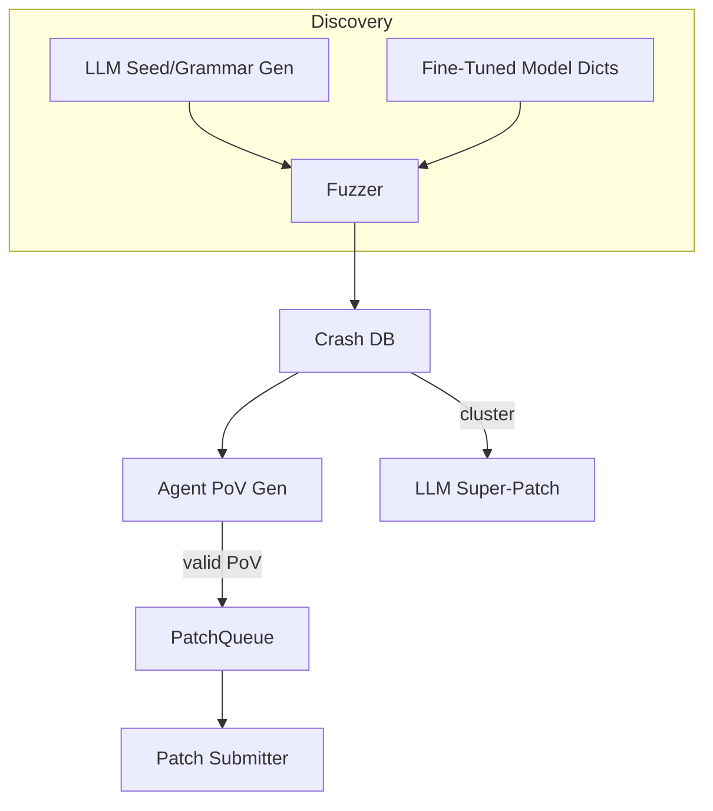

# AI-Assisted Fuzzing & Otomatik Zafiyet Keşfi

{{#include ../banners/hacktricks-training.md}}

## Genel Bakış
Büyük dil modelleri (LLM'ler); anlamsal açıdan zengin girdiler oluşturarak, gramerleri geliştirerek, crash verileri üzerinde akıl yürüterek ve hatta birden fazla bug'ı gideren yamalar önererek geleneksel zafiyet araştırma süreçlerini büyük ölçüde güçlendirebilir. Bu sayfa, DARPA'nın AI Cyber Challenge (AIxCC) finalinde ve diğer kamuya açık araştırmalarda gözlemlenen en etkili yöntemleri derlemektedir.<sup>[[4]](#references)</sup><sup>[[5]](#references)</sup>

Aşağıda belirli bir yarışma sisteminin açıklaması değil, bu yöntemleri kendi iş akışlarınızda uygulayabilmeniz için tekniklerin bir özeti yer almaktadır.

---

## 1. LLM Tarafından Oluşturulan Seed Girdileri

Geleneksel coverage-guided fuzzer'lar (AFL++, libFuzzer, Honggfuzz…) küçük bir seed corpus'u ile başlar ve byte'ları gelişigüzel mutate eder. Hedef girdi formatı karmaşık olduğunda (SQL, URL'ler, özel ikili protokoller), rastgele mutasyonlar genellikle ilgi çekici branch'lere ulaşılmadan önce sözdizimini bozar.

LLM'ler, **sözdizimi doğru ancak güvenlik açısından anlamlı girdiler** üreten kısa script'ler olan *seed generator*'lar oluşturarak bu başlangıç sorununu çözebilir. Örneğin:

```prompt
SYSTEM: You are a helpful security engineer.
USER:
Write a Python3 program that prints 200 unique SQL injection strings targeting common anti-pattern mistakes (missing quotes, numeric context, stacked queries).  Ensure length ≤ 256 bytes / string so they survive common length limits.
```

```python
# gen_sqli_seeds.py (truncated)
PAYLOADS = [
    "1 OR 1=1 -- ",
    "' UNION SELECT NULL,NULL--",
    "0; DROP TABLE users;--",
    ...
]
for p in PAYLOADS:
    print(p)
```

Bir kez çalıştırın ve çıktıyı doğrudan fuzzer’ın başlangıç corpus’una aktarın:

```bash
python3 gen_sqli_seeds.py > seeds.txt
afl-fuzz -i seeds.txt -o findings/ -- ./target @@
```

Faydaları:
1. Anlamsal geçerlilik → erken aşamada daha derin kapsama.
2. Yeniden üretilebilir: XSS, path traversal, binary blobs vb. konulara odaklanmak için prompt'u düzenleyin.
3. Ucuz (< 1 ¢ with GPT-3.5).

### İpuçları
* Yüzeysel filtreleri atlatmak için modelden payload uzunluğunu ve kodlamasını (UTF-8, URL-encoded, UTF-16-LE) *çeşitlendirmesini* isteyin.
* JSON biçimlendirme sorunlarını önlemek için *tek ve kendi kendine yeterli bir script* isteyin.

---

## 2. Grammar-Evolution Fuzzing

Daha güçlü bir yaklaşım, LLM'nin somut seed'ler yerine **bir grammar geliştirmesini** sağlamaktır. İş akışı (“Grammar Guy” pattern) şöyledir:

1. Prompt aracılığıyla başlangıç niteliğinde bir ANTLR/Peach/LibFuzzer grammar'ı oluşturun.
2. N dakika boyunca fuzzing yapın ve kapsama ölçümlerini (hit alan edges / blocks) toplayın.
3. Kapsanmayan program alanlarını özetleyin ve özeti modele geri gönderin:
   ```prompt
   The previous grammar triggered 12 % of the program edges.  Functions not reached: parse_auth, handle_upload.  Add / modify rules to cover these.
   ```
4. Yeni kuralları birleştir, yeniden fuzz et ve tekrarla.

Sözde kod iskeleti:

```python
for epoch in range(MAX_EPOCHS):
    grammar = llm.refine(grammar, feedback=coverage_stats)
    save(grammar, f"grammar_{epoch}.txt")
    coverage_stats = run_fuzzer(grammar)
```

Key points:
* Bir *bütçe* belirleyin – her iyileştirme token kullanır.
* Modelin baştan yazması yerine düzenleme yapması için `diff` + `patch` talimatları kullanın.
* Δcoverage < ε olduğunda durun.

---

## 3. Local-LLM libFuzzer Harness Mühendisliği

Analistin iş istasyonundan çıkarılamayacak kaynak kodlar için yerel bir kod modeli, fuzzer baytları ile C/C++ API’si arasındaki küçük adaptörü taslak olarak hazırlayabilir. Güvenlik sınırı açıkça tanımlıdır: **model test altyapısını yazar ve gözden geçirir; coverage-guided mutasyon girdileri keşfeder; sanitizer’lar geçersiz işlemleri bildirir; bir insan harness’i inceler ve bulguları değerlendirir**.<sup>[[9]](#references)</sup>

LLM’ye bağlı olmayan engine-level corpus, feedback, snapshot ve stateful-fuzzing teknikleri için genel [Fuzzing Methodology](../generic-methodologies-and-resources/fuzzing.md) bölümüne bakın.

Hedef header’dan alınan tam bildirimle başlayın ve çıktı biçimini kısıtlayın. Dar kapsamlı bir prompt, uydurma API’leri azaltır ve sonucu incelemeyi kolaylaştırır:<sup>[[8]](#references)[[9]](#references)</sup>

```prompt
Write a libFuzzer target for this exact declaration:
int parse_records(const uint8_t *data, size_t size);

Output only C code. Implement LLVMFuzzerTestOneInput, include the
declaration, pass data and size unchanged, and do not use files,
network access, randomness, clocks, threads, or persistent state.
```

Ham bayt ayrıştırıcısı için beklenen sonuç şundan daha karmaşık olmamalıdır:<sup>[[6]](#references)[[9]](#references)</sup>

```c
#include <stddef.h>
#include <stdint.h>

extern int parse_records(const uint8_t *, size_t);

int LLVMFuzzerTestOneInput(const uint8_t *data, size_t size) {
    (void)parse_records(data, size);
    return 0;
}
```

Derleme yalnızca ilk doğrulama aşamasıdır. CPU zamanı harcamadan önce oluşturulan her target'ı şu değişmezlere göre inceleyin:<sup>[[6]](#references)[[8]](#references)[[9]](#references)</sup>

- **Exact API:** Türleri, sahiplik kurallarını, başlatmayı, teardown işlemini ve çağrı kuralını gerçek header ve mevcut çağrılarla karşılaştırın.
- **Harness safety:** `data` üzerinden yapılan her okumayı korumalı hâle getirin; sanitizer bulguları, oluşturulan glue kodundan değil target'tan kaynaklanmalıdır.
- **Tekrarlanabilirlik:** Sonucu `data` ve `size` değerlerinin bir fonksiyonu hâline getirin; harici I/O'yu, zamanı, kontrolsüz rastgeleliği, birleştirilmemiş thread'leri ve çağrılar arasında kalan durumu kaldırın.
- **Throughput:** Pahalı ve değişmez durumu yalnızca davranışı etkilemeyeceği zaman bir kez başlatın, input boyutunu sınırlandırın, loglamayı devre dışı bırakın ve input başına ayrılan belleği serbest bırakın.
- **Erişilebilirlik:** Amaçlanan fonksiyonların ve dalların çalıştığını doğrulayın. Derlenen ancak yalnızca reddetme yollarını çalıştıran bir target sessiz bir başarısızlıktır.

### Yapıyı dikkate alan target'lar: hataları gizlemeden değişmezleri koruyun

Ham input'ların çoğu bir magic, uzunluk, sürüm veya checksum kontrolünde başarısız oluyorsa fuzz byte'larını **typed field** verisi olarak kullanıp geçerli bir nesne oluşturun. Format sabitlerini sabitleyin, anlamsal alanları ve payload byte'larını değiştirilebilir bırakın ve bütünlük meta verilerini yeniden oluşturulan payload'dan türetin. `FuzzedDataProvider`, sınırlandırılmış typed değerleri tüketmek için kullanışlıdır; oluşturulan bellek ayırmalarını ve dönüşümleri sınırlandırmaktan ise adapter sorumludur.<sup>[[9]](#references)</sup>

<details>
<summary>Yapıyı dikkate alan C++ target örneği</summary>

```cpp
#include <fuzzer/FuzzedDataProvider.h>
#include <stddef.h>
#include <stdint.h>
#include <vector>

extern "C" int parse_message(const uint8_t *, size_t);

extern "C" int LLVMFuzzerTestOneInput(const uint8_t *data, size_t size) {
    FuzzedDataProvider fdp(data, size);
    uint8_t version = fdp.ConsumeIntegral<uint8_t>();
    auto body = fdp.ConsumeRemainingBytes<uint8_t>();
    if (body.size() > UINT16_MAX) body.resize(UINT16_MAX);
    uint16_t len = static_cast<uint16_t>(body.size());
    std::vector<uint8_t> msg = {0x8b, 'M', 'S', 'G', version,
                                static_cast<uint8_t>(len >> 8),
                                static_cast<uint8_t>(len)};
    msg.insert(msg.end(), body.begin(), body.end());
    (void)parse_message(msg.data(), msg.size());
    return 0;
}
```

</details>

Her soru için tek bir yapı onaran hedef kullanmayın. Derin ve geçerli durumları keşfetmek için uzunlukları/checksum'ları türeten bir hedef; fuzzer'ın **bildirilen** metadata'yı kontrol ettiği, yalnızca harness'in kendi okuma ve bellek ayırmalarını sınırlandırdığı başka bir hedef bulundurun. İkinci hedef, otomatik onarımın aksi hâlde ortadan kaldıracağı uzunluk uyuşmazlıklarını ve hatalı bütünlük kontrollerini içeren saldırı yüzeylerini korur.<sup>[[9]](#references)</sup>

### Seed'ler, sözlükler, sanitizer'lar ve coverage geri bildirimi

Modelden doğrudan binary yazdırmasını istemek yerine, binary seed'ler yazan bir script oluşturmasını isteyin. Boş, minimal, tipik ve sınır değerlerinde geçerli nesnelerle seed oluşturun; ardından magic değerlerini, etiketleri, enum kodlamalarını ve parser anahtar sözcüklerini gözden geçirilmiş bir sözlüğe çıkarın. libFuzzer bu sözlüğü `-dict=` ile kabul eder ve yeni coverage ortaya çıkaran mutasyonları corpus'ta tutar.<sup>[[6]](#references)[[9]](#references)</sup>

```text
magic="\x8bMSG"
version_min="\x00"
version_max="\xff"
config_tag="CONFIG"
```

Aynı hedefi tamamlayıcı enstrümantasyonla derleyin. ASan ve UBSan aynı fuzzing binary'sini paylaşabilir; enstrümante edilmemiş koddan kaynaklanan raporları önlemek için ayrı bir MSan derlemesi kullanın ve bağımlılıklarını enstrümante edin.<sup>[[6]](#references)[[9]](#references)</sup>

```bash
clang++ -g -O1 -fsanitize=fuzzer,address,undefined \
  -fno-sanitize-recover=undefined target.cc harness.cc -o fuzz_target
./fuzz_target corpus -dict=msg.dict -max_len=65535

clang++ -g -O1 -fsanitize=fuzzer,memory \
  target.cc harness.cc -o fuzz_target_msan
```

Her model revizyonu için coverage'ı değerlendirici olarak kullanın. libFuzzer çıktısında `cov`/`ft` değerlerinin erken aşamada düz seyretmesi ve corpus'un değişmemesi genellikle hatalı framing'e, aşırı kısıtlayıcı bir erken dönüşe veya yanlış çağrıya işaret eder; düşük `exec/s` ise maliyetli setup, I/O, allocation ya da sızan state'e işaret eder. `NEW`, yalnızca bir coverage özelliğinin değiştiğini kanıtlar; amaçlanan parser'a ulaşıldığını değil.<sup>[[6]](#references)[[9]](#references)</sup>

Source-level feedback için bir coverage build oluşturun, fuzzing yapın ve modele yalnızca uncovered functions'ları ve bunları koruyan koşulları verin. Ortaya çıkan harness/seed/dictionary diff'ini doğrulayın ve yeniden ölçüm yapın:<sup>[[7]](#references)[[8]](#references)[[9]](#references)</sup>

```bash
clang++ -g -O1 -fsanitize=fuzzer \
  -fprofile-instr-generate -fcoverage-mapping target.cc harness.cc -o fuzz_cov
mkdir -p profiles
LLVM_PROFILE_FILE='profiles/%p.profraw' ./fuzz_cov -max_total_time=300 corpus
llvm-profdata merge -sparse profiles/*.profraw -o fuzz.profdata
llvm-cov report ./fuzz_cov -instr-profile=fuzz.profdata
llvm-cov show ./fuzz_cov -instr-profile=fuzz.profdata \
  --show-branches=count --region-coverage-lt=1 target.cc
```

Ölçeklenebilir döngü bu nedenle **üret → derle/bağla → sanitizer’lar altında smoke-test yap → hedef kapsamını ölç → ilgili en küçük kapsam/kaynak bağlamını sağla → gözden geçir → yeniden ölç** şeklindedir. OSS-Fuzz-Gen de üretilen hedefleri, makul görünen kodu olduğu gibi kabul etmek yerine derlenebilirlik, çalışma zamanı hataları, kapsam ve mevcut hedeflere kıyasla kapsam iyileşmesi açısından değerlendirerek aynı ilkeyi uygular.<sup>[[7]](#references)[[8]](#references)</sup>

---

<a id="3-agent-based-pov-exploit-generation" hidden>3. Agent Tabanlı PoV (Exploit) Üretimi</a>

## 4. Agent Tabanlı PoV (Exploit) Üretimi

Bir crash bulduktan sonra, bunu deterministik olarak tetikleyen bir **güvenlik açığı kanıtına (PoV)** ihtiyacınız olur.

Ölçeklenebilir bir yaklaşım, her biri farklı bir model veya örnekleme yapılandırması kullanan çok sayıda hafif worker (process, thread veya container) başlatmaktır. AIxCC finalist anketi, ölçeğe ilişkin somut örnekler sunuyor: Bir ekip AI öncelikli PoV üretimi için **binlerce eşzamanlı agent** kullanırken, başka bir ekip **300–500 fuzzing agent’ını** koordine edip LLM’leri üst düzey anlamsal akıl yürütme için ayırdı.<sup>[[4]](#references)</sup>

İş akışı:
1. Statik/dinamik analiz *bug adayları* üretir (crash PC, input dilimi ve sanitizer mesajını içeren struct).
2. Orchestrator adayları agent’lara dağıtır.
3. Agent’ın akıl yürütme adımları:
   a. Bug’ı yerel olarak `gdb` + input ile yeniden üret.
   b. En küçük exploit payload’unu öner.
   c. Exploit’i sandbox’ta doğrula. Başarılıysa → gönder.
4. Başarısız denemeler, coverage fuzzing için **yeni seed’ler olarak yeniden kuyruğa alınır** (geri bildirim döngüsü).

Avantajlar:
* Paralelleştirme, tek bir agent’ın güvenilmezliğini telafi eder.
* Gözlemlenen başarı oranına göre temp / model boyutunun otomatik ayarlanması.

---

<a id="4-directed-fuzzing-with-fine-tuned-code-models" hidden>4. Fine-Tune Edilmiş Code Model’lerle Yönlendirilmiş Fuzzing</a>

## 5. Fine-Tune Edilmiş Code Model’lerle Yönlendirilmiş Fuzzing

Vulnerability pattern’larıyla (integer overflow, buffer copy, format string) etiketlenmiş C/C++ kaynak koduyla açık ağırlıklı bir modeli (ör. Llama-7B) fine-tune edin. Ardından:

1. Function listesi + AST elde etmek için statik analiz çalıştırın.
2. Modele şu prompt’u verin: *“X function’ında memory safety’yi bozma olasılığı yüksek mutation dictionary girdileri ver”*.
3. Bu token’ları özel bir `AFL_CUSTOM_MUTATOR` içine ekleyin.

Bir `sprintf` wrapper’ı için örnek çıktı:
```
{"pattern":"%99999999s"}
{"pattern":"AAAAAAAA....<1024>....%n"}
```

Deneysel olarak, gerçek hedeflerde time-to-crash süresini 2×'den fazla kısaltır.

---

<a id="5-ai-guided-patching-strategies" hidden>5. AI Rehberliğinde Patch Stratejileri</a>

## 6. AI Rehberliğinde Patch Stratejileri

<a id="51-super-patches" hidden>5.1 Süper Patch'ler</a>

### 6.1 Süper Patch'ler
Modelden crash imzalarını *kümelemesini* ve ortak kök nedeni ortadan kaldıran **tek bir patch** önermesini isteyin. Bir kez gönderin, birkaç hatayı düzeltin → yanlış patch'in puana mal olduğu ortamlarda daha az doğruluk cezası.

Prompt taslağı:
```
Here are 10 stack traces + file snippets.  Identify the shared mistake and generate a unified diff fixing all occurrences.
```

{{#ref}}
../generic-methodologies-and-resources/fuzzing.md
{{#endref}}

<a id="52-speculative-patch-ratio" hidden>5.2 Spekülatif Patch Oranı</a>

### 6.2 Spekülatif Patch Oranı
Doğrulanmış, PoV ile doğrulanmış patch’ler ile *spekülatif* patch’lerin (PoV yok) puanlama kurallarına göre ayarlanan 1:​N oranında sırayla işlendiği bir kuyruk uygulayın (ör. 2 spekülatif : 1 doğrulanmış). Bir maliyet modeli, cezaları puanlara karşı izler ve N değerini otomatik olarak ayarlar.

---

<a id="6-deterministic-file-by-file-ai-code-review" hidden>6. Deterministik Dosya Dosya AI Code Review</a>

## 7. Deterministik Dosya Dosya AI Code Review

AI destekli incelemelerde sık karşılaşılan bir başarısızlık biçimi, tek bir ajandan tüm depoyu incelemesini istemek ve doğru dosyaları ve grep terimlerini seçmesini ummaktır. Daha güvenilir bir yaklaşım, **depo kapsamını zorunlu kılmaktır**:<sup>[[1]](#references)</sup>

1. Kaynak dosyaları listeleyin.
2. **Her seferinde tek bir dosyayı** asgari bağlamla (entrypoint, import’lar, yakındaki route’lar/çağıranlar) gönderin.
3. Her dosya için kaynakları, sink’i, eksik doğrulamayı, exploit ön koşullarını ve güven düzeyini içeren **yapılandırılmış bir rapor** isteyin.<sup>[[3]](#references)</sup>
4. Raporları **source→sink örüntüsüne** göre yinelenenlerden arındırın ve yüksek risklileri elle doğrulayın.

Bu yöntem çok token tüketir ve gürültülüdür, ancak geniş kapsamlı agentic incelemelerin çoğu zaman gözden kaçırdığı **basit, etkisi yüksek source/sink hatalarını** ortaya çıkarmada oldukça etkilidir.

### Önceliklendirmeye değer triage örüntüleri

- **Dinamik PHP include/dispatch**: Saldırganın kontrolündeki route/controller/module adlarının, katı bir allowlist ve path canonicalisation uygulanmadan `require_once()`, `include()` veya `include_once()` işlevlerine aktarılması.
- **Admin/account iş akışlarında shell çalıştırma**: Kullanıcı adlarının, domain’lerin, FTP hesaplarının veya diğer tanımlayıcıların `exec()`, `system()`, `shell_exec()`, `passthru()`, `proc_open()` ya da `popen()` işlevlerine ulaşması.
- **Yapılandırılmış girdilerin bir araya gelmesi**: Aynı parametrenin `$_GET`, `$_POST`, JSON, XML veya framework body parser’larından kabul edilip daha sonra dosya sistemi ya da OS-command sink’lerinde yeniden kullanılması.

### Bu yöntemin iyi bulduğu iki pratik hata sınıfı

- **PHP controller-dispatch LFI/RCE**: İstek tarafından kontrol edilen bir controller adı, allowlist/path normalisation olmadan `require_once()` işlevine birleştirilirse `../` gibi traversal dizileri PHP’nin istenmeyen bir yerel `.php` dosyasını include etmesine neden olabilir. Saldırgan include işlemini eklediği ya da başka şekilde işe yarar bir PHP dosyasına yönlendirebilirse LFI, code execution’a dönüşür. Bkz. [File Inclusion / Path Traversal](../pentesting-web/file-inclusion/README.md).<sup>[[1]](#references)</sup>
- **Hosting/admin panellerinde kimlik doğrulamalı command injection**: Kullanıcı adları gibi hesap yönetimi alanları shell komutlarına eklenirse, düşük ayrıcalıklı kimlik doğrulamalı bir kullanıcı normal bir oluşturma/silme işlemini RCE’ye dönüştürebilir. Panel komutu daha ayrıcalıklı bir service account olarak çalıştırdığında etki artar. Bkz. [Command Injection](../pentesting-web/command-injection.md).<sup>[[1]](#references)</sup>

### Pratik inceleme notları

- LLM’yi exploit generator olarak değil, öncelikle **source/sink inceleyicisi** olarak kullanın.
- Açıkça **saldırganın kontrolündeki alanı**, **normalisation/validation açığını** ve **tehlikeli sink’i** listelemesini isteyin.
- Büyük depolarda deterministik, dosya dosya inceleme; daha güçlü bir model kullansa bile, tek bir otonom agent çalıştırmasından çoğu zaman daha güvenilirdir.<sup>[[2]](#references)</sup>
- Exploit edilebilirliğin dosyalar arası varsayımlara, rol anlamlarına veya ürüne özgü tehdit modellerine bağlı olduğu **Broken Access Control** ve diğer business-logic hatalarında daha zayıf sonuçlar bekleyin.

---

## Mobil giriş noktası taskflow’ları

Tek bir depo genelindeki prompt, tehdit modellerini çoğu zaman birbirine karıştırır ve harici olarak erişilebilen bir bileşenden hassas bir sink’e giden yolu gözden kaçırır. Daha güçlü bir iş akışı, denetimi durum bilgisi tutan taskflow’lara böler: önce uygulamaları/bileşenleri sınıflandırın, ardından saldırganın kontrolündeki giriş noktalarını envanterleyin, her giriş noktasını erişilebilirlik meta verileriyle zenginleştirin ve son olarak her birini platforma özgü güvenlik açığı sınıflarına göre inceleyin. GitHub Security Lab’in mobil taskflow’ları, Android, iOS ve cross-platform depolar için bu örüntüyü uygular.<sup>[[14]](#references)[[15]](#references)</sup>

Android için en azından şunları kaydedin:<sup>[[14]](#references)[[15]](#references)</sup>

- İzinleriyle birlikte dışa aktarılmış Activities, Services, Receivers ve Providers;
- intent action’ları, deep-link scheme/host/path’leri, MIME filter’ları ve App Links;
- saldırganın kontrolündeki action’lar, data URI’leri, `ClipData`, extra’lar ve URI-grant flag’leri;
- WebView navigation girdileri ve `addJavascriptInterface` köprüleri;
- sonraki aşamalardaki ayrıcalıklı işlemler, içe aktarılan kaynaklar ve network hedefleri.

Ardından her giriş noktasını bağlam içinde sınıflandırın. Çağıran yetkilendirmesini/confused-deputy davranışını, intent redirection’ı, broadcast spoofing veya disclosure’ı, güvensiz import’ları, WebView scripting ve bridge exposure’ı, ayrıca credential veya cookie’lerin origin’ler arasında taşınmasını özellikle sorgulayın. Hem **katı bir checklist incelemesi** hem de **daha geniş bir adversarial inceleme** yürütün. Exploitation ayrıntılarını yinelemek yerine bulguları [Intent Injection](../mobile-pentesting/android-app-pentesting/intent-injection.md) ve [WebView Attacks](../mobile-pentesting/android-app-pentesting/webview-attacks.md) sayfalarına bağlayın.<sup>[[15]](#references)</sup>

Mevcut open-source taskflow’lar Codespace’lerinden şu komutla başlatılabilir:<sup>[[14]](#references)</sup>

```bash
./scripts/audit/run_audit.sh owner/repository
```

Sonuçlar SQLite'taki `audit_result` tablosuna yazılır.<sup>[[14]](#references)</sup> Savunmasız olarak işaretlenen satırları doğrulanmış bulgular değil, **iz sürülecek adaylar** olarak değerlendirin. Her aday için modelden saldırganın kontrol ettiği kaynağı, hassas sink'i, önkoşulları ve beklenen etkiyi belirtmesini isteyin; ardından minimal bir PoC oluşturmasını isteyin. Bu PoC'yi debugger veya enstrümantasyon kullanarak orijinal build üzerinde çalıştırın. Böylece erişilemeyen dallar, gerçekçi olmayan uygulama durumu, harici depolama verilerinin özel verilere göre önceliğini kaybetmesi ve önem derecesini kayda değer ölçüde azaltan önlemler gibi yaygın statik analiz hataları yakalanır.<sup>[[15]](#references)</sup>

---

## 8. Enstrümante Oracle ile Örüntü Rehberli Kernel Denetimi

Kernel boyutundaki bir hedef için ajandan tüm ağaçta rastgele hatalar bulmasını istemeyin. Token açısından daha verimli bir iş akışında, geçmiş güvenlik açığı bilgisi statik sorgulara dönüştürülür, sonuçlar açık saldırı yüzeyine göre sıralanır ve enstrümante bir kernel yürütme oracle'ı olarak kullanılır.<sup>[[11]](#references)</sup>

### Örüntü veritabanı → CodeQL/Semgrep → odaklı inceleme

Tehlikeli API'leri, eksik doğrulama örüntülerini, riskli source-to-sink akışlarını ve daha önce düzeltilmiş hata biçimlerini içeren küçük bir bilgi tabanı oluşturun. Modelden **her seferinde tek bir örüntüyü** inceleme sezgilerine ve CodeQL/Semgrep kurallarına dönüştürmesini isteyin; ardından bu deterministik kuralları tüm ağaç üzerinde çalıştırın. Kodları modele vermeden önce eşleşmeleri gruplandırıp yinelenenleri ayıklayın; ham tarayıcı çıktısında düşük değerli binlerce aday bulunabilir. Bu yaklaşımı uygun araştırma veya açık kaynak hedefleri dışında kullanmadan önce CodeQL'in güncel lisansını kontrol edin.<sup>[[11]](#references)</sup>

Alt sistemleri yalnızca eşleşme sayısına göre değil, **kural eşleşme yoğunluğunu** ve **saldırganın erişebilirliğini** birlikte değerlendirerek önceliklendirin. Ayrıcalıksız süreçlerden, sandbox'lardan, container'lardan, jail'lerden veya guest bağlamlarından erişilebilen kernel arayüzlerine, yalnızca dahili koddan daha fazla ağırlık verin. İnceleme birimini, ajanın çağıranları, doğrulayıcıları ve yaşam süresi kurallarını aklında tutabileceği kadar küçük tutun; “herhangi bir güvenlik açığı bul” demek yerine belirli bir güvenlik açığı sınıfı veya kontrol akışı örüntüsü hakkında istem verin. Eski ve ayrıcalıklı arayüzler, yeni bir yalıtım sınırı bunları namespace içindeki veya jail'e alınmış bir root kullanıcısına erişilebilir kılıyorsa özellikle ilgi çekicidir.<sup>[[11]](#references)</sup>

Her aday için, exploit denemeden önce açıkça belirtilmiş bir field-flow kaydı isteyin.<sup>[[11]](#references)</sup>

```text
entrypoint -> privilege check -> parser -> validation/normalization
           -> later rewrite -> dangerous sink
attacker controls: <fields and lengths>
constraints:       <values rewritten, rejected, or preserved>
observable result: <sanitizer report, assertion, panic, or clean exit>
```

### KASAN telemetrisini hipotez oracle'ı olarak kullanma

Hedef kernel'i KASAN ve yararlı tanılama assertion'ları etkinleştirilmiş, geçici bir VM'de çalıştırın. Şüphelenilen bozulma yeniden üretilene veya elenene kadar agent şu döngüyü yinelemelidir: **kaynak hipotezi → minimum userland tetikleyicisi → VM'de çalıştırma → KASAN/assertion izi → gözden geçirilmiş hipotez**. Her yinelemede yalnızca ilgili stack trace'i ve yakındaki kaynak kodu döndürün; böylece akıl yürütme bağlamı korunurken kabul ölçütü modelin güveni değil, çalışma zamanı kanıtı olur.<sup>[[11]](#references)</sup>

Enstrümante edilmiş bir build, nihai exploit edilebilirlik ortamı değildir. Assertion'lar, bozulmaya yol açan işlem gerçekleşmeden önce yürütmeyi durdurabilir; aynı assertion production kernel'inden derleme sırasında çıkarılmış olabilir. Değiştirilmemiş tetikleyiciyi tam production yapılandırmasında yeniden test edin, kernel build'ini ve yapılandırmasını kaydedin ve **erişilebilirlik**, **bellek bozulması**, **kontrollü primitive** ve **güvenlik etkisi** iddialarını ayrı ayrı ele alın.<sup>[[11]](#references)[[12]](#references)</sup>

CVE-2026-3038, exploit şablonundan ziyade yararlı bir doğrulama örneğidir. Ayrıcalıksız bir FreeBSD `RTM_GET` isteği, seçici doğrulama ve yanıtın yeniden yazılması boyunca boyutu aşırı büyük bir `RTAX_AUTHOR` sockaddr'ını koruyarak `rtsock_msg_buffer()` işlevinin kullanıcı denetimindeki `sa_len` değerini 128 baytlık stack `sockaddr_storage` içine kopyalamasına yol açabiliyordu. En fazla 255 baytlık kopyalama 127 baytlık bir taşmaya neden oldu; enstrümante edilmiş build'de hatalı uzunluğu tanılama assertion'ı yakalarken, GENERIC kernel kopyalama işlemine ulaşıyor ve ardından bozulmuş canary denetlendiğinde panic veriyordu. Bu, ayrıcalıksız hizmet engellemeyi kanıtlar; tek başına ayrıcalık yükseltmeyi değil: güvenilir denetim için önce canary ifşası gibi başka bir primitive gerekir. İlgili binary exploitation sınırı için [Stack Canaries](../binary-exploitation/common-binary-protections-and-bypasses/stack-canaries/index.html) sayfasına bakın.<sup>[[11]](#references)[[12]](#references)[[13]](#references)</sup>

### Exploit önkoşullarını hileyle aşmayı reddedin

Bir PoV veya exploit'i kabul etmeden önce, ayrı bir reviewer/agent'tan sabit ölçütlere göre iddiayı çürütmeye çalışmasını isteyin. İnceleme, aşağıdaki koşulların tümünü doğrulamalıdır.<sup>[[11]](#references)</sup>

- Hedef kaynak kodu, kernel ve savunmasız modül, yolu erişilebilir kılmak için değiştirilmemiştir.
- Yardımcı modül, sentetik gadget, devre dışı bırakılmış mitigation, fazladan ayrıcalık veya kullanılamayan arayüz eklenmemiştir.
- Tetikleyici, temiz bir snapshot üzerinde iddia edilen caller kimliği ve containment kısıtlamalarıyla başlar.
- İddia edilen sonuç hâlâ bug'a bağlıdır: hatalı alanı kaldırmak veya yalnızca bug'ı yamamak zinciri bozmalıdır.
- Crash, overread veya overwrite yalnızca o primitive olarak raporlanır; code execution veya privilege escalation için bağımsız kanıt gerekir.

Bu son karşı-olgusal kontrol, döngüsel gösterimleri yakalar: önkoşullar iddia edilen etkiyi zaten sağlıyorsa (örneğin `nosuid` olmadan mount edilmiş bir filesystem'den saldırgan tarafından sağlanan SUID içeriğini çalıştırmak), bellek güvenliği bug'ı bu etkiyi yaratmamıştır.<sup>[[11]](#references)</sup>

---

## Bilinmeyen Codebase'lerde Denetlenebilir Agent Destekli Araştırma

[Graph-first fuzz-target workflow](../generic-methodologies-and-resources/fuzzing.md#graph-first-fuzz-target-selection-and-mutation-triage) entrypoint erişilebilirliğini, [agentic SAST pipelines](../network-services-pentesting/pentesting-web/code-review-tools.md#agentic-sast-pipelines) ise aşamalı inceleme ve kanıt kapılarını zaten kapsıyor. Her yükseltilen bulgunun kaynak konumlarını, yol kanıtını ve dinamik bir ölçümü koruması için bu deterministik sonuçları modelin hipotezlerinden ayrı tutun.<sup>[[10]](#references)</sup>

### Veri akışı uydurmadan nesne ömrü kanıtlarını ilişkilendirin

Statik analiz, saldırgan denetimindeki bir uzunluğun bir işlevde saklandığını ve aynı nesne alanının çok daha sonra bir kopyalama sink'ine ulaştığını bulabilir; ancak callback'ler, reconnect'ler veya nesne ömrü boyunca bağlantıyı kanıtlayamayabilir. Her iki bulguyu ayrı ayrı koruyun, nesne/alan bazında kümelendirin ve eksik bağlantıyı açık bir triage sorusu hâline getirin. Agent ilişkiyi önerebilir, ancak kaynak kodunun incelenmesi veya çalışma zamanı enstrümantasyonu bunu kanıtlamalıdır.<sup>[[10]](#references)</sup>

Her aday için şunları kaydedin:

- somut entrypoint ve saldırgan denetimindeki baytlar;
- ilgili alanın her üreticisi ve her üreticiye özgü doğrulama;
- sink, hedef kapasitesi ve ona ulaşmak için gereken build/çalışma zamanı koşulları;
- yalnızca doğrudan harness çağrısı değil, açık entrypoint'ten alınmış gerçek bir call stack;
- hipotezi doğrulayan veya reddeden en küçük dinamik sonuç.

Görünüşte güvenli bir yol, alanı genel olarak güvenli kılmaz. İkinci bir üretici aynı alanı ilk yolun sınır kontrolü olmadan doldurabilir. Yolları birbirinden bağımsız test edin ve debug assertion'ları production'daki bellek bozulmasını yalnızca testte erken sonlandırmaya dönüştürebileceğinden, harness'i dağıtım ortamına eşdeğer build seçenekleriyle çalıştırın.<sup>[[10]](#references)</sup>

### İfşa ve exploit geliştirme için ölçüm kapıları

Başlatılmamış bellek ifşasından şüphelenildiğinde, yeni allocation'ları ayırt edilebilir bir baytla doldurun ve tam olarak bu işaretleyicinin gönderilen pakete ulaştığını doğrulayın. Exploit geliştirme için **kontrollü overwrite → yararlı victim object → disclosure → pointer/base recovery → control-flow hijack → composed payload** gibi ölçülebilir kapılar şart koşun. Agent yalnızca harness geçerli özelliği kanıtladığında ilerler; makul görünen bir anlatı, kapının geçildiği anlamına gelmez. Doğrulama sırasında korunması gereken yol ve build kısıtları için [FreeRDP case](../binary-exploitation/libc-heap/heap-overflow.md#cross-path-length-reuse-and-stale-output-disclosure) sayfasına bakın.<sup>[[10]](#references)</sup>

---

LLM destekli exploit geliştirmeye aşamalı L0–L4 doğrulamasını uygulayan bir kernel vaka incelemesi için bkz.:

{{#ref}}
../binary-exploitation/freebsd-kernel-exploitation-vnet-jail-escape.md
{{#endref}}

## Debugger destekli crash triage

Crash triage, function analysis ve kontrollü heap-chunk erişilebilirliği için Mona v3 iş akışları [Exploiting Tools](../binary-exploitation/basic-stack-binary-exploitation-methodology/tools/#mona-v3-debugger-context-requests-for-crash-triage) sayfasındadır.

---

## Hepsini Bir Araya Getirme
Uçtan uca bir CRS (Cyber Reasoning System), bileşenleri şu şekilde bağlayabilir:



---

## References

- [1] [Project Black - Siber Güvenlik için Yerel AI: phpIPAM LFI ve myVesta Kimliği Doğrulanmış RCE Bulma](https://projectblack.io/blog/local-ai-for-cyber-security)
- [2] [Strix](https://github.com/usestrix/strix)
- [3] [GitHub Copilot topluluk security-review becerisi](https://github.com/github/awesome-copilot/blob/main/skills/security-review/SKILL.md)
- [4] [Trail of Bits – AIxCC finalleri: Karşılaşmanın özeti](https://blog.trailofbits.com/2025/08/07/aixcc-finals-tale-of-the-tape/)
- [5] [CTF Radiooo AIxCC finalist röportajları](https://www.youtube.com/@ctfradiooo)
- [6] [LLVM — libFuzzer: coverage-guided fuzz testing için bir kütüphane](https://llvm.org/docs/LibFuzzer.html)
- [7] [Google — OSS-Fuzz-Gen](https://github.com/google/oss-fuzz-gen)
- [8] [Google Online Security Blog — Fuzzing'i ileri taşıma: AI ile daha fazla güvenlik açığı bulma](https://security.googleblog.com/2024/11/leveling-up-fuzzing-finding-more.html)
- [9] [8kSec — Yerel bir LLM ile AI destekli fuzzing harness oluşturma](https://8ksec.io/ai-assisted-fuzzing-harness-local-llm)
- [10] [Quarkslab — AI Agents'dan RCE'ye: Bir güvenlik açığı araştırma iş akışı oluşturma](https://blog.quarkslab.com/from-ai-agents-to-rce-building-a-vulnerability-research-workflow.html)
- [11] [Praetorian — FreeBSoD: Kernel hatalarını bulmak ve istismar etmek için dil modellerinden yararlanma (2 bölümün 1.si)](https://praetorian.com/blog/ai-vulnerability-research-freebsd-kernel)
- [12] [FreeBSD-SA-26:05.route — Routing socket'leri aracılığıyla yerel DoS ve olası ayrıcalık yükseltme](https://www.freebsd.org/security/advisories/FreeBSD-SA-26:05.route.asc)
- [13] [FreeBSD-SA-26:05.route kaynak yaması](https://security.FreeBSD.org/patches/SA-26:05/route.patch)
- [14] [GitHub Security Lab - SecLab Taskflows](https://github.com/GitHubSecurityLab/seclab-taskflows)
- [15] [GitHub Security Lab - Açık kaynaklı bir AI güvenlik ajanı kullanarak 24 Android güvenlik açığını nasıl bulduk](https://github.blog/security/how-we-found-24-android-vulnerabilities-using-our-open-source-ai-security-agent)
{{#include ../banners/hacktricks-training.md}}
