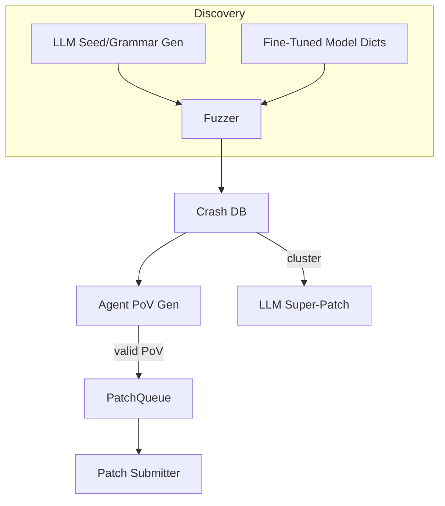

# Fuzzing asistido por IA y descubrimiento automatizado de vulnerabilidades

{{#include ../banners/hacktricks-training.md}}

## Descripción general
Los modelos de lenguaje grandes (LLM) pueden potenciar enormemente los flujos de trabajo tradicionales de investigación de vulnerabilidades al generar entradas con gran riqueza semántica, evolucionar gramáticas, razonar sobre datos de fallos e incluso proponer parches que solucionen varios bugs. Esta página recopila los patrones más eficaces observados durante las finales del AI Cyber Challenge (AIxCC) de DARPA y en otras investigaciones públicas.<sup>[[4]](#references)</sup><sup>[[5]](#references)</sup>

Lo que sigue no describe un sistema específico de competición, sino que abstrae las técnicas para que puedas reproducirlas en tus propios flujos de trabajo.

---

## 1. Entradas semilla generadas por LLM

Los fuzzers tradicionales guiados por cobertura (AFL++, libFuzzer, Honggfuzz…) comienzan con un pequeño corpus de semillas y mutan bytes a ciegas. Cuando el formato de entrada del objetivo es complejo (SQL, URL, protocolos binarios personalizados), las mutaciones aleatorias suelen romper la sintaxis antes de alcanzar ramas interesantes.

Los LLM pueden resolver este problema inicial generando *generadores de semillas*: scripts cortos que producen **entradas sintácticamente correctas pero relevantes para la seguridad**. Por ejemplo:

```prompt
SYSTEM: You are a helpful security engineer.
USER:
Write a Python3 program that prints 200 unique SQL injection strings targeting common anti-pattern mistakes (missing quotes, numeric context, stacked queries).  Ensure length ≤ 256 bytes / string so they survive common length limits.
```

```python
# gen_sqli_seeds.py (truncated)
PAYLOADS = [
    "1 OR 1=1 -- ",
    "' UNION SELECT NULL,NULL--",
    "0; DROP TABLE users;--",
    ...
]
for p in PAYLOADS:
    print(p)
```

Ejecútalo una vez y proporciona la salida directamente al corpus inicial del fuzzer:

```bash
python3 gen_sqli_seeds.py > seeds.txt
afl-fuzz -i seeds.txt -o findings/ -- ./target @@
```

Benefits:
1. Validez semántica → mayor cobertura desde el principio.
2. Regenerable: ajusta el prompt para enfocarlo en XSS, path traversal, binary blobs, etc.
3. Barato (< 1 ¢ con GPT-3.5).

### Tips
* Indica al modelo que *diversifique* la longitud y la codificación de los payloads (UTF-8, URL-encoded, UTF-16-LE) para eludir filtros superficiales.
* Pide un *único script autocontenido*: evita problemas con el formato JSON.

---

## 2. Fuzzing con evolución de gramáticas

Una variante más potente consiste en dejar que el LLM **evolucione una gramática** en lugar de seeds concretos. El flujo de trabajo (patrón “Grammar Guy”) es:

1. Genera una gramática inicial de ANTLR/Peach/LibFuzzer mediante un prompt.
2. Ejecuta fuzzing durante N minutos y recopila métricas de cobertura (edges / blocks alcanzados).
3. Resume las áreas del programa no cubiertas y envía el resumen de vuelta al modelo:
   ```prompt
   The previous grammar triggered 12 % of the program edges.  Functions not reached: parse_auth, handle_upload.  Add / modify rules to cover these.
   ```
4. Integra las nuevas reglas, vuelve a hacer fuzzing y repite.

Esqueleto de pseudocódigo:

```python
for epoch in range(MAX_EPOCHS):
    grammar = llm.refine(grammar, feedback=coverage_stats)
    save(grammar, f"grammar_{epoch}.txt")
    coverage_stats = run_fuzzer(grammar)
```

Puntos clave:
* Mantén un *presupuesto*: cada refinamiento consume tokens.
* Usa instrucciones `diff` + `patch` para que el modelo edite en lugar de reescribir.
* Detente cuando Δcoverage < ε.

---

## 3. Ingeniería de harness de libFuzzer con LLM local

Para código fuente que no puede salir de la estación de trabajo de un analista, un modelo de código local puede generar el pequeño adaptador entre los bytes del fuzzer y una API de C/C++. El límite de seguridad útil es explícito: **el modelo escribe y revisa la infraestructura de pruebas; la mutación guiada por cobertura explora las entradas; los sanitizers informan de las operaciones no válidas; una persona revisa el harness y clasifica los hallazgos**.<sup>[[9]](#references)</sup>

Para conocer técnicas de corpus, feedback, snapshots y fuzzing con estado a nivel del motor que no dependen de un LLM, consulta la [Metodología de fuzzing](../generic-methodologies-and-resources/fuzzing.md).

Empieza con la declaración exacta copiada del header de destino y limita el formato de salida. Un prompt específico reduce la invención de APIs y facilita la revisión del resultado:<sup>[[8]](#references)[[9]](#references)</sup>

```prompt
Write a libFuzzer target for this exact declaration:
int parse_records(const uint8_t *data, size_t size);

Output only C code. Implement LLVMFuzzerTestOneInput, include the
declaration, pass data and size unchanged, and do not use files,
network access, randomness, clocks, threads, or persistent state.
```

Para un parser de bytes en bruto, el resultado esperado no debería ser más complicado que:<sup>[[6]](#references)[[9]](#references)</sup>

```c
#include <stddef.h>
#include <stdint.h>

extern int parse_records(const uint8_t *, size_t);

int LLVMFuzzerTestOneInput(const uint8_t *data, size_t size) {
    (void)parse_records(data, size);
    return 0;
}
```

La compilación es solo la primera etapa de validación. Revisa cada target generado según estas invariantes antes de dedicarle tiempo de CPU:<sup>[[6]](#references)[[8]](#references)[[9]](#references)</sup>

- **API exacta:** compara los tipos, las reglas de ownership, la inicialización, el teardown y la convención de llamada con el header real y los callers existentes.
- **Seguridad del harness:** protege cada lectura de `data`; los hallazgos del sanitizer deben originarse en el target, no en el glue generado.
- **Repetibilidad:** haz que el resultado dependa de `data` y `size`; elimina la E/S externa, el tiempo, el azar no controlado, los threads sin join y el estado que persiste entre llamadas.
- **Throughput:** inicializa una sola vez el estado inmutable costoso únicamente si esto no afecta el comportamiento, limita el tamaño de entrada, suprime los logs y libera las allocations por entrada.
- **Reachability:** verifica que se ejecuten las funciones y ramas previstas. Un target que compila, pero solo recorre rutas de rechazo, es un fallo silencioso.

### Targets con estructura: conserva las invariantes sin ocultar bugs

Si la mayoría de las entradas raw fallan en una validación de magic, longitud, versión o checksum, usa los bytes de fuzzing como material para campos tipados y reconstruye un objeto válido. Fija las constantes del formato, deja mutables los campos semánticos y los bytes del payload, y deriva los metadatos de integridad a partir del payload reconstruido. `FuzzedDataProvider` es útil para consumir valores tipados acotados, mientras que el adapter sigue siendo responsable de limitar cualquier allocation y conversión generadas.<sup>[[9]](#references)</sup>

<details>
<summary>Ejemplo de target C++ con estructura</summary>

```cpp
#include <fuzzer/FuzzedDataProvider.h>
#include <stddef.h>
#include <stdint.h>
#include <vector>

extern "C" int parse_message(const uint8_t *, size_t);

extern "C" int LLVMFuzzerTestOneInput(const uint8_t *data, size_t size) {
    FuzzedDataProvider fdp(data, size);
    uint8_t version = fdp.ConsumeIntegral<uint8_t>();
    auto body = fdp.ConsumeRemainingBytes<uint8_t>();
    if (body.size() > UINT16_MAX) body.resize(UINT16_MAX);
    uint16_t len = static_cast<uint16_t>(body.size());
    std::vector<uint8_t> msg = {0x8b, 'M', 'S', 'G', version,
                                static_cast<uint8_t>(len >> 8),
                                static_cast<uint8_t>(len)};
    msg.insert(msg.end(), body.begin(), body.end());
    (void)parse_message(msg.data(), msg.size());
    return 0;
}
```

</details>

No uses un único objetivo que repare estructuras para todas las preguntas. Mantén un objetivo que derive longitudes y sumas de comprobación para explorar estados válidos profundos, y otro que deje los metadatos **declarados** bajo el control del fuzzer, limitando únicamente las lecturas y asignaciones de memoria propias del harness. El segundo objetivo conserva las superficies de ataque con longitudes incoherentes y problemas de integridad que la reparación automática eliminaría.<sup>[[9]](#references)</sup>

### Semillas, diccionarios, sanitizadores y retroalimentación de cobertura

Pídele al modelo que genere un script que escriba semillas binarias, en vez de pedirle que imprima datos binarios directamente. Crea semillas con objetos vacíos, mínimos, típicos y válidos en los límites; después, extrae los valores mágicos, las etiquetas, las codificaciones de enumeraciones y las palabras clave del parser para incluirlos en un diccionario revisado. libFuzzer acepta ese diccionario con `-dict=` y conserva en el corpus las mutaciones que revelan nueva cobertura.<sup>[[6]](#references)[[9]](#references)</sup>

```text
magic="\x8bMSG"
version_min="\x00"
version_max="\xff"
config_tag="CONFIG"
```

Construye el mismo objetivo con instrumentación complementaria. ASan y UBSan pueden compartir un binario de fuzzing; usa una compilación independiente de MSan e instrumenta sus dependencias para evitar informes causados por código no instrumentado.<sup>[[6]](#references)[[9]](#references)</sup>

```bash
clang++ -g -O1 -fsanitize=fuzzer,address,undefined \
  -fno-sanitize-recover=undefined target.cc harness.cc -o fuzz_target
./fuzz_target corpus -dict=msg.dict -max_len=65535

clang++ -g -O1 -fsanitize=fuzzer,memory \
  target.cc harness.cc -o fuzz_target_msan
```

Trata la cobertura como el evaluador de cada revisión del modelo. En la salida de libFuzzer, valores de `cov`/`ft` que se estancan pronto y un corpus estático suelen indicar un encuadre incorrecto, un early return demasiado restrictivo o una llamada equivocada; un `exec/s` bajo apunta a una configuración costosa, I/O, asignaciones o estado filtrado. `NEW` solo demuestra que cambió una característica de cobertura, no que se alcanzara el parser previsto.<sup>[[6]](#references)[[9]](#references)</sup>

Para obtener feedback a nivel de código fuente, genera una build con cobertura, haz fuzzing y proporciona al modelo solo las funciones no cubiertas y sus condiciones de protección. Verifica las diferencias resultantes en el harness/seed/dictionary y vuelve a medir:<sup>[[7]](#references)[[8]](#references)[[9]](#references)</sup>

```bash
clang++ -g -O1 -fsanitize=fuzzer \
  -fprofile-instr-generate -fcoverage-mapping target.cc harness.cc -o fuzz_cov
mkdir -p profiles
LLVM_PROFILE_FILE='profiles/%p.profraw' ./fuzz_cov -max_total_time=300 corpus
llvm-profdata merge -sparse profiles/*.profraw -o fuzz.profdata
llvm-cov report ./fuzz_cov -instr-profile=fuzz.profdata
llvm-cov show ./fuzz_cov -instr-profile=fuzz.profdata \
  --show-branches=count --region-coverage-lt=1 target.cc
```

El ciclo escalable es, por tanto, **generar → compilar/enlazar → hacer pruebas smoke con sanitizers → medir la cobertura del objetivo → proporcionar el contexto mínimo relevante de cobertura/código fuente → revisar → volver a medir**. OSS-Fuzz-Gen aplica el mismo principio: evalúa los objetivos generados por su compilabilidad, fallos en tiempo de ejecución, cobertura y mejora de cobertura respecto a los objetivos existentes, en lugar de aceptar código plausible sin más.<sup>[[7]](#references)[[8]](#references)</sup>

---

## 4. Generación de PoV (exploit) basada en agentes

Después de encontrar un crash, todavía necesitas un **proof-of-vulnerability (PoV)** que lo provoque de forma determinista.

Un enfoque escalable consiste en iniciar muchos workers ligeros (procesos, hilos o contenedores), cada uno con un modelo o una configuración de muestreo diferentes. La encuesta de finalistas de AIxCC ofrece ejemplos concretos de esta escala: un equipo usó **miles de agentes concurrentes** para generar PoV con IA como enfoque principal, mientras que otro coordinó **300–500 agentes de fuzzing** y reservó los LLM para el razonamiento semántico de alto nivel.<sup>[[4]](#references)</sup>

Pipeline:
1. El análisis estático/dinámico produce *candidatos a bug* (struct con crash PC, fragmento de entrada, mensaje del sanitizer).
2. El orquestador distribuye los candidatos entre los agentes.
3. Pasos de razonamiento del agente:
   a. Reproducir el bug localmente con `gdb` + la entrada.
   b. Proponer un payload de exploit mínimo.
   c. Validar el exploit en un sandbox. Si tiene éxito → enviar.
4. Los intentos fallidos se **vuelven a poner en cola como nuevas semillas** para el fuzzing de cobertura (bucle de retroalimentación).

Ventajas:
* La paralelización compensa la falta de fiabilidad de un solo agente.
* Ajuste automático de temp / tamaño del modelo según la tasa de éxito observada.

---

## 5. Fuzzing dirigido con modelos de código ajustados

Ajusta un modelo de pesos abiertos (p. ej., Llama-7B) con código fuente C/C++ etiquetado con patrones de vulnerabilidad (desbordamiento de enteros, copia de búfer, format string). Después:

1. Ejecuta un análisis estático para obtener la lista de funciones + el AST.
2. Indícale al modelo: *“Dame entradas para el diccionario de mutaciones que probablemente rompan la seguridad de memoria en la función X”*.
3. Inserta esos tokens en un `AFL_CUSTOM_MUTATOR` personalizado.

Ejemplo de salida para un wrapper de `sprintf`:
```
{"pattern":"%99999999s"}
{"pattern":"AAAAAAAA....<1024>....%n"}
```

Empíricamente, esto reduce el tiempo hasta el fallo en >2× en objetivos reales.

---

## 6. Estrategias de aplicación de parches guiadas por IA

### 6.1 Super Patches
Pídele al modelo que *agrupe* las firmas de fallos y proponga un **único parche** que elimine la causa raíz común. Envíalo una sola vez y corrige varios errores → menos penalizaciones por precisión en entornos donde cada parche incorrecto cuesta puntos.

Esquema del prompt:
```
Here are 10 stack traces + file snippets.  Identify the shared mistake and generate a unified diff fixing all occurrences.
```

### 6.2 Ratio de parches especulativos
Implementa una cola donde se intercalen parches confirmados y validados mediante PoV con parches *especulativos* (sin PoV), en una proporción 1:​N ajustada a las reglas de puntuación (p. ej., 2 especulativos : 1 confirmado). Un modelo de costes supervisa las penalizaciones frente a los puntos y ajusta N automáticamente.

---

## 7. Revisión de código con IA determinista, archivo por archivo

Un fallo frecuente en las revisiones asistidas por IA consiste en pedirle a un agente que inspeccione todo un repositorio y esperar que elija los archivos y términos de grep adecuados. Un patrón más fiable es **forzar la cobertura del repositorio**:<sup>[[1]](#references)</sup>

1. Enumera los archivos de código fuente.
2. Envía **un archivo a la vez** junto con contexto mínimo (punto de entrada, imports, rutas/llamadores cercanos).
3. Exige un **informe estructurado** para cada archivo: fuentes, sink, validación ausente, precondiciones de explotación y nivel de confianza.<sup>[[3]](#references)</sup>
4. Deduplica los informes por **patrón fuente→sink** y valida manualmente los de alto riesgo.

Esto consume muchos tokens y genera ruido, pero es muy eficaz para sacar a la luz **bugs simples de alto impacto entre fuentes y sinks** que las revisiones agentic amplias suelen pasar por alto.

### Patrones de triage que conviene priorizar

- **Inclusión/dispatch dinámico en PHP**: nombres de rutas/controladores/módulos controlados por el atacante que llegan a `require_once()`, `include()` o `include_once()` sin una allowlist estricta ni canonicalización de rutas.
- **Ejecución de shell en flujos de administración/cuentas**: nombres de usuario, dominios, cuentas FTP u otros identificadores que llegan a `exec()`, `system()`, `shell_exec()`, `passthru()`, `proc_open()` o `popen()`.
- **Convergencia de entradas estructuradas**: el mismo parámetro se acepta desde `$_GET`, `$_POST`, JSON, XML o los parsers del cuerpo de solicitudes del framework y luego se reutiliza en sinks del sistema de archivos o de comandos del sistema operativo.

### Dos clases prácticas de bugs que este método detecta bien

- **LFI/RCE por dispatch de controladores PHP**: si el nombre de un controlador controlado por la solicitud se concatena en `require_once()` sin una allowlist ni normalización de rutas, secuencias de traversal como `../` pueden hacer que PHP incluya un archivo `.php` local no previsto. Si el atacante puede dirigir la inclusión a un archivo PHP preparado o que resulte útil, la LFI se convierte en ejecución de código. Consulta [File Inclusion / Path Traversal](../pentesting-web/file-inclusion/README.md).<sup>[[1]](#references)</sup>
- **Command injection autenticada en paneles de hosting/administración**: si los campos de gestión de cuentas, como los nombres de usuario, se insertan en comandos de shell, un usuario autenticado con pocos privilegios puede convertir una acción normal de creación/eliminación en RCE. El impacto aumenta cuando el panel ejecuta el comando como una cuenta de servicio con más privilegios. Consulta [Command Injection](../pentesting-web/command-injection.md).<sup>[[1]](#references)</sup>

### Notas prácticas para la revisión

- Usa el LLM primero como **revisor de fuentes/sinks**, no como generador de exploits.
- Pídele que enumere explícitamente el **campo controlado por el atacante**, la **brecha de normalización/validación** y el **sink peligroso**.
- En repositorios grandes, la revisión determinista archivo por archivo suele ser más fiable que una única ejecución de un agente autónomo, incluso si esta última utiliza un modelo más potente.<sup>[[2]](#references)</sup>
- Espera resultados más débiles en **Broken Access Control** y otros bugs de lógica de negocio, cuya explotabilidad depende de supuestos entre archivos, semántica de roles o modelos de amenazas específicos del producto.

---

## Investigación auditable asistida por agentes en bases de código desconocidas

El [flujo de trabajo graph-first para fuzz targets](../generic-methodologies-and-resources/fuzzing.md#graph-first-fuzz-target-selection-and-mutation-triage) ya cubre la alcanzabilidad de los puntos de entrada, mientras que los [pipelines agentic de SAST](../network-services-pentesting/pentesting-web/code-review-tools.md#agentic-sast-pipelines) cubren la revisión por etapas y los controles de evidencia. Mantén esos resultados deterministas separados de las hipótesis del modelo para que cada indicio promovido conserve ubicaciones en el código fuente, evidencia de ruta y una medición dinámica.<sup>[[10]](#references)</sup>

### Correlacionar evidencia sobre el ciclo de vida de objetos sin inventar flujos de datos

El análisis estático puede encontrar una longitud controlada por el atacante que se almacena en una función y el mismo campo de objeto que llega a un sink de copia mucho después, pero no lograr demostrar la conexión a través de callbacks, reconexiones o el ciclo de vida del objeto. Conserva ambos hallazgos por separado, agrúpalos por objeto/campo y formula el edge faltante como una pregunta explícita de triage. El agente puede sugerir la relación, pero una revisión del código fuente o la instrumentación en tiempo de ejecución deben demostrarla.<sup>[[10]](#references)</sup>

Para cada candidato, registra:

- el punto de entrada concreto y los bytes controlados por el atacante;
- cada productor del campo pertinente, incluida la validación específica de cada productor;
- el sink, la capacidad del destino y las condiciones de compilación/ejecución necesarias para alcanzarlo;
- una pila de llamadas real desde el punto de entrada expuesto, no solo una invocación directa del harness;
- el resultado dinámico mínimo que confirme o descarte la hipótesis.

Una ruta aparentemente segura no descarta globalmente un campo. Un segundo productor puede poblar el mismo campo sin el límite aplicado por la primera ruta. Prueba las rutas de forma independiente y ejecuta el harness con opciones de compilación equivalentes a las del despliegue, porque las aserciones de depuración pueden convertir una corrupción de memoria en producción en un aborto temprano que solo ocurre en las pruebas.<sup>[[10]](#references)</sup>

### Controles de medición para la divulgación y la explotación

Para una sospecha de divulgación de memoria no inicializada, rellena las asignaciones nuevas con un byte reconocible y verifica que el marcador exacto llegue al paquete emitido. Para la explotación, exige controles medidos como **sobrescritura controlada → objeto víctima útil → divulgación → recuperación de puntero/base → secuestro del flujo de control → payload compuesto**. Un agente solo avanza cuando el harness demuestra la propiedad actual; una explicación plausible no equivale a superar un control. El [caso FreeRDP](../binary-exploitation/libc-heap/heap-overflow.md#cross-path-length-reuse-and-stale-output-disclosure) muestra la ruta y las restricciones de compilación que deben preservarse durante la validación.<sup>[[10]](#references)</sup>

---

## Integrarlo todo
Un CRS (Cyber Reasoning System) de extremo a extremo podría conectar los componentes así:



---

## References

- [1] [Project Black - IA local para ciberseguridad: detección de LFI en phpIPAM y RCE autenticado en myVesta](https://projectblack.io/blog/local-ai-for-cyber-security)
- [2] [Strix](https://github.com/usestrix/strix)
- [3] [Skill de revisión de seguridad de la comunidad de GitHub Copilot](https://github.com/github/awesome-copilot/blob/main/skills/security-review/SKILL.md)
- [4] [Trail of Bits – Finales de AIxCC: análisis de resultados](https://blog.trailofbits.com/2025/08/07/aixcc-finals-tale-of-the-tape/)
- [5] [Entrevistas de CTF Radiooo a finalistas de AIxCC](https://www.youtube.com/@ctfradiooo)
- [6] [LLVM — libFuzzer: una biblioteca para pruebas de fuzzing guiadas por cobertura](https://llvm.org/docs/LibFuzzer.html)
- [7] [Google — OSS-Fuzz-Gen](https://github.com/google/oss-fuzz-gen)
- [8] [Blog de seguridad en línea de Google — Mejora del fuzzing: encontrar más vulnerabilidades con IA](https://security.googleblog.com/2024/11/leveling-up-fuzzing-finding-more.html)
- [9] [8kSec — Generación asistida por IA de harnesses de fuzzing con un LLM local](https://8ksec.io/ai-assisted-fuzzing-harness-local-llm)
- [10] [Quarkslab — De agentes de IA a RCE: creación de un flujo de trabajo para la investigación de vulnerabilidades](https://blog.quarkslab.com/from-ai-agents-to-rce-building-a-vulnerability-research-workflow.html)
{{#include ../banners/hacktricks-training.md}}
