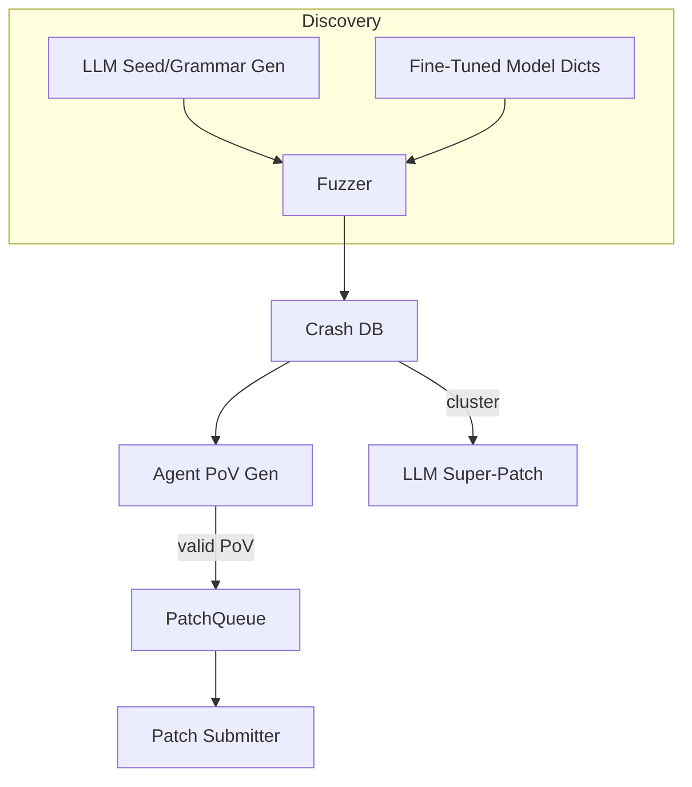

# Fuzzing Inayosaidiwa na AI na Ugunduzi wa Kiotomatiki wa Udhaifu

{{#include ../banners/hacktricks-training.md}}

## Muhtasari
Miundo mikubwa ya lugha (LLMs) inaweza kuongeza kwa kiasi kikubwa uwezo wa mifumo ya kawaida ya utafiti wa udhaifu wa kiusalama kwa kutengeneza ingizo zenye maana ya kisemantiki, kuboresha sarufi, kuchanganua data ya crash, na hata kupendekeza marekebisho yanayoshughulikia hitilafu nyingi. Ukurasa huu unakusanya mbinu zenye ufanisi zaidi zilizoonekana katika fainali za DARPA’s AI Cyber Challenge (AIxCC) na tafiti nyingine zilizochapishwa hadharani.<sup>[[4]](#references)</sup><sup>[[5]](#references)</sup>

Yanayofuata si maelezo ya mfumo mmoja mahususi wa mashindano, bali ni muhtasari wa mbinu ili uweze kuzitumia tena katika mifumo yako ya kazi.

---

## 1. Ingizo za Awali Zinazozalishwa na LLM

Fuzzer za kawaida zinazoongozwa na coverage (AFL++, libFuzzer, Honggfuzz…) huanza na mkusanyiko mdogo wa ingizo za awali na hubadilisha baiti bila mpangilio. Wakati muundo wa ingizo unaolengwa ni changamano (SQL, URL, itifaki maalum za binary), mabadiliko ya nasibu kwa kawaida huvunja sintaksia kabla matawi ya kuvutia hayajafikiwa.

LLM zinaweza kutatua tatizo hili la kuanzisha mchakato kwa kutoa *seed generators* – script fupi zinazotoa **ingizo sahihi kisintaksia lakini muhimu kwa usalama**. Kwa mfano:

```prompt
SYSTEM: You are a helpful security engineer.
USER:
Write a Python3 program that prints 200 unique SQL injection strings targeting common anti-pattern mistakes (missing quotes, numeric context, stacked queries).  Ensure length ≤ 256 bytes / string so they survive common length limits.
```

```python
# gen_sqli_seeds.py (truncated)
PAYLOADS = [
    "1 OR 1=1 -- ",
    "' UNION SELECT NULL,NULL--",
    "0; DROP TABLE users;--",
    ...
]
for p in PAYLOADS:
    print(p)
```

Iendeshe mara moja na uweke matokeo moja kwa moja kwenye corpus ya awali ya fuzzer:

```bash
python3 gen_sqli_seeds.py > seeds.txt
afl-fuzz -i seeds.txt -o findings/ -- ./target @@
```

Faida:
1. Uhalali wa kisemantiki → ufikiaji wa kina zaidi mapema.
2. Inaweza kuzalishwa upya: rekebisha prompt ili kulenga XSS, path traversal, binary blobs, n.k.
3. Gharama ndogo (< 1 ¢ kwa GPT-3.5).

### Vidokezo
* Iagize model itofautishe *urefu* na *encoding* za payload (UTF-8, URL-encoded, UTF-16-LE) ili kupita vichujio vya juu juu.
* Omba *script moja inayojitosheleza* – hii huepusha matatizo ya uumbizaji wa JSON.

---

## 2. Grammar-Evolution Fuzzing

Toleo lenye nguvu zaidi ni kuiacha LLM **ibadilishe grammar** badala ya seeds halisi. Mtiririko wa kazi (mfumo wa “Grammar Guy”) ni:

1. Tengeneza grammar ya awali ya ANTLR/Peach/LibFuzzer kupitia prompt.
2. Fanya fuzzing kwa dakika N na ukusanye vipimo vya coverage (edges / blocks zilizoguswa).
3. Fupisha sehemu za programu ambazo hazijafunikwa na urudishe muhtasari huo kwenye model:
   ```prompt
   The previous grammar triggered 12 % of the program edges.  Functions not reached: parse_auth, handle_upload.  Add / modify rules to cover these.
   ```
4. Unganisha sheria mpya, fanya fuzzing tena, rudia.

Muundo wa pseudocode:

```python
for epoch in range(MAX_EPOCHS):
    grammar = llm.refine(grammar, feedback=coverage_stats)
    save(grammar, f"grammar_{epoch}.txt")
    coverage_stats = run_fuzzer(grammar)
```

Mambo muhimu:
* Dumisha *bajeti* – kila uboreshaji hutumia tokens.
* Tumia maagizo ya `diff` + `patch` ili modeli ifanye mabadiliko badala ya kuandika upya.
* Simama wakati Δcoverage < ε.

---

## 3. Uhandisi wa Harness ya Local-LLM libFuzzer

Kwa source ambayo haiwezi kuondoka kwenye workstation ya mchambuzi, code model ya ndani inaweza kuandaa adapter ndogo kati ya fuzzer bytes na C/C++ API. Mpaka wa usalama unaofaa uko wazi: **modeli huandika na kurekebisha test infrastructure; coverage-guided mutation huchunguza inputs; sanitizers huripoti utendakazi batili; binadamu hukagua harness na kuchanganua matokeo**.<sup>[[9]](#references)</sup>

Kwa mbinu za engine-level corpus, feedback, snapshot, na stateful-fuzzing ambazo hazitegemei LLM, tazama [Fuzzing Methodology](../generic-methodologies-and-resources/fuzzing.md).

Anza na tamko halisi lililonakiliwa kutoka kwenye header ya lengo na uweke masharti ya muundo wa matokeo. Prompt finyu hupunguza API zilizobuniwa na kurahisisha ukaguzi wa matokeo:<sup>[[8]](#references)[[9]](#references)</sup>

```prompt
Write a libFuzzer target for this exact declaration:
int parse_records(const uint8_t *data, size_t size);

Output only C code. Implement LLVMFuzzerTestOneInput, include the
declaration, pass data and size unchanged, and do not use files,
network access, randomness, clocks, threads, or persistent state.
```

Kwa parser ya byte ghafi, matokeo yanayotarajiwa hayapaswi kuwa magumu zaidi ya:<sup>[[6]](#references)[[9]](#references)</sup>

```c
#include <stddef.h>
#include <stdint.h>

extern int parse_records(const uint8_t *, size_t);

int LLVMFuzzerTestOneInput(const uint8_t *data, size_t size) {
    (void)parse_records(data, size);
    return 0;
}
```

Compilation ni lango la kwanza tu la validation. Kagua kila target iliyozalishwa dhidi ya masharti haya kabla ya kuitumia CPU:<sup>[[6]](#references)[[8]](#references)[[9]](#references)</sup>

- **Exact API:** linganisha aina, kanuni za umiliki, uanzishaji, usafishaji na calling convention na header halisi pamoja na callers zilizopo.
- **Usalama wa harness:** linda kila usomaji kutoka `data`; matokeo ya sanitizer lazima yatokane na target, si glue iliyozalishwa.
- **Uwezo wa kurudiwa:** fanya matokeo yawe kazi ya `data` na `size`; ondoa I/O ya nje, muda, randomness isiyodhibitiwa, threads zisizojiunga na state inayosalia kati ya miito.
- **Throughput:** anzisha state nzito isiyobadilika mara moja tu pale ambapo haiwezi kuathiri tabia, weka kikomo cha ukubwa wa ingizo, zima logging na huru allocations za kila ingizo.
- **Ufikiwaji:** hakikisha kuwa functions na branches zilizokusudiwa zinatekelezwa. Target inayokompile lakini inajaribu tu njia za kukataa ni hitilafu isiyoonekana.

### Targets zinazozingatia muundo: hifadhi masharti bila kuficha bugs

Ikiwa ingizo nyingi ghafi zinashindwa kwenye kizuizi cha magic, urefu, version au checksum, tumia bytes za fuzz kama nyenzo za fields zenye aina maalum, kisha unda upya object halali. Rekebisha constants za format, acha fields za semantic na bytes za payload zibadilike, na ukokotoe metadata ya integrity kutoka kwenye payload iliyoundwa upya. `FuzzedDataProvider` inafaa kwa kutumia thamani zenye aina maalum na mipaka, huku adapter ikiwajibika kuweka kikomo kwa allocations na ubadilishaji wowote unaozalishwa.<sup>[[9]](#references)</sup>

<details>
<summary>Example ya target ya C++ inayozingatia muundo</summary>

```cpp
#include <fuzzer/FuzzedDataProvider.h>
#include <stddef.h>
#include <stdint.h>
#include <vector>

extern "C" int parse_message(const uint8_t *, size_t);

extern "C" int LLVMFuzzerTestOneInput(const uint8_t *data, size_t size) {
    FuzzedDataProvider fdp(data, size);
    uint8_t version = fdp.ConsumeIntegral<uint8_t>();
    auto body = fdp.ConsumeRemainingBytes<uint8_t>();
    if (body.size() > UINT16_MAX) body.resize(UINT16_MAX);
    uint16_t len = static_cast<uint16_t>(body.size());
    std::vector<uint8_t> msg = {0x8b, 'M', 'S', 'G', version,
                                static_cast<uint8_t>(len >> 8),
                                static_cast<uint8_t>(len)};
    msg.insert(msg.end(), body.begin(), body.end());
    (void)parse_message(msg.data(), msg.size());
    return 0;
}
```

</details>

Usitumie target moja inayorekebisha miundo kwa kila swali. Dumisha target moja inayokokotoa urefu/checksum ili kuchunguza hali halali za ndani zaidi, na nyingine inayofanya metadata **iliyotangazwa** idhibitiwe na fuzzer huku ikiweka mipaka kwa usomaji na ugawaji kumbukumbu unaofanywa na harness pekee. Target ya pili huhifadhi attack surfaces za urefu usiolingana na uadilifu mbovu ambazo marekebisho ya kiotomatiki yangefuta.<sup>[[9]](#references)</sup>

### Mbegu, kamusi, sanitizers, na maoni ya coverage

Iambie modeli itengeneze script inayoandika mbegu za binary badala ya kuiomba ichapishe binary moja kwa moja. Tumia vitu tupu, vidogo zaidi, vya kawaida, na halali vilivyo kwenye mipaka kama mbegu; kisha toa thamani za magic, tagi, usimbaji wa enum, na maneno muhimu ya parser ili kuweka kwenye kamusi iliyokaguliwa. libFuzzer hupokea kamusi hiyo kwa `-dict=`, na huhifadhi kwenye corpus mutations zinazofichua coverage mpya.<sup>[[6]](#references)[[9]](#references)</sup>

```text
magic="\x8bMSG"
version_min="\x00"
version_max="\xff"
config_tag="CONFIG"
```

Jenga target ileile kwa instrumentation inayokamilishana. ASan na UBSan zinaweza kutumia binary moja ya fuzzing; tumia build tofauti ya MSan na u-instrument dependencies zake ili kuepuka ripoti zinazosababishwa na code ambayo haija-instrumentiwa.<sup>[[6]](#references)[[9]](#references)</sup>

```bash
clang++ -g -O1 -fsanitize=fuzzer,address,undefined \
  -fno-sanitize-recover=undefined target.cc harness.cc -o fuzz_target
./fuzz_target corpus -dict=msg.dict -max_len=65535

clang++ -g -O1 -fsanitize=fuzzer,memory \
  target.cc harness.cc -o fuzz_target_msan
```

Chukulia coverage kama kipimo cha kutathmini kila toleo la model. Katika matokeo ya libFuzzer, `cov`/`ft` zisizobadilika mapema na corpus isiyobadilika kwa kawaida humaanisha framing isiyo sahihi, early return yenye vizuizi vingi, au wito usio sahihi; `exec/s` ya chini huashiria usanidi ghali, I/O, allocation, au state iliyovuja. `NEW` huthibitisha tu kuwa kipengele cha coverage kimebadilika, si kwamba parser iliyokusudiwa imefikiwa.<sup>[[6]](#references)[[9]](#references)</sup>

Kwa feedback ya kiwango cha source, tengeneza build ya coverage, fanya fuzzing, kisha upe model functions ambazo hazijafunikwa pamoja na masharti yanayozilinda pekee. Hakiki tofauti za harness/seed/dictionary zinazotokana na hilo, kisha pima tena:<sup>[[7]](#references)[[8]](#references)[[9]](#references)</sup>

```bash
clang++ -g -O1 -fsanitize=fuzzer \
  -fprofile-instr-generate -fcoverage-mapping target.cc harness.cc -o fuzz_cov
mkdir -p profiles
LLVM_PROFILE_FILE='profiles/%p.profraw' ./fuzz_cov -max_total_time=300 corpus
llvm-profdata merge -sparse profiles/*.profraw -o fuzz.profdata
llvm-cov report ./fuzz_cov -instr-profile=fuzz.profdata
llvm-cov show ./fuzz_cov -instr-profile=fuzz.profdata \
  --show-branches=count --region-coverage-lt=1 target.cc
```

Mzunguko unaoweza kupanuliwa ni **generate → compile/link → smoke-test chini ya sanitizers → pima target coverage → toa muktadha mdogo zaidi unaohusika wa coverage/source → rekebisha → pima tena**. OSS-Fuzz-Gen hutumia kanuni hiyo hiyo kwa kutathmini targets zilizozalishwa kulingana na uwezo wa kuzikompile, hitilafu za runtime, coverage, na uboreshaji wa coverage dhidi ya targets zilizopo, badala ya kukubali tu code inayoonekana kuwa sahihi.<sup>[[7]](#references)[[8]](#references)</sup>

---

<a id="3-agent-based-pov-exploit-generation" hidden>3. Uzalishaji wa PoV (Exploit) kwa Kutumia Agents</a>

## 4. Uzalishaji wa PoV (Exploit) kwa Kutumia Agents

Baada ya crash kupatikana, bado unahitaji **proof-of-vulnerability (PoV)** inayoiwasha kwa uhakika kila mara.

Mbinu inayoweza kupanuliwa ni kuanzisha workers wengi wepesi (processes, threads, au containers), kila mmoja akitumia model au usanidi tofauti wa sampling. Utafiti wa waliofika fainali za AIxCC unatoa mifano halisi ya ukubwa: timu moja ilitumia **maelfu ya agents zinazofanya kazi kwa wakati mmoja** kwa ajili ya utengenezaji wa PoV unaoongozwa na AI, huku nyingine ikiratibu **agents 300–500 za fuzzing** na kuhifadhi LLMs kwa ajili ya reasoning ya kisemantiki ya kiwango cha juu.<sup>[[4]](#references)</sup>

Pipeline:
1. Static/dynamic analysis hutoa *bug candidates* (struct yenye crash PC, input slice, sanitizer msg).
2. Orchestrator husambaza candidates kwa agents.
3. Hatua za reasoning za Agent:
   a. Zalisha tena bug ndani ya mashine kwa kutumia `gdb` + input.
   b. Pendekeza exploit payload ndogo zaidi.
   c. Thibitisha exploit ndani ya sandbox. Ikiwa imefanikiwa → wasilisha.
4. Majaribio yaliyoshindwa **huwekwa tena kwenye foleni kama seeds mpya** kwa coverage fuzzing (feedback loop).

Faida:
* Parallelisation huficha kutotegemewa kwa agent mmoja.
* Hufanya auto-tuning ya temp/model size kulingana na success-rate inayoonekana.

---

<a id="4-directed-fuzzing-with-fine-tuned-code-models" hidden>4. Directed Fuzzing kwa Kutumia Code Models Zilizofanyiwa Fine-Tuning</a>

## 5. Directed Fuzzing kwa Kutumia Code Models Zilizofanyiwa Fine-Tuning

Fanya fine-tuning ya model yenye open-weight (k.m. Llama-7B) kwa kutumia source ya C/C++ iliyowekewa lebo za mifumo ya vulnerability (integer overflow, buffer copy, format string). Kisha:

1. Endesha static analysis ili kupata orodha ya functions + AST.
2. Ipe model prompt: *“Toa dictionary entries za mutation ambazo huenda zikavunja memory safety katika function X”*.
3. Ingiza tokens hizo kwenye `AFL_CUSTOM_MUTATOR` maalum.

Mfano wa matokeo kwa wrapper ya `sprintf`:
```
{"pattern":"%99999999s"}
{"pattern":"AAAAAAAA....<1024>....%n"}
```

Kwa majaribio, hii hupunguza muda hadi kuanguka kwa zaidi ya mara 2 kwenye mifumo lengwa halisi.

---

<a id="5-ai-guided-patching-strategies" hidden>5. Mikakati ya Kuweka Viraka Inayoongozwa na AI</a>

## 6. Mikakati ya Kuweka Viraka Inayoongozwa na AI

<a id="51-super-patches" hidden>5.1 Viraka Vikuu</a>

### 6.1 Viraka Vikuu
Iombe modeli *ikusanye katika makundi* saini za kuanguka na ipendekeze **kiraka kimoja** kinachoondoa chanzo cha msingi kinachofanana.  Wasilisha mara moja, rekebisha hitilafu kadhaa → adhabu chache za usahihi katika mazingira ambapo kila kiraka kisicho sahihi hugharimu pointi.

Muhtasari wa prompt:
```
Here are 10 stack traces + file snippets.  Identify the shared mistake and generate a unified diff fixing all occurrences.
```

{{#ref}}
../generic-methodologies-and-resources/fuzzing.md
{{#endref}}

<a id="52-speculative-patch-ratio" hidden>5.2 Speculative Patch Ratio</a>

### 6.2 Uwiano wa Patch za Kukisia
Tekeleza foleni inayopishanisha patch zilizothibitishwa kwa PoV na *patch za kukisia* (zisizo na PoV) kwa uwiano wa 1:​N unaolingana na kanuni za utoaji alama (kwa mfano, 2 za kukisia : 1 iliyothibitishwa). Muundo wa gharama hufuatilia adhabu dhidi ya pointi na kurekebisha N kiotomatiki.

---

<a id="6-deterministic-file-by-file-ai-code-review" hidden>6. Deterministic File-by-File AI Code Review</a>

## 7. Ukaguzi wa Msimbo wa AI wa Kiamua kwa Kila Faili

Hali ya kawaida ya kushindwa katika ukaguzi unaosaidiwa na AI ni kumwomba agent mmoja akague repository nzima na kutumaini achague faili na maneno sahihi ya grep. Mbinu inayotegemeka zaidi ni **kulazimisha ukaguzi wa repository nzima**:<sup>[[1]](#references)</sup>

1. Orodhesha faili za source.
2. Tuma **faili moja kwa wakati mmoja** pamoja na muktadha wa chini kabisa (entrypoint, imports, routes/callers zilizo karibu).
3. Dai **ripoti yenye muundo** kwa kila faili: source, sink, uthibitishaji unaokosekana, masharti ya exploit, na kiwango cha uhakika.<sup>[[3]](#references)</sup>
4. Ondoa ripoti zinazojirudia kwa kutumia **muundo wa source→sink** na uthibitishe mwenyewe zile zenye hatari kubwa.

Mbinu hii hutumia tokeni nyingi na hutoa kelele, lakini inafaa sana katika kubaini **hitilafu rahisi za source/sink zenye athari kubwa** ambazo ukaguzi mpana wa agentic mara nyingi hukosa.

### Mifumo ya triage inayofaa kupewa kipaumbele

- **PHP include/dispatch inayobadilika**: majina ya route/controller/module yanayodhibitiwa na mshambuliaji na kupelekwa kwenye `require_once()`, `include()`, au `include_once()` bila allowlist kali na canonicalization ya path.
- **Utekelezaji wa shell katika workflows za admin/account**: usernames, domains, akaunti za FTP, au vitambulisho vingine vinavyofika kwenye `exec()`, `system()`, `shell_exec()`, `passthru()`, `proc_open()`, au `popen()`.
- **Uingizaji wa data iliyopangwa kutoka vyanzo vingi**: parameter ileile inayokubaliwa kutoka `$_GET`, `$_POST`, JSON, XML, au body parsers za framework na baadaye kutumiwa tena kwenye sinks za filesystem au OS-command.

### Aina mbili za vitendo za bug ambazo mbinu hii hupata vizuri

- **PHP controller-dispatch LFI/RCE**: ikiwa jina la controller linalodhibitiwa na ombi linaunganishwa na `require_once()` bila allowlist/path normalisation, mfuatano wa traversal kama `../` unaweza kusababisha PHP kujumuisha faili ya `.php` ya ndani isiyokusudiwa. Ikiwa mshambuliaji anaweza kuelekeza include kwenye faili ya PHP aliyoweka au faili nyingine yenye manufaa, LFI hugeuka kuwa utekelezaji wa msimbo. Tazama [File Inclusion / Path Traversal](../pentesting-web/file-inclusion/README.md).<sup>[[1]](#references)</sup>
- **Command injection iliyothibitishwa katika paneli za hosting/admin**: ikiwa sehemu za usimamizi wa akaunti kama usernames zitaingizwa kwenye amri za shell, mtumiaji aliyeingia mwenye ruhusa ndogo anaweza kugeuza kitendo cha kawaida cha kuunda/kufuta kuwa RCE. Athari huongezeka pale paneli inapotekeleza amri hiyo kama akaunti ya huduma yenye ruhusa zaidi. Tazama [Command Injection](../pentesting-web/command-injection.md).<sup>[[1]](#references)</sup>

### Vidokezo vya vitendo vya ukaguzi

- Tumia LLM kama **mkaguzi wa source/sink kwanza**, si kama jenereta ya exploit.
- Iambie itaje wazi **sehemu inayodhibitiwa na mshambuliaji**, **pengo la normalization/validation**, na **sink hatari**.
- Kwa repos kubwa, ukaguzi thabiti wa kila faili mara nyingi hutegemeka zaidi kuliko uendeshaji mmoja wa agent huru, hata kama wa mwisho unatumia model yenye nguvu zaidi.<sup>[[2]](#references)</sup>
- Tarajia matokeo dhaifu zaidi kuhusu **Broken Access Control** na hitilafu nyingine za business logic ambapo uwezekano wa exploit hutegemea dhana zinazovuka faili, maana ya role, au threat models mahususi za bidhaa.

---

## Taskflows za sehemu za kuingilia kwenye simu

Prompt moja ya repository nzima mara nyingi huchanganya threat models na kupoteza njia kutoka kwenye component inayofikiwa kutoka nje hadi kwenye sink nyeti. Workflow imara zaidi hugawa ukaguzi katika taskflows zenye hali: kwanza ainisha applications/components, kisha orodhesha sehemu za kuingilia zinazodhibitiwa na mshambuliaji, ongeza metadata ya ufikikaji kwa kila sehemu ya kuingilia, na hatimaye kagua kila moja kulingana na aina za udhaifu mahususi za platform. Taskflows za simu za GitHub Security Lab hutumia muundo huu kwa repos za Android, iOS, na za platforms nyingi.<sup>[[14]](#references)[[15]](#references)</sup>

Kwa Android, rekodi angalau:<sup>[[14]](#references)[[15]](#references)</sup>

- Activities, Services, Receivers, na Providers zilizowekwa wazi, pamoja na permissions;
- intent actions, deep-link schemes/hosts/paths, MIME filters, na App Links;
- actions, data URIs, `ClipData`, extras, na URI-grant flags zinazodhibitiwa na mshambuliaji;
- inputs za uelekezaji wa WebView na madaraja ya `addJavascriptInterface`;
- shughuli za chini zenye ruhusa za juu, resources zilizoingizwa, na destinations za mtandao.

Kisha ainisha kila sehemu ya kuingilia katika muktadha wake. Uliza wazi kuhusu uidhinishaji wa caller/tabia ya confused-deputy, intent redirection, kughushi au kufichua broadcast, imports zisizo salama, scripting na ufichuaji wa bridge wa WebView, na uhamishaji wa credentials au cookies kati ya origins. Tekeleza **ukaguzi wa checklist mkali** na **ukaguzi mpana zaidi wa kimshambulizi**. Unganisha matokeo na [Intent Injection](../mobile-pentesting/android-app-pentesting/intent-injection.md) na [WebView Attacks](../mobile-pentesting/android-app-pentesting/webview-attacks.md) badala ya kurudia maelezo ya exploitation.<sup>[[15]](#references)</sup>

Taskflows za sasa za open-source zinaweza kuanzishwa kutoka Codespace yake kwa:<sup>[[14]](#references)</sup>

```bash
./scripts/audit/run_audit.sh owner/repository
```

Matokeo huandikwa kwenye jedwali la SQLite `audit_result`.<sup>[[14]](#references)</sup> Chukulia safu zilizowekwa alama kuwa hatarishi kama **viashiria**, si matokeo yaliyothibitishwa. Kwa kila kiashiria, ihitaji modeli itaje chanzo kinachodhibitiwa na mshambuliaji, sinki nyeti, masharti ya awali na athari inayotarajiwa, kisha iombe itengeneze PoC ndogo kabisa. Tekeleza PoC hiyo dhidi ya build ya awali chini ya debugger au instrumentation. Hii hutambua makosa ya kawaida ya static analysis kama vile matawi yasiyoweza kufikiwa, hali zisizo halisi za programu, data ya external storage kupoteza kipaumbele dhidi ya data ya private, na mitigations zinazopunguza ukali kwa kiwango kikubwa.<sup>[[15]](#references)</sup>

---

## 8. Ukaguzi wa Kernel Unaoongozwa na Mifumo Ukitumia Oracle Iliyowekewa Instrumentation

Kwa target yenye ukubwa wa kernel, usiiombe agent itafute hitilafu zozote katika mti mzima wa msimbo. Badala yake, mtiririko wa kazi unaotumia tokeni kwa ufanisi zaidi hubadilisha maarifa ya kihistoria ya vulnerabilities kuwa maswali ya static, hupanga matokeo kulingana na attack surface iliyo wazi, na kutumia kernel iliyowekewa instrumentation kama oracle ya utekelezaji.<sup>[[11]](#references)</sup>

### Hifadhidata ya mifumo → CodeQL/Semgrep → ukaguzi lengwa

Jenga hifadhidata ndogo ya maarifa yenye API hatari, mifumo ya ukosefu wa validation, mtiririko hatarishi kutoka source hadi sink, na maumbo ya hitilafu zilizorekebishwa hapo awali. Iombe modeli ibadilishe **mfumo mmoja kwa wakati mmoja** kuwa heuristics za ukaguzi na sheria za CodeQL/Semgrep, kisha endesha sheria hizo deterministiki kwenye mti mzima wa msimbo. Panga na ondoa marudio ya matokeo kabla ya kuipa modeli msimbo; matokeo ghafi ya scanner yanaweza kuwa na maelfu ya wagombea wenye thamani ndogo. Angalia leseni ya sasa ya CodeQL kabla ya kutumia mbinu hii nje ya malengo ya utafiti au open-source yanayostahiki.<sup>[[11]](#references)</sup>

Panga vipaumbele vya subsystems kwa kutumia **wiani wa matokeo ya sheria** na **uwezekano wa mshambuliaji kufikia msimbo**, badala ya kuangalia idadi ya matokeo pekee. Miingiliano ya kernel inayofikiwa na michakato isiyo na upendeleo, sandboxes, containers, jails au mazingira ya guest inapaswa kupewa uzito zaidi kuliko msimbo wa ndani pekee. Weka sehemu ya ukaguzi ikiwa ndogo vya kutosha ili agent ikumbuke callers, validators na sheria za muda wa uhai, na ipe maelekezo ya kutafuta aina mahususi ya vulnerability au mfumo wa mtiririko wa udhibiti badala ya “tafuta vulnerability yoyote.” Miingiliano ya zamani yenye upendeleo ni ya kuvutia hasa pale ambapo mpaka mpya wa containment huifanya ifikiwe na mtumiaji wa root aliye kwenye namespace au jail.<sup>[[11]](#references)</sup>

Kwa kila mgombea, ihitaji rekodi iliyo wazi ya mtiririko wa data kabla ya kujaribu exploitation.<sup>[[11]](#references)</sup>

```text
entrypoint -> privilege check -> parser -> validation/normalization
           -> later rewrite -> dangerous sink
attacker controls: <fields and lengths>
constraints:       <values rewritten, rejected, or preserved>
observable result: <sanitizer report, assertion, panic, or clean exit>
```

### Tumia telemetry ya KASAN kama oracle ya nadharia

Endesha kernel lengwa katika VM ya muda yenye KASAN na assertions muhimu za uchunguzi zimewashwa. Agent inapaswa kurudia **nadharia ya source → kichocheo kidogo cha userland → utekelezaji wa VM → trace ya KASAN/assertion → nadharia iliyorekebishwa** hadi uharibifu unaoshukiwa uzalishwe au ukanushwe. Rudisha tu stack trace husika na source iliyo karibu katika kila mzunguko; hii hudumisha muktadha wa uchanganuzi huku ikifanya ushahidi wa runtime, si imani ya modeli, kuwa kigezo cha kukubali.<sup>[[11]](#references)</sup>

Build yenye instrumentation si mazingira ya mwisho ya kutathmini uwezekano wa kutumia udhaifu. Assertions zinaweza kusimamisha utekelezaji kabla ya operesheni inayosababisha uharibifu, ilhali assertion hiyo hiyo inaweza kuondolewa wakati wa kucompile kernel ya production. Jaribu tena kichocheo kilekile bila kukibadilisha dhidi ya usanidi halisi wa production, rekodi build na configuration ya kernel, na tofautisha **ufikikaji**, **uharibifu wa kumbukumbu**, **primitive inayodhibitika**, na **athari kwa usalama** kama madai tofauti.<sup>[[11]](#references)[[12]](#references)</sup>

CVE-2026-3038 ni mfano mzuri wa uthibitishaji, si kiolezo cha exploit. Ombi la FreeBSD `RTM_GET` lisilohitaji privileged access lingeweza kuhifadhi sockaddr ya `RTAX_AUTHOR` iliyo kubwa kupita kiasi kupitia validation teule na uandishi upya wa jibu, hadi `rtsock_msg_buffer()` ikanakili `sa_len` inayodhibitiwa na mtumiaji kwenye `sockaddr_storage` ya stack yenye ukubwa wa baiti 128. Nakala ya juu zaidi ya baiti 255 ilisababisha overwrite ya baiti 127; assertion ya uchunguzi iligundua urefu usio sahihi kwenye build yenye instrumentation, ilhali kernel ya GENERIC ilifikia nakala hiyo kisha ikapanic wakati canary iliyoharibika ilipokaguliwa. Hii inathibitisha denial of service isiyohitaji privileged access, si privilege escalation ya kujitegemea: ili kudhibitiwa kwa uhakika, kwanza ingehitajika primitive nyingine kama kufichua canary. Angalia [Stack Canaries](../binary-exploitation/common-binary-protections-and-bypasses/stack-canaries/index.html) kwa mpaka unaohusika wa binary exploitation.<sup>[[11]](#references)[[12]](#references)[[13]](#references)</sup>

### Kataa udanganyifu wa masharti ya awali ya exploit

Kabla ya kukubali PoV au exploit, mwombe mkaguzi/agent tofauti ajaribu kuibatilisha kwa kutumia vigezo vilivyowekwa. Ukaguzi lazima uthibitishe masharti yote yafuatayo.<sup>[[11]](#references)</sup>

- Source ya target, kernel na moduli iliyo hatarini havikubadilishwa ili kufanya njia iweze kufikiwa.
- Hakuna helper module, gadget ya kubuni, mitigation iliyozimwa, privilege ya ziada au interface isiyopatikana iliyoletwa.
- Kichocheo kinaanza kikiwa na utambulisho wa caller na vikwazo vya containment vinavyodaiwa, kwenye snapshot safi.
- Matokeo yanayodaiwa bado yanategemea bug: kuondoa field iliyoharibika au kurekebisha bug pekee lazima kuvunje chain.
- Crash, overread au overwrite inaripotiwa kama primitive hiyo pekee; code execution au privilege escalation inahitaji ushahidi huru.

Ukaguzi huu wa counterfactual wa mwisho hugundua maonyesho ya mviringo: ikiwa masharti ya awali tayari yanatoa athari inayodaiwa (kwa mfano, kutekeleza maudhui ya SUID yaliyotolewa na mshambuliaji kutoka filesystem iliyomountiwa bila `nosuid`), bug ya memory-safety haikusababisha athari hiyo.<sup>[[11]](#references)</sup>

---

## Utafiti Unaokaguliwa wa Codebase Zisizofahamika Unaosaidiwa na Agent

[Workflow ya kuchagua fuzz target kwa kuanzia kwenye graph](../generic-methodologies-and-resources/fuzzing.md#graph-first-fuzz-target-selection-and-mutation-triage) tayari inashughulikia ufikikaji wa entrypoint, huku [agentic SAST pipelines](../network-services-pentesting/pentesting-web/code-review-tools.md#agentic-sast-pipelines) zikishughulikia ukaguzi wa hatua kwa hatua na vigezo vya ushahidi. Weka matokeo hayo ya deterministic tofauti na nadharia za modeli ili kila lead iliyopandishwa daraja ihifadhi maeneo ya source, ushahidi wa njia na kipimo cha dynamic.<sup>[[10]](#references)</sup>

### Linganisha ushahidi wa muda wa uhai wa object bila kubuni mtiririko wa data

Static analysis inaweza kupata urefu unaodhibitiwa na mshambuliaji ukihifadhiwa katika function moja, na field hiyohiyo ya object kufika kwenye sink ya copy baadaye zaidi, lakini ikashindwa kuthibitisha uhusiano huo kupitia callbacks, kuunganisha tena au muda wa uhai wa object. Hifadhi matokeo hayo mawili kando, yaweke katika makundi kulingana na object/field na ufanye edge inayokosekana kuwa swali wazi la triage. Agent inaweza kupendekeza uhusiano huo, lakini ukaguzi wa source au runtime instrumentation lazima uthibitishe.<sup>[[10]](#references)</sup>

Kwa kila mgombea, rekodi:

- entrypoint halisi na baiti zinazodhibitiwa na mshambuliaji;
- kila producer wa field husika, pamoja na validation mahususi kwa kila producer;
- sink, uwezo wa destination na masharti ya build/runtime yanayohitajika ili kuifikia;
- call stack halisi kutoka entrypoint iliyo wazi, si mwito wa moja kwa moja wa harness pekee;
- matokeo madogo zaidi ya dynamic yanayothibitisha au kukanusha nadharia hiyo.

Njia inayoonekana kuwa salama haithibitishi kuwa field ni salama kila mahali. Producer wa pili anaweza kujaza field hiyohiyo bila kikomo cha njia ya kwanza. Jaribu njia hizo kivyake na endesha harness kwa chaguo za build zinazolingana na deployment, kwa sababu debug assertions zinaweza kubadilisha uharibifu wa kumbukumbu wa production kuwa kusimamishwa mapema kwa majaribio pekee.<sup>[[10]](#references)</sup>

### Vigezo vya vipimo vya kufichua taarifa na kutumia udhaifu

Kwa tuhuma za kufichua kumbukumbu ambayo haijaanzishwa, jaza allocations mpya kwa baiti inayotambulika na uthibitishe kuwa alama hiyo hiyo inafika kwenye packet inayotumwa. Kwa exploitation, hitaji vigezo vilivyopimwa kama **overwrite inayodhibitika → victim object yenye manufaa → kufichua taarifa → kurejesha pointer/base → kuteka udhibiti wa mtiririko wa utekelezaji → payload iliyounganishwa**. Agent huendelea tu pale harness inapothibitisha sifa ya sasa; maelezo yanayoonekana kuwa yanawezekana si kigezo kilichopitishwa. [Kisa cha FreeRDP](../binary-exploitation/libc-heap/heap-overflow.md#cross-path-length-reuse-and-stale-output-disclosure) kinaonyesha masharti ya njia na build yanayopaswa kuhifadhiwa wakati wa uthibitishaji.<sup>[[10]](#references)</sup>

---

Kwa uchunguzi wa kernel unaotumia uthibitishaji wa hatua kwa hatua wa L0–L4 katika uundaji wa exploit unaosaidiwa na LLM, angalia:

{{#ref}}
../binary-exploitation/freebsd-kernel-exploitation-vnet-jail-escape.md
{{#endref}}

## Triage ya crash kwa msaada wa debugger

Workflow za Mona v3 za triage ya crash, uchanganuzi wa function na kufikia heap chunk inayodhibitika zinapatikana katika [Exploiting Tools](../binary-exploitation/basic-stack-binary-exploitation-methodology/tools/#mona-v3-debugger-context-requests-for-crash-triage).

---

## Kuunganisha Yote Pamoja
CRS (Cyber Reasoning System) ya mwanzo hadi mwisho inaweza kuunganisha vipengele kama hivi:



---

## References

- [1] [Project Black - AI ya Ndani kwa Usalama wa Mtandao: Kugundua LFI katika phpIPAM na RCE Iliyothibitishwa katika myVesta](https://projectblack.io/blog/local-ai-for-cyber-security)
- [2] [Strix](https://github.com/usestrix/strix)
- [3] [Ujuzi wa security-review wa jumuiya ya GitHub Copilot](https://github.com/github/awesome-copilot/blob/main/skills/security-review/SKILL.md)
- [4] [Trail of Bits – Fainali za AIxCC: Muhtasari wa matukio](https://blog.trailofbits.com/2025/08/07/aixcc-finals-tale-of-the-tape/)
- [5] [Mahojiano ya waliofuzu fainali za CTF Radiooo AIxCC](https://www.youtube.com/@ctfradiooo)
- [6] [LLVM — libFuzzer: maktaba ya majaribio ya fuzz yanayoongozwa na coverage](https://llvm.org/docs/LibFuzzer.html)
- [7] [Google — OSS-Fuzz-Gen](https://github.com/google/oss-fuzz-gen)
- [8] [Blogu ya Usalama Mtandaoni ya Google — Kuboresha Fuzzing: Kugundua Athari Zaidi kwa AI](https://security.googleblog.com/2024/11/leveling-up-fuzzing-finding-more.html)
- [9] [8kSec — Kutengeneza Fuzzing Harness kwa Usaidizi wa AI kwa kutumia LLM ya Ndani](https://8ksec.io/ai-assisted-fuzzing-harness-local-llm)
- [10] [Quarkslab — Kutoka kwa Mawakala wa AI hadi RCE: Kujenga Mtiririko wa Kazi wa Utafiti wa Athari](https://blog.quarkslab.com/from-ai-agents-to-rce-building-a-vulnerability-research-workflow.html)
- [11] [Praetorian — FreeBSoD: Kutumia Miundo ya Lugha Kugundua na Kutumia Hitilafu za Kernel (Sehemu ya 1 kati ya 2)](https://praetorian.com/blog/ai-vulnerability-research-freebsd-kernel)
- [12] [FreeBSD-SA-26:05.route — DoS ya Ndani na uwezekano wa kupandisha marupurupu kupitia routing sockets](https://www.freebsd.org/security/advisories/FreeBSD-SA-26:05.route.asc)
- [13] [Kiraka cha chanzo cha FreeBSD-SA-26:05.route](https://security.FreeBSD.org/patches/SA-26:05/route.patch)
- [14] [GitHub Security Lab - Mitiririko ya Kazi ya SecLab](https://github.com/GitHubSecurityLab/seclab-taskflows)
- [15] [GitHub Security Lab - Jinsi tulivyogundua athari 24 za Android kwa kutumia wakala huria wa usalama wa AI](https://github.blog/security/how-we-found-24-android-vulnerabilities-using-our-open-source-ai-security-agent)
{{#include ../banners/hacktricks-training.md}}
