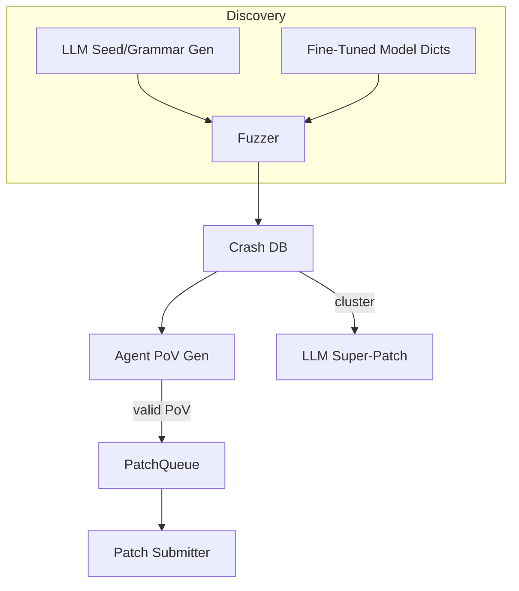

# Fuzzing wspomagany przez AI i automatyczne wykrywanie podatności

{{#include ../banners/hacktricks-training.md}}

## Omówienie
Duże modele językowe (LLM) mogą znacznie usprawnić tradycyjne procesy badania podatności, generując semantycznie bogate dane wejściowe, rozwijając gramatyki, analizując dane o awariach, a nawet proponując poprawki usuwające wiele błędów. Ta strona przedstawia najskuteczniejsze wzorce zaobserwowane podczas finałów AI Cyber Challenge (AIxCC) organizowanego przez DARPA oraz innych publicznych badań.<sup>[[4]](#references)</sup><sup>[[5]](#references)</sup>

Poniżej nie opisano konkretnego systemu konkursowego, lecz zebrano techniki w formie ogólnej, aby można je było odtworzyć we własnych procesach.

---

## 1. Dane wejściowe seedów generowane przez LLM

Tradycyjne fuzzery sterowane pokryciem (AFL++, libFuzzer, Honggfuzz…) rozpoczynają działanie od niewielkiego korpusu seedów, a następnie ślepo mutują bajty. Gdy format danych wejściowych programu docelowego jest złożony (SQL, URL-e, niestandardowe protokoły binarne), losowe mutacje zwykle psują składnię, zanim zostaną osiągnięte interesujące gałęzie.

LLM mogą rozwiązać ten problem początkowy, generując *generatory seedów* – krótkie skrypty, które tworzą **poprawne składniowo, ale istotne z punktu widzenia bezpieczeństwa dane wejściowe**. Na przykład:

```prompt
SYSTEM: You are a helpful security engineer.
USER:
Write a Python3 program that prints 200 unique SQL injection strings targeting common anti-pattern mistakes (missing quotes, numeric context, stacked queries).  Ensure length ≤ 256 bytes / string so they survive common length limits.
```

```python
# gen_sqli_seeds.py (truncated)
PAYLOADS = [
    "1 OR 1=1 -- ",
    "' UNION SELECT NULL,NULL--",
    "0; DROP TABLE users;--",
    ...
]
for p in PAYLOADS:
    print(p)
```

Uruchom raz i przekaż wynik bezpośrednio do początkowego korpusu fuzzera:

```bash
python3 gen_sqli_seeds.py > seeds.txt
afl-fuzz -i seeds.txt -o findings/ -- ./target @@
```

Korzyści:
1. Poprawność semantyczna → głębsze pokrycie już na początku.
2. Możliwość ponownego generowania: zmień prompt, aby skupić się na XSS, path traversal, binary blobs itd.
3. Niski koszt (< 1 ¢ z GPT-3.5).

### Wskazówki
* Poleć modelowi *zróżnicować* długość i kodowanie payloadów (UTF-8, URL-encoded, UTF-16-LE), aby ominąć powierzchowne filtry.
* Poproś o *pojedynczy, samowystarczalny skrypt* — pozwala uniknąć problemów z formatowaniem JSON.

---

## 2. Fuzzing z ewolucją gramatyki

Bardziej zaawansowany wariant polega na tym, by LLM **ewoluował gramatykę** zamiast konkretnych seedów. Przebieg pracy (wzorzec „Grammar Guy”) wygląda następująco:

1. Wygeneruj początkową gramatykę ANTLR/Peach/LibFuzzer za pomocą promptu.
2. Uruchom fuzzing przez N minut i zbierz metryki pokrycia (trafione krawędzie / bloki).
3. Podsumuj niepokryte obszary programu i przekaż podsumowanie z powrotem do modelu:
   ```prompt
   The previous grammar triggered 12 % of the program edges.  Functions not reached: parse_auth, handle_upload.  Add / modify rules to cover these.
   ```
4. Połącz nowe reguły, ponownie uruchom fuzzing i powtórz.

Szkielet pseudokodu:

```python
for epoch in range(MAX_EPOCHS):
    grammar = llm.refine(grammar, feedback=coverage_stats)
    save(grammar, f"grammar_{epoch}.txt")
    coverage_stats = run_fuzzer(grammar)
```

Key points:
* Trzymaj się *budżetu* – każde udoskonalenie zużywa tokeny.
* Używaj instrukcji `diff` + `patch`, aby model wprowadzał zmiany zamiast przepisywać całość.
* Zatrzymaj się, gdy Δcoverage < ε.

---

## 3. Inżynieria harnessa libFuzzer dla lokalnych LLM

Gdy kod źródłowy nie może opuścić stacji roboczej analityka, lokalny model kodujący może przygotować niewielki adapter między bajtami fuzzera a API C/C++. Granica bezpieczeństwa jest jasno określona: **model tworzy i poprawia infrastrukturę testową; mutacje sterowane pokryciem eksplorują dane wejściowe; sanitizery zgłaszają nieprawidłowe operacje; człowiek przegląda harness i analizuje znaleziska**.<sup>[[9]](#references)</sup>

Aby poznać techniki dotyczące korpusu, informacji zwrotnej, snapshotów i fuzzingu stanowego na poziomie silnika, które nie zależą od LLM, zobacz ogólną [metodologię fuzzingu](../generic-methodologies-and-resources/fuzzing.md).

Zacznij od dokładnej deklaracji skopiowanej z nagłówka celu i określ format wyjściowy. Wąski prompt ogranicza wymyślanie API i ułatwia przegląd wyniku:<sup>[[8]](#references)[[9]](#references)</sup>

```prompt
Write a libFuzzer target for this exact declaration:
int parse_records(const uint8_t *data, size_t size);

Output only C code. Implement LLVMFuzzerTestOneInput, include the
declaration, pass data and size unchanged, and do not use files,
network access, randomness, clocks, threads, or persistent state.
```

W przypadku parsera surowych bajtów oczekiwany wynik nie powinien być bardziej skomplikowany niż:<sup>[[6]](#references)[[9]](#references)</sup>

```c
#include <stddef.h>
#include <stdint.h>

extern int parse_records(const uint8_t *, size_t);

int LLVMFuzzerTestOneInput(const uint8_t *data, size_t size) {
    (void)parse_records(data, size);
    return 0;
}
```

Kompilacja to dopiero pierwsza bramka walidacji. Przed poświęceniem mocy obliczeniowej na każdy wygenerowany target sprawdź, czy spełnia wszystkie poniższe niezmienniki:<sup>[[6]](#references)[[8]](#references)[[9]](#references)</sup>

- **Dokładne API:** porównaj typy, zasady zarządzania własnością, inicjalizację, sprzątanie i konwencję wywołań z rzeczywistym nagłówkiem i istniejącymi wywołaniami.
- **Bezpieczeństwo harnessu:** zabezpiecz każdy odczyt z `data`; wykryte przez sanitizer błędy muszą pochodzić z targetu, a nie z wygenerowanego kodu pomocniczego.
- **Powtarzalność:** wynik ma być funkcją `data` i `size`; usuń zewnętrzne operacje wejścia/wyjścia, zależność od czasu, niekontrolowaną losowość, nieoczekujące zakończenia wątki i stan utrzymujący się między wywołaniami.
- **Przepustowość:** inicjalizuj kosztowny, niezmienny stan tylko raz i wyłącznie wtedy, gdy nie wpływa to na zachowanie, ogranicz rozmiar wejścia, wyłącz logowanie i zwalniaj alokacje przypadające na pojedyncze wejście.
- **Osiągalność:** sprawdź, czy wykonywane są zamierzone funkcje i gałęzie. Target, który się kompiluje, ale sprawdza tylko ścieżki odrzucenia, to cicha porażka.

### Targety uwzględniające strukturę: zachowaj niezmienniki, nie ukrywając błędów

Jeśli większość surowych wejść nie przechodzi kontroli magicznej wartości, długości, wersji lub sumy kontrolnej, użyj bajtów fuzz jako **materiału dla typowanych pól** i zbuduj poprawny obiekt. Ustaw stałe formatu, pozostaw pola semantyczne i bajty payloadu zmienne, a metadane integralności wylicz na podstawie odtworzonego payloadu. `FuzzedDataProvider` przydaje się do pobierania ograniczonych wartości typowanych, a adapter nadal odpowiada za ograniczenie każdej generowanej alokacji i konwersji.<sup>[[9]](#references)</sup>

<details>
<summary>Przykład targetu C++ uwzględniającego strukturę</summary>

```cpp
#include <fuzzer/FuzzedDataProvider.h>
#include <stddef.h>
#include <stdint.h>
#include <vector>

extern "C" int parse_message(const uint8_t *, size_t);

extern "C" int LLVMFuzzerTestOneInput(const uint8_t *data, size_t size) {
    FuzzedDataProvider fdp(data, size);
    uint8_t version = fdp.ConsumeIntegral<uint8_t>();
    auto body = fdp.ConsumeRemainingBytes<uint8_t>();
    if (body.size() > UINT16_MAX) body.resize(UINT16_MAX);
    uint16_t len = static_cast<uint16_t>(body.size());
    std::vector<uint8_t> msg = {0x8b, 'M', 'S', 'G', version,
                                static_cast<uint8_t>(len >> 8),
                                static_cast<uint8_t>(len)};
    msg.insert(msg.end(), body.begin(), body.end());
    (void)parse_message(msg.data(), msg.size());
    return 0;
}
```

</details>

Nie używaj jednego celu naprawiającego strukturę dla każdego pytania. Utrzymuj jeden cel, który wylicza długości/sumy kontrolne, aby eksplorować głębokie, poprawne stany, oraz drugi, w którym fuzzer kontroluje **deklarowane** metadane, a ograniczone są jedynie odczyty i alokacje wykonywane przez harness. Drugi cel zachowuje powierzchnie ataku związane z niezgodnymi długościami i błędną integralnością, które automatyczna naprawa w przeciwnym razie by usunęła.<sup>[[9]](#references)</sup>

### Ziarna, słowniki, sanitizery i informacje zwrotne o pokryciu

Poproś model o wygenerowanie skryptu zapisującego ziarna binarne, zamiast prosić go o bezpośrednie wypisanie danych binarnych. Przygotuj ziarna dla pustych, minimalnych, typowych i poprawnych granicznych obiektów, a następnie wyodrębnij wartości magiczne, tagi, kodowania enumów i słowa kluczowe parsera do sprawdzonego słownika. libFuzzer przyjmuje ten słownik za pomocą `-dict=`, a mutacje ujawniające nowe pokrycie zachowuje w korpusie.<sup>[[6]](#references)[[9]](#references)</sup>

```text
magic="\x8bMSG"
version_min="\x00"
version_max="\xff"
config_tag="CONFIG"
```

Zbuduj ten sam cel z uzupełniającą się instrumentacją. ASan i UBSan mogą współdzielić plik binarny do fuzzingu; użyj osobnej kompilacji MSan i instrumentuj jej zależności, aby uniknąć zgłoszeń powodowanych przez nieinstrumentowany kod.<sup>[[6]](#references)[[9]](#references)</sup>

```bash
clang++ -g -O1 -fsanitize=fuzzer,address,undefined \
  -fno-sanitize-recover=undefined target.cc harness.cc -o fuzz_target
./fuzz_target corpus -dict=msg.dict -max_len=65535

clang++ -g -O1 -fsanitize=fuzzer,memory \
  target.cc harness.cc -o fuzz_target_msan
```

Traktuj coverage jako ewaluator każdej rewizji modelu. W danych wyjściowych libFuzzer wczesny płaski przebieg `cov`/`ft` i statyczny corpus zwykle oznaczają nieprawidłowe ramkowanie, zbyt restrykcyjny wczesny return albo niewłaściwe wywołanie; niska wartość `exec/s` wskazuje na kosztowną konfigurację, operacje I/O, alokację lub wyciek stanu. `NEW` dowodzi jedynie, że zmieniła się funkcja coverage, a nie że osiągnięto zamierzony parser.<sup>[[6]](#references)[[9]](#references)</sup>

Aby uzyskać informacje zwrotne na poziomie kodu źródłowego, przygotuj build z coverage, uruchom fuzzing i udostępnij modelowi wyłącznie niepokryte funkcje wraz z warunkami, które je chronią. Sprawdź zmiany w harness/seed/dictionary i ponownie wykonaj pomiary:<sup>[[7]](#references)[[8]](#references)[[9]](#references)</sup>

```bash
clang++ -g -O1 -fsanitize=fuzzer \
  -fprofile-instr-generate -fcoverage-mapping target.cc harness.cc -o fuzz_cov
mkdir -p profiles
LLVM_PROFILE_FILE='profiles/%p.profraw' ./fuzz_cov -max_total_time=300 corpus
llvm-profdata merge -sparse profiles/*.profraw -o fuzz.profdata
llvm-cov report ./fuzz_cov -instr-profile=fuzz.profdata
llvm-cov show ./fuzz_cov -instr-profile=fuzz.profdata \
  --show-branches=count --region-coverage-lt=1 target.cc
```

Skalowalna pętla wygląda więc następująco: **generowanie → kompilacja/linkowanie → test smoke z użyciem sanitizerów → pomiar pokrycia celu → przekazanie najmniejszego istotnego kontekstu dotyczącego pokrycia/kodu źródłowego → poprawki → ponowny pomiar**. OSS-Fuzz-Gen stosuje tę samą zasadę, oceniając wygenerowane cele pod kątem możliwości kompilacji, błędów w czasie działania, pokrycia i poprawy pokrycia względem istniejących celów, zamiast bezkrytycznie akceptować wiarygodnie wyglądający kod.<sup>[[7]](#references)[[8]](#references)</sup>

---

<a id="3-agent-based-pov-exploit-generation" hidden>3. Generowanie PoV (Exploit) z użyciem agentów</a>

## 4. Generowanie PoV (Exploit) z użyciem agentów

Po znalezieniu crasha nadal potrzebujesz **proof-of-vulnerability (PoV)**, który deterministycznie go wywoła.

Skalowalne podejście polega na uruchomieniu wielu lekkich workerów (procesów, wątków lub kontenerów), z których każdy korzysta z innego modelu lub konfiguracji próbkowania. Przegląd finalistów AIxCC podaje konkretne przykłady skali: jeden zespół użył **tysięcy współbieżnych agentów** do generowania PoV w podejściu AI-first, podczas gdy inny koordynował **300–500 agentów fuzzingowych**, pozostawiając LLM-y do zadań wymagających wyższego poziomu rozumowania semantycznego.<sup>[[4]](#references)</sup>

Pipeline:
1. Analiza statyczna/dynamiczna generuje *kandydatów na błędy* (struct z adresem crasha, fragmentem wejścia i komunikatem sanitizera).
2. Orchestrator rozdziela kandydatów między agentów.
3. Kroki rozumowania agenta:
   a. Odtwórz błąd lokalnie za pomocą `gdb` i wejścia.
   b. Zaproponuj minimalny payload exploita.
   c. Zweryfikuj exploit w sandboxie. Jeśli się powiedzie → zgłoś.
4. Nieudane próby są **ponownie dodawane do kolejki jako nowe seedy** do fuzzingu pokryciowego (pętla informacji zwrotnej).

Zalety:
* Równoległość maskuje zawodność pojedynczego agenta.
* Automatyczne dostrajanie temperatury / rozmiaru modelu w oparciu o obserwowany wskaźnik powodzenia.

---

<a id="4-directed-fuzzing-with-fine-tuned-code-models" hidden>4. Ukierunkowany fuzzing z dostrojonymi modelami kodu</a>

## 5. Ukierunkowany fuzzing z dostrojonymi modelami kodu

Dostrój model o otwartych wagach (np. Llama-7B) na kodzie źródłowym C/C++ oznaczonym wzorcami podatności (przepełnienie liczby całkowitej, kopiowanie bufora, format string). Następnie:

1. Uruchom analizę statyczną, aby uzyskać listę funkcji i AST.
2. Wyślij do modelu prompt: *„Podaj wpisy słownika mutacji, które mogą naruszyć bezpieczeństwo pamięci w funkcji X”*.
3. Wstaw te tokeny do własnego `AFL_CUSTOM_MUTATOR`.

Przykładowy wynik dla wrappera `sprintf`:
```
{"pattern":"%99999999s"}
{"pattern":"AAAAAAAA....<1024>....%n"}
```

Empirycznie skraca to czas do awarii ponad dwukrotnie na rzeczywistych celach.

---

<a id="5-ai-guided-patching-strategies" hidden>5. Strategie patchowania wspomaganego przez AI</a>

## 6. Strategie patchowania wspomaganego przez AI

<a id="51-super-patches" hidden>5.1 Super Patches</a>

### 6.1 Super Patches
Poproś model o *pogrupowanie* sygnatur awarii i zaproponowanie **jednego patcha**, który usuwa wspólną przyczynę źródłową. Jedno zgłoszenie, kilka naprawionych błędów → mniej kar za brak dokładności w środowiskach, w których każdy błędny patch kosztuje punkty.

Zarys promptu:
```
Here are 10 stack traces + file snippets.  Identify the shared mistake and generate a unified diff fixing all occurrences.
```

{{#ref}}
../generic-methodologies-and-resources/fuzzing.md
{{#endref}}

<a id="52-speculative-patch-ratio" hidden>5.2 Speculative Patch Ratio</a>

### 6.2 Speculative Patch Ratio
Zaimplementuj kolejkę, w której potwierdzone patche zweryfikowane za pomocą PoV i *spekulacyjne* patche (bez PoV) są przeplatane w stosunku 1:N dostosowanym do zasad punktacji (np. 2 spekulacyjne : 1 potwierdzony). Model kosztów monitoruje kary w stosunku do punktów i samodzielnie dostosowuje N.

---

<a id="6-deterministic-file-by-file-ai-code-review" hidden>6. Deterministic File-by-File AI Code Review</a>

## 7. Deterministic File-by-File AI Code Review

Częstym błędem podczas przeglądu wspomaganego przez AI jest proszenie jednego agenta o sprawdzenie całego repozytorium i liczenie na to, że wybierze właściwe pliki oraz frazy do grep. Bardziej niezawodny schemat polega na **wymuszeniu pokrycia repozytorium**:<sup>[[1]](#references)</sup>

1. Wylicz pliki źródłowe.
2. Przesyłaj **po jednym pliku naraz** wraz z minimalnym kontekstem (entrypoint, importy, sąsiednie routes/callers).
3. Wymagaj **ustrukturyzowanego raportu** dla każdego pliku: źródła, sink, brakująca walidacja, warunki wstępne exploita i poziom pewności.<sup>[[3]](#references)</sup>
4. Usuń duplikaty raportów według **wzorca source→sink** i ręcznie zweryfikuj te o wysokim ryzyku.

To podejście zużywa dużo tokenów i generuje szum, ale bardzo skutecznie wykrywa **proste błędy source/sink o dużym wpływie**, które często umykają szerokim przeglądom agentowym.

### Wzorce warte priorytetowego triage

- **Dynamiczny include/dispatch w PHP**: kontrolowane przez atakującego nazwy routes/controllers/modules trafiają do `require_once()`, `include()` lub `include_once()` bez ścisłej allowlisty i kanonikalizacji ścieżek.
- **Wykonywanie poleceń powłoki w procesach administracyjnych i obsłudze kont**: nazwy użytkowników, domeny, konta FTP lub inne identyfikatory trafiają do `exec()`, `system()`, `shell_exec()`, `passthru()`, `proc_open()` lub `popen()`.
- **Przepływ danych ze strukturalnych danych wejściowych**: ten sam parametr jest pobierany z `$_GET`, `$_POST`, JSON, XML lub parserów body frameworka, a następnie używany w sinkach związanych z systemem plików lub poleceniami systemu operacyjnego.

### Dwie praktyczne klasy błędów, które ta metoda dobrze wykrywa

- **LFI/RCE w PHP przez dispatch kontrolera**: jeśli nazwa kontrolera kontrolowana przez request jest łączona z `require_once()` bez allowlisty lub normalizacji ścieżki, sekwencje traversal, takie jak `../`, mogą sprawić, że PHP dołączy niezamierzony lokalny plik `.php`. Jeśli atakujący może wskazać spreparowany lub w inny sposób użyteczny plik PHP, LFI prowadzi do wykonania kodu. Zobacz [File Inclusion / Path Traversal](../pentesting-web/file-inclusion/README.md).<sup>[[1]](#references)</sup>
- **Uwierzytelnione command injection w panelach hostingowych/administracyjnych**: jeśli pola zarządzania kontem, takie jak nazwy użytkowników, są umieszczane w poleceniach powłoki, uwierzytelniony użytkownik o niskich uprawnieniach może zmienić zwykłą operację tworzenia/usuwania w RCE. Wpływ jest większy, gdy panel wykonuje polecenie jako konto usługi o wyższych uprawnieniach. Zobacz [Command Injection](../pentesting-web/command-injection.md).<sup>[[1]](#references)</sup>

### Praktyczne uwagi dotyczące przeglądu

- Wykorzystuj LLM najpierw jako narzędzie do analizy **source/sink**, a nie jako generator exploitów.
- Poproś o jawne wskazanie **pola kontrolowanego przez atakującego**, **luki w normalizacji/walidacji** oraz **niebezpiecznego sinka**.
- W dużych repozytoriach deterministyczny przegląd plik po pliku jest często bardziej niezawodny niż pojedyncze uruchomienie autonomicznego agenta, nawet jeśli korzysta on z mocniejszego modelu.<sup>[[2]](#references)</sup>
- Oczekuj słabszych wyników w przypadku **Broken Access Control** i innych błędów logiki biznesowej, których exploitable zależy od założeń obejmujących wiele plików, semantyki ról lub modeli zagrożeń specyficznych dla produktu.

---

## Mobilne taskflow punktów wejścia

Pojedynczy prompt obejmujący całe repozytorium często miesza modele zagrożeń i gubi ścieżkę od komponentu dostępnego z zewnątrz do wrażliwego sinka. Lepszy workflow dzieli audyt na stanowe taskflow: najpierw klasyfikuje aplikacje/komponenty, następnie tworzy wykaz punktów wejścia kontrolowanych przez atakującego, uzupełnia każdy punkt wejścia o metadane dotyczące osiągalności, a na końcu sprawdza każdy z nich pod kątem klas podatności specyficznych dla platformy. Mobilne taskflow GitHub Security Lab realizują ten schemat dla repozytoriów Android, iOS i wieloplatformowych.<sup>[[14]](#references)[[15]](#references)</sup>

W przypadku Androida odnotuj co najmniej:<sup>[[14]](#references)[[15]](#references)</sup>

- eksportowane Activities, Services, Receivers i Providers, wraz z uprawnieniami;
- intent actions, schematy/hosty/ścieżki deep linków, filtry MIME i App Links;
- działania kontrolowane przez atakującego, URI danych, `ClipData`, extras i flagi przyznające dostęp do URI;
- dane wejściowe nawigacji WebView i mostki `addJavascriptInterface`;
- dalsze operacje uprzywilejowane, importowane zasoby i docelowe adresy sieciowe.

Następnie sklasyfikuj każdy punkt wejścia w kontekście. Zapytaj wprost o autoryzację wywołującego i zachowanie confused deputy, przekierowanie intentów, podszywanie się pod broadcast lub ujawnianie danych, niebezpieczne importy, skrypty WebView i ekspozycję mostków, a także przesyłanie poświadczeń lub cookies między originami. Wykonaj zarówno **przegląd według ścisłej checklisty**, jak i **szerszy przegląd adversarialny**. Powiąż ustalenia z [Intent Injection](../mobile-pentesting/android-app-pentesting/intent-injection.md) i [WebView Attacks](../mobile-pentesting/android-app-pentesting/webview-attacks.md), zamiast powielać szczegóły exploita.<sup>[[15]](#references)</sup>

Aktualne open-source taskflow można uruchomić z ich Codespace za pomocą:<sup>[[14]](#references)</sup>

```bash
./scripts/audit/run_audit.sh owner/repository
```

Wyniki są zapisywane w SQLite, w tabeli `audit_result`.<sup>[[14]](#references)</sup> Traktuj wiersze oznaczone jako podatne jako **tropy**, a nie potwierdzone ustalenia. W przypadku każdego tropu wymagaj, aby model wskazał źródło kontrolowane przez atakującego, wrażliwy sink, warunki wstępne i oczekiwany wpływ, a następnie poproś go o utworzenie minimalnego PoC. Uruchom ten PoC na oryginalnym buildzie pod debuggerem lub z użyciem instrumentacji. Pozwala to wychwycić typowe błędy analizy statycznej, takie jak nieosiągalne gałęzie, nierealistyczny stan aplikacji, utrata pierwszeństwa danych z pamięci zewnętrznej względem danych prywatnych oraz zabezpieczenia, które znacząco obniżają poziom zagrożenia.<sup>[[15]](#references)</sup>

---

## 8. Audyt kernela sterowany wzorcami z użyciem instrumentowanego oracle

W przypadku celu wielkości kernela nie proś agenta o wyszukiwanie dowolnych błędów w całym drzewie. Bardziej oszczędny pod względem tokenów proces przekształca wiedzę o historycznych podatnościach w zapytania statyczne, szereguje wyniki według dostępnej powierzchni ataku i wykorzystuje instrumentowany kernel jako oracle wykonania.<sup>[[11]](#references)</sup>

### Baza wzorców → CodeQL/Semgrep → ukierunkowany przegląd

Utwórz niewielką bazę wiedzy zawierającą niebezpieczne API, wzorce brakującej walidacji, ryzykowne przepływy od źródła do sinka oraz kształty wcześniej naprawionych błędów. Poproś model o przekształcanie **jednego wzorca naraz** w heurystyki przeglądu i reguły CodeQL/Semgrep, a następnie uruchom te deterministyczne reguły na całym drzewie. Pogrupuj i usuń duplikaty dopasowań, zanim przekażesz kod modelowi; surowe wyniki skanera mogą zawierać tysiące kandydatów o niewielkiej wartości. Przed zastosowaniem tego podejścia poza kwalifikującymi się celami badawczymi lub open source sprawdź aktualną licencję CodeQL.<sup>[[11]](#references)</sup>

Ustalaj priorytety podsystemów na podstawie zarówno **gęstości trafień reguł**, jak i **osiągalności przez atakującego**, a nie samej liczby trafień. Interfejsy kernela dostępne dla nieuprzywilejowanych procesów, sandboxów, kontenerów, jaili lub środowisk gościa zasługują na większą wagę niż kod dostępny wyłącznie wewnętrznie. Zachowuj na tyle mały zakres przeglądu, by agent mógł uwzględnić funkcje wywołujące, walidatory i reguły zarządzania czasem życia, a w poleceniu wskazuj konkretną klasę podatności lub wzorzec przepływu sterowania zamiast prośby „znajdź dowolną podatność”. Szczególnie interesujące są starsze uprzywilejowane interfejsy, gdy nowsza granica izolacji sprawia, że stają się dostępne dla użytkownika root z przestrzenią nazw lub uwięzionego użytkownika root.<sup>[[11]](#references)</sup>

W przypadku każdego kandydata wymagaj jawnego opisu przepływu danych między polami, zanim podejmiesz próbę wykorzystania podatności.<sup>[[11]](#references)</sup>

```text
entrypoint -> privilege check -> parser -> validation/normalization
           -> later rewrite -> dangerous sink
attacker controls: <fields and lengths>
constraints:       <values rewritten, rejected, or preserved>
observable result: <sanitizer report, assertion, panic, or clean exit>
```

### Używaj telemetrii KASAN jako wyroczni hipotez

Uruchom docelowy kernel w jednorazowej maszynie VM z włączonym KASAN i przydatnymi asercjami diagnostycznymi. Agent powinien iterować według schematu **hipoteza dotycząca źródła → minimalny wyzwalacz w userlandzie → wykonanie w VM → ślad KASAN/asercji → zrewidowana hipoteza**, aż podejrzewana korupcja zostanie odtworzona lub odrzucona. W każdej iteracji zwracaj tylko odpowiedni ślad stosu i sąsiadujący z nim kod źródłowy; pozwala to zachować kontekst do analizy, a jednocześnie sprawia, że kryterium akceptacji stanowią dowody z wykonania, a nie pewność modelu.<sup>[[11]](#references)</sup>

Build z instrumentacją nie jest środowiskiem do ostatecznej oceny możliwości wykorzystania podatności. Asercje mogą zatrzymać wykonanie przed operacją powodującą korupcję, podczas gdy ta sama asercja może być wyłączona w produkcyjnym kernelu. Ponownie przetestuj niezmieniony wyzwalacz z dokładną konfiguracją produkcyjną, zapisz build i konfigurację kernela oraz rozdziel **osiągalność**, **korupcję pamięci**, **kontrolowany prymityw** i **wpływ na bezpieczeństwo** jako odrębne twierdzenia.<sup>[[11]](#references)[[12]](#references)</sup>

CVE-2026-3038 to przydatny przykład walidacji, a nie szablon exploita. Nieuwierzytelnione żądanie FreeBSD `RTM_GET` mogło zachować nadmiernie duży sockaddr `RTAX_AUTHOR` mimo selektywnej walidacji i przepisywania odpowiedzi, aż `rtsock_msg_buffer()` skopiowało kontrolowane przez użytkownika `sa_len` do 128-bajtowego `sockaddr_storage` na stosie. Maksymalna kopia 255 bajtów powodowała nadpisanie 127 bajtów; asercja diagnostyczna wykrywała nieprawidłową długość w buildzie z instrumentacją, natomiast kernel GENERIC dochodził do kopiowania, po czym ulegał panic, gdy sprawdzano uszkodzony canary. Dowodzi to możliwości wywołania denial of service przez nieuwierzytelnionego użytkownika, a nie samodzielnej eskalacji uprawnień: niezawodne przejęcie kontroli wymagałoby najpierw innego prymitywu, takiego jak ujawnienie wartości canary. Zobacz [Stack Canaries](../binary-exploitation/common-binary-protections-and-bypasses/stack-canaries/index.html), aby poznać odpowiadającą temu granicę w binary exploitation.<sup>[[11]](#references)[[12]](#references)[[13]](#references)</sup>

### Odrzucaj oszukiwanie w kwestii warunków wstępnych exploita

Zanim zaakceptujesz PoV lub exploit, poproś niezależnego recenzenta/agenta o próbę jego obalenia według ustalonych kryteriów. Recenzja musi potwierdzić wszystkie poniższe warunki.<sup>[[11]](#references)</sup>

- Kod źródłowy celu, kernel ani podatny moduł nie zostały zmodyfikowane w celu ułatwienia osiągnięcia danej ścieżki.
- Nie dodano modułu pomocniczego, syntetycznego gadżetu, wyłączonego mechanizmu ochronnego, dodatkowych uprawnień ani niedostępnego interfejsu.
- Wyzwalacz uruchamia się z deklarowaną tożsamością wywołującego i ograniczeniami izolacji, na czystej migawce.
- Deklarowany rezultat nadal zależy od błędu: usunięcie nieprawidłowego pola lub załatanie wyłącznie tego błędu musi przerwać łańcuch.
- Awaria, odczyt poza zakresem lub nadpisanie są zgłaszane wyłącznie jako dany prymityw; wykonanie kodu lub eskalacja uprawnień wymagają niezależnych dowodów.

To ostatnie sprawdzenie kontrfaktyczne wykrywa demonstracje oparte na błędnym kole: jeśli warunki wstępne już zapewniają deklarowany wpływ (na przykład wykonanie dostarczonej przez atakującego zawartości SUID z systemu plików zamontowanego bez `nosuid`), błąd bezpieczeństwa pamięci nie spowodował tego wpływu.<sup>[[11]](#references)</sup>

---

## Audytowalne badania nieznanych baz kodu wspomagane przez agentów

Opisany już [workflow wyboru celów fuzzingu oparty na grafie](../generic-methodologies-and-resources/fuzzing.md#graph-first-fuzz-target-selection-and-mutation-triage) obejmuje osiągalność punktów wejścia, a [agentowe pipeline’y SAST](../network-services-pentesting/pentesting-web/code-review-tools.md#agentic-sast-pipelines) — etapową analizę i kryteria oparte na dowodach. Trzymaj te deterministyczne wyniki oddzielnie od hipotez modelu, aby każdy zakwalifikowany trop zachował lokalizacje w kodzie źródłowym, dowody dotyczące ścieżki i pomiar dynamiczny.<sup>[[10]](#references)</sup>

### Koreluj dowody dotyczące czasu życia obiektu, nie wymyślając przepływu danych

Analiza statyczna może znaleźć długość kontrolowaną przez atakującego, która jest zapisywana w jednej funkcji, oraz to samo pole obiektu docierające znacznie później do miejsca kopiowania, ale nie dowieść związku między nimi przez callbacki, ponowne połączenia lub czas życia obiektu. Zachowaj oba ustalenia oddzielnie, grupuj je według obiektu/pola i jawnie wskaż brakujące połączenie jako pytanie do analizy. Agent może zasugerować tę zależność, ale musi ona zostać dowiedziona przez analizę kodu źródłowego lub instrumentację w czasie wykonania.<sup>[[10]](#references)</sup>

Dla każdego kandydata zapisz:

- konkretny punkt wejścia i bajty kontrolowane przez atakującego;
- każdego producenta danego pola, w tym walidację właściwą dla każdego producenta;
- miejsce docelowe, pojemność bufora docelowego oraz warunki builda/wykonania wymagane do osiągnięcia tego miejsca;
- rzeczywisty stos wywołań prowadzący od ujawnionego punktu wejścia, a nie tylko bezpośrednie wywołanie harnessu;
- najmniejszy wynik dynamiczny potwierdzający lub odrzucający hipotezę.

Pozornie bezpieczna ścieżka nie zabezpiecza globalnie danego pola. Drugi producent może wypełnić to samo pole bez ograniczenia długości zastosowanego w pierwszej ścieżce. Testuj ścieżki niezależnie i uruchamiaj harness z opcjami builda odpowiadającymi wdrożeniu, ponieważ asercje debugowania mogą zmienić produkcyjną korupcję pamięci w przedwczesne przerwanie występujące wyłącznie podczas testu.<sup>[[10]](#references)</sup>

### Kryteria pomiarowe dla ujawniania danych i exploitation

W przypadku podejrzenia ujawnienia niezainicjalizowanej pamięci wypełnij świeżo przydzieloną pamięć rozpoznawalnym bajtem i sprawdź, czy dokładnie ten znacznik trafia do wysyłanego pakietu. W przypadku exploitation wymagaj zmierzonych etapów, takich jak **kontrolowane nadpisanie → przydatny obiekt docelowy → ujawnienie → odzyskanie wskaźnika/bazy → przejęcie przepływu sterowania → złożony payload**. Agent przechodzi dalej tylko wtedy, gdy harness potwierdzi bieżącą właściwość; wiarygodna narracja nie oznacza zaliczenia etapu. [Przypadek FreeRDP](../binary-exploitation/libc-heap/heap-overflow.md#cross-path-length-reuse-and-stale-output-disclosure) pokazuje ścieżkę i ograniczenia builda, które należy zachować podczas walidacji.<sup>[[10]](#references)</sup>

---

Przypadek z kernela, w którym zastosowano etapową walidację L0–L4 do wspomaganego przez LLM tworzenia exploitów, opisano tutaj:

{{#ref}}
../binary-exploitation/freebsd-kernel-exploitation-vnet-jail-escape.md
{{#endref}}

## Analiza awarii wspomagana debuggerem

Workflowy Mona v3 do analizy awarii, analizy funkcji i kontrolowanej osiągalności fragmentów heapu opisano w [Exploiting Tools](../binary-exploitation/basic-stack-binary-exploitation-methodology/tools/#mona-v3-debugger-context-requests-for-crash-triage).

---

## Jak połączyć wszystkie elementy
System CRS (Cyber Reasoning System) działający od początku do końca może łączyć komponenty w następujący sposób:



---

## References

- [1] [Project Black - Lokalna AI dla cyberbezpieczeństwa: wykrywanie phpIPAM LFI i uwierzytelnionego RCE w myVesta](https://projectblack.io/blog/local-ai-for-cyber-security)
- [2] [Strix](https://github.com/usestrix/strix)
- [3] [Umiejętność przeglądu bezpieczeństwa społeczności GitHub Copilot](https://github.com/github/awesome-copilot/blob/main/skills/security-review/SKILL.md)
- [4] [Trail of Bits – finały AIxCC: zestawienie wyników](https://blog.trailofbits.com/2025/08/07/aixcc-finals-tale-of-the-tape/)
- [5] [Wywiady z finalistami AIxCC w CTF Radiooo](https://www.youtube.com/@ctfradiooo)
- [6] [LLVM — libFuzzer: biblioteka do testowania fuzzingiem sterowanym pokryciem](https://llvm.org/docs/LibFuzzer.html)
- [7] [Google — OSS-Fuzz-Gen](https://github.com/google/oss-fuzz-gen)
- [8] [Google Online Security Blog — Udoskonalanie fuzzingu: wykrywanie większej liczby podatności dzięki AI](https://security.googleblog.com/2024/11/leveling-up-fuzzing-finding-more.html)
- [9] [8kSec — Generowanie harnessów fuzzingowych z pomocą lokalnego LLM](https://8ksec.io/ai-assisted-fuzzing-harness-local-llm)
- [10] [Quarkslab — Od agentów AI do RCE: tworzenie procesu badania podatności](https://blog.quarkslab.com/from-ai-agents-to-rce-building-a-vulnerability-research-workflow.html)
- [11] [Praetorian — FreeBSoD: wykorzystanie modeli językowych do znajdowania i wykorzystywania błędów jądra (część 1 z 2)](https://praetorian.com/blog/ai-vulnerability-research-freebsd-kernel)
- [12] [FreeBSD-SA-26:05.route — lokalny DoS i możliwa eskalacja uprawnień przez gniazda routingu](https://www.freebsd.org/security/advisories/FreeBSD-SA-26:05.route.asc)
- [13] [Łatka źródłowa FreeBSD-SA-26:05.route](https://security.FreeBSD.org/patches/SA-26:05/route.patch)
- [14] [GitHub Security Lab - SecLab Taskflows](https://github.com/GitHubSecurityLab/seclab-taskflows)
- [15] [GitHub Security Lab - Jak znaleźliśmy 24 podatności w Androidzie przy użyciu agenta bezpieczeństwa AI o otwartym kodzie źródłowym](https://github.blog/security/how-we-found-24-android-vulnerabilities-using-our-open-source-ai-security-agent)
{{#include ../banners/hacktricks-training.md}}
