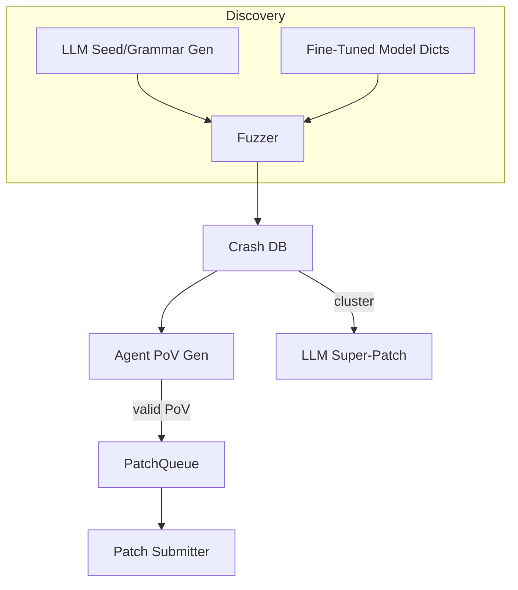

# AI-potpomognuto fuzzing i automatizovano otkrivanje ranjivosti

{{#include ../banners/hacktricks-training.md}}

## Pregled
Veliki jezički modeli (LLM-ovi) mogu znatno da unaprede tradicionalne procese istraživanja ranjivosti tako što generišu semantički bogate ulaze, razvijaju gramatike, analiziraju podatke o crash-evima, pa čak i predlažu zakrpe za više bagova. Ova stranica sadrži najefikasnije obrasce uočene tokom finala DARPA-inog AI Cyber Challenge-a (AIxCC) i drugih javnih istraživanja.<sup>[[4]](#references)</sup><sup>[[5]](#references)</sup>

Ovo nije opis konkretnog takmičarskog sistema, već prikaz tehnika koji vam omogućava da ih primenite u sopstvenim procesima.

---

## 1. Ulazni seed-ovi koje generiše LLM

Tradicionalni fuzzers vođeni pokrivenošću (AFL++, libFuzzer, Honggfuzz…) počinju s malim korpusom seed-ova i nasumično menjaju bajtove. Kada je format ulaza koji cilj prihvata složen (SQL, URL-ovi, prilagođeni binarni protokoli), nasumične izmene obično naruše sintaksu pre nego što se dođe do zanimljivih grana.

LLM-ovi mogu da reše ovaj problem pokretanja tako što generišu *generatore seed-ova* – kratke skripte koje daju **sintaksno ispravne ulaze relevantne za bezbednost**. Na primer:

```prompt
SYSTEM: You are a helpful security engineer.
USER:
Write a Python3 program that prints 200 unique SQL injection strings targeting common anti-pattern mistakes (missing quotes, numeric context, stacked queries).  Ensure length ≤ 256 bytes / string so they survive common length limits.
```

```python
# gen_sqli_seeds.py (truncated)
PAYLOADS = [
    "1 OR 1=1 -- ",
    "' UNION SELECT NULL,NULL--",
    "0; DROP TABLE users;--",
    ...
]
for p in PAYLOADS:
    print(p)
```

Pokrenite jednom i prosledite izlaz direktno u početni korpus fuzzera:

```bash
python3 gen_sqli_seeds.py > seeds.txt
afl-fuzz -i seeds.txt -o findings/ -- ./target @@
```

Benefits:
1. Semantička validnost → dublja pokrivenost u ranoj fazi.
2. Može ponovo da se generiše: prilagodite prompt da se fokusira na XSS, path traversal, binary blobs itd.
3. Jeftino (< 1 ¢ uz GPT-3.5).

### Tips
* Uputite model da *diversifikuje* dužinu i kodiranje payload-a (UTF-8, URL-encoded, UTF-16-LE) kako bi zaobišao površne filtere.
* Zatražite *jednu samostalnu skriptu* – time se izbegavaju problemi sa JSON formatiranjem.

---

## 2. Grammar-Evolution Fuzzing

Moćnija varijanta je da se od LLM-a traži da **evoluira gramatiku** umesto konkretnih seeds. Tok rada (obrazac „Grammar Guy“) je:

1. Generišite početnu ANTLR/Peach/LibFuzzer gramatiku pomoću prompt-a.
2. Pokrenite fuzzing N minuta i prikupite metrike pokrivenosti (pogodjene edges / blocks).
3. Sažmite nepokrivene delove programa i vratite sažetak modelu:
   ```prompt
   The previous grammar triggered 12 % of the program edges.  Functions not reached: parse_auth, handle_upload.  Add / modify rules to cover these.
   ```
4. Spojite nova pravila, ponovo pokrenite fuzzing i ponavljajte.

Kostur pseudokoda:

```python
for epoch in range(MAX_EPOCHS):
    grammar = llm.refine(grammar, feedback=coverage_stats)
    save(grammar, f"grammar_{epoch}.txt")
    coverage_stats = run_fuzzer(grammar)
```

Ključne tačke:
* Zadržite *budžet* – svako usavršavanje troši tokene.
* Koristite instrukcije `diff` + `patch` kako bi model uređivao, a ne prepisivao.
* Zaustavite se kada je Δcoverage < ε.

---

## 3. Inženjering harness-a za libFuzzer sa lokalnim LLM-om

Ako izvorni kod ne može da napusti radnu stanicu analitičara, lokalni model koda može da napravi nacrt malog adaptera između bajtova fuzzera i C/C++ API-ja. Važna je jasna bezbednosna granica: **model piše i dorađuje testnu infrastrukturu; mutacija vođena pokrivenošću istražuje ulaze; sanitizers prijavljuju neispravne operacije; čovek pregleda harness i vrši trijažu nalaza**.<sup>[[9]](#references)</sup>

Za tehnike rada sa corpus-om, feedback-om, snapshot-om i stateful fuzzing-om na nivou engine-a, koje ne zavise od LLM-a, pogledajte opštu [Metodologiju fuzzing-a](../generic-methodologies-and-resources/fuzzing.md).

Počnite od tačne deklaracije preuzete iz zaglavlja ciljnog programa i ograničite format izlaza. Usko formulisan prompt smanjuje verovatnoću izmišljenih API-ja i olakšava pregled rezultata:<sup>[[8]](#references)[[9]](#references)</sup>

```prompt
Write a libFuzzer target for this exact declaration:
int parse_records(const uint8_t *data, size_t size);

Output only C code. Implement LLVMFuzzerTestOneInput, include the
declaration, pass data and size unchanged, and do not use files,
network access, randomness, clocks, threads, or persistent state.
```

Za parser sirovih bajtova, očekivani rezultat ne bi trebalo da bude ništa složeniji od:<sup>[[6]](#references)[[9]](#references)</sup>

```c
#include <stddef.h>
#include <stdint.h>

extern int parse_records(const uint8_t *, size_t);

int LLVMFuzzerTestOneInput(const uint8_t *data, size_t size) {
    (void)parse_records(data, size);
    return 0;
}
```

Kompilacija je samo prva kapija validacije. Pre nego što potrošite CPU vreme, proverite svaki generisani target u odnosu na sledeće invarijante:<sup>[[6]](#references)[[8]](#references)[[9]](#references)</sup>

- **Tačan API:** uporedite tipove, pravila vlasništva, inicijalizaciju, razgradnju i konvenciju pozivanja sa stvarnim zaglavljem i postojećim pozivaocima.
- **Bezbednost harness-a:** zaštitite svako čitanje iz `data`; nalazi sanitizatora moraju poticati iz targeta, a ne iz generisanog glue koda.
- **Ponovljivost:** rezultat treba da bude funkcija vrednosti `data` i `size`; uklonite spoljašnji I/O, vreme, nekontrolisanu slučajnost, nepovezane niti i stanje koje opstaje između poziva.
- **Propusnost:** inicijalizujte skupo nepromenljivo stanje jednom samo ako to ne može da utiče na ponašanje, ograničite veličinu ulaza, isključite beleženje i oslobodite alokacije za svaki ulaz.
- **Dostupnost putanja izvršavanja:** proverite da li se izvršavaju predviđene funkcije i grane. Target koji se kompajlira, ali izvršava samo putanje odbacivanja, neprimetno ne uspeva.

### Targeti koji uzimaju u obzir strukturu: očuvajte invarijante bez prikrivanja grešaka

Ako većina sirovih ulaza ne prođe proveru magičnih vrednosti, dužine, verzije ili kontrolne sume, koristite bajtove za fuzzing kao materijal za **tipizirana polja** i ponovo izgradite ispravan objekat. Zadajte konstante formata, ostavite semantička polja i bajtove sadržaja promenljivim i izvedite metapodatke za proveru integriteta iz rekonstruisanog sadržaja. `FuzzedDataProvider` je koristan za preuzimanje ograničenih tipiziranih vrednosti, dok je adapter i dalje odgovoran za ograničavanje svih generisanih alokacija i konverzija.<sup>[[9]](#references)</sup>

<details>
<summary>Primer C++ targeta koji uzima u obzir strukturu</summary>

```cpp
#include <fuzzer/FuzzedDataProvider.h>
#include <stddef.h>
#include <stdint.h>
#include <vector>

extern "C" int parse_message(const uint8_t *, size_t);

extern "C" int LLVMFuzzerTestOneInput(const uint8_t *data, size_t size) {
    FuzzedDataProvider fdp(data, size);
    uint8_t version = fdp.ConsumeIntegral<uint8_t>();
    auto body = fdp.ConsumeRemainingBytes<uint8_t>();
    if (body.size() > UINT16_MAX) body.resize(UINT16_MAX);
    uint16_t len = static_cast<uint16_t>(body.size());
    std::vector<uint8_t> msg = {0x8b, 'M', 'S', 'G', version,
                                static_cast<uint8_t>(len >> 8),
                                static_cast<uint8_t>(len)};
    msg.insert(msg.end(), body.begin(), body.end());
    (void)parse_message(msg.data(), msg.size());
    return 0;
}
```

</details>

Nemojte koristiti jedan target koji popravlja strukturu za svako pitanje. Održavajte jedan target koji izračunava dužine/kontrolne sume kako bi istraživao duboka, validna stanja, i drugi koji ostavlja da fuzzer kontroliše **deklarisane** metapodatke, a ograničava samo čitanja i alokacije samog harness-a. Drugi target čuva površine za napade sa neusklađenim dužinama i neispravnim integritetom, koje bi automatska popravka inače uklonila.<sup>[[9]](#references)</sup>

### Seeds, dictionaries, sanitizers i povratne informacije o pokrivenosti

Zatražite od modela da generiše skriptu koja zapisuje binarne seeds, umesto da od njega tražite da direktno ispisuje binarne podatke. Napravite seeds od praznih, minimalnih, uobičajenih i validnih graničnih objekata; zatim izdvojite magic values, tagove, enum enkodiranja i ključne reči parsera u provereni dictionary. libFuzzer prihvata taj dictionary preko `-dict=`, а мутације које откривају нову покривеност задржава у corpus-у.<sup>[[6]](#references)[[9]](#references)</sup>

```text
magic="\x8bMSG"
version_min="\x00"
version_max="\xff"
config_tag="CONFIG"
```

Izgradite isti cilj uz komplementarnu instrumentaciju. ASan i UBSan mogu deliti isti fuzzing binarni fajl; koristite zasebnu MSan verziju i instrumentirajte njene zavisnosti da biste izbegli prijave uzrokovane neinstrumentiranim kodom.<sup>[[6]](#references)[[9]](#references)</sup>

```bash
clang++ -g -O1 -fsanitize=fuzzer,address,undefined \
  -fno-sanitize-recover=undefined target.cc harness.cc -o fuzz_target
./fuzz_target corpus -dict=msg.dict -max_len=65535

clang++ -g -O1 -fsanitize=fuzzer,memory \
  target.cc harness.cc -o fuzz_target_msan
```

Tretirajte coverage kao merilo za svaku reviziju modela. U izlazu libFuzzer-a, rano ravna kriva `cov`/`ft` i statički korpus obično ukazuju na loše formatiranje ulaza, previše restriktivan rani povratak ili pogrešan poziv; nizak `exec/s` ukazuje na skupo podešavanje, I/O, alokaciju ili leak stanja. `NEW` samo potvrđuje da se promenila neka funkcija pokrivenosti, a ne da je dosegnut željeni parser.<sup>[[6]](#references)[[9]](#references)</sup>

Za povratne informacije na nivou izvornog koda napravite build sa instrumentacijom za coverage, pokrenite fuzzing i dajte modelu samo nepokrivene funkcije i uslove koji ih štite. Proverite razlike u harness-u, seed-u i dictionary-ju, pa ponovo izmerite:<sup>[[7]](#references)[[8]](#references)[[9]](#references)</sup>

```bash
clang++ -g -O1 -fsanitize=fuzzer \
  -fprofile-instr-generate -fcoverage-mapping target.cc harness.cc -o fuzz_cov
mkdir -p profiles
LLVM_PROFILE_FILE='profiles/%p.profraw' ./fuzz_cov -max_total_time=300 corpus
llvm-profdata merge -sparse profiles/*.profraw -o fuzz.profdata
llvm-cov report ./fuzz_cov -instr-profile=fuzz.profdata
llvm-cov show ./fuzz_cov -instr-profile=fuzz.profdata \
  --show-branches=count --region-coverage-lt=1 target.cc
```

Skalabilni ciklus je zato **generiši → kompajliraj/poveži → testiraj ispravnost pod sanitizerima → izmeri pokrivenost cilja → obezbedi najmanji relevantan kontekst pokrivenosti/izvornog koda → doradi → ponovo izmeri**. OSS-Fuzz-Gen primenjuje isti princip tako što procenjuje generisane ciljeve na osnovu mogućnosti kompajliranja, grešaka tokom izvršavanja, pokrivenosti i poboljšanja pokrivenosti u odnosu na postojeće ciljeve, umesto da prihvata uverljiv kod zdravo za gotovo.<sup>[[7]](#references)[[8]](#references)</sup>

---

<a id="3-agent-based-pov-exploit-generation" hidden>3. Generisanje PoV-a (Exploit) pomoću agenata</a>

## 4. Generisanje PoV-a (Exploit) pomoću agenata

Nakon što se pronađe crash, i dalje vam je potreban **proof-of-vulnerability (PoV)** koji ga deterministički izaziva.

Skalabilan pristup je pokretanje velikog broja laganih radnika (procesa, niti ili kontejnera), od kojih svaki koristi drugi model ili konfiguraciju uzorkovanja. Istraživanje finalista AIxCC-a navodi konkretne primere obima: jedan tim je koristio **hiljade istovremenih agenata** za generisanje PoV-a prvenstveno pomoću AI-ja, dok je drugi orkestrirao **300–500 fuzzing agenata** i koristio LLM-ove za rezonovanje na višem nivou o semantici.<sup>[[4]](#references)</sup>

Pipeline:
1. Statička/dinamička analiza pronalazi *potencijalne greške* (struct sa crash PC-jem, segmentom ulaza i porukom sanitizera).
2. Orkestrator prosleđuje potencijalne greške agentima.
3. Koraci rezonovanja agenta:
   a. Lokalno reprodukuje grešku pomoću `gdb` + ulaza.
   b. Predlaže minimalni exploit payload.
   c. Validira exploit u sandboxu. Ako uspe → podnosi ga.
4. Neuspešni pokušaji se **ponovo stavljaju u red kao novi seedovi** za coverage fuzzing (povratna sprega).

Prednosti:
* Paralelizacija ublažava nepouzdanost pojedinačnog agenta.
* Automatsko podešavanje temperature / veličine modela na osnovu uočene stope uspeha.

---

<a id="4-directed-fuzzing-with-fine-tuned-code-models" hidden>4. Usmereni fuzzing pomoću fino podešenih modela za kod</a>

## 5. Usmereni fuzzing pomoću fino podešenih modela za kod

Fino podesite model otvorenih težina (npr. Llama-7B) na C/C++ izvornom kodu označenom obrascima ranjivosti (prekoračenje celog broja, kopiranje bafera, format string). Zatim:

1. Pokrenite statičku analizu da biste dobili listu funkcija + AST.
2. Zadajte modelu upit: *„Daj stavke rečnika mutacija koje bi verovatno narušile bezbednost memorije u funkciji X“*.
3. Ubacite te tokene u prilagođeni `AFL_CUSTOM_MUTATOR`.

Primer izlaza za omotač `sprintf`:
```
{"pattern":"%99999999s"}
{"pattern":"AAAAAAAA....<1024>....%n"}
```

Empirijski, ovo skraćuje vreme do pada za više od 2× na stvarnim ciljevima.

---

<a id="5-ai-guided-patching-strategies" hidden>5. Strategije za patching vođen AI-jem</a>

## 6. Strategije za patching vođen AI-jem

<a id="51-super-patches" hidden>5.1 Super patches</a>

### 6.1 Super patches
Zatražite od modela da *grupiše* crash potpise i predloži **jedan patch** koji uklanja zajednički osnovni uzrok.  Pošaljite ga jednom, rešite nekoliko bagova → manje kaznenih poena za tačnost u okruženjima gde svaki pogrešan patch donosi gubitak poena.

Okvir prompta:
```
Here are 10 stack traces + file snippets.  Identify the shared mistake and generate a unified diff fixing all occurrences.
```

{{#ref}}
../generic-methodologies-and-resources/fuzzing.md
{{#endref}}

<a id="52-speculative-patch-ratio" hidden>5.2 Odnos spekulativnih zakrpa</a>

### 6.2 Odnos spekulativnih zakrpa
Implementirajte red u kome se zakrpe potvrđene pomoću PoV-a i *spekulativne* zakrpe (bez PoV-a) smenjuju u odnosu 1:​N, podešenom prema pravilima bodovanja (npr. 2 spekulativne : 1 potvrđena). Model troškova prati kazne i poene i automatski prilagođava N.

---

<a id="6-deterministic-file-by-file-ai-code-review" hidden>6. Deterministički AI pregled koda fajl po fajl</a>

## 7. Deterministički AI pregled koda fajl po fajl

Čest način na koji AI-asistirani pregled ne uspeva jeste da se od jednog agenta zatraži da pregleda čitavo skladište i da se očekuje da sam izabere prave fajlove i termine za grep. Pouzdaniji obrazac je da se **obuhvati celo skladište**:<sup>[[1]](#references)</sup>

1. Nabrojte izvorne fajlove.
2. Šaljite **jedan fajl po pozivu**, uz minimalan kontekst (ulazna tačka, importi, obližnje rute/pozivaoci).
3. Zahtevajte **strukturisan izveštaj** za svaki fajl: izvori, odredište, nedostajuća validacija, preduslovi za eksploataciju i pouzdanost.<sup>[[3]](#references)</sup>
4. Uklonite duplikate izveštaja prema **obrascu source→sink** i ručno proverite one sa visokim rizikom.

Ovaj pristup zahteva mnogo tokena i daje dosta šuma, ali je veoma efikasan u otkrivanju **jednostavnih, veoma uticajnih source/sink grešaka** koje široki agentni pregledi često previde.

### Obrasci za trijažu koje vredi staviti u prvi plan

- **Dinamički PHP include/dispatch**: nazivi ruta/kontrolera/modula pod kontrolom napadača prosleđuju se u `require_once()`, `include()` ili `include_once()` bez stroge liste dozvoljenih vrednosti i kanonikalizacije putanje.
- **Izvršavanje shell komandi u administratorskim tokovima/nalozima**: korisnička imena, domeni, FTP nalozi ili drugi identifikatori stižu do `exec()`, `system()`, `shell_exec()`, `passthru()`, `proc_open()` ili `popen()`.
- **Spajanje strukturisanih ulaza**: isti parametar prihvata se iz `$_GET`, `$_POST`, JSON-a, XML-a ili parsera tela zahteva u okviru, a kasnije se ponovo koristi u sinkovima za fajl sistem ili OS komande.

### Dve praktične klase grešaka koje ova metoda dobro pronalazi

- **LFI/RCE kroz PHP usmeravanje kontrolera**: ako se naziv kontrolera iz zahteva konkatenira u `require_once()` bez liste dozvoljenih vrednosti/normalizacije putanje, sekvence za traversal kao što je `../` mogu navesti PHP da uključi neželjeni lokalni `.php` fajl. Ako napadač može da usmeri include ka podmetnutom ili na drugi način korisnom PHP fajlu, LFI prelazi u izvršavanje koda. Pogledajte [Uključivanje fajlova / traversal putanje](../pentesting-web/file-inclusion/README.md).<sup>[[1]](#references)</sup>
- **Autentifikovana command injection ranjivost u hosting/administratorskim panelima**: ako se polja za upravljanje nalozima, kao što su korisnička imena, ugrađuju u shell komande, autentifikovani korisnik sa niskim privilegijama može da pretvori uobičajenu radnju kreiranja/brisanja u RCE. Uticaj je veći ako panel izvršava komandu kao servisni nalog sa višim privilegijama. Pogledajte [Command Injection](../pentesting-web/command-injection.md).<sup>[[1]](#references)</sup>

### Praktične napomene za pregled

- Najpre koristite LLM kao **recenzenta izvora i sinkova**, a ne kao generator eksploita.
- Tražite od njega da izričito navede **polje pod kontrolom napadača**, **nedostatak normalizacije/validacije** i **opasan sink**.
- Kod velikih skladišta, deterministički pregled fajl po fajl često je pouzdaniji od jednog autonomnog pokretanja agenta, čak i kada se u potonjem koristi jači model.<sup>[[2]](#references)</sup>
- Očekujte slabije rezultate kod **Broken Access Control** i drugih grešaka poslovne logike, gde mogućnost eksploatacije zavisi od pretpostavki koje se protežu kroz više fajlova, semantike uloga ili modela pretnji specifičnih za proizvod.

---

## Tokovi zadataka za mobilne ulazne tačke

Jedan prompt za celo skladište često meša modele pretnji i gubi putanju od spolja dostupne komponente do osetljivog sinka. Robusniji tok rada deli audit na tokove zadataka sa stanjem: prvo klasifikujte aplikacije/komponente, zatim popišite ulazne tačke pod kontrolom napadača, obogatite svaku ulaznu tačku metapodacima o dostupnosti i na kraju pregledajte svaku u odnosu na klase ranjivosti specifične za platformu. GitHub Security Lab-ovi tokovi zadataka za mobilne aplikacije primenjuju ovaj obrazac na Android, iOS i međuplatformska skladišta.<sup>[[14]](#references)[[15]](#references)</sup>

Za Android zabeležite najmanje sledeće:<sup>[[14]](#references)[[15]](#references)</sup>

- izvezene Activities, Services, Receivers i Providers, uključujući dozvole;
- intent akcije, šeme/hostove/putanje deep linkova, MIME filtere i App Links;
- akcije, URI-je podataka, `ClipData`, dodatne podatke i zastavice za dodelu URI dozvola koje kontroliše napadač;
- ulaze za navigaciju WebView-a i mostove `addJavascriptInterface`;
- nizvodne privilegovane operacije, uvezene resurse i mrežna odredišta.

Zatim klasifikujte svaku ulaznu tačku u kontekstu. Izričito proverite autorizaciju pozivaoca/ponašanje zbunjenog zamenika, preusmeravanje intenta, lažiranje ili otkrivanje broadcast poruka, nebezbedne importe, skriptovanje u WebView-u i izloženost mostova, kao i prenos akreditiva ili kolačića između origin-a. Izvršite i **strogu proveru prema kontrolnoj listi** i **širu adversarijalnu proveru**. Povežite nalaze sa temama [Intent Injection](../mobile-pentesting/android-app-pentesting/intent-injection.md) i [WebView Attacks](../mobile-pentesting/android-app-pentesting/webview-attacks.md), umesto da ponavljate detalje eksploatacije.<sup>[[15]](#references)</sup>

Trenutne tokove zadataka otvorenog koda možete pokrenuti iz njihovog Codespace-a pomoću:<sup>[[14]](#references)</sup>

```bash
./scripts/audit/run_audit.sh owner/repository
```

Rezultati se upisuju u SQLite tabelu `audit_result`.<sup>[[14]](#references)</sup> Redove označene kao ranjive tretirajte kao **tragove**, a ne kao potvrđene nalaze. Za svaki trag zahtevajte da model navede izvor pod kontrolom napadača, osetljivi sink, preduslove i očekivani uticaj, a zatim ga zamolite da napravi minimalni PoC. Izvršite taj PoC nad originalnom verzijom uz debugger ili instrumentaciju. Tako se otkrivaju česte greške statičke analize, kao što su nedostupne grane, nerealistično stanje aplikacije, gubitak prvenstva podataka iz spoljne memorije u odnosu na privatne podatke i ublažavanja koja značajno smanjuju ozbiljnost.<sup>[[15]](#references)</sup>

---

## 8. Revizija kernela vođena obrascima uz instrumentisani oracle

Kada je cilj veličine kernela, nemojte tražiti od agenta da pronađe proizvoljne greške kroz celo stablo. Efikasniji postupak u pogledu tokena pretvara znanje o ranijim ranjivostima u statičke upite, rangira rezultate prema izloženoj površini napada i koristi instrumentisani kernel kao oracle za izvršavanje.<sup>[[11]](#references)</sup>

### Baza obrazaca → CodeQL/Semgrep → fokusirani pregled

Napravite malu bazu znanja koja sadrži opasne API-je, obrasce nedostajuće validacije, rizične tokove od izvora do sink-a i oblike ranije ispravljenih grešaka. Zatražite od modela da prevede **jedan obrazac u datom trenutku** u heuristike za pregled i CodeQL/Semgrep pravila, a zatim pokrenite ta deterministička pravila nad celim stablom. Grupšite i uklonite duplikate iz podudaranja pre nego što modelu prosledite kod; sirovi izlaz skenera može da sadrži hiljade kandidata male vrednosti. Pre nego što ovaj pristup primenite izvan prihvatljivih istraživačkih ili open-source ciljeva, proverite važeću licencu za CodeQL.<sup>[[11]](#references)</sup>

Dajte prioritet podsistemima na osnovu **gustine pogodaka pravila** i **dostupnosti napadaču**, a ne samo broja pogodaka. Interfejsi kernela dostupni neprivilegovanim procesima, sandbox-ovima, kontejnerima, jail-ovima ili gostujućim okruženjima zaslužuju veću težinu od koda namenjenog samo za internu upotrebu. Neka jedinica za pregled bude dovoljno mala da agent može da zadrži kontekst pozivalaca, validatora i pravila životnog ciklusa, a u upitu navedite konkretnu klasu ranjivosti ili obrazac kontrolnog toka, umesto „pronađi bilo koju ranjivost“. Nasleđeni privilegovani interfejsi naročito su zanimljivi kada ih novija granica izolacije učini dostupnim root korisniku u imenovanom prostoru ili jail-u.<sup>[[11]](#references)</sup>

Za svakog kandidata zahtevajte eksplicitni zapis toka polja pre pokušaja eksploatacije.<sup>[[11]](#references)</sup>

```text
entrypoint -> privilege check -> parser -> validation/normalization
           -> later rewrite -> dangerous sink
attacker controls: <fields and lengths>
constraints:       <values rewritten, rejected, or preserved>
observable result: <sanitizer report, assertion, panic, or clean exit>
```

### Koristite KASAN telemetriju kao oracle za hipoteze

Pokrenite ciljni kernel u privremenoj VM sa uključenim KASAN-om i korisnim dijagnostičkim tvrdnjama. Agent treba da ponavlja ciklus **hipoteza o izvoru → minimalni okidač iz korisničkog prostora → izvršavanje u VM-u → KASAN/trag tvrdnje → revidirana hipoteza** dok se sumnjiva korupcija ne reprodukuje ili odbaci. Pri svakom ciklusu vratite samo relevantni trag steka i okolni izvorni kod; tako se čuva kontekst za zaključivanje, a kriterijum prihvatanja zasniva na dokazima iz izvršavanja, ne na pouzdanosti modela.<sup>[[11]](#references)</sup>

Instrumentisana verzija nije konačno okruženje za procenu mogućnosti eksploatacije. Tvrdnje mogu zaustaviti izvršavanje pre operacije koja izaziva korupciju, dok ista tvrdnja može biti isključena iz produkcionog kernela. Ponovo testirajte neizmenjeni okidač na tačnoj produkcionoj konfiguraciji, zabeležite verziju kernela i konfiguraciju, a **mogućnost dostizanja putanje**, **korupciju memorije**, **kontrolisanu primitivu** i **bezbednosni uticaj** tretirajte kao zasebne tvrdnje.<sup>[[11]](#references)[[12]](#references)</sup>

CVE-2026-3038 je koristan primer validacije, a ne obrazac za eksploataciju. Neprivilegovani FreeBSD `RTM_GET` zahtev mogao je da sačuva preveliki `RTAX_AUTHOR` sockaddr kroz selektivnu validaciju i prepravljanje odgovora, sve dok `rtsock_msg_buffer()` nije kopirao korisnički kontrolisani `sa_len` u `sockaddr_storage` veličine 128 bajtova na steku. Kopiranje maksimalnih 255 bajtova izazvalo je prepisivanje od 127 bajtova; dijagnostička tvrdnja uhvatila je pogrešnu dužinu u instrumentisanoj verziji, dok je GENERIC kernel stigao do kopiranja, a zatim pao kada je proverena oštećena canary vrednost. Ovo dokazuje uskraćivanje usluge koje može izazvati neprivilegovani korisnik, a ne samostalno podizanje privilegija: za pouzdanu kontrolu prvo bi bila potrebna druga primitiva, kao što je otkrivanje canary vrednosti. Za odgovarajuću granicu u binary exploitation-u pogledajte [Stack Canaries](../binary-exploitation/common-binary-protections-and-bypasses/stack-canaries/index.html).<sup>[[11]](#references)[[12]](#references)[[13]](#references)</sup>

### Odbacite varanje u pogledu preduslova za eksploataciju

Pre prihvatanja PoV-a ili eksploita, tražite od zasebnog recenzenta/agenta da pokuša da ga opovrgne prema unapred utvrđenim kriterijumima. Recenzija mora da potvrdi sve sledeće uslove.<sup>[[11]](#references)</sup>

- Ciljni izvorni kod, kernel i ranjivi modul nisu izmenjeni da bi putanja postala dostupna.
- Nisu dodati pomoćni modul, sintetički gadget, isključena zaštita, dodatne privilegije ni nedostupan interfejs.
- Okidač se pokreće sa navedenim identitetom pozivaoca i ograničenjima izolacije na čistom snimku.
- Navedeni rezultat i dalje zavisi od greške: uklanjanje neispravnog polja ili ispravljanje samo te greške mora da prekine lanac.
- Pad, prekomerno čitanje ili prepisivanje prijavljuju se samo kao ta primitiva; za izvršavanje koda ili podizanje privilegija potrebni su nezavisni dokazi.

Ova poslednja kontrafaktualna provera otkriva kružne demonstracije: ako preduslovi već omogućavaju navedeni uticaj (na primer, izvršavanje napadaчевог SUID sadržaja sa sistemskog fajl-sistema montiranog bez `nosuid`), greška bezbednosti memorije nije izazvala taj uticaj.<sup>[[11]](#references)</sup>

---

## Revizibilno istraživanje nepoznatih baza koda uz pomoć agenata

[Tok rada za izbor fuzz cilja, počevši od grafa](../generic-methodologies-and-resources/fuzzing.md#graph-first-fuzz-target-selection-and-mutation-triage) već obuhvata dostupnost ulaznih tačaka, dok [agentic SAST cevovodi](../network-services-pentesting/pentesting-web/code-review-tools.md#agentic-sast-pipelines) obuhvataju etapnu recenziju i kontrolne tačke za dokaze. Te determinističke rezultate držite odvojeno od hipoteza modela kako bi svaka unapređena indicija zadržala lokacije u izvornom kodu, dokaze o putanji i dinamičko merenje.<sup>[[10]](#references)</sup>

### Povežite dokaze o životnom veku objekta bez izmišljanja toka podataka

Statička analiza može da pronađe da se dužina pod kontrolom napadača upisuje u jednoj funkciji i da isto polje objekta mnogo kasnije stiže do odredišta kopiranja, a da pritom ne uspe da dokaže vezu preko callback-ova, ponovnih povezivanja ili životnog veka objekta. Sačuvajte oba nalaza odvojeno, grupišite ih prema objektu/polju i jasno navedite nedostajuću vezu kao pitanje za trijažu. Agent može da predloži vezu, ali je pregled izvornog koda ili instrumentacija tokom izvršavanja moraju dokazati.<sup>[[10]](#references)</sup>

Za svaki kandidat zabeležite:

- konkretnu ulaznu tačku i bajtove pod kontrolom napadača;
- svakog proizvođača relevantnog polja, uključujući validaciju specifičnu za svakog proizvođača;
- odredište, kapacitet odredišta i uslove izgradnje/izvršavanja potrebne da bi se do njega stiglo;
- stvarni stek poziva od izložene ulazne tačke, a ne samo direktno pozivanje testnog okruženja;
- najmanji dinamički rezultat koji potvrđuje ili odbacuje hipotezu.

Naizgled bezbedna putanja ne znači da je polje bezbedno u svim slučajevima. Drugi proizvođač može da popuni isto polje bez ograničenja dužine iz prve putanje. Testirajte putanje nezavisno i pokrenite testno okruženje sa opcijama izgradnje koje odgovaraju stvarnom okruženju za primenu, jer dijagnostičke tvrdnje mogu da pretvore produkcionu korupciju memorije u rano prekidanje koje se javlja samo tokom testiranja.<sup>[[10]](#references)</sup>

### Kontrolne tačke za merenje pri otkrivanju podataka i eksploataciji

Kod sumnje na otkrivanje neinicijalizovane memorije, popunite sveže alokacije prepoznatljivim bajtom i proverite da li tačna oznaka stiže do emitovanog paketa. Za eksploataciju zahtevajte izmerene kontrolne tačke kao što su **kontrolisano prepisivanje → koristan ciljni objekat → otkrivanje podataka → oporavak pokazivača/osnovne adrese → preuzimanje kontrole toka izvršavanja → sastavljeni payload**. Agent napreduje samo kada testno okruženje dokaže trenutno svojstvo; uverljiva priča ne znači da je kontrolna tačka prošla. Slučaj [FreeRDP](../binary-exploitation/libc-heap/heap-overflow.md#cross-path-length-reuse-and-stale-output-disclosure) pokazuje putanju i ograničenja izgradnje koja treba sačuvati tokom validacije.<sup>[[10]](#references)</sup>

---

Za studiju slučaja kernela koja primenjuje etapnu L0–L4 validaciju na razvoj exploita potpomognut LLM-om, pogledajte:

{{#ref}}
../binary-exploitation/freebsd-kernel-exploitation-vnet-jail-escape.md
{{#endref}}

## Trijaža pada uz pomoć debagera

Tokovi rada za Mona v3, namenjeni trijaži pada, analizi funkcija i kontrolisanom dostizanju heap-chunk-a, nalaze se u odeljku [Exploiting Tools](../binary-exploitation/basic-stack-binary-exploitation-methodology/tools/#mona-v3-debugger-context-requests-for-crash-triage).

---

## Sve zajedno
End-to-end CRS (Cyber Reasoning System) može povezati komponente ovako:



---

## References

- [1] [Project Black - Lokalni AI za sajber bezbednost: Pronalaženje phpIPAM LFI-ja i autentifikovanog myVesta RCE-a](https://projectblack.io/blog/local-ai-for-cyber-security)
- [2] [Strix](https://github.com/usestrix/strix)
- [3] [GitHub Copilot community security-review skill](https://github.com/github/awesome-copilot/blob/main/skills/security-review/SKILL.md)
- [4] [Trail of Bits – AIxCC finale: Pregled učinka](https://blog.trailofbits.com/2025/08/07/aixcc-finals-tale-of-the-tape/)
- [5] [Intervjui sa finalistima AIxCC-a na CTF Radiooo](https://www.youtube.com/@ctfradiooo)
- [6] [LLVM — libFuzzer: biblioteka za fuzz testiranje vođeno pokrivenošću](https://llvm.org/docs/LibFuzzer.html)
- [7] [Google — OSS-Fuzz-Gen](https://github.com/google/oss-fuzz-gen)
- [8] [Google Online Security Blog — Unapređivanje fuzzinga: Pronalaženje više ranjivosti pomoću AI-ja](https://security.googleblog.com/2024/11/leveling-up-fuzzing-finding-more.html)
- [9] [8kSec — Generisanje fuzzing harness-a uz pomoć AI-ja i lokalnog LLM-a](https://8ksec.io/ai-assisted-fuzzing-harness-local-llm)
- [10] [Quarkslab — Od AI agenata do RCE-a: Izgradnja radnog procesa za istraživanje ranjivosti](https://blog.quarkslab.com/from-ai-agents-to-rce-building-a-vulnerability-research-workflow.html)
- [11] [Praetorian — FreeBSoD: Korišćenje jezičkih modela za pronalaženje i iskorišćavanje grešaka u kernelu (1. deo od 2)](https://praetorian.com/blog/ai-vulnerability-research-freebsd-kernel)
- [12] [FreeBSD-SA-26:05.route — Lokalni DoS i moguće povećanje privilegija preko routing socket-a](https://www.freebsd.org/security/advisories/FreeBSD-SA-26:05.route.asc)
- [13] [Izvorna zakrpa za FreeBSD-SA-26:05.route](https://security.FreeBSD.org/patches/SA-26:05/route.patch)
- [14] [GitHub Security Lab - SecLab Taskflows](https://github.com/GitHubSecurityLab/seclab-taskflows)
- [15] [GitHub Security Lab - Kako smo pomoću AI bezbednosnog agenta otvorenog koda pronašli 24 ranjivosti u Androidu](https://github.blog/security/how-we-found-24-android-vulnerabilities-using-our-open-source-ai-security-agent)
{{#include ../banners/hacktricks-training.md}}
