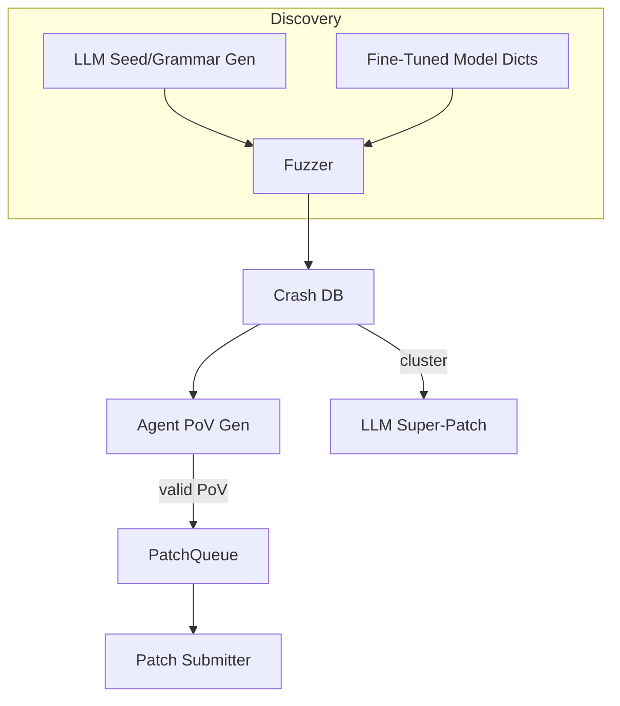

# AI支援Fuzzingと自動脆弱性発見

{{#include ../banners/hacktricks-training.md}}

## 概要
大規模言語モデル（LLM）は、意味的に豊かな入力の生成、文法の進化、クラッシュデータの推論、さらには複数のバグを修正するパッチの提案によって、従来の脆弱性研究のパイプラインを大幅に強化できます。このページでは、DARPAのAI Cyber Challenge（AIxCC）決勝戦やその他の公開研究で確認された、最も効果的なパターンをまとめています。<sup>[[4]](#references)</sup><sup>[[5]](#references)</sup>

以下は、特定の競技システムの説明ではなく、独自のワークフローで再現できるよう、これらのテクニックを抽象化したものです。

---

## 1. LLMが生成するSeed Input

従来のカバレッジガイド型Fuzzer（AFL++、libFuzzer、Honggfuzzなど）は、小規模なSeedのコーパスから始め、バイト列を無差別に変異させます。対象の入力形式が複雑な場合（SQL、URL、カスタムバイナリプロトコルなど）、ランダムな変異では通常、興味深い分岐に到達する前に構文が壊れてしまいます。

LLMは、*Seed Generator*（**構文的に正しく、セキュリティ上重要な入力**を出力する短いスクリプト）を生成して、このブートストラップ問題を解決できます。たとえば、次のようになります。

```prompt
SYSTEM: You are a helpful security engineer.
USER:
Write a Python3 program that prints 200 unique SQL injection strings targeting common anti-pattern mistakes (missing quotes, numeric context, stacked queries).  Ensure length ≤ 256 bytes / string so they survive common length limits.
```

```python
# gen_sqli_seeds.py (truncated)
PAYLOADS = [
    "1 OR 1=1 -- ",
    "' UNION SELECT NULL,NULL--",
    "0; DROP TABLE users;--",
    ...
]
for p in PAYLOADS:
    print(p)
```

一度実行し、出力をそのままfuzzerの初期コーパスに入力する:

```bash
python3 gen_sqli_seeds.py > seeds.txt
afl-fuzz -i seeds.txt -o findings/ -- ./target @@
```

Benefits:
1. Semantic validity → 早期により深いカバレッジを得られる。
2. 再生成可能: プロンプトを調整して、XSS、path traversal、バイナリ blob などに焦点を当てられる。
3. 低コスト（GPT-3.5なら 1 ¢ 未満）。

### Tips
* 表面的なフィルターを回避するため、payload の長さとエンコード（UTF-8、URL-encoded、UTF-16-LE）を*多様化*するようモデルに指示する。
* *単一の自己完結型スクリプト*を要求する。JSON のフォーマット上の問題を避けられる。

---

## 2. Grammar-Evolution Fuzzing

より強力な手法として、具体的な seed ではなく、LLM に**grammar を進化**させる方法がある。ワークフロー（「Grammar Guy」パターン）は次のとおり。

1. プロンプトで初期の ANTLR/Peach/LibFuzzer grammar を生成する。
2. N 分間 fuzzing し、カバレッジメトリクス（ヒットした edge / block）を収集する。
3. 未カバーのプログラム領域を要約し、その要約をモデルにフィードバックする。
   ```prompt
   The previous grammar triggered 12 % of the program edges.  Functions not reached: parse_auth, handle_upload.  Add / modify rules to cover these.
   ```
4. 新しいルールをマージし、再度 fuzzing し、繰り返す。

疑似コードの骨組み:

```python
for epoch in range(MAX_EPOCHS):
    grammar = llm.refine(grammar, feedback=coverage_stats)
    save(grammar, f"grammar_{epoch}.txt")
    coverage_stats = run_fuzzer(grammar)
```

Key points:
* 予算を守る – 改良のたびにトークンを消費します。
* モデルに書き直させず編集させるため、`diff` + `patch` の指示を使います。
* Δcoverage < ε になったら停止します。

---

## 3. Local-LLM libFuzzer Harness Engineering

アナリストのワークステーションから持ち出せないソースコードでは、ローカルのコードモデルを使って、fuzzer のバイト列と C/C++ API の間をつなぐ小さなアダプターを作成できます。重要なセキュリティ境界は明確です。**モデルがテスト基盤を作成・修正し、coverage-guided mutation が入力を探索し、sanitizer が不正な操作を報告し、人間がハーネスをレビューして検出結果をトリアージします**。<sup>[[9]](#references)</sup>

LLM に依存しない、エンジンレベルのコーパス、フィードバック、スナップショット、ステートフル fuzzing の手法については、一般的な [Fuzzing の手法](../generic-methodologies-and-resources/fuzzing.md)を参照してください。

まず、ターゲットヘッダーから正確な宣言をコピーし、出力形式を制約します。プロンプトを絞ることで、架空の API が作られにくくなり、結果もレビューしやすくなります。<sup>[[8]](#references)[[9]](#references)</sup>

```prompt
Write a libFuzzer target for this exact declaration:
int parse_records(const uint8_t *data, size_t size);

Output only C code. Implement LLVMFuzzerTestOneInput, include the
declaration, pass data and size unchanged, and do not use files,
network access, randomness, clocks, threads, or persistent state.
```

生バイトパーサーでは、期待される結果は次の程度より複雑であってはなりません:<sup>[[6]](#references)[[9]](#references)</sup>

```c
#include <stddef.h>
#include <stdint.h>

extern int parse_records(const uint8_t *, size_t);

int LLVMFuzzerTestOneInput(const uint8_t *data, size_t size) {
    (void)parse_records(data, size);
    return 0;
}
```

Compilationは最初の検証ゲートにすぎません。CPU時間を費やす前に、生成した各ターゲットが次の不変条件を満たしているか確認してください:<sup>[[6]](#references)[[8]](#references)[[9]](#references)</sup>

- **正確なAPI:** 実際のヘッダーおよび既存の呼び出し元と、型、所有権ルール、初期化、終了処理、呼び出し規約を比較する。
- **Harnessの安全性:** `data`から読み取る箇所すべてにガードを設ける。sanitizerの検出結果は、生成されたglueではなくターゲットに起因するものでなければならない。
- **再現性:** 結果を`data`と`size`の関数にする。外部I/O、時刻、制御されていない乱数、joinされていないスレッド、呼び出し間で存続する状態を取り除く。
- **スループット:** 挙動に影響しない場合に限り、高コストな不変状態を一度だけ初期化する。入力サイズに上限を設け、ログ出力を抑え、入力ごとの割り当てを解放する。
- **到達可能性:** 意図した関数や分岐が実行されることを確認する。コンパイルできても、拒否パスしか実行しないターゲットは、気づかれにくい失敗です。

### 構造を認識するターゲット: バグを隠さず不変条件を維持する

ほとんどの生入力がmagic、長さ、バージョン、またはチェックサムのゲートで失敗する場合は、fuzz bytesを**型付きフィールドの素材**として使い、有効なオブジェクトを再構築します。フォーマット定数を固定し、意味を持つフィールドとペイロードのバイト列は変更可能なままにして、再構築したペイロードから整合性メタデータを導出します。`FuzzedDataProvider`は、上限付きの型付き値を取り出すのに便利ですが、生成する割り当てと変換に上限を設ける責任はアダプターにあります。<sup>[[9]](#references)</sup>

<details>
<summary>構造認識型C++ターゲットの例</summary>

```cpp
#include <fuzzer/FuzzedDataProvider.h>
#include <stddef.h>
#include <stdint.h>
#include <vector>

extern "C" int parse_message(const uint8_t *, size_t);

extern "C" int LLVMFuzzerTestOneInput(const uint8_t *data, size_t size) {
    FuzzedDataProvider fdp(data, size);
    uint8_t version = fdp.ConsumeIntegral<uint8_t>();
    auto body = fdp.ConsumeRemainingBytes<uint8_t>();
    if (body.size() > UINT16_MAX) body.resize(UINT16_MAX);
    uint16_t len = static_cast<uint16_t>(body.size());
    std::vector<uint8_t> msg = {0x8b, 'M', 'S', 'G', version,
                                static_cast<uint8_t>(len >> 8),
                                static_cast<uint8_t>(len)};
    msg.insert(msg.end(), body.begin(), body.end());
    (void)parse_message(msg.data(), msg.size());
    return 0;
}
```

</details>

すべての質問に対して構造を修復する単一のtargetを使わないでください。深い有効状態を探索できるよう、長さとチェックサムを導出するtargetを1つ用意し、もう1つはハーネス自身の読み取りと割り当てだけを制限して、**宣言された**メタデータをfuzzerが制御できるようにします。2つ目のtargetは、長さの不一致や不正な完全性情報に関する攻撃対象領域を保ちます。これらは自動修復によって消えてしまうためです。<sup>[[9]](#references)</sup>

### Seeds、辞書、sanitizer、coverage feedback

モデルには、バイナリを直接出力するよう求めるのではなく、バイナリのseedを書き込むスクリプトを生成するよう求めてください。空のオブジェクト、最小オブジェクト、典型的なオブジェクト、有効な境界値のオブジェクトをseedとして用意し、magic値、tag、enumのエンコーディング、parserのキーワードを抽出して、レビュー済みの辞書にまとめます。libFuzzerは`-dict=`でその辞書を受け取り、新しいcoverageを見つけたmutationsをcorpusに保持します。<sup>[[6]](#references)[[9]](#references)</sup>

```text
magic="\x8bMSG"
version_min="\x00"
version_max="\xff"
config_tag="CONFIG"
```

補完的な instrumentation を使って同じ target をビルドします。ASan と UBSan は同じ fuzzing binary を共有できます。未 instrument のコードが原因の報告を避けるため、MSan は別途ビルドし、その依存関係も instrument してください。<sup>[[6]](#references)[[9]](#references)</sup>

```bash
clang++ -g -O1 -fsanitize=fuzzer,address,undefined \
  -fno-sanitize-recover=undefined target.cc harness.cc -o fuzz_target
./fuzz_target corpus -dict=msg.dict -max_len=65535

clang++ -g -O1 -fsanitize=fuzzer,memory \
  target.cc harness.cc -o fuzz_target_msan
```

各モデルの改訂を評価する指標としてカバレッジを使います。libFuzzerの出力で`cov`/`ft`が早期に横ばいになり、コーパスも変化しない場合は、フレーミングの不備、早すぎる段階での過度に制限的なreturn、または誤った呼び出し先が原因であることが多く、`exec/s`が低い場合は、コストの高いセットアップ、I/O、メモリ割り当て、または状態のリークが考えられます。`NEW`が示すのはカバレッジ機能に変化があったことだけで、意図したパーサーに到達した証拠ではありません。<sup>[[6]](#references)[[9]](#references)</sup>

ソースレベルのフィードバックには、カバレッジ計測用ビルドを作成してfuzzし、未カバーの関数とそのガード条件だけをモデルに渡します。生成されたharness/seed/dictionaryの差分を確認し、再度測定します。<sup>[[7]](#references)[[8]](#references)[[9]](#references)</sup>

```bash
clang++ -g -O1 -fsanitize=fuzzer \
  -fprofile-instr-generate -fcoverage-mapping target.cc harness.cc -o fuzz_cov
mkdir -p profiles
LLVM_PROFILE_FILE='profiles/%p.profraw' ./fuzz_cov -max_total_time=300 corpus
llvm-profdata merge -sparse profiles/*.profraw -o fuzz.profdata
llvm-cov report ./fuzz_cov -instr-profile=fuzz.profdata
llvm-cov show ./fuzz_cov -instr-profile=fuzz.profdata \
  --show-branches=count --region-coverage-lt=1 target.cc
```

スケーラブルなループは、したがって **生成 → コンパイル/リンク → sanitizer 下でスモークテスト → target coverage を測定 → 関連性の高い最小限の coverage/source context を提供 → 修正 → 再測定** となります。OSS-Fuzz-Gen も同じ原則を適用し、もっともらしいコードをそのまま受け入れるのではなく、生成した target のコンパイル可能性、実行時エラー、coverage、および既存 target に対する coverage の改善を評価します。<sup>[[7]](#references)[[8]](#references)</sup>

---

## 4. Agent-Based PoV (Exploit) Generation

crash が見つかっても、それを確実に発生させる **proof-of-vulnerability (PoV)** が必要です。

スケーラブルな方法は、多数の軽量 worker（process、thread、container）を起動し、それぞれ異なる model または sampling configuration を使用させることです。AIxCC finalist survey には具体的な規模の例が示されています。あるチームは AI-first PoV generation に **数千の同時稼働 agent** を使用し、別のチームは **300～500 の fuzzing agent** を統括し、より高度な意味的推論には LLM を使用しました。<sup>[[4]](#references)</sup>

パイプライン:
1. Static/dynamic analysis により *bug candidate*（crash PC、input slice、sanitizer msg を含む struct）を生成する。
2. Orchestrator が candidate を agent に配布する。
3. Agent の推論手順:
   a. `gdb` と input を使って、ローカルで bug を再現する。
   b. 最小限の exploit payload を提案する。
   c. sandbox で exploit を検証する。成功したら → submit。
4. 失敗した試行は、coverage fuzzing 用の新しい seed として **再キューイング** される（feedback loop）。

利点:
* 並列化により、単一 agent の信頼性の低さを補える。
* 観測された成功率に基づき、temp/model size を自動調整できる。

---

## 5. Directed Fuzzing with Fine-Tuned Code Models

脆弱性パターン（integer overflow、buffer copy、format string）のラベルを付けた C/C++ source を使い、open-weight model（例: Llama-7B）を fine-tune します。その後:

1. Static analysis を実行して、function list と AST を取得する。
2. Model にプロンプトを送る: *“Give mutation dictionary entries that are likely to break memory safety in function X”*。
3. それらの token をカスタム `AFL_CUSTOM_MUTATOR` に挿入する。

`sprintf` wrapper の出力例:
```
{"pattern":"%99999999s"}
{"pattern":"AAAAAAAA....<1024>....%n"}
```

実環境のターゲットでは、実測でcrashまでの時間を2倍以上短縮できます。

---

## 6. AI誘導パッチ戦略

### 6.1 Super Patches
モデルにcrashのシグネチャを*クラスタリング*し、共通の根本原因を取り除く**単一のパッチ**を提案するよう依頼します。一度の提出で複数のバグを修正できるため、誤ったパッチごとに減点される環境では、精度ペナルティを抑えられます。

プロンプトの概要：
```
Here are 10 stack traces + file snippets.  Identify the shared mistake and generate a unified diff fixing all occurrences.
```

### 6.2 推測パッチ比率
PoVで検証済みのパッチと、*推測的な*パッチ（PoVなし）を、スコアリングルールに合わせた1:Nの比率（例: 推測的なパッチ2件 : 検証済みパッチ1件）で交互に処理するキューを実装します。コストモデルでペナルティとポイントを監視し、Nを自動調整します。

---

## 7. ファイル単位で決定論的に行うAIコードレビュー

AI支援レビューでよくある失敗パターンは、1つのエージェントにリポジトリ全体を調査させ、適切なファイルやgrep用語を選ぶことを期待することです。より信頼性の高い方法は、**リポジトリ全体を確実に調査させる**ことです。<sup>[[1]](#references)</sup>

1. ソースファイルを列挙します。
2. 最小限のコンテキスト（エントリポイント、import、近接するルートや呼び出し元）とともに、**一度に1ファイルずつ**送信します。
3. 各ファイルについて、source、sink、検証不足、悪用の前提条件、信頼度を含む**構造化レポート**を必須にします。<sup>[[3]](#references)</sup>
4. **source→sinkのパターン**に基づいてレポートを重複排除し、リスクの高いものを手動で検証します。

トークンを多く消費し、ノイズも増えますが、広範囲なエージェント型レビューでは見逃されがちな、**単純で影響の大きいsource/sinkバグ**の発見に非常に効果的です。

### 優先して確認する価値のあるトリアージパターン

- **動的なPHP include/dispatch**: 攻撃者が制御するroute/controller/module名が、厳格なallowlistやパスの正規化なしに`require_once()`、`include()`、`include_once()`へ渡される。
- **管理者/アカウントのワークフローでのシェル実行**: username、domain、FTPアカウントなどの識別子が`exec()`、`system()`、`shell_exec()`、`passthru()`、`proc_open()`、`popen()`に渡される。
- **構造化入力の集約**: 同じパラメータを`$_GET`、`$_POST`、JSON、XML、またはフレームワークのbody parserから受け入れ、その後ファイルシステムやOSコマンドのsinkで再利用する。

### この方法で特に見つけやすい実用的なバグクラス2種

- **PHP controller-dispatch LFI/RCE**: リクエストで制御されるcontroller名が、allowlistやパスの正規化なしに`require_once()`へ連結されると、`../`のようなtraversalシーケンスによって、意図しないローカルの`.php`ファイルをPHPにincludeさせられる可能性があります。攻撃者が仕込んだ、または別の方法で利用可能なPHPファイルをincludeさせられる場合、LFIはコード実行につながります。[File Inclusion / Path Traversal](../pentesting-web/file-inclusion/README.md)を参照してください。<sup>[[1]](#references)</sup>
- **ホスティング/管理パネルでの認証済みコマンドインジェクション**: usernameなどのアカウント管理フィールドがシェルコマンドに埋め込まれる場合、権限の低い認証済みユーザーが通常の作成/削除操作をRCEに悪用できる可能性があります。パネルがより高い権限を持つサービスアカウントとしてコマンドを実行する場合、影響はさらに大きくなります。[Command Injection](../pentesting-web/command-injection.md)を参照してください。<sup>[[1]](#references)</sup>

### 実践的なレビュー上の注意点

- LLMは、まず**source/sinkのレビュー担当**として使い、exploitの生成には使わないでください。
- **攻撃者が制御するフィールド**、**正規化/検証の不足箇所**、**危険なsink**を明示的に列挙するよう指示してください。
- 大規模なリポジトリでは、より強力なモデルを使う場合でも、自律エージェントを1回実行するより、決定論的なファイル単位のレビューのほうが信頼性が高いことがよくあります。<sup>[[2]](#references)</sup>
- **Broken Access Control**や、悪用可能性が複数ファイルにまたがる前提、ロールの意味、製品固有の脅威モデルに左右されるその他のビジネスロジックバグでは、結果が弱くなることを想定してください。

---

## 8. 計測機能を備えたオラクルによるパターン主導のカーネル監査

カーネル規模のターゲットでは、エージェントにツリー全体から任意のバグを探させないでください。よりトークン効率の高いワークフローでは、過去の脆弱性に関する知識を静的クエリに変換し、露出した攻撃対象領域に基づいて結果をランク付けし、計測機能を備えたカーネルを実行オラクルとして使用します。<sup>[[11]](#references)</sup>

### パターンデータベース → CodeQL/Semgrep → 対象を絞ったレビュー

危険なAPI、検証不足のパターン、リスクのあるsource-to-sinkのデータフロー、過去に修正されたバグの形状を含む小規模なナレッジベースを構築します。モデルに**一度に1つのパターン**をレビュー用ヒューリスティクスおよびCodeQL/Semgrepルールに変換させ、その後、それらの決定論的なルールをツリー全体に適用します。一致結果をグループ化して重複排除してから、コードをモデルに渡してください。スキャナーの生出力には、価値の低い候補が何千件も含まれることがあります。対象が利用条件を満たす研究用途またはオープンソースプロジェクト以外の場合、この方法を使う前にCodeQLの現行ライセンスを確認してください。<sup>[[11]](#references)</sup>

ヒット数だけでなく、**ルールのヒット密度**と**攻撃者からの到達可能性**の両方を使ってサブシステムの優先順位を決めてください。非特権プロセス、sandbox、container、jail、guestのコンテキストから到達可能なカーネルインターフェースは、内部専用のコードより重視すべきです。エージェントが呼び出し元、validator、ライフタイムルールを把握できるよう、レビュー単位は小さく保ち、「脆弱性を何でも見つけて」ではなく、脆弱性クラスまたは制御フローパターンを指定してプロンプトしてください。新しい隔離境界によって、namespace内またはjail内のrootユーザーから到達可能になった古い特権インターフェースは、特に注目に値します。<sup>[[11]](#references)</sup>

すべての候補について、exploitを試みる前に、明示的なフィールドフローの記録を必須にしてください。<sup>[[11]](#references)</sup>

```text
entrypoint -> privilege check -> parser -> validation/normalization
           -> later rewrite -> dangerous sink
attacker controls: <fields and lengths>
constraints:       <values rewritten, rejected, or preserved>
observable result: <sanitizer report, assertion, panic, or clean exit>
```

### 仮説オラクルとして KASAN telemetry を使う

KASAN と有用な診断アサーションを有効にした使い捨て VM で、対象カーネルを実行します。エージェントには、疑わしい corruption が再現または否定されるまで、**source hypothesis → 最小限の userland trigger → VM execution → KASAN/assertion trace → revised hypothesis** の反復を行わせます。各反復では、関連する stack trace と近傍のソースコードだけを返します。これにより推論に必要な context を保ちつつ、合否の判断基準をモデルの確信度ではなく、runtime evidence に置けます。<sup>[[11]](#references)</sup>

instrumented build は、最終的な exploitability の評価環境ではありません。アサーションによって corruption を起こす操作の前に実行が止まることがありますが、同じアサーションが production kernel では無効化されている場合があります。変更していない trigger を正確な production configuration で再テストし、kernel build と configuration を記録したうえで、**reachability**、**memory corruption**、**controlled primitive**、**security impact** をそれぞれ別の主張として区別します。<sup>[[11]](#references)[[12]](#references)</sup>

CVE-2026-3038 は、exploit template ではなく、有用な検証例です。権限のない FreeBSD の `RTM_GET` request は、選択的な validation と reply の書き換えを経て、サイズ超過の `RTAX_AUTHOR` sockaddr を保持できました。その後 `rtsock_msg_buffer()` が、user-controlled な `sa_len` を 128 バイトの stack `sockaddr_storage` にコピーしました。最大 255 バイトのコピーにより 127 バイトの overwrite が発生しました。instrumented build では診断アサーションが不正な長さを検出しましたが、GENERIC kernel ではコピーに到達し、破損した canary のチェック時に panic しました。これは権限のないユーザーによる denial of service を証明しますが、単独での privilege escalation を証明するものではありません。確実に制御するには、まず canary disclosure などの別の primitive が必要です。対応する binary-exploitation の境界については、[Stack Canaries](../binary-exploitation/common-binary-protections-and-bypasses/stack-canaries/index.html) を参照してください。<sup>[[11]](#references)[[12]](#references)[[13]](#references)</sup>

### exploit の前提条件を偽装した検証を退ける

PoV や exploit を受け入れる前に、独立した reviewer/agent に、定められた基準に照らしてその主張を反証させます。レビューでは、以下の条件をすべて確認する必要があります。<sup>[[11]](#references)</sup>

- 経路を到達可能にするために、対象のソース、kernel、脆弱な module を変更していない。
- helper module、合成 gadget、無効化した mitigation、追加の権限、利用できない interface を導入していない。
- trigger は、クリーンな snapshot 上で、主張された caller identity と containment restrictions のもとで開始される。
- 主張された結果が、依然として bug に依存している。malformed field を取り除くか、bug だけを修正すると、chain が成立しなくなる。
- crash、overread、overwrite は、その primitive としてのみ報告されている。code execution や privilege escalation には独立した evidence が必要である。

最後の反実仮想チェックにより、循環した実証を見抜けます。たとえば `nosuid` なしで mount された filesystem 上の、攻撃者が用意した SUID content を実行するなど、前提条件だけですでに主張された影響が得られる場合、その memory-safety bug がその影響を生み出したわけではありません。<sup>[[11]](#references)</sup>

---

## 不慣れな codebase における監査可能な agent-assisted research

[graph-first fuzz-target workflow](../generic-methodologies-and-resources/fuzzing.md#graph-first-fuzz-target-selection-and-mutation-triage) では、entrypoint の reachability を扱っています。一方、[agentic SAST pipelines](../network-services-pentesting/pentesting-web/code-review-tools.md#agentic-sast-pipelines) では、段階的なレビューと evidence gate を扱っています。これらの確定的な結果はモデルの仮説と分けておき、採用された各候補に source location、path evidence、dynamic measurement が残るようにします。<sup>[[10]](#references)</sup>

### data flow を捏造せずに object lifetime の evidence を関連付ける

静的解析では、ある関数で attacker-controlled な長さが保存され、かなり後になって同じ object field が copy sink に到達することを検出できても、callback、reconnect、object lifetime をまたぐつながりを証明できないことがあります。両方の検出結果を個別に保持し、object/field 単位で cluster 化して、不足している edge を明示的な triage の問いにします。エージェントは関係を推測してもかまいませんが、その証明にはソースレビューまたは runtime instrumentation が必要です。<sup>[[10]](#references)</sup>

候補ごとに、以下を記録します。

- 具体的な entrypoint と attacker-controlled bytes
- 関連 field のすべての producer。各 producer 固有の validation も含める
- sink、destination capacity、および到達に必要な build/runtime conditions
- 直接の harness invocation だけではなく、露出した entrypoint からの実際の call stack
- 仮説を確認または否定する、最小限の dynamic result

一見安全な path があっても、field 全体の安全性は保証されません。別の producer が、最初の path にある上限チェックなしで同じ field に値を格納する場合があります。path を個別にテストし、debug assertion によって production の memory corruption がテスト時だけの早期 abort に変わらないよう、deployment と同等の build options で harness を実行します。<sup>[[10]](#references)</sup>

### disclosure と exploitation の measurement gate

未初期化メモリの disclosure が疑われる場合は、新しい allocation を識別可能な byte で埋め、その正確な marker が出力 packet に到達することを確認します。exploit では、**controlled overwrite → 有用な victim object → disclosure → pointer/base recovery → control-flow hijack → composed payload** などの gate を測定して満たす必要があります。エージェントは、harness が現在の性質を証明した場合にのみ先へ進みます。もっともらしい説明は、gate を通過したことにはなりません。[FreeRDP case](../binary-exploitation/libc-heap/heap-overflow.md#cross-path-length-reuse-and-stale-output-disclosure) は、検証中に維持すべき path と build constraints を示しています。<sup>[[10]](#references)</sup>

---

## 全体を組み合わせる

end-to-end の CRS (Cyber Reasoning System) は、次のように各 component を接続できます。



---

## References

- [1] [Project Black - サイバーセキュリティのためのローカルAI: phpIPAMのLFIとmyVestaの認証済みRCEを発見](https://projectblack.io/blog/local-ai-for-cyber-security)
- [2] [Strix](https://github.com/usestrix/strix)
- [3] [GitHub Copilotコミュニティのsecurity-reviewスキル](https://github.com/github/awesome-copilot/blob/main/skills/security-review/SKILL.md)
- [4] [Trail of Bits – AIxCC決勝: 勝負の記録](https://blog.trailofbits.com/2025/08/07/aixcc-finals-tale-of-the-tape/)
- [5] [CTF RadioooによるAIxCCファイナリストへのインタビュー](https://www.youtube.com/@ctfradiooo)
- [6] [LLVM — libFuzzer: カバレッジガイド型ファズテスト用ライブラリ](https://llvm.org/docs/LibFuzzer.html)
- [7] [Google — OSS-Fuzz-Gen](https://github.com/google/oss-fuzz-gen)
- [8] [Google Online Security Blog — ファジングをレベルアップ: AIでより多くの脆弱性を発見](https://security.googleblog.com/2024/11/leveling-up-fuzzing-finding-more.html)
- [9] [8kSec — ローカルLLMを用いたAI支援ファジングハーネスの生成](https://8ksec.io/ai-assisted-fuzzing-harness-local-llm)
- [10] [Quarkslab — AIエージェントからRCEへ: 脆弱性調査ワークフローの構築](https://blog.quarkslab.com/from-ai-agents-to-rce-building-a-vulnerability-research-workflow.html)
- [11] [Praetorian — FreeBSoD: 言語モデルを活用したカーネルバグの発見と悪用 (全2部の第1部)](https://praetorian.com/blog/ai-vulnerability-research-freebsd-kernel)
- [12] [FreeBSD-SA-26:05.route — ルーティングソケットを介したローカルDoSおよび権限昇格の可能性](https://www.freebsd.org/security/advisories/FreeBSD-SA-26:05.route.asc)
- [13] [FreeBSD-SA-26:05.routeのソースパッチ](https://security.FreeBSD.org/patches/SA-26:05/route.patch)
{{#include ../banners/hacktricks-training.md}}
