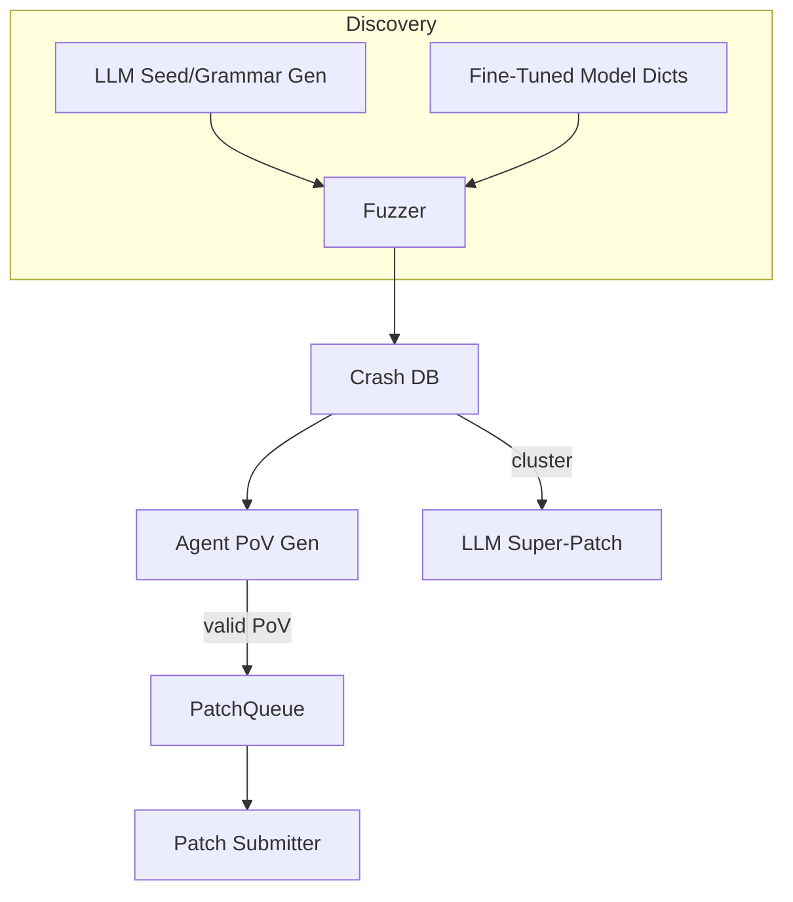

# Фаззинг за допомогою ШІ та автоматизоване виявлення вразливостей

{{#include ../banners/hacktricks-training.md}}

## Огляд
Великі мовні моделі (LLM) можуть значно посилити традиційні процеси дослідження вразливостей: генерувати семантично насичені вхідні дані, розвивати граматики, аналізувати дані про збої та навіть пропонувати виправлення кількох помилок. На цій сторінці зібрано найефективніші підходи, виявлені під час фіналу AI Cyber Challenge (AIxCC) від DARPA та інших публічних досліджень.<sup>[[4]](#references)</sup><sup>[[5]](#references)</sup>

Далі описано не конкретну систему для певного змагання, а узагальнення методів, які можна відтворити у власних робочих процесах.

---

## 1. Вхідні seed-дані, згенеровані LLM

Традиційні coverage-guided фаззери (AFL++, libFuzzer, Honggfuzz…) починають із невеликого корпусу seed-даних і сліпо змінюють байти. Якщо формат вхідних даних складний (SQL, URL-адреси, власні бінарні протоколи), випадкові зміни зазвичай порушують синтаксис ще до досягнення цікавих гілок коду.

LLM можуть розв’язати цю проблему початкового етапу, генеруючи *генератори seed-даних* — короткі скрипти, що виводять **синтаксично коректні, але релевантні з погляду безпеки вхідні дані**. Наприклад:

```prompt
SYSTEM: You are a helpful security engineer.
USER:
Write a Python3 program that prints 200 unique SQL injection strings targeting common anti-pattern mistakes (missing quotes, numeric context, stacked queries).  Ensure length ≤ 256 bytes / string so they survive common length limits.
```

```python
# gen_sqli_seeds.py (truncated)
PAYLOADS = [
    "1 OR 1=1 -- ",
    "' UNION SELECT NULL,NULL--",
    "0; DROP TABLE users;--",
    ...
]
for p in PAYLOADS:
    print(p)
```

Запустіть один раз і передайте вивід безпосередньо до початкового корпусу fuzzer:

```bash
python3 gen_sqli_seeds.py > seeds.txt
afl-fuzz -i seeds.txt -o findings/ -- ./target @@
```

Benefits:
1. Семантична валідність → глибше покриття на ранніх етапах.
2. Можна генерувати повторно: змініть prompt, щоб зосередитися на XSS, path traversal, бінарних даних тощо.
3. Дешево (< 1 ¢ з GPT-3.5).

### Поради
* Попросіть модель *урізноманітнити* довжину payload і кодування (UTF-8, URL-encoded, UTF-16-LE), щоб обходити поверхневі фільтри.
* Попросіть створити *один самодостатній скрипт* — це допоможе уникнути проблем із форматуванням JSON.

---

## 2. Fuzzing з еволюцією граматики

Потужніший варіант — дозволити LLM **еволюціонувати граматику**, а не конкретні seed-и. Робочий процес (патерн «Grammar Guy»):

1. Згенеруйте початкову граматику ANTLR/Peach/LibFuzzer за допомогою prompt.
2. Виконуйте fuzzing протягом N хвилин і збирайте метрики покриття (охоплені ребра / блоки).
3. Підсумуйте непокриті ділянки програми й передайте цей підсумок моделі:
   ```prompt
   The previous grammar triggered 12 % of the program edges.  Functions not reached: parse_auth, handle_upload.  Add / modify rules to cover these.
   ```
4. Об’єднайте нові правила, повторно запустіть fuzzing і повторіть.

Каркас псевдокоду:

```python
for epoch in range(MAX_EPOCHS):
    grammar = llm.refine(grammar, feedback=coverage_stats)
    save(grammar, f"grammar_{epoch}.txt")
    coverage_stats = run_fuzzer(grammar)
```

Ключові моменти:
* Дотримуйтеся *бюджету* — кожне уточнення витрачає токени.
* Використовуйте інструкції `diff` + `patch`, щоб модель редагувала, а не переписувала.
* Зупиніться, коли Δcoverage < ε.

---

## 3. Інженерія harness для libFuzzer із локальною LLM

Якщо вихідний код не можна виносити за межі робочої станції аналітика, локальна кодова модель може створити невеликий адаптер між байтами фузера та API на C/C++. Важливо чітко визначити межі безпеки: **модель пише й удосконалює тестову інфраструктуру; мутація з керуванням покриттям досліджує вхідні дані; санітайзери виявляють некоректні операції; людина перевіряє harness і сортує результати**.<sup>[[9]](#references)</sup>

Про методи роботи з corpus, зворотним зв’язком, snapshot і stateful-fuzzing на рівні рушія, які не залежать від LLM, див. загальну [Методологію fuzzing](../generic-methodologies-and-resources/fuzzing.md).

Почніть із точного оголошення, скопійованого із заголовка цільового файлу, і задайте обмеження щодо формату виводу. Вузький промпт зменшує ймовірність вигаданих API та полегшує перевірку результату:<sup>[[8]](#references)[[9]](#references)</sup>

```prompt
Write a libFuzzer target for this exact declaration:
int parse_records(const uint8_t *data, size_t size);

Output only C code. Implement LLVMFuzzerTestOneInput, include the
declaration, pass data and size unchanged, and do not use files,
network access, randomness, clocks, threads, or persistent state.
```

Для парсера необроблених байтів очікуваний результат має бути не складнішим за:<sup>[[6]](#references)[[9]](#references)</sup>

```c
#include <stddef.h>
#include <stdint.h>

extern int parse_records(const uint8_t *, size_t);

int LLVMFuzzerTestOneInput(const uint8_t *data, size_t size) {
    (void)parse_records(data, size);
    return 0;
}
```

Компіляція — лише перший етап перевірки. Перш ніж витрачати на цільовий об’єкт процесорний час, перевірте кожну згенеровану ціль на відповідність таким інваріантам:<sup>[[6]](#references)[[8]](#references)[[9]](#references)</sup>

- **Точний API:** звірте типи, правила керування власністю, ініціалізацію, завершення роботи та угоду про виклики з реальним заголовком і наявними викликами.
- **Безпека harness:** захистіть кожне читання з `data`; результати роботи санітайзера мають походити з цілі, а не зі згенерованого glue-коду.
- **Повторюваність:** результат має бути функцією від `data` і `size`; усуньте зовнішній ввід-вивід, час, неконтрольовану випадковість, неприєднані потоки та стан, що зберігається між викликами.
- **Пропускна здатність:** ініціалізуйте дорогий незмінний стан лише один раз і лише якщо це не впливає на поведінку, обмежте розмір вводу, вимкніть журналювання та звільняйте виділену для кожного вводу пам’ять.
- **Досяжність:** перевірте, що виконуються потрібні функції та гілки. Ціль, яка компілюється, але перевіряє лише шляхи відхилення, — це непомітна помилка.

### Цілі з урахуванням структури: зберігайте інваріанти, не приховуючи помилок

Якщо більшість необроблених вводів не проходять перевірку magic-значення, довжини, версії або контрольної суми, використовуйте байти fuzz-вводу як **матеріал для типізованих полів** і відновлюйте коректний об’єкт. Фіксуйте константи формату, залишайте семантичні поля та байти корисного навантаження змінними, а метадані цілісності обчислюйте на основі відновленого корисного навантаження. `FuzzedDataProvider` зручно використовувати для отримання типізованих значень із заданими межами, а адаптер відповідає за обмеження будь-якого згенерованого виділення пам’яті та перетворення.<sup>[[9]](#references)</sup>

<details>
<summary>Приклад C++-цілі з урахуванням структури</summary>

```cpp
#include <fuzzer/FuzzedDataProvider.h>
#include <stddef.h>
#include <stdint.h>
#include <vector>

extern "C" int parse_message(const uint8_t *, size_t);

extern "C" int LLVMFuzzerTestOneInput(const uint8_t *data, size_t size) {
    FuzzedDataProvider fdp(data, size);
    uint8_t version = fdp.ConsumeIntegral<uint8_t>();
    auto body = fdp.ConsumeRemainingBytes<uint8_t>();
    if (body.size() > UINT16_MAX) body.resize(UINT16_MAX);
    uint16_t len = static_cast<uint16_t>(body.size());
    std::vector<uint8_t> msg = {0x8b, 'M', 'S', 'G', version,
                                static_cast<uint8_t>(len >> 8),
                                static_cast<uint8_t>(len)};
    msg.insert(msg.end(), body.begin(), body.end());
    (void)parse_message(msg.data(), msg.size());
    return 0;
}
```

</details>

Не використовуйте одну ціль із виправленням структури для всіх запитань. Підтримуйте одну ціль, яка обчислює довжини й контрольні суми, щоб досліджувати глибокі коректні стани, та іншу, у якій fuzzer контролює **задекларовані** метадані, а обмежуються лише читання й виділення пам’яті, які виконує сам harness. Друга ціль зберігає поверхні для атак із невідповідними довжинами й некоректною цілісністю, які автоматичне виправлення інакше усунуло б.<sup>[[9]](#references)</sup>

### Початкові зразки, словники, санітайзери та зворотний зв’язок щодо покриття

Попросіть модель згенерувати скрипт, який записує бінарні початкові зразки, а не виводить бінарні дані безпосередньо. Створіть порожні, мінімальні, типові й граничні коректні об’єкти, а потім вилучіть магічні значення, теги, кодування enum і ключові слова парсера до словника, який пройшов перевірку. libFuzzer приймає цей словник через `-dict=`, а до корпусу додає мутації, що відкривають нове покриття.<sup>[[6]](#references)[[9]](#references)</sup>

```text
magic="\x8bMSG"
version_min="\x00"
version_max="\xff"
config_tag="CONFIG"
```

Зберіть ту саму ціль із додатковою інструментацією. ASan і UBSan можна використовувати в одному fuzzing-бінарному файлі; для MSan створіть окрему збірку та інструментуйте її залежності, щоб уникнути звітів, спричинених неінструментованим кодом.<sup>[[6]](#references)[[9]](#references)</sup>

```bash
clang++ -g -O1 -fsanitize=fuzzer,address,undefined \
  -fno-sanitize-recover=undefined target.cc harness.cc -o fuzz_target
./fuzz_target corpus -dict=msg.dict -max_len=65535

clang++ -g -O1 -fsanitize=fuzzer,memory \
  target.cc harness.cc -o fuzz_target_msan
```

Розглядайте покриття як критерій оцінювання кожної версії моделі. У виводі libFuzzer раннє плато `cov`/`ft` і незмінний корпус зазвичай свідчать про неправильне формування даних, надто обмежувальний ранній вихід або неправильний виклик; низьке значення `exec/s` вказує на затратне налаштування, I/O, виділення пам’яті або витік стану. `NEW` лише підтверджує зміну ознаки покриття, а не те, що було досягнуто потрібного парсера.<sup>[[6]](#references)[[9]](#references)</sup>

Щоб отримати зворотний зв’язок на рівні вихідного коду, створіть збірку з покриттям, запустіть fuzzing і надайте моделі лише непокриті функції разом із умовами, що їх захищають. Перевірте зміни в harness/seed/dictionary і виміряйте покриття ще раз:<sup>[[7]](#references)[[8]](#references)[[9]](#references)</sup>

```bash
clang++ -g -O1 -fsanitize=fuzzer \
  -fprofile-instr-generate -fcoverage-mapping target.cc harness.cc -o fuzz_cov
mkdir -p profiles
LLVM_PROFILE_FILE='profiles/%p.profraw' ./fuzz_cov -max_total_time=300 corpus
llvm-profdata merge -sparse profiles/*.profraw -o fuzz.profdata
llvm-cov report ./fuzz_cov -instr-profile=fuzz.profdata
llvm-cov show ./fuzz_cov -instr-profile=fuzz.profdata \
  --show-branches=count --region-coverage-lt=1 target.cc
```

Масштабований цикл такий: **генерація → компіляція/зв’язування → smoke-тестування із санітайзерами → вимірювання покриття цілі → надання мінімального релевантного контексту покриття/вихідного коду → доопрацювання → повторне вимірювання**. OSS-Fuzz-Gen застосовує той самий принцип: оцінює згенеровані цілі за можливістю компіляції, помилками під час виконання, покриттям і покращенням покриття порівняно з наявними цілями, а не приймає правдоподібний код за чисту монету.<sup>[[7]](#references)[[8]](#references)</sup>

---

## 4. Генерація PoV (експлойту) на основі агентів

Після виявлення збою вам усе ще потрібен **доказ уразливості (PoV)**, який детерміновано його спричиняє.

Масштабований підхід полягає в запуску багатьох легких воркерів (процесів, потоків або контейнерів), кожен із яких використовує іншу модель або конфігурацію семплювання. Огляд фіналістів AIxCC наводить конкретні приклади масштабування: одна команда використовувала **тисячі одночасних агентів** для генерації PoV за принципом AI-first, тоді як інша координувала **300–500 fuzzing-агентів**, залишаючи LLM для семантичного аналізу вищого рівня.<sup>[[4]](#references)</sup>

Конвеєр:
1. Статичний/динамічний аналіз виявляє *кандидатів на помилки* (структура з адресою інструкції збою, фрагментом вхідних даних, повідомленням санітайзера).
2. Оркестратор розподіляє кандидатів між агентами.
3. Етапи міркування агента:
   a. Відтворити помилку локально за допомогою `gdb` і вхідних даних.
   b. Запропонувати мінімальний експлойт-пейлоад.
   c. Перевірити експлойт у пісочниці. Якщо успішно → надіслати.
4. Невдалі спроби **повторно додаються до черги як нові сіди** для coverage fuzzing (цикл зворотного зв’язку).

Переваги:
* Паралелізація приховує ненадійність окремого агента.
* Автоматичне налаштування temp / розміру моделі на основі спостережуваного відсотка успіху.

---

## 5. Directed Fuzzing із донавченими моделями коду

Дообучіть модель із відкритими вагами (наприклад, Llama-7B) на вихідному коді C/C++, позначеному шаблонами вразливостей (цілочисельне переповнення, копіювання буфера, форматний рядок). Потім:

1. Запустіть статичний аналіз, щоб отримати список функцій і AST.
2. Запитайте модель: *«Запропонуй записи словника мутацій, які, імовірно, порушать безпеку пам’яті у функції X»*.
3. Додайте ці токени до власного `AFL_CUSTOM_MUTATOR`.

Приклад результату для обгортки `sprintf`:
```
{"pattern":"%99999999s"}
{"pattern":"AAAAAAAA....<1024>....%n"}
```

Емпірично це скорочує час до збою більш ніж удвічі на реальних цілях.

---

## 6. Стратегії патчингу під керуванням AI

### 6.1 Суперпатчі
Попросіть модель *кластеризувати* сигнатури збоїв і запропонувати **єдиний патч**, який усуває спільну першопричину. Надішліть один раз, виправте кілька багів → менше штрафів за точність у середовищах, де за кожен неправильний патч знімають бали.

Структура промпту:
```
Here are 10 stack traces + file snippets.  Identify the shared mistake and generate a unified diff fixing all occurrences.
```

### 6.2 Співвідношення спекулятивних патчів
Реалізуйте чергу, у якій підтверджені патчі, валідовані PoV, і *спекулятивні* патчі (без PoV) чергуються у співвідношенні 1:N, налаштованому відповідно до правил оцінювання (наприклад, 2 спекулятивні : 1 підтверджений). Модель витрат відстежує штрафи та бали й автоматично коригує N.

---

## 7. Детермінований AI code review файл за файлом

Поширена причина невдач під час AI-assisted review — попросити одного агента перевірити весь репозиторій і сподіватися, що він вибере правильні файли та пошукові терміни. Надійніший підхід — **примусово охопити весь репозиторій**:<sup>[[1]](#references)</sup>

1. Перелічіть вихідні файли.
2. Надсилайте **по одному файлу за раз** разом із мінімальним контекстом (entrypoint, імпорти, суміжні маршрути/місця виклику).
3. Для кожного файлу вимагайте **структурований звіт**: source, sink, відсутня валідація, передумови експлуатації та рівень упевненості.<sup>[[3]](#references)</sup>
4. Усуньте дублікати звітів за **патерном source→sink** і вручну перевірте найризикованіші з них.

Такий підхід потребує багато токенів і створює шум, але дуже ефективно виявляє **прості source/sink-помилки з високим впливом**, які часто пропускають широкі agentic review.

### Патерни для пріоритизації під час тріажу

- **Динамічний PHP include/dispatch**: контрольовані зловмисником назви маршрутів/контролерів/модулів передаються в `require_once()`, `include()` або `include_once()` без суворого allowlist і канонізації шляхів.
- **Виконання команд оболонки в робочих процесах адміністрування/облікових записів**: імена користувачів, домени, FTP-облікові записи чи інші ідентифікатори доходять до `exec()`, `system()`, `shell_exec()`, `passthru()`, `proc_open()` або `popen()`.
- **Об’єднання структурованих вхідних даних**: той самий параметр приймається з `$_GET`, `$_POST`, JSON, XML або парсерів тіла запиту фреймворку, а пізніше використовується в sink файлової системи або команд ОС.

### Два практичні класи багів, які цей метод добре виявляє

- **PHP controller-dispatch LFI/RCE**: якщо контрольоване запитом ім’я контролера конкатенується з `require_once()` без allowlist/нормалізації шляху, послідовності обходу каталогів, як-от `../`, можуть змусити PHP підключити неочікуваний локальний файл `.php`. Якщо зловмисник може спрямувати підключення на підготовлений або іншим чином корисний PHP-файл, LFI перетворюється на виконання коду. Див. [File Inclusion / Path Traversal](../pentesting-web/file-inclusion/README.md).<sup>[[1]](#references)</sup>
- **Автентифікована ін’єкція команд у панелях хостингу/адміністрування**: якщо поля керування обліковими записами, наприклад імена користувачів, вставляються в команди оболонки, автентифікований користувач із низькими привілеями може перетворити звичайну дію створення/видалення на RCE. Вплив зростає, якщо панель виконує команду від імені привілейованішого сервісного облікового запису. Див. [Command Injection](../pentesting-web/command-injection.md).<sup>[[1]](#references)</sup>

### Практичні примітки щодо перевірки

- Спершу використовуйте LLM як **ревізора source/sink**, а не генератора експлойтів.
- Попросіть його чітко вказати **контрольоване зловмисником поле**, **прогалину в нормалізації/валідації** та **небезпечний sink**.
- У великих репозиторіях детермінована перевірка файл за файлом часто надійніша за один запуск автономного агента, навіть якщо в останньому використовується потужніша модель.<sup>[[2]](#references)</sup>
- Очікуйте слабших результатів щодо **Broken Access Control** та інших багів бізнес-логіки, де можливість експлуатації залежить від міжфайлових припущень, семантики ролей або специфічних для продукту моделей загроз.

---

## Аудитоване дослідження незнайомих кодових баз за допомогою агентів

У [робочому процесі вибору fuzz-target спершу на основі графа](../generic-methodologies-and-resources/fuzzing.md#graph-first-fuzz-target-selection-and-mutation-triage) вже розглянуто досяжність entrypoint, а [agentic SAST pipelines](../network-services-pentesting/pentesting-web/code-review-tools.md#agentic-sast-pipelines) охоплюють поетапну перевірку та контроль доказів. Зберігайте ці детерміновані результати окремо від гіпотез моделі, щоб кожен перспективний висновок зберігав розташування у вихідному коді, докази проходження шляху та динамічне вимірювання.<sup>[[10]](#references)</sup>

### Зіставлення доказів життєвого циклу об’єктів без вигаданих потоків даних

Статичний аналіз може виявити, що контрольована зловмисником довжина зберігається в одній функції, а те саме поле об’єкта значно пізніше доходить до sink копіювання, але не довести зв’язок через callbacks, повторні підключення або життєвий цикл об’єкта. Зберігайте обидва результати окремо, кластеризуйте їх за об’єктом/полем і сформулюйте відсутній зв’язок як явне питання для тріажу. Агент може припустити цей зв’язок, але його мають підтвердити перевірка вихідного коду або runtime-інструментування.<sup>[[10]](#references)</sup>

Для кожного кандидата зафіксуйте:

- конкретний entrypoint і контрольовані зловмисником байти;
- кожне джерело значення відповідного поля, включно з валідацією, специфічною для кожного джерела;
- sink, місткість призначення та умови збірки/виконання, необхідні для досягнення sink;
- реальний стек викликів від доступного entrypoint, а не лише прямий виклик harness;
- найменший динамічний результат, який підтверджує або спростовує гіпотезу.

На перший погляд безпечний шлях не гарантує безпечності поля загалом. Інше джерело може заповнити те саме поле без обмеження довжини, застосованого на першому шляху. Перевіряйте шляхи незалежно й запускайте harness з параметрами збірки, еквівалентними розгортанню, оскільки debug assertions можуть перетворити пошкодження пам’яті у production на передчасне переривання тесту.<sup>[[10]](#references)</sup>

### Контрольні точки вимірювання для розкриття даних і експлуатації

Якщо є підозра на розкриття неініціалізованої пам’яті, заповніть нові алокації впізнаваним байтом і перевірте, чи потрапляє саме цей маркер у сформований пакет. Для експлуатації вимагайте виміряних контрольних точок, наприклад **контрольоване перезаписування → корисний об’єкт-жертва → розкриття даних → відновлення вказівника/базової адреси → перехоплення потоку керування → складений payload**. Агент переходить далі лише тоді, коли harness підтвердить поточну властивість; правдоподібна розповідь не означає, що контрольну точку пройдено. У [випадку FreeRDP](../binary-exploitation/libc-heap/heap-overflow.md#cross-path-length-reuse-and-stale-output-disclosure) показано шлях і обмеження збірки, які потрібно зберігати під час валідації.<sup>[[10]](#references)</sup>

---

## Зведення всіх компонентів
Наскрізну CRS (Cyber Reasoning System) можна побудувати, з’єднавши компоненти так:



---

## References

- [1] [Project Black — Локальний AI для кібербезпеки: виявлення LFI у phpIPAM та автентифікованого RCE у myVesta](https://projectblack.io/blog/local-ai-for-cyber-security)
- [2] [Strix](https://github.com/usestrix/strix)
- [3] [Навичка security-review спільноти GitHub Copilot](https://github.com/github/awesome-copilot/blob/main/skills/security-review/SKILL.md)
- [4] [Trail of Bits — Фінал AIxCC: підсумки змагання](https://blog.trailofbits.com/2025/08/07/aixcc-finals-tale-of-the-tape/)
- [5] [Інтерв’ю з фіналістами AIxCC від CTF Radiooo](https://www.youtube.com/@ctfradiooo)
- [6] [LLVM — libFuzzer: бібліотека для fuzz-тестування з керуванням за покриттям](https://llvm.org/docs/LibFuzzer.html)
- [7] [Google — OSS-Fuzz-Gen](https://github.com/google/oss-fuzz-gen)
- [8] [Блог Google про онлайн-безпеку — Вдосконалення fuzzing: виявлення більшої кількості вразливостей за допомогою AI](https://security.googleblog.com/2024/11/leveling-up-fuzzing-finding-more.html)
- [9] [8kSec — Генерація harness для fuzzing за допомогою AI та локальної LLM](https://8ksec.io/ai-assisted-fuzzing-harness-local-llm)
- [10] [Quarkslab — Від AI-агентів до RCE: побудова робочого процесу дослідження вразливостей](https://blog.quarkslab.com/from-ai-agents-to-rce-building-a-vulnerability-research-workflow.html)
{{#include ../banners/hacktricks-training.md}}
