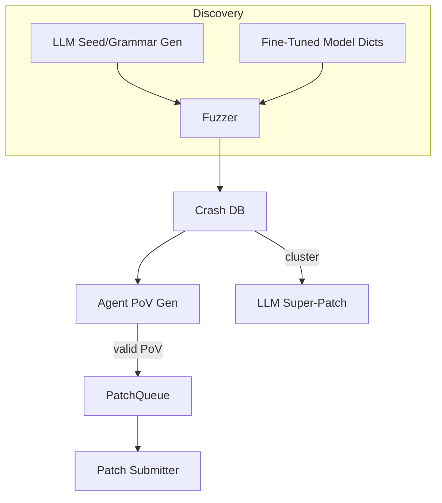

# Fuzzing Assistido por IA e Descoberta Automatizada de Vulnerabilidades

{{#include ../banners/hacktricks-training.md}}

## Visão geral
Os modelos de linguagem de grande escala (LLMs) podem potencializar bastante os pipelines tradicionais de pesquisa de vulnerabilidades, gerando entradas semanticamente ricas, evoluindo gramáticas, raciocinando sobre dados de crashes e até propondo patches para múltiplos bugs. Esta página reúne os padrões mais eficazes observados nas finais do AI Cyber Challenge (AIxCC) da DARPA e em outras pesquisas públicas.<sup>[[4]](#references)</sup><sup>[[5]](#references)</sup>

O que segue não é uma descrição de um sistema específico usado em uma competição, mas uma abstração das técnicas para que você possa reproduzi-las nos seus próprios fluxos de trabalho.

---

## 1. Entradas seed geradas por LLM

Fuzzers tradicionais guiados por coverage (AFL++, libFuzzer, Honggfuzz…) começam com um pequeno corpus de seeds e fazem mutações cegas nos bytes. Quando o formato de entrada do alvo é complexo (SQL, URLs, protocolos binários personalizados), mutações aleatórias geralmente quebram a sintaxe antes que branches interessantes sejam alcançados.

Os LLMs podem resolver esse problema inicial gerando *geradores de seed* — scripts curtos que produzem **entradas sintaticamente corretas, mas relevantes para a segurança**. Por exemplo:

```prompt
SYSTEM: You are a helpful security engineer.
USER:
Write a Python3 program that prints 200 unique SQL injection strings targeting common anti-pattern mistakes (missing quotes, numeric context, stacked queries).  Ensure length ≤ 256 bytes / string so they survive common length limits.
```

```python
# gen_sqli_seeds.py (truncated)
PAYLOADS = [
    "1 OR 1=1 -- ",
    "' UNION SELECT NULL,NULL--",
    "0; DROP TABLE users;--",
    ...
]
for p in PAYLOADS:
    print(p)
```

Execute uma vez e forneça a saída diretamente ao corpus inicial do fuzzer:

```bash
python3 gen_sqli_seeds.py > seeds.txt
afl-fuzz -i seeds.txt -o findings/ -- ./target @@
```

Benefits:
1. Validade semântica → cobertura mais profunda desde o início.
2. Pode ser gerado novamente: ajuste o prompt para focar em XSS, path traversal, blobs binários etc.
3. Barato (< 1 ¢ com GPT-3.5).

### Dicas
* Instrua o modelo a *diversificar* o comprimento e a codificação dos payloads (UTF-8, URL-encoded, UTF-16-LE) para contornar filtros superficiais.
* Peça um *script único e autocontido* – evita problemas de formatação JSON.

---

## 2. Grammar-Evolution Fuzzing

Uma variante mais poderosa é permitir que o LLM **evolua uma gramática** em vez de seeds concretos. O workflow (padrão “Grammar Guy”) é:

1. Gere uma gramática ANTLR/Peach/LibFuzzer inicial usando um prompt.
2. Faça fuzzing por N minutos e colete métricas de cobertura (edges / blocos atingidos).
3. Resuma as áreas não cobertas do programa e envie o resumo de volta ao modelo:
   ```prompt
   The previous grammar triggered 12 % of the program edges.  Functions not reached: parse_auth, handle_upload.  Add / modify rules to cover these.
   ```
4. Mescle as novas regras, execute o fuzzing novamente e repita.

Esqueleto de pseudocódigo:

```python
for epoch in range(MAX_EPOCHS):
    grammar = llm.refine(grammar, feedback=coverage_stats)
    save(grammar, f"grammar_{epoch}.txt")
    coverage_stats = run_fuzzer(grammar)
```

Pontos-chave:
* Mantenha um *orçamento* – cada refinamento usa tokens.
* Use instruções `diff` + `patch` para que o modelo edite em vez de reescrever.
* Pare quando Δcobertura < ε.

---

## 3. Engenharia de Harness do libFuzzer com LLM local

Para código-fonte que não pode sair da estação de trabalho de um analista, um modelo de código local pode elaborar o pequeno adaptador entre os bytes do fuzzer e uma API C/C++. O limite de segurança útil é explícito: **o modelo escreve e revisa a infraestrutura de testes; a mutação guiada por cobertura explora entradas; os sanitizers relatam operações inválidas; um humano revisa o harness e faz a triagem das descobertas**.<sup>[[9]](#references)</sup>

Para técnicas de corpus, feedback, snapshot e fuzzing com estado no nível do engine que não dependem de um LLM, consulte a [Metodologia de Fuzzing](../generic-methodologies-and-resources/fuzzing.md) geral.

Comece com a declaração exata copiada do header alvo e restrinja o formato da saída. Um prompt restrito reduz APIs inventadas e facilita a revisão do resultado:<sup>[[8]](#references)[[9]](#references)</sup>

```prompt
Write a libFuzzer target for this exact declaration:
int parse_records(const uint8_t *data, size_t size);

Output only C code. Implement LLVMFuzzerTestOneInput, include the
declaration, pass data and size unchanged, and do not use files,
network access, randomness, clocks, threads, or persistent state.
```

Para um parser de bytes brutos, o resultado esperado não deve ser mais complicado do que:<sup>[[6]](#references)[[9]](#references)</sup>

```c
#include <stddef.h>
#include <stdint.h>

extern int parse_records(const uint8_t *, size_t);

int LLVMFuzzerTestOneInput(const uint8_t *data, size_t size) {
    (void)parse_records(data, size);
    return 0;
}
```

A compilação é apenas a primeira etapa de validação. Revise cada target gerado em relação a estes invariantes antes de gastar tempo de CPU com ele:<sup>[[6]](#references)[[8]](#references)[[9]](#references)</sup>

- **API exata:** compare os tipos, as regras de ownership, a inicialização, a desmontagem e a convenção de chamada com o header real e os callers existentes.
- **Segurança do harness:** proteja cada leitura de `data`; os achados do sanitizer devem ter origem no target, não no código de ligação gerado.
- **Repetibilidade:** faça com que o resultado dependa de `data` e `size`; remova I/O externo, tempo, aleatoriedade não controlada, threads sem join e estado que persista entre chamadas.
- **Throughput:** inicialize estados imutáveis e caros apenas uma vez quando isso não puder afetar o comportamento, limite o tamanho da entrada, suprima logs e libere as alocações por entrada.
- **Reachability:** verifique se as funções e branches pretendidas são executadas. Um target que compila, mas só exercita caminhos de rejeição, é uma falha silenciosa.

### Targets com reconhecimento de estrutura: preserve invariantes sem ocultar bugs

Se a maioria das entradas brutas falhar em uma verificação de magic, tamanho, versão ou checksum, use os bytes de fuzzing como **material para campos tipados** e reconstrua um objeto válido. Fixe as constantes de formato, deixe os campos semânticos e os bytes do payload mutáveis e derive os metadados de integridade do payload reconstruído. `FuzzedDataProvider` é útil para consumir valores tipados limitados, enquanto o adapter continua responsável por limitar qualquer alocação e conversão geradas.<sup>[[9]](#references)</sup>

<details>
<summary>Exemplo de target C++ com reconhecimento de estrutura</summary>

```cpp
#include <fuzzer/FuzzedDataProvider.h>
#include <stddef.h>
#include <stdint.h>
#include <vector>

extern "C" int parse_message(const uint8_t *, size_t);

extern "C" int LLVMFuzzerTestOneInput(const uint8_t *data, size_t size) {
    FuzzedDataProvider fdp(data, size);
    uint8_t version = fdp.ConsumeIntegral<uint8_t>();
    auto body = fdp.ConsumeRemainingBytes<uint8_t>();
    if (body.size() > UINT16_MAX) body.resize(UINT16_MAX);
    uint16_t len = static_cast<uint16_t>(body.size());
    std::vector<uint8_t> msg = {0x8b, 'M', 'S', 'G', version,
                                static_cast<uint8_t>(len >> 8),
                                static_cast<uint8_t>(len)};
    msg.insert(msg.end(), body.begin(), body.end());
    (void)parse_message(msg.data(), msg.size());
    return 0;
}
```

</details>

Não use um único target que repare estruturas para todas as perguntas. Mantenha um target que derive comprimentos/checksums para explorar estados válidos profundos e outro que deixe os metadados **declarados** sob controle do fuzzer, limitando apenas as leituras e alocações do próprio harness. O segundo target preserva as superfícies de ataque de comprimentos incompatíveis e integridade inválida que o reparo automático eliminaria.<sup>[[9]](#references)</sup>

### Seeds, dicionários, sanitizers e feedback de cobertura

Peça ao modelo para gerar um script que grave seeds binárias, em vez de pedir que ele imprima dados binários diretamente. Use como seeds objetos vazios, mínimos, típicos e válidos nos limites; depois, extraia valores mágicos, tags, codificações de enum e palavras-chave do parser para um dicionário revisado. O libFuzzer aceita esse dicionário com `-dict=` e mantém no corpus as mutações que revelam novas coberturas.<sup>[[6]](#references)[[9]](#references)</sup>

```text
magic="\x8bMSG"
version_min="\x00"
version_max="\xff"
config_tag="CONFIG"
```

Compile o mesmo alvo com instrumentação complementar. ASan e UBSan podem compartilhar um binário de fuzzing; use uma compilação separada com MSan e instrumente suas dependências para evitar relatórios causados por código não instrumentado.<sup>[[6]](#references)[[9]](#references)</sup>

```bash
clang++ -g -O1 -fsanitize=fuzzer,address,undefined \
  -fno-sanitize-recover=undefined target.cc harness.cc -o fuzz_target
./fuzz_target corpus -dict=msg.dict -max_len=65535

clang++ -g -O1 -fsanitize=fuzzer,memory \
  target.cc harness.cc -o fuzz_target_msan
```

Trate a cobertura como o avaliador de cada revisão do modelo. Na saída do libFuzzer, `cov`/`ft` que se estabilizam cedo e um corpus estático geralmente indicam framing incorreto, um retorno antecipado restritivo demais ou a chamada errada; `exec/s` baixo aponta para setup caro, I/O, alocação ou estado vazado. `NEW` apenas comprova que um recurso de cobertura mudou, não que o parser pretendido foi alcançado.<sup>[[6]](#references)[[9]](#references)</sup>

Para obter feedback no nível do código-fonte, gere uma build com cobertura, faça fuzzing e forneça ao modelo apenas as funções não cobertas e as condições que as protegem. Verifique as diferenças no harness/seed/dictionary e meça novamente:<sup>[[7]](#references)[[8]](#references)[[9]](#references)</sup>

```bash
clang++ -g -O1 -fsanitize=fuzzer \
  -fprofile-instr-generate -fcoverage-mapping target.cc harness.cc -o fuzz_cov
mkdir -p profiles
LLVM_PROFILE_FILE='profiles/%p.profraw' ./fuzz_cov -max_total_time=300 corpus
llvm-profdata merge -sparse profiles/*.profraw -o fuzz.profdata
llvm-cov report ./fuzz_cov -instr-profile=fuzz.profdata
llvm-cov show ./fuzz_cov -instr-profile=fuzz.profdata \
  --show-branches=count --region-coverage-lt=1 target.cc
```

O loop escalável é, portanto, **gerar → compilar/linkar → fazer smoke test com sanitizers → medir a coverage do alvo → fornecer o contexto mais relevante e conciso de coverage/código-fonte → revisar → medir novamente**. O OSS-Fuzz-Gen aplica o mesmo princípio, avaliando os alvos gerados quanto à compilabilidade, falhas em tempo de execução, coverage e melhoria da coverage em relação aos alvos existentes, em vez de aceitar código plausível sem verificá-lo.<sup>[[7]](#references)[[8]](#references)</sup>

---

<a id="3-agent-based-pov-exploit-generation" hidden>3. Geração de PoV (Exploit) com agentes</a>

## 4. Geração de PoV (Exploit) com agentes

Depois que uma falha é encontrada, ainda é necessário um **proof-of-vulnerability (PoV)** que a acione de forma determinística.

Uma abordagem escalável é iniciar muitos workers leves (processos, threads ou containers), cada um usando um modelo ou uma configuração de sampling diferente. A pesquisa dos finalistas do AIxCC fornece exemplos concretos de escala: uma equipe usou **milhares de agents concorrentes** para a geração de PoV com IA como primeira abordagem, enquanto outra coordenou **300–500 agents de fuzzing** e reservou os LLMs para o raciocínio semântico de alto nível.<sup>[[4]](#references)</sup>

Pipeline:
1. A análise estática/dinâmica produz *candidatos a bugs* (struct com crash PC, input slice e mensagem do sanitizer).
2. O orquestrador distribui os candidatos aos agents.
3. Etapas de raciocínio do agent:
   a. Reproduzir o bug localmente com `gdb` + input.
   b. Sugerir um exploit payload mínimo.
   c. Validar o exploit em um sandbox. Se funcionar → submeter.
4. As tentativas malsucedidas são **colocadas novamente na fila como novos seeds** para coverage fuzzing (ciclo de feedback).

Vantagens:
* A paralelização oculta a falta de confiabilidade de um único agent.
* Ajuste automático de temp / tamanho do modelo com base na taxa de sucesso observada.

---

<a id="4-directed-fuzzing-with-fine-tuned-code-models" hidden>4. Fuzzing direcionado com modelos de código fine-tuned</a>

## 5. Fuzzing direcionado com modelos de código fine-tuned

Faça fine-tuning de um modelo de pesos abertos (por exemplo, Llama-7B) com código-fonte C/C++ rotulado com padrões de vulnerabilidade (integer overflow, buffer copy, format string). Depois:

1. Execute a análise estática para obter a lista de funções + AST.
2. Peça ao modelo: *“Forneça entradas para o mutation dictionary que provavelmente comprometam a segurança da memória na função X”*.
3. Insira esses tokens em um `AFL_CUSTOM_MUTATOR` personalizado.

Exemplo de saída para um wrapper de `sprintf`:
```
{"pattern":"%99999999s"}
{"pattern":"AAAAAAAA....<1024>....%n"}
```

Empiricamente, isso reduz o tempo até o crash em mais de 2× em alvos reais.

---

<a id="5-ai-guided-patching-strategies" hidden>5. Estratégias de patching guiadas por IA</a>

## 6. Estratégias de patching guiadas por IA

<a id="51-super-patches" hidden>5.1 Super patches</a>

### 6.1 Super patches
Peça ao modelo para *agrupar* assinaturas de crash e propor um **único patch** que elimine a causa-raiz comum.  Envie uma vez, corrija vários bugs → menos penalidades de precisão em ambientes onde cada patch incorreto custa pontos.

Estrutura do prompt:
```
Here are 10 stack traces + file snippets.  Identify the shared mistake and generate a unified diff fixing all occurrences.
```

{{#ref}}
../generic-methodologies-and-resources/fuzzing.md
{{#endref}}

<a id="52-speculative-patch-ratio" hidden>5.2 Proporção de Patches Especulativos</a>

### 6.2 Proporção de Patches Especulativos
Implemente uma fila que intercale patches confirmados e validados por PoV com patches *especulativos* (sem PoV) em uma proporção de 1:N ajustada às regras de pontuação (por exemplo, 2 especulativos : 1 confirmado). Um modelo de custos monitora penalidades versus pontos e ajusta N automaticamente.

---

<a id="6-deterministic-file-by-file-ai-code-review" hidden>6. Revisão de Código com IA Determinística, Arquivo por Arquivo</a>

## 7. Revisão de Código com IA Determinística, Arquivo por Arquivo

Uma falha frequente em revisões assistidas por IA é pedir a um agente que inspecione um repositório inteiro e esperar que ele escolha os arquivos certos e os termos grep adequados. Um padrão mais confiável é **forçar a cobertura do repositório**:<sup>[[1]](#references)</sup>

1. Enumere os arquivos de origem.
2. Envie **um arquivo por vez** com o contexto mínimo (ponto de entrada, imports, rotas/chamadores próximos).
3. Exija um **relatório estruturado** para cada arquivo: sources, sink, validação ausente, pré-condições de exploração e nível de confiança.<sup>[[3]](#references)</sup>
4. Elimine relatórios duplicados por **padrão source→sink** e valide manualmente os de alto risco.

Esse método consome muitos tokens e gera ruído, mas é muito eficaz para revelar **bugs simples de alto impacto em source/sink** que revisões agentic amplas frequentemente deixam passar.

### Padrões de triagem que vale a pena priorizar

- **Inclusão/dispatch dinâmico em PHP**: nomes de rota/controlador/módulo controlados pelo atacante chegam a `require_once()`, `include()` ou `include_once()` sem uma allowlist estrita e canonicalização de caminhos.
- **Execução de shell em fluxos de trabalho de administração/conta**: nomes de usuário, domínios, contas FTP ou outros identificadores chegam a `exec()`, `system()`, `shell_exec()`, `passthru()`, `proc_open()` ou `popen()`.
- **Convergência de entradas estruturadas**: o mesmo parâmetro é aceito de `$_GET`, `$_POST`, JSON, XML ou parsers de corpo do framework e depois reutilizado em sinks de sistema de arquivos ou comandos do SO.

### Duas classes práticas de bugs que esse método encontra bem

- **LFI/RCE por dispatch de controladores PHP**: se um nome de controlador controlado pela requisição é concatenado em `require_once()` sem allowlist/normalização de caminho, sequências de traversal como `../` podem fazer o PHP incluir um arquivo `.php` local não pretendido. Se o atacante puder direcionar a inclusão para um arquivo PHP inserido por ele ou útil por outro motivo, a LFI se transforma em execução de código. Consulte [File Inclusion / Path Traversal](../pentesting-web/file-inclusion/README.md).<sup>[[1]](#references)</sup>
- **Command Injection autenticada em painéis de hospedagem/administração**: se campos de gerenciamento de contas, como nomes de usuário, forem inseridos em comandos de shell, um usuário autenticado com poucos privilégios poderá transformar uma ação normal de criação/exclusão em RCE. O impacto aumenta quando o painel executa o comando como uma conta de serviço com mais privilégios. Consulte [Command Injection](../pentesting-web/command-injection.md).<sup>[[1]](#references)</sup>

### Observações práticas sobre a revisão

- Use o LLM primeiro como **revisor de source/sink**, não como gerador de exploits.
- Peça que ele liste explicitamente o **campo controlado pelo atacante**, a **falha de normalização/validação** e o **sink perigoso**.
- Em repositórios grandes, a revisão determinística arquivo por arquivo costuma ser mais confiável do que uma única execução de agente autônomo, mesmo quando esta usa um modelo mais potente.<sup>[[2]](#references)</sup>
- Espere resultados mais fracos em **Broken Access Control** e outros bugs de lógica de negócios cuja explorabilidade depende de suposições entre arquivos, semântica de funções ou modelos de ameaça específicos do produto.

---

## 8. Auditoria de Kernel Orientada por Padrões com um Oráculo Instrumentado

Para um alvo do tamanho de um kernel, não peça a um agente que encontre bugs arbitrários em toda a árvore. Um fluxo de trabalho mais eficiente em termos de tokens transforma o conhecimento histórico sobre vulnerabilidades em consultas estáticas, classifica os resultados pela superfície de ataque exposta e usa um kernel instrumentado como oráculo de execução.<sup>[[11]](#references)</sup>

### Banco de dados de padrões → CodeQL/Semgrep → revisão direcionada

Crie uma pequena base de conhecimento com APIs perigosas, padrões de validação ausente, fluxos arriscados de source para sink e formatos de bugs corrigidos anteriormente. Peça ao modelo que converta **um padrão por vez** em heurísticas de revisão e regras de CodeQL/Semgrep; em seguida, execute essas regras determinísticas em toda a árvore. Agrupe e elimine correspondências duplicadas antes de devolver o código ao modelo; a saída bruta do scanner pode conter milhares de candidatos de baixo valor. Verifique a licença atual do CodeQL antes de usar essa abordagem fora de alvos elegíveis de pesquisa ou de código aberto.<sup>[[11]](#references)</sup>

Priorize subsistemas usando tanto a **densidade de ocorrências das regras** quanto a **alcançabilidade pelo atacante**, em vez de considerar apenas o número de ocorrências. Interfaces do kernel alcançáveis por processos sem privilégios, sandboxes, contêineres, jails ou contextos de convidados merecem mais peso do que código acessível apenas internamente. Mantenha a unidade de revisão pequena o bastante para que o agente retenha os chamadores, validadores e regras de ciclo de vida, e solicite uma classe de vulnerabilidade ou padrão de fluxo de controle específico, em vez de pedir para “encontrar qualquer vulnerabilidade”. Interfaces privilegiadas legadas são especialmente interessantes quando um limite de contenção mais recente as torna alcançáveis por um usuário root namespaced ou em uma jail.<sup>[[11]](#references)</sup>

Para cada candidato, exija um registro explícito do fluxo de campos antes de tentar explorá-lo.<sup>[[11]](#references)</sup>

```text
entrypoint -> privilege check -> parser -> validation/normalization
           -> later rewrite -> dangerous sink
attacker controls: <fields and lengths>
constraints:       <values rewritten, rejected, or preserved>
observable result: <sanitizer report, assertion, panic, or clean exit>
```

### Use a telemetria do KASAN como oráculo de hipóteses

Execute o kernel-alvo em uma VM descartável com KASAN e asserções de diagnóstico úteis habilitadas. O agente deve iterar por **hipótese sobre o código-fonte → trigger mínimo em userland → execução na VM → rastreamento do KASAN/asserção → hipótese revisada** até que a corrupção suspeita seja reproduzida ou descartada. Retorne apenas o stack trace relevante e o trecho de código-fonte próximo a cada iteração; isso preserva o contexto para o raciocínio e faz com que as evidências de execução, não a confiança do modelo, sejam o critério de aceitação.<sup>[[11]](#references)</sup>

Uma build instrumentada não é o ambiente final para avaliar a explorabilidade. As asserções podem interromper a execução antes da operação que corrompe a memória, enquanto a mesma asserção pode ser removida de um kernel de produção. Teste novamente o mesmo trigger, sem alterações, na configuração exata de produção, registre a build e a configuração do kernel e trate **alcançabilidade**, **corrupção de memória**, **primitiva controlada** e **impacto de segurança** como alegações distintas.<sup>[[11]](#references)[[12]](#references)</sup>

CVE-2026-3038 é um exemplo útil de validação, não um modelo de exploit. Uma solicitação `RTM_GET` sem privilégios no FreeBSD podia preservar um sockaddr `RTAX_AUTHOR` grande demais por meio de validação seletiva e reescrita da resposta, até que `rtsock_msg_buffer()` copiasse seu `sa_len` controlado pelo usuário para um `sockaddr_storage` de 128 bytes na stack. A cópia máxima de 255 bytes causava uma sobrescrita de 127 bytes; uma asserção de diagnóstico detectava o tamanho inválido na build instrumentada, enquanto um kernel GENERIC chegava à cópia e então entrava em panic quando o canário corrompido era verificado. Isso comprova uma negação de serviço sem privilégios, não uma escalada de privilégios por si só: para obter controle confiável, seria necessário primeiro outra primitiva, como a divulgação do canário. Consulte [Stack Canaries](../binary-exploitation/common-binary-protections-and-bypasses/stack-canaries/index.html) para entender o limite correspondente em binary exploitation.<sup>[[11]](#references)[[12]](#references)[[13]](#references)</sup>

### Rejeite trapaças com pré-condições de exploit

Antes de aceitar um PoV ou exploit, peça a um revisor/agente separado que tente refutá-lo com critérios fixos. A revisão deve confirmar todas as condições a seguir.<sup>[[11]](#references)</sup>

- O código-fonte do alvo, o kernel e o módulo vulnerável não foram modificados para tornar o caminho alcançável.
- Nenhum módulo auxiliar, gadget sintético, mitigação desativada, privilégio adicional ou interface indisponível foi introduzido.
- O trigger começa com a identidade de usuário e as restrições de contenção alegadas, em um snapshot limpo.
- O resultado alegado ainda depende do bug: remover o campo malformado ou corrigir apenas o bug deve interromper a cadeia.
- Um crash, overread ou overwrite é reportado apenas como essa primitiva; execução de código ou escalada de privilégios exigem evidências independentes.

Essa última verificação contrafactual detecta demonstrações circulares: se os pré-requisitos já concedem o impacto alegado (por exemplo, executar conteúdo SUID fornecido pelo atacante em um filesystem montado sem `nosuid`), o bug de segurança de memória não criou esse impacto.<sup>[[11]](#references)</sup>

---

## Pesquisa auditável assistida por agentes em bases de código desconhecidas

O [fluxo de trabalho de seleção de fuzz targets com prioridade para o grafo](../generic-methodologies-and-resources/fuzzing.md#graph-first-fuzz-target-selection-and-mutation-triage) já aborda a alcançabilidade dos entrypoints, enquanto [pipelines agentic de SAST](../network-services-pentesting/pentesting-web/code-review-tools.md#agentic-sast-pipelines) abordam revisão por etapas e critérios de evidência. Mantenha esses resultados determinísticos separados das hipóteses do modelo para que cada pista promovida mantenha localizações no código-fonte, evidências do caminho e uma medição dinâmica.<sup>[[10]](#references)</sup>

### Correlacione evidências sobre o ciclo de vida dos objetos sem inventar fluxo de dados

A análise estática pode encontrar um comprimento controlado pelo atacante sendo armazenado em uma função e o mesmo campo do objeto chegando a um ponto de cópia muito depois, mas não conseguir provar a conexão entre callbacks, reconexões ou o ciclo de vida do objeto. Preserve as duas descobertas separadamente, agrupe-as por objeto/campo e transforme a aresta ausente em uma pergunta explícita de triagem. O agente pode sugerir a relação, mas a revisão do código-fonte ou a instrumentação em tempo de execução precisa comprová-la.<sup>[[10]](#references)</sup>

Para cada candidato, registre:

- o entrypoint concreto e os bytes controlados pelo atacante;
- todos os produtores do campo relevante, incluindo a validação específica de cada produtor;
- o ponto de destino, a capacidade do destino e as condições de build/execução necessárias para alcançá-lo;
- uma call stack real a partir do entrypoint exposto, não apenas a invocação direta de um harness;
- o menor resultado dinâmico que confirme ou rejeite a hipótese.

Um caminho aparentemente seguro não valida um campo globalmente. Um segundo produtor pode preencher o mesmo campo sem o limite aplicado no primeiro caminho. Teste os caminhos de forma independente e execute o harness com opções de build equivalentes às da implantação, pois asserções de depuração podem transformar uma corrupção de memória em produção em uma interrupção antecipada, exclusiva dos testes.<sup>[[10]](#references)</sup>

### Critérios de medição para divulgação e exploração

Se houver suspeita de divulgação de memória não inicializada, preencha novas alocações com um byte identificável e verifique se o marcador exato chega ao pacote emitido. Para a exploração, exija critérios medidos, como **sobrescrita controlada → objeto-vítima útil → divulgação → recuperação de ponteiro/base → hijack do fluxo de controle → payload composto**. O agente só avança quando o harness comprova a propriedade atual; uma narrativa plausível não satisfaz um critério. O [caso FreeRDP](../binary-exploitation/libc-heap/heap-overflow.md#cross-path-length-reuse-and-stale-output-disclosure) mostra o caminho e as restrições de build que precisam ser preservados durante a validação.<sup>[[10]](#references)</sup>

---

Para um estudo de caso de kernel que aplica validação em etapas L0–L4 ao desenvolvimento de exploits assistido por LLM, consulte:

{{#ref}}
../binary-exploitation/freebsd-kernel-exploitation-vnet-jail-escape.md
{{#endref}}

## Juntando tudo
Um CRS (Cyber Reasoning System) de ponta a ponta pode conectar os componentes desta forma:



---

## References

- [1] [Project Black - IA local para cibersegurança: encontrando LFI no phpIPAM e RCE autenticado no myVesta](https://projectblack.io/blog/local-ai-for-cyber-security)
- [2] [Strix](https://github.com/usestrix/strix)
- [3] [Skill security-review da comunidade GitHub Copilot](https://github.com/github/awesome-copilot/blob/main/skills/security-review/SKILL.md)
- [4] [Trail of Bits – Finais do AIxCC: análise dos resultados](https://blog.trailofbits.com/2025/08/07/aixcc-finals-tale-of-the-tape/)
- [5] [Entrevistas da CTF Radiooo com finalistas do AIxCC](https://www.youtube.com/@ctfradiooo)
- [6] [LLVM — libFuzzer: uma biblioteca para testes fuzz guiados por cobertura](https://llvm.org/docs/LibFuzzer.html)
- [7] [Google — OSS-Fuzz-Gen](https://github.com/google/oss-fuzz-gen)
- [8] [Blog de segurança online do Google — Elevando o nível do fuzzing: encontrando mais vulnerabilidades com IA](https://security.googleblog.com/2024/11/leveling-up-fuzzing-finding-more.html)
- [9] [8kSec — Geração de harnesses de fuzzing assistida por IA com um LLM local](https://8ksec.io/ai-assisted-fuzzing-harness-local-llm)
- [10] [Quarkslab — De agentes de IA a RCE: criando um workflow de pesquisa de vulnerabilidades](https://blog.quarkslab.com/from-ai-agents-to-rce-building-a-vulnerability-research-workflow.html)
- [11] [Praetorian — FreeBSoD: usando modelos de linguagem para encontrar e explorar bugs no kernel (parte 1 de 2)](https://praetorian.com/blog/ai-vulnerability-research-freebsd-kernel)
- [12] [FreeBSD-SA-26:05.route — DoS local e possível escalada de privilégios por meio de sockets de roteamento](https://www.freebsd.org/security/advisories/FreeBSD-SA-26:05.route.asc)
- [13] [Patch de origem do FreeBSD-SA-26:05.route](https://security.FreeBSD.org/patches/SA-26:05/route.patch)
{{#include ../banners/hacktricks-training.md}}
