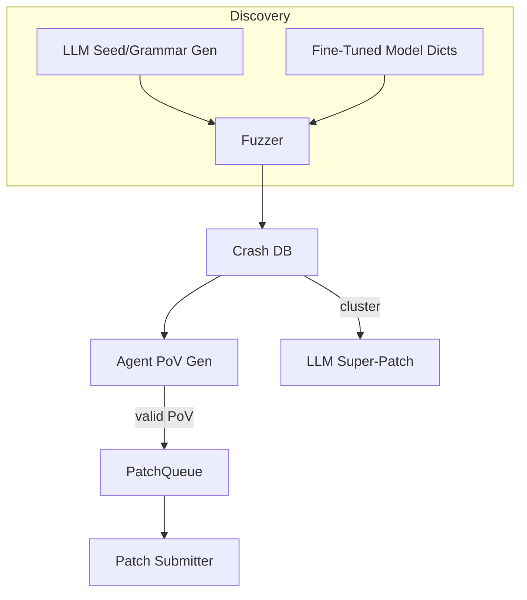

# Fuzzing Assistido por IA e Descoberta Automatizada de Vulnerabilidades

{{#include ../banners/hacktricks-training.md}}

## Visão geral
Modelos de linguagem grandes (LLMs) podem turbinar os pipelines tradicionais de pesquisa de vulnerabilidades ao gerar inputs semanticamente ricos, evoluir gramáticas, raciocinar sobre dados de crash e até propor patches para múltiplos bugs. Esta página reúne os padrões mais eficazes observados nas finais do AI Cyber Challenge (AIxCC) da DARPA e em outras pesquisas públicas.<sup>[[4]](#references)</sup><sup>[[5]](#references)</sup>

O que segue não é uma descrição de um sistema específico de competição, mas uma abstração das técnicas para que você possa reproduzi-las nos seus próprios workflows.

---

## 1. Inputs seed gerados por LLMs

Fuzzers tradicionais guiados por coverage (AFL++, libFuzzer, Honggfuzz…) começam com um pequeno corpus de seeds e mutam bytes cegamente. Quando o formato do input alvo é complexo (SQL, URLs, protocolos binários personalizados), mutações aleatórias geralmente quebram a sintaxe antes que branches interessantes sejam alcançados.

LLMs podem resolver esse problema de inicialização gerando *geradores de seeds* — scripts curtos que produzem **inputs sintaticamente corretos, mas relevantes para a segurança**. Por exemplo:

```prompt
SYSTEM: You are a helpful security engineer.
USER:
Write a Python3 program that prints 200 unique SQL injection strings targeting common anti-pattern mistakes (missing quotes, numeric context, stacked queries).  Ensure length ≤ 256 bytes / string so they survive common length limits.
```

```python
# gen_sqli_seeds.py (truncated)
PAYLOADS = [
    "1 OR 1=1 -- ",
    "' UNION SELECT NULL,NULL--",
    "0; DROP TABLE users;--",
    ...
]
for p in PAYLOADS:
    print(p)
```

Execute uma vez e forneça a saída diretamente ao corpus inicial do fuzzer:

```bash
python3 gen_sqli_seeds.py > seeds.txt
afl-fuzz -i seeds.txt -o findings/ -- ./target @@
```

Benefits:
1. Validade semântica → coverage mais profunda desde o início.
2. Regenerável: ajuste o prompt para focar em XSS, path traversal, binary blobs etc.
3. Barato (< 1 ¢ com GPT-3.5).

### Dicas
* Instrua o modelo a *diversificar* o comprimento e a codificação dos payloads (UTF-8, URL-encoded, UTF-16-LE) para contornar filtros superficiais.
* Peça um *único script autocontido* – evita problemas de formatação JSON.

---

## 2. Grammar-Evolution Fuzzing

Uma variante mais poderosa é permitir que o LLM **evolua uma gramática**, em vez de seeds concretos. O workflow (padrão “Grammar Guy”) é:

1. Gere uma gramática inicial ANTLR/Peach/LibFuzzer com um prompt.
2. Faça fuzzing por N minutos e colete métricas de coverage (edges / blocks atingidos).
3. Resuma as áreas do programa não cobertas e envie o resumo de volta ao modelo:
   ```prompt
   The previous grammar triggered 12 % of the program edges.  Functions not reached: parse_auth, handle_upload.  Add / modify rules to cover these.
   ```
4. Mescle as novas regras, execute o fuzzing novamente e repita.

Esqueleto de pseudocódigo:

```python
for epoch in range(MAX_EPOCHS):
    grammar = llm.refine(grammar, feedback=coverage_stats)
    save(grammar, f"grammar_{epoch}.txt")
    coverage_stats = run_fuzzer(grammar)
```

Pontos-chave:
* Mantenha um *orçamento* – cada refinamento consome tokens.
* Use instruções `diff` + `patch` para que o modelo edite em vez de reescrever.
* Pare quando Δcoverage < ε.

---

## 3. Engenharia de Harness do libFuzzer com LLM local

Para código-fonte que não pode sair da estação de trabalho do analista, um modelo de código local pode elaborar o pequeno adaptador entre bytes do fuzzer e uma API C/C++. A fronteira de segurança útil é explícita: **o modelo escreve e revisa a infraestrutura de teste; a mutação guiada por coverage explora entradas; os sanitizers reportam operações inválidas; um humano revisa o harness e faz a triagem dos achados**.<sup>[[9]](#references)</sup>

Para técnicas de corpus, feedback, snapshot e stateful fuzzing no nível do mecanismo que não dependem de um LLM, consulte a [Metodologia de Fuzzing](../generic-methodologies-and-resources/fuzzing.md).

Comece com a declaração exata copiada do cabeçalho do alvo e restrinja o formato de saída. Um prompt restrito reduz APIs inventadas e facilita a revisão:<sup>[[8]](#references)[[9]](#references)</sup>

```prompt
Write a libFuzzer target for this exact declaration:
int parse_records(const uint8_t *data, size_t size);

Output only C code. Implement LLVMFuzzerTestOneInput, include the
declaration, pass data and size unchanged, and do not use files,
network access, randomness, clocks, threads, or persistent state.
```

Para um parser de bytes brutos, o resultado esperado não deve ser mais complicado do que:<sup>[[6]](#references)[[9]](#references)</sup>

```c
#include <stddef.h>
#include <stdint.h>

extern int parse_records(const uint8_t *, size_t);

int LLVMFuzzerTestOneInput(const uint8_t *data, size_t size) {
    (void)parse_records(data, size);
    return 0;
}
```

A compilação é apenas a primeira etapa de validação. Revise cada target gerado com base nestes invariantes antes de gastar tempo de CPU nele:<sup>[[6]](#references)[[8]](#references)[[9]](#references)</sup>

- **API exata:** compare os tipos, as regras de ownership, a inicialização, a finalização e a convenção de chamada com o header real e os callers existentes.
- **Segurança do harness:** proteja cada leitura de `data`; os problemas encontrados pelo sanitizer devem ter origem no target, não no código glue gerado.
- **Reprodutibilidade:** faça o resultado depender de `data` e `size`; remova I/O externo, tempo, aleatoriedade não controlada, threads não sincronizadas e estado que persista entre chamadas.
- **Throughput:** inicialize o estado imutável dispendioso apenas uma vez e somente quando isso não puder afetar o comportamento, limite o tamanho da entrada, suprima os logs e libere as alocações por entrada.
- **Alcançabilidade:** verifique se as funções e branches pretendidos são executados. Um target que compila, mas só exercita caminhos de rejeição, falha silenciosamente.

### Targets com estrutura: preserve invariantes sem ocultar bugs

Se a maioria das entradas brutas falhar em uma verificação de magic, tamanho, versão ou checksum, use os bytes do fuzz como material para campos tipados e reconstrua um objeto válido. Fixe as constantes do formato, mantenha os campos semânticos e os bytes do payload mutáveis e derive os metadados de integridade do payload reconstruído. `FuzzedDataProvider` é útil para consumir valores tipados com limites, enquanto o adapter continua responsável por limitar qualquer alocação e conversão geradas.<sup>[[9]](#references)</sup>

<details>
<summary>Exemplo de target C++ com estrutura</summary>

```cpp
#include <fuzzer/FuzzedDataProvider.h>
#include <stddef.h>
#include <stdint.h>
#include <vector>

extern "C" int parse_message(const uint8_t *, size_t);

extern "C" int LLVMFuzzerTestOneInput(const uint8_t *data, size_t size) {
    FuzzedDataProvider fdp(data, size);
    uint8_t version = fdp.ConsumeIntegral<uint8_t>();
    auto body = fdp.ConsumeRemainingBytes<uint8_t>();
    if (body.size() > UINT16_MAX) body.resize(UINT16_MAX);
    uint16_t len = static_cast<uint16_t>(body.size());
    std::vector<uint8_t> msg = {0x8b, 'M', 'S', 'G', version,
                                static_cast<uint8_t>(len >> 8),
                                static_cast<uint8_t>(len)};
    msg.insert(msg.end(), body.begin(), body.end());
    (void)parse_message(msg.data(), msg.size());
    return 0;
}
```

</details>

Não use um único alvo com reparo de estrutura para todas as perguntas. Mantenha um alvo que derive comprimentos/checksums para explorar estados válidos profundos e outro que mantenha os metadados **declarados** sob controle do fuzzer, limitando apenas as leituras e alocações do próprio harness. O segundo alvo preserva superfícies de ataque com comprimentos incompatíveis e integridade inválida que o reparo automático apagaria.<sup>[[9]](#references)</sup>

### Seeds, dicionários, sanitizers e feedback de cobertura

Peça ao modelo para gerar um script que grave seeds binários, em vez de pedir para ele imprimir binário diretamente. Use como seeds objetos vazios, mínimos, típicos e válidos nos limites; depois extraia valores mágicos, tags, codificações de enum e palavras-chave do parser para um dicionário revisado. O libFuzzer aceita esse dicionário com `-dict=` e mantém no corpus as mutações que expõem nova cobertura.<sup>[[6]](#references)[[9]](#references)</sup>

```text
magic="\x8bMSG"
version_min="\x00"
version_max="\xff"
config_tag="CONFIG"
```

Compile o mesmo alvo com instrumentação complementar. ASan e UBSan podem compartilhar um binário de fuzzing; use uma compilação separada com MSan e instrumente suas dependências para evitar relatórios causados por código não instrumentado.<sup>[[6]](#references)[[9]](#references)</sup>

```bash
clang++ -g -O1 -fsanitize=fuzzer,address,undefined \
  -fno-sanitize-recover=undefined target.cc harness.cc -o fuzz_target
./fuzz_target corpus -dict=msg.dict -max_len=65535

clang++ -g -O1 -fsanitize=fuzzer,memory \
  target.cc harness.cc -o fuzz_target_msan
```

Trate a cobertura como o avaliador de cada revisão do modelo. Na saída do libFuzzer, `cov`/`ft` iniciais e estáveis e um corpus estático geralmente indicam framing incorreto, um retorno antecipado excessivamente restritivo ou uma chamada errada; `exec/s` baixo aponta para configuração, I/O ou alocação dispendiosos, ou estado vazado. `NEW` apenas prova que um recurso de cobertura mudou, não que o parser pretendido foi alcançado.<sup>[[6]](#references)[[9]](#references)</sup>

Para obter feedback no nível do código-fonte, gere uma build com cobertura, faça fuzzing e forneça ao modelo apenas as funções não cobertas e suas condições de proteção. Verifique o diff do harness/seed/dictionary e meça novamente:<sup>[[7]](#references)[[8]](#references)[[9]](#references)</sup>

```bash
clang++ -g -O1 -fsanitize=fuzzer \
  -fprofile-instr-generate -fcoverage-mapping target.cc harness.cc -o fuzz_cov
mkdir -p profiles
LLVM_PROFILE_FILE='profiles/%p.profraw' ./fuzz_cov -max_total_time=300 corpus
llvm-profdata merge -sparse profiles/*.profraw -o fuzz.profdata
llvm-cov report ./fuzz_cov -instr-profile=fuzz.profdata
llvm-cov show ./fuzz_cov -instr-profile=fuzz.profdata \
  --show-branches=count --region-coverage-lt=1 target.cc
```

O loop escalável é, portanto, **gerar → compilar/ligar → executar smoke-test com sanitizers → medir a cobertura do alvo → fornecer o menor contexto relevante de cobertura/código-fonte → revisar → medir novamente**. O OSS-Fuzz-Gen aplica o mesmo princípio ao avaliar os alvos gerados quanto à compilabilidade, falhas em tempo de execução, cobertura e melhoria da cobertura em relação aos alvos existentes, em vez de aceitar código plausível sem validação.<sup>[[7]](#references)[[8]](#references)</sup>

---

<a id="3-agent-based-pov-exploit-generation" hidden>3. Geração de PoV (Exploit) baseada em agentes</a>

## 4. Geração de PoV (Exploit) baseada em agentes

Depois que uma falha é encontrada, você ainda precisa de uma **prova de vulnerabilidade (PoV)** que a acione de forma determinística.

Uma abordagem escalável é iniciar muitos workers leves (processos, threads ou containers), cada um usando um modelo ou uma configuração de amostragem diferente. A pesquisa sobre os finalistas do AIxCC apresenta exemplos concretos dessa escala: uma equipe usou **milhares de agentes simultâneos** para gerar PoVs com AI em primeiro lugar, enquanto outra coordenou **300–500 agentes de fuzzing** e reservou os LLMs para raciocínio semântico de nível superior.<sup>[[4]](#references)</sup>

Pipeline:
1. A análise estática/dinâmica produz *candidatos a bug* (struct com PC da falha, trecho da entrada, mensagem do sanitizer).
2. O orquestrador distribui os candidatos aos agentes.
3. Etapas de raciocínio do agente:
   a. Reproduzir o bug localmente com `gdb` + entrada.
   b. Sugerir um payload de exploit mínimo.
   c. Validar o exploit em um sandbox. Se for bem-sucedido → enviar.
4. As tentativas malsucedidas são **enfileiradas novamente como novas seeds** para o fuzzing de cobertura (loop de feedback).

Vantagens:
* A paralelização disfarça a falta de confiabilidade de um único agente.
* Ajuste automático da temperatura / tamanho do modelo com base na taxa de sucesso observada.

---

<a id="4-directed-fuzzing-with-fine-tuned-code-models" hidden>4. Fuzzing direcionado com modelos de código ajustados</a>

## 5. Fuzzing direcionado com modelos de código ajustados

Faça fine-tuning de um modelo de pesos abertos (por exemplo, Llama-7B) com código-fonte C/C++ rotulado com padrões de vulnerabilidade (estouro de inteiro, cópia de buffer, format string). Em seguida:

1. Execute uma análise estática para obter a lista de funções + AST.
2. Peça ao modelo: *“Forneça entradas para o dicionário de mutações que provavelmente comprometam a segurança de memória na função X”*.
3. Insira esses tokens em um `AFL_CUSTOM_MUTATOR` personalizado.

Exemplo de saída para um wrapper de `sprintf`:
```
{"pattern":"%99999999s"}
{"pattern":"AAAAAAAA....<1024>....%n"}
```

Empiricamente, isso reduz o tempo até a falha em mais de 2× em alvos reais.

---

<a id="5-ai-guided-patching-strategies" hidden>5. Estratégias de Patching Orientadas por IA</a>

## 6. Estratégias de Patching Orientadas por IA

<a id="51-super-patches" hidden>5.1 Super Patches</a>

### 6.1 Super Patches
Peça ao modelo para *agrupar* assinaturas de falha e propor um **único patch** que elimine a causa raiz comum. Envie uma vez, corrija vários bugs → menos penalidades de precisão em ambientes onde cada patch incorreto custa pontos.

Estrutura do prompt:
```
Here are 10 stack traces + file snippets.  Identify the shared mistake and generate a unified diff fixing all occurrences.
```

{{#ref}}
../generic-methodologies-and-resources/fuzzing.md
{{#endref}}

<a id="52-speculative-patch-ratio" hidden>5.2 Razão de Patches Especulativos</a>

### 6.2 Razão de Patches Especulativos
Implemente uma fila em que patches confirmados e validados por PoV e patches *especulativos* (sem PoV) sejam intercalados em uma proporção de 1:​N ajustada às regras de pontuação (por exemplo, 2 especulativos : 1 confirmado). Um modelo de custos monitora as penalidades em relação aos pontos e ajusta N automaticamente.

---

Para revisões determinísticas do código-fonte arquivo por arquivo, fluxos de tarefas de pontos de entrada móveis, auditorias de padrões de kernel e validação de vulnerabilidades condicionada a evidências, consulte [Revisão de código-fonte assistida por IA e validação de vulnerabilidades](AI-Assisted-Source-Review-and-Vulnerability-Validation.md).

---

## Triagem de falhas assistida por debugger

Os fluxos de trabalho do Mona v3 para triagem de falhas, análise de funções e análise controlada de alcançabilidade de heap chunks estão em [Ferramentas de Exploração](../binary-exploitation/basic-stack-binary-exploitation-methodology/tools/#mona-v3-debugger-context-requests-for-crash-triage).

---

## Juntando Tudo
Um CRS (Sistema de Raciocínio Cibernético) de ponta a ponta pode conectar os componentes assim:



---

## References

- [4] [Trail of Bits – AIxCC finais: O balanço da competição](https://blog.trailofbits.com/2025/08/07/aixcc-finals-tale-of-the-tape/)
- [5] [Entrevistas da CTF Radiooo com finalistas do AIxCC](https://www.youtube.com/@ctfradiooo)
- [6] [LLVM — libFuzzer: uma biblioteca para testes de fuzzing guiados por cobertura](https://llvm.org/docs/LibFuzzer.html)
- [7] [Google — OSS-Fuzz-Gen](https://github.com/google/oss-fuzz-gen)
- [8] [Google Online Security Blog — Elevando o nível do fuzzing: encontrando mais vulnerabilidades com IA](https://security.googleblog.com/2024/11/leveling-up-fuzzing-finding-more.html)
- [9] [8kSec — Geração de harnesses de fuzzing assistida por IA com um LLM local](https://8ksec.io/ai-assisted-fuzzing-harness-local-llm)
{{#include ../banners/hacktricks-training.md}}
