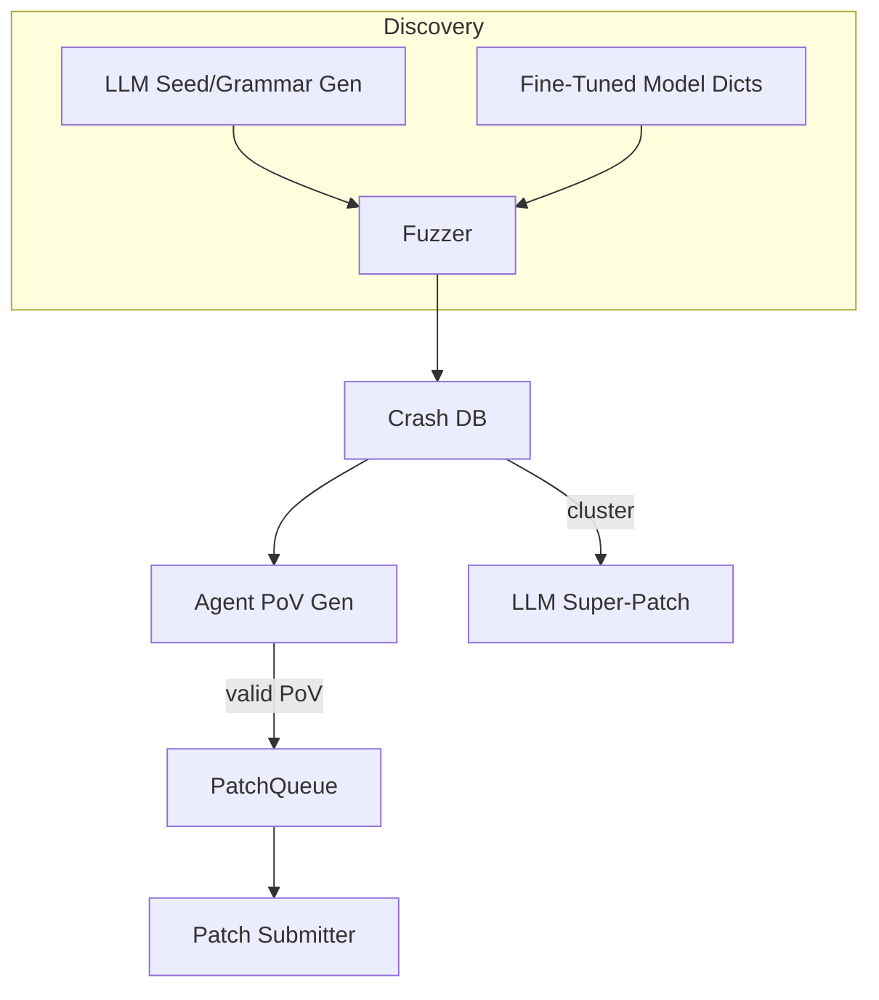

# Fuzzing uz pomoć AI-ja i automatizovano otkrivanje ranjivosti

{{#include ../banners/hacktricks-training.md}}

## Pregled
Veliki jezički modeli (LLM-ovi) mogu znatno da unaprede tradicionalne tokove rada za istraživanje ranjivosti tako što generišu semantički bogate ulaze, evoluiraju gramatike, analiziraju podatke o padovima, pa čak i predlažu zakrpe za više bagova. Ova stranica prikuplja najefikasnije obrasce uočene tokom finala DARPA-inog AI Cyber Challenge-a (AIxCC) i drugih javnih istraživanja.<sup>[[4]](#references)</sup><sup>[[5]](#references)</sup>

Ovo nije opis konkretnog sistema sa određenog takmičenja, već apstrakcija tehnika koje možete da primenite u sopstvenim tokovima rada.

---

## 1. Ulazni seedovi generisani pomoću LLM-a

Tradicionalni fuzzers vođeni pokrivenošću (AFL++, libFuzzer, Honggfuzz…) počinju s malim korpusom seedova i nasumično menjaju bajtove. Kada je format ulaza za cilj složen (SQL, URL-ovi, prilagođeni binarni protokoli), nasumične izmene obično naruše sintaksu pre nego što se dođe do zanimljivih grana.

LLM-ovi mogu da reše ovaj početni problem tako što generišu *generatore seedova* — kratke skripte koje emituju **sintaksno ispravne ulaze relevantne za bezbednost**. Na primer:

```prompt
SYSTEM: You are a helpful security engineer.
USER:
Write a Python3 program that prints 200 unique SQL injection strings targeting common anti-pattern mistakes (missing quotes, numeric context, stacked queries).  Ensure length ≤ 256 bytes / string so they survive common length limits.
```

```python
# gen_sqli_seeds.py (truncated)
PAYLOADS = [
    "1 OR 1=1 -- ",
    "' UNION SELECT NULL,NULL--",
    "0; DROP TABLE users;--",
    ...
]
for p in PAYLOADS:
    print(p)
```

Pokrenite jednom i direktno prosledite izlaz u početni korpus fuzzera:

```bash
python3 gen_sqli_seeds.py > seeds.txt
afl-fuzz -i seeds.txt -o findings/ -- ./target @@
```

Prednosti:
1. Semantička validnost → dublja pokrivenost u ranoj fazi.
2. Može se ponovo generisati: izmenite prompt da se fokusira na XSS, path traversal, binary blobs itd.
3. Jeftino (< 1 ¢ uz GPT-3.5).

### Saveti
* Uputite model da *diversifikuje* dužinu payload-a i encoding (UTF-8, URL-encoded, UTF-16-LE) kako bi zaobišao površne filtere.
* Zatražite *jednu samostalnu skriptu* – tako se izbegavaju problemi sa formatiranjem JSON-a.

---

## 2. Grammar-Evolution Fuzzing

Moćnija varijanta je da LLM **razvija gramatiku** umesto konkretnih seed-ova. Workflow (obrazac „Grammar Guy“) je:

1. Promptom generišite početnu ANTLR/Peach/LibFuzzer gramatiku.
2. Fuzz-ujte N minuta i prikupite metrike pokrivenosti (pogodjene edges / blocks).
3. Sažmite nepokrivene oblasti programa i prosledite sažetak nazad modelu:
   ```prompt
   The previous grammar triggered 12 % of the program edges.  Functions not reached: parse_auth, handle_upload.  Add / modify rules to cover these.
   ```
4. Spojite nova pravila, ponovo pokrenite fuzzing i ponovite.

Kostur pseudokoda:

```python
for epoch in range(MAX_EPOCHS):
    grammar = llm.refine(grammar, feedback=coverage_stats)
    save(grammar, f"grammar_{epoch}.txt")
    coverage_stats = run_fuzzer(grammar)
```

Ključne tačke:
* Držite se *budžeta* – svako doterivanje troši tokene.
* Koristite instrukcije `diff` + `patch` da bi model menjao, umesto da iznova piše.
* Zaustavite se kada je Δcoverage < ε.

---

## 3. Inženjering libFuzzer harness-a za lokalne LLM-ove

Kada izvorni kod ne sme da napusti analitičarevu radnu stanicu, lokalni model koda može da napravi mali adapter između bajtova fuzzera i C/C++ API-ja. Korisna bezbednosna granica je jasna: **model piše i dorađuje testnu infrastrukturu; mutacija vođena coverage-om istražuje ulaze; sanitizatori prijavljuju nevažeće operacije; čovek pregleda harness i trijažira nalaze**.<sup>[[9]](#references)</sup>

Za tehnike rada sa corpus-om, feedback-om, snapshot-ovima i stateful-fuzzing-om na nivou engine-a koje ne zavise od LLM-a, pogledajte opštu [Fuzzing Methodology](../generic-methodologies-and-resources/fuzzing.md).

Počnite od tačne deklaracije, kopirane iz zaglavlja ciljnog programa, i ograničite format izlaza. Usko postavljen prompt smanjuje broj izmišljenih API-ja i olakšava pregled rezultata:<sup>[[8]](#references)[[9]](#references)</sup>

```prompt
Write a libFuzzer target for this exact declaration:
int parse_records(const uint8_t *data, size_t size);

Output only C code. Implement LLVMFuzzerTestOneInput, include the
declaration, pass data and size unchanged, and do not use files,
network access, randomness, clocks, threads, or persistent state.
```

Za parser sirovih bajtova, očekivani rezultat ne bi trebalo da bude ništa složeniji od:<sup>[[6]](#references)[[9]](#references)</sup>

```c
#include <stddef.h>
#include <stdint.h>

extern int parse_records(const uint8_t *, size_t);

int LLVMFuzzerTestOneInput(const uint8_t *data, size_t size) {
    (void)parse_records(data, size);
    return 0;
}
```

Kompilacija je samo prva faza provere. Pre nego što potrošite CPU vreme, proverite svaki generisani target u odnosu na sledeće invarijante:<sup>[[6]](#references)[[8]](#references)[[9]](#references)</sup>

- **Tačan API:** uporedite tipove, pravila vlasništva, inicijalizaciju, razgradnju i konvenciju pozivanja sa stvarnim zaglavljem i postojećim pozivaocima.
- **Bezbednost harness-a:** zaštitite svako čitanje iz `data`; nalazi sanitizer-a moraju poticati iz targeta, a ne iz generisanog glue koda.
- **Ponovljivost:** rezultat treba da bude funkcija od `data` i `size`; uklonite eksterni I/O, vreme, nekontrolisanu nasumičnost, niti koje nisu spojene i stanje koje preživljava između poziva.
- **Propusnost:** inicijalizujte skupo nepromenljivo stanje jednom samo ako to ne može da utiče na ponašanje, ograničite veličinu ulaza, isključite logovanje i oslobodite alokacije za svaki ulaz.
- **Dostižnost:** proverite da li se izvršavaju predviđene funkcije i grane. Target koji se kompajlira, ali izvršava samo putanje odbijanja, predstavlja neprimetan neuspeh.

### Targeti koji uzimaju u obzir strukturu: očuvajte invarijante bez prikrivanja grešaka

Ako većina sirovih ulaza ne prođe proveru magične vrednosti, dužine, verzije ili kontrolne sume, koristite fuzz bajtove kao materijal za **tipizirana polja** i ponovo izgradite validan objekat. Postavite konstante formata, ostavite semantička polja i bajtove payload-a promenljivim i izračunajte metapodatke integriteta na osnovu rekonstruisanog payload-a. `FuzzedDataProvider` je koristan za preuzimanje ograničenih tipiziranih vrednosti, dok je adapter i dalje odgovoran za ograničavanje svih generisanih alokacija i konverzija.<sup>[[9]](#references)</sup>

<details>
<summary>Primer C++ targeta koji uzima u obzir strukturu</summary>

```cpp
#include <fuzzer/FuzzedDataProvider.h>
#include <stddef.h>
#include <stdint.h>
#include <vector>

extern "C" int parse_message(const uint8_t *, size_t);

extern "C" int LLVMFuzzerTestOneInput(const uint8_t *data, size_t size) {
    FuzzedDataProvider fdp(data, size);
    uint8_t version = fdp.ConsumeIntegral<uint8_t>();
    auto body = fdp.ConsumeRemainingBytes<uint8_t>();
    if (body.size() > UINT16_MAX) body.resize(UINT16_MAX);
    uint16_t len = static_cast<uint16_t>(body.size());
    std::vector<uint8_t> msg = {0x8b, 'M', 'S', 'G', version,
                                static_cast<uint8_t>(len >> 8),
                                static_cast<uint8_t>(len)};
    msg.insert(msg.end(), body.begin(), body.end());
    (void)parse_message(msg.data(), msg.size());
    return 0;
}
```

</details>

Nemojte koristiti jedan target koji popravlja strukturu za svako pitanje. Održavajte jedan target koji izračunava dužine/proverne sume kako bi istraživao duboka validna stanja, i drugi koji fuzzeru prepušta kontrolu nad **deklarisanim** metapodacima, a ograničava samo čitanja i alokacije koje obavlja sam harness. Drugi target čuva površine napada sa nepodudarnim dužinama i neispravnim integritetom, koje bi automatska popravka inače uklonila.<sup>[[9]](#references)</sup>

### Početni primerci, rečnici, sanitizatori i povratne informacije o pokrivenosti

Zatražite od modela da generiše skriptu koja zapisuje binarne početne primerke, umesto da tražite da ih ispiše direktno u binarnom obliku. Napravite početne primerke za prazne, minimalne, tipične i granične validne objekte; zatim izdvojite magic vrednosti, oznake, kodiranja enum vrednosti i ključne reči parsera u provereni rečnik. libFuzzer prihvata taj rečnik uz `-dict=`, a u korpusu zadržava mutacije koje otkrivaju novu pokrivenost.<sup>[[6]](#references)[[9]](#references)</sup>

```text
magic="\x8bMSG"
version_min="\x00"
version_max="\xff"
config_tag="CONFIG"
```

Napravite isti target uz komplementarnu instrumentaciju. ASan i UBSan mogu da dele fuzzing binary; koristite zaseban MSan build i instrumentirajte njegove zavisnosti da biste izbegli prijave izazvane neinstrumentiranim kodom.<sup>[[6]](#references)[[9]](#references)</sup>

```bash
clang++ -g -O1 -fsanitize=fuzzer,address,undefined \
  -fno-sanitize-recover=undefined target.cc harness.cc -o fuzz_target
./fuzz_target corpus -dict=msg.dict -max_len=65535

clang++ -g -O1 -fsanitize=fuzzer,memory \
  target.cc harness.cc -o fuzz_target_msan
```

Tretirajte pokrivenost kao merilo za svaku reviziju modela. U izlazu libFuzzer-a, rano zaravnjeni `cov`/`ft` i statički korpus obično ukazuju na loše uokviravanje, previše restriktivan rani povratak ili pogrešan poziv; nizak `exec/s` ukazuje na skupu pripremu, I/O, alokaciju ili leaked state. `NEW` samo potvrđuje da se promenila neka funkcija pokrivenosti, ne i da je dosegnut željeni parser.<sup>[[6]](#references)[[9]](#references)</sup>

Za povratne informacije na nivou izvornog koda, napravite build sa pokrivenošću, pokrenite fuzzing i dajte modelu samo nepokrivene funkcije i uslove koji ih štite. Proverite nastale izmene u harness-u/seedu/rečniku i ponovo izmerite:<sup>[[7]](#references)[[8]](#references)[[9]](#references)</sup>

```bash
clang++ -g -O1 -fsanitize=fuzzer \
  -fprofile-instr-generate -fcoverage-mapping target.cc harness.cc -o fuzz_cov
mkdir -p profiles
LLVM_PROFILE_FILE='profiles/%p.profraw' ./fuzz_cov -max_total_time=300 corpus
llvm-profdata merge -sparse profiles/*.profraw -o fuzz.profdata
llvm-cov report ./fuzz_cov -instr-profile=fuzz.profdata
llvm-cov show ./fuzz_cov -instr-profile=fuzz.profdata \
  --show-branches=count --region-coverage-lt=1 target.cc
```

Skalabilna petlja je zato **generiši → kompajliraj/poveži → izvrši smoke-test pod sanitizer-ima → izmeri pokrivenost cilja → obezbedi najmanji relevantni kontekst pokrivenosti/izvornog koda → revidiraj → ponovo izmeri**. OSS-Fuzz-Gen primenjuje isti princip tako što procenjuje generisane ciljeve prema mogućnosti kompilacije, greškama tokom izvršavanja, pokrivenosti i poboljšanju pokrivenosti u odnosu na postojeće ciljeve, umesto da prihvata uverljiv kod zdravo za gotovo.<sup>[[7]](#references)[[8]](#references)</sup>

---

<a id="3-agent-based-pov-exploit-generation" hidden>3. Generisanje PoV-a (exploit-a) zasnovano na agentima</a>

## 4. Generisanje PoV-a (exploit-a) zasnovano na agentima

Nakon što se pronađe crash, i dalje vam je potreban **proof-of-vulnerability (PoV)** koji ga deterministički izaziva.

Skalabilan pristup je pokretanje velikog broja laganih radnika (procesa, niti ili kontejnera), od kojih svaki koristi drugi model ili konfiguraciju uzorkovanja. Pregled AIxCC finalista navodi konkretne primere razmera: jedan tim koristio je **hiljade istovremenih agenata** za AI-first generisanje PoV-a, dok je drugi orkestrirao **300–500 fuzzing agenata** i koristio LLM-ove za semantičko rezonovanje višeg nivoa.<sup>[[4]](#references)</sup>

Pipeline:
1. Statička/dinamička analiza daje *kandidate za greške* (strukturu sa crash PC-jem, delom ulaza, porukom sanitizer-a).
2. Orkestrator prosleđuje kandidate agentima.
3. Koraci rezonovanja agenta:
   a. Lokalno reprodukuje grešku pomoću `gdb` + ulaza.
   b. Predlaže minimalni exploit payload.
   c. Validira exploit u sandbox-u. Ako uspe → šalje ga.
4. Neuspešni pokušaji se **ponovo stavljaju u red čekanja kao novi seed-ovi** za coverage fuzzing (povratna sprega).

Prednosti:
* Paralelizacija prikriva nepouzdanost pojedinačnog agenta.
* Automatsko podešavanje privremenog direktorijuma / veličine modela na osnovu uočene stope uspeha.

---

<a id="4-directed-fuzzing-with-fine-tuned-code-models" hidden>4. Usmereni fuzzing sa fino podešenim modelima koda</a>

## 5. Usmereni fuzzing sa fino podešenim modelima koda

Fino podesite model otvorenih težina (npr. Llama-7B) na C/C++ izvornom kodu označenom obrascima ranjivosti (integer overflow, kopiranje bafera, format string). Zatim:

1. Pokrenite statičku analizu da biste dobili listu funkcija + AST.
2. Zadajte modelu prompt: *„Navedite unose rečnika mutacija za koje je verovatno da će narušiti bezbednost memorije u funkciji X“*.
3. Ubacite te tokene u prilagođeni `AFL_CUSTOM_MUTATOR`.

Primer izlaza za omotač oko `sprintf`:
```
{"pattern":"%99999999s"}
{"pattern":"AAAAAAAA....<1024>....%n"}
```

Empirijski, ovo skraćuje vreme do pada za više od 2× na stvarnim ciljevima.

---

<a id="5-ai-guided-patching-strategies" hidden>5. Strategije patchovanja uz pomoć AI-ja</a>

## 6. Strategije patchovanja uz pomoć AI-ja

<a id="51-super-patches" hidden>5.1 Super patch-evi</a>

### 6.1 Super patch-evi
Zatražite od modela da *grupiše* potpise padova i predloži **jedan patch** koji otklanja zajednički osnovni uzrok.  Podnesite ga jednom, popravite nekoliko grešaka → manje kazni za preciznost u okruženjima u kojima svaki pogrešan patch košta poene.

Okvir prompta:
```
Here are 10 stack traces + file snippets.  Identify the shared mistake and generate a unified diff fixing all occurrences.
```

{{#ref}}
../generic-methodologies-and-resources/fuzzing.md
{{#endref}}

<a id="52-speculative-patch-ratio" hidden>5.2 Odnos spekulativnih zakrpa</a>

### 6.2 Odnos spekulativnih zakrpa
Implementirajte red u kojem se zakrpe potvrđene pomoću PoV-a i *spekulativne* zakrpe (bez PoV-a) smenjuju u odnosu 1:​N, podešenom prema pravilima bodovanja (npr. 2 spekulativne : 1 potvrđena). Model troškova prati kazne u odnosu na poene i automatski prilagođava N.

---

<a id="6-deterministic-file-by-file-ai-code-review" hidden>6. Determinisana AI revizija koda, datoteku po datoteku</a>

## 7. Determinisana AI revizija koda, datoteku po datoteku

Čest uzrok neuspeha pri AI-potpomognutoj reviziji jeste kada se od jednog agenta zatraži da pregleda ceo repozitorijum, uz nadu da će odabrati prave datoteke i termine za grep. Pouzdaniji obrazac je da **nametnete pokrivenost repozitorijuma**:<sup>[[1]](#references)</sup>

1. Popišite izvorne datoteke.
2. Šaljite **po jednu datoteku** uz minimalni kontekst (ulazna tačka, importi, obližnje rute/pozivaoci).
3. Zahtevajte **strukturisani izveštaj** za svaku datoteku: izvor, sink, nedostajuća validacija, preduslovi za eksploataciju i pouzdanost.<sup>[[3]](#references)</sup>
4. Uklonite duplikate izveštaja prema **obrascu source→sink** i ručno proverite one sa visokim rizikom.

Ovaj pristup troši mnogo tokena i stvara šum, ali je veoma efikasan u otkrivanju **jednostavnih source/sink bagova sa velikim uticajem** koje šire agentne revizije često previde.

### Obrasci za triage kojima vredi dati prednost

- **Dinamički PHP include/dispatch**: nazivi ruta/kontrolера/modula под контролом napadača prosleđuju se u `require_once()`, `include()` ili `include_once()` bez stroge allowliste i kanonikalizacije putanje.
- **Izvršavanje shell komandi u administratorskim tokovima/nalozima**: korisnička imena, domeni, FTP nalozi ili drugi identifikatori stižu do `exec()`, `system()`, `shell_exec()`, `passthru()`, `proc_open()` ili `popen()`.
- **Spajanje strukturisanih ulaza**: isti parametar prihvata se iz `$_GET`, `$_POST`, JSON-a, XML-a ili parsera tela zahteva u okviru frameworka, a kasnije ponovo koristi u sinkovima za sistem datoteka ili OS komande.

### Dve praktične klase bagova koje ovaj metod dobro pronalazi

- **LFI/RCE preko PHP controller-dispatch-a**: ako se naziv kontrolera pod kontrolom zahteva konkatenira u `require_once()` bez allowliste/normalizacije putanje, sekvence za traversal poput `../` mogu navesti PHP da uključi neželjenu lokalnu `.php` datoteku. Ako napadač može da usmeri include na podmetnutu ili na drugi način korisnu PHP datoteku, LFI postaje izvršavanje koda. Pogledajte [File Inclusion / Path Traversal](../pentesting-web/file-inclusion/README.md).<sup>[[1]](#references)</sup>
- **Autentifikovana command injection ranjivost u hosting/administratorskim panelima**: ako se polja za upravljanje nalozima, poput korisničkih imena, ugrađuju u shell komande, autentifikovani korisnik sa niskim privilegijama može uobičajenu akciju kreiranja/brisanja da pretvori u RCE. Uticaj je veći kada panel izvršava komandu kao servisni nalog sa višim privilegijama. Pogledajte [Command Injection](../pentesting-web/command-injection.md).<sup>[[1]](#references)</sup>

### Praktične napomene za reviziju

- Koristite LLM najpre kao **recenzenta source/sink obrazaca**, a ne kao generator eksploita.
- Zatražite da izričito navede **polje pod kontrolom napadača**, **propust u normalizaciji/validaciji** i **opasan sink**.
- U velikim repozitorijumima determinisana revizija po datotekama često je pouzdanija od jednog autonomnog pokretanja agenta, čak i kada se koristi snažniji model.<sup>[[2]](#references)</sup>
- Očekujte slabije rezultate za **Broken Access Control** i druge bagove poslovne logike, kod kojih mogućnost eksploatacije zavisi od pretpostavki kroz više datoteka, semantike uloga ili modela pretnji specifičnog za proizvod.

---

## Tokovi zadataka za mobilne ulazne tačke

Jedan prompt za ceo repozitorijum često meša modele pretnji i gubi putanju od spolja dostupne komponente do osetljivog sinka. Bolji tok rada deli reviziju na tokove zadataka sa stanjem: prvo klasifikujte aplikacije/komponente, zatim popišite ulazne tačke pod kontrolom napadača, obogatite svaku ulaznu tačku metapodacima o dostupnosti i na kraju svaku proverite u odnosu na klase ranjivosti specifične za platformu. Mobilni tokovi zadataka GitHub Security Lab-a primenjuju ovaj obrazac na Android, iOS i višeplatformske repozitorijume.<sup>[[14]](#references)[[15]](#references)</sup>

Za Android zabeležite najmanje:<sup>[[14]](#references)[[15]](#references)</sup>

- izvezene Activities, Services, Receivers i Providers, uključujući dozvole;
- intent akcije, šeme/hostove/putanje deep linkova, MIME filtere i App Links;
- akcije pod kontrolom napadača, URI-jeve podataka, `ClipData`, dodatne podatke i zastavice za dodelu URI dozvola;
- ulaze za navigaciju u WebView-u i mostove `addJavascriptInterface`;
- nizvodne privilegovane operacije, uvezene resurse i mrežna odredišta.

Zatim klasifikujte svaku ulaznu tačku u kontekstu. Izričito proverite autorizaciju pozivaoca i ponašanje confused-deputy, preusmeravanje intent-a, lažiranje ili otkrivanje podataka putem broadcast-a, nebezbedne importe, skriptovanje u WebView-u i izloženost mostova, kao i prenos akreditiva ili kolačića između origin-a. Pokrenite i **proveru po strogoj kontrolnoj listi** i **širu adversarijalnu proveru**. Povežite nalaze sa [Intent Injection](../mobile-pentesting/android-app-pentesting/intent-injection.md) i [WebView Attacks](../mobile-pentesting/android-app-pentesting/webview-attacks.md), umesto da ponavljate pojedinosti o eksploataciji.<sup>[[15]](#references)</sup>

Trenutni tokovi zadataka otvorenog koda mogu se pokrenuti iz njihovog Codespace-a pomoću:<sup>[[14]](#references)</sup>

```bash
./scripts/audit/run_audit.sh owner/repository
```

Rezultati se upisuju u SQLite tabelu `audit_result`.<sup>[[14]](#references)</sup> Redove označene kao ranjive tretirajte kao **tragove**, a ne kao potvrđene nalaze. Za svaki trag zahtevajte od modela da navede izvor pod kontrolom napadača, osetljivi odredišni element, preduslove i očekivani uticaj, a zatim tražite da napravi minimalni PoC. Izvršite taj PoC nad originalnom verzijom, uz debugger ili instrumentaciju. Time se otkrivaju česte greške statičke analize, kao što su nedostižne grane, nerealistično stanje aplikacije, gubitak prednosti podataka iz spoljne memorije u odnosu na privatne podatke i mere ublažavanja koje značajno smanjuju ozbiljnost.<sup>[[15]](#references)</sup>

---

## 8. Revizija kernela vođena obrascima uz instrumentisani oracle

Kada je cilj kernel, nemojte tražiti od agenta da pronađe proizvoljne greške u celom stablu koda. Efikasniji tok rada u pogledu potrošnje tokena pretvara znanje o istorijskim ranjivostima u statičke upite, rangira rezultate prema izloženoj površini napada i koristi instrumentisani kernel kao izvršni oracle.<sup>[[11]](#references)</sup>

### Baza obrazaca → CodeQL/Semgrep → fokusirani pregled

Napravite malu bazu znanja koja sadrži opasne API-je, obrasce izostale validacije, rizične tokove od izvora do odredišta i oblike ranjivosti koji su ranije ispravljeni. Tražite od modela da prevede **jedan obrazac odjednom** u heuristike za pregled i CodeQL/Semgrep pravila, a zatim pokrenite ta deterministička pravila nad celim stablom koda. Grupišite i uklonite duplikate iz rezultata pre nego što vratite kod modelu; sirovi izlaz skenera može da sadrži hiljade kandidata male vrednosti. Pre primene ovog pristupa izvan istraživačkih ili open-source ciljeva za koje ispunjavate uslove, proverite aktuelnu licencu za CodeQL.<sup>[[11]](#references)</sup>

Dajte prioritet podsistemima na osnovu **gustine podudaranja s pravilima** i **dostupnosti napadaču**, a ne samo broja podudaranja. Interfejsi kernela dostupni neprivilegovanim procesima, sandbox okruženjima, kontejnerima, jail okruženjima ili gostujućim kontekstima zaslužuju veću težinu od koda dostupnog samo interno. Ograničite jedinicu pregleda tako da agent može da zadrži kontekst pozivalaca, validatora i pravila životnog ciklusa, i zatražite određenu klasu ranjivosti ili obrazac toka kontrole umesto „pronađi bilo koju ranjivost“. Nasleđeni privilegovani interfejsi posebno su zanimljivi kada ih novija granica izolacije učini dostupnim root korisniku u namespace-u ili jail okruženju.<sup>[[11]](#references)</sup>

Za svakog kandidata zahtevajte eksplicitan zapis toka podataka pre pokušaja eksploatacije.<sup>[[11]](#references)</sup>

```text
entrypoint -> privilege check -> parser -> validation/normalization
           -> later rewrite -> dangerous sink
attacker controls: <fields and lengths>
constraints:       <values rewritten, rejected, or preserved>
observable result: <sanitizer report, assertion, panic, or clean exit>
```

### Koristite KASAN telemetriju kao oracle za hipoteze

Pokrenite ciljni kernel u privremenoj VM mašini sa uključenim KASAN-om i korisnim dijagnostičkim assertion-ima. Agent treba da iterira kroz **hipoteza o izvoru → minimalni userland okidač → izvršavanje u VM-u → KASAN/assertion trag → revidirana hipoteza** dok se sumnjiva korupcija ne reprodukuje ili odbaci. U svakoj iteraciji vratite samo relevantan stack trace i okolni izvorni kod; tako se čuva kontekst za rezonovanje, dok su runtime dokazi, a ne pouzdanost modela, kriterijum prihvatanja.<sup>[[11]](#references)</sup>

Instrumentisana kompilacija nije konačno okruženje za procenu mogućnosti eksploatacije. Assertion-i mogu zaustaviti izvršavanje pre operacije koja izaziva korupciju, dok isti assertion može biti isključen iz produkcionog kernela. Ponovo testirajte neizmenjeni okidač sa tačnom produkcionom konfiguracijom, zabeležite verziju i konfiguraciju kernela i tretirajte **dostizanje putanje**, **korupciju memorije**, **primitivu kojom se može upravljati** i **bezbedносни uticaj** kao zasebne tvrdnje.<sup>[[11]](#references)[[12]](#references)</sup>

CVE-2026-3038 je koristan primer validacije, a ne šablon za exploit. Neprivilegovani FreeBSD `RTM_GET` zahtev mogao je da sačuva preveliki `RTAX_AUTHOR` sockaddr kroz selektivnu validaciju i prepravljanje odgovora, sve dok `rtsock_msg_buffer()` nije kopirao korisnički kontrolisani `sa_len` u 128-bajtni stek `sockaddr_storage`. Maksimalna kopija od 255 bajtova izazvala je prepisivanje od 127 bajtova; dijagnostički assertion je otkrio neispravnu dužinu u instrumentisanoj kompilaciji, dok je GENERIC kernel stigao do kopiranja, a zatim izazvao panic prilikom provere oštećenog canary-ja. Ovo dokazuje neprivilegovani denial of service, a ne samostalnu eskalaciju privilegija: pouzdana kontrola bi najpre zahtevala drugu primitivu, kao što je otkrivanje canary-ja. Pogledajte [Stack Canaries](../binary-exploitation/common-binary-protections-and-bypasses/stack-canaries/index.html) za odgovarajuću granicu binary exploitation-a.<sup>[[11]](#references)[[12]](#references)[[13]](#references)</sup>

### Odbacite varanje u vezi sa preduslovima za exploit

Pre prihvatanja PoV-a ili exploita, neka zasebni recenzent/agent pokuša da ga opovrgne prema unapred utvrđenim kriterijumima. Provera mora da potvrdi sve sledeće uslove.<sup>[[11]](#references)</sup>

- Izvorni kod cilja, kernel i ranjivi modul nisu izmenjeni da bi putanja postala dostupna.
- Nisu uvedeni pomoćni modul, sintetički gadget, isključena mitigacija, dodatne privilegije niti nedostupan interfejs.
- Okidač počinje sa navedenim identitetom pozivaoca i ograničenjima izolacije, na čistom snapshot-u.
- Navedeni rezultat i dalje zavisi od baga: uklanjanje neispravnog polja ili ispravljanje samo baga mora da prekine lanac.
- Crash, overread ili overwrite prijavljuje se samo kao ta primitiva; za code execution ili eskalaciju privilegija потребни su nezavisni dokazi.

Ova poslednja kontrafaktualna provera otkriva kružne demonstracije: ako preduslovi već omogućavaju navedeni uticaj (na primer, izvršavanje sadržaja koji je dostavio napadač, a koji nosi SUID bit, sa filesystem-a montiranog bez `nosuid`), onda bag bezbednosti memorije nije izazvao taj uticaj.<sup>[[11]](#references)</sup>

---

## Proverljivo istraživanje nepoznatih codebase-ova uz pomoć agenta

[graph-first fuzz-target workflow](../generic-methodologies-and-resources/fuzzing.md#graph-first-fuzz-target-selection-and-mutation-triage) već obuhvata dostupnost entrypoint-a, dok [agentic SAST pipelines](../network-services-pentesting/pentesting-web/code-review-tools.md#agentic-sast-pipelines) obuhvataju etapnu proveru i dokazne kriterijume. Držite te determinističke rezultate odvojeno od hipoteza modela kako bi svaka izdvojena sumnjiva putanja zadržala lokacije u izvornom kodu, dokaze o putanji i dinamičko merenje.<sup>[[10]](#references)</sup>

### Povežite dokaze o životnom veku objekta bez izmišljanja toka podataka

Statička analiza može da otkrije da se dužina pod kontrolom napadača čuva u jednoj funkciji, a da isto polje objekta mnogo kasnije stiže do odredišta kopiranja, ali da ne uspe da dokaže vezu kroz callback-ove, ponovno povezivanje ili životni vek objekta. Sačuvajte oba nalaza zasebno, grupišite ih prema objektu/polju i eksplicitno navedite nedostajuću vezu kao pitanje za trijažu. Agent može da predloži vezu, ali pregled izvornog koda ili runtime instrumentacija moraju da je dokažu.<sup>[[10]](#references)</sup>

Za svakog kandidata zabeležite:

- konkretan entrypoint i bajtove pod kontrolom napadača;
- svakog proizvođača relevantnog polja, uključujući validaciju specifičnu za svakog proizvođača;
- odredište, kapacitet odredišta i uslove kompilacije/runtime-a potrebne da bi se do njega stiglo;
- stvarni call stack od izloženog entrypoint-a, a ne samo direktan poziv harness-a;
- najmanji dinamički rezultat koji potvrđuje ili odbacuje hipotezu.

Naizgled bezbedna putanja ne znači da je polje bezbedno u svim slučajevima. Drugi proizvođač može da popuni isto polje bez ograničenja dužine iz prve putanje. Testirajte putanje nezavisno i pokrenite harness sa opcijama kompilacije koje odgovaraju produkcionom okruženju, jer debug assertion-i mogu da pretvore produkcionu korupciju memorije u rano zaustavljanje koje se javlja samo tokom testiranja.<sup>[[10]](#references)</sup>

### Kriterijumi merenja za otkrivanje podataka i eksploataciju

Ako sumnjate na otkrivanje neinicijalizovane memorije, popunite sveže alokacije prepoznatljivim bajtom i proverite da li tačno taj marker dospeva u poslati paket. Za eksploataciju zahtevajte izmerene kriterijume kao što su **kontrolisano prepisivanje → koristan victim object → otkrivanje podataka → oporavak pointer-a/base adrese → preuzimanje kontrole toka → sastavljeni payload**. Agent napreduje samo kada harness dokaže trenutno svojstvo; uverljiv opis nije ispunjen kriterijum. [FreeRDP case](../binary-exploitation/libc-heap/heap-overflow.md#cross-path-length-reuse-and-stale-output-disclosure) pokazuje putanju i ograničenja kompilacije koja treba sačuvati tokom validacije.<sup>[[10]](#references)</sup>

---

Za studiju slučaja kernela koja primenjuje etapnu L0–L4 validaciju na razvoj exploita uz pomoć LLM-a, pogledajte:

{{#ref}}
../binary-exploitation/freebsd-kernel-exploitation-vnet-jail-escape.md
{{#endref}}

## Sve povezati
CRS (Cyber Reasoning System) od početka do kraja može da poveže komponente na sledeći način:



---

## References

- [1] [Project Black - Lokalna AI za sajber-bezbednost: pronalaženje phpIPAM LFI i autentifikovanog myVesta RCE](https://projectblack.io/blog/local-ai-for-cyber-security)
- [2] [Strix](https://github.com/usestrix/strix)
- [3] [GitHub Copilot skill za bezbednosni pregled zajednice](https://github.com/github/awesome-copilot/blob/main/skills/security-review/SKILL.md)
- [4] [Trail of Bits – AIxCC finale: pregled događaja](https://blog.trailofbits.com/2025/08/07/aixcc-finals-tale-of-the-tape/)
- [5] [CTF Radiooo intervjui sa finalistima AIxCC-a](https://www.youtube.com/@ctfradiooo)
- [6] [LLVM — libFuzzer: biblioteka za fuzz testiranje vođeno pokrivenošću](https://llvm.org/docs/LibFuzzer.html)
- [7] [Google — OSS-Fuzz-Gen](https://github.com/google/oss-fuzz-gen)
- [8] [Google Online Security Blog — Unapređivanje fuzzinga: pronalaženje većeg broja ranjivosti pomoću AI-ja](https://security.googleblog.com/2024/11/leveling-up-fuzzing-finding-more.html)
- [9] [8kSec — Generisanje fuzzing harness-a uz pomoć lokalnog LLM-a](https://8ksec.io/ai-assisted-fuzzing-harness-local-llm)
- [10] [Quarkslab — Od AI agenata do RCE-a: izgradnja radnog procesa za istraživanje ranjivosti](https://blog.quarkslab.com/from-ai-agents-to-rce-building-a-vulnerability-research-workflow.html)
- [11] [Praetorian — FreeBSoD: korišćenje jezičkih modela za pronalaženje i iskorišćavanje grešaka u kernelu (1. deo od 2)](https://praetorian.com/blog/ai-vulnerability-research-freebsd-kernel)
- [12] [FreeBSD-SA-26:05.route — lokalni DoS i moguće podizanje privilegija putem routing socket-a](https://www.freebsd.org/security/advisories/FreeBSD-SA-26:05.route.asc)
- [13] [FreeBSD-SA-26:05.route izvorna zakrpa](https://security.FreeBSD.org/patches/SA-26:05/route.patch)
- [14] [GitHub Security Lab - SecLab Taskflows](https://github.com/GitHubSecurityLab/seclab-taskflows)
- [15] [GitHub Security Lab - Kako smo pronašli 24 ranjivosti u Androidu pomoću open-source AI bezbednosnog agenta](https://github.blog/security/how-we-found-24-android-vulnerabilities-using-our-open-source-ai-security-agent)
{{#include ../banners/hacktricks-training.md}}
