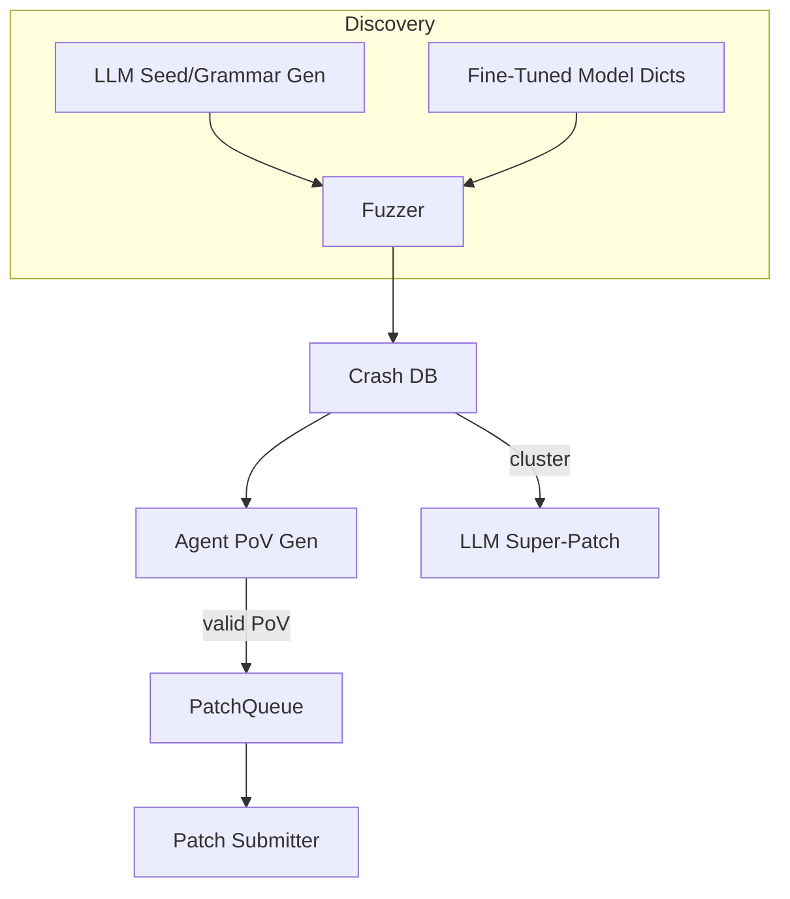

# AI Destekli Fuzzing ve Otomatik Güvenlik Açığı Keşfi

{{#include ../banners/hacktricks-training.md}}

## Genel Bakış
Büyük dil modelleri (LLM'ler), anlamsal açıdan zengin girdiler üreterek, gramerleri geliştirerek, crash verileri üzerinde akıl yürüterek ve hatta birden fazla hatayı gideren yamalar önererek geleneksel güvenlik açığı araştırma süreçlerini büyük ölçüde güçlendirebilir. Bu sayfa, DARPA'nın AI Cyber Challenge (AIxCC) finallerinde ve diğer kamuya açık araştırmalarda gözlemlenen en etkili yöntemleri bir araya getiriyor.<sup>[[4]](#references)</sup><sup>[[5]](#references)</sup>

Aşağıda belirli bir yarışma sisteminin açıklaması değil, bu teknikleri kendi iş akışlarınızda yeniden uygulayabilmeniz için bir soyutlaması sunulmaktadır.

---

## 1. LLM Tarafından Üretilen Seed Girdileri

Geleneksel coverage-guided fuzzer'lar (AFL++, libFuzzer, Honggfuzz…) küçük bir seed corpus'u ile başlar ve baytları körlemesine mutate eder.  Hedef girdi biçimi karmaşık olduğunda (SQL, URL'ler, özel ikili protokoller), rastgele mutasyonlar genellikle ilgi çekici dallara ulaşılmadan sözdizimini bozar.

LLM'ler, *seed generator*'lar (çıktı olarak **sözdizimi doğru ancak güvenlik açısından anlamlı girdiler** üreten kısa betikler) oluşturarak bu başlangıç sorununu çözebilir.  Örneğin:

```prompt
SYSTEM: You are a helpful security engineer.
USER:
Write a Python3 program that prints 200 unique SQL injection strings targeting common anti-pattern mistakes (missing quotes, numeric context, stacked queries).  Ensure length ≤ 256 bytes / string so they survive common length limits.
```

```python
# gen_sqli_seeds.py (truncated)
PAYLOADS = [
    "1 OR 1=1 -- ",
    "' UNION SELECT NULL,NULL--",
    "0; DROP TABLE users;--",
    ...
]
for p in PAYLOADS:
    print(p)
```

Bir kez çalıştırın ve çıktıyı doğrudan fuzzer’ın başlangıç corpus’una aktarın:

```bash
python3 gen_sqli_seeds.py > seeds.txt
afl-fuzz -i seeds.txt -o findings/ -- ./target @@
```

Benefits:
1. Semantik geçerlilik → başlangıçta daha derin coverage.
2. Yeniden üretilebilir: XSS, path traversal, binary blobs vb. konulara odaklanmak için prompt'u değiştirin.
3. Ucuz (< 1 ¢ with GPT-3.5).

### İpuçları
* Yüzeysel filtreleri aşmak için modelden payload uzunluğunu ve encoding'i (UTF-8, URL-encoded, UTF-16-LE) *çeşitlendirmesini* isteyin.
* *Tek ve kendi kendine yeten bir script* isteyin – böylece JSON biçimlendirme sorunlarını önlersiniz.

---

## 2. Grammar-Evolution Fuzzing

Daha güçlü bir varyant, LLM'nin somut seed'ler yerine bir grammar'ı **evrimleştirmesini** sağlamaktır. İş akışı (“Grammar Guy” pattern) şöyledir:

1. Prompt aracılığıyla bir başlangıç ANTLR/Peach/LibFuzzer grammar'ı oluşturun.
2. N dakika fuzzing yapın ve coverage metriklerini (ulaşılan edge/block'lar) toplayın.
3. Programın kapsanmayan bölümlerini özetleyip bu özeti modele geri verin:
   ```prompt
   The previous grammar triggered 12 % of the program edges.  Functions not reached: parse_auth, handle_upload.  Add / modify rules to cover these.
   ```
4. Yeni kuralları birleştirin, yeniden fuzzing yapın ve tekrarlayın.

Pseudo-code iskeleti:

```python
for epoch in range(MAX_EPOCHS):
    grammar = llm.refine(grammar, feedback=coverage_stats)
    save(grammar, f"grammar_{epoch}.txt")
    coverage_stats = run_fuzzer(grammar)
```

Key points:
* Bir *bütçe* belirleyin – her iyileştirme token kullanır.
* Modelin baştan yazmak yerine düzenleme yapması için `diff` + `patch` talimatları kullanın.
* Δcoverage < ε olduğunda durun.

---

## 3. Local-LLM libFuzzer Harness Mühendisliği

Analist iş istasyonundan çıkarılamayan kaynak kodlar için yerel bir kod modeli, fuzzer baytları ile bir C/C++ API’si arasındaki küçük adaptörü taslak olarak hazırlayabilir. Yararlı güvenlik sınırı açıktır: **model test altyapısını yazar ve gözden geçirir; coverage-guided mutation girdileri araştırır; sanitizer’lar geçersiz işlemleri bildirir; bir insan harness’i inceler ve bulguları önceliklendirir**.<sup>[[9]](#references)</sup>

LLM’ye bağlı olmayan engine düzeyindeki corpus, feedback, snapshot ve stateful-fuzzing teknikleri için genel [Fuzzing Methodology](../generic-methodologies-and-resources/fuzzing.md) bölümüne bakın.

Hedef başlıktan alınan tam bildirimle başlayın ve çıktı biçimini kısıtlayın. Dar kapsamlı bir prompt, modelin var olmayan API’ler uydurmasını azaltır ve sonucu incelemeyi kolaylaştırır:<sup>[[8]](#references)[[9]](#references)</sup>

```prompt
Write a libFuzzer target for this exact declaration:
int parse_records(const uint8_t *data, size_t size);

Output only C code. Implement LLVMFuzzerTestOneInput, include the
declaration, pass data and size unchanged, and do not use files,
network access, randomness, clocks, threads, or persistent state.
```

Ham bayt ayrıştırıcısı için beklenen sonuç şundan daha karmaşık olmamalıdır:<sup>[[6]](#references)[[9]](#references)</sup>

```c
#include <stddef.h>
#include <stdint.h>

extern int parse_records(const uint8_t *, size_t);

int LLVMFuzzerTestOneInput(const uint8_t *data, size_t size) {
    (void)parse_records(data, size);
    return 0;
}
```

Derleme yalnızca ilk doğrulama aşamasıdır. CPU zamanı harcamadan önce oluşturulan her target'ı şu değişmezlere göre gözden geçirin:<sup>[[6]](#references)[[8]](#references)[[9]](#references)</sup>

- **API'nin birebir uyumu:** Türleri, sahiplik kurallarını, başlatmayı, teardown işlemini ve çağrı kuralını gerçek header ve mevcut çağıranlarla karşılaştırın.
- **Harness güvenliği:** `data` üzerinden yapılan her okumayı korumaya alın; sanitizer bulguları oluşturulan glue kodundan değil, target'tan kaynaklanmalıdır.
- **Tekrarlanabilirlik:** Sonucu `data` ve `size` değerlerinin bir fonksiyonu hâline getirin; harici I/O'yu, zamanı, kontrolsüz rastgeleliği, join edilmemiş thread'leri ve çağrılar arasında kalan durumu kaldırın.
- **Throughput:** Pahalı ve değişmez durumu yalnızca davranışı etkileyemeyecekse bir kez başlatın, input boyutunu sınırlayın, loglamayı kapatın ve input başına yapılan tahsisleri serbest bırakın.
- **Erişilebilirlik:** Amaçlanan fonksiyon ve dalların çalıştığını doğrulayın. Derlenen ancak yalnızca ret yollarını çalıştıran bir target sessiz bir başarısızlıktır.

### Yapı farkındalıklı target'lar: hataları gizlemeden değişmezleri koruyun

Ham input'ların çoğu bir magic, uzunluk, sürüm veya checksum kontrolünde başarısız oluyorsa fuzz byte'larını **tipli alan verisi** olarak kullanın ve geçerli bir nesne oluşturun. Format sabitlerini düzeltin, semantik alanları ve payload byte'larını değiştirilebilir bırakın ve bütünlük metadata'sını yeniden oluşturulan payload'dan türetin. `FuzzedDataProvider`, sınırlandırılmış tipli değerleri tüketmek için kullanışlıdır; oluşturulan tahsisleri ve dönüşümleri sınırlama sorumluluğu ise adapter'dadır.<sup>[[9]](#references)</sup>

<details>
<summary>Yapı farkındalıklı C++ target örneği</summary>

```cpp
#include <fuzzer/FuzzedDataProvider.h>
#include <stddef.h>
#include <stdint.h>
#include <vector>

extern "C" int parse_message(const uint8_t *, size_t);

extern "C" int LLVMFuzzerTestOneInput(const uint8_t *data, size_t size) {
    FuzzedDataProvider fdp(data, size);
    uint8_t version = fdp.ConsumeIntegral<uint8_t>();
    auto body = fdp.ConsumeRemainingBytes<uint8_t>();
    if (body.size() > UINT16_MAX) body.resize(UINT16_MAX);
    uint16_t len = static_cast<uint16_t>(body.size());
    std::vector<uint8_t> msg = {0x8b, 'M', 'S', 'G', version,
                                static_cast<uint8_t>(len >> 8),
                                static_cast<uint8_t>(len)};
    msg.insert(msg.end(), body.begin(), body.end());
    (void)parse_message(msg.data(), msg.size());
    return 0;
}
```

</details>

Her soru için tek bir yapı onarma hedefi kullanmayın. Derin ve geçerli durumları keşfetmek üzere uzunlukları/sağlama toplamlarını hesaplayan bir hedef; fuzzer'ın kontrolündeki **bildirilen** metadata'yı korurken yalnızca harness'in kendi okumalarını ve bellek ayırmalarını sınırlandıran başka bir hedef bulundurun. İkinci hedef, otomatik onarımın aksi hâlde ortadan kaldıracağı uyuşmayan uzunluklara ve bozuk bütünlük denetimlerine yönelik attack surface'leri korur.<sup>[[9]](#references)</sup>

### Seed'ler, sözlükler, sanitizer'lar ve coverage geri bildirimi

Modelden doğrudan binary yazdırmasını istemek yerine, binary seed'ler yazan bir script üretmesini isteyin. Boş, minimal, tipik ve sınır değerlerde geçerli nesnelerle seed oluşturun; ardından magic değerlerini, tag'leri, enum kodlamalarını ve parser anahtar sözcüklerini gözden geçirilmiş bir sözlüğe çıkarın. libFuzzer bu sözlüğü `-dict=` ile kabul eder ve corpus'ta yeni coverage sağlayan mutasyonları tutar.<sup>[[6]](#references)[[9]](#references)</sup>

```text
magic="\x8bMSG"
version_min="\x00"
version_max="\xff"
config_tag="CONFIG"
```

Aynı hedefi tamamlayıcı enstrümantasyonla derleyin. ASan ve UBSan aynı fuzzing ikilisini paylaşabilir; enstrümante edilmemiş koddan kaynaklanan raporları önlemek için ayrı bir MSan derlemesi oluşturun ve bağımlılıklarını da enstrümante edin.<sup>[[6]](#references)[[9]](#references)</sup>

```bash
clang++ -g -O1 -fsanitize=fuzzer,address,undefined \
  -fno-sanitize-recover=undefined target.cc harness.cc -o fuzz_target
./fuzz_target corpus -dict=msg.dict -max_len=65535

clang++ -g -O1 -fsanitize=fuzzer,memory \
  target.cc harness.cc -o fuzz_target_msan
```

Coverage'ı her model revizyonu için değerlendirici olarak kullanın. libFuzzer çıktısında erken düzleşen `cov`/`ft` ve statik bir corpus genellikle hatalı framing, gereğinden fazla kısıtlayıcı bir erken dönüş veya yanlış çağrı anlamına gelir; düşük `exec/s` ise pahalı kurulum, I/O, allocation ya da leaked state'e işaret eder. `NEW`, yalnızca bir coverage özelliğinin değiştiğini kanıtlar; hedeflenen parser'a ulaşıldığını değil.<sup>[[6]](#references)[[9]](#references)</sup>

Kaynak düzeyinde geri bildirim için coverage build oluşturup fuzzing yapın ve modele yalnızca kapsanmayan işlevleri ve bunları koruyan koşulları verin. Ortaya çıkan harness/seed/dictionary diff'ini doğrulayın ve yeniden ölçüm yapın:<sup>[[7]](#references)[[8]](#references)[[9]](#references)</sup>

```bash
clang++ -g -O1 -fsanitize=fuzzer \
  -fprofile-instr-generate -fcoverage-mapping target.cc harness.cc -o fuzz_cov
mkdir -p profiles
LLVM_PROFILE_FILE='profiles/%p.profraw' ./fuzz_cov -max_total_time=300 corpus
llvm-profdata merge -sparse profiles/*.profraw -o fuzz.profdata
llvm-cov report ./fuzz_cov -instr-profile=fuzz.profdata
llvm-cov show ./fuzz_cov -instr-profile=fuzz.profdata \
  --show-branches=count --region-coverage-lt=1 target.cc
```

Ölçeklenebilir döngü bu nedenle **üret → derle/bağla → sanitizer’lar altında smoke test yap → hedef kapsamını ölç → en küçük ilgili kapsam/kaynak bağlamını sağla → gözden geçir → yeniden ölç** şeklindedir. OSS-Fuzz-Gen de aynı ilkeyi, üretilen hedefleri makul görünen kodu olduğu gibi kabul etmek yerine derlenebilirlik, çalışma zamanı hataları, kapsam ve mevcut hedeflere kıyasla kapsam iyileşmesi açısından değerlendirerek uygular.<sup>[[7]](#references)[[8]](#references)</sup>

---

<a id="3-agent-based-pov-exploit-generation" hidden>3. Agent Tabanlı PoV (Exploit) Üretimi</a>

## 4. Agent Tabanlı PoV (Exploit) Üretimi

Bir crash bulduktan sonra, bunu deterministik biçimde tetikleyen bir **açığın kanıtına (PoV)** yine de ihtiyacınız vardır.

Ölçeklenebilir bir yaklaşım, her biri farklı bir model veya örnekleme yapılandırması kullanan çok sayıda hafif worker (process, thread veya container) başlatmaktır. AIxCC finalistleri anketi, ölçeğe dair somut örnekler sunuyor: Bir ekip, AI öncelikli PoV üretimi için **binlerce eşzamanlı agent** kullanırken, başka bir ekip **300–500 fuzzing agent’ını** koordine edip LLM’leri üst düzey anlamsal akıl yürütme için ayırdı.<sup>[[4]](#references)</sup>

Pipeline:
1. Statik/dinamik analiz *bug adayları* üretir (crash PC’si, input dilimi, sanitizer mesajı içeren struct).
2. Orchestrator adayları agent’lara dağıtır.
3. Agent’ın akıl yürütme adımları:
   a. Bug’ı `gdb` + input ile yerel olarak yeniden üret.
   b. Minimal exploit payload’ı öner.
   c. Exploit’i sandbox’ta doğrula. Başarılıysa → gönder.
4. Başarısız denemeler, coverage fuzzing için **yeni seed’ler olarak kuyruğa yeniden eklenir** (geri bildirim döngüsü).

Avantajları:
* Paralelleştirme, tek agent’ın güvenilmezliğini telafi eder.
* Gözlemlenen başarı oranına göre temp/model boyutu otomatik ayarlanır.

---

<a id="4-directed-fuzzing-with-fine-tuned-code-models" hidden>4. Fine-Tune Edilmiş Kod Modelleriyle Yönlendirilmiş Fuzzing</a>

## 5. Fine-Tune Edilmiş Kod Modelleriyle Yönlendirilmiş Fuzzing

Açık ağırlıklı bir modeli (ör. Llama-7B), açık örüntüleriyle etiketlenmiş C/C++ kaynak kodu üzerinde fine-tune edin (integer overflow, buffer copy, format string). Ardından:

1. Fonksiyon listesini ve AST’yi elde etmek için statik analiz çalıştırın.
2. Modele şu prompt’u verin: *“X fonksiyonunda memory safety’yi bozma olasılığı yüksek mutation dictionary girdileri ver”*.
3. Bu token’ları özel bir `AFL_CUSTOM_MUTATOR` içine yerleştirin.

Bir `sprintf` wrapper’ı için örnek çıktı:
```
{"pattern":"%99999999s"}
{"pattern":"AAAAAAAA....<1024>....%n"}
```

Gerçek hedeflerde deneysel olarak crash'e kadar geçen süreyi >2× kısaltır.

---

<a id="5-ai-guided-patching-strategies" hidden>5. AI-Guided Patching Strategies</a>

## 6. AI-Guided Patching Strategies

<a id="51-super-patches" hidden>5.1 Super Patches</a>

### 6.1 Super Patches
Modelden crash imzalarını *kümelemesini* ve ortak temel nedeni ortadan kaldıran **tek bir patch** önermesini isteyin. Bir kez gönderin, birkaç hatayı düzeltin → her yanlış patch'in puan kaybettirdiği ortamlarda daha az doğruluk cezası.

İstem taslağı:
```
Here are 10 stack traces + file snippets.  Identify the shared mistake and generate a unified diff fixing all occurrences.
```

{{#ref}}
../generic-methodologies-and-resources/fuzzing.md
{{#endref}}

<a id="52-speculative-patch-ratio" hidden>5.2 Varsayımsal Yama Oranı</a>

### 6.2 Varsayımsal Yama Oranı
Onaylanmış, PoV ile doğrulanmış yamalar ile *varsayımsal* yamaların (PoV yok) puanlama kurallarına göre ayarlanan 1:N oranında sırayla işlendiği bir kuyruk oluşturun (ör. 2 varsayımsal : 1 onaylanmış). Bir maliyet modeli, cezaları puanlara göre izler ve N değerini otomatik olarak ayarlar.

---

<a id="6-deterministic-file-by-file-ai-code-review" hidden>6. Deterministic File-by-File AI Code Review</a>

## 7. Deterministik Dosya Dosya AI Kod İncelemesi

AI destekli incelemede sık görülen bir başarısızlık biçimi, bir ajandan tüm bir depoyu incelemesini istemek ve doğru dosyaları ve grep terimlerini seçmesini ummaktır. Daha güvenilir bir yaklaşım, **depo kapsamını zorunlu kılmaktır**:<sup>[[1]](#references)</sup>

1. Kaynak dosyaları listeleyin.
2. Her seferinde **tek bir dosya** ile asgari bağlamı (giriş noktası, importlar, yakındaki rotalar/çağıranlar) gönderin.
3. Her dosya için kaynakları, sink'i, eksik doğrulamaları, exploit ön koşullarını ve güven düzeyini içeren **yapılandırılmış bir rapor** isteyin.<sup>[[3]](#references)</sup>
4. Raporları **source→sink örüntüsüne** göre tekilleştirin ve yüksek riskli olanları elle doğrulayın.

Bu yöntem çok token tüketir ve gürültülüdür; ancak kapsamlı agentic incelemelerin sıklıkla gözden kaçırdığı **basit ve yüksek etkili source/sink hatalarını** ortaya çıkarmada çok etkilidir.

### Önceliklendirmeye değer triage örüntüleri

- **Dinamik PHP include/dispatch**: Saldırganın kontrolündeki rota/controller/modül adlarının katı bir allowlist ve yol kanonikleştirmesi olmadan `require_once()`, `include()` veya `include_once()` işlevlerine aktarılması.
- **Yönetici/hesap iş akışlarında shell çalıştırma**: Kullanıcı adlarının, alan adlarının, FTP hesaplarının veya diğer tanımlayıcıların `exec()`, `system()`, `shell_exec()`, `passthru()`, `proc_open()` ya da `popen()` işlevlerine ulaşması.
- **Yapılandırılmış girdilerin bir araya gelmesi**: Aynı parametrenin `$_GET`, `$_POST`, JSON, XML veya framework body parser'ları üzerinden kabul edilmesi ve daha sonra dosya sistemi ya da OS komut sink'lerinde yeniden kullanılması.

### Bu yöntemin iyi bulduğu iki pratik hata sınıfı

- **PHP controller-dispatch LFI/RCE**: İstek tarafından kontrol edilen bir controller adı, allowlist/yol normalleştirmesi olmadan `require_once()` içine birleştirilirse `../` gibi traversal dizileri PHP'nin amaçlanmayan bir yerel `.php` dosyasını dahil etmesine neden olabilir. Saldırgan, eklenen ya da başka şekilde işe yarar bir PHP dosyasını hedef gösterebilirse LFI, kod çalıştırmaya dönüşür. Bkz. [File Inclusion / Path Traversal](../pentesting-web/file-inclusion/README.md).<sup>[[1]](#references)</sup>
- **Hosting/yönetici panellerinde kimlik doğrulamalı command injection**: Kullanıcı adları gibi hesap yönetimi alanları shell komutlarına ekleniyorsa, düşük ayrıcalıklı ve kimliği doğrulanmış bir kullanıcı normal bir oluşturma/silme işlemini RCE'ye dönüştürebilir. Panel komutu daha ayrıcalıklı bir hizmet hesabı olarak çalıştırıyorsa etki artar. Bkz. [Command Injection](../pentesting-web/command-injection.md).<sup>[[1]](#references)</sup>

### Pratik inceleme notları

- LLM'yi önce bir **source/sink inceleyicisi** olarak kullanın; exploit üreticisi olarak değil.
- Ondan **saldırganın kontrolündeki alanı**, **normalleştirme/doğrulama açığını** ve **tehlikeli sink'i** açıkça listelemesini isteyin.
- Büyük depolarda deterministik dosya dosya inceleme, daha güçlü bir model kullansa bile tek bir otonom ajan çalıştırmasından genellikle daha güvenilirdir.<sup>[[2]](#references)</sup>
- Exploit edilebilirliğin dosyalar arası varsayımlara, rol anlamlarına veya ürüne özgü tehdit modellerine bağlı olduğu **Broken Access Control** ve diğer iş mantığı hatalarında daha zayıf sonuçlar bekleyin.

---

## Mobil giriş noktası taskflow'ları

Depo genelinde kullanılan tek bir prompt çoğu zaman tehdit modellerini birbirine karıştırır ve dışarıdan erişilebilir bir bileşenden hassas bir sink'e giden yolu kaybettirir. Daha güçlü bir iş akışı, denetimi durum bilgisi taşıyan taskflow'lara böler: önce uygulamaları/bileşenleri sınıflandırın, sonra saldırganın kontrol edebildiği giriş noktalarını envantere alın, her giriş noktasını erişilebilirlik meta verileriyle zenginleştirin ve son olarak her birini platforma özgü zafiyet sınıflarına göre inceleyin. GitHub Security Lab'in mobil taskflow'ları bu örüntüyü Android, iOS ve çapraz platform depoları için uygular.<sup>[[14]](#references)[[15]](#references)</sup>

Android için en azından şunları kaydedin:<sup>[[14]](#references)[[15]](#references)</sup>

- İzinleriyle birlikte dışa aktarılmış Activities, Services, Receivers ve Providers;
- intent action'ları, deep-link şemaları/host'ları/yolları, MIME filtreleri ve App Links;
- saldırganın kontrol edebildiği action'lar, data URI'leri, `ClipData`, extras ve URI-grant bayrakları;
- WebView gezinme girdileri ve `addJavascriptInterface` köprüleri;
- aşağı akıştaki ayrıcalıklı işlemler, içe aktarılan kaynaklar ve ağ hedefleri.

Ardından her giriş noktasını bağlam içinde sınıflandırın. Çağıran yetkilendirmesi/confused-deputy davranışı, intent redirection, broadcast spoofing veya disclosure, güvensiz import'lar, WebView scripting ve köprülerin açığa çıkması, kimlik bilgilerinin veya çerezlerin origin'ler arasında taşınması hakkında açıkça soru sorun. Hem **katı bir kontrol listesi incelemesi** hem de **daha geniş bir adversarial inceleme** yürütün. Exploitation ayrıntılarını yinelemek yerine bulguları [Intent Injection](../mobile-pentesting/android-app-pentesting/intent-injection.md) ve [WebView Attacks](../mobile-pentesting/android-app-pentesting/webview-attacks.md) başlıklarına bağlayın.<sup>[[15]](#references)</sup>

Mevcut açık kaynak taskflow'ları Codespace'lerinden şu şekilde başlatılabilir:<sup>[[14]](#references)</sup>

```bash
./scripts/audit/run_audit.sh owner/repository
```

Sonuçlar SQLite içindeki `audit_result` tablosuna yazılır.<sup>[[14]](#references)</sup> Savunmasız olarak işaretlenen satırları doğrulanmış bulgular değil, **adaylar** olarak değerlendirin. Her aday için modelden saldırganın kontrolündeki kaynağı, hassas sink'i, ön koşulları ve beklenen etkiyi belirtmesini isteyin, ardından minimal bir PoC oluşturmasını talep edin. Bu PoC'yi hata ayıklayıcı veya instrumentation altında orijinal build üzerinde çalıştırın. Böylece erişilemeyen dallar, gerçekçi olmayan uygulama durumları, harici depolama verilerinin özel verilere göre önceliğini kaybetmesi ve önem derecesini kayda değer ölçüde azaltan önlemler gibi yaygın statik analiz hataları yakalanır.<sup>[[15]](#references)</sup>

---

## 8. Instrumented Oracle ile Pattern-Guided Kernel Denetimi

Kernel boyutundaki bir hedef için bir ajandan tüm ağaçta rastgele hatalar bulmasını istemeyin. Daha az token kullanan bir iş akışında geçmiş güvenlik açığı bilgileri statik sorgulara dönüştürülür, sonuçlar saldırı yüzeyinin açıklığına göre sıralanır ve instrumented bir kernel yürütme oracle'ı olarak kullanılır.<sup>[[11]](#references)</sup>

### Pattern veritabanı → CodeQL/Semgrep → odaklı inceleme

Tehlikeli API'leri, eksik doğrulama kalıplarını, riskli kaynak-hedef akışlarını ve daha önce düzeltilmiş hata biçimlerini içeren küçük bir bilgi tabanı oluşturun. Modelden **her seferinde tek bir kalıbı** inceleme sezgilerine ve CodeQL/Semgrep kurallarına dönüştürmesini isteyin, ardından bu belirleyici kuralları ağacın tamamında çalıştırın. Eşleşmeleri gruplandırıp yinelenenleri ayıkladıktan sonra kodu modele verin; ham tarayıcı çıktısı, değeri düşük binlerce aday içerebilir. Bu yaklaşımı uygun araştırma veya açık kaynak hedeflerinin dışında kullanmadan önce CodeQL'in geçerli lisansını kontrol edin.<sup>[[11]](#references)</sup>

Alt sistemlere öncelik verirken yalnızca eşleşme sayısına değil, hem **kural eşleşmesi yoğunluğuna** hem de **saldırganın erişebilirliğine** göre değerlendirme yapın. Ayrıcalıksız süreçlerden, sandbox'lardan, container'lardan, jail'lerden veya guest bağlamlarından erişilebilen kernel arayüzleri, yalnızca içeriden erişilebilen kodlardan daha fazla ağırlık taşımalıdır. İnceleme birimini, ajanın çağıranları, doğrulayıcıları ve ömür kurallarını aklında tutabileceği kadar küçük tutun; “herhangi bir güvenlik açığı bul” demek yerine belirli bir güvenlik açığı sınıfı veya kontrol akışı kalıbı için istemde bulunun. Yeni bir containment sınırı, eski ayrıcalıklı arayüzlere namespaced veya jailed root kullanıcısının erişmesini mümkün kıldığında bu arayüzler özellikle ilgi çekicidir.<sup>[[11]](#references)</sup>

Her aday için istismar girişiminden önce açık bir alan-akışı kaydı tutulmasını şart koşun.<sup>[[11]](#references)</sup>

```text
entrypoint -> privilege check -> parser -> validation/normalization
           -> later rewrite -> dangerous sink
attacker controls: <fields and lengths>
constraints:       <values rewritten, rejected, or preserved>
observable result: <sanitizer report, assertion, panic, or clean exit>
```

### KASAN telemetrisini hipotez oracle’ı olarak kullanın

Hedef kernel’i, KASAN ve kullanışlı tanılama assertion’ları etkinleştirilmiş, geçici bir VM’de çalıştırın. Agent, şüphelenilen bozulma yeniden üretilene veya elenene kadar **kaynak hipotezi → minimal userland trigger → VM’de çalıştırma → KASAN/assertion trace’i → gözden geçirilmiş hipotez** döngüsünü izlemelidir. Her iterasyonda yalnızca ilgili stack trace’i ve yakındaki kaynak kodunu döndürün; bu, akıl yürütme için bağlamı korurken kabul ölçütünü modelin güveni değil, runtime kanıtı yapar.<sup>[[11]](#references)</sup>

Enstrümante edilmiş build, nihai exploitability ortamı değildir. Assertion’lar, bozulmaya yol açan işlemden önce çalışmayı durdurabilir; aynı assertion production kernel’den derleme sırasında çıkarılmış olabilir. Değiştirilmemiş trigger’ı tam production konfigürasyonunda yeniden test edin, kernel build’ini ve konfigürasyonunu kaydedin ve **erişilebilirlik**, **memory corruption**, **controlled primitive** ve **güvenlik etkisi** iddialarını ayrı ayrı ele alın.<sup>[[11]](#references)[[12]](#references)</sup>

CVE-2026-3038 bir exploit şablonundan ziyade yararlı bir doğrulama örneğidir. Yetkisiz bir FreeBSD `RTM_GET` isteği, aşırı büyük bir `RTAX_AUTHOR` sockaddr’ını seçici doğrulama ve yanıtın yeniden yazılması boyunca koruyarak `rtsock_msg_buffer()` fonksiyonunun kullanıcı tarafından denetlenen `sa_len` değerini 128 baytlık stack `sockaddr_storage` içine kopyalamasına neden olabiliyordu. En fazla 255 baytlık kopyalama, 127 baytlık bir taşmaya yol açtı; enstrümante edilmiş build’de tanılama assertion’ı hatalı uzunluğu yakalarken, GENERIC kernel kopyalama işlemine ulaşıyor ve ardından bozulmuş canary kontrol edildiğinde panic veriyordu. Bu, yetkisiz bir hizmet engelleme durumunu kanıtlar; tek başına privilege escalation’ı değil: güvenilir kontrol için öncelikle canary disclosure gibi başka bir primitive gerekir. İlgili binary exploitation sınırı için [Stack Canaries](../binary-exploitation/common-binary-protections-and-bypasses/stack-canaries/index.html) sayfasına bakın.<sup>[[11]](#references)[[12]](#references)[[13]](#references)</sup>

### Exploit önkoşullarını hileyle sağlama girişimlerini reddedin

Bir PoV veya exploit’i kabul etmeden önce, ayrı bir reviewer/agent’tan sabit ölçütlere göre onu çürütmeye çalışmasını isteyin. İnceleme, aşağıdaki koşulların tümünü doğrulamalıdır.<sup>[[11]](#references)</sup>

- Hedef kaynak kodu, kernel ve savunmasız modül, yolu erişilebilir kılmak için değiştirilmemiş olmalıdır.
- Hiçbir helper module, synthetic gadget, devre dışı bırakılmış mitigation, ek yetki veya kullanılamayan arayüz eklenmemiş olmalıdır.
- Trigger, temiz bir snapshot üzerinde iddia edilen çağıran kimliği ve containment kısıtlamalarıyla başlatılmalıdır.
- İddia edilen sonuç hâlâ bug’a bağlı olmalıdır: hatalı alanı kaldırmak veya yalnızca bug’ı yamamak zinciri bozmalıdır.
- Bir crash, overread veya overwrite yalnızca ilgili primitive olarak raporlanmalıdır; code execution veya privilege escalation için bağımsız kanıt gerekir.

Bu son karşı-olgusal kontrol, döngüsel gösterimleri yakalar: Önkoşullar iddia edilen etkiyi zaten sağlıyorsa (örneğin, `nosuid` olmadan mount edilmiş bir filesystem’den saldırgan tarafından sağlanan SUID içeriğini çalıştırmak), memory-safety bug’ı bu etkiyi yaratmamıştır.<sup>[[11]](#references)</sup>

---

## Bilinmeyen Codebase’lerde Denetlenebilir Agent Destekli Araştırma

[Graph-first fuzz-target workflow](../generic-methodologies-and-resources/fuzzing.md#graph-first-fuzz-target-selection-and-mutation-triage), entrypoint erişilebilirliğini; [agentic SAST pipelines](../network-services-pentesting/pentesting-web/code-review-tools.md#agentic-sast-pipelines) ise aşamalı inceleme ve kanıt eşiklerini zaten kapsar. Öne çıkarılan her bulgunun kaynak konumlarını, path kanıtını ve dinamik ölçümünü koruması için bu deterministik sonuçları modelin hipotezlerinden ayrı tutun.<sup>[[10]](#references)</sup>

### Veri akışı uydurmadan nesne ömrüne ilişkin kanıtları ilişkilendirin

Statik analiz, saldırgan denetimindeki bir uzunluğun bir fonksiyonda saklandığını ve aynı nesne alanının çok daha sonra bir copy sink’e ulaştığını bulabilir; ancak callback’ler, yeniden bağlantılar veya nesne ömrü boyunca bu bağlantıyı kanıtlayamayabilir. Her iki bulguyu ayrı ayrı koruyun, nesne/alan bazında kümeleyin ve eksik bağlantıyı açık bir triage sorusu hâline getirin. Agent bu ilişkiyi önerebilir, ancak kaynak kod incelemesi veya runtime instrumentation bunu kanıtlamalıdır.<sup>[[10]](#references)</sup>

Her aday için şunları kaydedin:

- somut entrypoint ve saldırgan denetimindeki byte’lar;
- ilgili alanın tüm üreticileri ve her üreticiye özgü doğrulama;
- sink, hedef kapasitesi ve erişim için gereken build/runtime koşulları;
- yalnızca doğrudan harness çağrısı değil, dışarıya açık entrypoint’ten alınmış gerçek bir call stack;
- hipotezi doğrulayan veya reddeden en küçük dinamik sonuç.

Görünüşte güvenli bir path, bir alanın tamamını güvenli kılmaz. İkinci bir üretici, aynı alanı ilk path’teki sınır kontrolü olmadan doldurabilir. Path’leri ayrı ayrı test edin ve debug assertion’ları production memory corruption’ını yalnızca test sırasında oluşan erken bir abort’a dönüştürebileceğinden, harness’i deployment’a eşdeğer build seçenekleriyle çalıştırın.<sup>[[10]](#references)</sup>

### Disclosure ve exploitation için ölçüm eşikleri

Şüpheli uninitialized-memory disclosure için yeni allocation’ları ayırt edilebilir bir byte ile doldurun ve tam olarak bu işaretleyicinin gönderilen pakete ulaştığını doğrulayın. Exploitation için **controlled overwrite → kullanışlı victim object → disclosure → pointer/base recovery → control-flow hijack → composed payload** gibi ölçülmüş eşikler arayın. Agent yalnızca harness mevcut özelliği kanıtladığında ilerler; makul görünen bir anlatı, eşik geçilmiş demek değildir. [FreeRDP örneği](../binary-exploitation/libc-heap/heap-overflow.md#cross-path-length-reuse-and-stale-output-disclosure), doğrulama sırasında korunması gereken path ve build kısıtlarını gösterir.<sup>[[10]](#references)</sup>

---

LLM destekli exploit geliştirmeye aşamalı L0–L4 doğrulaması uygulayan bir kernel vaka incelemesi için bkz.:

{{#ref}}
../binary-exploitation/freebsd-kernel-exploitation-vnet-jail-escape.md
{{#endref}}

## Hepsini Bir Araya Getirmek
Uçtan uca bir CRS (Cyber Reasoning System), bileşenleri şu şekilde birbirine bağlayabilir:



---

## References

- [1] [Project Black - Siber Güvenlik için Yerel AI: phpIPAM LFI ve myVesta Kimliği Doğrulanmış RCE Bulma](https://projectblack.io/blog/local-ai-for-cyber-security)
- [2] [Strix](https://github.com/usestrix/strix)
- [3] [GitHub Copilot topluluk security-review becerisi](https://github.com/github/awesome-copilot/blob/main/skills/security-review/SKILL.md)
- [4] [Trail of Bits – AIxCC finalleri: Yarışın hikâyesi](https://blog.trailofbits.com/2025/08/07/aixcc-finals-tale-of-the-tape/)
- [5] [CTF Radiooo AIxCC finalist röportajları](https://www.youtube.com/@ctfradiooo)
- [6] [LLVM — libFuzzer: coverage-guided fuzz testing için bir kütüphane](https://llvm.org/docs/LibFuzzer.html)
- [7] [Google — OSS-Fuzz-Gen](https://github.com/google/oss-fuzz-gen)
- [8] [Google Online Security Blog — Fuzzing'i bir üst seviyeye taşıma: AI ile daha fazla güvenlik açığı bulma](https://security.googleblog.com/2024/11/leveling-up-fuzzing-finding-more.html)
- [9] [8kSec — Yerel bir LLM ile AI destekli fuzzing harness oluşturma](https://8ksec.io/ai-assisted-fuzzing-harness-local-llm)
- [10] [Quarkslab — AI Agents'tan RCE'ye: Bir güvenlik açığı araştırma iş akışı oluşturma](https://blog.quarkslab.com/from-ai-agents-to-rce-building-a-vulnerability-research-workflow.html)
- [11] [Praetorian — FreeBSoD: Kernel hatalarını bulmak ve istismar etmek için dil modellerinden yararlanma (2 bölümün 1.si)](https://praetorian.com/blog/ai-vulnerability-research-freebsd-kernel)
- [12] [FreeBSD-SA-26:05.route — Routing socket'leri üzerinden yerel DoS ve olası ayrıcalık yükseltme](https://www.freebsd.org/security/advisories/FreeBSD-SA-26:05.route.asc)
- [13] [FreeBSD-SA-26:05.route kaynak yaması](https://security.FreeBSD.org/patches/SA-26:05/route.patch)
- [14] [GitHub Security Lab - SecLab Taskflows](https://github.com/GitHubSecurityLab/seclab-taskflows)
- [15] [GitHub Security Lab - Açık kaynaklı bir AI güvenlik ajanı kullanarak 24 Android güvenlik açığını nasıl bulduk](https://github.blog/security/how-we-found-24-android-vulnerabilities-using-our-open-source-ai-security-agent)
{{#include ../banners/hacktricks-training.md}}
