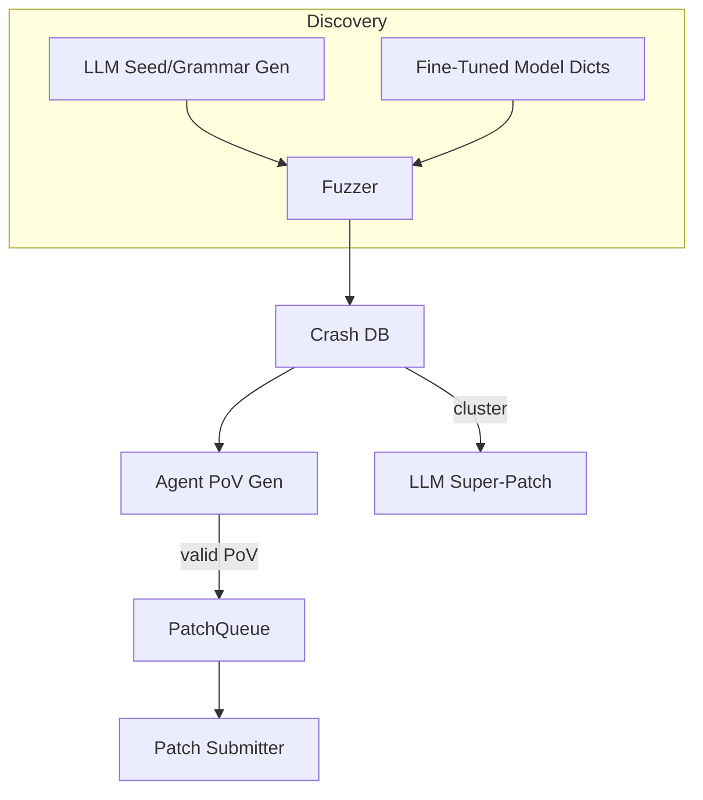

# Fuzzing uz pomoć AI-ja i automatizovano otkrivanje ranjivosti

{{#include ../banners/hacktricks-training.md}}

## Pregled
Modeli velikih jezika (LLM-ovi) mogu znatno da unaprede tradicionalne tokove rada za istraživanje ranjivosti tako što generišu semantički bogate ulaze, razvijaju gramatike, analiziraju podatke o padovima i čak predlažu zakrpe za više bagova. Ova stranica prikuplja najefikasnije obrasce uočene tokom finala DARPA-inog AI Cyber Challenge-a (AIxCC) i drugih javnih istraživanja.<sup>[[4]](#references)</sup><sup>[[5]](#references)</sup>

Ovo nije opis jednog konkretnog takmičarskog sistema, već pregled tehnika koje možete ponoviti u sopstvenim tokovima rada.

---

## 1. Ulazni seedovi koje generiše LLM

Tradicionalni fuzzing alati vođeni pokrivenošću (AFL++, libFuzzer, Honggfuzz…) počinju s malim korpusom seedova i nasumično menjaju bajtove. Kada je format ulaza koji program očekuje složen (SQL, URL-ovi, prilagođeni binarni protokoli), nasumične izmene obično naruše sintaksu pre nego što se dođe do zanimljivih grana.

LLM-ovi mogu da reše ovaj početni problem generisanjem *generatora seedova* – kratkih skripti koje daju **sintaksno ispravne, ali bezbednosno relevantne ulaze**. Na primer:

```prompt
SYSTEM: You are a helpful security engineer.
USER:
Write a Python3 program that prints 200 unique SQL injection strings targeting common anti-pattern mistakes (missing quotes, numeric context, stacked queries).  Ensure length ≤ 256 bytes / string so they survive common length limits.
```

```python
# gen_sqli_seeds.py (truncated)
PAYLOADS = [
    "1 OR 1=1 -- ",
    "' UNION SELECT NULL,NULL--",
    "0; DROP TABLE users;--",
    ...
]
for p in PAYLOADS:
    print(p)
```

Pokrenite jednom i prosledite izlaz direktno u početni korpus fuzzera:

```bash
python3 gen_sqli_seeds.py > seeds.txt
afl-fuzz -i seeds.txt -o findings/ -- ./target @@
```

Benefits:
1. Semantic validity → deeper coverage early.
2. Može se ponovo generisati: prilagodite prompt tako da se fokusira na XSS, path traversal, binary blobs itd.
3. Jeftino (< 1 ¢ uz GPT-3.5).

### Saveti
* Naložite modelu da *diversify* dužinu i kodiranje payload-a (UTF-8, URL-encoded, UTF-16-LE) kako bi zaobišao površne filtere.
* Zatražite *jednu samostalnu skriptu* – tako se izbegavaju problemi s formatiranjem JSON-a.

---

## 2. Grammar-Evolution Fuzzing

Moćnija varijanta je da LLM **evoluira gramatiku** umesto konkretnih seed-ova. Tok rada (obrazac „Grammar Guy“) je sledeći:

1. Generišite početnu ANTLR/Peach/LibFuzzer gramatiku pomoću prompt-a.
2. Fuzz-ujte N minuta i prikupite metrike pokrivenosti (pogodjene grane / blokovi).
3. Sažmite nepokrivene delove programa i prosledite sažetak modelu:
   ```prompt
   The previous grammar triggered 12 % of the program edges.  Functions not reached: parse_auth, handle_upload.  Add / modify rules to cover these.
   ```
4. Spojite nova pravila, ponovo pokrenite fuzzing i ponavljajte.

Skelet pseudo-koda:

```python
for epoch in range(MAX_EPOCHS):
    grammar = llm.refine(grammar, feedback=coverage_stats)
    save(grammar, f"grammar_{epoch}.txt")
    coverage_stats = run_fuzzer(grammar)
```

Ključne tačke:
* Držite *budžet* – svaka dorada troši tokene.
* Koristite instrukcije `diff` + `patch` kako bi model menjao kod umesto da ga ponovo ispisuje.
* Zaustavite se kada je Δcoverage < ε.

---

## 3. Inženjering harnessa za Local-LLM libFuzzer

Kada izvorni kod ne može da napusti radnu stanicu analitičara, lokalni model za kod može da sastavi mali adapter između bajtova fuzzera i C/C++ API-ja. Bezbednosna granica je jasno definisana: **model piše i dorađuje testnu infrastrukturu; mutacija vođena pokrivenošću istražuje ulaze; sanitizers prijavljuju neispravne operacije; čovek pregleda harness i trijažira nalaze**.<sup>[[9]](#references)</sup>

Za tehnike rada s corpusom, povratnim informacijama, snimcima stanja i stateful fuzzingom na nivou engine-a, koje ne zavise od LLM-a, pogledajte opštu [Fuzzing Methodology](../generic-methodologies-and-resources/fuzzing.md).

Počnite od tačne deklaracije, kopirane iz zaglavlja ciljnog programa, i ograničite format izlaza. Usko definisan prompt smanjuje broj izmišljenih API-ja i olakšava pregled rezultata:<sup>[[8]](#references)[[9]](#references)</sup>

```prompt
Write a libFuzzer target for this exact declaration:
int parse_records(const uint8_t *data, size_t size);

Output only C code. Implement LLVMFuzzerTestOneInput, include the
declaration, pass data and size unchanged, and do not use files,
network access, randomness, clocks, threads, or persistent state.
```

Za parser sirovih bajtova, očekivani rezultat ne bi trebalo da bude ništa složeniji od:<sup>[[6]](#references)[[9]](#references)</sup>

```c
#include <stddef.h>
#include <stdint.h>

extern int parse_records(const uint8_t *, size_t);

int LLVMFuzzerTestOneInput(const uint8_t *data, size_t size) {
    (void)parse_records(data, size);
    return 0;
}
```

Kompilacija je samo prva faza provere. Pre nego što potrošite CPU vreme, proverite svaki generisani target prema sledećim invarijantama:<sup>[[6]](#references)[[8]](#references)[[9]](#references)</sup>

- **Tačan API:** uporedite tipove, pravila vlasništva, inicijalizaciju, razgradnju i calling convention sa stvarnim zaglavljem i postojećim pozivaocima.
- **Bezbednost harness-a:** zaštitite svako čitanje iz `data`; nalazi sanitizer-a moraju poticati iz target-a, a ne iz generisanog glue koda.
- **Ponovljivost:** rezultat mora biti funkcija vrednosti `data` i `size`; uklonite spoljašnji I/O, vreme, nekontrolisanu nasumičnost, nepovezane niti i stanje koje opstaje između poziva.
- **Propusnost:** skupo nepromenljivo stanje inicijalizujte jednom samo ako to ne može uticati na ponašanje, ograničite veličinu ulaza, onemogućite logovanje i oslobodite memoriju alociranu za svaki ulaz.
- **Dostizanje koda:** proverite da li se izvršavaju predviđene funkcije i grane. Target koji se kompajlira, ali izvršava samo putanje odbijanja, predstavlja neprimetan neuspeh.

### Target-i svesni strukture: očuvajte invarijante, a da ne prikrijete greške

Ako većina sirovih ulaza ne prođe proveru magic vrednosti, dužine, verzije ili kontrolne sume, upotrebite fuzz bajtove kao materijal za tipizirana polja i ponovo izgradite ispravan objekat. Postavite konstante formata, ostavite semantička polja i bajtove payloada promenljivim, a metapodatke za proveru integriteta izvedite iz rekonstruisanog payloada. `FuzzedDataProvider` je koristan za preuzimanje ograničenih tipiziranih vrednosti, dok adapter ostaje odgovoran za ograničavanje svake generisane alokacije i konverzije.<sup>[[9]](#references)</sup>

<details>
<summary>Primer C++ target-a svesnog strukture</summary>

```cpp
#include <fuzzer/FuzzedDataProvider.h>
#include <stddef.h>
#include <stdint.h>
#include <vector>

extern "C" int parse_message(const uint8_t *, size_t);

extern "C" int LLVMFuzzerTestOneInput(const uint8_t *data, size_t size) {
    FuzzedDataProvider fdp(data, size);
    uint8_t version = fdp.ConsumeIntegral<uint8_t>();
    auto body = fdp.ConsumeRemainingBytes<uint8_t>();
    if (body.size() > UINT16_MAX) body.resize(UINT16_MAX);
    uint16_t len = static_cast<uint16_t>(body.size());
    std::vector<uint8_t> msg = {0x8b, 'M', 'S', 'G', version,
                                static_cast<uint8_t>(len >> 8),
                                static_cast<uint8_t>(len)};
    msg.insert(msg.end(), body.begin(), body.end());
    (void)parse_message(msg.data(), msg.size());
    return 0;
}
```

</details>

Nemojte koristiti jedan target koji popravlja strukturu za svako pitanje. Održavajte jedan target koji izračunava dužine i kontrolne sume kako bi istraživao duboka validna stanja, a drugi koji ostavlja da fuzzer kontroliše **deklarisane** metapodatke i ograničava samo čitanja i alokacije samog harness-a. Drugi target čuva attack surface za neusklađene dužine i neispravne provere integriteta, koje bi automatska popravka inače uklonila.<sup>[[9]](#references)</sup>

### Početni primeri, rečnici, sanitizatori i povratne informacije o pokrivenosti

Zatražite od modela da generiše skriptu koja zapisuje binarne početne primere, umesto da tražite od njega da direktno ispisuje binarne podatke. Koristite prazne, minimalne, tipične i granične validne objekte kao početne primere; zatim izdvojite magic vrednosti, tagove, kodiranja enum vrednosti i ključne reči parsera u provereni rečnik. libFuzzer prihvata taj rečnik pomoću opcije `-dict=` i zadržava mutacije koje otkriju novu pokrivenost u korpusu.<sup>[[6]](#references)[[9]](#references)</sup>

```text
magic="\x8bMSG"
version_min="\x00"
version_max="\xff"
config_tag="CONFIG"
```

Kompajlirajte isti target uz komplementarnu instrumentaciju. ASan i UBSan mogu da koriste isti fuzzing binary; koristite zaseban MSan build i instrumentirajte njegove zavisnosti kako biste izbegli prijave izazvane neinstrumentiranim kodom.<sup>[[6]](#references)[[9]](#references)</sup>

```bash
clang++ -g -O1 -fsanitize=fuzzer,address,undefined \
  -fno-sanitize-recover=undefined target.cc harness.cc -o fuzz_target
./fuzz_target corpus -dict=msg.dict -max_len=65535

clang++ -g -O1 -fsanitize=fuzzer,memory \
  target.cc harness.cc -o fuzz_target_msan
```

Tretirajte pokrivenost kao evaluacioni kriterijum za svaku reviziju modela. U izlazu libFuzzer-a, rano izravnati `cov`/`ft` i statički korpus obično ukazuju na loše formatiranje, previše restriktivan rani povratak ili pogrešan poziv; nizak `exec/s` ukazuje na skupu inicijalizaciju, I/O, alokaciju ili stanje koje nije očišćeno. `NEW` samo dokazuje da se promenila neka funkcija pokrivenosti, a ne da je dostignut željeni parser.<sup>[[6]](#references)[[9]](#references)</sup>

Za povratne informacije na nivou izvornog koda, napravite build sa instrumentacijom za pokrivenost, pokrenite fuzzing i dajte modelu samo nepokrivene funkcije i uslove koji ih štite. Proverite nastale razlike u harness/seed/dictionary i ponovo izmerite:<sup>[[7]](#references)[[8]](#references)[[9]](#references)</sup>

```bash
clang++ -g -O1 -fsanitize=fuzzer \
  -fprofile-instr-generate -fcoverage-mapping target.cc harness.cc -o fuzz_cov
mkdir -p profiles
LLVM_PROFILE_FILE='profiles/%p.profraw' ./fuzz_cov -max_total_time=300 corpus
llvm-profdata merge -sparse profiles/*.profraw -o fuzz.profdata
llvm-cov report ./fuzz_cov -instr-profile=fuzz.profdata
llvm-cov show ./fuzz_cov -instr-profile=fuzz.profdata \
  --show-branches=count --region-coverage-lt=1 target.cc
```

Skalabilna petlja je zato **generisanje → compile/link → smoke-test pod sanitizerima → merenje pokrivenosti cilja → dostavljanje najmanjeg relevantnog konteksta pokrivenosti/izvornog koda → revizija → ponovno merenje**. OSS-Fuzz-Gen primenjuje isti princip tako što procenjuje generisane ciljeve prema mogućnosti kompajliranja, greškama tokom izvršavanja, pokrivenosti i poboljšanju pokrivenosti u odnosu na postojeće ciljeve, umesto da prihvata uverljiv kod bez provere.<sup>[[7]](#references)[[8]](#references)</sup>

---

<a id="3-agent-based-pov-exploit-generation" hidden>3. Generisanje PoV-a (Exploit) pomoću agenata</a>

## 4. Generisanje PoV-a (Exploit) pomoću agenata

Nakon što pronađete crash, i dalje vam je potreban **proof-of-vulnerability (PoV)** koji ga deterministički izaziva.

Skalabilan pristup je pokretanje velikog broja laganih worker-a (procesa, thread-ova ili kontejnera), od kojih svaki koristi drugi model ili konfiguraciju uzorkovanja. Pregled finalista AIxCC-a navodi konkretne primere razmera: jedan tim je koristio **hiljade istovremenih agenata** za AI-first generisanje PoV-a, dok je drugi orkestrirao **300–500 fuzzing agenata**, a LLM-ove koristio za rezonovanje na višem nivou.<sup>[[4]](#references)</sup>

Pipeline:
1. Statička/dinamička analiza generiše *kandidate za bug* (struct sa crash PC-jem, input slice-om i sanitizer porukom).
2. Orchestrator prosleđuje kandidate agentima.
3. Koraci rezonovanja agenta:
   a. Lokalno reprodukuje bug pomoću `gdb` + input-a.
   b. Predlaže minimalni exploit payload.
   c. Validira exploit u sandbox-u.  Ako uspe → šalje ga.
4. Neuspešni pokušaji se **ponovo stavljaju u red kao novi seed-ovi** za coverage fuzzing (povratna sprega).

Prednosti:
* Paralelizacija ublažava nepouzdanost pojedinačnog agenta.
* Automatsko podešavanje temp-a / veličine modela na osnovu uočene stope uspeha.

---

<a id="4-directed-fuzzing-with-fine-tuned-code-models" hidden>4. Usmereni fuzzing pomoću fine-tuned code modela</a>

## 5. Usmereni fuzzing pomoću fine-tuned code modela

Fine-tune-ujte model otvorenih težina (npr. Llama-7B) na C/C++ izvornom kodu označenom obrascima ranjivosti (integer overflow, buffer copy, format string). Zatim:

1. Pokrenite statičku analizu da biste dobili listu funkcija + AST.
2. Zadajte modelu prompt: *„Daj stavke mutation dictionary-ja koje bi verovatno narušile bezbednost memorije u funkciji X“*.
3. Ubacite te tokene u prilagođeni `AFL_CUSTOM_MUTATOR`.

Primer izlaza za `sprintf` wrapper:
```
{"pattern":"%99999999s"}
{"pattern":"AAAAAAAA....<1024>....%n"}
```

Empirijski, ovo skraćuje vreme do pada za više od 2× na stvarnim metama.

---

<a id="5-ai-guided-patching-strategies" hidden>5. Strategije zakrpa vođene AI-jem</a>

## 6. Strategije zakrpa vođene AI-jem

<a id="51-super-patches" hidden>5.1 Super zakrpe</a>

### 6.1 Super zakrpe
Zatražite od modela da *grupiše* potpise padova i predloži **jednu zakrpu** koja otklanja zajednički osnovni uzrok. Pošaljite je jednom i ispravite nekoliko grešaka → manje kazni za tačnost u okruženjima u kojima svaka pogrešna zakrpa košta poene.

Okvir prompta:
```
Here are 10 stack traces + file snippets.  Identify the shared mistake and generate a unified diff fixing all occurrences.
```

{{#ref}}
../generic-methodologies-and-resources/fuzzing.md
{{#endref}}

<a id="52-speculative-patch-ratio" hidden>5.2 Speculative Patch Ratio</a>

### 6.2 Odnos spekulativnih zakrpa
Implementirajte red u kom se potvrđene zakrpe validirane pomoću PoV-a i *spekulativne* zakrpe (bez PoV-a) smenjuju u odnosu 1:​N, podešenom prema pravilima bodovanja (npr. 2 spekulativne : 1 potvrđena). Model troškova prati kazne u odnosu na poene i samostalno podešava N.

---

Za deterministički pregled izvornog koda, datoteku po datoteku, tokove zadataka za mobilne ulazne tačke, revizije obrazaca kernela i validaciju ranjivosti uz obavezne dokaze, pogledajte [AI-assisted source review and vulnerability validation](AI-Assisted-Source-Review-and-Vulnerability-Validation.md).

---

## Triage padova uz pomoć debuggera

Tokovi rada Mona v3 za triage padova, analizu funkcija i kontrolisanu dostižnost heap chunk-ova nalaze se u odeljku [Exploiting Tools](../binary-exploitation/basic-stack-binary-exploitation-methodology/tools/#mona-v3-debugger-context-requests-for-crash-triage).

---

## Sve povezati
End-to-end CRS (Cyber Reasoning System) može da poveže komponente ovako:



---

## References

- [4] [Trail of Bits – AIxCC finals: Pregled rezultata](https://blog.trailofbits.com/2025/08/07/aixcc-finals-tale-of-the-tape/)
- [5] [CTF Radiooo intervjui sa finalistima AIxCC](https://www.youtube.com/@ctfradiooo)
- [6] [LLVM — libFuzzer: biblioteka za fuzz testiranje vođeno pokrivenošću](https://llvm.org/docs/LibFuzzer.html)
- [7] [Google — OSS-Fuzz-Gen](https://github.com/google/oss-fuzz-gen)
- [8] [Google Online Security Blog — Podizanje nivoa fuzzinga: pronalaženje više ranjivosti pomoću AI-ja](https://security.googleblog.com/2024/11/leveling-up-fuzzing-finding-more.html)
- [9] [8kSec — Generisanje fuzzing harness-a uz pomoć AI-ja i lokalnog LLM-a](https://8ksec.io/ai-assisted-fuzzing-harness-local-llm)
{{#include ../banners/hacktricks-training.md}}
