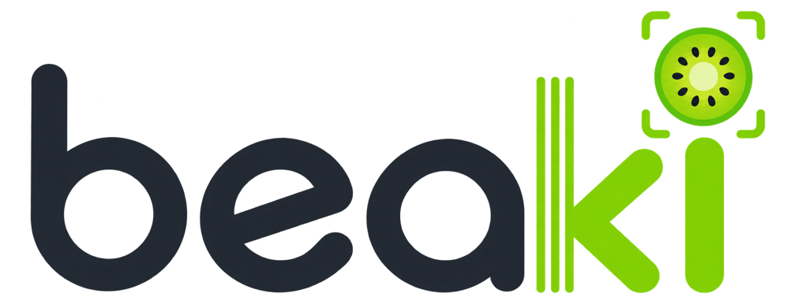

# HackTricks

<figure><figcaption></figcaption></figure>

_Logo và thiết kế chuyển động bởi_ [_@ppieranacho_](https://www.instagram.com/ppieranacho/)_._

### Chạy HackTricks cục bộ

```bash
# Download latest version of hacktricks
git clone https://github.com/HackTricks-wiki/hacktricks

# Select the language you want to use
export HT_LANG="master" # Leave master for English
# "af" for Afrikaans
# "de" for German
# "el" for Greek
# "es" for Spanish
# "fr" for French
# "hi" for Hindi
# "it" for Italian
# "ja" for Japanese
# "ko" for Korean
# "pl" for Polish
# "pt" for Portuguese
# "sr" for Serbian
# "sw" for Swahili
# "tr" for Turkish
# "uk" for Ukrainian
# "vi" for Vietnamese
# "zh" for Chinese

# Run the docker container indicating the path to the hacktricks folder
docker run -d --rm --platform linux/amd64 -p 3337:3000 --name hacktricks -v $(pwd)/hacktricks:/app ghcr.io/hacktricks-wiki/hacktricks-cloud/translator-image bash -c "mkdir -p ~/.ssh && ssh-keyscan -H github.com >> ~/.ssh/known_hosts && cd /app && git config --global --add safe.directory /app && git checkout $HT_LANG && git pull && MDBOOK_PREPROCESSOR__HACKTRICKS__ENV=dev mdbook serve --hostname 0.0.0.0"
```

Bản sao HackTricks trên máy của bạn sẽ **khả dụng tại [http://localhost:3337](http://localhost:3337)** sau chưa đầy 5 phút (cần thời gian để build sách, hãy kiên nhẫn).

Ngoài ra, nếu có Docker Compose, bạn chỉ cần chạy lệnh sau từ thư mục gốc của repo:

```bash
docker compose up
```

Điều này sử dụng `docker-compose.yml` đi kèm để phục vụ nhánh hiện đang được checkout trên host tại [http://localhost:3337](http://localhost:3337), có live reload. Để thay đổi ngôn ngữ khi dùng Compose, hãy checkout nhánh ngôn ngữ mong muốn trước khi khởi chạy dịch vụ.

## Đối tác HackTricks

---

## Bạn bè HackTricks

### [STM Cyber](https://www.stmcyber.com)

<figure class="sponsor-logo"><figcaption></figcaption></figure>

STM Cyber cung cấp dịch vụ kiểm thử xâm nhập, kiểm toán bảo mật, nghiên cứu và phát triển exploit, công cụ và nâng cao nhận thức về bảo mật. Trang web giới thiệu đội ngũ gồm các chuyên gia kiểm thử xâm nhập, lập trình viên và nhà nghiên cứu bảo mật với hơn một thập kỷ kinh nghiệm.<sup>[[1]](#references)</sup>

Bạn có thể xem **blog** của họ tại [**https://blog.stmcyber.com**](https://blog.stmcyber.com).

**STM Cyber** cũng hỗ trợ các dự án mã nguồn mở về an ninh mạng như HackTricks :)

---

### [Intigriti](https://www.intigriti.com)

<figure class="sponsor-logo"><figcaption></figcaption></figure>

Intigriti là nhà cung cấp dịch vụ bảo mật cộng đồng, cung cấp dịch vụ bug bounty và kiểm thử xâm nhập thông qua cộng đồng nhà nghiên cứu toàn cầu. Nền tảng này kết hợp phạm vi bảo vệ bug bounty liên tục với dịch vụ PTaaS theo yêu cầu và các chương trình công bố lỗ hổng được quản lý.<sup>[[2]](#references)</sup>

**Mẹo bug bounty**: Tham gia Intigriti qua [**https://go.intigriti.com/hacktricks**](https://go.intigriti.com/hacktricks) và khám phá các chương trình bug bounty của họ.

---

### [Modern Security – Nền tảng đào tạo bảo mật AI và ứng dụng](https://modernsecurity.io/)

<figure class="sponsor-logo"><figcaption></figcaption></figure>

Modern Security cung cấp chương trình đào tạo bảo mật AI thực hành, tự học theo tiến độ cá nhân, dành cho kỹ sư bảo mật, chuyên gia AppSec và nhà phát triển. Chứng chỉ AI Security của họ bao gồm kiến thức nền tảng về LLM và agent, RAG và cơ sở dữ liệu vector, mô hình hóa mối đe dọa, các cuộc tấn công prompt injection và MCP, cùng kiến trúc phòng thủ.<sup>[[3]](#references)</sup>

👉 Tìm hiểu thêm về khóa học AI Security:  
https://www.modernsecurity.io/courses/ai-security-certification

---

### [SerpApi](https://serpapi.com/)

<figure class="sponsor-logo"><figcaption></figcaption></figure>

**SerpApi** cung cấp API cho Google và các công cụ tìm kiếm khác, trả về dữ liệu SERP có cấu trúc với các tính năng như kết quả theo vị trí, Maps, Shopping và Knowledge Graph.<sup>[[4]](#references)</sup>

Để biết thêm thông tin, hãy xem [**blog**](https://serpapi.com/blog/) của họ, thử ví dụ trên [**playground**](https://serpapi.com/playground), hoặc [**tạo tài khoản miễn phí**](https://serpapi.com/users/sign_up).

---

### [8kSec Academy – Khóa học chuyên sâu về bảo mật di động và AI](https://academy.8ksec.io/)

<figure class="sponsor-logo"><figcaption></figcaption></figure>

**8kSec Academy** cung cấp các khóa học về bảo mật di động và AI theo hình thức tự học. Danh mục khóa học bao gồm kiểm toán và reverse ứng dụng di động bằng các công cụ như Ghidra, Frida và LLDB, cùng các phòng lab về tấn công và phòng thủ AI/LLM.<sup>[[5]](#references)[[6]](#references)</sup>

Xem [danh mục khóa học của 8kSec Academy](https://academy.8ksec.io/).

---

### [NaxusAI – Bảo mật tấn công tự động](https://www.naxusai.com/)

<figure class="sponsor-logo"><figcaption></figcaption></figure>

**Naxus** là nền tảng bảo mật tấn công sử dụng AI, hỗ trợ quét toàn diện bề mặt tấn công bên ngoài, kiểm toán ứng dụng di động, kiểm thử black-box ứng dụng web và đánh giá mã nguồn. Các agent xác thực những phát hiện có thể khai thác và cung cấp bằng chứng có thể truy vết, exploit proof-of-concept và hướng khắc phục khả thi.<sup>[[7]](#references)</sup>

**Mẹo kiểm toán bảo mật**: Dùng Naxus để thực hiện kiểm toán tự động từ đầu đến cuối trên tài sản bên ngoài, ứng dụng di động, ứng dụng web và mã nguồn.

---

### [WebSec](https://websec.net/)

<figure class="sponsor-logo"><figcaption></figcaption></figure>

WebSec cung cấp dịch vụ kiểm thử xâm nhập, gói dịch vụ bảo mật, nhân sự và đánh giá lỗ hổng. Trang web cho biết công ty hoạt động trên phạm vi quốc tế, cung cấp dịch vụ về bảo mật tấn công, bảo mật phòng thủ và quản trị, rủi ro, tuân thủ.<sup>[[8]](#references)</sup>

Để biết thêm thông tin, hãy truy cập [**trang web**](https://websec.net/en/) hoặc [**blog**](https://websec.net/blog/) của họ.

Ngoài những điều trên, WebSec còn là **đơn vị ủng hộ HackTricks lâu dài.**

---

### [CyberHelmets](https://cyberhelmets.com/courses/?ref=hacktricks)

<figure class="sponsor-logo"><figcaption></figcaption></figure>


**Được xây dựng cho thực tế. Được thiết kế xoay quanh bạn.**\
[**Cyber Helmets**](https://cyberhelmets.com/?ref=hacktricks) cung cấp chương trình đào tạo an ninh mạng do chuyên gia hướng dẫn, với nội dung và phòng lab được xây dựng riêng, dựa trên hạ tầng thực tế. Chương trình được thiết kế phù hợp với nhu cầu của từng tổ chức và bao quát từ đánh giá đến triển khai.<sup>[[9]](#references)</sup> Để hỏi về chương trình đào tạo tùy chỉnh, hãy liên hệ [**tại đây**](https://cyberhelmets.com/tailor-made-training/?ref=hacktricks).

**Điểm khác biệt của chương trình đào tạo:**
* Nội dung và phòng lab được xây dựng riêng
* Được hỗ trợ bởi các công cụ và nền tảng hàng đầu
* Được thiết kế và giảng dạy bởi các chuyên gia thực hành

---

### [Last Tower Solutions](https://www.lasttowersolutions.com/)

<figure class="sponsor-logo"><figcaption></figcaption></figure>

Last Tower Solutions tập trung vào tư vấn an ninh mạng cho lĩnh vực **Giáo dục** và **FinTech**, bao gồm đánh giá cloud, kiểm thử xâm nhập nội bộ và bên ngoài, đánh giá lỗ hổng và hỗ trợ tuân thủ.<sup>[[10]](#references)</sup>

Theo dõi tin tức và cập nhật những thông tin mới nhất về an ninh mạng tại [**blog**](https://www.lasttowersolutions.com/blog) của chúng tôi.

---

### [Beaki — Thực phẩm phù hợp với bạn](https://www.beaki.app/)

<figure class="sponsor-logo"><figcaption></figcaption></figure>

**Beaki** là ứng dụng quét thực phẩm cá nhân hóa, đếm calo và theo dõi dinh dưỡng. Quét mã vạch và kệ hàng siêu thị, chụp ảnh hoặc mô tả món ăn và thực đơn nhà hàng để nhận điểm số dễ hiểu, được cá nhân hóa theo mục tiêu, chế độ ăn, dị ứng và hồ sơ sức khỏe của bạn. Beaki cũng theo dõi calo và các chất đa lượng, đồng thời tạo kế hoạch bữa ăn cá nhân hóa kèm danh sách mua sắm.<sup>[[11]](#references)</sup>

[**Tải Beaki miễn phí**](https://www.beaki.app/?utm_source=hacktricks&utm_medium=partner&utm_campaign=hacktricks) trên Android hoặc iPhone.

---

## Giấy phép và tuyên bố miễn trừ trách nhiệm

Xem mục HackTricks Values & FAQ trong phần References bên dưới.

## Thống kê Github


## References

- [1] [STM Cyber](https://www.stmcyber.com/)
- [2] [Intigriti](https://www.intigriti.com/)
- [3] [Chứng chỉ AI Security – Modern Security](https://www.modernsecurity.io/courses/ai-security-certification)
- [4] [SerpApi](https://serpapi.com/)
- [5] [8kSec Academy](https://academy.8ksec.io/)
- [6] [Bảo mật AI thực tiễn: Tấn công, phòng thủ và ứng dụng](https://academy.8ksec.io/course/practical-ai-security)
- [7] [Naxus](https://www.naxusai.com/)
- [8] [WebSec](https://websec.net/)
- [9] [Cyber Helmets](https://cyberhelmets.com/)
- [10] [Last Tower Solutions](https://www.lasttowersolutions.com/)
- [11] [Beaki](https://www.beaki.app/)
- [12] [Liên kết giới thiệu Intigriti HackTricks](https://go.intigriti.com/hacktricks)
- [13] [Modern Security](https://modernsecurity.io/)
- [14] [Video tài trợ của WebSec](https://www.youtube.com/watch?v=Zq2JycGDCPM)
- [15] [Các khóa học Cyber Helmets](https://cyberhelmets.com/courses/?ref=hacktricks)
- [16] [Giá trị và Câu hỏi thường gặp về HackTricks](welcome/hacktricks-values-and-faq.md)

{{#include banners/hacktricks-training.md}}
