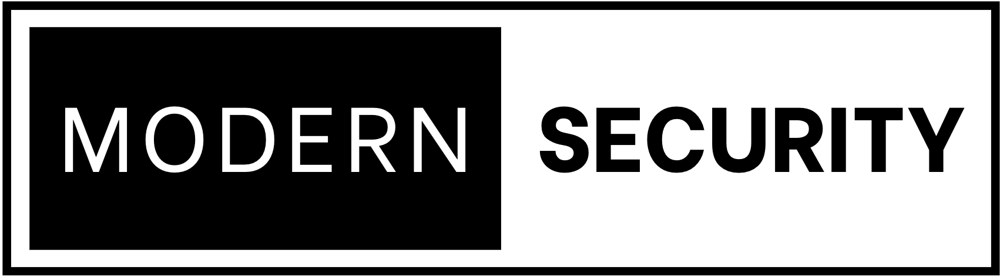

# HackTricks

<figure><figcaption></figcaption></figure>

_Λογότυπα Hacktricks και σχεδιασμός κίνησης από_ [_@ppieranacho_](https://www.instagram.com/ppieranacho/)_._

### Εκτελέστε το HackTricks τοπικά

```bash
# Download latest version of hacktricks
git clone https://github.com/HackTricks-wiki/hacktricks

# Select the language you want to use
export HT_LANG="master" # Leave master for English
# "af" for Afrikaans
# "de" for German
# "el" for Greek
# "es" for Spanish
# "fr" for French
# "hi" for Hindi
# "it" for Italian
# "ja" for Japanese
# "ko" for Korean
# "pl" for Polish
# "pt" for Portuguese
# "sr" for Serbian
# "sw" for Swahili
# "tr" for Turkish
# "uk" for Ukrainian
# "vi" for Vietnamese
# "zh" for Chinese

# Run the docker container indicating the path to the hacktricks folder
docker run -d --rm --platform linux/amd64 -p 3337:3000 --name hacktricks -v $(pwd)/hacktricks:/app ghcr.io/hacktricks-wiki/hacktricks-cloud/translator-image bash -c "mkdir -p ~/.ssh && ssh-keyscan -H github.com >> ~/.ssh/known_hosts && cd /app && git config --global --add safe.directory /app && git checkout $HT_LANG && git pull && MDBOOK_PREPROCESSOR__HACKTRICKS__ENV=dev mdbook serve --hostname 0.0.0.0"
```

Το τοπικό σας αντίγραφο του HackTricks θα είναι **διαθέσιμο στη διεύθυνση [http://localhost:3337](http://localhost:3337)** σε <5 λεπτά (χρειάζεται χρόνο για να γίνει build το βιβλίο, κάντε υπομονή).

Εναλλακτικά, αν έχετε Docker Compose, μπορείτε απλώς να εκτελέσετε τα παρακάτω από τη ρίζα του repo:

```bash
docker compose up
```

This uses the bundled `docker-compose.yml` to serve the branch currently checked out on the host at [http://localhost:3337](http://localhost:3337) with live reload. To change languages when using Compose, check out the desired language branch before starting the service.

## Συνεργάτες HackTricks

---

## Φίλοι του HackTricks

### [STM Cyber](https://www.stmcyber.com)

<figure class="sponsor-logo"><figcaption></figcaption></figure>

Η STM Cyber παρέχει υπηρεσίες penetration testing, ελέγχους ασφαλείας, εργασία σε exploit και έρευνα, εργαλεία και υπηρεσίες ευαισθητοποίησης σε θέματα ασφάλειας. Ο ιστότοπός της περιγράφει μια ομάδα penetration testers, προγραμματιστών και ερευνητών ασφάλειας με εμπειρία άνω της δεκαετίας.<sup>[[1]](#references)</sup>

Μπορείτε να επισκεφτείτε το **blog** τους στη διεύθυνση [**https://blog.stmcyber.com**](https://blog.stmcyber.com).

Η **STM Cyber** υποστηρίζει επίσης έργα ανοικτού κώδικα στον τομέα της κυβερνοασφάλειας, όπως το HackTricks :)

---

### [Intigriti](https://www.intigriti.com)

<figure class="sponsor-logo"><figcaption></figcaption></figure>

Η Intigriti είναι πάροχος crowdsourced ασφάλειας που προσφέρει υπηρεσίες bug bounty και penetration testing μέσω μιας παγκόσμιας κοινότητας ερευνητών. Η πλατφόρμα της συνδυάζει συνεχή κάλυψη bug bounty με on-demand PTaaS και διαχειριζόμενα προγράμματα γνωστοποίησης ευπαθειών.<sup>[[2]](#references)</sup>

**Συμβουλή για bug bounty**: Εγγραφείτε στην Intigriti μέσω του [**https://go.intigriti.com/hacktricks**](https://go.intigriti.com/hacktricks) και εξερευνήστε τα προγράμματα bug bounty της.

---

### [Modern Security – Πλατφόρμα Εκπαίδευσης σε AI & Ασφάλεια Εφαρμογών](https://modernsecurity.io/)

<figure class="sponsor-logo"><figcaption></figcaption></figure>

Η Modern Security προσφέρει αυτορυθμιζόμενη, πρακτική εκπαίδευση στην ασφάλεια AI για μηχανικούς ασφάλειας, επαγγελματίες AppSec και προγραμματιστές. Η πιστοποίηση AI Security καλύπτει τα βασικά των LLM και των agents, τα RAG και vector databases, το threat modeling, τις επιθέσεις prompt injection και MCP, καθώς και την αμυντική αρχιτεκτονική.<sup>[[3]](#references)</sup>

👉 Περισσότερες λεπτομέρειες για το μάθημα AI Security:  
https://www.modernsecurity.io/courses/ai-security-certification

---

### [SerpApi](https://serpapi.com/)

<figure class="sponsor-logo"><figcaption></figcaption></figure>

Η **SerpApi** παρέχει APIs για την Google και άλλες μηχανές αναζήτησης, επιστρέφοντας δομημένα δεδομένα SERP με λειτουργίες όπως αποτελέσματα βάσει τοποθεσίας, Maps, Shopping και Knowledge Graph.<sup>[[4]](#references)</sup>

Για περισσότερες πληροφορίες, επισκεφτείτε το [**blog**](https://serpapi.com/blog/), δοκιμάστε ένα παράδειγμα στο [**playground**](https://serpapi.com/playground) ή [**δημιουργήστε δωρεάν λογαριασμό**](https://serpapi.com/users/sign_up).

---

### [8kSec Academy – Εκτενή Μαθήματα Ασφάλειας Κινητών & AI](https://academy.8ksec.io/)

<figure class="sponsor-logo"><figcaption></figcaption></figure>

Η **8kSec Academy** προσφέρει αυτορυθμιζόμενα μαθήματα για την ασφάλεια κινητών συσκευών και AI. Ο κατάλογός της καλύπτει τον έλεγχο και το reverse engineering εφαρμογών για κινητά με εργαλεία όπως τα Ghidra, Frida και LLDB, καθώς και εργαστήρια επιθέσεων και άμυνας AI/LLM.<sup>[[5]](#references)[[6]](#references)</sup>

Δείτε τον [κατάλογο μαθημάτων της 8kSec Academy](https://academy.8ksec.io/).

---

### [NaxusAI – Αυτόνομη Επιθετική Ασφάλεια](https://www.naxusai.com/)

<figure class="sponsor-logo"><figcaption></figcaption></figure>

Η **Naxus** είναι μια πλατφόρμα επιθετικής ασφάλειας με τεχνητή νοημοσύνη, για πλήρεις σαρώσεις εξωτερικής επιφάνειας επίθεσης, ελέγχους εφαρμογών για κινητά, black-box testing ιστού και ελέγχους πηγαίου κώδικα. Οι agents της επαληθεύουν ευρήματα που μπορούν να αξιοποιηθούν και παρέχουν ανιχνεύσιμα αποδεικτικά στοιχεία, exploits proof-of-concept και εφαρμόσιμες προτάσεις αποκατάστασης.<sup>[[7]](#references)</sup>

**Συμβουλή για ελέγχους ασφαλείας**: Χρησιμοποιήστε τη Naxus για αυτόνομους ελέγχους από άκρο σε άκρο σε εξωτερικά περιουσιακά στοιχεία, εφαρμογές για κινητά, web apps και πηγαίο κώδικα.

---

### [WebSec](https://websec.net/)

<figure class="sponsor-logo"><figcaption></figcaption></figure>

Η WebSec παρέχει υπηρεσίες penetration testing, συνδρομές ασφάλειας, στελέχωση και αξιολόγηση ευπαθειών. Σύμφωνα με τον ιστότοπό της, δραστηριοποιείται διεθνώς και καλύπτει την επιθετική και αμυντική ασφάλεια, καθώς και εργασίες διακυβέρνησης, διαχείρισης κινδύνων και συμμόρφωσης.<sup>[[8]](#references)</sup>

Για περισσότερες πληροφορίες, επισκεφτείτε τον [**ιστότοπο**](https://websec.net/en/) ή το [**blog**](https://websec.net/blog/).

Επιπλέον, η WebSec είναι **ένθερμος υποστηρικτής του HackTricks.**

---

### [CyberHelmets](https://cyberhelmets.com/courses/?ref=hacktricks)

<figure class="sponsor-logo"><figcaption></figcaption></figure>


**Φτιαγμένο για το πεδίο. Φτιαγμένο για εσάς.**\
Η [**Cyber Helmets**](https://cyberhelmets.com/?ref=hacktricks) προσφέρει εκπαίδευση στην κυβερνοασφάλεια από ειδικούς, με ειδικά σχεδιασμένο περιεχόμενο και εργαστήρια βασισμένα σε πραγματικές υποδομές. Τα προγράμματά της προσαρμόζονται στις ανάγκες κάθε οργανισμού και καλύπτουν όλη τη διαδικασία, από την αξιολόγηση έως την υλοποίηση.<sup>[[9]](#references)</sup> Για ερωτήσεις σχετικά με εξατομικευμένη εκπαίδευση, επικοινωνήστε [**εδώ**](https://cyberhelmets.com/tailor-made-training/?ref=hacktricks).

**Τι κάνει την εκπαίδευσή τους να ξεχωρίζει:**
* Ειδικά σχεδιασμένο περιεχόμενο και εργαστήρια
* Υποστήριξη από κορυφαία εργαλεία και πλατφόρμες
* Σχεδιασμός και διδασκαλία από επαγγελματίες του χώρου

---

### [Last Tower Solutions](https://www.lasttowersolutions.com/)

<figure class="sponsor-logo"><figcaption></figcaption></figure>

Η Last Tower Solutions εστιάζει στις συμβουλευτικές υπηρεσίες κυβερνοασφάλειας για τους τομείς της **Εκπαίδευσης** και του **FinTech**, συμπεριλαμβανομένων αξιολογήσεων cloud, εσωτερικών και εξωτερικών penetration tests, αξιολογήσεων ευπαθειών και υποστήριξης συμμόρφωσης.<sup>[[10]](#references)</sup>

Ενημερωθείτε για τις τελευταίες εξελίξεις στην κυβερνοασφάλεια επισκεπτόμενοι το [**blog**](https://www.lasttowersolutions.com/blog).

---

### [Beaki — Φαγητό που σας ταιριάζει](https://www.beaki.app/)

<figure class="sponsor-logo"><figcaption></figcaption></figure>

Το **Beaki** είναι ένας εξατομικευμένος σαρωτής τροφίμων, μετρητής θερμίδων και καταγραφέας διατροφής. Σαρώστε γραμμωτούς κώδικες και ράφια σούπερ μάρκετ, φωτογραφίστε ή περιγράψτε γεύματα και μενού εστιατορίων και λάβετε επεξηγήσιμες βαθμολογίες με βάση τους στόχους, τη διατροφή, τις αλλεργίες και το προφίλ υγείας σας. Το Beaki καταγράφει επίσης θερμίδες και μακροθρεπτικά συστατικά και δημιουργεί εξατομικευμένα προγράμματα γευμάτων με λίστες αγορών.<sup>[[11]](#references)</sup>

[**Κατεβάστε δωρεάν το Beaki**](https://www.beaki.app/?utm_source=hacktricks&utm_medium=partner&utm_campaign=hacktricks) για Android ή iPhone.

---

## Άδεια Χρήσης & Αποποίηση Ευθύνης

Δείτε την καταχώριση «HackTricks Values & FAQ» στις Παραπομπές παρακάτω.

## Στατιστικά GitHub


## References

- [1] [STM Cyber](https://www.stmcyber.com/)
- [2] [Intigriti](https://www.intigriti.com/)
- [3] [Πιστοποίηση AI Security – Modern Security](https://www.modernsecurity.io/courses/ai-security-certification)
- [4] [SerpApi](https://serpapi.com/)
- [5] [8kSec Academy](https://academy.8ksec.io/)
- [6] [Πρακτική Ασφάλεια AI: Επιθέσεις, Άμυνες και Εφαρμογές](https://academy.8ksec.io/course/practical-ai-security)
- [7] [Naxus](https://www.naxusai.com/)
- [8] [WebSec](https://websec.net/)
- [9] [Cyber Helmets](https://cyberhelmets.com/)
- [10] [Last Tower Solutions](https://www.lasttowersolutions.com/)
- [11] [Beaki](https://www.beaki.app/)
- [12] [Σύνδεσμος παραπομπής Intigriti HackTricks](https://go.intigriti.com/hacktricks)
- [13] [Modern Security](https://modernsecurity.io/)
- [14] [Βίντεο χορηγίας της WebSec](https://www.youtube.com/watch?v=Zq2JycGDCPM)
- [15] [Μαθήματα Cyber Helmets](https://cyberhelmets.com/courses/?ref=hacktricks)
- [16] [Αξίες & FAQ του HackTricks](welcome/hacktricks-values-and-faq.md)
{{#include banners/hacktricks-training.md}}
