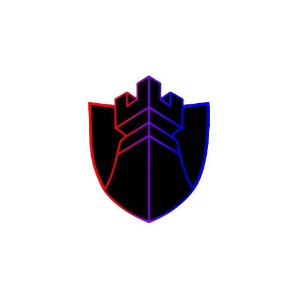

# HackTricks

<figure><figcaption></figcaption></figure>

_Логотипи Hacktricks і моушн-дизайн від_ [_@ppieranacho_](https://www.instagram.com/ppieranacho/)_._

### Запустити HackTricks локально

```bash
# Download latest version of hacktricks
git clone https://github.com/HackTricks-wiki/hacktricks

# Select the language you want to use
export HT_LANG="master" # Leave master for English
# "af" for Afrikaans
# "de" for German
# "el" for Greek
# "es" for Spanish
# "fr" for French
# "hi" for Hindi
# "it" for Italian
# "ja" for Japanese
# "ko" for Korean
# "pl" for Polish
# "pt" for Portuguese
# "sr" for Serbian
# "sw" for Swahili
# "tr" for Turkish
# "uk" for Ukrainian
# "vi" for Vietnamese
# "zh" for Chinese

# Run the docker container indicating the path to the hacktricks folder
docker run -d --rm --platform linux/amd64 -p 3337:3000 --name hacktricks -v $(pwd)/hacktricks:/app ghcr.io/hacktricks-wiki/hacktricks-cloud/translator-image bash -c "mkdir -p ~/.ssh && ssh-keyscan -H github.com >> ~/.ssh/known_hosts && cd /app && git config --global --add safe.directory /app && git checkout $HT_LANG && git pull && MDBOOK_PREPROCESSOR__HACKTRICKS__ENV=dev mdbook serve --hostname 0.0.0.0"
```

Ваша локальна копія HackTricks буде **доступна за адресою [http://localhost:3337](http://localhost:3337)** менш ніж за 5 хвилин (потрібен час, щоб зібрати книгу, зачекайте).

Якщо у вас є Docker Compose, можна просто виконати таку команду з кореня репозиторію:

```bash
docker compose up
```

Це використовує вбудований `docker-compose.yml`, щоб обслуговувати гілку, яка зараз checkout-нута на хості, за адресою [http://localhost:3337](http://localhost:3337) з live reload. Щоб змінити мову під час використання Compose, checkout-ніть потрібну мовну гілку перед запуском сервісу.

## Партнери HackTricks

---

## Друзі HackTricks

### [STM Cyber](https://www.stmcyber.com)

<figure class="sponsor-logo"><figcaption></figcaption></figure>

STM Cyber надає послуги з penetration testing, аудиту безпеки, роботи з exploit-ами та досліджень, розробки інструментів і підвищення обізнаності з безпеки. На сайті описано команду фахівців із penetration testing, програмістів і дослідників безпеки з понад десятирічним досвідом.<sup>[[1]](#references)</sup>

Відвідайте їхній **блог** за посиланням [**https://blog.stmcyber.com**](https://blog.stmcyber.com).

**STM Cyber** також підтримує open source проєкти з кібербезпеки, як-от HackTricks :)

---

### [Intigriti](https://www.intigriti.com)

<figure class="sponsor-logo"><figcaption></figcaption></figure>

Intigriti — це провайдер crowdsourced security, який пропонує послуги bug bounty та penetration testing завдяки глобальній спільноті дослідників. Її платформа поєднує постійне покриття bug bounty з послугами PTaaS на вимогу та керованими програмами розкриття вразливостей.<sup>[[2]](#references)</sup>

**Порада щодо bug bounty**: приєднуйтеся до Intigriti за посиланням [**https://go.intigriti.com/hacktricks**](https://go.intigriti.com/hacktricks) та перегляньте її програми bug bounty.

---

### [Modern Security – Платформа для навчання AI та безпеки застосунків](https://modernsecurity.io/)

<figure class="sponsor-logo"><figcaption></figcaption></figure>

Modern Security пропонує навчання з безпеки AI у власному темпі з практичними завданнями для інженерів із безпеки, фахівців AppSec і розробників. Сертифікація з безпеки AI охоплює основи LLM і агентів, RAG і векторні бази даних, моделювання загроз, атаки з prompt injection і MCP, а також захисну архітектуру.<sup>[[3]](#references)</sup>

👉 Докладніше про курс із безпеки AI:  
https://www.modernsecurity.io/courses/ai-security-certification

---

### [SerpApi](https://serpapi.com/)

<figure class="sponsor-logo"><figcaption></figcaption></figure>

**SerpApi** надає API для Google та інших пошукових систем і повертає структуровані дані SERP із такими функціями, як результати з урахуванням місцезнаходження, Maps, Shopping і Knowledge Graph.<sup>[[4]](#references)</sup>

Докладніше — у їхньому [**блозі**](https://serpapi.com/blog/); спробуйте приклад у [**пісочниці**](https://serpapi.com/playground) або [**створіть безкоштовний обліковий запис**](https://serpapi.com/users/sign_up).

---

### [8kSec Academy – Поглиблені курси з безпеки мобільних пристроїв та AI](https://academy.8ksec.io/)

<figure class="sponsor-logo"><figcaption></figcaption></figure>

**8kSec Academy** пропонує курси з безпеки мобільних пристроїв та AI у власному темпі. Каталог охоплює аудит і реверсинг мобільних застосунків за допомогою таких інструментів, як Ghidra, Frida і LLDB, а також лабораторні роботи з атак і захисту AI/LLM.<sup>[[5]](#references)[[6]](#references)</sup>

Перегляньте [каталог курсів 8kSec Academy](https://academy.8ksec.io/).

---

### [NaxusAI – Автономна offensive security](https://www.naxusai.com/)

<figure class="sponsor-logo"><figcaption></figcaption></figure>

**Naxus** — це платформа offensive security на основі AI для повного сканування зовнішньої поверхні атаки, аудиту мобільних застосунків, black-box тестування вебзастосунків і перевірки вихідного коду. Її агенти перевіряють, чи можна скористатися виявленими проблемами, і надають відстежувані докази, proof-of-concept exploit-и та практичні рекомендації щодо усунення.<sup>[[7]](#references)</sup>

**Порада щодо аудиту безпеки**: використовуйте Naxus для автономного аудиту від початку до кінця зовнішніх активів, мобільних застосунків, вебзастосунків і вихідного коду.

---

### [WebSec](https://websec.net/)

<figure class="sponsor-logo"><figcaption></figcaption></figure>

WebSec надає послуги з penetration testing, підписки на послуги безпеки, підбору персоналу та оцінювання вразливостей. На сайті зазначено, що компанія працює на міжнародному рівні та охоплює offensive security, defensive security, а також управління, ризики й відповідність вимогам.<sup>[[8]](#references)</sup>

Докладніше — на їхньому [**вебсайті**](https://websec.net/en/) або в [**блозі**](https://websec.net/blog/).

Крім переліченого вище, WebSec також є **відданим прихильником HackTricks.**

---

### [CyberHelmets](https://cyberhelmets.com/courses/?ref=hacktricks)

<figure class="sponsor-logo"><figcaption></figcaption></figure>


**Створено для практичної роботи. Створено з урахуванням ваших потреб.**\
[**Cyber Helmets**](https://cyberhelmets.com/?ref=hacktricks) пропонує навчання з кібербезпеки під керівництвом експертів, з індивідуально розробленими матеріалами та лабораторними роботами на основі реальної інфраструктури. Їхні програми адаптовані до потреб організацій і охоплюють етапи від оцінювання до впровадження.<sup>[[9]](#references)</sup> Щоб дізнатися про індивідуальне навчання, зверніться [**сюди**](https://cyberhelmets.com/tailor-made-training/?ref=hacktricks).

**Що вирізняє їхнє навчання:**
* Індивідуально розроблені матеріали та лабораторні роботи
* Підтримка провідних інструментів і платформ
* Розроблено та викладається практиками

---

### [Last Tower Solutions](https://www.lasttowersolutions.com/)

<figure class="sponsor-logo"><figcaption></figcaption></figure>

Last Tower Solutions спеціалізується на консалтингу з кібербезпеки для **освіти** та **FinTech**, зокрема на оцінюванні хмарної інфраструктури, внутрішньому й зовнішньому penetration testing, оцінюванні вразливостей і підтримці відповідності вимогам.<sup>[[10]](#references)</sup>

Щоб бути в курсі останніх новин кібербезпеки, відвідайте наш [**блог**](https://www.lasttowersolutions.com/blog).

---

### [K8Studio - Розумніший GUI для керування Kubernetes.](https://k8studio.io/)

<figure class="sponsor-logo"><figcaption></figcaption></figure>

K8Studio — це десктопне середовище IDE для Kubernetes із візуалізацією CloudMaps, навігацією між кількома кластерами, RBAC, Helm, журналами, YAML і терміналом. За словами постачальника, підключення відбувається через kubeconfig без встановлення агентів; підтримуються macOS, Windows, Linux і ізольовані від мережі кластери.<sup>[[11]](#references)</sup>

---

## Ліцензія та застереження

Див. запис HackTricks Values & FAQ у розділі References нижче.

## Статистика Github


## References

- [1] [STM Cyber](https://www.stmcyber.com/)
- [2] [Intigriti](https://www.intigriti.com/)
- [3] [Сертифікація з безпеки AI – Modern Security](https://www.modernsecurity.io/courses/ai-security-certification)
- [4] [SerpApi](https://serpapi.com/)
- [5] [8kSec Academy](https://academy.8ksec.io/)
- [6] [Практична безпека AI: атаки, захист і застосування](https://academy.8ksec.io/course/practical-ai-security)
- [7] [Naxus](https://www.naxusai.com/)
- [8] [WebSec](https://websec.net/)
- [9] [Cyber Helmets](https://cyberhelmets.com/)
- [10] [Last Tower Solutions](https://www.lasttowersolutions.com/)
- [11] [K8Studio](https://k8studio.io/)
- [12] [Реферальне посилання Intigriti HackTricks](https://go.intigriti.com/hacktricks)
- [13] [Modern Security](https://modernsecurity.io/)
- [14] [Відео про спонсорство WebSec](https://www.youtube.com/watch?v=Zq2JycGDCPM)
- [15] [Курси Cyber Helmets](https://cyberhelmets.com/courses/?ref=hacktricks)
- [16] [Цінності та поширені запитання HackTricks](welcome/hacktricks-values-and-faq.md)
{{#include banners/hacktricks-training.md}}
