# Mô hình hóa mối đe dọa

{{#include ../banners/hacktricks-training.md}}

Chào mừng bạn đến với hướng dẫn toàn diện về Mô hình hóa mối đe dọa của HackTricks! Hãy cùng khám phá khía cạnh then chốt này của an ninh mạng, nơi chúng ta xác định, tìm hiểu và xây dựng chiến lược đối phó với các lỗ hổng tiềm ẩn trong hệ thống. Bài viết này là hướng dẫn từng bước, bao gồm các ví dụ thực tế, phần mềm hữu ích và lời giải thích dễ hiểu. Nội dung phù hợp cho cả người mới bắt đầu lẫn những người có kinh nghiệm muốn củng cố hệ thống phòng thủ an ninh mạng.

### Các tình huống thường gặp

1. **Phát triển phần mềm**: Là một phần của Vòng đời Phát triển Phần mềm An toàn (SSDLC), mô hình hóa mối đe dọa giúp **xác định các nguồn lỗ hổng tiềm ẩn** ở những giai đoạn đầu của quá trình phát triển.[[1]](#references)[[4]](#references)
2. **Penetration Testing**: Penetration Testing Execution Standard (PTES) xem mô hình hóa mối đe dọa là yêu cầu cần thiết để thực hiện đúng quy trình, đồng thời yêu cầu ghi lại các tài sản kinh doanh, quy trình kinh doanh, cộng đồng mối đe dọa và năng lực của họ.[[2]](#references)

### Khái quát về mô hình mối đe dọa

Mô hình mối đe dọa thường được thể hiện dưới dạng sơ đồ, hình ảnh hoặc hình minh họa trực quan khác về kiến trúc dự kiến hoặc ứng dụng hiện có. Sơ đồ luồng dữ liệu (DFD) là cách phổ biến để mô hình hóa hệ thống và các tương tác của nó, còn mô hình hóa mối đe dọa bổ sung bước phân tích tập trung vào bảo mật.[[1]](#references)

Trong Microsoft Threat Modeling Tool, các đường chấm đỏ biểu thị ranh giới tin cậy; các công cụ khác có thể sử dụng quy ước trực quan khác.[[4]](#references) Để đơn giản hóa việc xác định rủi ro, các nhóm có thể sử dụng bộ ba CIA (Tính bảo mật, Tính toàn vẹn, Tính sẵn sàng) hoặc các nhóm mối đe dọa STRIDE. Tuy nhiên, phương pháp phù hợp phụ thuộc vào bối cảnh và yêu cầu của dự án.[[1]](#references)[[3]](#references)[[10]](#references)

### Bộ ba CIA

Bộ ba CIA là mô hình bảo mật thông tin được công nhận rộng rãi, gồm Tính bảo mật (Confidentiality), Tính toàn vẹn (Integrity) và Tính sẵn sàng (Availability). Các thuộc tính này thường được dùng để mô tả mục tiêu bảo mật cho dữ liệu và hệ thống.[[3]](#references)

1. **Tính bảo mật**: Đảm bảo dữ liệu hoặc hệ thống không bị truy cập bởi những người không được phép. Đây là khía cạnh cốt lõi của bảo mật, đòi hỏi các biện pháp kiểm soát truy cập, mã hóa và những biện pháp khác để ngăn chặn rò rỉ dữ liệu.
2. **Tính toàn vẹn**: Đảm bảo tính chính xác, nhất quán và đáng tin cậy của dữ liệu trong suốt vòng đời của nó. Nguyên tắc này đảm bảo dữ liệu không bị các bên trái phép sửa đổi hoặc can thiệp. Việc này thường sử dụng checksum, hashing và các phương pháp xác minh dữ liệu khác.
3. **Tính sẵn sàng**: Đảm bảo người dùng được phép có thể truy cập dữ liệu và dịch vụ khi cần. Việc này thường bao gồm dự phòng, khả năng chịu lỗi và cấu hình tính sẵn sàng cao để duy trì hoạt động của hệ thống ngay cả khi xảy ra gián đoạn.

### Phương pháp mô hình hóa mối đe dọa

1. **STRIDE**: Phương pháp STRIDE của Microsoft phân loại các mối đe dọa phần mềm thành **Spoofing, Tampering, Repudiation, Information Disclosure, Denial of Service và Elevation of Privilege**. Các nhóm này giúp chuyên viên phân tích xác định những mối đe dọa có thể xuất hiện tại từng điểm dễ bị tổn thương trong thiết kế.[[5]](#references)
2. **DREAD**: Phương pháp đánh giá này của Microsoft chấm điểm mối đe dọa dựa trên **Damage, Reproducibility, Exploitability, Affected users và Discoverability**. Điểm số thu được có thể giúp ưu tiên các mối đe dọa cần giảm thiểu.[[5]](#references)
3. **PASTA** (Process for Attack Simulation and Threat Analysis): Đây là phương pháp luận **lấy rủi ro làm trọng tâm**, gồm bảy giai đoạn: mục tiêu, phạm vi kỹ thuật, phân rã ứng dụng, phân tích mối đe dọa, phân tích lỗ hổng và điểm yếu, mô hình hóa tấn công, và phân tích rủi ro/tác động.[[8]](#references)
4. **Trike**: Khung kiểm tra bảo mật này tiếp cận mô hình hóa mối đe dọa theo hướng **quản lý rủi ro** và phòng thủ.[[9]](#references)
5. **VAST** (Visual, Agile, and Simple Threat modeling): Phương pháp này chú trọng tạo ra các mô hình mối đe dọa có khả năng mở rộng và dễ sử dụng cho cả góc nhìn ứng dụng lẫn vận hành, đồng thời có thể tích hợp vào vòng đời phát triển và DevOps.[[10]](#references)
6. **OCTAVE** (Operationally Critical Threat, Asset, and Vulnerability Evaluation): Được tạo ra bởi CERT Division thuộc Software Engineering Institute của Carnegie Mellon, OCTAVE là phương pháp đánh giá và lập kế hoạch chiến lược dựa trên rủi ro, tập trung vào rủi ro của tổ chức thay vì chỉ tập trung vào công nghệ.[[10]](#references)

## Công cụ

Có nhiều công cụ và giải pháp phần mềm có thể **hỗ trợ** việc tạo và quản lý mô hình mối đe dọa. Dưới đây là một số lựa chọn bạn có thể cân nhắc.

### [SpiderSuite](https://github.com/3nock/SpiderSuite)

SpiderSuite là trình thu thập dữ liệu web đa nền tảng dành cho chuyên gia bảo mật, hỗ trợ lập bản đồ bề mặt tấn công, phát hiện endpoint và phân tích ứng dụng web.[[6]](#references)

**Cách sử dụng**

1. Chọn URL và Crawl

<figure>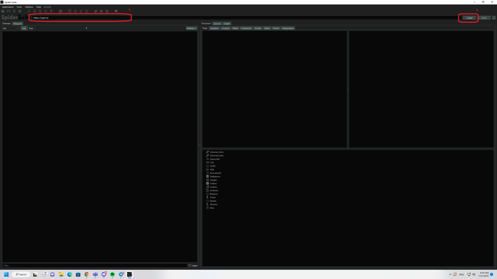<figcaption></figcaption></figure>

2. Xem biểu đồ

<figure>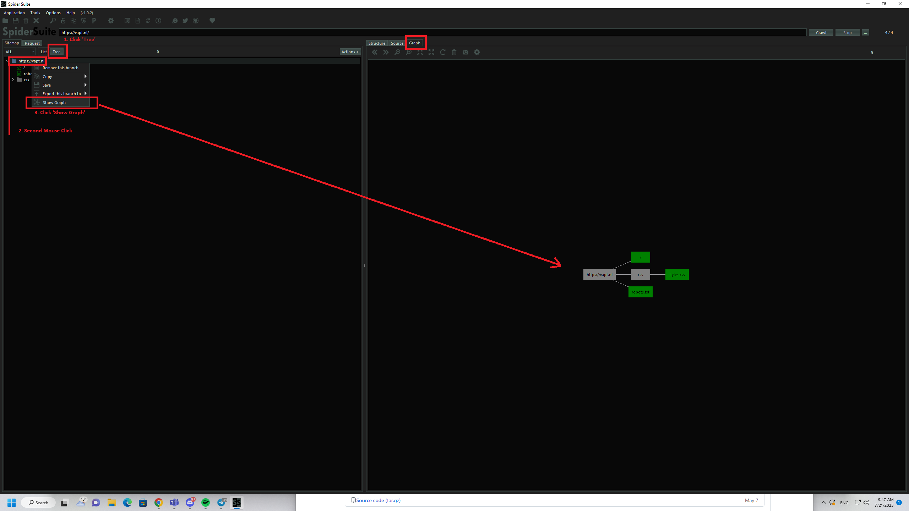<figcaption></figcaption></figure>

### [OWASP Threat Dragon](https://github.com/OWASP/threat-dragon/releases)

OWASP Threat Dragon là ứng dụng mô hình hóa mối đe dọa miễn phí, mã nguồn mở và đa nền tảng, dùng để vẽ sơ đồ, đề xuất mối đe dọa và ghi lại các biện pháp giảm thiểu. Ứng dụng có phiên bản web và desktop.[[7]](#references)

**Cách sử dụng**

1. Tạo dự án mới

<figure>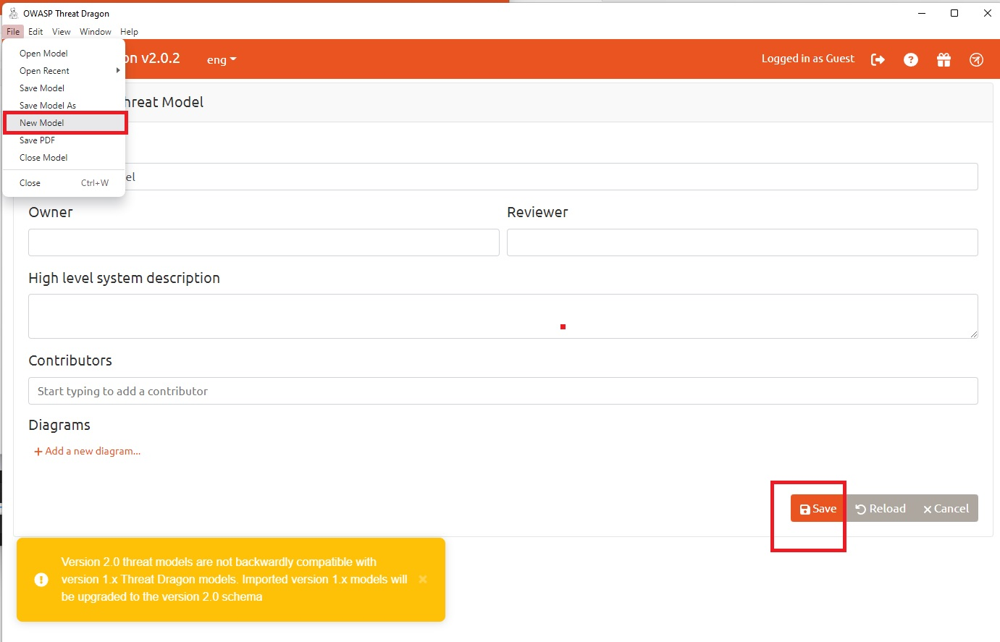<figcaption></figcaption></figure>

Đôi khi giao diện có thể trông như sau:

<figure>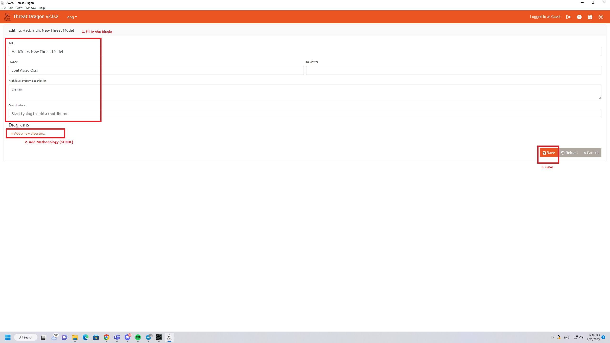<figcaption></figcaption></figure>

2. Mở dự án mới

<figure>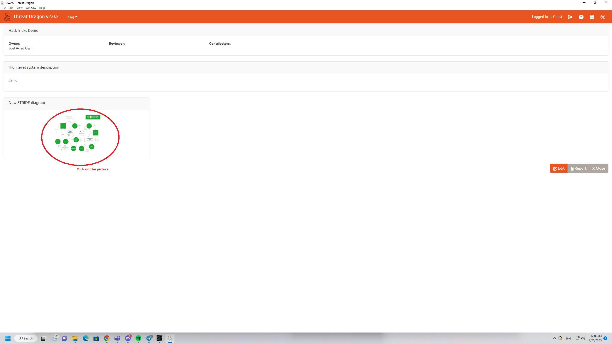<figcaption></figcaption></figure>

3. Lưu dự án mới

<figure>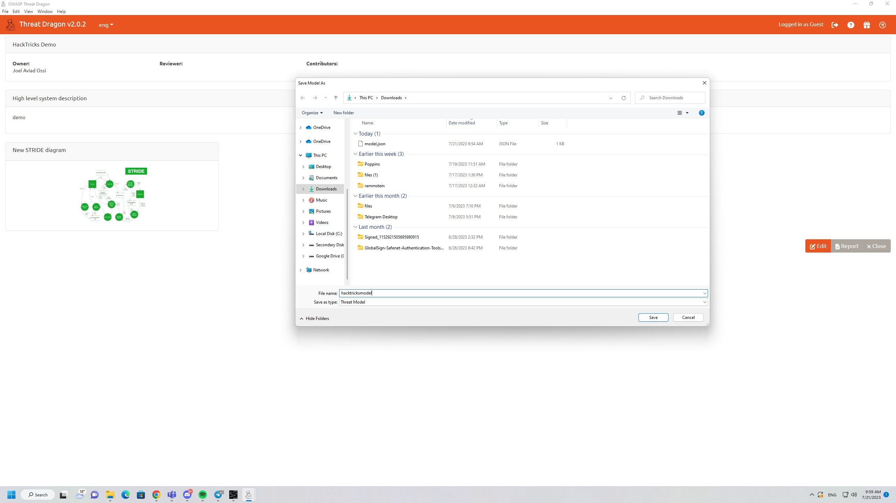<figcaption></figcaption></figure>

4. Tạo mô hình

Bạn có thể tham khảo các công cụ như SpiderSuite Crawler để lấy ý tưởng. Một mô hình cơ bản có thể trông như sau:

<figure>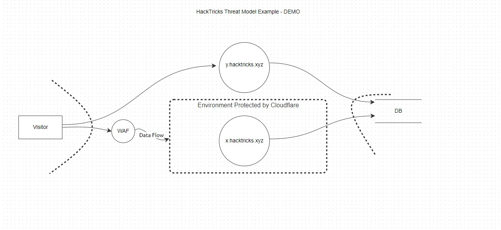<figcaption></figcaption></figure>

Giải thích ngắn gọn về các thực thể:

- Process (Thực thể như Webserver hoặc chức năng web)
- Actor (Một người, chẳng hạn như khách truy cập website, người dùng hoặc quản trị viên)
- Data Flow Line (Chỉ báo tương tác)
- Trust Boundary (Các phân đoạn mạng hoặc phạm vi khác nhau.)
- Store (Nơi lưu trữ dữ liệu, chẳng hạn như cơ sở dữ liệu)

5. Tạo mối đe dọa (Bước 1)

Trước tiên, bạn cần chọn lớp mà mình muốn thêm mối đe dọa vào

<figure>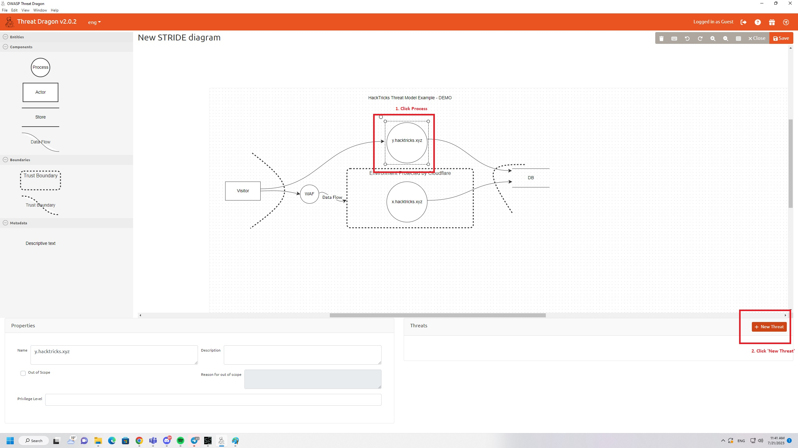<figcaption></figcaption></figure>

Bây giờ bạn có thể tạo mối đe dọa

<figure>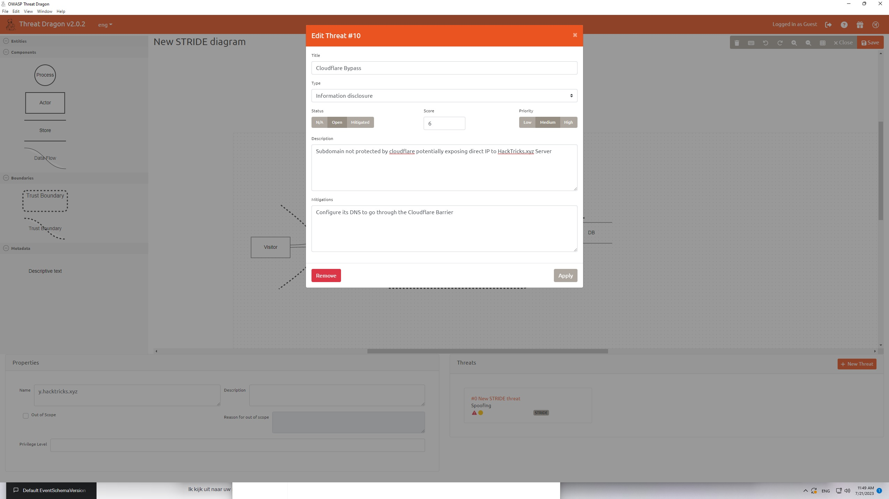<figcaption></figcaption></figure>

Hãy lưu ý rằng Actor Threats và Process Threats có sự khác biệt. Nếu thêm mối đe dọa vào một Actor, bạn chỉ có thể chọn "Spoofing" và "Repudiation". Tuy nhiên, trong ví dụ này, chúng ta thêm mối đe dọa vào một Process entity, vì vậy hộp tạo mối đe dọa sẽ hiển thị các lựa chọn sau:

<figure>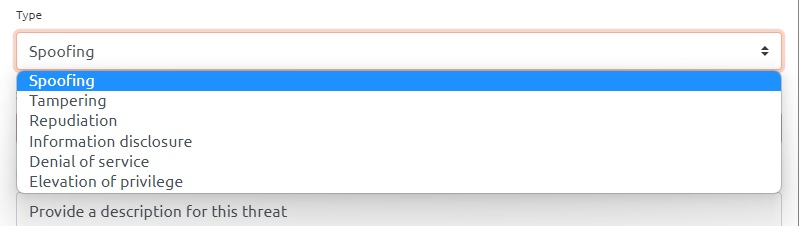<figcaption></figcaption></figure>

6. Hoàn tất

Mô hình hoàn chỉnh của bạn sẽ trông tương tự như sau. Đây là cách tạo mô hình mối đe dọa đơn giản bằng OWASP Threat Dragon.

<figure>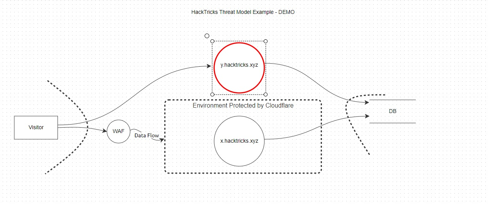<figcaption></figcaption></figure>

### [Microsoft Threat Modeling Tool](https://aka.ms/threatmodelingtool)

Microsoft Threat Modeling Tool là công cụ có thể tải xuống miễn phí để phân tích thiết kế phần mềm. Quy trình làm việc của công cụ tạo sơ đồ, xác định mối đe dọa và hỗ trợ giảm thiểu cũng như xác thực bằng phương pháp STRIDE.[[4]](#references)

## References

- [1] [Tài liệu hướng dẫn nhanh về mô hình hóa mối đe dọa](https://cheatsheetseries.owasp.org/cheatsheets/Threat_Modeling_Cheat_Sheet.html)
- [2] [Mô hình hóa mối đe dọa - Tiêu chuẩn thực hiện Penetration Testing](https://www.pentest-standard.org/index.php/Threat_Modeling)
- [3] [Các nguyên tắc cơ bản về bảo mật - Hướng dẫn dành cho nhà phát triển OWASP](https://devguide.owasp.org/en/02-foundations/01-security-fundamentals/)
- [4] [Bắt đầu với Microsoft Threat Modeling Tool](https://learn.microsoft.com/en-us/azure/security/develop/threat-modeling-tool-getting-started)
- [5] [Mô hình hóa mối đe dọa cho driver - Windows drivers](https://learn.microsoft.com/en-us/windows-hardware/drivers/driversecurity/threat-modeling-for-drivers)
- [6] [SpiderSuite](https://spidersuite.io/)
- [7] [OWASP Threat Dragon](https://github.com/OWASP/threat-dragon)
- [8] [Mô hình hóa mối đe dọa PASTA: Giải thích 7 giai đoạn](https://versprite.com/cybersecurity-listings/devsecops/pasta-threat-modeling/)
- [9] [Tài liệu phương pháp luận Trike v1](https://trike.sourceforge.net/papers/Trike_v1_Methodology_Document-draft.pdf)
- [10] [Mô hình hóa mối đe dọa: Tóm tắt các phương pháp hiện có](https://www.sei.cmu.edu/documents/569/2018_019_001_524597.pdf)
{{#include ../banners/hacktricks-training.md}}
