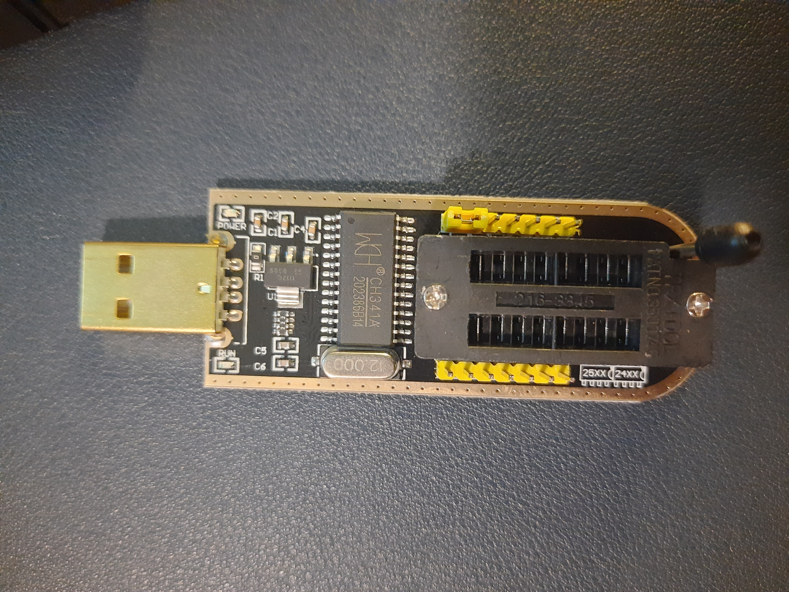
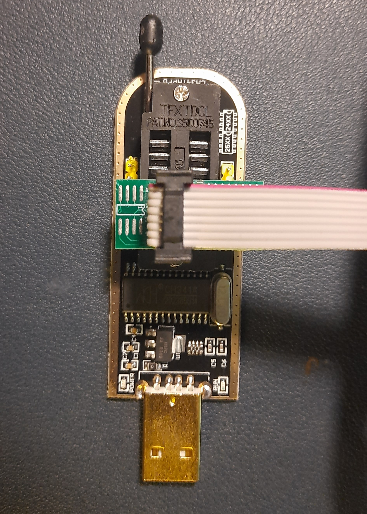
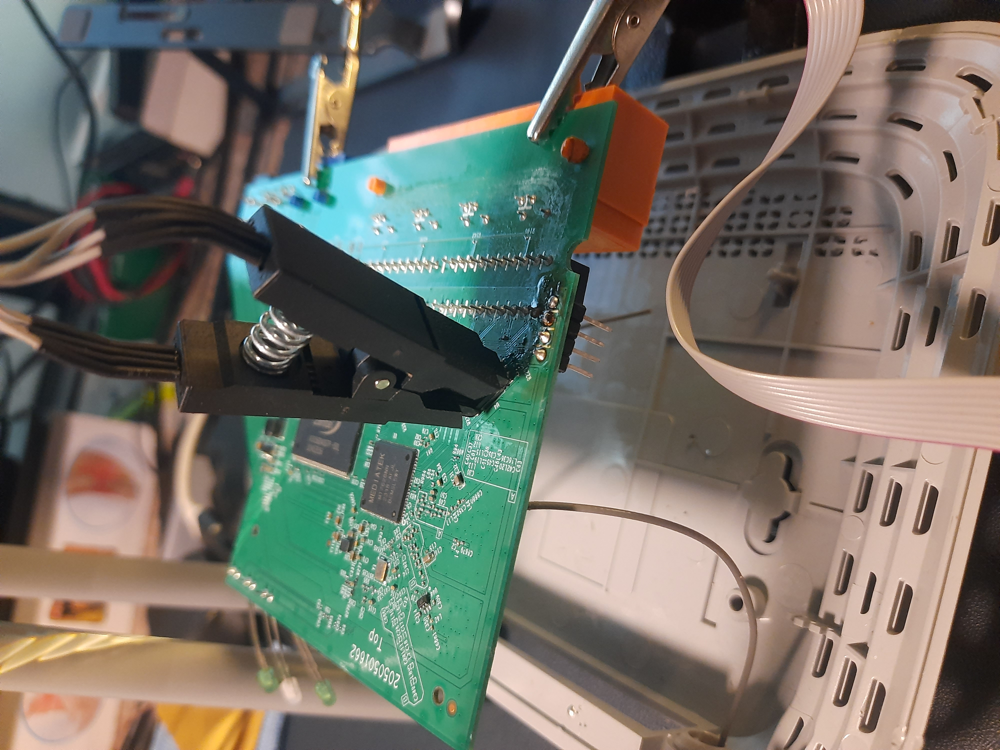
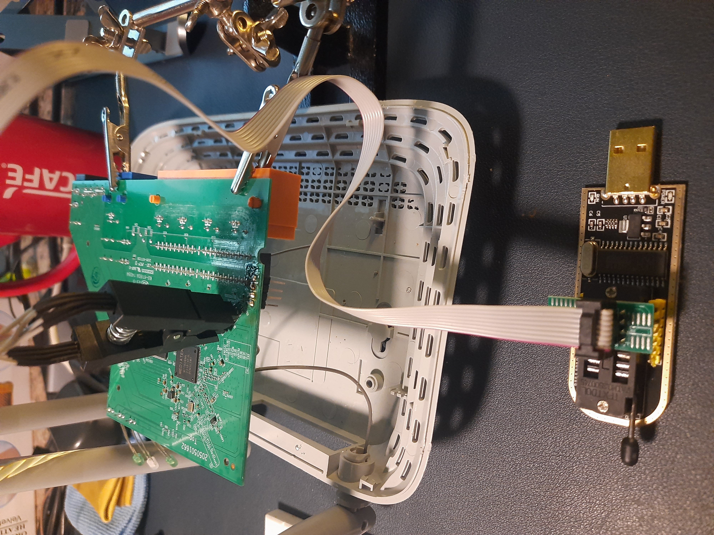

# SPI

{{#include ../../banners/hacktricks-training.md}}

## बुनियादी जानकारी

SPI (Serial Peripheral Interface) एक synchronous serial bus है, जिसका इस्तेमाल आम तौर पर integrated circuits के बीच कम दूरी के communication के लिए किया जाता है। एक controller clock देता है और chip-select signal का इस्तेमाल करके किसी peripheral, जैसे EEPROM, sensor या control device को चुनता है।<sup>[[1]](#references)</sup>

कई peripherals clock और data lines साझा कर सकते हैं; आम तौर पर हर peripheral के लिए अलग chip-select होता है। Controller transfers का संचालन करता है; आम तौर पर peripherals SPI bus पर एक-दूसरे से सीधे communicate नहीं करते। Chip-select की polarity और timing device-specific होती है; active-low selection आम है, लेकिन हर जगह ऐसा नहीं होता। SPI, discovery, addressing, commands या transfer की कोई एक अधिकतम length तय नहीं करता, इसलिए हमेशा target datasheet देखें।<sup>[[1]](#references)</sup>

MOSI/COPI पर controller से peripheral तक data जाता है और MISO/CIPO पर peripheral से controller तक। दोनों दिशाओं में एक साथ data shift हो सकता है। Command, address, dummy cycles और लौटाए गए data के बीच संबंध peripheral तय करता है—SPI नहीं—और यह clock polarity तथा phase (modes 0–3) पर निर्भर करता है। यह न मानें कि input खत्म होते ही ठीक एक clock बाद output शुरू हो जाता है।<sup>[[1]](#references)</sup>

## EEPROMs से Firmware Dump करना

Firmware को dump करना, उसका विश्लेषण करने और vulnerabilities ढूँढ़ने में उपयोगी हो सकता है। हो सकता है कि सही image ऑनलाइन उपलब्ध न हो या model, hardware revision अथवा version के अनुसार अलग हो; इसलिए उसे सीधे physical device से निकालने पर आकलन के लिए सटीक target मिलता है।

Serial console मददगार हो सकता है, लेकिन उसका filesystem read-only हो सकता है और target में analysis tools न हों—जिनमें test traffic भेजने/प्राप्त करने या आसानी से binaries निकालने के लिए ज़रूरी utilities भी शामिल हैं। Offline image में पूरा flash layout सुरक्षित रहता है और running target में बदलाव किए बिना filesystem extraction तथा reverse engineering की जा सकती है।

अधिकृत physical assessment के दौरान, verified dump नियंत्रित modification और reflashing tests में भी काम आ सकता है। इसमें files बदलना या firmware-level persistence दिखाने के लिए test payload/backdoor inject करना शामिल है। किसी भी write से पहले कई मेल खाते reads और original image सुरक्षित रखें: गलत voltage, chip selection, layout या image से device brick हो सकता है।

### CH341A EEPROM Programmer और Reader

यह कम कीमत वाला USB tool, compatible serial EEPROM और SPI flash devices को dump और reflash कर सकता है। इसका इस्तेमाल आम तौर पर PC BIOS/UEFI firmware रखने वाली SPI NOR flash chips के साथ किया जाता है और समय-सीमित physical access के दौरान यह सुविधाजनक होता है।



Flash memory को CH341A से जोड़ें और फिर programmer को computer से connect करें। अगर programmer detect नहीं होता है, तो target chip की troubleshooting से पहले USB cable, OS permissions और सही CH341A driver जाँचें। Datasheets या meter की मदद से chip का voltage, pin 1, adapter wiring और programmer output की पुष्टि करें—VCC को USB connector के उल्टी तरफ रखने जैसे नियम पर **भरोसा न करें**। गलत orientation या 3.3/1.8 V part पर 5 V लगाने से वह खराब हो सकता है। In-circuit reads भी fail हो सकते हैं, क्योंकि बाकी board bus को load या power कर सकता है।<sup>[[2]](#references)</sup>

 

Chip को पढ़ने के लिए `flashrom` या G-Flash जैसे software का इस्तेमाल करें। G-Flash एक minimal GUI है और compatible devices को auto-detect कर सकता है; quick acquisition के दौरान यह सुविधाजनक है, लेकिन detected model और voltage की खुद पुष्टि करें। Programmer का exact model और, ज़रूरत पड़ने पर, chip का exact model दें; कम-से-कम दो reads करें और dump को भरोसेमंद मानने से पहले उनके hashes की तुलना करें।<sup>[[2]](#references)</sup>



Firmware dump करने के बाद, binary files का विश्लेषण किया जा सकता है। Firmware और पूरे file system के बारे में बहुत-सी जानकारी निकालने के लिए strings, hexdump, xxd, binwalk आदि जैसे tools इस्तेमाल किए जा सकते हैं।

शुरुआती triage के लिए, Binwalk ज्ञात signatures scan कर सकता है और supported embedded content extract कर सकता है:

```
binwalk -e <filename>
```

आउटपुट फ़ाइल में `.bin`, `.rom` या कोई अन्य extension हो सकता है; extension से format तय नहीं होता।

> [!CAUTION]
> ध्यान दें कि firmware extraction एक नाज़ुक प्रक्रिया है और इसके लिए बहुत धैर्य की आवश्यकता होती है। किसी भी तरह की लापरवाही से firmware corrupt हो सकता है या पूरी तरह erase भी हो सकता है, जिससे device अनुपयोगी हो सकता है। firmware extract करने की कोशिश करने से पहले उस विशिष्ट device का अध्ययन करने की सलाह दी जाती है।

### Bus Pirate + flashrom

.png>)

कुछ datasheet में target pins को `DI` और `DO` नाम दिया जाता है: पारंपरिक single-data-line flash connection के लिए, controller का **MOSI/COPI, DI से** और controller का **MISO/CIPO, DO से** connect होता है। Target datasheet ज़रूर जाँचें, क्योंकि dual/quad I/O parts अन्य modes में इन्हीं pins का दोबारा उपयोग करते हैं।

.png>)

Windows या Linux में, flash memory का content dump करने के लिए आप [**`flashrom`**](https://www.flashrom.org/Flashrom) program का उपयोग करके कुछ इस तरह चला सकते हैं:

```bash
# In this command we are indicating:
# -VV Verbose
# -c <chip> Exact chip model (omit it to let flashrom probe candidates)
# -p <programmer> Programmer configuration; here, the Bus Pirate connection
# -r <file> Image to save in the filesystem
flashrom -VV -c "W25Q64.V" -p buspirate_spi:dev=COM3 -r flash_content.img
```

Bus Pirate के हालिया documentation में वैकल्पिक `serialspeed` और `spispeed` parameters भी दिखाए गए हैं। यदि लंबी wires या circuit में जुड़े components के load के कारण reads अस्थिर हों, तो शुरुआत कम speed से करें।<sup>[[3]](#references)</sup>

## References

- [1] [Analog Devices — SPI इंटरफ़ेस का परिचय](https://www.analog.com/en/resources/analog-dialogue/articles/introduction-to-spi-interface.html)
- [2] [flashrom manual — CH341A SPI programmer और read/write विकल्प](https://flashrom.org/classic_cli_manpage.html)
- [3] [Bus Pirate documentation — flashrom](https://docs.buspirate.com/docs/software/flashrom/)
{{#include ../../banners/hacktricks-training.md}}
