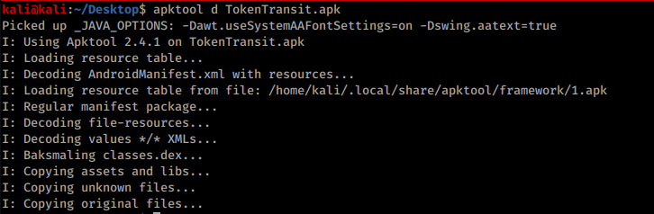
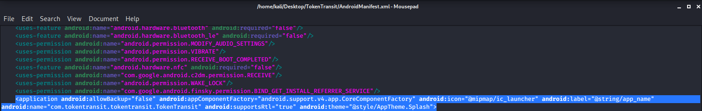
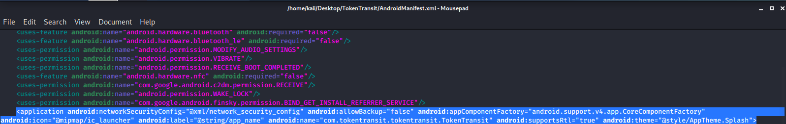
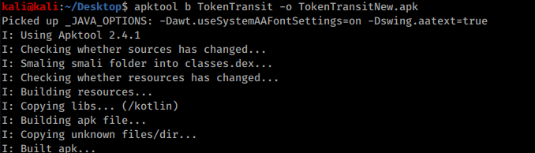

# Làm cho APK tin cậy chứng chỉ CA của người dùng

{{#include ../../banners/hacktricks-training.md}}

Ứng dụng Android có thể giới hạn các certificate authority mà chúng tin cậy. Trong môi trường kiểm thử được cấp phép, đóng gói lại APK với Network Security Configuration tin cậy các CA do người dùng cài đặt có thể giúp kiểm tra lưu lượng HTTPS. Việc này không tự động vượt qua certificate pinning được triển khai ở nơi khác trong ứng dụng.<sup>[[1]](#references)</sup>

## Tự động

[`apk-mitm`](https://github.com/shroudedcode/apk-mitm) tự động vá APK để kiểm tra HTTPS và bao gồm các bản vá cho một số cách triển khai certificate pinning phổ biến.<sup>[[2]](#references)</sup>

## Thủ công

Decompile APK:

```bash
apktool d app.apk
```



Trong `AndroidManifest.xml`, thêm thuộc tính sau vào phần tử `<application>` nếu thuộc tính này chưa được đặt:<sup>[[1]](#references)</sup>

`android:networkSecurityConfig="@xml/network_security_config"`

Trước khi thêm:



Sau khi thêm:



Tạo hoặc cập nhật `res/xml/network_security_config.xml` với nội dung sau. Nguồn `system` giữ lại các trust anchor được cài đặt sẵn, còn `user` bổ sung các CA do người dùng cài đặt:<sup>[[1]](#references)</sup>

```html
<network-security-config>
    <base-config>
        <trust-anchors>
            <!-- Trust preinstalled CAs -->
            <certificates src="system" />
            <!-- Additionally trust user-added CAs -->
            <certificates src="user" />
        </trust-anchors>
    </base-config>
</network-security-config>
```

Build lại APK:

```bash
apktool b app -o patched.apk
```



Đóng gói lại sẽ làm mất hiệu lực chữ ký gốc, vì vậy hãy ký APK đã dựng lại trước khi cài đặt. [Xem phần ký APK](smali-changes.md#sign-the-new-apk).

## References

- [1] [Android Developers - Cấu hình bảo mật mạng](https://developer.android.com/privacy-and-security/security-config)
- [2] [apk-mitm - Chuẩn bị tệp APK Android để kiểm tra HTTPS](https://github.com/shroudedcode/apk-mitm)
{{#include ../../banners/hacktricks-training.md}}
