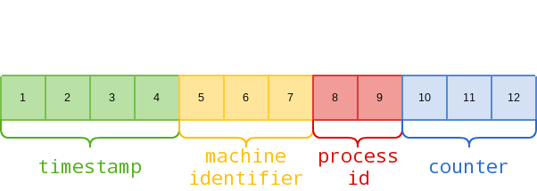

# 27017,27018 - Pentesting MongoDB

{{#include ../banners/hacktricks-training.md}}

## Thông tin cơ bản

**MongoDB** là một cơ sở dữ liệu hướng tài liệu mã nguồn mở. Một listener `mongod` hoặc `mongos` thông thường mặc định sử dụng TCP **27017**, máy chủ shard mặc định sử dụng **27018**, còn máy chủ cấu hình mặc định sử dụng **27019**.<sup>[[7]](#references)</sup>

```
PORT      STATE SERVICE VERSION
27017/tcp open  mongodb MongoDB 2.6.9 2.6.9
```

## Liệt kê

### Thủ công

```python
from pymongo import MongoClient
client = MongoClient(host, port, username=username, password=password)
client.server_info() #Basic info
#If you have admin access you can obtain more info
admin = client.admin
admin_info = admin.command("serverStatus")
cursor = client.list_databases()
for db in cursor:
    print(db)
    print(client[db["name"]].list_collection_names())
#If admin access, you could dump the database also
```

**Một số lệnh MongoDB:**

```bash
show dbs
use <db>
show collections
db.<collection>.find()  #Dump the collection
db.<collection>.count() #Number of records of the collection
db.current.find({"username":"admin"})  #Find in current db the username admin
```

### Tự động

```bash
nmap -sV --script "mongo* and default" -p 27017 <IP> #By default all the nmap mongo enumerate scripts are used
```

### Shodan

- All mongodb: `"mongodb server information"`
- Search for full open mongodb servers: `"mongodb server information" -"partially enabled"`
- Only partially enable auth: `"mongodb server information" "partially enabled"`

## Đăng nhập

MongoDB tự quản lý mặc định có `security.authorization: disabled`, nhưng cũng chỉ bind vào localhost. Vì vậy, listener có thể truy cập từ bên ngoài mà không có authorization là một cấu hình nguy hiểm, không phải mặc định an toàn khi kết nối Internet.<sup>[[7]](#references)</sup> Cơ sở dữ liệu `admin` thường được dùng làm cơ sở dữ liệu xác thực cho người dùng quản trị.

Một shell cục bộ vẫn có thể kết nối đến listener MongoDB chỉ bind loopback. Nếu authorization hiệu lực đang bị tắt, hãy chỉ kiểm tra thủ công các bản ghi ứng dụng trong phạm vi được phép và không đưa bất kỳ giá trị thông tin xác thực nào vào đầu ra liệt kê được chia sẻ. Mật khẩu cơ sở dữ liệu hoặc bản ghi ứng dụng dạng văn bản thuần chỉ trở thành một con đường privilege-escalation trên Unix nếu thông tin đó xác thực được một tài khoản cục bộ khác hoặc vượt qua lời nhắc sudo của tài khoản đó, đồng thời chính sách sudo hiệu lực cấp quyền chạy lệnh có đặc quyền cao hơn. Hãy xác minh riêng từng điều kiện; sự hiện diện của listener, các giá trị mặc định trong cấu hình và tên người dùng ứng dụng không chứng minh được việc dùng lại mật khẩu hoặc quyền truy cập sudo.

```bash
mongo <HOST>
mongo <HOST>:<PORT>
mongo <HOST>:<PORT>/<DB>
mongo <database> -u <username> -p '<password>'
```

Script nmap: _**mongodb-brute**_ sẽ kiểm tra xem có cần thông tin xác thực hay không.

```bash
nmap -n -sV --script mongodb-brute -p 27017 <ip>
```

### [**Brute force**](../generic-hacking/brute-force.md#mongo)

Kiểm tra _/opt/bitnami/mongodb/mongodb.conf_ để biết có cần thông tin đăng nhập hay không:

```bash
grep "noauth.*true" /opt/bitnami/mongodb/mongodb.conf | grep -v "^#" #Not needed
grep "auth.*true" /opt/bitnami/mongodb/mongodb.conf | grep -v "^#\|noauth" #Not needed
```

## Dự đoán Mongo Objectid

Ví dụ [tại đây](https://techkranti.com/idor-through-mongodb-object-ids-prediction/).<sup>[[1]](#references)</sup>

MongoDB ObjectIds là **giá trị 12 byte**, thường được biểu diễn dưới dạng 24 ký tự thập lục phân:<sup>[[8]](#references)</sup>



Ví dụ, đây là cách phân tích một Object ID thực tế do ứng dụng trả về: 5f2459ac9fa6dc2500314019

1. `5f2459ac`: dấu thời gian Unix 4 byte (`1596217772`, thứ Sáu, ngày 31 tháng 7 năm 2020 17:49:32 UTC)
2. `9fa6dc2500`: giá trị ngẫu nhiên 5 byte được tạo một lần cho mỗi tiến trình phía client
3. `314019`: bộ đếm 3 byte được khởi tạo bằng một giá trị ngẫu nhiên

Các định dạng ObjectId cũ để lộ riêng mã định danh máy và tiến trình; đặc tả hiện tại thay thế các trường đó bằng một giá trị ngẫu nhiên cho mỗi tiến trình. Dấu thời gian thay đổi mỗi giây và bộ đếm tăng dần trong một tiến trình, vì vậy các ID được quan sát từ cùng một bộ tạo trong khoảng thời gian ngắn vẫn có thể dự đoán được một phần. Điều này không đúng trong mọi trường hợp: driver tạo ObjectId ở phía client, các tiến trình khác nhau dùng những giá trị ngẫu nhiên khác nhau, và ứng dụng có thể chọn các giá trị `_id` không liên quan.<sup>[[1]](#references)[[8]](#references)</sup>

Với một ObjectId đã quan sát được, `mongo-objectid-predict` tạo các ứng viên gần đó để kiểm thử phân quyền.<sup>[[9]](#references)</sup> Hãy xem đây là một bài kiểm thử IDOR có mục tiêu, không phải công cụ phá mọi ObjectId: cách này hiệu quả nhất khi các ID mục tiêu có chung dấu thời gian, thành phần ngẫu nhiên của tiến trình và các giá trị bộ đếm liền kề.

Lệnh ở upstream cung cấp `--counter-diff` (số lượng giá trị bộ đếm liền kề cần kiểm tra), `--per-counter` (số lượng độ lệch dấu thời gian cần thử cho mỗi bộ đếm) và `--backward` (tạo các ứng viên trước đó thay vì sau đó). Giá trị mặc định của hai tham số đầu là `20` và `60`, tạo ra khoảng một nghìn ứng viên; chỉ tăng chúng sau khi xác nhận một mẫu nhỏ hơn, được phép, có chung thành phần bộ tạo.<sup>[[9]](#references)</sup>

```bash
./mongo-objectid-predict 5ae9b90a2c144b9def01ec37
./mongo-objectid-predict 5ae9b90a2c144b9def01ec37 --counter-diff 50 --per-counter 120
./mongo-objectid-predict 5ae9b90a2c144b9def01ec37 --backward
```

Kho lưu trữ hiện chứa mã từ thời Python 2 và mô tả thuật ngữ machine-ID/process-ID cũ. Hãy rà soát hoặc chuyển đổi mã trước khi sử dụng, và đừng nhầm các candidate được tạo ra với bằng chứng rằng tài nguyên tồn tại hoặc bạn được phép truy cập.

## Hậu khai thác

Khi có quyền root hợp lệ trên máy chủ tự quản lý, bạn có thể kiểm tra cấu hình thực tế và, trong một lab phục hồi tạm thời, khởi chạy một instance chỉ lắng nghe cục bộ với authorization bị tắt. Cấu hình YAML hiện tại dùng `security.authorization: disabled`; các ví dụ `noauth = true` kiểu cũ áp dụng cho định dạng cấu hình cũ. Không để listener phục hồi này lộ ra ngoài loopback.<sup>[[7]](#references)</sup>

## Rò rỉ bộ nhớ MongoBleed qua zlib (CVE-2025-14847)

Một lỗ hổng rò rỉ bộ nhớ diện rộng, không cần xác thực ("MongoBleed"), ảnh hưởng đến MongoDB 3.6–8.2 khi **bật bộ nén mạng zlib**. Header `OP_COMPRESSED` tin vào giá trị `uncompressedSize` do attacker cung cấp, khiến máy chủ cấp phát buffer có kích thước đó rồi sao chép buffer vào response, dù payload nén được gửi lên nhỏ hơn nhiều. Các byte thừa là **dữ liệu heap chưa khởi tạo** từ những kết nối khác, `/proc` hoặc cache WiredTiger. Sau đó, attacker bỏ qua **ký tự kết thúc BSON `\x00`** dự kiến, khiến parser của MongoDB tiếp tục quét buffer có kích thước lớn cho đến khi tìm thấy ký tự kết thúc; response lỗi sẽ phản hồi cả document độc hại lẫn các byte heap đã quét **trước khi xác thực**, qua TCP/27017.<sup>[[2]](#references)</sup>

### Điều kiện phơi nhiễm & kiểm tra nhanh

- Phiên bản máy chủ phải nằm trong các dải bị ảnh hưởng (3.6, 4.0, 4.2, 4.4.0–4.4.29, 5.0.0–5.0.31, 6.0.0–6.0.26, 7.0.0–7.0.27, 8.0.0–8.0.16, 8.2.0–8.2.2).<sup>[[6]](#references)</sup>
- `net.compression.compressors` hoặc `networkMessageCompressors` phải bao gồm `zlib` (mặc định trên nhiều bản build). Kiểm tra trong shell bằng lệnh:

```javascript
db.adminCommand({getParameter: 1, networkMessageCompressors: 1})
```

- Kẻ tấn công chỉ cần có quyền truy cập mạng đến cổng MongoDB. Không cần xác thực.<sup>[[3]](#references)[[4]](#references)</sup>

### Quy trình khai thác & thu thập dữ liệu

1. Bắt đầu wire-protocol handshake và khai báo `compressors:["zlib"]` để phiên làm việc sử dụng zlib.
2. Gửi các frame `OP_COMPRESSED` có `uncompressedSize` được khai báo lớn hơn nhiều so với payload thực tế sau khi giải nén, nhằm buộc cấp phát heap quá cỡ chứa đầy dữ liệu cũ.
3. Tạo BSON nhúng **không có `\x00` cuối cùng** để parser đọc vượt qua dữ liệu do kẻ tấn công kiểm soát và đi vào bộ đệm quá cỡ khi tìm ký tự kết thúc.
4. MongoDB trả về lỗi chứa thông điệp gốc cùng các byte heap mà nó đã quét qua, làm rò rỉ bộ nhớ. Lặp lại với các độ dài/offset khác nhau để tổng hợp thông tin nhạy cảm (thông tin xác thực/API key/token phiên), thống kê WiredTiger và các dữ liệu `/proc`.<sup>[[2]](#references)</sup>

PoC công khai tự động thăm dò các offset và trích xuất dữ liệu từ những đoạn được trả về:<sup>[[5]](#references)</sup>

```bash
python3 mongobleed.py --host <target> --max-offset 50000 --output leaks.bin
```

### Tín hiệu nhiễu phát hiện (kết nối tần suất cao)

Cuộc tấn công thường tạo ra nhiều yêu cầu tồn tại trong thời gian ngắn. Theo dõi các đợt tăng đột biến kết nối đến `mongod`/`mongod.exe`. Ví dụ truy vấn XQL săn tìm (>500 kết nối/phút trên mỗi IP từ xa, mặc định loại trừ các dải RFC1918/loopback/link-local/mcast/broadcast/reserved):<sup>[[2]](#references)</sup>

<details>
<summary>Kết nối Mongo tần suất cao bằng Cortex XQL</summary>

```sql
// High-velocity inbound connections to mongod/mongod.exe (possible MongoBleed probing)

dataset = xdr_data
| filter event_type = ENUM.NETWORK
| filter lowercase(actor_process_image_name) in ("mongod", "mongod.exe")
| filter action_network_is_server = true
| filter action_remote_ip not in (null, "")
| filter incidr(action_remote_ip, "10.0.0.0/8") != true and
        incidr(action_remote_ip, "192.168.0.0/16") != true and
        incidr(action_remote_ip, "172.16.0.0/12") != true and
        incidr(action_remote_ip, "127.0.0.0/8") != true and
        incidr(action_remote_ip, "169.254.0.0/16") != true and
        incidr(action_remote_ip, "224.0.0.0/4") != true and
        incidr(action_remote_ip, "255.255.255.255/32") != true and
        incidr(action_remote_ip, "198.18.0.0/15") != true
| filter action_network_session_duration <= 5000
| bin _time span = 1m
| comp count(_time) as Counter by agent_hostname, action_remote_ip, _time
| filter Counter >= 500
```

</details>


## References

- [1] [IDOR thông qua dự đoán MongoDB Object ID](https://techkranti.com/idor-through-mongodb-object-ids-prediction/)
- [2] [Unit 42 – Bản tin về mối đe dọa: Lỗ hổng MongoDB (CVE-2025-14847)](https://unit42.paloaltonetworks.com/mongobleed-cve-2025-14847/)
- [3] [Tenable – CVE-2025-14847 (MongoBleed): Lỗ hổng memory leak của MongoDB bị khai thác ngoài thực tế](https://www.tenable.com/blog/cve-2025-14847-mongobleed-mongodb-memory-leak-vulnerability-exploited-in-the-wild)
- [4] [Thông báo bảo mật MongoDB SERVER-115508](https://jira.mongodb.org/browse/SERVER-115508)
- [5] [PoC MongoBleed (joe-desimone/mongobleed)](https://github.com/joe-desimone/mongobleed)
- [6] [Censys – Thông báo MongoBleed](https://censys.com/advisory/cve-2025-14847)
- [7] [Tài liệu MongoDB - Các tùy chọn tệp cấu hình tự quản lý](https://www.mongodb.com/docs/manual/reference/configuration-options/)
- [8] [Tài liệu MongoDB - Kiểu BSON ObjectId](https://www.mongodb.com/docs/manual/reference/bson-types/#objectid)
- [9] [andresriancho/mongo-objectid-predict](https://github.com/andresriancho/mongo-objectid-predict)
---

{{#include ../banners/hacktricks-training.md}}
